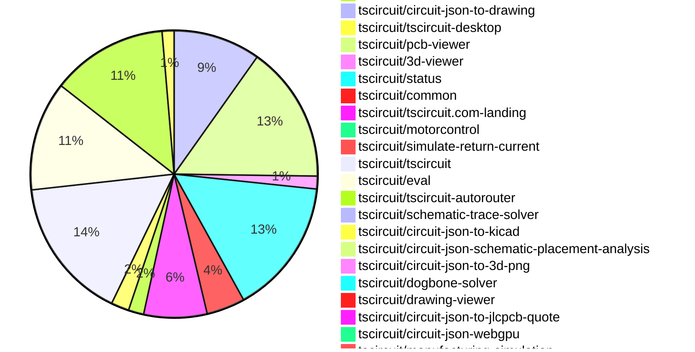

# contribution tracker

[contributions.tscircuit.com](https://contributions.tscircuit.com) ・ [tscircuit.com](https://tscircuit.com) ・ [Contribution Overviews](./contribution-overviews/) ・ [Changelogs](./changelogs/)

Generates weekly contribution overviews for tscircuit contributors. Check out all
the [contribution overviews here](./contribution-overviews/)
You can find AI-generated monthly changelogs in the [changelogs directory](./changelogs/)

- All PRs in the tscircuit org are scanned/summarized via an LLM
- The LLM classifies each Diff/PR as into a set of attributes for scoring
- All the PRs, summaries, and classifications are organized into charts and tables for [the website](https://contributions.tscircuit.com)

> Want to run locally? See the [Development Section](#development)

## Current Week

<!-- START_CURRENT_WEEK -->

# Contribution Overview 2026-11-10

The current week is shown below. There are 3 major sections:

- [Contributor Overview](#contributor-overview)
- [PRs by Repository](#prs-by-repository)
- [PRs by Contributor](#changes-by-contributor)
- [Scoring & Sponsorship Details](/docs/sponsorship-calculation-explanation.md)

## PRs by Repository



## Contributor Overview

| Contributor | 🐳 Major | 🐙 Minor | 🐌 Tiny | Score | ⭐ |
|-------------|---------|---------|---------|-------|-----|
| [ShiboSoftwareDev](#ShiboSoftwareDev) | 103 | 18 | 55 | 461 | 👑👑👑 |
| [seveibar](#seveibar) | 37 | 19 | 21 | 199 | 👑👑👑 |
| [Abse2001](#Abse2001) | 12 | 22 | 23 | 105 | 👑 |
| [imrishabh18](#imrishabh18) | 7 | 19 | 7 | 74 | ⭐⭐⭐ |
| [0hmX](#0hmX) | 11 | 5 | 4 | 59 | ⭐⭐⭐ |
| [MustafaMulla29](#MustafaMulla29) | 7 | 7 | 18 | 55 | ⭐⭐⭐ |
| [AnasSarkiz](#AnasSarkiz) | 6 | 5 | 7 | 42 | ⭐⭐ |
| [rushabhcodes](#rushabhcodes) | 3 | 9 | 5 | 35 | ⭐⭐ |
| [techmannih](#techmannih) | 3 | 2 | 3 | 19 | ⭐⭐ |
| [tscircuitbot](#tscircuitbot) | 0 | 0 | 749 | 15.5 | ⭐⭐ |
| [mohan-bee](#mohan-bee) | 1 | 0 | 3 | 7 | ⭐ |
| [GokulPandi-M](#GokulPandi-M) | 0 | 0 | 5 | 4.5 | ⭐ |
| [KrishnaX12](#KrishnaX12) | 0 | 0 | 1 | 1 |  |
| [anil08607](#anil08607) | 0 | 0 | 1 | 1 |  |
| [hrithik18k](#hrithik18k) | 0 | 0 | 1 | 1 |  |
| [abdalraof-albarbar](#abdalraof-albarbar) | 0 | 0 | 1 | 1 |  |

## Staff Pass Ratio (SPR)

| Contributor | Reviewed PRs | Rejections | Approvals | SPR |
|-------------|--------------|------------|-----------|-----|
| [ShiboSoftwareDev](#ShiboSoftwareDev) | 23 | 0 | 23 | 100.0% |
| [0hmX](#0hmX) | 15 | 2 | 15 | 86.7% |
| [Abse2001](#Abse2001) | 13 | 2 | 13 | 84.6% |
| [rushabhcodes](#rushabhcodes) | 8 | 3 | 8 | 62.5% |
| [MustafaMulla29](#MustafaMulla29) | 7 | 1 | 6 | 85.7% |
| [AnasSarkiz](#AnasSarkiz) | 4 | 1 | 3 | 75.0% |
| [imrishabh18](#imrishabh18) | 4 | 0 | 4 | 100.0% |
| [techmannih](#techmannih) | 4 | 0 | 5 | 100.0% |
| [Asymtode712](#Asymtode712) | 1 | 1 | 0 | 0.0% |
| [mohan-bee](#mohan-bee) | 1 | 0 | 1 | 100.0% |
| [mukesh-dev-git](#mukesh-dev-git) | 1 | 1 | 0 | 0.0% |

<details>
<summary>ShiboSoftwareDev SPR PRs (23)</summary>

- [#5524](https://github.com/tscircuit/core/pull/5524) Honor explicit fanout layers and staggered edge capacity
- [#5523](https://github.com/tscircuit/core/pull/5523) Handle plated-hole passages in supplied bus routing copper
- [#75](https://github.com/tscircuit/circuit-json-to-spice/pull/75) fix: let custom SPICE subcircuits replace built-in components
- [#3873](https://github.com/tscircuit/tscircuit-autorouter/pull/3873) Preserve copper clearance during port redistribution
- [#3880](https://github.com/tscircuit/tscircuit-autorouter/pull/3880) Pin tiny-hypergraph final-routing recovery fix
- [#3868](https://github.com/tscircuit/tscircuit-autorouter/pull/3868) Reproduce iCE/Pi plane-via rejection after coordinate rounding
- [#3795](https://github.com/tscircuit/tscircuit-autorouter/pull/3795) fix: preserve regional repair progress across error priorities
- [#3796](https://github.com/tscircuit/tscircuit-autorouter/pull/3796) Fix through-via clearance across the physical board stack
- [#3783](https://github.com/tscircuit/tscircuit-autorouter/pull/3783) fix: pass the board via copper minimum to node repair
- [#3770](https://github.com/tscircuit/tscircuit-autorouter/pull/3770) fix: preserve preloaded vias at routing cell boundaries
- [#3765](https://github.com/tscircuit/tscircuit-autorouter/pull/3765) fix: honor explicit via clearance in regional repair guard
- [#3760](https://github.com/tscircuit/tscircuit-autorouter/pull/3760) fix: honor declared via clearance when validating projection
- [#3733](https://github.com/tscircuit/tscircuit-autorouter/pull/3733) fix: preserve validated gaps in stitch paths
- [#3671](https://github.com/tscircuit/tscircuit-autorouter/pull/3671) Avoid repeated mesh scans during DDR port spacing
- [#3667](https://github.com/tscircuit/tscircuit-autorouter/pull/3667) Use faster DDR length-matching obstacle checks
- [#3664](https://github.com/tscircuit/tscircuit-autorouter/pull/3664) Restore physically clear BGA via columns at the gap threshold
- [#3693](https://github.com/tscircuit/tscircuit-autorouter/pull/3693) repro: ButterStick bus wires ignore allowed layers
- [#3660](https://github.com/tscircuit/tscircuit-autorouter/pull/3660) fix: retain H616 DDR repairs during final contact restoration
- [#201](https://github.com/tscircuit/high-density-repair03/pull/201) fix: preserve independent repairs during contact restoration
- [#90](https://github.com/tscircuit/length-matching-solver/pull/90) Skip distant pads before DDR meander clearance checks
- [#207](https://github.com/tscircuit/bus-lanes-solver/pull/207) fix: price complete DDR escapes and prefer grid-centered vias
- [#198](https://github.com/tscircuit/bus-lanes-solver/pull/198) Avoid repeated pad-alias expansion during pending exit search
- [#28](https://github.com/tscircuit/tscircuit-desktop/pull/28) Generate chips from the chat composer

</details>

<details>
<summary>0hmX SPR PRs (15)</summary>

- [#1000](https://github.com/tscircuit/circuit-json/pull/1000) refactor!: align IBIS and eye records with channel simulation props
- [#999](https://github.com/tscircuit/circuit-json/pull/999) feat: add PCB transient channel simulation records (RFC #28)
- [#996](https://github.com/tscircuit/circuit-json/pull/996) fix: enforce ordered length-only differential pair buses
- [#5549](https://github.com/tscircuit/core/pull/5549) refactor: remove archived infgrid and soup-util dependencies (blocked migration)
- [#5382](https://github.com/tscircuit/core/pull/5382) feat: include per-connection compute cost in autorouting events
- [#5413](https://github.com/tscircuit/core/pull/5413) fix: emit the ordered path of every multi-port trace
- [#5412](https://github.com/tscircuit/core/pull/5412) test: reproduce trace path order not emitted or routed
- [#5415](https://github.com/tscircuit/core/pull/5415) test: cover three-pad differential path routing data flow
- [#5760](https://github.com/tscircuit/cli/pull/5760) feat: capture per-connection compute cost in autorouter diagnostics
- [#3710](https://github.com/tscircuit/tscircuit-autorouter/pull/3710) fix: pass ordered differential lane hops to length matching
- [#3709](https://github.com/tscircuit/tscircuit-autorouter/pull/3709) fix: length-match ordered differential pair lanes
- [#3651](https://github.com/tscircuit/tscircuit-autorouter/pull/3651) Add a per-connection compute cost summary to the pipeline 9 solver
- [#3708](https://github.com/tscircuit/tscircuit-autorouter/pull/3708) fix: route connection path points in order
- [#1441](https://github.com/tscircuit/schematic-trace-solver/pull/1441) feat: opt into interior-channel recovery for wire-only consumers
- [#315](https://github.com/tscircuit/tiny-hypergraph/pull/315) Report each connection's solo search iterations from DuplicateCongestedPortSolver

</details>

<details>
<summary>Abse2001 SPR PRs (13)</summary>

- [#1011](https://github.com/tscircuit/props/pull/1011) Add defaultSolderPasteMargin to board props
- [#5500](https://github.com/tscircuit/core/pull/5500) Apply board defaultSolderPasteMargin to its SMT pads (#4800)
- [#5217](https://github.com/tscircuit/core/pull/5217) feat: V-score panel tabs with vScore (#5067)
- [#5214](https://github.com/tscircuit/core/pull/5214) feat: implement finished panel size limits (#5067)
- [#5211](https://github.com/tscircuit/core/pull/5211) feat: implement tooling rail elements (#5067)
- [#5208](https://github.com/tscircuit/core/pull/5208) feat: implement panel tab child elements (#5067)
- [#5205](https://github.com/tscircuit/core/pull/5205) feat: implement panel silkscreen (#5067)
- [#5202](https://github.com/tscircuit/core/pull/5202) feat: implement panel tooling holes and fiducials (#5067)
- [#256](https://github.com/tscircuit/circuit-json-to-gerber/pull/256) Skip soldermask for inner-layer copper pours (#127)
- [#246](https://github.com/tscircuit/circuit-json-to-gerber/pull/246) Merge cutouts that are flush with the board edge into the board outline
- [#632](https://github.com/tscircuit/jlcsearch/pull/632) Expose JLCPCB's Standard-only mark on verified parts
- [#5805](https://github.com/tscircuit/cli/pull/5805) feat: `tsci add-provider`/`remove-provider circuithub` and `tsci quote create --circuithub`
- [#5771](https://github.com/tscircuit/cli/pull/5771) Implement tsci quote estimate with the JLCPCB quote estimator

</details>

<details>
<summary>rushabhcodes SPR PRs (8)</summary>

- [#1002](https://github.com/tscircuit/circuit-json/pull/1002) feat: preserve nominal board trace width in Circuit JSON
- [#5400](https://github.com/tscircuit/core/pull/5400) fix: preserve authored pad layers in mixed-side footprints
- [#5375](https://github.com/tscircuit/core/pull/5375) [2/2] Preserve unbroken inner copper planes in remote autorouting
- [#5404](https://github.com/tscircuit/core/pull/5404) fix: preserve plated-slot rotation on flipped footprints
- [#5402](https://github.com/tscircuit/core/pull/5402) fix: render pcbtrace coordinate routes
- [#5962](https://github.com/tscircuit/tscircuit.com/pull/5962) Add the Drawing tab to package previews
- [#108](https://github.com/tscircuit/circuit-json-webgpu/pull/108) Show Classic F1 ground traces when copper pours are hidden
- [#12](https://github.com/tscircuit/drawing-viewer/pull/12) Render assembly stages and exploded views in Drawing Viewer

</details>

<details>
<summary>MustafaMulla29 SPR PRs (7)</summary>

- [#5614](https://github.com/tscircuit/core/pull/5614) fix: round-trip saved routes with junctions and shared pads
- [#5426](https://github.com/tscircuit/core/pull/5426) fix: preserve copper-plane connectivity at breakout endpoints
- [#5438](https://github.com/tscircuit/core/pull/5438) fix: keep board plane reservations independent of child groups
- [#580](https://github.com/tscircuit/checks/pull/580) Report schematic box width and pin-padding warnings
- [#3748](https://github.com/tscircuit/tscircuit-autorouter/pull/3748) fix: reuse existing vias for planned copper-plane access
- [#464](https://github.com/tscircuit/circuit-json-schematic-placement-analysis/pull/464) fix: only report inverted rails between positive supply and ground
- [#268](https://github.com/tscircuit/fanout-solver/pull/268) fix: generate exact-angle dogbone sites for imported pad grids

</details>

<details>
<summary>AnasSarkiz SPR PRs (4)</summary>

- [#540](https://github.com/tscircuit/checks/pull/540) fix: recognize explicit pin role attributes as specified
- [#5780](https://github.com/tscircuit/cli/pull/5780) fix: warn when imports omit an explicit 3D model
- [#3877](https://github.com/tscircuit/tscircuit-autorouter/pull/3877) Search regional repairs at the board's declared trace clearance
- [#15](https://github.com/tscircuit/tscircuit-desktop/pull/15) feat(circuit): stack two Circuit views vertically

</details>

<details>
<summary>imrishabh18 SPR PRs (4)</summary>

- [#646](https://github.com/tscircuit/jlcsearch/pull/646) Keep stock cleanup scans small and resume them between runs
- [#635](https://github.com/tscircuit/jlcsearch/pull/635) Fix JSON output after D1 stock-sync retries
- [#638](https://github.com/tscircuit/jlcsearch/pull/638) Add a safe search-index-only rebuild action
- [#7](https://github.com/tscircuit/manufacturing-simulation/pull/7) Simulate the Amazon partnered carrier label at Ship-ready

</details>

<details>
<summary>techmannih SPR PRs (4)</summary>

- [#5343](https://github.com/tscircuit/core/pull/5343) Fix named-net routing via a phase-selected pin
- [#5341](https://github.com/tscircuit/core/pull/5341) Fix plated-hole solder paste ownership
- [#557](https://github.com/tscircuit/checks/pull/557) Use the board via-to-pad clearance for routing DRC
- [#5750](https://github.com/tscircuit/cli/pull/5750) Fix autorouter worker count in tsci build

</details>

<details>
<summary>Asymtode712 SPR PRs (1)</summary>

- [#30](https://github.com/tscircuit/tscircuit-desktop/pull/30) feat(order): export STEP and GLB from the Order tab

</details>

<details>
<summary>mohan-bee SPR PRs (1)</summary>

- [#75](https://github.com/tscircuit/power-trace-expander/pull/75) Straighten doglegs in narrow power traces

</details>

<details>
<summary>mukesh-dev-git SPR PRs (1)</summary>

- [#5544](https://github.com/tscircuit/core/pull/5544) fix: support pinLabels on mosfet to match physical package pins

</details>

> Note: AI evaluates PRs and assigns 1-3 star ratings automatically. 4 and 5 star ratings require manual staff review.

## Review Table

[reviews-received-hover]: ## "Number of reviews received for PRs for this contributor"
[approvals-received-hover]: ## "Number of approvals received for PRs this contributor authored"
[rejections-received-hover]: ## "Number of rejections received for PRs this contributor authored"
[prs-opened-hover]: ## "Number of PRs opened by this contributor"
[issues-created-hover]: ## "Number of issues created by this contributor"

| Contributor | Reviews Received | Approvals Received | Rejections Received | Approvals | Rejections Given | PRs Opened | PRs Merged | Issues Created |
|---|---|---|---|---|---|---|---|---|
| [0hmX](#0hmX) | 67 | 17 | 2 | 40 | 0 | 78 | 22 | 0 |
| [1932819331hy-debug](#1932819331hy-debug) | 0 | 0 | 0 | 0 | 0 | 35 | 0 | 0 |
| [abdalraof-albarbar](#abdalraof-albarbar) | 0 | 0 | 0 | 0 | 0 | 3 | 1 | 0 |
| [Abse2001](#Abse2001) | 18 | 17 | 0 | 14 | 0 | 82 | 57 | 0 |
| [ameenalqershi](#ameenalqershi) | 0 | 0 | 0 | 0 | 0 | 9 | 0 | 0 |
| [AnasSarkiz](#AnasSarkiz) | 14 | 13 | 1 | 2 | 0 | 35 | 18 | 0 |
| [Andresdev14](#Andresdev14) | 0 | 0 | 0 | 0 | 0 | 11 | 0 | 0 |
| [anil08607](#anil08607) | 0 | 0 | 0 | 0 | 0 | 1 | 1 | 0 |
| [aswadi](#aswadi) | 0 | 0 | 0 | 0 | 0 | 204 | 0 | 0 |
| [Asymtode712](#Asymtode712) | 1 | 0 | 1 | 0 | 0 | 3 | 0 | 0 |
| [BHAWESHBHASKAR](#BHAWESHBHASKAR) | 0 | 0 | 0 | 0 | 0 | 2 | 0 | 0 |
| [Burapa-J](#Burapa-J) | 0 | 0 | 0 | 0 | 0 | 8 | 0 | 0 |
| [cocvn157](#cocvn157) | 0 | 0 | 0 | 0 | 0 | 28 | 0 | 0 |
| [contactmelvinlevard](#contactmelvinlevard) | 0 | 0 | 0 | 0 | 0 | 2 | 0 | 0 |
| [CrowAleksito](#CrowAleksito) | 0 | 0 | 0 | 0 | 0 | 1 | 0 | 0 |
| [deep-bhikadiya](#deep-bhikadiya) | 0 | 0 | 0 | 0 | 0 | 1 | 0 | 0 |
| [Devesh36](#Devesh36) | 1 | 0 | 0 | 0 | 0 | 6 | 0 | 0 |
| [ghost](#ghost) | 0 | 0 | 0 | 0 | 0 | 1 | 0 | 0 |
| [GokulPandi-M](#GokulPandi-M) | 7 | 5 | 1 | 0 | 0 | 9 | 5 | 0 |
| [hrithik18k](#hrithik18k) | 0 | 0 | 0 | 0 | 0 | 1 | 1 | 0 |
| [imrishabh18](#imrishabh18) | 10 | 7 | 0 | 16 | 4 | 46 | 33 | 0 |
| [imyelo](#imyelo) | 3 | 0 | 0 | 0 | 0 | 4 | 0 | 0 |
| [jeffrey-graham](#jeffrey-graham) | 0 | 0 | 0 | 0 | 0 | 2 | 0 | 0 |
| [KrishnaX12](#KrishnaX12) | 1 | 1 | 0 | 0 | 0 | 2 | 1 | 0 |
| [LBCron](#LBCron) | 0 | 0 | 0 | 0 | 0 | 14 | 0 | 0 |
| [mohan-bee](#mohan-bee) | 5 | 3 | 0 | 0 | 0 | 21 | 4 | 0 |
| [mukesh-dev-git](#mukesh-dev-git) | 1 | 0 | 1 | 0 | 0 | 1 | 0 | 0 |
| [MustafaMulla29](#MustafaMulla29) | 20 | 17 | 1 | 4 | 2 | 48 | 37 | 0 |
| [nitina-ariveguru](#nitina-ariveguru) | 0 | 0 | 0 | 0 | 0 | 1 | 0 | 0 |
| [nolanntibi-dot](#nolanntibi-dot) | 0 | 0 | 0 | 0 | 0 | 4 | 0 | 0 |
| [OLuHneschastniy](#OLuHneschastniy) | 0 | 0 | 0 | 0 | 0 | 6 | 0 | 0 |
| [peteking](#peteking) | 0 | 0 | 0 | 0 | 0 | 2 | 0 | 0 |
| [rafagil11](#rafagil11) | 0 | 0 | 0 | 0 | 0 | 2 | 0 | 0 |
| [rushabhcodes](#rushabhcodes) | 29 | 11 | 4 | 0 | 0 | 57 | 18 | 0 |
| [sainath998](#sainath998) | 0 | 0 | 0 | 0 | 0 | 1 | 0 | 0 |
| [satoshinakamoto666666](#satoshinakamoto666666) | 0 | 0 | 0 | 0 | 0 | 1 | 0 | 0 |
| [seveibar](#seveibar) | 18 | 1 | 0 | 84 | 6 | 99 | 80 | 0 |
| [ShiboSoftwareDev](#ShiboSoftwareDev) | 76 | 76 | 0 | 15 | 0 | 265 | 183 | 0 |
| [singhaditya21](#singhaditya21) | 0 | 0 | 0 | 0 | 0 | 9 | 0 | 0 |
| [sumitrevolt](#sumitrevolt) | 0 | 0 | 0 | 0 | 0 | 7 | 0 | 0 |
| [techmannih](#techmannih) | 23 | 7 | 1 | 0 | 0 | 30 | 8 | 0 |
| [tirumallaharish0200](#tirumallaharish0200) | 0 | 0 | 0 | 0 | 0 | 1 | 0 | 0 |
| [trixie010](#trixie010) | 0 | 0 | 0 | 0 | 0 | 4 | 0 | 0 |
| [tscircuitbot](#tscircuitbot) | 0 | 0 | 0 | 0 | 0 | 879 | 749 | 0 |
| [tungnguyen84](#tungnguyen84) | 0 | 0 | 0 | 0 | 0 | 2 | 0 | 0 |
| [ulixes](#ulixes) | 0 | 0 | 0 | 0 | 0 | 4 | 0 | 0 |
| [Umutplvn](#Umutplvn) | 0 | 0 | 0 | 0 | 0 | 1 | 0 | 0 |
| [VB-Blue](#VB-Blue) | 0 | 0 | 0 | 0 | 0 | 10 | 0 | 0 |
| [voropaevv](#voropaevv) | 0 | 0 | 0 | 0 | 0 | 3 | 0 | 0 |
| [xtruel](#xtruel) | 0 | 0 | 0 | 0 | 0 | 13 | 0 | 0 |
| [yan0lovesha](#yan0lovesha) | 0 | 0 | 0 | 0 | 0 | 4 | 0 | 0 |

## Changes by Repository

### [tscircuit/schematic-viewer](https://github.com/tscircuit/schematic-viewer)

| PR # | Impact | Rating | Contributor | Description |
|------|--------|--------|-------------|-------------|
| [#317](https://github.com/tscircuit/schematic-viewer/pull/317) | 🐳 Major | ⭐⭐⭐ | seveibar | Clicking a chip in the schematic viewer now adds a description row to the component details popup, between manufacturer_part_number and the supplier rows. |
| [#312](https://github.com/tscircuit/schematic-viewer/pull/312) | 🐙 Minor | ⭐⭐ | seveibar | Adds two props to SchematicViewer to outline rendered schematic components and texts with a dashed blue outline based on provided IDs. |

### [tscircuit/circuit-json](https://github.com/tscircuit/circuit-json)

| PR # | Impact | Rating | Contributor | Description |
|------|--------|--------|-------------|-------------|
| [#1003](https://github.com/tscircuit/circuit-json/pull/1003) | 🐳 Major | ⭐⭐⭐ | seveibar | Adds assembly-stage drawings with a dedicated drawing_explosion_view record, allowing for independent explosion views with configurable moves, factors, and trails. |
| [#1004](https://github.com/tscircuit/circuit-json/pull/1004) | 🐳 Major | ⭐⭐⭐ | seveibar | Add optional schematic_group.show_boundary, schematic_port.schematic_group_id, and schematic_port.boundary_position to define expanded subcircuit boundaries and public terminal geometry. |
| [#1000](https://github.com/tscircuit/circuit-json/pull/1000) | 🐳 Major | ⭐⭐⭐ | 0hmX | Aligns IBIS and eye records with channel simulation properties by updating and removing obsolete records, impacting consumers who must adapt to the changes. |
| [#999](https://github.com/tscircuit/circuit-json/pull/999) | 🐳 Major | ⭐⭐⭐ | 0hmX | Adds circuit-json records for PCB transient channel simulation, including driverreceiver channels and waveform results. |
| [#1002](https://github.com/tscircuit/circuit-json/pull/1002) | 🐙 Minor | ⭐⭐ | rushabhcodes | Adds the optional pcb_board.default_nominal_trace_width field to the canonical schema to store the boards preferred routing width for connections without an explicit width, addressing issues with SRJ conversion. |

<details>
<summary>🐌 Tiny Contributions (4)</summary>

| PR # | Impact | Contributor | Description |
|------|--------|-------------|-------------|
| [#1016](https://github.com/tscircuit/circuit-json/pull/1016) | 🐌 Tiny | tscircuitbot | Automated package update |
| [#1009](https://github.com/tscircuit/circuit-json/pull/1009) | 🐌 Tiny | tscircuitbot | Automated package update |
| [#1007](https://github.com/tscircuit/circuit-json/pull/1007) | 🐌 Tiny | tscircuitbot | Automated package update |
| [#1005](https://github.com/tscircuit/circuit-json/pull/1005) | 🐌 Tiny | tscircuitbot | Automated package update |

</details>

### [tscircuit/props](https://github.com/tscircuit/props)

| PR # | Impact | Rating | Contributor | Description |
|------|--------|--------|-------------|-------------|
| [#1010](https://github.com/tscircuit/props/pull/1010) | 🐳 Major | ⭐⭐⭐ | seveibar | Refactors the drawing explosion view to inherit moves from assembly explosion stages, removing the need for inline moves and standalone drawing explosions. |
| [#1009](https://github.com/tscircuit/props/pull/1009) | 🐳 Major | ⭐⭐⭐ | seveibar | Adds assembly drawing capabilities with explosion views and reusable stage definitions, enhancing the drawing functionality for parts and assemblies. |
| [#1024](https://github.com/tscircuit/props/pull/1024) | 🐙 Minor | ⭐⭐ | 0hmX | Adds simulation.eyediagram linked to a transient channel simulation, allowing for the visualization of driven channels in a PCB transient channel simulation. |
| [#1011](https://github.com/tscircuit/props/pull/1011) | 🐙 Minor | ⭐⭐ | Abse2001 | Adds defaultSolderPasteMargin to board for setting a uniform solder paste margin across all pads on the board, allowing for more consistent solder paste application without altering individual pad settings. |

<details>
<summary>🐌 Tiny Contributions (6)</summary>

| PR # | Impact | Contributor | Description |
|------|--------|-------------|-------------|
| [#1006](https://github.com/tscircuit/props/pull/1006) | 🐌 Tiny | 0hmX | Removes superseded SI properties and suggestions for the pcb_spice engine, including the removal of tests and documentation for these elements. |
| [#1005](https://github.com/tscircuit/props/pull/1005) | 🐌 Tiny | 0hmX | Stack: circuit-json999(https:github.comtscircuitcircuit-jsonpull999)  props1005(https:github.comtscircuitpropspull1005)  core5423(https:github.comtscircuitcorepull5423) (this PR is 2 of 3) Additions only, split out of 995. The removals are in the stacked PR on top of this one. Adds the authoring props from RFC 28(https:github.comtscircuitrfcpull28): simulation.pcbtransientchannelsimulation: PcbTransientChannelSimulationProps  pcbTransientChannelSimulationProps. simulation.pcbdriverreceiverchannel: PcbDriverReceiverChannelProps  pcbDriverReceiverChannelProps. It takes driverRef  receiverRef selectors, including multi-drop arrays and differential per-leg IBIS overrides. libcommonsignal-integrity.ts: bit-rate and timeUI parsing. Times become seconds; UI offsets and durations stay normalized strings (0.5UI) for core to resolve at the bit rate. Generated README, COMPONENT_TYPES and PROPS_OVERVIEW sections for the new props; the README documents simulation.pcbtransientchannelsimulation  and simulation.pcbdriverreceiverchannel  with matching anchors, and both validators are exposed through simulationProps. No existing code changes: everything existing stays as it is, including ibismodel, analogeyediagram and the pcb_spice suggestion. Unit strings are parsed by suffix lookup, without a regex. Verified locally: tsc --noEmit passes, bun test 779 pass  0 fail (existing tests; this PR adds none), and biome format is clean on the touched files.  Example This follows the current tscircuitsignal-integrity-pipeline usage on featsi-25d-pipeline: explicit routed pcbPath plus a simulation block and channel. Inside a board with a stackup, generic .TX  .RX chips and their simulation.ibismodel declarations: tsx import  simulation  from tscircuitcore  trace from.TX  .IO to.RX  .IO width0.2 pcbPath.TX  .IO, .RX  .IO  simulation.pcbtransientchannelsimulation nameLINK bitRate50Mbps duration40e-9 simulation.pcbdriverreceiverchannel nameDATA driverRef pin: .TX  .IO, model: GENERIC_OUT  receiverRef pin: .RX  .IO, model: GENERIC_IN  pattern01  simulation.pcbtransientchannelsimulation   GENERIC_OUT and GENERIC_IN are synthetic model names. The endpoint form  pin, model  selects a model for this test; a plain selector also works. SignalEndpoint also accepts  p, n  or  pin:  p, n , model: string   p, n  . An array in receiverRef means multiple receivers. Key inputs from pcbTransientChannelSimulationProps and pcbDriverReceiverChannelProps:  Element  prop  Input type  Meaning   ---  ---  ---   block name  string, optional  Run name; core requires it when the board has multiple blocks.   block bitRate  string  number  Required default rate; numbers are bits, e.g. 50Mbps  50000000.   block duration  string  number, optional  Positive seconds or UI; 40e-9 is 40 ns. Omitted stays absent for downstream selection.   block allowUnroutedTraces  boolean, optional  Defaults to false; true permits ideal unrouted connections.   channel name  string  Required nonempty signal name, unique within its block.   channel driverRef  receiverRef  SignalEndpoint  SignalEndpoint  SignalEndpoint  Required driving endpoint and one or more receiving endpoints.   channel bitRate  string  number, optional  Overrides the blocks rate.   channel pattern  string, optional  Nonempty; defaults to prbs7. The example repeats literal bits 01.   channel seed  number, optional  Positive integer; PRBS71531 seeds must fit 1..2n-1. Core resolves omitted PRBS seeds.   channel offset  string  number, optional  Nonnegative seconds or UI; defaults to 0UI. UI stays a normalized string until core knows the signal rate.   channel driverDisabled  boolean, optional  Defaults to false; true requests high impedance and requires a disable-capable driver model.  The downstream consumer is tscircuitsignal-integrity-pipeline. This example uses the current pipeline authoring style and the schemas in this diff.  Generated with Claude Code(https:claude.comclaude-code) |
| [#1022](https://github.com/tscircuit/props/pull/1022) | 🐌 Tiny | 0hmX | Adds pinLabels to mosfetProps, allowing users to specify physical package pins mapped to terminal names for MOSFET components. |
| [#1004](https://github.com/tscircuit/props/pull/1004) | 🐌 Tiny | 0hmX | Documents that trace paths should always be ordered, clarifying that the trace is routed as a chain from the first port to the last. |
| [#999](https://github.com/tscircuit/props/pull/999) | 🐌 Tiny | Abse2001 | Changes the paneltab component to use center offsets from board edges instead of a single offset, introducing new properties for better tab placement and width specification. |
| [#1000](https://github.com/tscircuit/props/pull/1000) | 🐌 Tiny | Abse2001 | Updates documentation to clarify that panel size limits now shape the grid layout, allowing auto-sized panels to grow and grids to rearrange based on specified limits. |

</details>

### [tscircuit/core](https://github.com/tscircuit/core)

| PR # | Impact | Rating | Contributor | Description |
|------|--------|--------|-------------|-------------|
| [#5497](https://github.com/tscircuit/core/pull/5497) | 🐳 Major | ⭐⭐⭐ | seveibar | Connects the merged drawing propsschema to core: assembly.drawing.explosionview stageReflift-cover now emits an exploded drawing from the referenced assembly.explosion.stage and its assembly.explosion.move children. Authors do not supply a drawing moves prop. Core reuses existing ordered explosion evaluation through the selected stage, including preceding moves, overlapping parentchild targets and mounted owner frames. It emits one final CAD-world translation per source component, preserving assembled geometry. Each view has independent factorshowTrails; factor 0 restores assembled placement. Qualified references select nested stages. Also registers drawing membership stages, part labels and pageview notes. Assembled views can select reusable stages, including PCB substrates and fitted components. Labels follow their targets, notes support per-axis view offsets, and page anchors use anchorAlignment. References are validated before committing a page; dimensions are computed from the displayed pose, including factor and section cuts. Labeled legacy board views get explicit membership for the identity-preserving renderer path. Uses published props 0.0.731, Circuit JSON 0.0.550 and drawing renderer 0.0.6. The snapshot adapter converts the existing glTF export frame to the renderers canonical CAD-to-scene frame; native dimensions use the paired camera transform. Validation: 139 assemblynamespaced tests pass across the suite and focused runs, including 24 drawing tests; typecheck, build, built-package drawing smoke test, class-export check, dependency check and formatting pass. Six new committed SVG snapshots cover inherited cumulative moves, independent view factors, rotated owner frames, displayed-pose section dimensions, PCB membership, labelspage anchors and invalid references. Existing drawing snapshots are unchanged. !Inherited moves, independent drawing factors(https:raw.githubusercontent.comtscircuitcorefeatassembly-drawing-explosion-viewstestsassembly__snapshots__assembly-drawing-explosionview.snap.svg) !Qualified stages in mounted owner frames(https:raw.githubusercontent.comtscircuitcorefeatassembly-drawing-explosion-viewstestsassembly__snapshots__assembly-drawing-explosion-frames.snap.svg) Existing assembly playback restrictions remain: moving PCBcable geometry is unsupported, while stationary boards can be shown. Geometry loading for dimensions retains the existing native-model support boundary. Authoring and emission documentation(https:github.comtscircuitcoreblobfeatassembly-drawing-explosion-viewsdocsassembly-drawings.mdexplosion-views-and-assembly-stages). |
| [#5507](https://github.com/tscircuit/core/pull/5507) | 🐳 Major | ⭐⭐⭐ | seveibar | Problem System diagrams drew hooks, 12 mm S-bends and angular corners. Four causes: Every labelled wire was routed through a label slot Dagre picked before routing, so wires detoured to reach their own text. Port slots on facing blocks rarely lined up, which put a short jog into wires that should be straight. When two parallel wires turned together, the outer one was left angular. The slot-swap optimizer could move a port to the far side of its block to remove a crossing, wrapping the wire around the block.  Change Route each wire directly, then place its label on the finished wire: inline on a horizontal run, otherwise beside it. Only self-loops still reserve their label first. Slide an attachment along its block face, without passing a neighbor, when that straightens the wire. A port never starts on, or is swapped to, a face that looks away from the block it connects to. Wires that double back are penalized in the diagram score. The path search counts turns at the port stubs as bends, and stubs are a full 6 mm so the first fillet and the arrowhead have room. Rounding compares neighboring wires in their rounded form, so nested corners keep concentric fillets.  Results   Before  After  ---------  Flip-phone fixture (23 wires): bends  105  46   Flip-phone fixture: sharp or under 3 mm radius  62  1   250 random diagrams (1,917 wires): bends  8,705  3,320   250 random: sharp corners  566  4   250 random: fillets under 1.5 mm  2,849  27   250 random: crossing wire pairs  501  350   250 random: layout time  63 s  12 s  The random-diagram numbers come from a throwaway script that is not part of this PR.  Tests New system-blocks-flip-phone test and fixture, with an assertSystemWireSmoothness helper. It fails on the previous router. The existing no-crossing and 3 mm separation checks on both RVBoy pages pass unchanged. Two tests asserted that every wire contains a curve. Some wires are now straight, so they assert that every bend is a fillet instead. Nine existing snapshots are regenerated.  Known limits In tight downup diagrams a label can land beside the wrong wire. In the power-feedback snapshot, Feedback sits left of the dashed 3.3 V wire. Very dense graphs still produce long detours where the router avoids crossings. docssystem-blocks.md is edited only where this change made existing sentences false. |
| [#5559](https://github.com/tscircuit/core/pull/5559) | 🐳 Major | ⭐⭐⭐ | rushabhcodes | Store the boards authored defaultTraceWidth in pcb_board.default_nominal_trace_width using circuit-json0.0.551. Restore the saved value through defaultTraceWidth when loading boards and use each owning boards default for SRJ connections without an explicit width. |
| [#5399](https://github.com/tscircuit/core/pull/5399) | 🐳 Major | ⭐⭐⭐ | rushabhcodes | An explicit component layer collapses a mixed-side footprint onto one side. Centralize the duplicated SMT pad layer resolver without changing behavior, and capture the bug with a minimal four-pad example plus a real imported connector footprint. The real example is the Amphenol 132289 edge-mount SMA(https:github.comKiCadkicad-footprintsblob7ebfa6b23cc292a56f751b7b5f4a0e12eeef69ddConnector_Coaxial.prettySMA_Amphenol_132289_EdgeMount.kicad_modL39) from the pinned KiCad library: three SMT pads on F.Cu and two ground pads on B.Cu. This branch incorrectly emits all five pads on the components placement layer. A single three-pane image shows the PCB, 3D top, and 3D bottom, including the actual KiCad SMA STEP model(https:gitlab.comkicadlibrarieskicad-packages3D-blob77236890410eb655ba2e63e23f59a85cf45af290Connector_Coaxial.3dshapesSMA_Amphenol_132289_EdgeMount.step). The unmodified model is served locally during tests, and the connectors mount on opposite board edges. The real-component regression also exercises ordinary 0402 controls and cached placement once the dependent fix is applied. This work follows up on Jan Mrzeks November 9, 2026 email to Severin Ibarluzea, titled Re: mind.dump() Interest in work with tscircuit (new venture-backed EDA tool). Item 3 under Placement reported:  Setting layer on a component forces all of its pads onto that layer, so a mixed-side footprint loses its other-side pads. Both regressions use test.failing to record the known layer bug. Snapshot assertions run separately in beforeAll, so visual mismatches still fail CI. The dependent fix, 5400, removes the expected-failure markers and updates the snapshots. The minimal example uses a single redtop, bluebottom view with fixed pad positions; the real connectors three-pane image exposes the coincident ground pads on each face. !Broken baseline: PCB, 3D top, 3D bottom(https:raw.githubusercontent.comtscircuitcore4f7fd1c56ddcf9fd4a6bc95565ea237a0ffc2e52testsrepros__snapshots__amphenol-132289-mixed-side-pad-layers.snap.svg) Validation: both expected-failure regressions, all ten CI test shards, typecheck, build preview, and smoke checks pass. Part 1 of GitHub stack 5401(https:github.comtscircuitcorestack5401): main  5399  5400. |
| [#5375](https://github.com/tscircuit/core/pull/5375) | 🐳 Major | ⭐⭐⭐ | rushabhcodes | Preserves unbroken inner copper planes in remote autorouting by ensuring that raw Circuit JSON requests maintain the intended copper pour intent during routing processes. |
| [#5384](https://github.com/tscircuit/core/pull/5384) | 🐳 Major | ⭐⭐⭐ | imrishabh18 | Adds an optional ordered path of point IDs to the existing SRJ connection for each explicitly declared multi-pad differential trace, preserving matching explicit paths attached to named nets as their own SRJ connections. |
| [#5424](https://github.com/tscircuit/core/pull/5424) | 🐳 Major | ⭐⭐⭐ | MustafaMulla29 | After native copper-pour generation, the STM32s ground pads already connect through their escape vias and a shared ground plane. Core loses that physical connection when exporting breakout endpoints, so the native router requests redundant connections. This TSX repro uses U70s complete STM32MP157DAB1 footprint from our four-motor USB-CUSB-PD motherboard: All 354 literal pad definitions match the JLCPCB C1236721 import, including its original coordinates and sizes. All 104 motherboard GND assignments are retained, with semantic ball names from the board. The same six-layer arrangement, 20  20 mm breakout region, native dogbone settings and relevant tracevia rules are used. The chip remains at its motherboard position, (0, 20). A 24  24 mm inspection board contains the chip and one native inner1 ground pour. Other nets, other motherboard components and unused 3D assets are omitted. The test runs native dogbone routing  native ground-pour generation  core SRJ export  native point-pair generation. All 104 escape vias are generated afresh and checked geometrically against the same ground pour. Expected: 0 new routes; actual: 103 redundant requests. No patched solver, saved routes, injected copper or dependencyconfiguration changes. The snapshot separates existing copper from connection requests. The complete chip, TOP escape close-up and INNER1 plane close-up are pixel-identical before and after the fix. A separate aligned INNER3 panel shows the actual native requests as dashed pink lines. The written path follows F7 pad  short trace  F7 via  shared INNER1 plane  G6 via  short trace  G6 pad. Pink dashes mean connect these endpoints; they are neither copper nor a prescribed track shape. The test uses routeRemainingfalse: it skips full-board routing so native pour generation can complete, then tests the export of that existing copper. It does not reproduce or fix the motherboards initial routing iteration-limit failure, which occurs before the physical pours are generated. This defect was found when motherboard path search exhausted its budget on ground links before reaching DDR signals. The stacked fix is 5426; its matching full-STM32 snapshot changes 103 requests to 0. Validation: the updated native STM32 repro and full TypeScript check pass on both the repro and fix branches; changed-file formatting passes. Rendered beforeafter images were compared and all three physical-copper panels are pixel-identical. The existing copper-pour terminal-routing test passed in earlier verification. Every imported pad definition matches the motherboard source. The previously investigated full-suite failure is the existing AM62L direct-decoupling snapshot mismatch, also present on unchanged main: repro log(https:github.comtscircuitcoreactionsruns43183539146job131065071153), main log(https:github.comtscircuitcoreactionsruns43140285484job130925346524). That unrelated snapshot is unchanged. The full suite was not rerun locally for this fixture update. |
| [#5426](https://github.com/tscircuit/core/pull/5426) | 🐳 Major | ⭐⭐⭐ | MustafaMulla29 | Fixes copper-plane connectivity issues at breakout endpoints, preventing redundant routing requests in the autorouter. |
| [#5437](https://github.com/tscircuit/core/pull/5437) | 🐳 Major | ⭐⭐⭐ | MustafaMulla29 | Fixes incorrect board-level plane reservations caused by child groups affecting autorouting output. |
| [#5624](https://github.com/tscircuit/core/pull/5624) | 🐳 Major | ⭐⭐⭐ | ShiboSoftwareDev | Bumps the tscircuitcapacity-autorouter dependency from version 0.0.1117 to 0.0.1119, improving routing capabilities and fixing trace clearance errors in the ECP5 repair region. |
| [#5606](https://github.com/tscircuit/core/pull/5606) | 🐳 Major | ⭐⭐⭐ | ShiboSoftwareDev | Caches port selectors per subcircuit and each traces connected ports for one phase-planning pass, resulting in 59.0 less fanout setup time and 90.2 fewer selector searches during autorouting. |
| [#5524](https://github.com/tscircuit/core/pull/5524) | 🐳 Major | ⭐⭐⭐ | ShiboSoftwareDev | Fixes autorouting failure by honoring explicit fanout layers for unbused connections and adjusting edge capacity to accommodate staggered layer assignments. |
| [#5523](https://github.com/tscircuit/core/pull/5523) | 🐳 Major | ⭐⭐⭐ | ShiboSoftwareDev | Fixes autorouting failure when handling plated-hole passages in bus routing, enabling successful routing of DQ signals. |
| [#5556](https://github.com/tscircuit/core/pull/5556) | 🐳 Major | ⭐⭐⭐ | ShiboSoftwareDev | Fixes autorouting failure for ButterStick power input by updating checks to version 0.0.279, allowing proper routing without placement or connectivity errors. |
| [#5552](https://github.com/tscircuit/core/pull/5552) | 🐳 Major | ⭐⭐⭐ | ShiboSoftwareDev | Bumps the tscircuitcapacity-autorouter dependency from version 0.0.1101 to 0.0.1102 to include fixes for movable preload ports and enhance reachability in autorouting. |
| [#5486](https://github.com/tscircuit/core/pull/5486) | 🐳 Major | ⭐⭐⭐ | ShiboSoftwareDev | Bumps the tscircuitcapacity-autorouter dependency from 0.0.1090 to 0.0.1092, incorporating fixes for same-net negotiation and board clearance propagation, while ensuring compatibility with native iMX6. |
| [#5442](https://github.com/tscircuit/core/pull/5442) | 🐳 Major | ⭐⭐⭐ | ShiboSoftwareDev | Bumps capacity-autorouter from 0.0.1083 to 0.0.1084 to bring in the regional portfolio candidate-validation fix, allowing the H616 SVREF region to reject invalid candidates and keep searching for a legal route. |
| [#5388](https://github.com/tscircuit/core/pull/5388) | 🐳 Major | ⭐⭐⭐ | ShiboSoftwareDev | Bumps tscircuitcapacity-autorouter from 0.0.1071 to 0.0.1074, incorporating fixes for faster DDR length-matching obstacle checks, retaining H616 DDR repairs, and restoring physically clear BGA via columns at the gap threshold. |
| [#5413](https://github.com/tscircuit/core/pull/5413) | 🐳 Major | ⭐⭐⭐ | 0hmX | Fixes the emission of ordered paths for every multi-port trace, ensuring that paths with 3 or more ports are correctly represented in the autorouting system. |
| [#5380](https://github.com/tscircuit/core/pull/5380) | 🐳 Major | ⭐⭐⭐ | 0hmX | Fixes autorouting failure when differential pairs are connected to nets that are not routed, leading to ratsnest lines and port-not-connected errors. |
| [#5412](https://github.com/tscircuit/core/pull/5412) | 🐳 Major | ⭐⭐⭐ | 0hmX | Reproduces a bug where trace paths are not emitted or routed in the correct order, specifically for paths involving multiple pins. |
| [#5343](https://github.com/tscircuit/core/pull/5343) | 🐳 Major | ⭐⭐⭐ | techmannih | Fixes autorouting failure when a phase-selected pin does not route a named net connection, resulting in zero routed traces on the PCB. |
| [#5341](https://github.com/tscircuit/core/pull/5341) | 🐳 Major | ⭐⭐⭐ | techmannih | Fixes the ownership assignment for solder paste records associated with circular plated holes in KiCad exports, ensuring correct PCB component IDs are applied. |
| [#5445](https://github.com/tscircuit/core/pull/5445) | 🐙 Minor | ⭐⭐ | seveibar | When a subcircuit is rendered as the sole root element, show its internal schematic inside a boundary with public terminals wired to internal pins. Reuse direct port children and existing exposedNets  exposeNets declarations; no new TSX prop is required. Core assigns frame and terminal geometry after internal layout and before routing. schPinArrangement supplies sideorder, with each ports direction as fallback. Terminals align with connected internal pins when space permits. Public source ports retain group ownership and electrical connectivity; exposed nets produce public ports deduplicated against explicit declarations. Boundary terminals get explicit connections to internal pins in the targets schematic section. This prevents section splitting from replacing their wires with disconnected labels. Boundary wires retain their actual source trace IDs. Other inter-section connections keep their net-label representation. Standalone section layout and solver membership use the root subcircuit when there is no board. The integration fixture adapts the real ShiboSoftwareDev CC2340R5 reference design, release bff7bbb1-c0df-4b3e-8cb2-5f5c706caa87. It retains all 27 components, values, and all 16 original nets, including RFantenna, crystals, DCDCdecoupling, reset and SWD circuitry. The module exports VDDS, GND, RESET_N, SWDIO, SWCLK and eight GPIOs: DIO8, DIO11, DIO12, DIO13, DIO20_A11, DIO21_A10, DIO24_A7 and DIO6_A1. Those GPIOs were marked unconnected in the published board; this adaptation removes their NC declarations and adds eight named nets. The result has 13 public terminals and 24 nets. U1s schematic pin arrangement aligns the interface on the left; the physical pin mappings are preserved. Tests compare the emitted electrical signature to the immutable published signature plus the explicit eight-net addition. They also traverse actual wire edges from every boundary terminal to its MCU pin, without using net labels as edges, for both direct-port and exposed-net modes. Four inspected visual snapshots cover direct ports, exposed nets with translation, board-nested use, and the collapsed module. The converter fixture is generated from actual core output. Initial scope: one standalone root subcircuit on one schematic sheet. Multi-sheet interface placement, arbitrary drawing primitives as layout inputs, and manual public-port coordinates are deferred. Routing respects the configured trace-distance limit. Schema 1004 and renderer 932 are merged. This PR now uses published circuit-json0.0.550 (including the override) and circuit-to-svg0.0.460; no local companion links or preview dependencies are required. The renderer upgrade also includes its simulation-legend sizing fix. Refresh 15 existing simulation snapshots for the expanded graph canvas and centered titles; plotted data, axes and legend text are unchanged. All 15 affected tests pass without update mode. Validation against those npm packages: all four CC2340R5 integration tests pass, including their actual wire-path assertions and visual snapshots. The remaining targeted subcircuit, group-port and schematic-section checks pass (one existing skip). Three snapshots were refreshed for the crystal symbol from cores installed symbol library, visually inspected, and rerun without update mode. TypeScript check and build pass. |
| [#5483](https://github.com/tscircuit/core/pull/5483) | 🐙 Minor | ⭐⭐ | seveibar | Enables the use of a string cadModel as a footprinter model for normal components, allowing for procedural generation of 3D models based on the cadModel string, independent of the PCB footprint. |
| [#5558](https://github.com/tscircuit/core/pull/5558) | 🐙 Minor | ⭐⭐ | rushabhcodes | Fixes the issue where regenerating Simple Route JSON (SRJ) does not apply the boards default trace width correctly, ensuring that the intended 0.35 mm width is used instead of the minimum width of 0.10 mm. |
| [#5403](https://github.com/tscircuit/core/pull/5403) | 🐙 Minor | ⭐⭐ | rushabhcodes | A bottom-mounted USB-C connector rotated 30 currently has plated-slot long axes at 60, while its shell-hole centers and model mounting tabs require 120. Add real C165948 USB-C ports on opposite PCB faces and one three-pane snapshot showing the PCB, 3D from above, and 3D from below. Assert that the slot axes follow the connector and that every rendered mounting-tab tip fits inside a plated slot. Use the regenerated C165948 fixture from easyeda0.0.389 with OBJ metadata, including the corrected native model bounds and origin from easyeda-converter 540(https:github.comtscircuiteasyeda-converterpull540). Check in the OBJ for reproducible rendering and refresh the shared PCB snapshot to the converters current pill-shaped copper. The geometry regression uses test.failing to record the known rotation error. Snapshot validation runs separately in beforeAll, so snapshot mismatches still fail CI. The implementation fix, enabled regression, and corrected snapshots are in 5404. Local validation: All 25 related tests pass, including the expected failure and every test using the shared C165948 fixture. Running the regression as a regular test before the fix fails with expected 120 and received 60. Full TypeScript checking, Biome formatting, and git diff --check pass. Part 1 of GitHub stack 5405(https:github.comtscircuitcorestack5405). |
| [#5400](https://github.com/tscircuit/core/pull/5400) | 🐙 Minor | ⭐⭐ | rushabhcodes | Fixes the issue where an explicit component layer overwrites authored topbottom pad layers in mixed-side footprints, ensuring that pads without an explicit layer retain the component-layer default and preserving the correct pad layers during footprint flipping. |
| [#5404](https://github.com/tscircuit/core/pull/5404) | 🐙 Minor | ⭐⭐ | rushabhcodes | Fixes misalignment of plated-slot rotations for bottom-side components when flipped, ensuring correct alignment with the component. |
| [#5611](https://github.com/tscircuit/core/pull/5611) | 🐙 Minor | ⭐⭐ | imrishabh18 | Adds a new schematic example for the RP2040 motor controller, including tests for rendering the schematic and its components. |
| [#5455](https://github.com/tscircuit/core/pull/5455) | 🐙 Minor | ⭐⭐ | imrishabh18 | Updates the Footprinter to version 0.0.451 to ensure proper silkscreen placement for cathode-first LED footprints, fixing regression issues present in version 0.0.450. |
| [#5438](https://github.com/tscircuit/core/pull/5438) | 🐙 Minor | ⭐⭐ | MustafaMulla29 | Fixes incorrect board plane reservations by ensuring that child groups do not influence the boards routing dimensions when their subcircuit IDs match. |
| [#5382](https://github.com/tscircuit/core/pull/5382) | 🐙 Minor | ⭐⭐ | 0hmX | Expose per-connection solo search compute cost on autorouting events, allowing for detailed performance metrics during routing processes. |
| [#5503](https://github.com/tscircuit/core/pull/5503) | 🐙 Minor | ⭐⭐ | Abse2001 | Fixes the incorrect emission of inner-layer copper pours as covered with soldermask, ensuring they are always emitted as false. |
| [#5504](https://github.com/tscircuit/core/pull/5504) | 🐙 Minor | ⭐⭐ | Abse2001 | Fixes rendering of inner-layer copper pours to ensure they are never covered with soldermask, addressing a critical issue in Gerber export. |
| [#5491](https://github.com/tscircuit/core/pull/5491) | 🐙 Minor | ⭐⭐ | Abse2001 | Fixes the issue where the boards defaultSolderPasteMargin is ignored for pads that do not set their own solderPasteMargin, ensuring correct paste margins are applied during PCB rendering. |
| [#5500](https://github.com/tscircuit/core/pull/5500) | 🐙 Minor | ⭐⭐ | Abse2001 | Changes the solder paste margin resolution for SMT pads to include the boards default solder paste margin if not specified, affecting paste size calculations for components. |
| [#5217](https://github.com/tscircuit/core/pull/5217) | 🐙 Minor | ⭐⭐ | Abse2001 | Implements V-scored panel tabs that replace mouse bites with score lines along the board edge for panels using tab-routing and vScore. |
| [#5214](https://github.com/tscircuit/core/pull/5214) | 🐙 Minor | ⭐⭐ | Abse2001 | Implements finished panel size limits that enforce minimum and maximum dimensions for panels, affecting layout and error reporting. |
| [#5211](https://github.com/tscircuit/core/pull/5211) | 🐙 Minor | ⭐⭐ | Abse2001 | Implements tooling rail elements only from issue 5067, allowing for the addition of a toolingrail component within a panel with specified dimensions and positioning constraints. |
| [#5208](https://github.com/tscircuit/core/pull/5208) | 🐙 Minor | ⭐⭐ | Abse2001 | Implements panel tab child elements only from issue 5067, allowing for better control of panel tab placements and interactions within the circuit design. |
| [#5216](https://github.com/tscircuit/core/pull/5216) | 🐙 Minor | ⭐⭐ | Abse2001 | Reproduces the V-scored panel tabs portion of issue 5067, ensuring correct rendering of V-score lines in the panel layout. |
| [#5205](https://github.com/tscircuit/core/pull/5205) | 🐙 Minor | ⭐⭐ | Abse2001 | Implements panel silkscreen functionality, allowing silkscreen text to be placed in the panel frame of the PCB design. |
| [#5202](https://github.com/tscircuit/core/pull/5202) | 🐙 Minor | ⭐⭐ | Abse2001 | Implements panel tooling holes and fiducials only from issue 5067, updating the SVG output and allowing these elements in panels and subpanels. |
| [#5340](https://github.com/tscircuit/core/pull/5340) | 🐙 Minor | ⭐⭐ | techmannih | Fixes the issue where plated-hole solder paste ownership is not correctly assigned during the rendering process, leading to incorrect KiCad exports. |

<details>
<summary>🐌 Tiny Contributions (57)</summary>

| PR # | Impact | Contributor | Description |
|------|--------|-------------|-------------|
| [#5501](https://github.com/tscircuit/core/pull/5501) | 🐌 Tiny | tscircuitbot | Updates the tscircuitchecks package from version 0.0.277 to 0.0.278 |
| [#5446](https://github.com/tscircuit/core/pull/5446) | 🐌 Tiny | tscircuitbot | Updates the version of the tscircuitchecks package from 0.0.276 to 0.0.277 in package.json |
| [#5432](https://github.com/tscircuit/core/pull/5432) | 🐌 Tiny | tscircuitbot | Updates the tscircuitchecks package to version 0.0.274 in package.json |
| [#5416](https://github.com/tscircuit/core/pull/5416) | 🐌 Tiny | tscircuitbot | Updates the version of the tscircuitfanout-solver package from 0.0.81 to 0.0.84 in package.json |
| [#5433](https://github.com/tscircuit/core/pull/5433) | 🐌 Tiny | tscircuitbot | Updates the version of the tscircuitchecks package from 0.0.273 to 0.0.274 in package.json |
| [#5436](https://github.com/tscircuit/core/pull/5436) | 🐌 Tiny | tscircuitbot | Updates the tscircuitchecks package from version 0.0.274 to 0.0.276 |
| [#5374](https://github.com/tscircuit/core/pull/5374) | 🐌 Tiny | rushabhcodes | Reproduces a bug where raw remote solve and job requests lose copperpour unbroken intent before copper pours render, affecting signal routing on inner planes. |
| [#5408](https://github.com/tscircuit/core/pull/5408) | 🐌 Tiny | MustafaMulla29 | Updates the tscircuitdogbone-solver CDN dependency from 0.0.2 to 0.0.4, addressing native dogbone escape blockers found with the STM32MP157DAB1 in the four-motor USB-PD motherboard. |
| [#5394](https://github.com/tscircuit/core/pull/5394) | 🐌 Tiny | MustafaMulla29 | Updates the tscircuitdogbone-solver dependency from version 0.0.1 to 0.0.2, which includes a fix for escape vias being incorrectly blocked by unbroken ground planes on other layers. |
| [#5621](https://github.com/tscircuit/core/pull/5621) | 🐌 Tiny | ShiboSoftwareDev | Bumps the bundled tscircuitbus-lanes-solver CDN package from 0.0.60 to 0.0.61, ensuring compatibility and performance improvements without introducing new functionality. |
| [#5605](https://github.com/tscircuit/core/pull/5605) | 🐌 Tiny | ShiboSoftwareDev | Reproduces the issue of excessive selector searches during the planning of a routed 16-bit memory bus, measuring 984 searches and checking both byte phases with pin-label aliases. |
| [#5600](https://github.com/tscircuit/core/pull/5600) | 🐌 Tiny | ShiboSoftwareDev | Updates the tscircuitcapacity-autorouter and tscircuitbus-lanes-solver dependencies to their latest versions, ensuring compatibility and incorporating recent fixes without introducing new functionality. |
| [#5597](https://github.com/tscircuit/core/pull/5597) | 🐌 Tiny | ShiboSoftwareDev | Bumps the tscircuitcapacity-autorouter package version from 0.0.1111 to 0.0.1112, incorporating fixes for via merging issues related to near-coincident layer coordinates. |
| [#5590](https://github.com/tscircuit/core/pull/5590) | 🐌 Tiny | ShiboSoftwareDev | Bumps the tscircuitcapacity-autorouter package version from 0.0.1110 to 0.0.1111, incorporating performance improvements and optimizations from upstream changes. |
| [#5589](https://github.com/tscircuit/core/pull/5589) | 🐌 Tiny | ShiboSoftwareDev | Bumps the tscircuitcapacity-autorouter dependency from version 0.0.1109 to 0.0.1110, incorporating changes that add a layer-change tie-break cost to autorouting. |
| [#5527](https://github.com/tscircuit/core/pull/5527) | 🐌 Tiny | ShiboSoftwareDev | Records current fanout boundary-planning failures in PCB snapshots without production code changes. |
| [#5587](https://github.com/tscircuit/core/pull/5587) | 🐌 Tiny | ShiboSoftwareDev | Bumps the tscircuitcapacity-autorouter package version from 0.0.1107 to 0.0.1109, incorporating indexed fixed-copper checks in DDR repair and earlier rejection of malformed differential-pair declarations. |
| [#5578](https://github.com/tscircuit/core/pull/5578) | 🐌 Tiny | ShiboSoftwareDev | Bumps the tscircuitcapacity-autorouter package from version 0.0.1106 to 0.0.1107, incorporating fixes for copper repair defaults and ensuring compatibility with ECP5s clearance rules. |
| [#5574](https://github.com/tscircuit/core/pull/5574) | 🐌 Tiny | ShiboSoftwareDev | Bumps the tscircuitcapacity-autorouter dependency from version 0.0.1104 to 0.0.1106, incorporating various fixes and improvements from upstream. |
| [#5568](https://github.com/tscircuit/core/pull/5568) | 🐌 Tiny | ShiboSoftwareDev | Bumps the versions of the autorouter and bus solver dependencies in the project. |
| [#5555](https://github.com/tscircuit/core/pull/5555) | 🐌 Tiny | ShiboSoftwareDev | Reproduces the ButterStick r1.0 power-input placement error with the native C165U18 footprints and connections, demonstrating that the overlap error stops autorouting. |
| [#5553](https://github.com/tscircuit/core/pull/5553) | 🐌 Tiny | ShiboSoftwareDev | Bumps the tscircuitcapacity-autorouter dependency from version 0.0.1102 to 0.0.1103, incorporating updates from upstream repositories and ensuring compatibility with existing tests. |
| [#5550](https://github.com/tscircuit/core/pull/5550) | 🐌 Tiny | ShiboSoftwareDev | Updates the circuit-json-to-spice package from version 0.0.45 to 0.0.47, incorporating a parseable spicemodel for parts SPICE output. |
| [#5548](https://github.com/tscircuit/core/pull/5548) | 🐌 Tiny | ShiboSoftwareDev | Updates the capacity-autorouter to version 0.0.1101 and the bus-lanes-solver to version 0.0.57, ensuring compatibility and performance improvements in routing and bus lane solving. |
| [#5528](https://github.com/tscircuit/core/pull/5528) | 🐌 Tiny | ShiboSoftwareDev | Reproduces a bug where bus routing fails due to an existing plated-hole passage being rejected by the autorouter. |
| [#5536](https://github.com/tscircuit/core/pull/5536) | 🐌 Tiny | ShiboSoftwareDev | Bumps the tscircuitcapacity-autorouter dependency from version 0.0.1099 to 0.0.1100 to include the Repair02 pin and improve solver functionality. |
| [#5533](https://github.com/tscircuit/core/pull/5533) | 🐌 Tiny | ShiboSoftwareDev | Bumps the tscircuitcapacity-autorouter package version from 0.0.1097 to 0.0.1098 to enable staged routing repairs for clearance beside earlier copper. |
| [#5535](https://github.com/tscircuit/core/pull/5535) | 🐌 Tiny | ShiboSoftwareDev | Bumps the tscircuitcapacity-autorouter dependency from version 0.0.1098 to 0.0.1099 to retain clearance-projection progress when clearing prioritized Circuit JSON errors. |
| [#5521](https://github.com/tscircuit/core/pull/5521) | 🐌 Tiny | ShiboSoftwareDev | Updates the capacity-autorouter to version 0.0.1097 and the bus-lanes-solver to version 0.0.56, incorporating various bug fixes and improvements from the respective releases. |
| [#5494](https://github.com/tscircuit/core/pull/5494) | 🐌 Tiny | ShiboSoftwareDev | Bumps the tscircuitcapacity-autorouter dependency from 0.0.1093 to 0.0.1094 to include updates related to node repair and copper queries. |
| [#5482](https://github.com/tscircuit/core/pull/5482) | 🐌 Tiny | ShiboSoftwareDev | Bumps tscircuitcapacity-autorouter from 0.0.1088 to 0.0.1089 to include tscircuittscircuit-autorouter3765, allowing regional repair to use the boards explicit via-to-pad clearance for ECP5 repairs. |
| [#5480](https://github.com/tscircuit/core/pull/5480) | 🐌 Tiny | ShiboSoftwareDev | Bumps capacity-autorouter from 0.0.1087 to 0.0.1088 to honor the boards declared via-to-pad clearance during projection validation, allowing the native ECP5 DDR repair to retain legal moved vias on its 0.089 mm board instead of being rejected by the implicit 0.1 mm guard. |
| [#5487](https://github.com/tscircuit/core/pull/5487) | 🐌 Tiny | ShiboSoftwareDev | Bumps the tscircuitcapacity-autorouter dependency from 0.0.1092 to 0.0.1093 to include fixes for width regression and improvements in DDR routing. |
| [#5484](https://github.com/tscircuit/core/pull/5484) | 🐌 Tiny | ShiboSoftwareDev | Bumps tscircuitcapacity-autorouter from 0.0.1089 to 0.0.1090 to include fixes for routing issues with neighboring wire sections while preserving original DDR via connectivity. |
| [#5474](https://github.com/tscircuit/core/pull/5474) | 🐌 Tiny | ShiboSoftwareDev | Bumps capacity-autorouter from 0.0.1086 to 0.0.1087 to preserve valid inner-layer crossing positions when centering a solitary port would overlap preloaded DDR copper, including the merged H616 ZQ1 crossing fix from autorouter PR 3752. |
| [#5459](https://github.com/tscircuit/core/pull/5459) | 🐌 Tiny | ShiboSoftwareDev | Bumps the capacity-autorouter version from 0.0.1085 to 0.0.1086, incorporating three merged fixes related to BGA pitch estimation, DDR copper checks, and topology layer reuse. |
| [#5443](https://github.com/tscircuit/core/pull/5443) | 🐌 Tiny | ShiboSoftwareDev | Bumps the capacity-autorouter version from 0.0.1084 to 0.0.1085 to ensure validated gaps are represented in stitch paths and the native H616 C3 route reaches its bottom-layer terminal, while rejecting output that misses a tagged PCB terminal layer. |
| [#5441](https://github.com/tscircuit/core/pull/5441) | 🐌 Tiny | ShiboSoftwareDev | Pins the native DDR benchmark correction to ensure imported net membership no longer prescribes pad order while maintaining checks on all native terminals, geometry, rules, and phase assignments. |
| [#5427](https://github.com/tscircuit/core/pull/5427) | 🐌 Tiny | ShiboSoftwareDev | Updates the tscircuitcapacity-autorouter and tscircuitbus-lanes-solver dependencies to their latest versions, ensuring compatibility and incorporating recent improvements in routing and board tuning. |
| [#5398](https://github.com/tscircuit/core/pull/5398) | 🐌 Tiny | ShiboSoftwareDev | Bumps the tscircuitcapacity-autorouter dependency from version 0.0.1076 to 0.0.1077, ensuring safe H616 DDR repairs after restoring a colliding connection through the updated repair03 dependency. |
| [#5395](https://github.com/tscircuit/core/pull/5395) | 🐌 Tiny | ShiboSoftwareDev | Bumps tscircuitcapacity-autorouter from 0.0.1075 to 0.0.1076, including the DDR intersection fix from tscircuitmath-utils69. |
| [#5406](https://github.com/tscircuit/core/pull/5406) | 🐌 Tiny | ShiboSoftwareDev | Bumps the tscircuitcapacity-autorouter package from version 0.0.1077 to 0.0.1078, incorporating optimizations and fixes from previous pull requests. |
| [#5397](https://github.com/tscircuit/core/pull/5397) | 🐌 Tiny | ShiboSoftwareDev | Updates the bus-lanes-solver dependency from version 0.0.51 to 0.0.52, ensuring compatibility and incorporating recent fixes. |
| [#5396](https://github.com/tscircuit/core/pull/5396) | 🐌 Tiny | ShiboSoftwareDev | Pins math-utils to version 0.0.39 to resolve false overlap findings in the ButterStick contact checks. |
| [#5440](https://github.com/tscircuit/core/pull/5440) | 🐌 Tiny | ShiboSoftwareDev | Updates the capacity-autorouter and bus-lanes-solver packages to their latest versions, bringing in new features and fixes related to routing and connection paths. |
| [#5393](https://github.com/tscircuit/core/pull/5393) | 🐌 Tiny | ShiboSoftwareDev | Bumps tscircuitcapacity-autorouter from 0.0.1074 to 0.0.1075, improving DDR port spacing by reusing a node-ID index for ownership lookups instead of scanning the mesh repeatedly. |
| [#5499](https://github.com/tscircuit/core/pull/5499) | 🐌 Tiny | Abse2001 | Bumps tscircuitprops to 0.0.732, which adds board defaultSolderPasteMargin (tscircuitprops1011). No code changes; the board-margin repro and fix for 4800 build on this. |
| [#5213](https://github.com/tscircuit/core/pull/5213) | 🐌 Tiny | Abse2001 | Reproduces the finished panel size limits portion of issue 5067 by adding a test that verifies the grid layout constraints for panel size limits. |
| [#5210](https://github.com/tscircuit/core/pull/5210) | 🐌 Tiny | Abse2001 | Reproduces the tooling rail elements portion of a previous issue, ensuring the test renders correctly and captures the expected output. |
| [#5207](https://github.com/tscircuit/core/pull/5207) | 🐌 Tiny | Abse2001 | Reproduces the panel tab child elements portion of issue 5067, ensuring the test renders correctly and captures the expected output. |
| [#5204](https://github.com/tscircuit/core/pull/5204) | 🐌 Tiny | Abse2001 | Reproduces the panel silkscreen portion of issue 5067, ensuring the test renders correctly and captures the expected output. |
| [#5411](https://github.com/tscircuit/core/pull/5411) | 🐌 Tiny | Abse2001 | Updates tscircuitprops from 0.0.724 to published 0.0.728, in the development dependency and the existing matching override. |
| [#5201](https://github.com/tscircuit/core/pull/5201) | 🐌 Tiny | Abse2001 | Reproduces the panel tooling holes and fiducials portion of issue 5067, providing a test that captures the rendering error when the panel is rejected by Core. |
| [#5543](https://github.com/tscircuit/core/pull/5543) | 🐌 Tiny | AnasSarkiz | Moves tscircuitcore-ddr-benchmark from 7b05251 to 24dc44c, updating the A13 fixtures clearance from 0.2 mm to 0.1249 mm without any core code changes. |
| [#5509](https://github.com/tscircuit/core/pull/5509) | 🐌 Tiny | KrishnaX12 | Reproduces a bug where the reference-divider wire doubles back through the resistor in a specific circuit schematic. |
| [#5460](https://github.com/tscircuit/core/pull/5460) | 🐌 Tiny | GokulPandi-M | Updates the schematic-trace-solver dependency from version 0.0.238 to 0.0.246 to remove redundant terminal paths in generated schematics. |
| [#5342](https://github.com/tscircuit/core/pull/5342) | 🐌 Tiny | techmannih | Reproduces the routing behavior of a named-net by selecting a specific pin phase for autorouting, ensuring that only the designated pins are routed while deferring unrelated connections. |

</details>

### [tscircuit/circuit-to-svg](https://github.com/tscircuit/circuit-to-svg)

| PR # | Impact | Rating | Contributor | Description |
|------|--------|--------|-------------|-------------|
| [#932](https://github.com/tscircuit/circuit-to-svg/pull/932) | 🐳 Major | ⭐⭐⭐ | seveibar | Render expanded subcircuits with a dashed labeled frame and persistent public terminals. Read resolved group and port coordinates from Circuit JSON, draw each stem and square boundary marker, and place exported names outside the frame. Internal connections do not hide public terminals. Include frames and labels in automatic bounds, preserve sourcegroup IDs in SVG attributes, and respect schematic sheet selection. Existing groups without show_boundary and component-owned ports retain their rendering. Both visual tests use actual core output from the real ShiboSoftwareDev CC2340R5 reference design(https:tscircuit.comShiboSoftwareDevcc2340r5-reference-designcustomize?package_release_idbff7bbb1-c0df-4b3e-8cb2-5f5c706caa87preview_filedist2Findex2Fcircuit.jsonschematic), release bff7bbb1-c0df-4b3e-8cb2-5f5c706caa87. The fixture preserves all 27 components and 16 original nets, and adapts eight formerly unconnected GPIO pins into named module nets. It exports those eight GPIOs plus VDDS, GND, RESET_N, SWDIO and SWCLK: 13 terminals, each with a wire to its real MCU pin. RFantenna, clock, DCDCdecoupling, reset and debug circuitry remains intact. The core companion checks the published electrical signature plus this explicit addition and verifies every terminals wire path. Provenance and regeneration are documented; schematic geometry is not postprocessed. Schema 1004(https:github.comtscircuitcircuit-jsonpull1004) is merged and published in circuit-json0.0.549. This PR updates the devDependency to 0.0.549 and the Bun lockfile to that published version. Core companion 5445(https:github.comtscircuitcorepull5445) can follow once this renderer is published. Validation against the installed npm release circuit-json0.0.549 (no local schema link): all 485 tests pass, one existing todo; TypeScript check and build pass. Snapshots were visually inspected and rerun without update mode, covering all 13 terminals, automatic bounds and sheet selection. !CC2340R5 with 13 wired public terminals(https:raw.githubusercontent.comtscircuitcircuit-to-svgdecededtestssch__snapshots__expanded-group-boundary-ports.snap.svg) |
| [#936](https://github.com/tscircuit/circuit-to-svg/pull/936) | 🐙 Minor | ⭐⭐ | ShiboSoftwareDev | Fixes the issue where simulation SVGs did not contain full legends when label text extended beyond the canvas, ensuring legends are fully visible without altering plot coordinates or layout behavior. |

### [tscircuit/tscircuit.com](https://github.com/tscircuit/tscircuit.com)

| PR # | Impact | Rating | Contributor | Description |
|------|--------|--------|-------------|-------------|
| [#5910](https://github.com/tscircuit/tscircuit.com/pull/5910) | 🐳 Major | ⭐⭐⭐ | seveibar | Adds Windows download option for tscircuit-desktop on the desktop page and prepares for future Linux support by indicating availability once a build is released. |
| [#5898](https://github.com/tscircuit/tscircuit.com/pull/5898) | 🐳 Major | ⭐⭐⭐ | seveibar | Package maintainers can select chips under General settings to publish their package as a reference design. Settings reads selections from packageslist_datasheet_references and saves them through packagesupdate_datasheet_references. |
| [#5813](https://github.com/tscircuit/tscircuit.com/pull/5813) | 🐳 Major | ⭐⭐⭐ | seveibar | Adds a Customize link in the package About section for packages with a manifest, allowing users to navigate to the Customize page directly from the sidebar. |
| [#5812](https://github.com/tscircuit/tscircuit.com/pull/5812) | 🐳 Major | ⭐⭐⭐ | seveibar | Adds a new page for customizing package configurations, allowing users to interact with published configurations through controls generated from preview data. |
| [#5851](https://github.com/tscircuit/tscircuit.com/pull/5851) | 🐳 Major | ⭐⭐⭐ | seveibar | Adds a copyable, syntax-highlighted TSX usage example beneath the customization preview, using the selected variants parameters and the packages published default or named component export. |
| [#5815](https://github.com/tscircuit/tscircuit.com/pull/5815) | 🐳 Major | ⭐⭐⭐ | seveibar | Adds a Reference designs button to the datasheet header that links to the curated catalog of designs using the chip. |
| [#5811](https://github.com/tscircuit/tscircuit.com/pull/5811) | 🐳 Major | ⭐⭐⭐ | seveibar | Adds the data layer for packages whose build publishes distpreview.json, including hooks for loading manifests and managing package configurations. |
| [#5907](https://github.com/tscircuit/tscircuit.com/pull/5907) | 🐙 Minor | ⭐⭐ | seveibar | Fixes broken URL issue during sign-in redirect by ensuring the query string retains the leading ? character. |
| [#5814](https://github.com/tscircuit/tscircuit.com/pull/5814) | 🐙 Minor | ⭐⭐ | seveibar | Adds two new pages for displaying reference designs for specific chips, enhancing the datasheet functionality. |
| [#5810](https://github.com/tscircuit/tscircuit.com/pull/5810) | 🐙 Minor | ⭐⭐ | seveibar | Adds change tracking between two circuits, allowing the Customize page to identify which schematic parts a configuration switch added or changed. |
| [#5852](https://github.com/tscircuit/tscircuit.com/pull/5852) | 🐙 Minor | ⭐⭐ | seveibar | Moves the TSX usage panel into the shared PackageConfigurationPreview to ensure both the datasheet reference-design pages and the package customize page display copyable code for the selected configuration. |
| [#5834](https://github.com/tscircuit/tscircuit.com/pull/5834) | 🐙 Minor | ⭐⭐ | seveibar | Draws dashed outlines around changed schematic parts on the Customize and reference-design pages for three seconds using the schematic viewers new props. |
| [#5809](https://github.com/tscircuit/tscircuit.com/pull/5809) | 🐙 Minor | ⭐⭐ | seveibar | Adds PackagePreviewScope, an optional context that supplies the release, preview file, circuit JSON and GLB for an embedded preview, allowing hooks to resolve identity without a provider. |
| [#5808](https://github.com/tscircuit/tscircuit.com/pull/5808) | 🐙 Minor | ⭐⭐ | seveibar | Adds support for loading gzip-compressed Circuit JSON preview files, allowing package pages to preview large circuits efficiently. |

<details>
<summary>🐌 Tiny Contributions (146)</summary>

| PR # | Impact | Contributor | Description |
|------|--------|-------------|-------------|
| [#5975](https://github.com/tscircuit/tscircuit.com/pull/5975) | 🐌 Tiny | seveibar | Updates tscircuitschematic-viewer to version 2.0.111, adding a description row to the chip details popup in the schematic viewer. |
| [#5897](https://github.com/tscircuit/tscircuit.com/pull/5897) | 🐌 Tiny | seveibar | Removes the note about the app not being signed by Apple from the desktop page, simplifying the message for users. |
| [#5891](https://github.com/tscircuit/tscircuit.com/pull/5891) | 🐌 Tiny | seveibar | Replaces the screenshot on desktop with a dark mode conversation interface alongside the PCB view of the rp2040-motor-controller. |
| [#5890](https://github.com/tscircuit/tscircuit.com/pull/5890) | 🐌 Tiny | seveibar | Adds a new page at desktop for the tscircuit Desktop app, providing information about the app, download options, and features. |
| [#5984](https://github.com/tscircuit/tscircuit.com/pull/5984) | 🐌 Tiny | tscircuitbot | Updates the tscircuitrunframe package version from 0.0.3272 to 0.0.3273 in package.json |
| [#5983](https://github.com/tscircuit/tscircuit.com/pull/5983) | 🐌 Tiny | tscircuitbot | Updates the tscircuiteval package from version 0.0.1796 to 0.0.1797 |
| [#5982](https://github.com/tscircuit/tscircuit.com/pull/5982) | 🐌 Tiny | tscircuitbot | Updates the tscircuitrunframe package from version 0.0.3271 to 0.0.3272 |
| [#5981](https://github.com/tscircuit/tscircuit.com/pull/5981) | 🐌 Tiny | tscircuitbot | Updates the tscircuiteval package from version 0.0.1795 to 0.0.1796 |
| [#5980](https://github.com/tscircuit/tscircuit.com/pull/5980) | 🐌 Tiny | tscircuitbot | Updates the tscircuitrunframe package from version 0.0.3270 to 0.0.3271 |
| [#5979](https://github.com/tscircuit/tscircuit.com/pull/5979) | 🐌 Tiny | tscircuitbot | Updates the tscircuiteval package from version 0.0.1794 to 0.0.1795 |
| [#5978](https://github.com/tscircuit/tscircuit.com/pull/5978) | 🐌 Tiny | tscircuitbot | Updates the tscircuitrunframe package version from 0.0.3269 to 0.0.3270 in package.json |
| [#5977](https://github.com/tscircuit/tscircuit.com/pull/5977) | 🐌 Tiny | tscircuitbot | Updates the tscircuiteval package version from 0.0.1793 to 0.0.1794 in package.json |
| [#5976](https://github.com/tscircuit/tscircuit.com/pull/5976) | 🐌 Tiny | tscircuitbot | Updates the tscircuitrunframe package from version 0.0.3268 to 0.0.3269 and downgrades the tscircuitschematic-viewer package from version 2.0.111 to 2.0.110. |
| [#5974](https://github.com/tscircuit/tscircuit.com/pull/5974) | 🐌 Tiny | tscircuitbot | Updates the tscircuitrunframe package version from 0.0.3267 to 0.0.3268 |
| [#5973](https://github.com/tscircuit/tscircuit.com/pull/5973) | 🐌 Tiny | tscircuitbot | Automated package update |
| [#5972](https://github.com/tscircuit/tscircuit.com/pull/5972) | 🐌 Tiny | tscircuitbot | Updates the tscircuiteval package from version 0.0.1792 to 0.0.1793 |
| [#5971](https://github.com/tscircuit/tscircuit.com/pull/5971) | 🐌 Tiny | tscircuitbot | Updates the tscircuitrunframe package from version 0.0.3265 to 0.0.3266 |
| [#5970](https://github.com/tscircuit/tscircuit.com/pull/5970) | 🐌 Tiny | tscircuitbot | Updates the tscircuitrunframe package from version 0.0.3264 to 0.0.3265 |
| [#5969](https://github.com/tscircuit/tscircuit.com/pull/5969) | 🐌 Tiny | tscircuitbot | Updates the tscircuiteval package from version 0.0.1791 to 0.0.1792 |
| [#5967](https://github.com/tscircuit/tscircuit.com/pull/5967) | 🐌 Tiny | tscircuitbot | Updates the tscircuitrunframe package from version 0.0.3262 to 0.0.3264 |
| [#5966](https://github.com/tscircuit/tscircuit.com/pull/5966) | 🐌 Tiny | tscircuitbot | Automated package update |
| [#5940](https://github.com/tscircuit/tscircuit.com/pull/5940) | 🐌 Tiny | tscircuitbot | Updates the tscircuitrunframe package from version 0.0.3251 to 0.0.3252 |
| [#5965](https://github.com/tscircuit/tscircuit.com/pull/5965) | 🐌 Tiny | tscircuitbot | Updates the tscircuiteval package from version 0.0.1789 to 0.0.1790 |
| [#5958](https://github.com/tscircuit/tscircuit.com/pull/5958) | 🐌 Tiny | tscircuitbot | Updates the tscircuitrunframe package version from 0.0.3259 to 0.0.3260 in package.json |
| [#5957](https://github.com/tscircuit/tscircuit.com/pull/5957) | 🐌 Tiny | tscircuitbot | Updates the tscircuiteval package from version 0.0.1788 to 0.0.1789 |
| [#5951](https://github.com/tscircuit/tscircuit.com/pull/5951) | 🐌 Tiny | tscircuitbot | Updates the tscircuitrunframe package version from 0.0.3257 to 0.0.3258 in package.json |
| [#5949](https://github.com/tscircuit/tscircuit.com/pull/5949) | 🐌 Tiny | tscircuitbot | Updates the tscircuitrunframe package from version 0.0.3256 to 0.0.3257 |
| [#5947](https://github.com/tscircuit/tscircuit.com/pull/5947) | 🐌 Tiny | tscircuitbot | Updates the tscircuitrunframe package version from 0.0.3255 to 0.0.3256 in package.json |
| [#5946](https://github.com/tscircuit/tscircuit.com/pull/5946) | 🐌 Tiny | tscircuitbot | Updates the tscircuiteval package from version 0.0.1784 to 0.0.1785 |
| [#5945](https://github.com/tscircuit/tscircuit.com/pull/5945) | 🐌 Tiny | tscircuitbot | Updates the tscircuitrunframe package from version 0.0.3254 to 0.0.3255 |
| [#5941](https://github.com/tscircuit/tscircuit.com/pull/5941) | 🐌 Tiny | tscircuitbot | Updates the tscircuitrunframe package from version 0.0.3252 to 0.0.3253 |
| [#5938](https://github.com/tscircuit/tscircuit.com/pull/5938) | 🐌 Tiny | tscircuitbot | Updates the tscircuitrunframe package version from 0.0.3250 to 0.0.3251 in package.json |
| [#5937](https://github.com/tscircuit/tscircuit.com/pull/5937) | 🐌 Tiny | tscircuitbot | Updates the tscircuiteval package from version 0.0.1780 to 0.0.1781 |
| [#5936](https://github.com/tscircuit/tscircuit.com/pull/5936) | 🐌 Tiny | tscircuitbot | Updates the tscircuitrunframe package from version 0.0.3249 to 0.0.3250 |
| [#5933](https://github.com/tscircuit/tscircuit.com/pull/5933) | 🐌 Tiny | tscircuitbot | Updates the tscircuiteval package from version 0.0.1778 to 0.0.1779 |
| [#5964](https://github.com/tscircuit/tscircuit.com/pull/5964) | 🐌 Tiny | tscircuitbot | Updates the tscircuitrunframe package from version 0.0.3261 to 0.0.3262 |
| [#5959](https://github.com/tscircuit/tscircuit.com/pull/5959) | 🐌 Tiny | tscircuitbot | Updates the tscircuitrunframe package version from 0.0.3260 to 0.0.3261 |
| [#5953](https://github.com/tscircuit/tscircuit.com/pull/5953) | 🐌 Tiny | tscircuitbot | Updates the tscircuitrunframe package version from 0.0.3258 to 0.0.3259 in package.json |
| [#5948](https://github.com/tscircuit/tscircuit.com/pull/5948) | 🐌 Tiny | tscircuitbot | Updates the tscircuiteval package version from 0.0.1785 to 0.0.1786 in package.json |
| [#5939](https://github.com/tscircuit/tscircuit.com/pull/5939) | 🐌 Tiny | tscircuitbot | Automated package update |
| [#5935](https://github.com/tscircuit/tscircuit.com/pull/5935) | 🐌 Tiny | tscircuitbot | Updates the tscircuiteval package version from 0.0.1779 to 0.0.1780 in package.json |
| [#5952](https://github.com/tscircuit/tscircuit.com/pull/5952) | 🐌 Tiny | tscircuitbot | Updates the tscircuiteval package from version 0.0.1787 to 0.0.1788 |
| [#5950](https://github.com/tscircuit/tscircuit.com/pull/5950) | 🐌 Tiny | tscircuitbot | Updates the tscircuiteval package from version 0.0.1786 to 0.0.1787 |
| [#5944](https://github.com/tscircuit/tscircuit.com/pull/5944) | 🐌 Tiny | tscircuitbot | Updates the tscircuitrunframe package from version 0.0.3253 to 0.0.3254 |
| [#5943](https://github.com/tscircuit/tscircuit.com/pull/5943) | 🐌 Tiny | tscircuitbot | Automated package update |
| [#5942](https://github.com/tscircuit/tscircuit.com/pull/5942) | 🐌 Tiny | tscircuitbot | Updates the tscircuiteval package from version 0.0.1782 to 0.0.1783 |
| [#5934](https://github.com/tscircuit/tscircuit.com/pull/5934) | 🐌 Tiny | tscircuitbot | Updates the tscircuitrunframe package version from 0.0.3248 to 0.0.3249 |
| [#5919](https://github.com/tscircuit/tscircuit.com/pull/5919) | 🐌 Tiny | tscircuitbot | Updates the tscircuiteval package from version 0.0.1776 to 0.0.1777 |
| [#5920](https://github.com/tscircuit/tscircuit.com/pull/5920) | 🐌 Tiny | tscircuitbot | Updates the tscircuitrunframe package version from 0.0.3246 to 0.0.3247 in package.json |
| [#5904](https://github.com/tscircuit/tscircuit.com/pull/5904) | 🐌 Tiny | tscircuitbot | Updates the tscircuitrunframe package version from 0.0.3237 to 0.0.3239 in package.json |
| [#5903](https://github.com/tscircuit/tscircuit.com/pull/5903) | 🐌 Tiny | tscircuitbot | Updates the tscircuiteval package from version 0.0.1771 to 0.0.1772 |
| [#5901](https://github.com/tscircuit/tscircuit.com/pull/5901) | 🐌 Tiny | tscircuitbot | Updates the tscircuiteval package version from 0.0.1770 to 0.0.1771 in package.json |
| [#5922](https://github.com/tscircuit/tscircuit.com/pull/5922) | 🐌 Tiny | tscircuitbot | Updates the tscircuitrunframe package from version 0.0.3247 to 0.0.3248 |
| [#5921](https://github.com/tscircuit/tscircuit.com/pull/5921) | 🐌 Tiny | tscircuitbot | Updates the tscircuiteval package from version 0.0.1777 to 0.0.1778 |
| [#5918](https://github.com/tscircuit/tscircuit.com/pull/5918) | 🐌 Tiny | tscircuitbot | Updates the version of the tscircuitrunframe package from 0.0.3245 to 0.0.3246 in the package.json file. |
| [#5917](https://github.com/tscircuit/tscircuit.com/pull/5917) | 🐌 Tiny | tscircuitbot | Updates the tscircuiteval package from version 0.0.1775 to 0.0.1776 |
| [#5916](https://github.com/tscircuit/tscircuit.com/pull/5916) | 🐌 Tiny | tscircuitbot | Updates the tscircuitrunframe package from version 0.0.3244 to 0.0.3245 |
| [#5915](https://github.com/tscircuit/tscircuit.com/pull/5915) | 🐌 Tiny | tscircuitbot | Updates the tscircuitrunframe package from version 0.0.3243 to 0.0.3244 in the package.json file. |
| [#5914](https://github.com/tscircuit/tscircuit.com/pull/5914) | 🐌 Tiny | tscircuitbot | Updates the tscircuiteval package from version 0.0.1774 to 0.0.1775 in the package.json file. |
| [#5913](https://github.com/tscircuit/tscircuit.com/pull/5913) | 🐌 Tiny | tscircuitbot | Automated package update |
| [#5912](https://github.com/tscircuit/tscircuit.com/pull/5912) | 🐌 Tiny | tscircuitbot | Updates the tscircuiteval package from version 0.0.1773 to 0.0.1774 |
| [#5911](https://github.com/tscircuit/tscircuit.com/pull/5911) | 🐌 Tiny | tscircuitbot | Updates the tscircuitrunframe package from version 0.0.3241 to 0.0.3242 |
| [#5909](https://github.com/tscircuit/tscircuit.com/pull/5909) | 🐌 Tiny | tscircuitbot | Updates the tscircuitrunframe package from version 0.0.3240 to 0.0.3241 |
| [#5906](https://github.com/tscircuit/tscircuit.com/pull/5906) | 🐌 Tiny | tscircuitbot | Updates the tscircuiteval package from version 0.0.1772 to 0.0.1773 |
| [#5905](https://github.com/tscircuit/tscircuit.com/pull/5905) | 🐌 Tiny | tscircuitbot | Updates the tscircuitrunframe package version from 0.0.3239 to 0.0.3240 |
| [#5902](https://github.com/tscircuit/tscircuit.com/pull/5902) | 🐌 Tiny | tscircuitbot | Updates the tscircuitrunframe package version from 0.0.3236 to 0.0.3237 |
| [#5900](https://github.com/tscircuit/tscircuit.com/pull/5900) | 🐌 Tiny | tscircuitbot | Updates the tscircuitrunframe package version from 0.0.3235 to 0.0.3236 |
| [#5899](https://github.com/tscircuit/tscircuit.com/pull/5899) | 🐌 Tiny | tscircuitbot | Updates the tscircuiteval package from version 0.0.1769 to 0.0.1770 |
| [#5908](https://github.com/tscircuit/tscircuit.com/pull/5908) | 🐌 Tiny | tscircuitbot | Automated package update |
| [#5896](https://github.com/tscircuit/tscircuit.com/pull/5896) | 🐌 Tiny | tscircuitbot | Updates the tscircuitrunframe package from version 0.0.3234 to 0.0.3235 |
| [#5894](https://github.com/tscircuit/tscircuit.com/pull/5894) | 🐌 Tiny | tscircuitbot | Updates the tscircuiteval package version from 0.0.1768 to 0.0.1769 in package.json |
| [#5893](https://github.com/tscircuit/tscircuit.com/pull/5893) | 🐌 Tiny | tscircuitbot | Updates the tscircuitrunframe package version from 0.0.3232 to 0.0.3233 |
| [#5892](https://github.com/tscircuit/tscircuit.com/pull/5892) | 🐌 Tiny | tscircuitbot | Automated package update |
| [#5889](https://github.com/tscircuit/tscircuit.com/pull/5889) | 🐌 Tiny | tscircuitbot | Automated package update |
| [#5888](https://github.com/tscircuit/tscircuit.com/pull/5888) | 🐌 Tiny | tscircuitbot | Updates the tscircuiteval package from version 0.0.1766 to 0.0.1767 |
| [#5887](https://github.com/tscircuit/tscircuit.com/pull/5887) | 🐌 Tiny | tscircuitbot | Updates the tscircuitrunframe package from version 0.0.3230 to 0.0.3231 |
| [#5886](https://github.com/tscircuit/tscircuit.com/pull/5886) | 🐌 Tiny | tscircuitbot | Updates the tscircuitrunframe package version from 0.0.3229 to 0.0.3230 |
| [#5885](https://github.com/tscircuit/tscircuit.com/pull/5885) | 🐌 Tiny | tscircuitbot | Updates the tscircuiteval package from version 0.0.1765 to 0.0.1766 |
| [#5884](https://github.com/tscircuit/tscircuit.com/pull/5884) | 🐌 Tiny | tscircuitbot | Updates the tscircuitrunframe package version from 0.0.3228 to 0.0.3229 in package.json |
| [#5883](https://github.com/tscircuit/tscircuit.com/pull/5883) | 🐌 Tiny | tscircuitbot | Updates the tscircuiteval package from version 0.0.1764 to 0.0.1765 |
| [#5882](https://github.com/tscircuit/tscircuit.com/pull/5882) | 🐌 Tiny | tscircuitbot | Updates the tscircuitrunframe package from version 0.0.3227 to 0.0.3228 |
| [#5881](https://github.com/tscircuit/tscircuit.com/pull/5881) | 🐌 Tiny | tscircuitbot | Updates the tscircuiteval package from version 0.0.1763 to 0.0.1764 |
| [#5880](https://github.com/tscircuit/tscircuit.com/pull/5880) | 🐌 Tiny | tscircuitbot | Updates the tscircuitrunframe package from version 0.0.3226 to 0.0.3227 |
| [#5879](https://github.com/tscircuit/tscircuit.com/pull/5879) | 🐌 Tiny | tscircuitbot | Updates the tscircuiteval package version from 0.0.1762 to 0.0.1763 in package.json |
| [#5878](https://github.com/tscircuit/tscircuit.com/pull/5878) | 🐌 Tiny | tscircuitbot | Updates the tscircuitrunframe package version from 0.0.3225 to 0.0.3226 in package.json |
| [#5877](https://github.com/tscircuit/tscircuit.com/pull/5877) | 🐌 Tiny | tscircuitbot | Updates the tscircuiteval package from version 0.0.1761 to 0.0.1762 |
| [#5876](https://github.com/tscircuit/tscircuit.com/pull/5876) | 🐌 Tiny | tscircuitbot | Updates the tscircuitrunframe package from version 0.0.3224 to 0.0.3225 |
| [#5875](https://github.com/tscircuit/tscircuit.com/pull/5875) | 🐌 Tiny | tscircuitbot | Updates the tscircuiteval package from version 0.0.1760 to 0.0.1761 in the package.json file. |
| [#5895](https://github.com/tscircuit/tscircuit.com/pull/5895) | 🐌 Tiny | tscircuitbot | Updates the tscircuitrunframe package from version 0.0.3233 to 0.0.3234 |
| [#5869](https://github.com/tscircuit/tscircuit.com/pull/5869) | 🐌 Tiny | tscircuitbot | Updates the tscircuiteval package from version 0.0.1757 to 0.0.1758 |
| [#5866](https://github.com/tscircuit/tscircuit.com/pull/5866) | 🐌 Tiny | tscircuitbot | Updates the tscircuitrunframe package version from 0.0.3219 to 0.0.3220 |
| [#5861](https://github.com/tscircuit/tscircuit.com/pull/5861) | 🐌 Tiny | tscircuitbot | Updates the tscircuitrunframe package from version 0.0.3216 to 0.0.3218 |
| [#5829](https://github.com/tscircuit/tscircuit.com/pull/5829) | 🐌 Tiny | tscircuitbot | Updates the tscircuiteval package from version 0.0.1741 to 0.0.1742 |
| [#5816](https://github.com/tscircuit/tscircuit.com/pull/5816) | 🐌 Tiny | tscircuitbot | Updates the tscircuiteval package from version 0.0.1735 to 0.0.1736 |
| [#5864](https://github.com/tscircuit/tscircuit.com/pull/5864) | 🐌 Tiny | tscircuitbot | Updates the tscircuitrunframe package version from 0.0.3218 to 0.0.3219 in package.json |
| [#5822](https://github.com/tscircuit/tscircuit.com/pull/5822) | 🐌 Tiny | tscircuitbot | Updates the tscircuiteval package from version 0.0.1738 to 0.0.1739 |
| [#5818](https://github.com/tscircuit/tscircuit.com/pull/5818) | 🐌 Tiny | tscircuitbot | Updates the tscircuiteval package version from 0.0.1736 to 0.0.1737 in package.json |
| [#5873](https://github.com/tscircuit/tscircuit.com/pull/5873) | 🐌 Tiny | tscircuitbot | Updates the tscircuiteval package version from 0.0.1759 to 0.0.1760 in package.json |
| [#5872](https://github.com/tscircuit/tscircuit.com/pull/5872) | 🐌 Tiny | tscircuitbot | Updates the tscircuitrunframe package from version 0.0.3222 to 0.0.3223 |
| [#5870](https://github.com/tscircuit/tscircuit.com/pull/5870) | 🐌 Tiny | tscircuitbot | Updates the tscircuitrunframe package from version 0.0.3221 to 0.0.3222 |
| [#5867](https://github.com/tscircuit/tscircuit.com/pull/5867) | 🐌 Tiny | tscircuitbot | Updates the tscircuiteval package from version 0.0.1756 to 0.0.1757 |
| [#5860](https://github.com/tscircuit/tscircuit.com/pull/5860) | 🐌 Tiny | tscircuitbot | Updates the tscircuiteval package from version 0.0.1753 to 0.0.1754 |
| [#5857](https://github.com/tscircuit/tscircuit.com/pull/5857) | 🐌 Tiny | tscircuitbot | Updates the tscircuitrunframe package from version 0.0.3215 to 0.0.3216 |
| [#5856](https://github.com/tscircuit/tscircuit.com/pull/5856) | 🐌 Tiny | tscircuitbot | Updates the tscircuiteval package from version 0.0.1751 to 0.0.1752 |
| [#5854](https://github.com/tscircuit/tscircuit.com/pull/5854) | 🐌 Tiny | tscircuitbot | Updates the tscircuiteval package version from 0.0.1750 to 0.0.1751 in package.json |
| [#5849](https://github.com/tscircuit/tscircuit.com/pull/5849) | 🐌 Tiny | tscircuitbot | Updates the tscircuiteval package version from 0.0.1749 to 0.0.1750 in package.json |
| [#5848](https://github.com/tscircuit/tscircuit.com/pull/5848) | 🐌 Tiny | tscircuitbot | Updates the tscircuitrunframe package from version 0.0.3212 to 0.0.3213 |
| [#5846](https://github.com/tscircuit/tscircuit.com/pull/5846) | 🐌 Tiny | tscircuitbot | Automated package update |
| [#5845](https://github.com/tscircuit/tscircuit.com/pull/5845) | 🐌 Tiny | tscircuitbot | Updates the tscircuiteval package from version 0.0.1747 to 0.0.1748 in the package.json file. |
| [#5844](https://github.com/tscircuit/tscircuit.com/pull/5844) | 🐌 Tiny | tscircuitbot | Updates the tscircuitrunframe package from version 0.0.3210 to 0.0.3211 |
| [#5843](https://github.com/tscircuit/tscircuit.com/pull/5843) | 🐌 Tiny | tscircuitbot | Updates the tscircuiteval package from version 0.0.1746 to 0.0.1747 |
| [#5842](https://github.com/tscircuit/tscircuit.com/pull/5842) | 🐌 Tiny | tscircuitbot | Updates the tscircuitrunframe package from version 0.0.3209 to 0.0.3210 |
| [#5840](https://github.com/tscircuit/tscircuit.com/pull/5840) | 🐌 Tiny | tscircuitbot | Updates the tscircuitrunframe package from version 0.0.3208 to 0.0.3209 |
| [#5832](https://github.com/tscircuit/tscircuit.com/pull/5832) | 🐌 Tiny | tscircuitbot | Updates the tscircuitrunframe package from version 0.0.3205 to 0.0.3206 |
| [#5830](https://github.com/tscircuit/tscircuit.com/pull/5830) | 🐌 Tiny | tscircuitbot | Updates the tscircuitrunframe package from version 0.0.3204 to 0.0.3205 |
| [#5828](https://github.com/tscircuit/tscircuit.com/pull/5828) | 🐌 Tiny | tscircuitbot | Updates the tscircuitrunframe package version from 0.0.3203 to 0.0.3204 |
| [#5825](https://github.com/tscircuit/tscircuit.com/pull/5825) | 🐌 Tiny | tscircuitbot | Updates the tscircuitrunframe package from version 0.0.3201 to 0.0.3202 |
| [#5824](https://github.com/tscircuit/tscircuit.com/pull/5824) | 🐌 Tiny | tscircuitbot | Updates the tscircuiteval package from version 0.0.1739 to 0.0.1740 |
| [#5817](https://github.com/tscircuit/tscircuit.com/pull/5817) | 🐌 Tiny | tscircuitbot | Updates the tscircuitrunframe package from version 0.0.3197 to 0.0.3198 |
| [#5806](https://github.com/tscircuit/tscircuit.com/pull/5806) | 🐌 Tiny | tscircuitbot | Updates the tscircuiteval package from version 0.0.1734 to 0.0.1735 in the package.json file. |
| [#5874](https://github.com/tscircuit/tscircuit.com/pull/5874) | 🐌 Tiny | tscircuitbot | Updates the tscircuitrunframe package from version 0.0.3223 to 0.0.3224 |
| [#5871](https://github.com/tscircuit/tscircuit.com/pull/5871) | 🐌 Tiny | tscircuitbot | Automated package update |
| [#5868](https://github.com/tscircuit/tscircuit.com/pull/5868) | 🐌 Tiny | tscircuitbot | Updates the tscircuitrunframe package from version 0.0.3220 to 0.0.3221 |
| [#5865](https://github.com/tscircuit/tscircuit.com/pull/5865) | 🐌 Tiny | tscircuitbot | Updates the tscircuiteval package from version 0.0.1755 to 0.0.1756 |
| [#5863](https://github.com/tscircuit/tscircuit.com/pull/5863) | 🐌 Tiny | tscircuitbot | Updates the tscircuiteval package from version 0.0.1754 to 0.0.1755 |
| [#5859](https://github.com/tscircuit/tscircuit.com/pull/5859) | 🐌 Tiny | tscircuitbot | Updates the tscircuiteval package from version 0.0.1752 to 0.0.1753 |
| [#5850](https://github.com/tscircuit/tscircuit.com/pull/5850) | 🐌 Tiny | tscircuitbot | Updates the tscircuitrunframe package from version 0.0.3213 to 0.0.3214 |
| [#5847](https://github.com/tscircuit/tscircuit.com/pull/5847) | 🐌 Tiny | tscircuitbot | Updates the tscircuiteval package from version 0.0.1748 to 0.0.1749 |
| [#5841](https://github.com/tscircuit/tscircuit.com/pull/5841) | 🐌 Tiny | tscircuitbot | Updates the tscircuiteval package from version 0.0.1745 to 0.0.1746 |
| [#5836](https://github.com/tscircuit/tscircuit.com/pull/5836) | 🐌 Tiny | tscircuitbot | Automated package update to version 0.0.227 |
| [#5831](https://github.com/tscircuit/tscircuit.com/pull/5831) | 🐌 Tiny | tscircuitbot | Automated package update |
| [#5827](https://github.com/tscircuit/tscircuit.com/pull/5827) | 🐌 Tiny | tscircuitbot | Updates the tscircuiteval package version from 0.0.1740 to 0.0.1741 in package.json |
| [#5823](https://github.com/tscircuit/tscircuit.com/pull/5823) | 🐌 Tiny | tscircuitbot | Updates the tscircuitrunframe package version from 0.0.3200 to 0.0.3201 in package.json |
| [#5821](https://github.com/tscircuit/tscircuit.com/pull/5821) | 🐌 Tiny | tscircuitbot | Updates the tscircuitrunframe package version from 0.0.3199 to 0.0.3200 in package.json |
| [#5819](https://github.com/tscircuit/tscircuit.com/pull/5819) | 🐌 Tiny | tscircuitbot | Updates the tscircuitrunframe package from version 0.0.3198 to 0.0.3199 |
| [#5803](https://github.com/tscircuit/tscircuit.com/pull/5803) | 🐌 Tiny | tscircuitbot | Updates the tscircuiteval package from version 0.0.1733 to 0.0.1734 |
| [#5802](https://github.com/tscircuit/tscircuit.com/pull/5802) | 🐌 Tiny | tscircuitbot | Updates the tscircuitrunframe package from version 0.0.3194 to 0.0.3195 |
| [#5855](https://github.com/tscircuit/tscircuit.com/pull/5855) | 🐌 Tiny | tscircuitbot | Updates the tscircuitrunframe package version from 0.0.3214 to 0.0.3215 |
| [#5839](https://github.com/tscircuit/tscircuit.com/pull/5839) | 🐌 Tiny | tscircuitbot | Updates the tscircuiteval package version from 0.0.1744 to 0.0.1745 in package.json |
| [#5820](https://github.com/tscircuit/tscircuit.com/pull/5820) | 🐌 Tiny | tscircuitbot | Updates the tscircuiteval package from version 0.0.1737 to 0.0.1738 |
| [#5804](https://github.com/tscircuit/tscircuit.com/pull/5804) | 🐌 Tiny | tscircuitbot | Updates the tscircuitrunframe package version from 0.0.3195 to 0.0.3196 in package.json |
| [#5838](https://github.com/tscircuit/tscircuit.com/pull/5838) | 🐌 Tiny | tscircuitbot | Updates the tscircuitrunframe package from version 0.0.3207 to 0.0.3208 and the tscircuitschematic-viewer package from version 2.0.108 to 2.0.109 |
| [#5837](https://github.com/tscircuit/tscircuit.com/pull/5837) | 🐌 Tiny | tscircuitbot | Updates the tscircuiteval package from version 0.0.1743 to 0.0.1744 and the tscircuitschematic-viewer package from version 2.0.110 to 2.0.108 in package.json |
| [#5835](https://github.com/tscircuit/tscircuit.com/pull/5835) | 🐌 Tiny | tscircuitbot | Automated package update |
| [#5807](https://github.com/tscircuit/tscircuit.com/pull/5807) | 🐌 Tiny | tscircuitbot | Updates the tscircuitrunframe package from version 0.0.3196 to 0.0.3197 |
| [#5826](https://github.com/tscircuit/tscircuit.com/pull/5826) | 🐌 Tiny | tscircuitbot | Updates the tscircuitrunframe package from version 0.0.3202 to 0.0.3203 |

</details>

### [tscircuit/jlcsearch](https://github.com/tscircuit/jlcsearch)

| PR # | Impact | Rating | Contributor | Description |
|------|--------|--------|-------------|-------------|
| [#643](https://github.com/tscircuit/jlcsearch/pull/643) | 🐳 Major | ⭐⭐⭐ | seveibar | Serve the last good copy when D1 fails, optimize cache key handling, and improve query efficiency with new indexes for resistors and capacitors. |
| [#637](https://github.com/tscircuit/jlcsearch/pull/637) | 🐳 Major | ⭐⭐⭐ | seveibar | Adds a Buzzers link on the home page and buzzerslist with package, Basic, and Preferred filters, and exposes the same results through the API at buzzerslist.json. |
| [#648](https://github.com/tscircuit/jlcsearch/pull/648) | 🐳 Major | ⭐⭐⭐ | imrishabh18 | Reduces redundant D1 reads and cache writes by sharing lookups among overlapping requests, and implements a backoff mechanism for retries after D1 overloads. |
| [#646](https://github.com/tscircuit/jlcsearch/pull/646) | 🐳 Major | ⭐⭐⭐ | imrishabh18 | Stock cleanup can scan almost the entire catalog to find unverified quantities, even when nothing needs clearing. This keeps the shared database busy and can make website requests queue up. |
| [#647](https://github.com/tscircuit/jlcsearch/pull/647) | 🐳 Major | ⭐⭐⭐ | imrishabh18 | This reduces repeated work in text searches by replacing LIKE checks on the FTS table with MATCH. The old query already used the text index; the improvement avoids extra reads and checks of the text stored in that index. Catalog matching, aliases and stock ordering remain. No index rebuild is needed. It also bounds expensive requests and handles invalid input consistently: Result limits must be 11,000 (default 100), and search text is limited to 256 characters. limit-1 no longer allows unlimited results. Searches need a term the index can use. DC, IC and 8MHz alone return 400 with examples such as dc connector, IC amplifier and 8MHz crystal. Adding another term preserves the existing 8MHz8M matching. Exact lookups such as C1 still work. Repeated parameters consistently use the last value for validation, caching, exact-part lookups and execution. This fixes the 500 from limit100limit1001. NUL characters (00) return 400 before database access, preventing an FTS parser error. The compatibility changes and error responses are documented in Search API input rules. Validation: 585 local tests passed (91 skipped), 57 Cloudflare simulator tests passed, and both TypeScript checks passed. Regression tests cover the reported errors, duplicate parameters, cache behavior, exact-part requests and index recovery. All testing used local data. Production data and settings were not changed. Broad searches can still read and sort many matches; local results do not establish production latency savings. |
| [#649](https://github.com/tscircuit/jlcsearch/pull/649) | 🐳 Major | ⭐⭐⭐ | imrishabh18 | Enables logging for a 10 sample of requests to track route timing, cache results, slow database queries, and database errors, improving visibility for diagnosing D1 overloads without reducing database load. |
| [#642](https://github.com/tscircuit/jlcsearch/pull/642) | 🐳 Major | ⭐⭐⭐ | imrishabh18 | This PR changes the search index rebuild process to retain completed entries, repair only missing or changed parts, and remove obsolete index entries in small batches, improving efficiency and reliability during rebuilds. |
| [#652](https://github.com/tscircuit/jlcsearch/pull/652) | 🐙 Minor | ⭐⭐ | imrishabh18 | Normalizes cache keys for equivalent JSON searches by standardizing capitalization, whitespace, and limits, allowing shared cache entries and reducing redundant database queries. |
| [#641](https://github.com/tscircuit/jlcsearch/pull/641) | 🐙 Minor | ⭐⭐ | imrishabh18 | When the search index is unavailable, text searches currently scan the full catalog and compete with the rebuild for database resources. This change keeps serving usable cached results, including when a forced refresh cannot run. Uncached text searches return a clear 503 response with a 60-second retry hint instead of scanning the catalog. Exact LCSC lookups and browsing still work, and text searches resume automatically once the rebuilt index is marked ready. Existing cache expiry stays the same. |
| [#640](https://github.com/tscircuit/jlcsearch/pull/640) | 🐙 Minor | ⭐⭐ | imrishabh18 | Changes the search index initialization process to avoid reliance on Cloudflares bulk-import service by using the normal query API instead. |
| [#635](https://github.com/tscircuit/jlcsearch/pull/635) | 🐙 Minor | ⭐⭐ | imrishabh18 | Fixes JSON output handling in stock-sync job by separating successful and failed JSON attempts, ensuring valid JSON is returned to the stock job. |
| [#638](https://github.com/tscircuit/jlcsearch/pull/638) | 🐙 Minor | ⭐⭐ | imrishabh18 | Adds a manual GitHub Action to rebuild only the search index, without changing the component catalogue or stock. |
| [#636](https://github.com/tscircuit/jlcsearch/pull/636) | 🐙 Minor | ⭐⭐ | imrishabh18 | Caches dropdown values for resistor and capacitor pages to reduce load by skipping dropdown queries for JSON requests and caching HTML dropdown values for 15 minutes. |
| [#632](https://github.com/tscircuit/jlcsearch/pull/632) | 🐙 Minor | ⭐⭐ | Abse2001 | Adds is_standard_only to the verified component that exact-part lookups return, indicating whether a part is marked as Standard only by JLCPCB, which affects the assembly service selection for PCBA. |

<details>
<summary>🐌 Tiny Contributions (1)</summary>

| PR # | Impact | Contributor | Description |
|------|--------|-------------|-------------|
| [#639](https://github.com/tscircuit/jlcsearch/pull/639) | 🐌 Tiny | imrishabh18 | Prevents queued search-index rebuilds from being cancelled when a scheduled inventory refresh replaces them in the waiting queue by adding GitHubs queue: max setting to workflows sharing the production database queue. |

</details>

### [tscircuit/runframe](https://github.com/tscircuit/runframe)

| PR # | Impact | Rating | Contributor | Description |
|------|--------|--------|-------------|-------------|
| [#6303](https://github.com/tscircuit/runframe/pull/6303) | 🐳 Major | ⭐⭐⭐ | seveibar | The 3D tab now mounts on first selection and stays mounted, hidden, while another tab is selected, preventing slow rebuilds of the scene on subsequent visits. |

<details>
<summary>🐌 Tiny Contributions (158)</summary>

| PR # | Impact | Contributor | Description |
|------|--------|-------------|-------------|
| [#6289](https://github.com/tscircuit/runframe/pull/6289) | 🐌 Tiny | seveibar | tscircuit desktop frames RunFrame and is getting its own view tabs (Source, PCB, Schematic, 3D, System, Assembly) in the apps style. For that the page around RunFrame needs three things RunFrame did not offer: remove RunFrames header, choose the tab from outside, and know what a circuit contains. The app also wants to frame the RunFrame that the tscircuit package ships, in place of runframe.tscircuit.comiframe.html, so the standalone bundle learns to take its props the same way. |
| [#6290](https://github.com/tscircuit/runframe/pull/6290) | 🐌 Tiny | seveibar | The publish workflow failed on the merge of 6289, so that change is not on npm yet: run(https:github.comtscircuitrunframeactionsruns43563166003).  Cannot pull with rebase due to unstaged changes in the following files: libhooksstyles.generated.ts  6289 added the class roletabpanel:!rf-mt-0. Tailwind emits two rules for it, the variant and a plain .!rf-mt-0. The styles.generated.ts I committed in that PR had only the first, so bun run build in the workflow rewrote the file and pver release refused to continue with a modified tree. This PR is the file exactly as bun run build:css writes it on main: one rule added, nothing removed. Running the build a second time leaves it unchanged. Until this is merged, every publish from main fails the same way. |
| [#6391](https://github.com/tscircuit/runframe/pull/6391) | 🐌 Tiny | tscircuitbot | Automated package update |
| [#6390](https://github.com/tscircuit/runframe/pull/6390) | 🐌 Tiny | tscircuitbot | Automated package update |
| [#6389](https://github.com/tscircuit/runframe/pull/6389) | 🐌 Tiny | tscircuitbot | Automated package update |
| [#6388](https://github.com/tscircuit/runframe/pull/6388) | 🐌 Tiny | tscircuitbot | Automated package update |
| [#6387](https://github.com/tscircuit/runframe/pull/6387) | 🐌 Tiny | tscircuitbot | Automated package update |
| [#6386](https://github.com/tscircuit/runframe/pull/6386) | 🐌 Tiny | tscircuitbot | Updates the tscircuiteval package from version 0.0.1794 to 0.0.1795 |
| [#6385](https://github.com/tscircuit/runframe/pull/6385) | 🐌 Tiny | tscircuitbot | Automated package update |
| [#6384](https://github.com/tscircuit/runframe/pull/6384) | 🐌 Tiny | tscircuitbot | Updates the tscircuiteval package from version 0.0.1793 to 0.0.1794 |
| [#6383](https://github.com/tscircuit/runframe/pull/6383) | 🐌 Tiny | tscircuitbot | Automated package update |
| [#6382](https://github.com/tscircuit/runframe/pull/6382) | 🐌 Tiny | tscircuitbot | Automated package update |
| [#6381](https://github.com/tscircuit/runframe/pull/6381) | 🐌 Tiny | tscircuitbot | Updates the tscircuitschematic-viewer package from version 2.0.109 to 2.0.110 |
| [#6379](https://github.com/tscircuit/runframe/pull/6379) | 🐌 Tiny | tscircuitbot | Automated package update |
| [#6378](https://github.com/tscircuit/runframe/pull/6378) | 🐌 Tiny | tscircuitbot | Updates the tscircuiteval package from version 0.0.1792 to 0.0.1793 |
| [#6377](https://github.com/tscircuit/runframe/pull/6377) | 🐌 Tiny | tscircuitbot | Automated package update |
| [#6376](https://github.com/tscircuit/runframe/pull/6376) | 🐌 Tiny | tscircuitbot | Automated package update |
| [#6375](https://github.com/tscircuit/runframe/pull/6375) | 🐌 Tiny | tscircuitbot | Automated package update |
| [#6374](https://github.com/tscircuit/runframe/pull/6374) | 🐌 Tiny | tscircuitbot | Updates the tscircuiteval package from version 0.0.1791 to 0.0.1792 |
| [#6373](https://github.com/tscircuit/runframe/pull/6373) | 🐌 Tiny | tscircuitbot | Automated package update |
| [#6372](https://github.com/tscircuit/runframe/pull/6372) | 🐌 Tiny | tscircuitbot | Updates the tscircuiteval package from version 0.0.1790 to 0.0.1791 in the package.json file. |
| [#6367](https://github.com/tscircuit/runframe/pull/6367) | 🐌 Tiny | tscircuitbot | Updates the circuit-json-to-kicad package version from 0.0.277 to 0.0.278 in package.json |
| [#6363](https://github.com/tscircuit/runframe/pull/6363) | 🐌 Tiny | tscircuitbot | Updates the circuit-json-to-kicad package version from 0.0.276 to 0.0.277 in package.json |
| [#6360](https://github.com/tscircuit/runframe/pull/6360) | 🐌 Tiny | tscircuitbot | Updates the tscircuiteval package from version 0.0.1788 to 0.0.1789 |
| [#6356](https://github.com/tscircuit/runframe/pull/6356) | 🐌 Tiny | tscircuitbot | Updates the tscircuiteval package from version 0.0.1786 to 0.0.1787 |
| [#6351](https://github.com/tscircuit/runframe/pull/6351) | 🐌 Tiny | tscircuitbot | Updates the tscircuiteval package from version 0.0.1784 to 0.0.1785 |
| [#6349](https://github.com/tscircuit/runframe/pull/6349) | 🐌 Tiny | tscircuitbot | Updates the circuit-json-to-kicad package version from 0.0.275 to 0.0.276 |
| [#6346](https://github.com/tscircuit/runframe/pull/6346) | 🐌 Tiny | tscircuitbot | Updates the tscircuiteval package from version 0.0.1783 to 0.0.1784 in the package.json file. |
| [#6334](https://github.com/tscircuit/runframe/pull/6334) | 🐌 Tiny | tscircuitbot | Updates the tscircuiteval package from version 0.0.1778 to 0.0.1779 |
| [#6370](https://github.com/tscircuit/runframe/pull/6370) | 🐌 Tiny | tscircuitbot | Automated package update |
| [#6369](https://github.com/tscircuit/runframe/pull/6369) | 🐌 Tiny | tscircuitbot | Updates the tscircuiteval package from version 0.0.1789 to 0.0.1790 |
| [#6368](https://github.com/tscircuit/runframe/pull/6368) | 🐌 Tiny | tscircuitbot | Automated package update |
| [#6364](https://github.com/tscircuit/runframe/pull/6364) | 🐌 Tiny | tscircuitbot | Automated package update |
| [#6361](https://github.com/tscircuit/runframe/pull/6361) | 🐌 Tiny | tscircuitbot | Automated package update |
| [#6359](https://github.com/tscircuit/runframe/pull/6359) | 🐌 Tiny | tscircuitbot | Automated package update |
| [#6358](https://github.com/tscircuit/runframe/pull/6358) | 🐌 Tiny | tscircuitbot | Updates the tscircuiteval package from version 0.0.1787 to 0.0.1788 |
| [#6357](https://github.com/tscircuit/runframe/pull/6357) | 🐌 Tiny | tscircuitbot | Automated package update |
| [#6354](https://github.com/tscircuit/runframe/pull/6354) | 🐌 Tiny | tscircuitbot | Automated package update |
| [#6352](https://github.com/tscircuit/runframe/pull/6352) | 🐌 Tiny | tscircuitbot | Automated package update |
| [#6350](https://github.com/tscircuit/runframe/pull/6350) | 🐌 Tiny | tscircuitbot | Automated package update |
| [#6347](https://github.com/tscircuit/runframe/pull/6347) | 🐌 Tiny | tscircuitbot | Automated package update |
| [#6345](https://github.com/tscircuit/runframe/pull/6345) | 🐌 Tiny | tscircuitbot | Automated package update |
| [#6343](https://github.com/tscircuit/runframe/pull/6343) | 🐌 Tiny | tscircuitbot | Automated package update |
| [#6340](https://github.com/tscircuit/runframe/pull/6340) | 🐌 Tiny | tscircuitbot | Automated package update |
| [#6339](https://github.com/tscircuit/runframe/pull/6339) | 🐌 Tiny | tscircuitbot | Updates the tscircuiteval package from version 0.0.1780 to 0.0.1781 |
| [#6337](https://github.com/tscircuit/runframe/pull/6337) | 🐌 Tiny | tscircuitbot | Automated package update |
| [#6336](https://github.com/tscircuit/runframe/pull/6336) | 🐌 Tiny | tscircuitbot | Updates the tscircuiteval package from version 0.0.1779 to 0.0.1780 |
| [#6335](https://github.com/tscircuit/runframe/pull/6335) | 🐌 Tiny | tscircuitbot | Automated package update |
| [#6353](https://github.com/tscircuit/runframe/pull/6353) | 🐌 Tiny | tscircuitbot | Updates the tscircuiteval package from version 0.0.1785 to 0.0.1786 |
| [#6342](https://github.com/tscircuit/runframe/pull/6342) | 🐌 Tiny | tscircuitbot | Updates the tscircuiteval package from version 0.0.1781 to 0.0.1783 in the package.json file. |
| [#6327](https://github.com/tscircuit/runframe/pull/6327) | 🐌 Tiny | tscircuitbot | Automated package update |
| [#6316](https://github.com/tscircuit/runframe/pull/6316) | 🐌 Tiny | tscircuitbot | Updates the tscircuit3d-viewer package to version 0.0.651 in package.json |
| [#6311](https://github.com/tscircuit/runframe/pull/6311) | 🐌 Tiny | tscircuitbot | Updates the tscircuiteval package from version 0.0.1772 to 0.0.1773 |
| [#6306](https://github.com/tscircuit/runframe/pull/6306) | 🐌 Tiny | tscircuitbot | Updates the tscircuiteval package from version 0.0.1770 to 0.0.1771 |
| [#6305](https://github.com/tscircuit/runframe/pull/6305) | 🐌 Tiny | tscircuitbot | Automated package update |
| [#6330](https://github.com/tscircuit/runframe/pull/6330) | 🐌 Tiny | tscircuitbot | Automated package update |
| [#6329](https://github.com/tscircuit/runframe/pull/6329) | 🐌 Tiny | tscircuitbot | Updates the tscircuiteval package from version 0.0.1777 to 0.0.1778 |
| [#6326](https://github.com/tscircuit/runframe/pull/6326) | 🐌 Tiny | tscircuitbot | Updates the tscircuiteval package from version 0.0.1776 to 0.0.1777 in the package.json file. |
| [#6325](https://github.com/tscircuit/runframe/pull/6325) | 🐌 Tiny | tscircuitbot | Automated package update |
| [#6324](https://github.com/tscircuit/runframe/pull/6324) | 🐌 Tiny | tscircuitbot | Updates the tscircuiteval package from version 0.0.1775 to 0.0.1776 in the package.json file. |
| [#6323](https://github.com/tscircuit/runframe/pull/6323) | 🐌 Tiny | tscircuitbot | Automated package update |
| [#6321](https://github.com/tscircuit/runframe/pull/6321) | 🐌 Tiny | tscircuitbot | Automated package update |
| [#6319](https://github.com/tscircuit/runframe/pull/6319) | 🐌 Tiny | tscircuitbot | Automated package update |
| [#6318](https://github.com/tscircuit/runframe/pull/6318) | 🐌 Tiny | tscircuitbot | Updates the tscircuiteval package from version 0.0.1773 to 0.0.1774 |
| [#6317](https://github.com/tscircuit/runframe/pull/6317) | 🐌 Tiny | tscircuitbot | Automated package update |
| [#6315](https://github.com/tscircuit/runframe/pull/6315) | 🐌 Tiny | tscircuitbot | Automated package update |
| [#6314](https://github.com/tscircuit/runframe/pull/6314) | 🐌 Tiny | tscircuitbot | Updates the circuit-json-to-kicad package version from 0.0.272 to 0.0.275 in package.json |
| [#6312](https://github.com/tscircuit/runframe/pull/6312) | 🐌 Tiny | tscircuitbot | Automated package update |
| [#6310](https://github.com/tscircuit/runframe/pull/6310) | 🐌 Tiny | tscircuitbot | Automated package update |
| [#6309](https://github.com/tscircuit/runframe/pull/6309) | 🐌 Tiny | tscircuitbot | Updates the tscircuiteval package from version 0.0.1771 to 0.0.1772 |
| [#6307](https://github.com/tscircuit/runframe/pull/6307) | 🐌 Tiny | tscircuitbot | Automated package update |
| [#6304](https://github.com/tscircuit/runframe/pull/6304) | 🐌 Tiny | tscircuitbot | Updates the tscircuiteval package from version 0.0.1769 to 0.0.1770 |
| [#6302](https://github.com/tscircuit/runframe/pull/6302) | 🐌 Tiny | tscircuitbot | Updates the tscircuitpcb-viewer package to version 1.11.451 |
| [#6320](https://github.com/tscircuit/runframe/pull/6320) | 🐌 Tiny | tscircuitbot | Updates the tscircuiteval package from version 0.0.1774 to 0.0.1775 |
| [#6279](https://github.com/tscircuit/runframe/pull/6279) | 🐌 Tiny | tscircuitbot | Updates the tscircuiteval package from version 0.0.1762 to 0.0.1763 |
| [#6301](https://github.com/tscircuit/runframe/pull/6301) | 🐌 Tiny | tscircuitbot | Automated package update |
| [#6300](https://github.com/tscircuit/runframe/pull/6300) | 🐌 Tiny | tscircuitbot | Automated package update |
| [#6299](https://github.com/tscircuit/runframe/pull/6299) | 🐌 Tiny | tscircuitbot | Automated package update |
| [#6298](https://github.com/tscircuit/runframe/pull/6298) | 🐌 Tiny | tscircuitbot | Updates the tscircuiteval package from version 0.0.1768 to 0.0.1769 |
| [#6297](https://github.com/tscircuit/runframe/pull/6297) | 🐌 Tiny | tscircuitbot | Automated package update |
| [#6296](https://github.com/tscircuit/runframe/pull/6296) | 🐌 Tiny | tscircuitbot | Updates the tscircuiteval package from version 0.0.1767 to 0.0.1768 |
| [#6295](https://github.com/tscircuit/runframe/pull/6295) | 🐌 Tiny | tscircuitbot | Automated package update |
| [#6294](https://github.com/tscircuit/runframe/pull/6294) | 🐌 Tiny | tscircuitbot | Updates the tscircuiteval package from version 0.0.1766 to 0.0.1767 |
| [#6291](https://github.com/tscircuit/runframe/pull/6291) | 🐌 Tiny | tscircuitbot | Automated package update |
| [#6288](https://github.com/tscircuit/runframe/pull/6288) | 🐌 Tiny | tscircuitbot | Automated package update |
| [#6287](https://github.com/tscircuit/runframe/pull/6287) | 🐌 Tiny | tscircuitbot | Updates the tscircuiteval package from version 0.0.1765 to 0.0.1766 |
| [#6286](https://github.com/tscircuit/runframe/pull/6286) | 🐌 Tiny | tscircuitbot | Automated package update |
| [#6285](https://github.com/tscircuit/runframe/pull/6285) | 🐌 Tiny | tscircuitbot | Updates the tscircuiteval package from version 0.0.1764 to 0.0.1765 |
| [#6282](https://github.com/tscircuit/runframe/pull/6282) | 🐌 Tiny | tscircuitbot | Automated package update |
| [#6281](https://github.com/tscircuit/runframe/pull/6281) | 🐌 Tiny | tscircuitbot | Updates the tscircuiteval package from version 0.0.1763 to 0.0.1764 in the package.json file. |
| [#6280](https://github.com/tscircuit/runframe/pull/6280) | 🐌 Tiny | tscircuitbot | Automated package update |
| [#6277](https://github.com/tscircuit/runframe/pull/6277) | 🐌 Tiny | tscircuitbot | Updates the tscircuiteval package from version 0.0.1761 to 0.0.1762 in the package.json file. |
| [#6276](https://github.com/tscircuit/runframe/pull/6276) | 🐌 Tiny | tscircuitbot | Automated package update |
| [#6275](https://github.com/tscircuit/runframe/pull/6275) | 🐌 Tiny | tscircuitbot | Updates the tscircuiteval package from version 0.0.1760 to 0.0.1761 in the package.json file. |
| [#6278](https://github.com/tscircuit/runframe/pull/6278) | 🐌 Tiny | tscircuitbot | Automated package update |
| [#6271](https://github.com/tscircuit/runframe/pull/6271) | 🐌 Tiny | tscircuitbot | Updates the tscircuiteval package from version 0.0.1758 to 0.0.1759 in the package.json file. |
| [#6269](https://github.com/tscircuit/runframe/pull/6269) | 🐌 Tiny | tscircuitbot | Updates the tscircuiteval package from version 0.0.1757 to 0.0.1758 |
| [#6261](https://github.com/tscircuit/runframe/pull/6261) | 🐌 Tiny | tscircuitbot | Updates the tscircuiteval package from version 0.0.1753 to 0.0.1754 |
| [#6253](https://github.com/tscircuit/runframe/pull/6253) | 🐌 Tiny | tscircuitbot | Updates the tscircuiteval package from version 0.0.1749 to 0.0.1750 |
| [#6248](https://github.com/tscircuit/runframe/pull/6248) | 🐌 Tiny | tscircuitbot | Automated package update |
| [#6226](https://github.com/tscircuit/runframe/pull/6226) | 🐌 Tiny | tscircuitbot | Updates the tscircuiteval package from version 0.0.1738 to 0.0.1739 |
| [#6272](https://github.com/tscircuit/runframe/pull/6272) | 🐌 Tiny | tscircuitbot | Automated package update |
| [#6268](https://github.com/tscircuit/runframe/pull/6268) | 🐌 Tiny | tscircuitbot | Automated package update |
| [#6265](https://github.com/tscircuit/runframe/pull/6265) | 🐌 Tiny | tscircuitbot | Updates the tscircuiteval package from version 0.0.1755 to 0.0.1756 |
| [#6263](https://github.com/tscircuit/runframe/pull/6263) | 🐌 Tiny | tscircuitbot | Updates the tscircuiteval package from version 0.0.1754 to 0.0.1755 in the package.json file. |
| [#6259](https://github.com/tscircuit/runframe/pull/6259) | 🐌 Tiny | tscircuitbot | Updates the tscircuiteval package from version 0.0.1752 to 0.0.1753 |
| [#6250](https://github.com/tscircuit/runframe/pull/6250) | 🐌 Tiny | tscircuitbot | Automated package update |
| [#6247](https://github.com/tscircuit/runframe/pull/6247) | 🐌 Tiny | tscircuitbot | Updates the tscircuiteval package from version 0.0.1746 to 0.0.1747 |
| [#6244](https://github.com/tscircuit/runframe/pull/6244) | 🐌 Tiny | tscircuitbot | Automated package update |
| [#6243](https://github.com/tscircuit/runframe/pull/6243) | 🐌 Tiny | tscircuitbot | Updates the tscircuiteval package from version 0.0.1744 to 0.0.1745 |
| [#6242](https://github.com/tscircuit/runframe/pull/6242) | 🐌 Tiny | tscircuitbot | Automated package update |
| [#6240](https://github.com/tscircuit/runframe/pull/6240) | 🐌 Tiny | tscircuitbot | Automated package update |
| [#6236](https://github.com/tscircuit/runframe/pull/6236) | 🐌 Tiny | tscircuitbot | Updates the tscircuiteval package from version 0.0.1742 to 0.0.1743 |
| [#6233](https://github.com/tscircuit/runframe/pull/6233) | 🐌 Tiny | tscircuitbot | Automated package update |
| [#6219](https://github.com/tscircuit/runframe/pull/6219) | 🐌 Tiny | tscircuitbot | Automated package update |
| [#6217](https://github.com/tscircuit/runframe/pull/6217) | 🐌 Tiny | tscircuitbot | Automated package update |
| [#6215](https://github.com/tscircuit/runframe/pull/6215) | 🐌 Tiny | tscircuitbot | Automated package update |
| [#6273](https://github.com/tscircuit/runframe/pull/6273) | 🐌 Tiny | tscircuitbot | Updates the tscircuiteval package from version 0.0.1759 to 0.0.1760 in the package.json file. |
| [#6267](https://github.com/tscircuit/runframe/pull/6267) | 🐌 Tiny | tscircuitbot | Updates the tscircuiteval package from version 0.0.1756 to 0.0.1757 |
| [#6262](https://github.com/tscircuit/runframe/pull/6262) | 🐌 Tiny | tscircuitbot | Automated package update |
| [#6260](https://github.com/tscircuit/runframe/pull/6260) | 🐌 Tiny | tscircuitbot | Automated package update |
| [#6258](https://github.com/tscircuit/runframe/pull/6258) | 🐌 Tiny | tscircuitbot | Automated package update |
| [#6257](https://github.com/tscircuit/runframe/pull/6257) | 🐌 Tiny | tscircuitbot | Updates the tscircuiteval package from version 0.0.1751 to 0.0.1752 |
| [#6256](https://github.com/tscircuit/runframe/pull/6256) | 🐌 Tiny | tscircuitbot | Automated package update |
| [#6255](https://github.com/tscircuit/runframe/pull/6255) | 🐌 Tiny | tscircuitbot | Updates the tscircuiteval package from version 0.0.1750 to 0.0.1751 |
| [#6252](https://github.com/tscircuit/runframe/pull/6252) | 🐌 Tiny | tscircuitbot | Automated package update |
| [#6251](https://github.com/tscircuit/runframe/pull/6251) | 🐌 Tiny | tscircuitbot | Updates the tscircuiteval package from version 0.0.1748 to 0.0.1749 |
| [#6249](https://github.com/tscircuit/runframe/pull/6249) | 🐌 Tiny | tscircuitbot | Updates the tscircuiteval package from version 0.0.1747 to 0.0.1748 |
| [#6245](https://github.com/tscircuit/runframe/pull/6245) | 🐌 Tiny | tscircuitbot | Updates the tscircuiteval package from version 0.0.1745 to 0.0.1746 |
| [#6239](https://github.com/tscircuit/runframe/pull/6239) | 🐌 Tiny | tscircuitbot | Updates the tscircuitschematic-viewer package from version 2.0.108 to 2.0.109 |
| [#6235](https://github.com/tscircuit/runframe/pull/6235) | 🐌 Tiny | tscircuitbot | Automated package update |
| [#6232](https://github.com/tscircuit/runframe/pull/6232) | 🐌 Tiny | tscircuitbot | Updates the tscircuiteval package from version 0.0.1740 to 0.0.1741 |
| [#6230](https://github.com/tscircuit/runframe/pull/6230) | 🐌 Tiny | tscircuitbot | Automated package update |
| [#6229](https://github.com/tscircuit/runframe/pull/6229) | 🐌 Tiny | tscircuitbot | Updates the tscircuiteval package from version 0.0.1739 to 0.0.1740 |
| [#6227](https://github.com/tscircuit/runframe/pull/6227) | 🐌 Tiny | tscircuitbot | Automated package update |
| [#6225](https://github.com/tscircuit/runframe/pull/6225) | 🐌 Tiny | tscircuitbot | Automated package update |
| [#6224](https://github.com/tscircuit/runframe/pull/6224) | 🐌 Tiny | tscircuitbot | Updates the tscircuiteval package from version 0.0.1737 to 0.0.1738 |
| [#6223](https://github.com/tscircuit/runframe/pull/6223) | 🐌 Tiny | tscircuitbot | Automated package update |
| [#6222](https://github.com/tscircuit/runframe/pull/6222) | 🐌 Tiny | tscircuitbot | Updates the tscircuiteval package from version 0.0.1736 to 0.0.1737 |
| [#6216](https://github.com/tscircuit/runframe/pull/6216) | 🐌 Tiny | tscircuitbot | Automated package update |
| [#6214](https://github.com/tscircuit/runframe/pull/6214) | 🐌 Tiny | tscircuitbot | Updates the circuit-json-to-gerber package from version 0.0.121 to 0.0.122 |
| [#6270](https://github.com/tscircuit/runframe/pull/6270) | 🐌 Tiny | tscircuitbot | Automated package update |
| [#6254](https://github.com/tscircuit/runframe/pull/6254) | 🐌 Tiny | tscircuitbot | Automated package update |
| [#6246](https://github.com/tscircuit/runframe/pull/6246) | 🐌 Tiny | tscircuitbot | Automated package update |
| [#6274](https://github.com/tscircuit/runframe/pull/6274) | 🐌 Tiny | tscircuitbot | Automated package update |
| [#6266](https://github.com/tscircuit/runframe/pull/6266) | 🐌 Tiny | tscircuitbot | Automated package update |
| [#6264](https://github.com/tscircuit/runframe/pull/6264) | 🐌 Tiny | tscircuitbot | Automated package update |
| [#6241](https://github.com/tscircuit/runframe/pull/6241) | 🐌 Tiny | tscircuitbot | Updates the tscircuiteval package from version 0.0.1743 to 0.0.1744 |
| [#6234](https://github.com/tscircuit/runframe/pull/6234) | 🐌 Tiny | tscircuitbot | Updates the tscircuiteval package from version 0.0.1741 to 0.0.1742 |
| [#6220](https://github.com/tscircuit/runframe/pull/6220) | 🐌 Tiny | tscircuitbot | Updates the tscircuiteval package from version 0.0.1735 to 0.0.1736 |
| [#6218](https://github.com/tscircuit/runframe/pull/6218) | 🐌 Tiny | tscircuitbot | Updates the tscircuiteval package from version 0.0.1734 to 0.0.1735 |
| [#6231](https://github.com/tscircuit/runframe/pull/6231) | 🐌 Tiny | tscircuitbot | Automated package update |
| [#6221](https://github.com/tscircuit/runframe/pull/6221) | 🐌 Tiny | tscircuitbot | Automated package update |
| [#6237](https://github.com/tscircuit/runframe/pull/6237) | 🐌 Tiny | tscircuitbot | Automated package update |
| [#6365](https://github.com/tscircuit/runframe/pull/6365) | 🐌 Tiny | rushabhcodes | Updates the circuit-to-svg dependency to version 0.0.460 to ensure proper rendering of centered connection labels in the System view. |
| [#6322](https://github.com/tscircuit/runframe/pull/6322) | 🐌 Tiny | rushabhcodes | Bumps tscircuitpcb-viewer from 1.11.451 to 1.11.452, incorporating WebGPU renderer 0.0.21 to maintain visibility of traces when copper pours are hidden. |
| [#6344](https://github.com/tscircuit/runframe/pull/6344) | 🐌 Tiny | ShiboSoftwareDev | Adds circuit-json-to-spice0.0.47 as a development dependency to ensure standalone bundles include updated SPICE converter functionality and custom models. |
| [#6228](https://github.com/tscircuit/runframe/pull/6228) | 🐌 Tiny | GokulPandi-M | Moves schematic-symbols from devDependencies at 0.0.237 to runtime dependencies at 0.0.251 to ensure consumers receive the corrected dependency for four-pin crystal previews, fixing detached wires and overlapping labels. |

</details>

### [tscircuit/cli](https://github.com/tscircuit/cli)

| PR # | Impact | Rating | Contributor | Description |
|------|--------|--------|-------------|-------------|
| [#5829](https://github.com/tscircuit/cli/pull/5829) | 🐳 Major | ⭐⭐⭐ | seveibar | Changes the loading mechanism for the site viewer bundle to use jscdn, improving load times and user feedback during loading. |
| [#5773](https://github.com/tscircuit/cli/pull/5773) | 🐳 Major | ⭐⭐⭐ | seveibar | Only the first 10 errors (and warnings) of each type are logged; the rest are reported as a count, improving clarity in build error reporting. |
| [#5795](https://github.com/tscircuit/cli/pull/5795) | 🐳 Major | ⭐⭐⭐ | ShiboSoftwareDev | Adds error handling for missing Reacttscircuit dependencies, providing setup guidance for users when loading fails. |
| [#5846](https://github.com/tscircuit/cli/pull/5846) | 🐳 Major | ⭐⭐⭐ | Abse2001 | Changes the CircuitHub CLI to output a more readable quote table per quantity and opens the browser for adding a provider instead of requiring manual link copying. |
| [#5842](https://github.com/tscircuit/cli/pull/5842) | 🐳 Major | ⭐⭐⭐ | Abse2001 | Simplifies tsci quote create --circuithub to use CircuitHubs API as documented, and splits quoting into a fast first quote plus a refresh. |
| [#5805](https://github.com/tscircuit/cli/pull/5805) | 🐳 Major | ⭐⭐⭐ | Abse2001 | Adds CircuitHub as a way to get real manufacturing quotes from the CLI, alongside the offline JLCPCB tsci quote estimate. Following the provider-flag convention of tsci search --jlcpcb and tsci import --jlcpcb, the manufacturer is a flag: tsci quote create --circuithub. |
| [#5771](https://github.com/tscircuit/cli/pull/5771) | 🐳 Major | ⭐⭐⭐ | Abse2001 | The tsci quote estimate command now produces a real JLCPCB estimate instead of a placeholder, providing detailed cost breakdowns for PCB fabrication, assembly, shipping, and taxes based on user-defined parameters. |
| [#5750](https://github.com/tscircuit/cli/pull/5750) | 🐳 Major | ⭐⭐⭐ | techmannih | Fixes the issue where the tsci build command rejected the --autorouter-threads option, allowing it to accept a positive integer to specify the number of solver workers for local autorouters. |
| [#5849](https://github.com/tscircuit/cli/pull/5849) | 🐙 Minor | ⭐⭐ | seveibar | Moves manufacturing provider authentication commands to be nested under the auth command, updating related help messages and integration tests accordingly. |
| [#5782](https://github.com/tscircuit/cli/pull/5782) | 🐙 Minor | ⭐⭐ | seveibar | Adds a warning in the tsci import process when a chip lacks a 3D model, suggesting a footprinter model instead. |
| [#5837](https://github.com/tscircuit/cli/pull/5837) | 🐙 Minor | ⭐⭐ | imrishabh18 | Render TSX with Cores existing routingDisabled setting for SRJ, bypass cached builds for consistent routing input, and use live board trace width for compatibility with older Core versions. |
| [#5789](https://github.com/tscircuit/cli/pull/5789) | 🐙 Minor | ⭐⭐ | ShiboSoftwareDev | Fixes exit status for component imports when no match is found or the catalog is unavailable, ensuring proper error handling and diagnostics. |
| [#5760](https://github.com/tscircuit/cli/pull/5760) | 🐙 Minor | ⭐⭐ | 0hmX | Captures optional per-connection compute cost from autorouter progress, end, and error events in the existing CLI diagnostics, preserving the single-active-phase design and enhancing diagnostic output. |

<details>
<summary>🐌 Tiny Contributions (32)</summary>

| PR # | Impact | Contributor | Description |
|------|--------|-------------|-------------|
| [#5784](https://github.com/tscircuit/cli/pull/5784) | 🐌 Tiny | seveibar | Removes feature-specific sections from the README and tightens documentation rules for agents regarding README modifications. |
| [#5854](https://github.com/tscircuit/cli/pull/5854) | 🐌 Tiny | tscircuitbot | Automated package update |
| [#5851](https://github.com/tscircuit/cli/pull/5851) | 🐌 Tiny | tscircuitbot | Automated package update |
| [#5850](https://github.com/tscircuit/cli/pull/5850) | 🐌 Tiny | tscircuitbot | Automated README update with latest CLI usage output. |
| [#5848](https://github.com/tscircuit/cli/pull/5848) | 🐌 Tiny | tscircuitbot | Automated package update |
| [#5845](https://github.com/tscircuit/cli/pull/5845) | 🐌 Tiny | tscircuitbot | Automated package update |
| [#5844](https://github.com/tscircuit/cli/pull/5844) | 🐌 Tiny | tscircuitbot | Automated package update |
| [#5843](https://github.com/tscircuit/cli/pull/5843) | 🐌 Tiny | tscircuitbot | Automated package update |
| [#5841](https://github.com/tscircuit/cli/pull/5841) | 🐌 Tiny | tscircuitbot | Automated package update |
| [#5839](https://github.com/tscircuit/cli/pull/5839) | 🐌 Tiny | tscircuitbot | Automated package update |
| [#5838](https://github.com/tscircuit/cli/pull/5838) | 🐌 Tiny | tscircuitbot | Automated package update |
| [#5831](https://github.com/tscircuit/cli/pull/5831) | 🐌 Tiny | tscircuitbot | Automated package update |
| [#5830](https://github.com/tscircuit/cli/pull/5830) | 🐌 Tiny | tscircuitbot | Automated README update with latest CLI usage output. |
| [#5825](https://github.com/tscircuit/cli/pull/5825) | 🐌 Tiny | tscircuitbot | Automated package update |
| [#5803](https://github.com/tscircuit/cli/pull/5803) | 🐌 Tiny | tscircuitbot | Automated package update |
| [#5781](https://github.com/tscircuit/cli/pull/5781) | 🐌 Tiny | tscircuitbot | Automated package update |
| [#5800](https://github.com/tscircuit/cli/pull/5800) | 🐌 Tiny | tscircuitbot | Automated package update |
| [#5790](https://github.com/tscircuit/cli/pull/5790) | 🐌 Tiny | tscircuitbot | Automated package update |
| [#5785](https://github.com/tscircuit/cli/pull/5785) | 🐌 Tiny | tscircuitbot | Automated package update |
| [#5772](https://github.com/tscircuit/cli/pull/5772) | 🐌 Tiny | tscircuitbot | Automated package update |
| [#5766](https://github.com/tscircuit/cli/pull/5766) | 🐌 Tiny | tscircuitbot | Automated package update |
| [#5762](https://github.com/tscircuit/cli/pull/5762) | 🐌 Tiny | tscircuitbot | Automated package update |
| [#5853](https://github.com/tscircuit/cli/pull/5853) | 🐌 Tiny | imrishabh18 | Pins the CLIs JLCPCB quote calculator to the published 0.0.6 tarball, bringing quantity-tier component prices and the missing-footprint fallback to tsci quote estimate. |
| [#5770](https://github.com/tscircuit/cli/pull/5770) | 🐌 Tiny | MustafaMulla29 | Updates the CLIs pinned dependencies for circuit-json-to-kicad and circuit-json-schematic-placement-analysis to their latest versions, ensuring compatibility and incorporating recent fixes. |
| [#5794](https://github.com/tscircuit/cli/pull/5794) | 🐌 Tiny | ShiboSoftwareDev | Adds tests to reproduce the issue where missing React runtime does not provide project setup guidance, ensuring that the error handling is correctly documented and tested. |
| [#5788](https://github.com/tscircuit/cli/pull/5788) | 🐌 Tiny | ShiboSoftwareDev | Fixes the issue where the command tsci import OPA197 --jlcpcb exits with status 0 even when no component is imported due to an empty or unavailable catalog. |
| [#5833](https://github.com/tscircuit/cli/pull/5833) | 🐌 Tiny | Abse2001 | Bumps circuit-json-to-kicad from 0.0.276 to 0.0.279, fixing exporter issues related to standalone vias and holes in KiCad exports. |
| [#5821](https://github.com/tscircuit/cli/pull/5821) | 🐌 Tiny | Abse2001 | Bumps circuit-json-to-gerber from 0.0.122 to 0.0.124, fixing a bug where an inner-layer copper pour with covered_with_solder_mask: false aborts Gerber export. |
| [#5836](https://github.com/tscircuit/cli/pull/5836) | 🐌 Tiny | Abse2001 | Fixes the flaky return-current-em check by adopting a stable OpenBLAS kernel configuration for Intel CPUs. |
| [#5806](https://github.com/tscircuit/cli/pull/5806) | 🐌 Tiny | Abse2001 | Bumps circuit-json-to-kicad from 0.0.275 to 0.0.276, enabling V-score lines on panels to export to the KiCad F.Fab and B.Fab layers. |
| [#5802](https://github.com/tscircuit/cli/pull/5802) | 🐌 Tiny | Abse2001 | Updates the circuit-json-to-kicad dependency from version 0.0.274 to 0.0.275, which includes fixes for custom symbols exporting and alignment of schematic connections to KiCads grid. |
| [#5749](https://github.com/tscircuit/cli/pull/5749) | 🐌 Tiny | techmannih | Fixes the build parser rejection of the --autorouter-threads option, allowing independent configuration of solver worker count and file concurrency. |

</details>

### [tscircuit/svg.tscircuit.com](https://github.com/tscircuit/svg.tscircuit.com)

| PR # | Impact | Rating | Contributor | Description |
|------|--------|--------|-------------|-------------|
| [#2921](https://github.com/tscircuit/svg.tscircuit.com/pull/2921) | 🐳 Major | ⭐⭐⭐ | seveibar | Update circuit-to-svg from 0.0.455 to 0.0.460 so the hosted renderer draws the boundary and wired public terminals emitted for a standalone subcircuit. Core 0.0.2376 and the compatible model dependencies are already on main. Add an HTTP regression using the real 27-component CC2340R5 reference module, asserting one boundary and all 13 exported terminals, plus its rendered SVG snapshot. Refresh the simulation and system snapshots for the renderers legend sizing, curved connections, and label halos. Validation: production build, format check, Bun and Node production smoke checks pass. Full-suite testing found the expected system snapshot changes (updated) and one local public-model download failure also reproduced on unchanged main; that test passes when fetching the same public models with curl. The CC2340 HTTP test passes, and the hosted PR preview returns a real schematic with one boundary and 13 terminals. GitHub CI runs the unchanged test commands. Docs with real CircuitPreview examples: https:github.comtscircuitdocspull1028. Released tscircuit0.0.3187 already includes the feature. This PR needs a production Cloudflare deployment after merge. The repositorys svg3 workflow validates builds but does not deploy. |
| [#2919](https://github.com/tscircuit/svg.tscircuit.com/pull/2919) | 🐙 Minor | ⭐⭐ | seveibar | Upgrades core and renderer versions to support rendering of inherited assembly explosion views and drawing stages while preserving part identities and improving memory allocation for rendering. |

<details>
<summary>🐌 Tiny Contributions (72)</summary>

| PR # | Impact | Contributor | Description |
|------|--------|-------------|-------------|
| [#2959](https://github.com/tscircuit/svg.tscircuit.com/pull/2959) | 🐌 Tiny | tscircuitbot | Updates the tscircuit package version from 0.0.3223 to 0.0.3225 in package.json |
| [#2957](https://github.com/tscircuit/svg.tscircuit.com/pull/2957) | 🐌 Tiny | tscircuitbot | Updates the tscircuit package version from 0.0.3222 to 0.0.3223 in package.json |
| [#2956](https://github.com/tscircuit/svg.tscircuit.com/pull/2956) | 🐌 Tiny | tscircuitbot | Updates the tscircuit package version from 0.0.3221 to 0.0.3222 in package.json |
| [#2955](https://github.com/tscircuit/svg.tscircuit.com/pull/2955) | 🐌 Tiny | tscircuitbot | Updates the tscircuit package version from 0.0.3220 to 0.0.3221 in package.json |
| [#2954](https://github.com/tscircuit/svg.tscircuit.com/pull/2954) | 🐌 Tiny | tscircuitbot | Updates the tscircuit package version from 0.0.3218 to 0.0.3220 in package.json |
| [#2953](https://github.com/tscircuit/svg.tscircuit.com/pull/2953) | 🐌 Tiny | tscircuitbot | Updates the tscircuit package version from 0.0.3216 to 0.0.3218 in package.json |
| [#2951](https://github.com/tscircuit/svg.tscircuit.com/pull/2951) | 🐌 Tiny | tscircuitbot | Updates the tscircuit package version from 0.0.3215 to 0.0.3216 in package.json |
| [#2950](https://github.com/tscircuit/svg.tscircuit.com/pull/2950) | 🐌 Tiny | tscircuitbot | Updates the tscircuit package version from 0.0.3214 to 0.0.3215 in package.json |
| [#2949](https://github.com/tscircuit/svg.tscircuit.com/pull/2949) | 🐌 Tiny | tscircuitbot | Updates the tscircuit package version from 0.0.3213 to 0.0.3214 in package.json |
| [#2948](https://github.com/tscircuit/svg.tscircuit.com/pull/2948) | 🐌 Tiny | tscircuitbot | Updates the tscircuit package version from 0.0.3212 to 0.0.3213 in package.json |
| [#2947](https://github.com/tscircuit/svg.tscircuit.com/pull/2947) | 🐌 Tiny | tscircuitbot | Updates the tscircuit package version from 0.0.3211 to 0.0.3212 |
| [#2946](https://github.com/tscircuit/svg.tscircuit.com/pull/2946) | 🐌 Tiny | tscircuitbot | Updates the tscircuit package version from 0.0.3210 to 0.0.3211 in package.json |
| [#2945](https://github.com/tscircuit/svg.tscircuit.com/pull/2945) | 🐌 Tiny | tscircuitbot | Updates the tscircuit package version from 0.0.3209 to 0.0.3210 in package.json |
| [#2944](https://github.com/tscircuit/svg.tscircuit.com/pull/2944) | 🐌 Tiny | tscircuitbot | Updates the tscircuit package version from 0.0.3208 to 0.0.3209 in package.json |
| [#2943](https://github.com/tscircuit/svg.tscircuit.com/pull/2943) | 🐌 Tiny | tscircuitbot | Updates the tscircuit package version from 0.0.3207 to 0.0.3208 in package.json |
| [#2942](https://github.com/tscircuit/svg.tscircuit.com/pull/2942) | 🐌 Tiny | tscircuitbot | Updates the tscircuit package version from 0.0.3206 to 0.0.3207 in package.json |
| [#2941](https://github.com/tscircuit/svg.tscircuit.com/pull/2941) | 🐌 Tiny | tscircuitbot | Updates the tscircuit package version from 0.0.3205 to 0.0.3206 in package.json |
| [#2940](https://github.com/tscircuit/svg.tscircuit.com/pull/2940) | 🐌 Tiny | tscircuitbot | Updates the tscircuit package version from 0.0.3204 to 0.0.3205 in package.json |
| [#2939](https://github.com/tscircuit/svg.tscircuit.com/pull/2939) | 🐌 Tiny | tscircuitbot | Updates the tscircuit package version from 0.0.3203 to 0.0.3204 in package.json |
| [#2938](https://github.com/tscircuit/svg.tscircuit.com/pull/2938) | 🐌 Tiny | tscircuitbot | Updates the tscircuit package version from 0.0.3202 to 0.0.3203 in package.json |
| [#2928](https://github.com/tscircuit/svg.tscircuit.com/pull/2928) | 🐌 Tiny | tscircuitbot | Updates the tscircuit package version from 0.0.3191 to 0.0.3192 in package.json |
| [#2937](https://github.com/tscircuit/svg.tscircuit.com/pull/2937) | 🐌 Tiny | tscircuitbot | Updates the tscircuit package version from 0.0.3200 to 0.0.3202 in package.json |
| [#2932](https://github.com/tscircuit/svg.tscircuit.com/pull/2932) | 🐌 Tiny | tscircuitbot | Updates the tscircuit package version from 0.0.3195 to 0.0.3196 in package.json |
| [#2936](https://github.com/tscircuit/svg.tscircuit.com/pull/2936) | 🐌 Tiny | tscircuitbot | Updates the tscircuit package version from 0.0.3199 to 0.0.3200 in package.json |
| [#2934](https://github.com/tscircuit/svg.tscircuit.com/pull/2934) | 🐌 Tiny | tscircuitbot | Updates the tscircuit package version from 0.0.3197 to 0.0.3199 in package.json |
| [#2933](https://github.com/tscircuit/svg.tscircuit.com/pull/2933) | 🐌 Tiny | tscircuitbot | Updates the tscircuit package version from 0.0.3196 to 0.0.3197 in package.json |
| [#2931](https://github.com/tscircuit/svg.tscircuit.com/pull/2931) | 🐌 Tiny | tscircuitbot | Updates the tscircuit package version from 0.0.3194 to 0.0.3195 in package.json |
| [#2930](https://github.com/tscircuit/svg.tscircuit.com/pull/2930) | 🐌 Tiny | tscircuitbot | Updates the tscircuit package version from 0.0.3192 to 0.0.3194 in package.json |
| [#2927](https://github.com/tscircuit/svg.tscircuit.com/pull/2927) | 🐌 Tiny | tscircuitbot | Updates the tscircuit package version from 0.0.3190 to 0.0.3191 in package.json |
| [#2925](https://github.com/tscircuit/svg.tscircuit.com/pull/2925) | 🐌 Tiny | tscircuitbot | Updates the tscircuit package version from 0.0.3189 to 0.0.3190 in package.json |
| [#2924](https://github.com/tscircuit/svg.tscircuit.com/pull/2924) | 🐌 Tiny | tscircuitbot | Updates the tscircuit package version from 0.0.3188 to 0.0.3189 in package.json |
| [#2920](https://github.com/tscircuit/svg.tscircuit.com/pull/2920) | 🐌 Tiny | tscircuitbot | Updates the tscircuit package version from 0.0.3185 to 0.0.3186 in package.json |
| [#2918](https://github.com/tscircuit/svg.tscircuit.com/pull/2918) | 🐌 Tiny | tscircuitbot | Updates the tscircuit package version from 0.0.3184 to 0.0.3185 in package.json |
| [#2917](https://github.com/tscircuit/svg.tscircuit.com/pull/2917) | 🐌 Tiny | tscircuitbot | Updates the tscircuit package version from 0.0.3183 to 0.0.3184 in package.json |
| [#2916](https://github.com/tscircuit/svg.tscircuit.com/pull/2916) | 🐌 Tiny | tscircuitbot | Updates the tscircuit package version from 0.0.3182 to 0.0.3183 in package.json |
| [#2922](https://github.com/tscircuit/svg.tscircuit.com/pull/2922) | 🐌 Tiny | tscircuitbot | Automated package update |
| [#2923](https://github.com/tscircuit/svg.tscircuit.com/pull/2923) | 🐌 Tiny | tscircuitbot | Updates the tscircuit package version from 0.0.3187 to 0.0.3188 in package.json |
| [#2914](https://github.com/tscircuit/svg.tscircuit.com/pull/2914) | 🐌 Tiny | tscircuitbot | Updates the tscircuit package version from 0.0.3179 to 0.0.3180 in package.json |
| [#2912](https://github.com/tscircuit/svg.tscircuit.com/pull/2912) | 🐌 Tiny | tscircuitbot | Updates the tscircuit package version from 0.0.3177 to 0.0.3178 |
| [#2910](https://github.com/tscircuit/svg.tscircuit.com/pull/2910) | 🐌 Tiny | tscircuitbot | Updates the tscircuit package version from 0.0.3175 to 0.0.3176 in package.json |
| [#2906](https://github.com/tscircuit/svg.tscircuit.com/pull/2906) | 🐌 Tiny | tscircuitbot | Updates the tscircuit package version from 0.0.3171 to 0.0.3172 in package.json |
| [#2915](https://github.com/tscircuit/svg.tscircuit.com/pull/2915) | 🐌 Tiny | tscircuitbot | Updates the tscircuit package version from 0.0.3180 to 0.0.3182 in package.json |
| [#2913](https://github.com/tscircuit/svg.tscircuit.com/pull/2913) | 🐌 Tiny | tscircuitbot | Updates the tscircuit package version from 0.0.3178 to 0.0.3179 in package.json |
| [#2911](https://github.com/tscircuit/svg.tscircuit.com/pull/2911) | 🐌 Tiny | tscircuitbot | Updates the tscircuit package version from 0.0.3176 to 0.0.3177 in package.json |
| [#2909](https://github.com/tscircuit/svg.tscircuit.com/pull/2909) | 🐌 Tiny | tscircuitbot | Updates the tscircuit package version from 0.0.3173 to 0.0.3175 in package.json |
| [#2907](https://github.com/tscircuit/svg.tscircuit.com/pull/2907) | 🐌 Tiny | tscircuitbot | Updates the tscircuit package version from 0.0.3172 to 0.0.3173 in package.json |
| [#2905](https://github.com/tscircuit/svg.tscircuit.com/pull/2905) | 🐌 Tiny | tscircuitbot | Updates the tscircuit package version from 0.0.3170 to 0.0.3171 in package.json |
| [#2904](https://github.com/tscircuit/svg.tscircuit.com/pull/2904) | 🐌 Tiny | tscircuitbot | Updates the tscircuit package version from 0.0.3169 to 0.0.3170 in package.json |
| [#2880](https://github.com/tscircuit/svg.tscircuit.com/pull/2880) | 🐌 Tiny | tscircuitbot | Updates the tscircuit package version from 0.0.3145 to 0.0.3146 in package.json |
| [#2897](https://github.com/tscircuit/svg.tscircuit.com/pull/2897) | 🐌 Tiny | tscircuitbot | Updates the tscircuit package version from 0.0.3160 to 0.0.3163 in package.json |
| [#2894](https://github.com/tscircuit/svg.tscircuit.com/pull/2894) | 🐌 Tiny | tscircuitbot | Updates the tscircuit package version from 0.0.3159 to 0.0.3160 in package.json |
| [#2889](https://github.com/tscircuit/svg.tscircuit.com/pull/2889) | 🐌 Tiny | tscircuitbot | Updates the tscircuit package version from 0.0.3154 to 0.0.3155 |
| [#2882](https://github.com/tscircuit/svg.tscircuit.com/pull/2882) | 🐌 Tiny | tscircuitbot | Updates the tscircuit package version from 0.0.3147 to 0.0.3148 |
| [#2879](https://github.com/tscircuit/svg.tscircuit.com/pull/2879) | 🐌 Tiny | tscircuitbot | Updates the tscircuit package version from 0.0.3144 to 0.0.3145 in package.json |
| [#2903](https://github.com/tscircuit/svg.tscircuit.com/pull/2903) | 🐌 Tiny | tscircuitbot | Updates the tscircuit package version from 0.0.3168 to 0.0.3169 in package.json |
| [#2900](https://github.com/tscircuit/svg.tscircuit.com/pull/2900) | 🐌 Tiny | tscircuitbot | Updates the tscircuit package version from 0.0.3165 to 0.0.3166 |
| [#2899](https://github.com/tscircuit/svg.tscircuit.com/pull/2899) | 🐌 Tiny | tscircuitbot | Updates the tscircuit package version from 0.0.3164 to 0.0.3165 in package.json |
| [#2898](https://github.com/tscircuit/svg.tscircuit.com/pull/2898) | 🐌 Tiny | tscircuitbot | Updates the tscircuit package version from 0.0.3163 to 0.0.3164 in package.json |
| [#2893](https://github.com/tscircuit/svg.tscircuit.com/pull/2893) | 🐌 Tiny | tscircuitbot | Updates the tscircuit package version from 0.0.3158 to 0.0.3159 in package.json |
| [#2892](https://github.com/tscircuit/svg.tscircuit.com/pull/2892) | 🐌 Tiny | tscircuitbot | Updates the tscircuit package version from 0.0.3157 to 0.0.3158 in package.json |
| [#2891](https://github.com/tscircuit/svg.tscircuit.com/pull/2891) | 🐌 Tiny | tscircuitbot | Updates the tscircuit package version from 0.0.3156 to 0.0.3157 in package.json |
| [#2887](https://github.com/tscircuit/svg.tscircuit.com/pull/2887) | 🐌 Tiny | tscircuitbot | Updates the tscircuit package version from 0.0.3150 to 0.0.3152 in package.json |
| [#2884](https://github.com/tscircuit/svg.tscircuit.com/pull/2884) | 🐌 Tiny | tscircuitbot | Updates the tscircuit package version from 0.0.3149 to 0.0.3150 in package.json |
| [#2881](https://github.com/tscircuit/svg.tscircuit.com/pull/2881) | 🐌 Tiny | tscircuitbot | Updates the tscircuit package version from 0.0.3146 to 0.0.3147 in package.json |
| [#2878](https://github.com/tscircuit/svg.tscircuit.com/pull/2878) | 🐌 Tiny | tscircuitbot | Updates the tscircuit package version from 0.0.3143 to 0.0.3144 in package.json |
| [#2877](https://github.com/tscircuit/svg.tscircuit.com/pull/2877) | 🐌 Tiny | tscircuitbot | Updates the tscircuit package version from 0.0.3142 to 0.0.3143 in package.json |
| [#2901](https://github.com/tscircuit/svg.tscircuit.com/pull/2901) | 🐌 Tiny | tscircuitbot | Updates the tscircuit package version from 0.0.3166 to 0.0.3167 in package.json |
| [#2890](https://github.com/tscircuit/svg.tscircuit.com/pull/2890) | 🐌 Tiny | tscircuitbot | Updates the tscircuit package version from 0.0.3155 to 0.0.3156 in package.json |
| [#2888](https://github.com/tscircuit/svg.tscircuit.com/pull/2888) | 🐌 Tiny | tscircuitbot | Updates the tscircuit package version from 0.0.3152 to 0.0.3154 in package.json |
| [#2876](https://github.com/tscircuit/svg.tscircuit.com/pull/2876) | 🐌 Tiny | tscircuitbot | Updates the tscircuit package version from 0.0.3141 to 0.0.3142 in package.json |
| [#2883](https://github.com/tscircuit/svg.tscircuit.com/pull/2883) | 🐌 Tiny | tscircuitbot | Updates the tscircuit package version from 0.0.3148 to 0.0.3149 in package.json |
| [#2902](https://github.com/tscircuit/svg.tscircuit.com/pull/2902) | 🐌 Tiny | tscircuitbot | Updates the tscircuit package version from 0.0.3167 to 0.0.3168 in package.json |

</details>

### [tscircuit/docs](https://github.com/tscircuit/docs)

| PR # | Impact | Rating | Contributor | Description |
|------|--------|--------|-------------|-------------|
| [#1026](https://github.com/tscircuit/docs/pull/1026) | 🐳 Major | ⭐⭐⭐ | seveibar | Documents CLI features that were removed from the README, ensuring users have access to all relevant command options and configurations. |

<details>
<summary>🐌 Tiny Contributions (4)</summary>

| PR # | Impact | Contributor | Description |
|------|--------|-------------|-------------|
| [#1028](https://github.com/tscircuit/docs/pull/1028) | 🐌 Tiny | seveibar | Add a live CircuitPreview showing a standalone subcircuit with 13 exposed nets, using the real CC2340R5 reference circuit, and provide cross-references from port and group. |
| [#1027](https://github.com/tscircuit/docs/pull/1027) | 🐌 Tiny | seveibar | Add references for assembly.drawing.explosionview, stage, partlabel, and note, and update page anchors, part-view selection, dimensions, and explosion-stage cross-links. The explosionview page shows the actual published rushabhcodesfidget-counter 1.0.31 mechanical models, board outline, mounting holes, and fitted component models. Runnable TSX inherits moves from assembly explosion stages and demonstrates an assembled pose, a rotor drawing stage, part labels, and pageview-relative annotations. Its JSON import contains drawing geometry. Committed SVGs are generated from the displayed TSX filesystem maps through the SVG service; a regeneration script is included. Requires tscircuit 0.0.3187 and https:github.comtscircuitsvg.tscircuit.compull2919; merge the service first. Validation: docs production build, TypeScript, and CircuitPreview drawing tests pass. Both examples build with released tscircuit 0.0.3187 (the fidget uses --ignore-errors for its source press-fit-bearing collision diagnostic, documented on the page). All three drawings regenerate successfully on the hosted service preview, including the full fidget; its Circuit JSON POST also returns HTTP 200. Visually inspected the deployed fidget drawing and verified HTTP 200 and page titles on all eight reference routes. |
| [#1024](https://github.com/tscircuit/docs/pull/1024) | 🐌 Tiny | seveibar | Adds the missing pin 1 dot to the ts logo in the SVG file, ensuring consistency with the logo used elsewhere. |
| [#1019](https://github.com/tscircuit/docs/pull/1019) | 🐌 Tiny | techmannih | Updates documentation to clarify the behavior of the routeRemaining setting in relation to the implicit routing phase and the 50-connection threshold. |

</details>

### [tscircuit/high-density-repair02](https://github.com/tscircuit/high-density-repair02)

| PR # | Impact | Rating | Contributor | Description |
|------|--------|--------|-------------|-------------|
| [#79](https://github.com/tscircuit/high-density-repair02/pull/79) | 🐳 Major | ⭐⭐⭐ | seveibar | Optimizes the exact distance calculations for node repair by caching and reusing spatial queries, significantly reducing compute time during autorouting. |
| [#88](https://github.com/tscircuit/high-density-repair02/pull/88) | 🐳 Major | ⭐⭐⭐ | ShiboSoftwareDev | Rejects disjoint physical layer spans before allocating candidate-pair arrays for copper, improving clearance repair efficiency without altering output. |
| [#85](https://github.com/tscircuit/high-density-repair02/pull/85) | 🐳 Major | ⭐⭐⭐ | ShiboSoftwareDev | Applies the stricter via copper minimum in the existing node repair while preserving its existing copper minimum, resolving missed native contact issues during routing. |
| [#83](https://github.com/tscircuit/high-density-repair02/pull/83) | 🐳 Major | ⭐⭐⭐ | ShiboSoftwareDev | Uses the requested minClearance for node repair and fixed-copper checks, ensuring conservative search bounds and guarding native round pads separately to prevent weakening existing obstacle constraints. |
| [#87](https://github.com/tscircuit/high-density-repair02/pull/87) | 🐙 Minor | ⭐⭐ | ShiboSoftwareDev | Captures a slow clearance-repair region from the real A64 DDR experiment, including 69 routes and 166 fixed neighbors, and provides a method to regenerate the SVG and measure repair output. |
| [#81](https://github.com/tscircuit/high-density-repair02/pull/81) | 🐙 Minor | ⭐⭐ | ShiboSoftwareDev | Adds support for explicit physical layer spans on vias, preventing collisions with pads or copper on other layers during routing. |
| [#84](https://github.com/tscircuit/high-density-repair02/pull/84) | 🐙 Minor | ⭐⭐ | ShiboSoftwareDev | Reproduces a missed via copper minimum in ButterSticks native node repair, ensuring compliance with required copper edge spacing. |
| [#82](https://github.com/tscircuit/high-density-repair02/pull/82) | 🐙 Minor | ⭐⭐ | ShiboSoftwareDev | Capture iMX6 DDR repair using its requested 0.119 mm copper clearance, addressing four viatrace violations and introducing a via-in-pad violation. |

### [tscircuit/high-density-repair03](https://github.com/tscircuit/high-density-repair03)

| PR # | Impact | Rating | Contributor | Description |
|------|--------|--------|-------------|-------------|
| [#97](https://github.com/tscircuit/high-density-repair03/pull/97) | 🐳 Major | ⭐⭐⭐ | seveibar | Ensures consistent scoring for trace-layer candidates by excluding via-to-pad issues from hard via regression counts and maintaining protections against via-to-trace and via-pair collisions during the repair process. |
| [#212](https://github.com/tscircuit/high-density-repair03/pull/212) | 🐳 Major | ⭐⭐⭐ | ShiboSoftwareDev | Restores DDR trace clearance by rechecking via clearances between restored and retained routes, ensuring no violations occur after restoration. |
| [#203](https://github.com/tscircuit/high-density-repair03/pull/203) | 🐳 Major | ⭐⭐⭐ | ShiboSoftwareDev | Fixes issue where restoring connections discarded repairs that became safe after other connections were restored, ensuring repaired routes are retained when no new contacts or pad overlaps are present. |
| [#202](https://github.com/tscircuit/high-density-repair03/pull/202) | 🐳 Major | ⭐⭐⭐ | ShiboSoftwareDev | Restores a safe peer connection during contact repair on the H616 board by discarding a peers repair after the other connection is restored. |
| [#145](https://github.com/tscircuit/high-density-repair03/pull/145) | 🐳 Major | ⭐⭐⭐ | Abse2001 | Via-to-trace repulsion used the relaxed 0.10 mm default even when the board declared a larger clearance. Use the declared rule for both the force target and the spatial interaction distance. Integrate the remaining changes from the historical dependency stack after 97: compare ordinary and clearance-adjusted safe-layer placements, target the identified via owner, and check nearby copper and board edges when constructing via repairs. Preserve current mains staged scoring, explicit copper-layer support, plated-hole conversion, contact guards, and detour-index refresh behavior when resolving the overlapping changes from 121, 143, and 144. Validation on the integrated tree: 198 tests pass, including the unchanged SRJ18 repair-quality ceilings, H616 contact restorations, and both detourvia-connectivity regressions. Both TypeScript projects and the repository formatting check pass. The declared-clearance regression checks 0.13, 0.20, 0.30, and 0.80 mm, zero output DRC, fixed endpoints, and unchanged copper sizes. Native USB and SRJ18 sample 9 snapshots were refreshed and visually inspected. Their clearance, terminal, and zero-DRC assertions pass. The sample 9 input expectation follows mains existing route conversion (seven findings). Full dataset benchmarks and the complete downstream Game Boy pipeline were not rerun for this final integration. |
| [#211](https://github.com/tscircuit/high-density-repair03/pull/211) | 🐙 Minor | ⭐⭐ | ShiboSoftwareDev | Reproduces H616 via clearance error after restoring DDR traces, capturing DRC findings and ensuring compliance with clearance constraints. |
| [#209](https://github.com/tscircuit/high-density-repair03/pull/209) | 🐙 Minor | ⭐⭐ | ShiboSoftwareDev | Preserves the lower-severity repair when total error counts tie; uses via-error count only when severity also ties. |
| [#208](https://github.com/tscircuit/high-density-repair03/pull/208) | 🐙 Minor | ⭐⭐ | ShiboSoftwareDev | Reproduces a native ButterStick repair selecting a route through pad66 because it has fewer via errors, despite worse clearance severity. |
| [#205](https://github.com/tscircuit/high-density-repair03/pull/205) | 🐙 Minor | ⭐⭐ | ShiboSoftwareDev | Fixes the issue where a whole-connection rollback can restore a via hole that earlier repair moved out of its BGA pad, ensuring that the drill is repaired against the final routes only when DRC improves without new contacts or pad overlaps. |
| [#201](https://github.com/tscircuit/high-density-repair03/pull/201) | 🐙 Minor | ⭐⭐ | ShiboSoftwareDev | Fixes the issue where independent repairs are lost during the contact restoration process by using the original input contact baseline. |

<details>
<summary>🐌 Tiny Contributions (1)</summary>

| PR # | Impact | Contributor | Description |
|------|--------|-------------|-------------|
| [#204](https://github.com/tscircuit/high-density-repair03/pull/204) | 🐌 Tiny | ShiboSoftwareDev | Restores a via hole overlapping its own BGA pad on the H616 DDR board after contact rollback, despite allowViaInPad: false. |

</details>

### [tscircuit/fanout-solver](https://github.com/tscircuit/fanout-solver)

| PR # | Impact | Rating | Contributor | Description |
|------|--------|--------|-------------|-------------|
| [#272](https://github.com/tscircuit/fanout-solver/pull/272) | 🐳 Major | ⭐⭐⭐ | seveibar | Fixes routing failures for local HDMI escapes by ensuring proper handling of blind and buried vias, allowing for four pad-to-via escapes without clearance violations. |
| [#252](https://github.com/tscircuit/fanout-solver/pull/252) | 🐳 Major | ⭐⭐⭐ | seveibar | Adds routeLocalSignalDogbones for routing both package terminals to local signal-layer vias before a fixed-layer interconnect solve, preserving existing boundary-routing behavior. |
| [#268](https://github.com/tscircuit/fanout-solver/pull/268) | 🐳 Major | ⭐⭐⭐ | MustafaMulla29 | Fixes failure to assign valid dogbone sites for pads in imported STM32MP157DAB1 footprint, ensuring all pads have legal candidates for routing. |
| [#262](https://github.com/tscircuit/fanout-solver/pull/262) | 🐳 Major | ⭐⭐⭐ | ShiboSoftwareDev | Fixes endpoint connectivity to respect a vias physical layers, allowing connections through the barrel beyond logical layer transitions. |
| [#267](https://github.com/tscircuit/fanout-solver/pull/267) | 🐙 Minor | ⭐⭐ | MustafaMulla29 | Found while building our four-motor USB-PD motherboard with the JLCPCB C1236721 STM32MP157DAB1 footprint. The existing matcher drops non-45 midpoint candidates on the imported pad grid, but does not generate nearby exact-angle alternatives. Ten pads have no usable candidates, including A10, and the complete assignment fails. This follows the repositorys captured-input and SVG snapshot pattern: an explicit TSX generator retains all 354 imported pads, a native SRJ fixture captures A10, and one test requests a distinct local escape for every physical pad to exercise joint assignment. The snapshot shows the full pad field and an A10 close-up. These 354 test requests are a geometry regression, not the motherboard netlist. No solver changes, new dependencies, configuration changes, manual copper, or saved routes. Validation: focused snapshot test passes while asserting the current failure; all three repository typecheck commands pass. Fix PR 268 is stacked on this branch (267  268). Related: tscircuitdogbone-solver17 fixes the callers angle-mode mismatch. This repro exercises fanouts existing directplane matcher independently. The separate local-signal API work in 252 also addresses imported grids, but does not change this main-branch matcher. |

<details>
<summary>🐌 Tiny Contributions (1)</summary>

| PR # | Impact | Contributor | Description |
|------|--------|-------------|-------------|
| [#271](https://github.com/tscircuit/fanout-solver/pull/271) | 🐌 Tiny | seveibar | Reproduces the issue where HDMI blind escapes are blocked by bottom decoupling pads, providing comprehensive tests and validation without altering the solvers production. |

</details>

### [tscircuit/bus-lanes-solver](https://github.com/tscircuit/bus-lanes-solver)

| PR # | Impact | Rating | Contributor | Description |
|------|--------|--------|-------------|-------------|
| [#182](https://github.com/tscircuit/bus-lanes-solver/pull/182) | 🐳 Major | ⭐⭐⭐ | seveibar | Fits demand-sized tuning banks to a populated board by allowing kinks in routing paths and adjusting bank layouts to accommodate obstacles from other components. |
| [#181](https://github.com/tscircuit/bus-lanes-solver/pull/181) | 🐳 Major | ⭐⭐⭐ | seveibar | Fixes HDMI routing failure due to local blind-via escapes being rejected by bottom-layer decoupling pads, updating the fanout-solver to check physical via spans and source-trace layers. |
| [#210](https://github.com/tscircuit/bus-lanes-solver/pull/210) | 🐳 Major | ⭐⭐⭐ | ShiboSoftwareDev | Retains recently used board masks when search bounds alternate, allowing for improved net returns and reduced routing time within a specified memory budget. |
| [#207](https://github.com/tscircuit/bus-lanes-solver/pull/207) | 🐳 Major | ⭐⭐⭐ | ShiboSoftwareDev | Fixes the pricing of complete DDR escapes and prefers grid-centered vias for improved routing efficiency. |
| [#204](https://github.com/tscircuit/bus-lanes-solver/pull/204) | 🐳 Major | ⭐⭐⭐ | ShiboSoftwareDev | Optimizes clearance checks by rejecting unreachable rectangular pads before performing exact clearance calculations, improving performance in routing processes. |
| [#198](https://github.com/tscircuit/bus-lanes-solver/pull/198) | 🐳 Major | ⭐⭐⭐ | ShiboSoftwareDev | Reuse distinct connectivity groups and each groups foreign copper during pending package exit searches to optimize routing budget usage. |
| [#185](https://github.com/tscircuit/bus-lanes-solver/pull/185) | 🐳 Major | ⭐⭐⭐ | ShiboSoftwareDev | Fixes the issue where rotated rectangular pads block legal exits by accurately representing their geometry in the local pad frame while retaining the world bounding box for indexing. |
| [#179](https://github.com/tscircuit/bus-lanes-solver/pull/179) | 🐳 Major | ⭐⭐⭐ | ShiboSoftwareDev | Compares reachable via anchors with the existing multi-goal grid search before routing the branch to optimize the selection of trunk vias for RAM branches. |
| [#188](https://github.com/tscircuit/bus-lanes-solver/pull/188) | 🐳 Major | ⭐⭐⭐ | ShiboSoftwareDev | Fixes issue where multi-terminal DDR branches close pending pad exits needed for later signals, ensuring proper routing and connectivity. |
| [#201](https://github.com/tscircuit/bus-lanes-solver/pull/201) | 🐳 Major | ⭐⭐⭐ | AnasSarkiz | Fixes routing issues by allowing buses to access pending pad exits even when there is no completed trunk, improving connectivity for bus routes between packages. |
| [#209](https://github.com/tscircuit/bus-lanes-solver/pull/209) | 🐙 Minor | ⭐⭐ | ShiboSoftwareDev | Reproduces repeated board-grid work when searches alternate between two bounds, addressing cache misses and ensuring accurate point checks and updates. |
| [#187](https://github.com/tscircuit/bus-lanes-solver/pull/187) | 🐙 Minor | ⭐⭐ | ShiboSoftwareDev | Fixes the routing issue where the LDQS_N strobe pad is blocked by the DDR byte in the ButterStick circuit. |
| [#196](https://github.com/tscircuit/bus-lanes-solver/pull/196) | 🐙 Minor | ⭐⭐ | Abse2001 | Change Native connectivity can exhaust negotiation on routable pad banks or produce invalid viapad joins. Plan legal terminal vias before negotiation, normalize joined copper, and require complete copper, drill, endpoint and self-clearance validation before accepting output. Against solver main 74ed20b, the native controls improve 512  1212 without losing a valid completion. The handheld reproduction improves from failed negotiation to 6565 accepted signals. Matched routing keeps its existing implementation. The cleanup removes obsolete failure captures and the failed-snapshot path, uses named fixture parameters and typed fixture imports, and reconstructs the original eight-layer input byte-for-byte instead of storing duplicate geometry. Production code and active routing inputs are unchanged from validated implementation 51a7373.  Validation Cleanup head a0c48fd: push suite(https:github.comtscircuitbus-lanes-solveractionsruns44025767691) and PR-merge suite(https:github.comtscircuitbus-lanes-solveractionsruns44025774104) each pass 609 tests, 0 failures, 674300 assertions. Formatting, typecheck, package consumers and preview checks pass. Fresh AM3352 acceptance at this head(https:github.comtscircuitbus-lanes-solveractionsruns44025774250) passes 1111 with the unchanged 3600-second budget per revisionsample. One obsolete input-preview renderer test was removed with that deleted tool. All solver regression tests and the completed-output rejection test remain. Native controls and 384 additional diagnostic layouts pass independent physical checks with immutable inputs and unchanged widths, clearances and budgets. Paired AM3352 results(https:github.comtscircuitbus-lanes-solveractionsruns43961138525): 1111  1111, 517517 signals, identical connectivity, DRC, buspair skew, coupling and fixed-copper validation. Total time 1.6, median 13.1, P95 2.5; timing is mixed. Core pin 5496(https:github.comtscircuitcorepull5496): 510 completed and DRC-clean on both, identical copperfindings, unchanged 335606 connected nets and two timeouts. Total time 2.6, budgeted median 2.8. No observed routingphysical-quality regression. details summaryAM3352 per-sample measurements and reproductionsummary Measured main: 74ed20b7f9331a97abfed44ff606d9e72e208a0a; implementation: 51a7373eb863a6522563e25b90fc82000b40379e. The cleanup leaves the library, package configuration and benchmark inputs identical. Sequential fresh basehead solves on one Blacksmith 4-vCPU Linux x64 runner per sample, Bun 1.4.0, 3600 seconds per revisionsample. All inputs and fixed fanouts remain immutable. All 11 validation objects and iteration counts match; no failures or timeouts. Bus matching includes fixed fanouts and new interconnect; shared and exterior pair coupling pass.  Sample  Routed (base  head)  Base s  Head s  Bus skew mm  Pair skew mm   ---  ---  ---:  ---:  ---  ---   above  47  47 of 47  53.837  57.143  DDR_BYTE0: 0.635, DDR_BYTE1: 0.635  pair_0: 0.127, pair_1: 0.127, pair_2: 0.127   control  47  47 of 47  27.698  28.376  DDR_BYTE0: 0.635, DDR_BYTE1: 0.635  pair_0: 0.078, pair_1: 0.127, pair_2: 0.073   control-inner1  47  47 of 47  1042.794  1003.405  DDR_BYTE0: 0.635, DDR_BYTE1: 0.635  pair_0: 0.049, pair_1: 0.005, pair_2: 0.030   inner-layers  47  47 of 47  66.114  67.739  DDR_BYTE0: 0.635, DDR_BYTE1: 0.635  pair_0: 0.078, pair_1: 0.127, pair_2: 0.127   inner-layers-above  47  47 of 47  307.774  308.732  DDR_BYTE0: 0.635, DDR_BYTE1: 0.635  pair_0: 0.127, pair_1: 0.127, pair_2: 0.000   inner-layers-complete-ca  47  47 of 47  235.380  225.939  DDR_BYTE0: 0.635, DDR_BYTE1: 0.635, DDR_ADDR_CTRL_CK: 0.635  pair_0: 0.075, pair_1: 0.000, pair_2: 0.066   inner-layers-left  47  47 of 47  207.479  203.295  DDR_BYTE0: 0.635, DDR_BYTE1: 0.635  pair_0: 0.127, pair_1: 0.000, pair_2: 0.105   inner-layers-right  47  47 of 47  67.454  76.289  DDR_BYTE0: 0.635, DDR_BYTE1: 0.635  pair_0: 0.127, pair_1: 0.127, pair_2: 0.127   left  47  47 of 47  32.985  34.313  DDR_BYTE0: 0.635, DDR_BYTE1: 0.511  pair_0: 0.011, pair_1: 0.127, pair_2: 0.105   outer-layers  47  47 of 47  935.481  926.325  DDR_BYTE0: 0.635, DDR_BYTE1: 0.635  pair_0: 0.019, pair_1: 0.127, pair_2: 0.127   right  47  47 of 47  21.298  18.420  DDR_BYTE0: 0.635, DDR_BYTE1: 0.635  pair_0: 0.096, pair_1: 0.122, pair_2: 0.103  Summed solve time: 2998.293  2949.976 s; P50: 67.454  76.289 s; P95: 989.138  964.865 s. This does not establish a matched-router speedup. Reproduce from pinned base and head checkouts using the base harness: sh bun basescriptspr-benchmarkrun-pair.ts  --sample NAME --timeout-seconds 3600  --main baselibindex.ts --pr headlibindex.ts  --main-sha 74ed20b7f9331a97abfed44ff606d9e72e208a0a  --pr-sha 51a7373eb863a6522563e25b90fc82000b40379e  --controller-sha 74ed20b7f9331a97abfed44ff606d9e72e208a0a  --output resultsNAME.json  Raw paired reports and logs are retained in the linked workflow artifacts. Core revisions, per-board outcomes and the two A13 repeats are recorded in 5496. details  Routed sample snapshots !Handheld: 65 accepted connectivity routes(https:raw.githubusercontent.comtscircuitbus-lanes-solvera0c48fde1b5ec479b9913ec0ef9290b14f6daf7areproshandheld-gaming-consoleboard.snap.svg) Completed AM3352 gallery: all 11 samples(https:github.comtscircuitbus-lanes-solverbloba0c48fde1b5ec479b9913ec0ef9290b14f6daf7adocsrouted-am3352-placementsREADME.md). These retained images were inspected; fresh solve acceptance is checked separately in CI. The handheld snapshot is regenerated from a fresh solve and independently validated before export. Failed or incomplete output cannot be exported. Handheld acceptance is connectivity-only: all six DDR groups still fail length matching and differential coupling remains unresolved. |

<details>
<summary>🐌 Tiny Contributions (5)</summary>

| PR # | Impact | Contributor | Description |
|------|--------|-------------|-------------|
| [#206](https://github.com/tscircuit/bus-lanes-solver/pull/206) | 🐌 Tiny | ShiboSoftwareDev | Reproduces a bug where A13 RAM data bytes lose their escapes before routing, affecting mask-pad access. |
| [#197](https://github.com/tscircuit/bus-lanes-solver/pull/197) | 🐌 Tiny | ShiboSoftwareDev | Captures the native i.MX6 board at the second-byte request, including TP27 and the full board geometry, providing a PCB snapshot for updates without moving components or dropping terminals. |
| [#184](https://github.com/tscircuit/bus-lanes-solver/pull/184) | 🐌 Tiny | ShiboSoftwareDev | Captures the unchanged second-byte SRJ with eight completed routes retained, addressing the stall issue on the second CPU data byte of the A13 TSXCore board. |
| [#178](https://github.com/tscircuit/bus-lanes-solver/pull/178) | 🐌 Tiny | ShiboSoftwareDev | Adds a test for ButterStick RAM branches to ensure they leave the native UDM pin reachable without changing production code. |
| [#200](https://github.com/tscircuit/bus-lanes-solver/pull/200) | 🐌 Tiny | AnasSarkiz | Reproduces a failure in routing the second RAM byte after successfully routing the first RAM byte in the Allwinner A13 RAM configuration. |

</details>

### [tscircuit/circuit-json-to-drawing](https://github.com/tscircuit/circuit-json-to-drawing)

| PR # | Impact | Rating | Contributor | Description |
|------|--------|--------|-------------|-------------|
| [#10](https://github.com/tscircuit/circuit-json-to-drawing/pull/10) | 🐳 Major | ⭐⭐⭐ | seveibar | Renders dedicated drawing_explosion_view records alongside assembled drawing_part_view records. Explosion views share viewport controls, reference reusable stage membership, and own their moves, factor and show_trails directly; labels and resolved dimensions attach through the corresponding view ID. Adds identity-preserving scene resolution for drawing assembly stages and exploded poses. Populated PCBs and completed subassemblies move rigidly together; source placement and cached geometry remain unchanged. Part labels follow their target offsets, and page notes describe assembly steps. Includes the actual published fidget-counter 1.0.31 geometry and Circuit JSON, an offline runnable example, and four committed visual snapshot tests: Full exploded assembly Stationary subassembly stages Rotor subassembly stages Final subassembly join Browse the example and all four rendered snapshots(https:github.comtscircuitcircuit-json-to-drawingblobfeatexploded-assembly-drawingsexamplesassembly-studyREADME.md). |
| [#12](https://github.com/tscircuit/circuit-json-to-drawing/pull/12) | 🐙 Minor | ⭐⭐ | seveibar | Replace the schema PR preview dependency with published circuit-json0.0.550, which includes merged circuit-json 1003. This follows merged renderer 10. Update the authoring examples to match props 1010: an explosion view references assembly.explosion.stage and inherits its assembly.explosion.move children, without an authored moves prop. The renderer still consumes resolved moves in Circuit JSON; core stage resolutionemission remains follow-up work. Validation: verified the published package tarball integrity; all 21 visual tests, typecheck and formatting pass against that package. All four fidget-counter snapshots are unchanged. |

### [tscircuit/tscircuit-desktop](https://github.com/tscircuit/tscircuit-desktop)

| PR # | Impact | Rating | Contributor | Description |
|------|--------|--------|-------------|-------------|
| [#14](https://github.com/tscircuit/tscircuit-desktop/pull/14) | 🐳 Major | ⭐⭐⭐ | seveibar | Problem When the autorouter does something wrong on a board, the useful thing to send the autorouter team is the exact input it was given: the Simple Route JSON on cores autorouting:start event. The desktop app had no way to get at it. RunFrames own report button is in the header the app hides, and a file the Circuit tab draws from its tsci build output is never run in the app at all.  Fix A Report autorouter bug command in the command palette (CmdK). It opens the Circuit tab and a dialog over it. Where the SRJ comes from. The viewers page (frame.html) wraps the listeners RunFrame puts on its eval worker and keeps the input of each autorouting:start of the run. It tells the app which phases the run had, and hands one input over when asked. If the tab already ran the file, nothing is built again. Rebuilding, with a loader. A file shown from its dist build has no run to take the input from, so while the dialog is open the tab runs the sources instead. The dialog says it is building, and lists each phase as it starts. Build again runs the same files once more. Choosing a phase. A design with more than one phase asks which went wrong. The first phase that failed is picked to begin with, otherwise the last. Sending. Same endpoint, payload, and reports are public notice as tsci report autorouter. The dialog ends with the reports link. Signing in. The endpoint needs a tscircuit session, which the app did not have. The dialog runs the browser sign-in tsci login uses and keeps the session in the apps local storage. It does not pick up an existing tsci login. One new patch, three lines in CommandPalette.tsx, to list the command. Everything else is in overlay. setup now stops if the bundled RunFrame no longer keeps its eval worker in globalThis.runFrameWorker, since that is what the viewers page listens on. A bump that breaks the capture fails instead of shipping a dialog that never finds a phase.  How it was checked npm run check:app, npm run export:check and npm test pass. In a dev web build, in headless Chrome, with the registry API stubbed: a one-phase board: loader, then the form, sign-in, upload, and the link. The upload carried the phases SRJ and the title. a two-phase board (autoroutingphase): both phases listed as they started, the title follows the phase picked, Build again reruns. the same board after a real tsci build: the tab drew the build without running it, opening the dialog ran the sources and the phases arrived, closing it went back to the build.  Not checked, and side effects No report has been sent to the real registry. Sign-in and upload follow tscircuitclis code and were only run against a stub. Not run in the packaged desktop app. The capture relies on RunFrame internals. The lasting fix is for RunFrames iframe messages to carry the phases and their inputs. Opening the dialog on a file shown from its build routes the whole board again, each time it is opened. Groups routed by a remote autorouter were not tried. The session token is kept in the app pages local storage, which the viewers origin cannot read. |
| [#18](https://github.com/tscircuit/tscircuit-desktop/pull/18) | 🐳 Major | ⭐⭐⭐ | seveibar | Fixes autorouter report dialog to distinguish between multiple boards by grouping phases under their respective boards and providing unique identifiers for unnamed boards, preventing incorrect report selections. |
| [#16](https://github.com/tscircuit/tscircuit-desktop/pull/16) | 🐳 Major | ⭐⭐⭐ | seveibar | Adds a way to go from a design to an order without leaving the app. |
| [#11](https://github.com/tscircuit/tscircuit-desktop/pull/11) | 🐳 Major | ⭐⭐⭐ | seveibar | Enables the application to automatically update itself from the repositorys releases on Mac and Windows. |
| [#10](https://github.com/tscircuit/tscircuit-desktop/pull/10) | 🐳 Major | ⭐⭐⭐ | seveibar | Changes to the Circuit tabs row of views, allowing PCB view without a board, replacing Assembly with BOM, and adding Drawings tab only when applicable. |
| [#21](https://github.com/tscircuit/tscircuit-desktop/pull/21) | 🐳 Major | ⭐⭐⭐ | seveibar | Excludes files in the imports directory from the Order tabs file picker, ensuring only relevant circuit boards are displayed for ordering. |
| [#5](https://github.com/tscircuit/tscircuit-desktop/pull/5) | 🐳 Major | ⭐⭐⭐ | seveibar | Stacked on 4 (the t3 command rename). Merge that first; this one then shows only its own changes against main. The Circuit tab has its own row of views, in the apps style, where RunFrames header was: Source  PCB  Schematic  3D  System  Assembly. Source is first and shows the files text with the apps read-only viewer. RunFrames header is gone. The app tells RunFrame which view to draw; RunFrame reports what the rendered circuit contains. Views with nothing in them are greyed out. A system-only file greys out PCB, 3D and Assembly; a board without systemblock elements greys out System. When a file is first opened on an empty view, the app moves to the first view that has something. Clicking a greyed-out view opens a dialog with a short TSX example of what to add, and an Add to prompt button. For System it adds Add TSX systemblock elements to populate the System view. A file that does not run gets an error tab with RunFrames error list. Every view is greyed out, and their dialog shows the error with a Fix this error in  prompt. Once the file runs, the tab returns to the view it left. The viewer is bundled into the app. Nothing is loaded from runframe.tscircuit.com or a CDN to draw a circuit. viewer.json names what to bundle, and setup downloads it and checks its hashes: the tscircuit package, whose distbrowser.min.js is RunFrame with its eval worker inside, and manifold-3d for the 3D view. They are generated, not committed, like the skill. The app grows by about 64 MB. RunFrames own usage analytics (PostHog) are turned off in the bundled viewer, as the apps are, and RunFrame no longer asks jsDelivr which eval version is newest. It needs tscircuit 0.0.3179 or newer. The row of views needs a RunFrame that the page around it can drive. tscircuitrunframe6289 added that and 0.0.3179 is the first tscircuit release with it. viewer.json takes tscircuit: latest at build time, and setup stops with a clear message if it is given a version that is too old. Where the viewer runs RunFrame runs the projects code, so it must not share the apps origin: the apps session can start agents and terminals. The hosted viewer was on another site; a bundled one is not, so: In the desktop app the viewer is served on a host of its own, tscircuit-desktop:viewer. Checked from inside the frame: the apps page and storage are out of reach, fetching the apps files is refused, and so are requests to the local server. In a browser (tscircuit-desktop from a terminal) there is no second origin, so the frame is sandboxed without one. The PCB view does not draw there: it needs WebGPU in a worker, which a frame without an origin does not get. The other views work. One patch to T3 Codes protocol handler serves that host, with a content security policy that allows the eval RunFrame needs. Decisions for you The apps copy of tscircuit is used, not the projects. A project with its own tscircuit in node_modules is still rendered with the version the app was built with. This matters for projects that pin an older tscircuit: imrishabh18rp2040-motor-controller (pinned to 0.0.3102) stops in its own schematic check on the bundled version, and renders when given 0.0.3102s worker. Using the projects version is a follow-up, not part of this PR. RunFrames analytics are off in the app. They are yours, so flip TSCIRCUIT_TELEMETRY_DISABLED in frame.html if you want them. The READMEs privacy section says they are off. Source is read-only. It reuses the apps lightweight viewer. The full editor would need the file panels larger component. An error tab was added beyond the six views you listed. Without RunFrames header there was nowhere else for a syntax error to show. Still fetched from the web Part lookups for the components a circuit uses (jlcsearch.tscircuit.com, easyeda.com), and packages a circuit imports. This is tscircuit rendering, not the viewer loading itself. Fonts for 3D text (three files from jsDelivr), and occt-import-js if a board has a STEP model. RunFrame has a TSCIRCUIT_JSCDN_BASE_URL setting that would let these be bundled too; the font index does not go through it. Testing npm run check:app: typecheck of the three apps, lint, 162 tests, unused-code check. npm test: 19 script tests, one new, which builds the viewer from a fake registry and a pinned file and checks a changed file or a too-old RunFrame stops the build. Run in the dev app with tscircuit 0.0.3179, desktop: PCB, Schematic, 3D and Assembly. Every request was logged; none went to runframe.tscircuit.com, none fetched the worker or manifold-3d, and none went to PostHog. System, a syntax error and its fix were run on the earlier build of the same RunFrame change. The browser modes frame was driven by hand (same messages as the app sends) and rendered. The app itself was not opened in a browser. An earlier build of this branch (0.1.6-pr.5.6, with the pull requests RunFrame build) was installed on a Mac and every view checked there, dark theme included. A clean setup from this branch applies all 20 patches and bundles the viewer. Not checked: the packaged Mac build of this last commit. |
| [#1](https://github.com/tscircuit/tscircuit-desktop/pull/1) | 🐳 Major | ⭐⭐⭐ | seveibar | tscircuit desktop is T3 Code plus a small set of tscircuit changes. T3 Code lands about 180 commits a day, so this repo is not a fork: it holds only the difference and rebuilds the app from it. |
| [#28](https://github.com/tscircuit/tscircuit-desktop/pull/28) | 🐳 Major | ⭐⭐⭐ | ShiboSoftwareDev | Adds functionality to generate reusable tscircuit components from chip specifications entered in the chat composer, including optional SPICE model generation and improved user interaction. |
| [#27](https://github.com/tscircuit/tscircuit-desktop/pull/27) | 🐳 Major | ⭐⭐⭐ | ShiboSoftwareDev | Add browser previews for desktop pull requests, enabling isolated Vercel Sandboxes for each browser with app and simulation tools, and attaching UI screenshots in the workflow. |
| [#15](https://github.com/tscircuit/tscircuit-desktop/pull/15) | 🐳 Major | ⭐⭐⭐ | AnasSarkiz | Moves the Split circuit view toggle to the top workspace toolbar beside the layout controls, allowing users to stack two Circuit views vertically with independent tab selections and shared workspace lookup. |
| [#26](https://github.com/tscircuit/tscircuit-desktop/pull/26) | 🐙 Minor | ⭐⭐ | seveibar | Changes the release versioning strategy to increment patch numbers sequentially and allows manual minor version increments, ensuring consistent versioning across platforms. |
| [#6](https://github.com/tscircuit/tscircuit-desktop/pull/6) | 🐙 Minor | ⭐⭐ | seveibar | This PR changes the release process by signing the app with tscircuits Developer ID and notarizing it, allowing macOS to open downloaded copies without user intervention. |
| [#7](https://github.com/tscircuit/tscircuit-desktop/pull/7) | 🐙 Minor | ⭐⭐ | imrishabh18 | Builds an x64 NSIS installer on a native Windows runner, integrates Azure Artifact Signing for the installer, and validates Authenticode signatures on the installer and application. |
| [#9](https://github.com/tscircuit/tscircuit-desktop/pull/9) | 🐙 Minor | ⭐⭐ | imrishabh18 | Adds verification for Windows embedded signatures on catalog-signed files using SignTool to ensure correct signature type and publisher validation. |

<details>
<summary>🐌 Tiny Contributions (6)</summary>

| PR # | Impact | Contributor | Description |
|------|--------|-------------|-------------|
| [#22](https://github.com/tscircuit/tscircuit-desktop/pull/22) | 🐌 Tiny | seveibar | Adds a Linux x64 build to the release workflow, enabling the generation of AppImage and .deb packages for Linux alongside existing Mac and Windows builds. |
| [#17](https://github.com/tscircuit/tscircuit-desktop/pull/17) | 🐌 Tiny | seveibar | Redesigns the Order tab to simplify the layout by removing unnecessary elements and changing the interaction for price breakdowns to a click-only mechanism. |
| [#4](https://github.com/tscircuit/tscircuit-desktop/pull/4) | 🐌 Tiny | seveibar | Renames the command from t3 to tscircuit-desktop to avoid conflicts with T3 Code, ensuring separate environment variables, project files, and git references for the two applications. |
| [#3](https://github.com/tscircuit/tscircuit-desktop/pull/3) | 🐌 Tiny | seveibar | Four changes that take tscircuit desktop from runs with npm run dev to an app you can download. |
| [#2](https://github.com/tscircuit/tscircuit-desktop/pull/2) | 🐌 Tiny | seveibar | The app is now called tscircuit desktop and carries tscircuits icon. It also has its own app ID, link scheme and data folders, so it can be installed beside T3 Code without sharing its data. |
| [#19](https://github.com/tscircuit/tscircuit-desktop/pull/19) | 🐌 Tiny | ShiboSoftwareDev | Adding a chip starts with a datasheet or part number. chip opens an Add chip dialog and sends the request to a side chat. A part number, datasheet URL, or PDF is enough, and SPICE model generation is optional. The Circuit panel keeps Simulation visible and shows a waveform-only plot when an experiment is available. The main agent can also embed the CLI-generated SVG in its reply. Circuit views that do not fit in the header move into the overflow menu.  Checked Clean setup on current main, followed by npm test, npm run export:check, and npm run check:app. Provider context and SVG asset checks passed. After opening the PR, rebuilt the published commit and checked it in the desktop app. chip opens the dialog and accepts a datasheet URL on its own. The LM358B demo opens the waveform-only Simulation view from chat, and order still opens the Order panel. Prepared with Codex (GPT-6). |

</details>

### [tscircuit/pcb-viewer](https://github.com/tscircuit/pcb-viewer)

| PR # | Impact | Rating | Contributor | Description |
|------|--------|--------|-------------|-------------|
| [#1209](https://github.com/tscircuit/pcb-viewer/pull/1209) | 🐙 Minor | ⭐⭐ | seveibar | Fixes rendering issue where canvas incorrectly displayed a false copper bridge across USB-C pins due to improper handling of layer transitions in the PCB viewer. |

<details>
<summary>🐌 Tiny Contributions (4)</summary>

| PR # | Impact | Contributor | Description |
|------|--------|-------------|-------------|
| [#1208](https://github.com/tscircuit/pcb-viewer/pull/1208) | 🐌 Tiny | seveibar | Adds a frozen v1.0.1 snapshot of imrishabh18nema17-motor-controller-wago and a Cosmos fixture focused on the USB-C pins. The view box is fixed at x-10.8, -1.2, y12, 19.6 mm, with a CanvasWebGPU selector sharing the same transform. Canvas draws a false horizontal copper bridge at y15.2943068 because layer filtering drops through_pad transitions and joins disconnected top-layer wire points. This PR only reproduces the bug. The fix is stacked in 1209. Repro: bun install  bun run start, then open 2026reprosnema17-canvas-shortsnema17-canvas-shorts. Validation: reproduced the false bridge in headless Chromium using the real Canvas renderer; TypeScript check passes. |
| [#1213](https://github.com/tscircuit/pcb-viewer/pull/1213) | 🐌 Tiny | tscircuitbot | Automated package update |
| [#1207](https://github.com/tscircuit/pcb-viewer/pull/1207) | 🐌 Tiny | tscircuitbot | Automated package update |
| [#1206](https://github.com/tscircuit/pcb-viewer/pull/1206) | 🐌 Tiny | rushabhcodes | Updates the tscircuitcircuit-json-webgpu dependency to version 0.0.21, fixing the issue of Classic F1 ground traces disappearing when copper pours are hidden. |

</details>

### [tscircuit/3d-viewer](https://github.com/tscircuit/3d-viewer)

| PR # | Impact | Rating | Contributor | Description |
|------|--------|--------|-------------|-------------|
| [#1139](https://github.com/tscircuit/3d-viewer/pull/1139) | 🐙 Minor | ⭐⭐ | seveibar | Tentative fix for 1138.  Problem With more than one standalone pcb_board in the circuit JSON (e.g. two board s in one assembly.device ), the Manifold renderer meshed only the first board. Soldermask and silkscreen textures were generated for the merged bounds of all boards, then squashed onto that one board, while copper textures used the first boards bounds.  Change useManifoldBoardBuilder now builds a mesh and a copper clip volume for each standalone board and unions them. When there are several standalone boards, boardData is an envelope (createMultiBoardEnvelope): the bounds of all boards, no outline, the first boards stackup. Every layer texture is sized from it, so they all cover the same rectangle, matching what getSoldermaskRenderBounds already did. Single-board and panel behaviour is unchanged. Adds a BugsMultipleBoards story with a two-board fixture and unit tests for the new helpers.  Verified Rendered the new story in headless Chromium before and after: before, one board with both boards soldermask and silkscreen on it and the second boards parts floating; after, two separate boards, each with its own copper, soldermask and silkscreen. bun test: 256 pass, 0 fail. tsc --noEmit clean.  Not done  open questions JSCAD renderer (CadViewerJscad, BoardGeomBuilder, JscadBoardTextures) still assumes one board and is untouched. Board identity: the envelope keeps the first boards pcb_board_id, so hiding or picking the board acts on all boards together. Per-board visibility would need separate meshes. Mixed stackups: thickness, material and soldermask colour come from the first board. Boards with different thickness would need per-board Z handling. Texture resolution: boards far apart share one texture over the whole envelope, so resolution per board drops as the gap grows. Per-board textures would avoid that but is a larger change. No visual snapshot test was added; I did not find an existing screenshot test for the Manifold viewer to extend. |
| [#1137](https://github.com/tscircuit/3d-viewer/pull/1137) | 🐙 Minor | ⭐⭐ | imrishabh18 | Adds dimension labels to the 3D viewer reference objects, displaying each objects name and dimensions directly on its surface, and ensuring the labels follow the geometry as the camera orbits. |

<details>
<summary>🐌 Tiny Contributions (1)</summary>

| PR # | Impact | Contributor | Description |
|------|--------|-------------|-------------|
| [#1143](https://github.com/tscircuit/3d-viewer/pull/1143) | 🐌 Tiny | mohan-bee | Refines the exploded view UI controls by enhancing the layout and styling of playback controls and the timeline for better readability and usability. |

</details>

### [tscircuit/status](https://github.com/tscircuit/status)

| PR # | Impact | Rating | Contributor | Description |
|------|--------|--------|-------------|-------------|
| [#78](https://github.com/tscircuit/status/pull/78) | 🐙 Minor | ⭐⭐ | seveibar | Preserves HTTP status, content type, Cloudflare Ray ID, and a bounded response body before attempting JSON parsing to expose underlying errors hidden by usercode outage alerts. |

### [tscircuit/common](https://github.com/tscircuit/common)


<details>
<summary>🐌 Tiny Contributions (1)</summary>

| PR # | Impact | Contributor | Description |
|------|--------|-------------|-------------|
| [#112](https://github.com/tscircuit/common/pull/112) | 🐌 Tiny | seveibar | Adds an exported TscircuitLogo  for placing the tscircuit tsdot mark on a PCBs silkscreen, with customizable properties for size, position, rotation, and layer. |

</details>

### [tscircuit/tscircuit.com-landing](https://github.com/tscircuit/tscircuit.com-landing)


<details>
<summary>🐌 Tiny Contributions (1)</summary>

| PR # | Impact | Contributor | Description |
|------|--------|-------------|-------------|
| [#78](https://github.com/tscircuit/tscircuit.com-landing/pull/78) | 🐌 Tiny | seveibar | Adds tscircuit Desktop to the Product menu on the landing page, in the desktop header and the mobile menu, pointing to desktop. |

</details>

### [tscircuit/motorcontrol](https://github.com/tscircuit/motorcontrol)


<details>
<summary>🐌 Tiny Contributions (1)</summary>

| PR # | Impact | Contributor | Description |
|------|--------|-------------|-------------|
| [#45](https://github.com/tscircuit/motorcontrol/pull/45) | 🐌 Tiny | seveibar | Adds a printable NEMA17 spacer with 10 mm total height (1 mm base and four 9 mm sleeves), using the existing 42 mm face, 31 mm mounting pitch, 3.4 mm screw holes, and 22.6 mm center clearance. The Assets page now lists both spacer heights with distinct STL downloads and 3D preview controls. The shared OpenSCAD source and generator reproduce both variants. |

</details>

### [tscircuit/simulate-return-current](https://github.com/tscircuit/simulate-return-current)

| PR # | Impact | Rating | Contributor | Description |
|------|--------|--------|-------------|-------------|
| [#26](https://github.com/tscircuit/simulate-return-current/pull/26) | 🐙 Minor | ⭐⭐ | Abse2001 | Fixes the flaky return-current-em check in tscircuitcli by pinning OpenBLAS to its Haswell kernels and declaring peer dependencies for tscircuitmath-utils and tscircuitchecks. |

<details>
<summary>🐌 Tiny Contributions (2)</summary>

| PR # | Impact | Contributor | Description |
|------|--------|-------------|-------------|
| [#18](https://github.com/tscircuit/simulate-return-current/pull/18) | 🐌 Tiny | seveibar | Adds a GitHub workflow to publish built simulator packages for pull requests, ensuring consumers can install the simulators exported APIs from npm and fixes a dependency issue with tscircuitcapacity-autorouter. |
| [#27](https://github.com/tscircuit/simulate-return-current/pull/27) | 🐌 Tiny | Abse2001 | Adds tscircuitmath-utils and tscircuitchecks as devDependencies, fixing CI failures caused by missing exports and version mismatches after previous changes. |

</details>

### [tscircuit/tscircuit](https://github.com/tscircuit/tscircuit)


<details>
<summary>🐌 Tiny Contributions (167)</summary>

| PR # | Impact | Contributor | Description |
|------|--------|-------------|-------------|
| [#6492](https://github.com/tscircuit/tscircuit/pull/6492) | 🐌 Tiny | tscircuitbot | Updates the tscircuitcli package to version 0.1.2473 in package.json |
| [#6491](https://github.com/tscircuit/tscircuit/pull/6491) | 🐌 Tiny | tscircuitbot | Automated package update |
| [#6490](https://github.com/tscircuit/tscircuit/pull/6490) | 🐌 Tiny | tscircuitbot | Automated package update |
| [#6488](https://github.com/tscircuit/tscircuit/pull/6488) | 🐌 Tiny | tscircuitbot | Updates the versions of tscircuitcore and tscircuitcapacity-autorouter, ensuring compatibility and integrity of the packages. |
| [#6489](https://github.com/tscircuit/tscircuit/pull/6489) | 🐌 Tiny | tscircuitbot | Automated package update |
| [#6487](https://github.com/tscircuit/tscircuit/pull/6487) | 🐌 Tiny | tscircuitbot | Automated package update |
| [#6486](https://github.com/tscircuit/tscircuit/pull/6486) | 🐌 Tiny | tscircuitbot | Updates the tscircuitcli package to version 0.1.2471 in package.json |
| [#6484](https://github.com/tscircuit/tscircuit/pull/6484) | 🐌 Tiny | tscircuitbot | Automated package update |
| [#6483](https://github.com/tscircuit/tscircuit/pull/6483) | 🐌 Tiny | tscircuitbot | Automated package update |
| [#6482](https://github.com/tscircuit/tscircuit/pull/6482) | 🐌 Tiny | tscircuitbot | Automated package update |
| [#6481](https://github.com/tscircuit/tscircuit/pull/6481) | 🐌 Tiny | tscircuitbot | Updates the tscircuitcli package version from 0.1.2469 to 0.1.2470 |
| [#6480](https://github.com/tscircuit/tscircuit/pull/6480) | 🐌 Tiny | tscircuitbot | Automated package update |
| [#6479](https://github.com/tscircuit/tscircuit/pull/6479) | 🐌 Tiny | tscircuitbot | Automated package update |
| [#6478](https://github.com/tscircuit/tscircuit/pull/6478) | 🐌 Tiny | tscircuitbot | Automated package update |
| [#6477](https://github.com/tscircuit/tscircuit/pull/6477) | 🐌 Tiny | tscircuitbot | Updates the tscircuitcli package version from 0.1.2468 to 0.1.2469 |
| [#6476](https://github.com/tscircuit/tscircuit/pull/6476) | 🐌 Tiny | tscircuitbot | Automated package update |
| [#6475](https://github.com/tscircuit/tscircuit/pull/6475) | 🐌 Tiny | tscircuitbot | Automated package update |
| [#6474](https://github.com/tscircuit/tscircuit/pull/6474) | 🐌 Tiny | tscircuitbot | Automated package update |
| [#6473](https://github.com/tscircuit/tscircuit/pull/6473) | 🐌 Tiny | tscircuitbot | Updates the tscircuitcli package from version 0.1.2467 to 0.1.2468 and the tscircuitrunframe package from version 0.0.3272 to 0.0.3273 in package.json |
| [#6472](https://github.com/tscircuit/tscircuit/pull/6472) | 🐌 Tiny | tscircuitbot | Automated package update |
| [#6471](https://github.com/tscircuit/tscircuit/pull/6471) | 🐌 Tiny | tscircuitbot | Automated package update |
| [#6469](https://github.com/tscircuit/tscircuit/pull/6469) | 🐌 Tiny | tscircuitbot | Update tscircuitcore from 0.0.2400 to 0.0.2402, bringing the latest Core selector cache and bundled bus solver 0.0.61 from tscircuitcore5621. |
| [#6470](https://github.com/tscircuit/tscircuit/pull/6470) | 🐌 Tiny | tscircuitbot | Automated package update |
| [#6468](https://github.com/tscircuit/tscircuit/pull/6468) | 🐌 Tiny | tscircuitbot | Automated package update |
| [#6467](https://github.com/tscircuit/tscircuit/pull/6467) | 🐌 Tiny | tscircuitbot | Updates the tscircuitcli package to version 0.1.2467 |
| [#6466](https://github.com/tscircuit/tscircuit/pull/6466) | 🐌 Tiny | tscircuitbot | Automated package update |
| [#6465](https://github.com/tscircuit/tscircuit/pull/6465) | 🐌 Tiny | tscircuitbot | Automated package update |
| [#6464](https://github.com/tscircuit/tscircuit/pull/6464) | 🐌 Tiny | tscircuitbot | Automated package update |
| [#6463](https://github.com/tscircuit/tscircuit/pull/6463) | 🐌 Tiny | tscircuitbot | Updates the tscircuitcli package version from 0.1.2464 to 0.1.2466 in package.json |
| [#6462](https://github.com/tscircuit/tscircuit/pull/6462) | 🐌 Tiny | tscircuitbot | Automated package update |
| [#6461](https://github.com/tscircuit/tscircuit/pull/6461) | 🐌 Tiny | tscircuitbot | Automated package update |
| [#6459](https://github.com/tscircuit/tscircuit/pull/6459) | 🐌 Tiny | tscircuitbot | Automated package update |
| [#6458](https://github.com/tscircuit/tscircuit/pull/6458) | 🐌 Tiny | tscircuitbot | Updates the tscircuitcli package to version 0.1.2464 in package.json |
| [#6457](https://github.com/tscircuit/tscircuit/pull/6457) | 🐌 Tiny | tscircuitbot | Automated package version bump from 0.0.3209 to 0.0.3210 |
| [#6456](https://github.com/tscircuit/tscircuit/pull/6456) | 🐌 Tiny | tscircuitbot | Automated package update |
| [#6454](https://github.com/tscircuit/tscircuit/pull/6454) | 🐌 Tiny | tscircuitbot | Updates the versions of tscircuitcore and tscircuitcapacity-autorouter in package.json to their latest releases, ensuring compatibility and stability with the latest features and fixes. |
| [#6455](https://github.com/tscircuit/tscircuit/pull/6455) | 🐌 Tiny | tscircuitbot | Automated package update |
| [#6452](https://github.com/tscircuit/tscircuit/pull/6452) | 🐌 Tiny | tscircuitbot | Update tscircuitcore to 0.0.2399 and tscircuitcapacity-autorouter to 0.0.1112, bringing in the stitched-via coordinate canonicalization fix from tscircuittscircuit-autorouter3869 via tscircuitcore5597. |
| [#6453](https://github.com/tscircuit/tscircuit/pull/6453) | 🐌 Tiny | tscircuitbot | Updates the package version from 0.0.3207 to 0.0.3208 in package.json |
| [#6451](https://github.com/tscircuit/tscircuit/pull/6451) | 🐌 Tiny | tscircuitbot | Automated package update |
| [#6450](https://github.com/tscircuit/tscircuit/pull/6450) | 🐌 Tiny | tscircuitbot | Updates the tscircuitcli package to version 0.1.2462 in package.json |
| [#6448](https://github.com/tscircuit/tscircuit/pull/6448) | 🐌 Tiny | tscircuitbot | Automated package update |
| [#6447](https://github.com/tscircuit/tscircuit/pull/6447) | 🐌 Tiny | tscircuitbot | Automated package update |
| [#6445](https://github.com/tscircuit/tscircuit/pull/6445) | 🐌 Tiny | tscircuitbot | Updates the core package from version 0.0.2397 to 0.0.2398 and the autorouter package from version 0.0.1110 to 0.0.1111, along with other package updates in package.json. |
| [#6446](https://github.com/tscircuit/tscircuit/pull/6446) | 🐌 Tiny | tscircuitbot | Automated package update |
| [#6443](https://github.com/tscircuit/tscircuit/pull/6443) | 🐌 Tiny | tscircuitbot | Updates the core package from version 0.0.2396 to 0.0.2397 and the autorouter package from version 0.0.1109 to 0.0.1110, along with other package updates in the project. |
| [#6444](https://github.com/tscircuit/tscircuit/pull/6444) | 🐌 Tiny | tscircuitbot | Automated package update |
| [#6425](https://github.com/tscircuit/tscircuit/pull/6425) | 🐌 Tiny | tscircuitbot | Update tscircuitcore from 0.0.2388 to 0.0.2389 and copy its autorouter version 0.0.1103 into the main package, carrying DDR tuning allocationclearance fixes from tscircuittscircuit-autorouter3830 through tscircuitcore5553. |
| [#6441](https://github.com/tscircuit/tscircuit/pull/6441) | 🐌 Tiny | tscircuitbot | Updates the core package from version 0.0.2395 to 0.0.2396 and the autorouter package from version 0.0.1107 to 0.0.1109, along with a runframe package update, ensuring all dependencies are current and verified through integration tests. |
| [#6439](https://github.com/tscircuit/tscircuit/pull/6439) | 🐌 Tiny | tscircuitbot | Updates the tscircuitcli package to version 0.1.2461 in the package.json file. |
| [#6436](https://github.com/tscircuit/tscircuit/pull/6436) | 🐌 Tiny | tscircuitbot | Automated package update |
| [#6435](https://github.com/tscircuit/tscircuit/pull/6435) | 🐌 Tiny | tscircuitbot | Updates core package from version 0.0.2394 to 0.0.2395 and autorouter package from version 0.0.1106 to 0.0.1107, along with other package updates, ensuring compatibility and integrity with existing functionalities. |
| [#6433](https://github.com/tscircuit/tscircuit/pull/6433) | 🐌 Tiny | tscircuitbot | Updates core package from version 0.0.2392 to 0.0.2394 and autorouter from 0.0.1104 to 0.0.1106, along with other package updates, ensuring compatibility and integrity with published artifacts. |
| [#6432](https://github.com/tscircuit/tscircuit/pull/6432) | 🐌 Tiny | tscircuitbot | Updates the package version from 0.0.3197 to 0.0.3198 in package.json |
| [#6431](https://github.com/tscircuit/tscircuit/pull/6431) | 🐌 Tiny | tscircuitbot | Updates core package from version 0.0.2390 to 0.0.2392 and autorouter from 0.0.1103 to 0.0.1104, along with other package updates and lockfile resolutions. |
| [#6428](https://github.com/tscircuit/tscircuit/pull/6428) | 🐌 Tiny | tscircuitbot | Automated package update |
| [#6424](https://github.com/tscircuit/tscircuit/pull/6424) | 🐌 Tiny | tscircuitbot | Automated package update |
| [#6423](https://github.com/tscircuit/tscircuit/pull/6423) | 🐌 Tiny | tscircuitbot | Updates the tscircuitrunframe package from version 0.0.3253 to 0.0.3254, ensuring compatibility with circuit-json-to-spice0.0.47 and refreshing the lockfile. |
| [#6422](https://github.com/tscircuit/tscircuit/pull/6422) | 🐌 Tiny | tscircuitbot | Automated package update |
| [#6421](https://github.com/tscircuit/tscircuit/pull/6421) | 🐌 Tiny | tscircuitbot | Automated package update |
| [#6419](https://github.com/tscircuit/tscircuit/pull/6419) | 🐌 Tiny | tscircuitbot | Updates the package version from 0.0.3192 to 0.0.3193 in package.json |
| [#6418](https://github.com/tscircuit/tscircuit/pull/6418) | 🐌 Tiny | tscircuitbot | Automated package update |
| [#6442](https://github.com/tscircuit/tscircuit/pull/6442) | 🐌 Tiny | tscircuitbot | Automated package update |
| [#6440](https://github.com/tscircuit/tscircuit/pull/6440) | 🐌 Tiny | tscircuitbot | Automated package update |
| [#6438](https://github.com/tscircuit/tscircuit/pull/6438) | 🐌 Tiny | tscircuitbot | Automated package update |
| [#6434](https://github.com/tscircuit/tscircuit/pull/6434) | 🐌 Tiny | tscircuitbot | Automated package update |
| [#6429](https://github.com/tscircuit/tscircuit/pull/6429) | 🐌 Tiny | tscircuitbot | Automated package update |
| [#6427](https://github.com/tscircuit/tscircuit/pull/6427) | 🐌 Tiny | tscircuitbot | Automated package update |
| [#6417](https://github.com/tscircuit/tscircuit/pull/6417) | 🐌 Tiny | tscircuitbot | Automated package update |
| [#6416](https://github.com/tscircuit/tscircuit/pull/6416) | 🐌 Tiny | tscircuitbot | Automated package update |
| [#6437](https://github.com/tscircuit/tscircuit/pull/6437) | 🐌 Tiny | tscircuitbot | Updates the version of the tscircuiteval and tscircuitrunframe packages in package.json |
| [#6409](https://github.com/tscircuit/tscircuit/pull/6409) | 🐌 Tiny | tscircuitbot | Automated package update |
| [#6407](https://github.com/tscircuit/tscircuit/pull/6407) | 🐌 Tiny | tscircuitbot | Automated package update |
| [#6405](https://github.com/tscircuit/tscircuit/pull/6405) | 🐌 Tiny | tscircuitbot | Automated package update |
| [#6403](https://github.com/tscircuit/tscircuit/pull/6403) | 🐌 Tiny | tscircuitbot | Automated package update |
| [#6400](https://github.com/tscircuit/tscircuit/pull/6400) | 🐌 Tiny | tscircuitbot | Automated package update |
| [#6399](https://github.com/tscircuit/tscircuit/pull/6399) | 🐌 Tiny | tscircuitbot | Automated package version bump from 0.0.3185 to 0.0.3186 |
| [#6398](https://github.com/tscircuit/tscircuit/pull/6398) | 🐌 Tiny | tscircuitbot | Updates the tscircuitcli package to version 0.1.2460 |
| [#6397](https://github.com/tscircuit/tscircuit/pull/6397) | 🐌 Tiny | tscircuitbot | Automated package update |
| [#6395](https://github.com/tscircuit/tscircuit/pull/6395) | 🐌 Tiny | tscircuitbot | Automated package update |
| [#6406](https://github.com/tscircuit/tscircuit/pull/6406) | 🐌 Tiny | tscircuitbot | Automated package update |
| [#6401](https://github.com/tscircuit/tscircuit/pull/6401) | 🐌 Tiny | tscircuitbot | Automated package update |
| [#6408](https://github.com/tscircuit/tscircuit/pull/6408) | 🐌 Tiny | tscircuitbot | Automated package update |
| [#6404](https://github.com/tscircuit/tscircuit/pull/6404) | 🐌 Tiny | tscircuitbot | Automated package update |
| [#6396](https://github.com/tscircuit/tscircuit/pull/6396) | 🐌 Tiny | tscircuitbot | Automated package update |
| [#6410](https://github.com/tscircuit/tscircuit/pull/6410) | 🐌 Tiny | tscircuitbot | Automated package update |
| [#6394](https://github.com/tscircuit/tscircuit/pull/6394) | 🐌 Tiny | tscircuitbot | Automated package update |
| [#6393](https://github.com/tscircuit/tscircuit/pull/6393) | 🐌 Tiny | tscircuitbot | Automated package update |
| [#6390](https://github.com/tscircuit/tscircuit/pull/6390) | 🐌 Tiny | tscircuitbot | Updates the version of the tscircuiteval and tscircuitrunframe packages in package.json |
| [#6387](https://github.com/tscircuit/tscircuit/pull/6387) | 🐌 Tiny | tscircuitbot | Automated package update |
| [#6386](https://github.com/tscircuit/tscircuit/pull/6386) | 🐌 Tiny | tscircuitbot | Automated package update |
| [#6385](https://github.com/tscircuit/tscircuit/pull/6385) | 🐌 Tiny | tscircuitbot | Automated package update |
| [#6384](https://github.com/tscircuit/tscircuit/pull/6384) | 🐌 Tiny | tscircuitbot | Automated package update |
| [#6383](https://github.com/tscircuit/tscircuit/pull/6383) | 🐌 Tiny | tscircuitbot | Automated package update |
| [#6382](https://github.com/tscircuit/tscircuit/pull/6382) | 🐌 Tiny | tscircuitbot | Automated package update |
| [#6381](https://github.com/tscircuit/tscircuit/pull/6381) | 🐌 Tiny | tscircuitbot | Updates the tscircuitcli package to version 0.1.2457 in the package.json file. |
| [#6380](https://github.com/tscircuit/tscircuit/pull/6380) | 🐌 Tiny | tscircuitbot | Automated package update |
| [#6379](https://github.com/tscircuit/tscircuit/pull/6379) | 🐌 Tiny | tscircuitbot | Automated package update |
| [#6378](https://github.com/tscircuit/tscircuit/pull/6378) | 🐌 Tiny | tscircuitbot | Automated package update |
| [#6377](https://github.com/tscircuit/tscircuit/pull/6377) | 🐌 Tiny | tscircuitbot | Updates the tscircuitcli package to version 0.1.2456 |
| [#6376](https://github.com/tscircuit/tscircuit/pull/6376) | 🐌 Tiny | tscircuitbot | Updates the package version from 0.0.3174 to 0.0.3175 in package.json |
| [#6375](https://github.com/tscircuit/tscircuit/pull/6375) | 🐌 Tiny | tscircuitbot | Automated package update |
| [#6374](https://github.com/tscircuit/tscircuit/pull/6374) | 🐌 Tiny | tscircuitbot | Automated package update |
| [#6373](https://github.com/tscircuit/tscircuit/pull/6373) | 🐌 Tiny | tscircuitbot | Updates the tscircuitcli package version from 0.1.2454 to 0.1.2455 |
| [#6372](https://github.com/tscircuit/tscircuit/pull/6372) | 🐌 Tiny | tscircuitbot | Automated package update |
| [#6371](https://github.com/tscircuit/tscircuit/pull/6371) | 🐌 Tiny | tscircuitbot | Automated package update |
| [#6370](https://github.com/tscircuit/tscircuit/pull/6370) | 🐌 Tiny | tscircuitbot | Automated package update |
| [#6369](https://github.com/tscircuit/tscircuit/pull/6369) | 🐌 Tiny | tscircuitbot | Automated package update |
| [#6368](https://github.com/tscircuit/tscircuit/pull/6368) | 🐌 Tiny | tscircuitbot | Updates the package version from 0.0.3170 to 0.0.3171 in package.json |
| [#6392](https://github.com/tscircuit/tscircuit/pull/6392) | 🐌 Tiny | tscircuitbot | Updates the tscircuitcli package version from 0.1.2457 to 0.1.2459 |
| [#6388](https://github.com/tscircuit/tscircuit/pull/6388) | 🐌 Tiny | tscircuitbot | Updates the package version from 0.0.3180 to 0.0.3181 in package.json |
| [#6367](https://github.com/tscircuit/tscircuit/pull/6367) | 🐌 Tiny | tscircuitbot | Automated package update |
| [#6321](https://github.com/tscircuit/tscircuit/pull/6321) | 🐌 Tiny | tscircuitbot | Automated package update |
| [#6365](https://github.com/tscircuit/tscircuit/pull/6365) | 🐌 Tiny | tscircuitbot | Automated package update |
| [#6346](https://github.com/tscircuit/tscircuit/pull/6346) | 🐌 Tiny | tscircuitbot | Automated package update |
| [#6366](https://github.com/tscircuit/tscircuit/pull/6366) | 🐌 Tiny | tscircuitbot | Automated package update |
| [#6362](https://github.com/tscircuit/tscircuit/pull/6362) | 🐌 Tiny | tscircuitbot | Updates the package version from 0.0.3167 to 0.0.3168 in package.json |
| [#6361](https://github.com/tscircuit/tscircuit/pull/6361) | 🐌 Tiny | tscircuitbot | Automated package update |
| [#6357](https://github.com/tscircuit/tscircuit/pull/6357) | 🐌 Tiny | tscircuitbot | Automated package update |
| [#6353](https://github.com/tscircuit/tscircuit/pull/6353) | 🐌 Tiny | tscircuitbot | Automated package update |
| [#6352](https://github.com/tscircuit/tscircuit/pull/6352) | 🐌 Tiny | tscircuitbot | Automated package update |
| [#6350](https://github.com/tscircuit/tscircuit/pull/6350) | 🐌 Tiny | tscircuitbot | Automated package update |
| [#6347](https://github.com/tscircuit/tscircuit/pull/6347) | 🐌 Tiny | tscircuitbot | Updates the tscircuitcli and tscircuitcore packages to their latest versions. |
| [#6343](https://github.com/tscircuit/tscircuit/pull/6343) | 🐌 Tiny | tscircuitbot | Updates the package version from 0.0.3158 to 0.0.3159 in package.json |
| [#6335](https://github.com/tscircuit/tscircuit/pull/6335) | 🐌 Tiny | tscircuitbot | Automated package update |
| [#6334](https://github.com/tscircuit/tscircuit/pull/6334) | 🐌 Tiny | tscircuitbot | Automated package update |
| [#6332](https://github.com/tscircuit/tscircuit/pull/6332) | 🐌 Tiny | tscircuitbot | Automated package update |
| [#6328](https://github.com/tscircuit/tscircuit/pull/6328) | 🐌 Tiny | tscircuitbot | Automated package update |
| [#6322](https://github.com/tscircuit/tscircuit/pull/6322) | 🐌 Tiny | tscircuitbot | Automated package update |
| [#6320](https://github.com/tscircuit/tscircuit/pull/6320) | 🐌 Tiny | tscircuitbot | Automated package update |
| [#6319](https://github.com/tscircuit/tscircuit/pull/6319) | 🐌 Tiny | tscircuitbot | Updates the version of the tscircuiteval and tscircuitrunframe packages in package.json |
| [#6318](https://github.com/tscircuit/tscircuit/pull/6318) | 🐌 Tiny | tscircuitbot | Automated package update |
| [#6317](https://github.com/tscircuit/tscircuit/pull/6317) | 🐌 Tiny | tscircuitbot | Automated package update |
| [#6316](https://github.com/tscircuit/tscircuit/pull/6316) | 🐌 Tiny | tscircuitbot | Automated package update |
| [#6314](https://github.com/tscircuit/tscircuit/pull/6314) | 🐌 Tiny | tscircuitbot | Automated package update |
| [#6360](https://github.com/tscircuit/tscircuit/pull/6360) | 🐌 Tiny | tscircuitbot | Automated package update |
| [#6359](https://github.com/tscircuit/tscircuit/pull/6359) | 🐌 Tiny | tscircuitbot | Automated package update |
| [#6358](https://github.com/tscircuit/tscircuit/pull/6358) | 🐌 Tiny | tscircuitbot | Automated package update |
| [#6351](https://github.com/tscircuit/tscircuit/pull/6351) | 🐌 Tiny | tscircuitbot | Automated package update |
| [#6341](https://github.com/tscircuit/tscircuit/pull/6341) | 🐌 Tiny | tscircuitbot | Automated package update |
| [#6337](https://github.com/tscircuit/tscircuit/pull/6337) | 🐌 Tiny | tscircuitbot | Automated package update |
| [#6336](https://github.com/tscircuit/tscircuit/pull/6336) | 🐌 Tiny | tscircuitbot | Automated package update |
| [#6333](https://github.com/tscircuit/tscircuit/pull/6333) | 🐌 Tiny | tscircuitbot | Automated package update |
| [#6331](https://github.com/tscircuit/tscircuit/pull/6331) | 🐌 Tiny | tscircuitbot | Automated package update |
| [#6330](https://github.com/tscircuit/tscircuit/pull/6330) | 🐌 Tiny | tscircuitbot | Automated package update |
| [#6329](https://github.com/tscircuit/tscircuit/pull/6329) | 🐌 Tiny | tscircuitbot | Automated package update |
| [#6326](https://github.com/tscircuit/tscircuit/pull/6326) | 🐌 Tiny | tscircuitbot | Automated package update |
| [#6324](https://github.com/tscircuit/tscircuit/pull/6324) | 🐌 Tiny | tscircuitbot | Automated package update |
| [#6364](https://github.com/tscircuit/tscircuit/pull/6364) | 🐌 Tiny | tscircuitbot | Automated package update |
| [#6348](https://github.com/tscircuit/tscircuit/pull/6348) | 🐌 Tiny | tscircuitbot | Automated package update |
| [#6355](https://github.com/tscircuit/tscircuit/pull/6355) | 🐌 Tiny | tscircuitbot | Automated package update |
| [#6315](https://github.com/tscircuit/tscircuit/pull/6315) | 🐌 Tiny | tscircuitbot | Updates the tscircuitcli package to version 0.1.2451 |
| [#6363](https://github.com/tscircuit/tscircuit/pull/6363) | 🐌 Tiny | tscircuitbot | Automated package update |
| [#6313](https://github.com/tscircuit/tscircuit/pull/6313) | 🐌 Tiny | tscircuitbot | Automated package update |
| [#6345](https://github.com/tscircuit/tscircuit/pull/6345) | 🐌 Tiny | tscircuitbot | Automated package update |
| [#6339](https://github.com/tscircuit/tscircuit/pull/6339) | 🐌 Tiny | tscircuitbot | Automated package update |
| [#6327](https://github.com/tscircuit/tscircuit/pull/6327) | 🐌 Tiny | tscircuitbot | Automated package update |
| [#6323](https://github.com/tscircuit/tscircuit/pull/6323) | 🐌 Tiny | tscircuitbot | Automated package update |
| [#6312](https://github.com/tscircuit/tscircuit/pull/6312) | 🐌 Tiny | tscircuitbot | Automated package update |
| [#6340](https://github.com/tscircuit/tscircuit/pull/6340) | 🐌 Tiny | tscircuitbot | Automated package update |
| [#6344](https://github.com/tscircuit/tscircuit/pull/6344) | 🐌 Tiny | imrishabh18 | Removes the bundle size check and its Slack notification workflow, along with their scripts, configuration, and tests. |
| [#6292](https://github.com/tscircuit/tscircuit/pull/6292) | 🐌 Tiny | imrishabh18 | Adds a size-growth rule to alert when a change lands on main and any measured size increases by more than 2 MB, with specific CI checks and Slack notifications for large increases. |
| [#6349](https://github.com/tscircuit/tscircuit/pull/6349) | 🐌 Tiny | MustafaMulla29 | Update tscircuitcore from 0.0.2343 to 0.0.2346 and tscircuiteval from 0.0.1744 to 0.0.1748, synchronizing fanout-solver and props versions as well as regenerating the lockfile. |
| [#6354](https://github.com/tscircuit/tscircuit/pull/6354) | 🐌 Tiny | MustafaMulla29 | Updates the direct kicadts dependency from 0.0.53 to 0.0.65, the latest published release, and refreshes its Bun lockfile entries. |
| [#6325](https://github.com/tscircuit/tscircuit/pull/6325) | 🐌 Tiny | MustafaMulla29 | Update the published dependencies in package.json to versions 0.0.2334 for tscircuitcore and 0.0.1739 for tscircuiteval, along with regenerating the lockfile. |
| [#6342](https://github.com/tscircuit/tscircuit/pull/6342) | 🐌 Tiny | ShiboSoftwareDev | Reduces production-install size by deduplicating dependencies after an autorouter update, resolving peer version conflicts and removing redundant lock entries. |
| [#6338](https://github.com/tscircuit/tscircuit/pull/6338) | 🐌 Tiny | ShiboSoftwareDev | Deduplicates dependencies in the project after an autorouter update to reduce production-install size by removing redundant lock entries. |

</details>

### [tscircuit/eval](https://github.com/tscircuit/eval)


<details>
<summary>🐌 Tiny Contributions (128)</summary>

| PR # | Impact | Contributor | Description |
|------|--------|-------------|-------------|
| [#5923](https://github.com/tscircuit/eval/pull/5923) | 🐌 Tiny | tscircuitbot | Automated package update |
| [#5922](https://github.com/tscircuit/eval/pull/5922) | 🐌 Tiny | tscircuitbot | Updates package dependencies to their latest versions as part of routine maintenance. |
| [#5920](https://github.com/tscircuit/eval/pull/5920) | 🐌 Tiny | tscircuitbot | Automated package update |
| [#5919](https://github.com/tscircuit/eval/pull/5919) | 🐌 Tiny | tscircuitbot | Updates the version of the tscircuitcore package from 0.0.2400 to 0.0.2401 in package.json |
| [#5917](https://github.com/tscircuit/eval/pull/5917) | 🐌 Tiny | tscircuitbot | Automated package update |
| [#5916](https://github.com/tscircuit/eval/pull/5916) | 🐌 Tiny | tscircuitbot | Automated package update |
| [#5914](https://github.com/tscircuit/eval/pull/5914) | 🐌 Tiny | tscircuitbot | Automated package update |
| [#5913](https://github.com/tscircuit/eval/pull/5913) | 🐌 Tiny | tscircuitbot | Automated package update |
| [#5911](https://github.com/tscircuit/eval/pull/5911) | 🐌 Tiny | tscircuitbot | Automated package update |
| [#5910](https://github.com/tscircuit/eval/pull/5910) | 🐌 Tiny | tscircuitbot | Updates package dependencies to their latest versions as part of routine maintenance. |
| [#5908](https://github.com/tscircuit/eval/pull/5908) | 🐌 Tiny | tscircuitbot | Automated package update |
| [#5907](https://github.com/tscircuit/eval/pull/5907) | 🐌 Tiny | tscircuitbot | Automated package update |
| [#5905](https://github.com/tscircuit/eval/pull/5905) | 🐌 Tiny | tscircuitbot | Automated package update |
| [#5904](https://github.com/tscircuit/eval/pull/5904) | 🐌 Tiny | tscircuitbot | Automated package update |
| [#5890](https://github.com/tscircuit/eval/pull/5890) | 🐌 Tiny | tscircuitbot | Automated package update |
| [#5887](https://github.com/tscircuit/eval/pull/5887) | 🐌 Tiny | tscircuitbot | Updates the version of the tscircuitcore and circuit-json packages in package.json |
| [#5881](https://github.com/tscircuit/eval/pull/5881) | 🐌 Tiny | tscircuitbot | Automated package update |
| [#5876](https://github.com/tscircuit/eval/pull/5876) | 🐌 Tiny | tscircuitbot | Automated package update |
| [#5871](https://github.com/tscircuit/eval/pull/5871) | 🐌 Tiny | tscircuitbot | Automated package update |
| [#5901](https://github.com/tscircuit/eval/pull/5901) | 🐌 Tiny | tscircuitbot | Automated package update |
| [#5896](https://github.com/tscircuit/eval/pull/5896) | 🐌 Tiny | tscircuitbot | Automated package update |
| [#5893](https://github.com/tscircuit/eval/pull/5893) | 🐌 Tiny | tscircuitbot | Automated package update |
| [#5892](https://github.com/tscircuit/eval/pull/5892) | 🐌 Tiny | tscircuitbot | Automated package update |
| [#5891](https://github.com/tscircuit/eval/pull/5891) | 🐌 Tiny | tscircuitbot | Automated package update |
| [#5885](https://github.com/tscircuit/eval/pull/5885) | 🐌 Tiny | tscircuitbot | Automated package update |
| [#5884](https://github.com/tscircuit/eval/pull/5884) | 🐌 Tiny | tscircuitbot | Updates package dependencies to their latest versions. |
| [#5880](https://github.com/tscircuit/eval/pull/5880) | 🐌 Tiny | tscircuitbot | Updates package dependencies to their latest versions as part of routine maintenance. |
| [#5879](https://github.com/tscircuit/eval/pull/5879) | 🐌 Tiny | tscircuitbot | Automated package update |
| [#5878](https://github.com/tscircuit/eval/pull/5878) | 🐌 Tiny | tscircuitbot | Automated package update |
| [#5875](https://github.com/tscircuit/eval/pull/5875) | 🐌 Tiny | tscircuitbot | Updates the versions of the tscircuitcore and circuit-json-to-spice packages in package.json |
| [#5872](https://github.com/tscircuit/eval/pull/5872) | 🐌 Tiny | tscircuitbot | Automated package update |
| [#5868](https://github.com/tscircuit/eval/pull/5868) | 🐌 Tiny | tscircuitbot | Automated package update |
| [#5867](https://github.com/tscircuit/eval/pull/5867) | 🐌 Tiny | tscircuitbot | Updates the version of tscircuitcore and tscircuitcore-ddr-benchmark in package.json |
| [#5865](https://github.com/tscircuit/eval/pull/5865) | 🐌 Tiny | tscircuitbot | Automated package update |
| [#5902](https://github.com/tscircuit/eval/pull/5902) | 🐌 Tiny | tscircuitbot | Automated package update |
| [#5895](https://github.com/tscircuit/eval/pull/5895) | 🐌 Tiny | tscircuitbot | Updates the versions of several dependencies in the package.json file. |
| [#5888](https://github.com/tscircuit/eval/pull/5888) | 🐌 Tiny | tscircuitbot | Automated package update |
| [#5864](https://github.com/tscircuit/eval/pull/5864) | 🐌 Tiny | tscircuitbot | Automated package update |
| [#5853](https://github.com/tscircuit/eval/pull/5853) | 🐌 Tiny | tscircuitbot | Automated package update |
| [#5850](https://github.com/tscircuit/eval/pull/5850) | 🐌 Tiny | tscircuitbot | Updates the version of the tscircuitcore package from 0.0.2378 to 0.0.2379 in package.json |
| [#5847](https://github.com/tscircuit/eval/pull/5847) | 🐌 Tiny | tscircuitbot | Automated package update |
| [#5841](https://github.com/tscircuit/eval/pull/5841) | 🐌 Tiny | tscircuitbot | Automated package update |
| [#5860](https://github.com/tscircuit/eval/pull/5860) | 🐌 Tiny | tscircuitbot | Automated package update |
| [#5857](https://github.com/tscircuit/eval/pull/5857) | 🐌 Tiny | tscircuitbot | Automated package update |
| [#5840](https://github.com/tscircuit/eval/pull/5840) | 🐌 Tiny | tscircuitbot | Automated package update |
| [#5839](https://github.com/tscircuit/eval/pull/5839) | 🐌 Tiny | tscircuitbot | Automated package update |
| [#5838](https://github.com/tscircuit/eval/pull/5838) | 🐌 Tiny | tscircuitbot | Automated package update |
| [#5836](https://github.com/tscircuit/eval/pull/5836) | 🐌 Tiny | tscircuitbot | Automated package update |
| [#5835](https://github.com/tscircuit/eval/pull/5835) | 🐌 Tiny | tscircuitbot | Automated package update |
| [#5859](https://github.com/tscircuit/eval/pull/5859) | 🐌 Tiny | tscircuitbot | Automated package update |
| [#5856](https://github.com/tscircuit/eval/pull/5856) | 🐌 Tiny | tscircuitbot | Automated package update |
| [#5854](https://github.com/tscircuit/eval/pull/5854) | 🐌 Tiny | tscircuitbot | Automated package update |
| [#5851](https://github.com/tscircuit/eval/pull/5851) | 🐌 Tiny | tscircuitbot | Automated package update |
| [#5848](https://github.com/tscircuit/eval/pull/5848) | 🐌 Tiny | tscircuitbot | Automated package update |
| [#5844](https://github.com/tscircuit/eval/pull/5844) | 🐌 Tiny | tscircuitbot | Automated package update |
| [#5843](https://github.com/tscircuit/eval/pull/5843) | 🐌 Tiny | tscircuitbot | Updates the versions of several dependencies in the package.json file. |
| [#5822](https://github.com/tscircuit/eval/pull/5822) | 🐌 Tiny | tscircuitbot | Updates the version of the tscircuitcore package from 0.0.2368 to 0.0.2369 in package.json |
| [#5831](https://github.com/tscircuit/eval/pull/5831) | 🐌 Tiny | tscircuitbot | Automated package update |
| [#5830](https://github.com/tscircuit/eval/pull/5830) | 🐌 Tiny | tscircuitbot | Automated package update |
| [#5828](https://github.com/tscircuit/eval/pull/5828) | 🐌 Tiny | tscircuitbot | Automated package update |
| [#5827](https://github.com/tscircuit/eval/pull/5827) | 🐌 Tiny | tscircuitbot | Automated package update |
| [#5823](https://github.com/tscircuit/eval/pull/5823) | 🐌 Tiny | tscircuitbot | Updates the package version from 0.0.1767 to 0.0.1768 in package.json |
| [#5820](https://github.com/tscircuit/eval/pull/5820) | 🐌 Tiny | tscircuitbot | Automated package update |
| [#5819](https://github.com/tscircuit/eval/pull/5819) | 🐌 Tiny | tscircuitbot | Updates the version of the tscircuitcore package from 0.0.2367 to 0.0.2368 in package.json |
| [#5817](https://github.com/tscircuit/eval/pull/5817) | 🐌 Tiny | tscircuitbot | Automated package update |
| [#5816](https://github.com/tscircuit/eval/pull/5816) | 🐌 Tiny | tscircuitbot | Updates the version of the tscircuitcore package from 0.0.2366 to 0.0.2367 in package.json |
| [#5814](https://github.com/tscircuit/eval/pull/5814) | 🐌 Tiny | tscircuitbot | Automated package update |
| [#5813](https://github.com/tscircuit/eval/pull/5813) | 🐌 Tiny | tscircuitbot | Automated package update |
| [#5811](https://github.com/tscircuit/eval/pull/5811) | 🐌 Tiny | tscircuitbot | Automated package update |
| [#5810](https://github.com/tscircuit/eval/pull/5810) | 🐌 Tiny | tscircuitbot | Automated package update |
| [#5808](https://github.com/tscircuit/eval/pull/5808) | 🐌 Tiny | tscircuitbot | Automated package update |
| [#5807](https://github.com/tscircuit/eval/pull/5807) | 🐌 Tiny | tscircuitbot | Automated package update |
| [#5805](https://github.com/tscircuit/eval/pull/5805) | 🐌 Tiny | tscircuitbot | Automated package update |
| [#5804](https://github.com/tscircuit/eval/pull/5804) | 🐌 Tiny | tscircuitbot | Updates the version of the tscircuitcore package from 0.0.2360 to 0.0.2361 in package.json |
| [#5790](https://github.com/tscircuit/eval/pull/5790) | 🐌 Tiny | tscircuitbot | Updates the version of the tscircuitcore package from 0.0.2356 to 0.0.2357 in package.json |
| [#5740](https://github.com/tscircuit/eval/pull/5740) | 🐌 Tiny | tscircuitbot | Updates the version of the tscircuitcore package from 0.0.2336 to 0.0.2337 in package.json |
| [#5726](https://github.com/tscircuit/eval/pull/5726) | 🐌 Tiny | tscircuitbot | Updates the version of tscircuitcapacity-autorouter from 0.0.1074 to 0.0.1075 and tscircuitcore from 0.0.2332 to 0.0.2333 in package.json |
| [#5800](https://github.com/tscircuit/eval/pull/5800) | 🐌 Tiny | tscircuitbot | Automated package update |
| [#5799](https://github.com/tscircuit/eval/pull/5799) | 🐌 Tiny | tscircuitbot | Updates package dependencies to their latest versions as part of routine maintenance. |
| [#5797](https://github.com/tscircuit/eval/pull/5797) | 🐌 Tiny | tscircuitbot | Automated package update |
| [#5796](https://github.com/tscircuit/eval/pull/5796) | 🐌 Tiny | tscircuitbot | Automated package update |
| [#5788](https://github.com/tscircuit/eval/pull/5788) | 🐌 Tiny | tscircuitbot | Automated package update |
| [#5784](https://github.com/tscircuit/eval/pull/5784) | 🐌 Tiny | tscircuitbot | Updates package dependencies to their latest versions as part of routine maintenance. |
| [#5781](https://github.com/tscircuit/eval/pull/5781) | 🐌 Tiny | tscircuitbot | Updates the versions of several dependencies in the package.json file. |
| [#5775](https://github.com/tscircuit/eval/pull/5775) | 🐌 Tiny | tscircuitbot | Updates the version of tscircuitcore and tscircuitcore-ddr-benchmark in package.json |
| [#5772](https://github.com/tscircuit/eval/pull/5772) | 🐌 Tiny | tscircuitbot | Updates various package dependencies to their latest versions. |
| [#5770](https://github.com/tscircuit/eval/pull/5770) | 🐌 Tiny | tscircuitbot | Automated package update |
| [#5767](https://github.com/tscircuit/eval/pull/5767) | 🐌 Tiny | tscircuitbot | Automated package update |
| [#5766](https://github.com/tscircuit/eval/pull/5766) | 🐌 Tiny | tscircuitbot | Automated package update |
| [#5763](https://github.com/tscircuit/eval/pull/5763) | 🐌 Tiny | tscircuitbot | Automated package update |
| [#5755](https://github.com/tscircuit/eval/pull/5755) | 🐌 Tiny | tscircuitbot | Automated package update |
| [#5754](https://github.com/tscircuit/eval/pull/5754) | 🐌 Tiny | tscircuitbot | Updates the version of tscircuitcore and tscircuitdogbone-solver in package.json |
| [#5751](https://github.com/tscircuit/eval/pull/5751) | 🐌 Tiny | tscircuitbot | Automated package update |
| [#5750](https://github.com/tscircuit/eval/pull/5750) | 🐌 Tiny | tscircuitbot | Updates the versions of several dependencies in the package.json file. |
| [#5741](https://github.com/tscircuit/eval/pull/5741) | 🐌 Tiny | tscircuitbot | Automated package update |
| [#5735](https://github.com/tscircuit/eval/pull/5735) | 🐌 Tiny | tscircuitbot | Updates package dependencies to their latest versions in package.json |
| [#5732](https://github.com/tscircuit/eval/pull/5732) | 🐌 Tiny | tscircuitbot | Updates the versions of several dependencies in the package.json file. |
| [#5730](https://github.com/tscircuit/eval/pull/5730) | 🐌 Tiny | tscircuitbot | Automated package update |
| [#5729](https://github.com/tscircuit/eval/pull/5729) | 🐌 Tiny | tscircuitbot | Automated package update |
| [#5727](https://github.com/tscircuit/eval/pull/5727) | 🐌 Tiny | tscircuitbot | Automated package update |
| [#5724](https://github.com/tscircuit/eval/pull/5724) | 🐌 Tiny | tscircuitbot | Automated package update |
| [#5721](https://github.com/tscircuit/eval/pull/5721) | 🐌 Tiny | tscircuitbot | Automated package update |
| [#5720](https://github.com/tscircuit/eval/pull/5720) | 🐌 Tiny | tscircuitbot | Updates various package dependencies to their latest versions in package.json |
| [#5718](https://github.com/tscircuit/eval/pull/5718) | 🐌 Tiny | tscircuitbot | Automated package update |
| [#5717](https://github.com/tscircuit/eval/pull/5717) | 🐌 Tiny | tscircuitbot | Updates the version of the tscircuitcore package from 0.0.2329 to 0.0.2330 in package.json |
| [#5715](https://github.com/tscircuit/eval/pull/5715) | 🐌 Tiny | tscircuitbot | Automated package update to version 0.0.1735 |
| [#5794](https://github.com/tscircuit/eval/pull/5794) | 🐌 Tiny | tscircuitbot | Automated package update |
| [#5791](https://github.com/tscircuit/eval/pull/5791) | 🐌 Tiny | tscircuitbot | Automated package update |
| [#5782](https://github.com/tscircuit/eval/pull/5782) | 🐌 Tiny | tscircuitbot | Automated package update |
| [#5776](https://github.com/tscircuit/eval/pull/5776) | 🐌 Tiny | tscircuitbot | Automated package update |
| [#5773](https://github.com/tscircuit/eval/pull/5773) | 🐌 Tiny | tscircuitbot | Automated package update |
| [#5769](https://github.com/tscircuit/eval/pull/5769) | 🐌 Tiny | tscircuitbot | Updates package dependencies to their latest versions as part of routine maintenance. |
| [#5764](https://github.com/tscircuit/eval/pull/5764) | 🐌 Tiny | tscircuitbot | Automated package update |
| [#5761](https://github.com/tscircuit/eval/pull/5761) | 🐌 Tiny | tscircuitbot | Automated package update |
| [#5758](https://github.com/tscircuit/eval/pull/5758) | 🐌 Tiny | tscircuitbot | Automated package update |
| [#5757](https://github.com/tscircuit/eval/pull/5757) | 🐌 Tiny | tscircuitbot | Updates package dependencies to their latest versions as part of routine maintenance. |
| [#5744](https://github.com/tscircuit/eval/pull/5744) | 🐌 Tiny | tscircuitbot | Automated package update |
| [#5736](https://github.com/tscircuit/eval/pull/5736) | 🐌 Tiny | tscircuitbot | Automated package update |
| [#5723](https://github.com/tscircuit/eval/pull/5723) | 🐌 Tiny | tscircuitbot | Automated package update |
| [#5714](https://github.com/tscircuit/eval/pull/5714) | 🐌 Tiny | tscircuitbot | Updates the versions of several dependencies in the package.json file. |
| [#5787](https://github.com/tscircuit/eval/pull/5787) | 🐌 Tiny | tscircuitbot | Automated package update |
| [#5793](https://github.com/tscircuit/eval/pull/5793) | 🐌 Tiny | tscircuitbot | Automated package update |
| [#5785](https://github.com/tscircuit/eval/pull/5785) | 🐌 Tiny | tscircuitbot | Automated package update |
| [#5779](https://github.com/tscircuit/eval/pull/5779) | 🐌 Tiny | tscircuitbot | Automated package update |
| [#5778](https://github.com/tscircuit/eval/pull/5778) | 🐌 Tiny | tscircuitbot | Automated package update |
| [#5743](https://github.com/tscircuit/eval/pull/5743) | 🐌 Tiny | tscircuitbot | Updates package dependencies to their latest versions as part of routine maintenance. |
| [#5733](https://github.com/tscircuit/eval/pull/5733) | 🐌 Tiny | tscircuitbot | Automated package update |
| [#5760](https://github.com/tscircuit/eval/pull/5760) | 🐌 Tiny | MustafaMulla29 | Update tscircuitcore from 0.0.2345 to the published 0.0.2346 release and synchronize tscircuitprops from 0.0.724 to 0.0.728, matching cores release manifest and evals existing copy-core-versions logic. |

</details>

### [tscircuit/tscircuit-autorouter](https://github.com/tscircuit/tscircuit-autorouter)

| PR # | Impact | Rating | Contributor | Description |
|------|--------|--------|-------------|-------------|
| [#3748](https://github.com/tscircuit/tscircuit-autorouter/pull/3748) | 🐳 Major | ⭐⭐⭐ | MustafaMulla29 | Fixes the autorouting process by reusing existing vias that connect to planned copper planes, reducing unnecessary connection requests and improving routing efficiency. |
| [#3747](https://github.com/tscircuit/tscircuit-autorouter/pull/3747) | 🐳 Major | ⭐⭐⭐ | MustafaMulla29 | Fixes the issue where existing vias are overlooked when planning access to a ground plane in the autorouting process. |
| [#3891](https://github.com/tscircuit/tscircuit-autorouter/pull/3891) | 🐳 Major | ⭐⭐⭐ | ShiboSoftwareDev | Retains tangent preloaded copper and completed ordinary traces in regional repair constraints, ensuring repairs account for existing copper on the board and improving routing path efficiency. |
| [#3890](https://github.com/tscircuit/tscircuit-autorouter/pull/3890) | 🐳 Major | ⭐⭐⭐ | ShiboSoftwareDev | Captures the ECP5 regional repair aborting after it omits RAM_A13 copper touching the region boundary, highlighting tracevia clearance errors. |
| [#3873](https://github.com/tscircuit/tscircuit-autorouter/pull/3873) | 🐳 Major | ⭐⭐⭐ | ShiboSoftwareDev | Preserves copper clearance during port redistribution to maintain valid planned crossing groups when centering would violate copper clearance. |
| [#3880](https://github.com/tscircuit/tscircuit-autorouter/pull/3880) | 🐳 Major | ⭐⭐⭐ | ShiboSoftwareDev | Fixes autorouting failure by pinning tiny-hypergraph to the recovery fix, allowing one final attempt from saved progress after normal retries fail. |
| [#3875](https://github.com/tscircuit/tscircuit-autorouter/pull/3875) | 🐳 Major | ⭐⭐⭐ | ShiboSoftwareDev | Fixes autorouting issue where nets could merge through a pad on a different copper layer, ensuring physical copper layers are matched while preserving through-via spans. |
| [#3874](https://github.com/tscircuit/tscircuit-autorouter/pull/3874) | 🐳 Major | ⭐⭐⭐ | ShiboSoftwareDev | OrangeCrabs routed plane phase falsely joins four distinct nets through pads on the opposite copper layer. This passing repro records one DRC net group and 23 reported issues, using 176 real pads and 85 captured routed traces. |
| [#3869](https://github.com/tscircuit/tscircuit-autorouter/pull/3869) | 🐳 Major | ⭐⭐⭐ | ShiboSoftwareDev | Canonicalizes stitched via transitions to prevent simplification errors during via merging due to minor discrepancies between layers. |
| [#3868](https://github.com/tscircuit/tscircuit-autorouter/pull/3868) | 🐳 Major | ⭐⭐⭐ | ShiboSoftwareDev | Three captured iCEPi 1V5 routes contain a layer transition whose XY coordinates differ by about 1.3e-12 mm. Replaying the complete simplification phase fails in via merging with could not find transition layers for via. The passing repro records that failure and a native SVG of the three real routes with 54 surrounding pads. The stacked fix 3869 normalizes stitched transitions before simplification and updates the same snapshot. Validation: focused replay passes. Original captured solve(https:github.comtscircuittscircuit-autorouteractionsruns43931646411). |
| [#3863](https://github.com/tscircuit/tscircuit-autorouter/pull/3863) | 🐳 Major | ⭐⭐⭐ | ShiboSoftwareDev | Reduces pruning time by reusing the reachability index during cramped-port pruning instead of rescanning the mesh for each terminal. |
| [#3862](https://github.com/tscircuit/tscircuit-autorouter/pull/3862) | 🐳 Major | ⭐⭐⭐ | ShiboSoftwareDev | Adds an iCEPi power and ground cutout to optimize cramped-port reachability checks, improving routing efficiency and accuracy in PCB designs. |
| [#3830](https://github.com/tscircuit/tscircuit-autorouter/pull/3830) | 🐳 Major | ⭐⭐⭐ | ShiboSoftwareDev | Fixes DDR length matching to prevent selection of tuning segments with insufficient combined capacity and optimizes clearance checks for copper outside a candidates reach. |
| [#3850](https://github.com/tscircuit/tscircuit-autorouter/pull/3850) | 🐳 Major | ⭐⭐⭐ | ShiboSoftwareDev | Optimizes DDR repair by using indexed fixed-copper checks, reducing runtime for certain operations while maintaining output integrity. |
| [#3849](https://github.com/tscircuit/tscircuit-autorouter/pull/3849) | 🐳 Major | ⭐⭐⭐ | ShiboSoftwareDev | Reproduces the A13 DDR routing around previously routed data bytes while preserving the geometry and findings from the original routing. |
| [#3846](https://github.com/tscircuit/tscircuit-autorouter/pull/3846) | 🐳 Major | ⭐⭐⭐ | ShiboSoftwareDev | Fixes physical DRC errors on routed copper by honoring the boards declared clearances during fixed-copper checks, eliminating previously rejected repairs. |
| [#3837](https://github.com/tscircuit/tscircuit-autorouter/pull/3837) | 🐳 Major | ⭐⭐⭐ | ShiboSoftwareDev | Fixes the issue where OrangeCrab start vias are deleted during trace simplification, ensuring they are preserved in the routing process. |
| [#3829](https://github.com/tscircuit/tscircuit-autorouter/pull/3829) | 🐳 Major | ⭐⭐⭐ | ShiboSoftwareDev | Caches serialized bucket keys when adjacent slabs reuse the same layer topology and Y bounds, resulting in reduced processing time for merging operations. |
| [#3823](https://github.com/tscircuit/tscircuit-autorouter/pull/3823) | 🐳 Major | ⭐⭐⭐ | ShiboSoftwareDev | Fixes autorouting failure for H616 by enabling RAM reference connection to reroute movable DDR preloads instead of being rejected as unreachable. |
| [#3815](https://github.com/tscircuit/tscircuit-autorouter/pull/3815) | 🐳 Major | ⭐⭐⭐ | ShiboSoftwareDev | Fixes routing failure in H616 PCB due to movable DDR preloads blocking ordinary signal paths, preventing RAM reference connections. |
| [#3855](https://github.com/tscircuit/tscircuit-autorouter/pull/3855) | 🐳 Major | ⭐⭐⭐ | ShiboSoftwareDev | Adds a layer-change tie-break cost to optimize net pairing by reducing unnecessary vias when XY distances are nearly equal, while retaining original edge names and directions. |
| [#3854](https://github.com/tscircuit/tscircuit-autorouter/pull/3854) | 🐳 Major | ⭐⭐⭐ | ShiboSoftwareDev | Addresses needless layer changes in the iCEPi routing and optimizes via count in the GMSL serializer board routing. |
| [#3794](https://github.com/tscircuit/tscircuit-autorouter/pull/3794) | 🐳 Major | ⭐⭐⭐ | ShiboSoftwareDev | Reproduces a Glider DDR proposal that clears prioritized circuit errors but is rejected when inherited fixed-copper contacts become visible. |
| [#3809](https://github.com/tscircuit/tscircuit-autorouter/pull/3809) | 🐳 Major | ⭐⭐⭐ | ShiboSoftwareDev | Reduces repair time by filtering clearance candidates for pins in Repair02, improving efficiency without altering signal connections. |
| [#3806](https://github.com/tscircuit/tscircuit-autorouter/pull/3806) | 🐳 Major | ⭐⭐⭐ | ShiboSoftwareDev | Retains a clearance projection when it clears the prioritized Circuit JSON errors and reveals inherited fixed-copper contacts, allowing the existing regional repair to finish during the first pass. |
| [#3805](https://github.com/tscircuit/tscircuit-autorouter/pull/3805) | 🐳 Major | ⭐⭐⭐ | ShiboSoftwareDev | Reproduces a native Glider projection that clears the last prioritized circuit error but is rejected when inherited fixed-copper contacts become visible, requiring later cleanup after the first repair pass. |
| [#3804](https://github.com/tscircuit/tscircuit-autorouter/pull/3804) | 🐳 Major | ⭐⭐⭐ | ShiboSoftwareDev | Fixes clearance issues beside preloaded copper in autorouting, resolving DRC errors and ensuring proper routing of signals. |
| [#3795](https://github.com/tscircuit/tscircuit-autorouter/pull/3795) | 🐳 Major | ⭐⭐⭐ | ShiboSoftwareDev | Fixes the issue where regional repair progress was not preserved across different error priorities, ensuring that inherited fixed-copper contacts are not rejected during the repair process. |
| [#3793](https://github.com/tscircuit/tscircuit-autorouter/pull/3793) | 🐳 Major | ⭐⭐⭐ | ShiboSoftwareDev | Reproduces a regression in the autorouting system that causes physical clearance violations in the OrangeCrab DDR signals, while capturing the real DDR section from the current native-net TSXCore importer. |
| [#3786](https://github.com/tscircuit/tscircuit-autorouter/pull/3786) | 🐳 Major | ⭐⭐⭐ | ShiboSoftwareDev | Fixes connectivity issues by grouping physically connected copper plane strips, reducing unnecessary routing requests between vias. |
| [#3802](https://github.com/tscircuit/tscircuit-autorouter/pull/3802) | 🐳 Major | ⭐⭐⭐ | ShiboSoftwareDev | Fixes clearance violations caused by DDR traces during the final regional repair stage of autorouting for the H616 PCB. |
| [#3796](https://github.com/tscircuit/tscircuit-autorouter/pull/3796) | 🐳 Major | ⭐⭐⭐ | ShiboSoftwareDev | Fixes the issue of through-via clearance across the physical board stack, resolving a regression in physical findings from the autorouter. |
| [#3783](https://github.com/tscircuit/tscircuit-autorouter/pull/3783) | 🐳 Major | ⭐⭐⭐ | ShiboSoftwareDev | Passes the boards stricter via copper minimum through the existing node repair, including its fixed-copper query, while retaining the existing copper minimum. |
| [#3777](https://github.com/tscircuit/tscircuit-autorouter/pull/3777) | 🐳 Major | ⭐⭐⭐ | ShiboSoftwareDev | Passes the boards copper clearance through global and regional node repair, ensuring conservative obstacle bounds and independent checks for native round pads to prevent pad-clearance errors during via repairs. |
| [#3776](https://github.com/tscircuit/tscircuit-autorouter/pull/3776) | 🐳 Major | ⭐⭐⭐ | ShiboSoftwareDev | Fixes via-to-trace clearance errors and via-in-pad errors in the native iMX6 circuit by ensuring node repair adheres to the boards copper clearance rule. |
| [#3773](https://github.com/tscircuit/tscircuit-autorouter/pull/3773) | 🐳 Major | ⭐⭐⭐ | ShiboSoftwareDev | Allows the existing clearance negotiation to move conflicting same-net peer vias, ensuring that the captured iMX6 DDR repro passes its declared clearance checks. |
| [#3770](https://github.com/tscircuit/tscircuit-autorouter/pull/3770) | 🐳 Major | ⭐⭐⭐ | ShiboSoftwareDev | Fixes routing issues by preserving preloaded vias at routing cell boundaries, ensuring graph connectivity and allowing neighboring wire sections to reroute effectively. |
| [#3769](https://github.com/tscircuit/tscircuit-autorouter/pull/3769) | 🐳 Major | ⭐⭐⭐ | ShiboSoftwareDev | Fixes autorouting failure when Glider DDR via is incorrectly routed outside its designated cell due to boundary crossing. |
| [#3768](https://github.com/tscircuit/tscircuit-autorouter/pull/3768) | 🐳 Major | ⭐⭐⭐ | ShiboSoftwareDev | Restores DDR trace widths to their requested values during the cleanup step after routing, ensuring that traces are widened appropriately when space is available. |
| [#3765](https://github.com/tscircuit/tscircuit-autorouter/pull/3765) | 🐳 Major | ⭐⭐⭐ | ShiboSoftwareDev | Fixes the issue where the autorouter rejects valid repairs on ECP5 boards due to a default via-to-pad clearance that is too large, by passing the boards explicit clearance to the regional repairs final guard. |
| [#3760](https://github.com/tscircuit/tscircuit-autorouter/pull/3760) | 🐳 Major | ⭐⭐⭐ | ShiboSoftwareDev | Fixes clearance validation by using the boards declared via-to-pad clearance, preventing shorts on ECP5 boards. |
| [#3759](https://github.com/tscircuit/tscircuit-autorouter/pull/3759) | 🐳 Major | ⭐⭐⭐ | ShiboSoftwareDev | Fixes ECP5 DDR repair issue where the boards declared clearance of 0.089 mm is rejected due to a default via guard clearance of 0.1 mm, resulting in a PCB retaining a D7CS contact. |
| [#3756](https://github.com/tscircuit/tscircuit-autorouter/pull/3756) | 🐳 Major | ⭐⭐⭐ | ShiboSoftwareDev | Fixes unnecessary narrowing of Glider DDR routes beside round BGA pads from 0.127 to 0.11 mm, ensuring accurate representation of the actual widths. |
| [#3751](https://github.com/tscircuit/tscircuit-autorouter/pull/3751) | 🐳 Major | ⭐⭐⭐ | ShiboSoftwareDev | Redistribution moves H616s solitary ZQ1 crossing into existing SDQM1 copper, blocking detailed routing. |
| [#3718](https://github.com/tscircuit/tscircuit-autorouter/pull/3718) | 🐳 Major | ⭐⭐⭐ | ShiboSoftwareDev | Captures native DDR BGA grid and routing failures for the STMP157 CPU and i.MX6 board, addressing floating-point duplicates and clearance findings without production changes. |
| [#3704](https://github.com/tscircuit/tscircuit-autorouter/pull/3704) | 🐳 Major | ⭐⭐⭐ | ShiboSoftwareDev | Captures circular-pad regional routing failures, including the incomplete C3U2 SVREF connection on the full H616 reference PCB. |
| [#3752](https://github.com/tscircuit/tscircuit-autorouter/pull/3752) | 🐳 Major | ⭐⭐⭐ | ShiboSoftwareDev | Fixes autorouting failure by ensuring valid solitary inner-layer crossings do not overlap with preloaded copper, allowing routing in previously blocked regions. |
| [#3743](https://github.com/tscircuit/tscircuit-autorouter/pull/3743) | 🐳 Major | ⭐⭐⭐ | ShiboSoftwareDev | Fixes incorrect BGA pitch estimation caused by off-grid fiducials, reducing unnecessary grid columns and improving mesh efficiency. |
| [#3733](https://github.com/tscircuit/tscircuit-autorouter/pull/3733) | 🐳 Major | ⭐⭐⭐ | ShiboSoftwareDev | Fixes failure to preserve existing stitches that reach both PCB terminals, ensuring complete path reconstruction with clearance-checked segments. |
| [#3732](https://github.com/tscircuit/tscircuit-autorouter/pull/3732) | 🐳 Major | ⭐⭐⭐ | ShiboSoftwareDev | Fixes the issue where the C3 stitch path incorrectly ends on the top copper layer instead of the bottom layer, ensuring accurate routing for the H616 PCB. |
| [#3717](https://github.com/tscircuit/tscircuit-autorouter/pull/3717) | 🐳 Major | ⭐⭐⭐ | ShiboSoftwareDev | Fixes autorouting failure by reconstructing edge-touching promoted traces over the correct copper clearance envelope, preventing crashes during routing on H616. |
| [#3689](https://github.com/tscircuit/tscircuit-autorouter/pull/3689) | 🐳 Major | ⭐⭐⭐ | ShiboSoftwareDev | Fixes the issue of forbidden pad drills being restored inside BGA pads due to contact rollback, ensuring routed DDR connections are preserved. |
| [#3739](https://github.com/tscircuit/tscircuit-autorouter/pull/3739) | 🐳 Major | ⭐⭐⭐ | ShiboSoftwareDev | Fixes stitching validation to ensure that stitch bridges do not touch existing vias, preventing accidental trace contacts. |
| [#3738](https://github.com/tscircuit/tscircuit-autorouter/pull/3738) | 🐳 Major | ⭐⭐⭐ | ShiboSoftwareDev | Fixes clearance check issue in H616 stitcher that fails to account for preloaded DDR copper when routing SVREF bridge on inner1. |
| [#3736](https://github.com/tscircuit/tscircuit-autorouter/pull/3736) | 🐳 Major | ⭐⭐⭐ | ShiboSoftwareDev | Captures twelve native ButterStick mesh regions where a bottom pad edge slices an unrelated eight-layer cell, ensuring accurate layer calculations across all input nodes. |
| [#3727](https://github.com/tscircuit/tscircuit-autorouter/pull/3727) | 🐳 Major | ⭐⭐⭐ | ShiboSoftwareDev | Validates each regional portfolio candidate in board coordinates and through cleanup before choosing a winner, ensuring that the first completed candidate does not block SVREF routing in an H616 region. |
| [#3726](https://github.com/tscircuit/tscircuit-autorouter/pull/3726) | 🐳 Major | ⭐⭐⭐ | ShiboSoftwareDev | Reproduces the H616 SVREF routing failure with all 125 components and 264 nets, capturing the failure when the first candidate collides with a BGA pad. |
| [#3716](https://github.com/tscircuit/tscircuit-autorouter/pull/3716) | 🐳 Major | ⭐⭐⭐ | ShiboSoftwareDev | Fixes autorouting failure when promoting H616 boundary DDR copper due to neighboring trace issues. |
| [#3705](https://github.com/tscircuit/tscircuit-autorouter/pull/3705) | 🐳 Major | ⭐⭐⭐ | ShiboSoftwareDev | Fixes autorouting failure by measuring regional via clearance from the edge of circular pads instead of their bounding rectangles, ensuring complete connections in high-density routing regions. |
| [#3688](https://github.com/tscircuit/tscircuit-autorouter/pull/3688) | 🐳 Major | ⭐⭐⭐ | ShiboSoftwareDev | Reduces the lookup work and retained state during DDR mesh construction, optimizing edge construction time and memory usage. |
| [#3671](https://github.com/tscircuit/tscircuit-autorouter/pull/3671) | 🐳 Major | ⭐⭐⭐ | ShiboSoftwareDev | Reduces the time taken for port-spacing stage by reusing a node-ID index instead of repeatedly scanning mesh nodes for port ownership. |
| [#3667](https://github.com/tscircuit/tscircuit-autorouter/pull/3667) | 🐳 Major | ⭐⭐⭐ | ShiboSoftwareDev | Changes the dependency pin to use a faster DDR length-matching obstacle check, resulting in a significant speedup in the autorouting process without altering the output copper or solver steps. |
| [#3664](https://github.com/tscircuit/tscircuit-autorouter/pull/3664) | 🐳 Major | ⭐⭐⭐ | ShiboSoftwareDev | Fixes the BGA gap threshold so physically clear via sites reach the existing clearance check. |
| [#3655](https://github.com/tscircuit/tscircuit-autorouter/pull/3655) | 🐳 Major | ⭐⭐⭐ | ShiboSoftwareDev | Captures the real H616 DDR routing input alongside its completed data-byte copper, exposing clearance regression for visibility in snapshot diffs. |
| [#3670](https://github.com/tscircuit/tscircuit-autorouter/pull/3670) | 🐳 Major | ⭐⭐⭐ | ShiboSoftwareDev | Fixes the issue of discarding safe repairs for H616 DDR peers after a colliding connection is restored. |
| [#3737](https://github.com/tscircuit/tscircuit-autorouter/pull/3737) | 🐳 Major | ⭐⭐⭐ | ShiboSoftwareDev | Reduces layer calculation redundancy by reusing layer selections when neighboring X slices cover the same mesh regions, optimizing performance in topology merging. |
| [#3711](https://github.com/tscircuit/tscircuit-autorouter/pull/3711) | 🐳 Major | ⭐⭐⭐ | ShiboSoftwareDev | Fixes the ranking of pin repairs to ensure that a repair with fewer via errors cannot replace a lower-severity repair when total error counts tie. |
| [#3663](https://github.com/tscircuit/tscircuit-autorouter/pull/3663) | 🐳 Major | ⭐⭐⭐ | ShiboSoftwareDev | Reproduces the remaining ButterStick DDR routing failure while preserving both completed data bytes. |
| [#3710](https://github.com/tscircuit/tscircuit-autorouter/pull/3710) | 🐳 Major | ⭐⭐⭐ | 0hmX | Fixes autorouting failure by ensuring ordered USB DD lanes finish routing and matching while excluding TP1 from lane measurements. |
| [#3709](https://github.com/tscircuit/tscircuit-autorouter/pull/3709) | 🐳 Major | ⭐⭐⭐ | 0hmX | Fixes autorouting failure by ensuring USB DD lanes are length-matched while excluding TP1s branch, resolving previous lookup errors in differential pair connections. |
| [#3651](https://github.com/tscircuit/tscircuit-autorouter/pull/3651) | 🐳 Major | ⭐⭐⭐ | 0hmX | Adds getComputeCostSummary() to the pipeline 9 solver, providing a summary of compute costs for routing connections, aiding AI in identifying poorly placed components. |
| [#3708](https://github.com/tscircuit/tscircuit-autorouter/pull/3708) | 🐳 Major | ⭐⭐⭐ | 0hmX | Fixes routing to ensure that trace paths follow the specified order of connection points, resolving issues with incorrect routing sequences. |
| [#3707](https://github.com/tscircuit/tscircuit-autorouter/pull/3707) | 🐳 Major | ⭐⭐⭐ | 0hmX | Fixes autorouting failure when the trace path order is ignored by the NetToPointPairsSolver, ensuring traces are routed in the specified order. |
| [#3877](https://github.com/tscircuit/tscircuit-autorouter/pull/3877) | 🐳 Major | ⭐⭐⭐ | AnasSarkiz | Adjusts the autorouting algorithm to utilize the boards declared minimum trace clearance for regional repairs, improving routing accuracy and compliance with design rules. |
| [#3822](https://github.com/tscircuit/tscircuit-autorouter/pull/3822) | 🐳 Major | ⭐⭐⭐ | AnasSarkiz | Rejects malformed differential-pair constraints before routing to prevent invalid inputs from reaching the routing stage. |
| [#3764](https://github.com/tscircuit/tscircuit-autorouter/pull/3764) | 🐙 Minor | ⭐⭐ | ShiboSoftwareDev | Fixes the issue where regional repair discards a candidate that meets ECP5s declared 0.089 mm via gap due to its outer guard defaulting to 0.1 mm. |
| [#3690](https://github.com/tscircuit/tscircuit-autorouter/pull/3690) | 🐙 Minor | ⭐⭐ | ShiboSoftwareDev | Captures the pad-drill count of the H616 circuit after contact rollback to address a forbidden via drill issue. |

<details>
<summary>🐌 Tiny Contributions (59)</summary>

| PR # | Impact | Contributor | Description |
|------|--------|-------------|-------------|
| [#3899](https://github.com/tscircuit/tscircuit-autorouter/pull/3899) | 🐌 Tiny | tscircuitbot | Automated package update |
| [#3895](https://github.com/tscircuit/tscircuit-autorouter/pull/3895) | 🐌 Tiny | tscircuitbot | Automated package update |
| [#3887](https://github.com/tscircuit/tscircuit-autorouter/pull/3887) | 🐌 Tiny | tscircuitbot | Automated package update |
| [#3886](https://github.com/tscircuit/tscircuit-autorouter/pull/3886) | 🐌 Tiny | tscircuitbot | Automated package update |
| [#3884](https://github.com/tscircuit/tscircuit-autorouter/pull/3884) | 🐌 Tiny | tscircuitbot | Automated package update |
| [#3883](https://github.com/tscircuit/tscircuit-autorouter/pull/3883) | 🐌 Tiny | tscircuitbot | Automated package update |
| [#3879](https://github.com/tscircuit/tscircuit-autorouter/pull/3879) | 🐌 Tiny | tscircuitbot | Automated package update |
| [#3871](https://github.com/tscircuit/tscircuit-autorouter/pull/3871) | 🐌 Tiny | tscircuitbot | Automated package update |
| [#3866](https://github.com/tscircuit/tscircuit-autorouter/pull/3866) | 🐌 Tiny | tscircuitbot | Automated package update |
| [#3859](https://github.com/tscircuit/tscircuit-autorouter/pull/3859) | 🐌 Tiny | tscircuitbot | Automated package update |
| [#3856](https://github.com/tscircuit/tscircuit-autorouter/pull/3856) | 🐌 Tiny | tscircuitbot | Automated package update |
| [#3851](https://github.com/tscircuit/tscircuit-autorouter/pull/3851) | 🐌 Tiny | tscircuitbot | Automated package update |
| [#3845](https://github.com/tscircuit/tscircuit-autorouter/pull/3845) | 🐌 Tiny | tscircuitbot | Automated package update |
| [#3842](https://github.com/tscircuit/tscircuit-autorouter/pull/3842) | 🐌 Tiny | tscircuitbot | Automated package update |
| [#3838](https://github.com/tscircuit/tscircuit-autorouter/pull/3838) | 🐌 Tiny | tscircuitbot | Automated package update |
| [#3836](https://github.com/tscircuit/tscircuit-autorouter/pull/3836) | 🐌 Tiny | tscircuitbot | Automated package update |
| [#3832](https://github.com/tscircuit/tscircuit-autorouter/pull/3832) | 🐌 Tiny | tscircuitbot | Automated package update |
| [#3852](https://github.com/tscircuit/tscircuit-autorouter/pull/3852) | 🐌 Tiny | tscircuitbot | Automated package update |
| [#3861](https://github.com/tscircuit/tscircuit-autorouter/pull/3861) | 🐌 Tiny | tscircuitbot | Automated package update |
| [#3812](https://github.com/tscircuit/tscircuit-autorouter/pull/3812) | 🐌 Tiny | tscircuitbot | Automated package update |
| [#3811](https://github.com/tscircuit/tscircuit-autorouter/pull/3811) | 🐌 Tiny | tscircuitbot | Automated package update |
| [#3799](https://github.com/tscircuit/tscircuit-autorouter/pull/3799) | 🐌 Tiny | tscircuitbot | Automated package update |
| [#3813](https://github.com/tscircuit/tscircuit-autorouter/pull/3813) | 🐌 Tiny | tscircuitbot | Automated package update |
| [#3801](https://github.com/tscircuit/tscircuit-autorouter/pull/3801) | 🐌 Tiny | tscircuitbot | Automated package update |
| [#3800](https://github.com/tscircuit/tscircuit-autorouter/pull/3800) | 🐌 Tiny | tscircuitbot | Automated package update |
| [#3785](https://github.com/tscircuit/tscircuit-autorouter/pull/3785) | 🐌 Tiny | tscircuitbot | Automated package update |
| [#3782](https://github.com/tscircuit/tscircuit-autorouter/pull/3782) | 🐌 Tiny | tscircuitbot | Automated package update |
| [#3780](https://github.com/tscircuit/tscircuit-autorouter/pull/3780) | 🐌 Tiny | tscircuitbot | Automated package update |
| [#3779](https://github.com/tscircuit/tscircuit-autorouter/pull/3779) | 🐌 Tiny | tscircuitbot | Automated package update |
| [#3772](https://github.com/tscircuit/tscircuit-autorouter/pull/3772) | 🐌 Tiny | tscircuitbot | Automated package update |
| [#3767](https://github.com/tscircuit/tscircuit-autorouter/pull/3767) | 🐌 Tiny | tscircuitbot | Automated package update |
| [#3763](https://github.com/tscircuit/tscircuit-autorouter/pull/3763) | 🐌 Tiny | tscircuitbot | Automated package update |
| [#3714](https://github.com/tscircuit/tscircuit-autorouter/pull/3714) | 🐌 Tiny | tscircuitbot | Automated package update |
| [#3758](https://github.com/tscircuit/tscircuit-autorouter/pull/3758) | 🐌 Tiny | tscircuitbot | Automated package update |
| [#3750](https://github.com/tscircuit/tscircuit-autorouter/pull/3750) | 🐌 Tiny | tscircuitbot | Automated package update |
| [#3724](https://github.com/tscircuit/tscircuit-autorouter/pull/3724) | 🐌 Tiny | tscircuitbot | Automated package update |
| [#3722](https://github.com/tscircuit/tscircuit-autorouter/pull/3722) | 🐌 Tiny | tscircuitbot | Automated package update |
| [#3721](https://github.com/tscircuit/tscircuit-autorouter/pull/3721) | 🐌 Tiny | tscircuitbot | Automated package update |
| [#3713](https://github.com/tscircuit/tscircuit-autorouter/pull/3713) | 🐌 Tiny | tscircuitbot | Automated package update |
| [#3686](https://github.com/tscircuit/tscircuit-autorouter/pull/3686) | 🐌 Tiny | tscircuitbot | Automated package update |
| [#3676](https://github.com/tscircuit/tscircuit-autorouter/pull/3676) | 🐌 Tiny | tscircuitbot | Automated package update |
| [#3669](https://github.com/tscircuit/tscircuit-autorouter/pull/3669) | 🐌 Tiny | tscircuitbot | Automated package update |
| [#3668](https://github.com/tscircuit/tscircuit-autorouter/pull/3668) | 🐌 Tiny | tscircuitbot | Automated package update |
| [#3735](https://github.com/tscircuit/tscircuit-autorouter/pull/3735) | 🐌 Tiny | tscircuitbot | Automated package update |
| [#3731](https://github.com/tscircuit/tscircuit-autorouter/pull/3731) | 🐌 Tiny | tscircuitbot | Automated package update |
| [#3695](https://github.com/tscircuit/tscircuit-autorouter/pull/3695) | 🐌 Tiny | tscircuitbot | Automated package update |
| [#3683](https://github.com/tscircuit/tscircuit-autorouter/pull/3683) | 🐌 Tiny | tscircuitbot | Automated package update |
| [#3659](https://github.com/tscircuit/tscircuit-autorouter/pull/3659) | 🐌 Tiny | tscircuitbot | Automated package update |
| [#3888](https://github.com/tscircuit/tscircuit-autorouter/pull/3888) | 🐌 Tiny | imrishabh18 | This Pipeline 9 repro uses the TI AM6254 and Samsung K4AAG165WA-BCWE from BeaglePlay Rev A2. It keeps the original placement, all 521 pads, and eight copper-layer indexes. The input requests 51 direct DDR signal connections and starts from bare pads with all copper layers available to the router. On autorouter 0.0.1117 at effort 1, the five-minute run ended during joint clearance repair. With a longer budget, the solver exported all 51 traces in 333 seconds. Each trace reaches both of its pads. The exported result still has 103 trace errors under the relaxed DRC check. |
| [#3843](https://github.com/tscircuit/tscircuit-autorouter/pull/3843) | 🐌 Tiny | imrishabh18 | Summary Add a Pipeline 9 fixture for the NEMA 23 stepper controller v1.4.24(https:tscircuit.comimrishabh18nema-23-stepper-controller?version1.4.24files). The captured routing input has 124 connection groups and no preloaded traces. Route the full board at default effort and verify that every expected point pair is routed. Apply the fresh routes to the captured native board data using Cores route materialization, then run the full routing checks. The SVG reports 13 errors on the current branch: seven trace-length violations, five via-count violations, and one clearance violation between CPL and WAKE. Hover over the DRC summary to see the individual messages. The original Core build used a 1.5 mm limit on the flash capacitors ground return to get past preflight after its fixed via was removed. That build produced 383 traces with no missing connections or Gerber shorts and reported eight trace-length and six via-count violations. The per-trace limits live in the native board fixture so the snapshot can evaluate them on the newly routed geometry.  Validation bun test --timeout 9999999 testsbugsnema-23-stepper-controller.test.ts bun run format:check bun x --no-install tsc --noEmit |
| [#3872](https://github.com/tscircuit/tscircuit-autorouter/pull/3872) | 🐌 Tiny | ShiboSoftwareDev | Reproduces a bug where ground crossings are incorrectly centered inside DDR copper clearance, affecting routing capabilities. |
| [#3844](https://github.com/tscircuit/tscircuit-autorouter/pull/3844) | 🐌 Tiny | ShiboSoftwareDev | Reproduces 34 physical DRC errors on the ECP5 circuit after both DDR data bytes and the addresscontrol nets are routed, retaining all components and board nets. |
| [#3682](https://github.com/tscircuit/tscircuit-autorouter/pull/3682) | 🐌 Tiny | ShiboSoftwareDev | Pins tscircuitmath-utils to npm 0.0.39, which includes the merged DDR intersection fix. |
| [#3687](https://github.com/tscircuit/tscircuit-autorouter/pull/3687) | 🐌 Tiny | ShiboSoftwareDev | Reproduces the dense native A64 DDR capacity-edge lookup graph preparation without altering the existing routing rules or connections. |
| [#3840](https://github.com/tscircuit/tscircuit-autorouter/pull/3840) | 🐌 Tiny | mohan-bee | Cleans up the power traces for the Pocket Mic RX DAC to reduce wobble and improve trace quality. |
| [#3839](https://github.com/tscircuit/tscircuit-autorouter/pull/3839) | 🐌 Tiny | mohan-bee | Motivation Capture the Pocket Mic RX power-trace doglegs using the complete board routing input.  Before Pipeline 9 widened the DAC power traces and introduced doglegs, with no saved full-board repro.  After The SRJ fixture and snapshot record both doglegs in the routed board. |
| [#3876](https://github.com/tscircuit/tscircuit-autorouter/pull/3876) | 🐌 Tiny | AnasSarkiz | Reproduces a bug where routed traces in the A13 design are closer together than the declared clearance, providing a comprehensive test to facilitate fixing the issue. |
| [#3821](https://github.com/tscircuit/tscircuit-autorouter/pull/3821) | 🐌 Tiny | AnasSarkiz | The unchanged native AM62LLPDDR4 SRJ29 sample 21 omits the required lengthTolerance from all three differential pairs. Shared classic preprocessing and Pipeline9 exact-trace preprocessing currently admit that malformed input and expose output for later routing work. This reproduction changes no production code. The characterization assertions and complete native snapshot record the current preprocessing behavior. Stacked fix 3822 rejects the same input before graph construction and updates this same snapshot path. The fixture retains all 573 native pads, 33 signal requests, eight layers, the board outline, buses and differential pairs. Dashed lines represent unrouted requests. Source revision, original SHA-256 and the source MIT notice are included. !Complete native board and preprocessing results(https:raw.githubusercontent.comtscircuittscircuit-autoroutercd137b308b3103232012e946f9e893f78ca406d4testsrepro__snapshots__ddr-pair-preflight.snap.svg) Validation on cd137b308b3103232012e946f9e893f78ca406d4: Canonical project typecheck, package build, Vercel build, formatting, dependency-patch and added-code checks pass. Canonical nine-shard test run(https:github.comtscircuittscircuit-autorouteractionsruns43721883838) records the full test status. The focused characterization test passes locally with 9 assertions; the complete SVG was rendered to PNG and inspected. Related 3605 concerns resolved multi-terminal membership at a later stage. This issue concerns malformed pair metadata at the SRJ boundary. Stack: main  this repro  fix 3822. Keep the stack draft while fix-head buildtypecheck qualification is incomplete. |
| [#3810](https://github.com/tscircuit/tscircuit-autorouter/pull/3810) | 🐌 Tiny | GokulPandi-M | Motivation Pipeline 9 reports successful routing while VCC and GATE still violate the effective 0.1 mm clearance rule. Rendering the original circuit TSX reproduces the boards single trace DRC error: a reported gap of 0.053 mm. This provides a real circuit for verifying a future routing repair. The repro now builds routing input from the original components, footprints, placements and eight manual traces instead of a saved SRJ file. The generated input matches the previous capture. Checking the complete board removes the seven connection warnings caused by the old reconstruction; the clearance failure remains.  Full board  Bottom-layer clearance   ---  ---   !Complete board: one Core trace DRC error(https:raw.githubusercontent.comGokulPandi-Mtscircuit-autorouter13eb611bff415d8c3eef46345e7ea19376af8bf4testsrepro__snapshots__sepic-converter-pipeline9-clearance.snap.svg)  !Reported 0.053 mm gap; 0.1 mm required(https:raw.githubusercontent.comGokulPandi-Mtscircuit-autorouter13eb611bff415d8c3eef46345e7ea19376af8bf4testsrepro__snapshots__sepic-converter-pipeline9-clearance-bottom-clearance.snap.svg)  Source: https:tscircuit.comgokulsepic-converter Validation: reproduction test passes (14 assertions), including zero trace-continuity warnings; both snapshots inspected; type check passes with NODE_OPTIONS--max-old-space-size8192 bunx tsc --noEmit. The test pins its original tscircuit runtime and props alongside the repos older Core. The browser fixture previews the generated snapshots. |

</details>

### [tscircuit/schematic-trace-solver](https://github.com/tscircuit/schematic-trace-solver)

| PR # | Impact | Rating | Contributor | Description |
|------|--------|--------|-------------|-------------|
| [#1444](https://github.com/tscircuit/schematic-trace-solver/pull/1444) | 🐙 Minor | ⭐⭐ | imrishabh18 | Keeps the U-shaped wire between nearby pins on the same side of a symbol compact when the only obstruction is padding around the symbols text, ensuring proper inline net label placement and reducing wire length. |
| [#1443](https://github.com/tscircuit/schematic-trace-solver/pull/1443) | 🐙 Minor | ⭐⭐ | imrishabh18 | Add a reduced solver input captured from the RP2040 motor controller v1.0.55, capturing the final routing pass and retaining the H-bridge, its annotations, and the current-reference divider. |

<details>
<summary>🐌 Tiny Contributions (4)</summary>

| PR # | Impact | Contributor | Description |
|------|--------|-------------|-------------|
| [#1445](https://github.com/tscircuit/schematic-trace-solver/pull/1445) | 🐌 Tiny | tscircuitbot | Updates the package version from v0.0.245 to v0.0.247 in package.json for GitHub Packages. |
| [#1430](https://github.com/tscircuit/schematic-trace-solver/pull/1430) | 🐌 Tiny | tscircuitbot | Bumps the version number in package.json from 0.0.243 to 0.0.245 for jscdn publishing. |
| [#1429](https://github.com/tscircuit/schematic-trace-solver/pull/1429) | 🐌 Tiny | GokulPandi-M | Motivation Automatically routed power wires can join the same net at two different points, leaving unnecessary closed loops. The connections remain electrically valid, but the extra paths and junction dots make the schematic difficult to follow. This reproduces two LED_5V loops using the captured Controls-sheet solver input from macro-six-usbc v0.1.16. The original chip, pin, label and net geometry is preserved. It also reproduces on current main |
| [#1431](https://github.com/tscircuit/schematic-trace-solver/pull/1431) | 🐌 Tiny | GokulPandi-M | Removes redundant terminal paths between the same junctions on a power rail to eliminate unintended loops in schematics. |

</details>

### [tscircuit/circuit-json-to-kicad](https://github.com/tscircuit/circuit-json-to-kicad)


<details>
<summary>🐌 Tiny Contributions (14)</summary>

| PR # | Impact | Contributor | Description |
|------|--------|-------------|-------------|
| [#928](https://github.com/tscircuit/circuit-json-to-kicad/pull/928) | 🐌 Tiny | tscircuitbot | Automated package update |
| [#930](https://github.com/tscircuit/circuit-json-to-kicad/pull/930) | 🐌 Tiny | tscircuitbot | Automated package update |
| [#929](https://github.com/tscircuit/circuit-json-to-kicad/pull/929) | 🐌 Tiny | tscircuitbot | Automated package update |
| [#919](https://github.com/tscircuit/circuit-json-to-kicad/pull/919) | 🐌 Tiny | tscircuitbot | Automated package update |
| [#925](https://github.com/tscircuit/circuit-json-to-kicad/pull/925) | 🐌 Tiny | MustafaMulla29 | Reproduces broken chipRef connections in KiCad schematics and asserts the errors in the output. |
| [#926](https://github.com/tscircuit/circuit-json-to-kicad/pull/926) | 🐌 Tiny | MustafaMulla29 | Fixes disconnected pins on named schematicsymbol chipRef symbols by ensuring that named artwork uses existing artwork pin conversion and grid placement paths without generic box-pin geometry. |
| [#894](https://github.com/tscircuit/circuit-json-to-kicad/pull/894) | 🐌 Tiny | MustafaMulla29 | Built-in and custom symbols can place electrical endpoints between KiCads 1.27 mm connection-grid points. This addresses the off-grid portion of 878 by placing pins, symbol origins, and attached electrical objects together on every schematic sheet. Stacked on 893; this PR targets repro878-custom-symbol-off-grid. Solve sheet connections and local pin positions together, subject to attachment bounds on the unchanged symbol bodies. Choosing fixed local pin offsets first could reject valid layouts, including the automotive mirror fixture. Preserve coordinate ordering, but require a grid interval only where electrical points or wires must remain distinct. Unrelated wiring can share a row instead of forcing extra rows between another components pins. Check every electrical points wire attachments before applying placement. This permits diagonal wires whose contacts survive and rejects placements that would introduce or remove a connection. Determine pin attachments to circular arcs from their geometry, retaining the original arc span and branch. Symbols with unrelated arcs export normally. Recognize slanted free-end strokes as leads. Identical duplicate strokes move together; ambiguous attachments to different strokes still fail. Move wire endpoints, junctions, global and inline labels, and no-connect markers consistently. Prefer shared symbol definitions where the wiring permits them, and preserve already-aligned connections, including fractional-origin cases. Keep body artwork and scale unchanged; adjust lead endpoints or native pin lengths to reach the body. Use the existing coordinate helpers and transformation-matrix for placement. Surface unsatisfied placement constraints as errors. There is no warn-and-export-original-coordinates fallback. README documents the compatibility boundary: no body resizing or general rerouting, and KiCad only permits orthogonal native pin angles. Follow the maintainers cleanup requests: function-specific named parameters first and context last, hoisted helpers, domain-specific names and component-id types, numbered tests with tscircuit-built fixtures, and visual snapshots for all six built-in grid cases. No new dependencies. This does not implement general rerouting or resolve artworktext collisions; dense label text can still overlap. Validation with KiCad 10.0.1: Follow-up f3d658b: 21 focused grid and pin-angle tests pass locally. Three new regressions cover direct arc attachments, the missing part of an arc, and connected clockwise major arcs; native ERCnetlist checks and nine new PNG snapshots are included. Typecheck and formatting pass. Verified native KiCad rejects a generated file after changing a pin angle to 45 degrees. Normal converter paths already emit only cardinal pin angles. The existing graphics repro15 has the same local PNG mismatch with both the preceding and updated placement implementation; its expectation is unchanged. Full CI for the follow-up is pending. 34 tests pass, including the grid regressions, BGA pin-name compatibility, custom transistor, TB67S579FTG, inline labels, and all five generated systems. This was a normal run after updating and inspecting the affected snapshots. New numbered regressions cover independent pin rows sharing grid rows without merging four separate nets, duplicate slanted leads, and connected diagonal routing. Native KiCad netlist comparisons preserve all 584 net names and pin memberships across the BGA, automotive mirror, motor control, consumer wireless, Bluetooth audio, and blood-pressure monitor fixtures. Native ERC checks pass in the focused grid fixtures, excluding only embedded-library lookup warnings. The too-small-body test continues to require an explicit failure. Exact SVG snapshots use the Linux KiCad drawing order from CI. Verified all 23 platform-dependent SVGs contain identical drawing primitives, coordinates, styles, and transforms to the macOS exports. Comparison assertions and tolerances are unchanged. Full CI at ff2a390(https:github.comtscircuitcircuit-json-to-kicadactionsruns42860572301): 306 tests pass, 0 fail, across 266 files. Typecheck and formatting CI also pass.  Earlier manual KiCad verification Opened the exported fixtures from commit b536bcc in KiCads schematic editor and inspected Net Navigator and ERC. These checks cover the two fixtures below; they are not a guarantee for every possible layout.  Closely spaced custom-symbol pins Net Navigator keeps A on U1.1  U2.1  U3.1 and B on U1.2  U2.2; U3.2 remains intentionally unconnected. The branch junction and both separate nets survive grid placement. Known visual limitation: the AB label text overlaps in this dense fixture; electrical connectivity is preserved, but label collision handling remains unfinished. !Custom-symbol connections and separate net membership(https:github.comuser-attachmentsassetsc7487f4d-deae-4e16-9d60-f93fa35787bc) ERC reports zero errors and no off-grid or disconnected-pin warnings. The three remaining warnings concern the missing installed Custom library. Off-grid and disconnected-pin checks were enabled. !Custom-symbol ERC: only three library lookup warnings remain(https:github.comuser-attachmentsassetsd93eb5b0-1f5f-4d39-9fd7-2c3e76745563)  Built-in resistorcapacitor network Net Navigator confirms V3_3  R5.1, R5.2  D1.1, and D1.2  GND (the fixture names its capacitor D1). The wire endpoints still meet the correct pins after grid placement. !Built-in resistor and capacitor connections with net membership(https:github.comuser-attachmentsassets6518026e-2e75-4f83-a625-91ec2c66c156) ERC reports no off-grid or disconnected-pin warnings. Its two errors are undriven power inputs in this passive fixture; the four warnings concern library lookup. These remaining messages are shown rather than excluded. !Built-in ERC: two undriven-power errors and four library lookup warnings(https:github.comuser-attachmentsassets4504ddf3-4b22-484a-bb69-bdca0c38c66a) |
| [#882](https://github.com/tscircuit/circuit-json-to-kicad/pull/882) | 🐌 Tiny | MustafaMulla29 | Fixes floating-point roundoff issues in symbol artwork export, ensuring identical custom artwork exports as a single library definition. |
| [#893](https://github.com/tscircuit/circuit-json-to-kicad/pull/893) | 🐌 Tiny | MustafaMulla29 | Reproduces the off-grid warning in 878 using the reported MyPart fixture, capturing the current behavior for a subsequent fix without changing production code or dependencies. |
| [#879](https://github.com/tscircuit/circuit-json-to-kicad/pull/879) | 🐌 Tiny | MustafaMulla29 | Reproduces a bug where duplicate custom symbols are generated at rounding boundaries, capturing the existing behavior for further investigation. |
| [#917](https://github.com/tscircuit/circuit-json-to-kicad/pull/917) | 🐌 Tiny | Abse2001 | Standalone hole footprints now export with a reference and are excluded from BOM and position files, preventing assembly tools from treating them as parts. |
| [#916](https://github.com/tscircuit/circuit-json-to-kicad/pull/916) | 🐌 Tiny | Abse2001 | Stops the KiCad PCB export from writing an empty tscircuit:Unknown footprint for every standalone via. |
| [#828](https://github.com/tscircuit/circuit-json-to-kicad/pull/828) | 🐌 Tiny | Abse2001 | Preserves panelboard-level fabrication path strokes, including V-score drawings, in native KiCad exports. |
| [#827](https://github.com/tscircuit/circuit-json-to-kicad/pull/827) | 🐌 Tiny | Abse2001 | Reproduces the issue where panel-owned fabrication paths disappear from KiCad, while their V-SCORE text labels remain visible, as part of the prerequisite for fixing core5067. |

</details>

### [tscircuit/circuit-json-schematic-placement-analysis](https://github.com/tscircuit/circuit-json-schematic-placement-analysis)

| PR # | Impact | Rating | Contributor | Description |
|------|--------|--------|-------------|-------------|
| [#450](https://github.com/tscircuit/circuit-json-schematic-placement-analysis/pull/450) | 🐙 Minor | ⭐⭐ | AnasSarkiz | Adds a guard to prevent incorrect rail orientation recommendations for floating chip-return capacitors in schematic analysis. |

<details>
<summary>🐌 Tiny Contributions (3)</summary>

| PR # | Impact | Contributor | Description |
|------|--------|-------------|-------------|
| [#453](https://github.com/tscircuit/circuit-json-schematic-placement-analysis/pull/453) | 🐌 Tiny | tscircuitbot | Automated package update |
| [#451](https://github.com/tscircuit/circuit-json-schematic-placement-analysis/pull/451) | 🐌 Tiny | tscircuitbot | Automated package update |
| [#452](https://github.com/tscircuit/circuit-json-schematic-placement-analysis/pull/452) | 🐌 Tiny | MustafaMulla29 | Updates the schematic-symbols package from version 0.0.248 to 0.0.251 to resolve dependency conflicts and refresh test snapshots for specific components. |

</details>

### [tscircuit/circuit-json-to-3d-png](https://github.com/tscircuit/circuit-json-to-3d-png)

| PR # | Impact | Rating | Contributor | Description |
|------|--------|--------|-------------|-------------|
| [#27](https://github.com/tscircuit/circuit-json-to-3d-png/pull/27) | 🐙 Minor | ⭐⭐ | AnasSarkiz | Reproduces the real NEMA11 assembly preview clipping issue by updating the camera fitting and verifying the output with the correct exporter version, ensuring proper handling of large OBJ models without distortion. |
| [#26](https://github.com/tscircuit/circuit-json-to-3d-png/pull/26) | 🐙 Minor | ⭐⭐ | AnasSarkiz | Fixes camera clipping issues for tall and off-board models in assembly previews by adjusting camera positioning and margins without altering model geometry or introducing new dependencies. |

<details>
<summary>🐌 Tiny Contributions (2)</summary>

| PR # | Impact | Contributor | Description |
|------|--------|-------------|-------------|
| [#30](https://github.com/tscircuit/circuit-json-to-3d-png/pull/30) | 🐌 Tiny | tscircuitbot | Automated package update |
| [#29](https://github.com/tscircuit/circuit-json-to-3d-png/pull/29) | 🐌 Tiny | tscircuitbot | Automated package update |

</details>

### [tscircuit/dogbone-solver](https://github.com/tscircuit/dogbone-solver)

| PR # | Impact | Rating | Contributor | Description |
|------|--------|--------|-------------|-------------|
| [#16](https://github.com/tscircuit/dogbone-solver/pull/16) | 🐙 Minor | ⭐⭐ | MustafaMulla29 | The native dogbone router stops on STM32MP157DAB1 pin W13 while building our four-motor USB-PD motherboard. It selects a pad-to-via candidate with XY offsets of 0.3999230.400050 mm, then rejects that same candidate at its straight45-degree guard. No escape copper is returned. Adds the complete explicit 354-pad JLCPCB C1236721 footprint in TSX, a capture script, the unedited native solver input, and one snapshot characterization test. The snapshot shows the full pad field, an enlarged W13 candidate, the numerical mismatch and zero accepted traces. All imported pad coordinates and radii are retained. There are no manual traces, saved routes, solver overrides, new dependencies or configuration changes. The fixture was captured with tscircuit 0.0.3150  core 0.0.2334 and matches the original failing motherboard isolation input exactly. Run bun test testsimported-grid.test.ts to reproduce without installing core. To recapture, copy the two examplesimported-grid files into an existing tscircuit project and run bun capture-imported-grid.mjs. This overlaps 89: the same candidateemitter contract mismatch, with coverage for a real imported STM32 grid. Fix 17 is stacked on top of this repro, with the accepted-route snapshot. Mergereview order: 16  17. Validation: all 15 tests pass (1047 assertions), typecheck and format checks pass; SVG rendered and inspected. The passing characterization test asserts the current failure. This covers one local signal escape with the full footprint retained, not all 260 MCU signals or whole-board routing. |
| [#17](https://github.com/tscircuit/dogbone-solver/pull/17) | 🐙 Minor | ⭐⭐ | MustafaMulla29 | Fixes angle-selection mismatch for dogbone candidates in STM32MP157DAB1 native escape, ensuring only valid 45-degree candidates are assigned. |

<details>
<summary>🐌 Tiny Contributions (5)</summary>

| PR # | Impact | Contributor | Description |
|------|--------|-------------|-------------|
| [#19](https://github.com/tscircuit/dogbone-solver/pull/19) | 🐌 Tiny | tscircuitbot | Automated package update |
| [#11](https://github.com/tscircuit/dogbone-solver/pull/11) | 🐌 Tiny | MustafaMulla29 | Updates the tscircuitfanout-solver dependency to version 0.0.82, ensuring that reserved inner1 GND cases produce the same native escape trace and via as ordinary-pour control. |
| [#10](https://github.com/tscircuit/dogbone-solver/pull/10) | 🐌 Tiny | MustafaMulla29 | Reproduces a failure in the dogbone escape routing when a ground plane is reserved, confirming the defect with a comprehensive test. |
| [#20](https://github.com/tscircuit/dogbone-solver/pull/20) | 🐌 Tiny | MustafaMulla29 | Updates the tscircuitfanout-solver dependency from version 0.0.82 to 0.0.83 to address a candidate-generation blocker for imported pad grids in the STM32MP157DAB1 four-motor USB-PD motherboard. |
| [#14](https://github.com/tscircuit/dogbone-solver/pull/14) | 🐌 Tiny | MustafaMulla29 | Fixes the GitHub Packages configuration in the release workflow to ensure dependencies are installed correctly before publishing. |

</details>

### [tscircuit/drawing-viewer](https://github.com/tscircuit/drawing-viewer)

| PR # | Impact | Rating | Contributor | Description |
|------|--------|--------|-------------|-------------|
| [#12](https://github.com/tscircuit/drawing-viewer/pull/12) | 🐙 Minor | ⭐⭐ | rushabhcodes | Render native assembly stages and exploded drawing views with the current drawing converter, allowing overlapping boards to be independently selectable and enhancing the testing framework with updated SVG snapshots. |

<details>
<summary>🐌 Tiny Contributions (2)</summary>

| PR # | Impact | Contributor | Description |
|------|--------|-------------|-------------|
| [#14](https://github.com/tscircuit/drawing-viewer/pull/14) | 🐌 Tiny | tscircuitbot | Automated package update |
| [#11](https://github.com/tscircuit/drawing-viewer/pull/11) | 🐌 Tiny | rushabhcodes | Adds tests to reproduce the missing exploded view of the Classic F1 drawing, ensuring it renders correctly alongside existing views. |

</details>

### [tscircuit/circuit-json-to-jlcpcb-quote](https://github.com/tscircuit/circuit-json-to-jlcpcb-quote)

| PR # | Impact | Rating | Contributor | Description |
|------|--------|--------|-------------|-------------|
| [#2](https://github.com/tscircuit/circuit-json-to-jlcpcb-quote/pull/2) | 🐳 Major | ⭐⭐⭐ | Abse2001 | Summary Replaces the placeholder with a working JLCPCB quote estimator. Given Circuit JSON it returns an itemised estimate of bare PCBs, the charges JLCPCB engineers add after review, assembly fees and parts, each with a lowhigh range and a confidence label. Shipping, duties and tax are out of scope.  How it works 1. convertCircuitJsonToFabricationFiles generates Gerbers, drill files, bom.csv and pick_and_place.csv with the same converters and options as the tscircuit.com fabrication export and tsci export -f gerbers. 2. getQuoteInputsFromFabricationFiles reads board size, layers, vias, holes, trace widths, paste openings and the BOM back out of those files. An existing fabrication export can be quoted directly with quoteFabricationFiles. 3. lookupJlcParts prices each BOM line from jlcsearch (unit price, stock, basicpreferred flag, footprint pads). Resistors and capacitors without a part number are matched by rating and package. 4. estimateJlcpcbQuote applies the fee rules in libjlcpcb-price-table.ts. It is pure, so real orders can be replayed against it. The quote is deliberately computed from generated fabrication files rather than from Circuit JSON directly, so it sees exactly what JLCPCB receives and an existing fabrication export can be quoted too.  Accuracy so far  Case  Actual  Estimate  ---------  Live JLCPCB quote, 4-layer 144.5x82mm, 5 assembled, economic PCBA (end to end from fabrication files)  348.43  363.79 (4.4)   Shipped order Y45 (fee rules replayed from the invoice)  239.66  within 3   Shipped order Y63 (fee rules replayed from the invoice)  125.30  within 2  On the live quote every line matches JLCPCB except two: parts (180.87 against 164.76) and SMT placement (7.02 against 7.77). The parts gap is because jlcsearch only reports a single-piece price: JLCPCBs quantity price breaks are not applied and billed spares are estimated. The estimator already applies both when a part carries them, and with them the parts line matches to the cent; they need to be exposed by jlcsearch.  Known limits Bare-PCB prices are fitted to very few data points. The 4-layer area price comes from one quote; 1-2 layer boards over 100mm, quantities above 5, 6 layers, ENIG and all flex prices are heuristics with wide ranges. The 4-wire Kelvin test fee is inferred from supplement notices, three of which bundle dutyVAT. Standard PCBA rates come from JLCPCBs help page, not a live quote. Parts are priced from jlcsearch only, at single-piece prices with estimated spares, so the parts line carries a range and runs about 10 high on the one quote checked. It refuses instead of guessing: an unpriceable BOM line, a failed or malformed lookup, or a board with no price in the table throws. unresolvedParts: exclude quotes without the unpriceable lines and lists them. Lookups run one at a time, so a 73-part board takes about a minute. circuit-json-to-gerber, circuit-json-to-bom-csv and circuit-json-to-pnp-csv are now runtime dependencies.  Testing bun test (16 tests, no network), bun run typecheck and bun run format:check pass. https:claude.aicodesession_01PiJ1d3KnENfen8uCgH3yBH --- _Generated by Claude Code(https:claude.aicode)_ |
| [#4](https://github.com/tscircuit/circuit-json-to-jlcpcb-quote/pull/4) | 🐳 Major | ⭐⭐⭐ | Abse2001 | Adds a summary table displaying all expenses, including total and per-board prices, and enforces that assembled boards do not exceed PCB quantity. |
| [#3](https://github.com/tscircuit/circuit-json-to-jlcpcb-quote/pull/3) | 🐳 Major | ⭐⭐⭐ | Abse2001 | Implements faster part lookups by fetching BOM lines in batches, sets lead-free HASL as the default surface finish, removes false warnings for bottom paste openings on through-hole pins, and displays the sales tax rate on the quote page without allowing edits. |
| [#13](https://github.com/tscircuit/circuit-json-to-jlcpcb-quote/pull/13) | 🐙 Minor | ⭐⭐ | imrishabh18 | Load JLCSearch catalog price tiers and apply the matching tier to the total billed quantity per part number. Show the same unit price in the terminal and web BOMs. |
| [#11](https://github.com/tscircuit/circuit-json-to-jlcpcb-quote/pull/11) | 🐙 Minor | ⭐⭐ | imrishabh18 | Keeps catalog-priced parts in the quote when their footprint is missing, estimating one manual solder joint per placement and showing a warning. |
| [#6](https://github.com/tscircuit/circuit-json-to-jlcpcb-quote/pull/6) | 🐙 Minor | ⭐⭐ | imrishabh18 | Add the small-via drilling surcharge to rigid FR-4 quotes, check drill and pad sizes to ensure compliance, update testing estimates, and accept empty pick-and-place files for bare-board quotes. |
| [#8](https://github.com/tscircuit/circuit-json-to-jlcpcb-quote/pull/8) | 🐙 Minor | ⭐⭐ | Abse2001 | Moves typespapaparse to dependencies, adds tax destination details to quotes, and fixes parsing for one-column CSVs. |

<details>
<summary>🐌 Tiny Contributions (4)</summary>

| PR # | Impact | Contributor | Description |
|------|--------|-------------|-------------|
| [#14](https://github.com/tscircuit/circuit-json-to-jlcpcb-quote/pull/14) | 🐌 Tiny | tscircuitbot | Automated package update |
| [#12](https://github.com/tscircuit/circuit-json-to-jlcpcb-quote/pull/12) | 🐌 Tiny | tscircuitbot | Automated package update |
| [#9](https://github.com/tscircuit/circuit-json-to-jlcpcb-quote/pull/9) | 🐌 Tiny | tscircuitbot | Automated package update |
| [#5](https://github.com/tscircuit/circuit-json-to-jlcpcb-quote/pull/5) | 🐌 Tiny | Abse2001 | Fixes the GitHub Packages publishing failure by installing dependencies before configuring the registry, allowing the CLI integration to function correctly. |

</details>

### [tscircuit/circuit-json-webgpu](https://github.com/tscircuit/circuit-json-webgpu)

| PR # | Impact | Rating | Contributor | Description |
|------|--------|--------|-------------|-------------|
| [#108](https://github.com/tscircuit/circuit-json-webgpu/pull/108) | 🐙 Minor | ⭐⭐ | rushabhcodes | Restores Classic F1s ground traces when copper pours are hidden or have zero opacity. |
| [#107](https://github.com/tscircuit/circuit-json-webgpu/pull/107) | 🐙 Minor | ⭐⭐ | rushabhcodes | Reproduce missing top-layer ground traces on the LCD side of Classic F1 v6.0.7. |
| [#58](https://github.com/tscircuit/circuit-json-webgpu/pull/58) | 🐙 Minor | ⭐⭐ | rushabhcodes | Fixes the missing ground traces in the published Classic F1 PCB v6.0.7 when View  Show Copper Pours is off. |

### [tscircuit/manufacturing-simulation](https://github.com/tscircuit/manufacturing-simulation)

| PR # | Impact | Rating | Contributor | Description |
|------|--------|--------|-------------|-------------|
| [#5](https://github.com/tscircuit/manufacturing-simulation/pull/5) | 🐳 Major | ⭐⭐⭐ | imrishabh18 | Changes the batch size from 30 to 25 units and implements the simulation of printing and applying the Amazon FBA Box ID label to the carton during the shipping process. |
| [#4](https://github.com/tscircuit/manufacturing-simulation/pull/4) | 🐳 Major | ⭐⭐⭐ | Abse2001 | Makes the unit 322 simulation usable on phones and tablets by implementing touch controls and optimizing layout for mobile devices. |
| [#3](https://github.com/tscircuit/manufacturing-simulation/pull/3) | 🐳 Major | ⭐⭐⭐ | Abse2001 | Updates the unit 322 manufacturing simulation from PR 1 in place, from a single job to the full motor controller line. Its the same page and the same ManufacturingSimulation core; nothing is added alongside the old version. The operator now runs a batch of 30 NEMA17 motor controllers across four standing desks on the window wall: assembly, QC, pack-out and ship-ready. The batch ends with one sealed Amazon carton by the door. The 3D printers (Bambu P2S and H2S) and the label printer (Epson ET-2400) sit on their own benches on the east wall, and keep the line supplied with spacers and label sheets. The line Assembly: load the motor, swap its 4 stock screws for long M3s through a 4 mm spacer and the PCB with the SKIL Twist 2.0, plug in the motor cable, rack it. QC: cradle, DATA and PWR USB-C, a spin test, then the ready rack. Pack-out: 743 mailer with pink foam, 2 USB-C cables, a 45 W charger and a 24 label. Ship-ready: 30 mailers into a 151317 carton, flaps folded, taped, out by the door. Printers: the P2S and H2S print spacer plates (25 and 49 per plate). Finished plates go into a tub, which refills the assembly basket. Labels: the Epson prints AveneMark sheets; the operator carries them to pack-out. Racks, a tote and the carton carry the batch from bench to bench. Every step is timed, and walking time is shown separately. Controller board. Its modelled from the imrishabh18rp2040-motor-controller(https:tscircuit.comimrishabh18rp2040-motor-controller) v1.0.55 circuit.json: the 42.3 mm chamfered outline and 31 mm mounting holes; all 103 populated top-side parts at their placed positions; DATA and PWR USB-C on one edge, and the side-entry JST-PH J1, which takes the motor cables PHR-4. Playing it Simulate: a full batch of 30, or 1 motor from start to ship. Jump to a bench: start at any bench with the units already done up to it. Equipment buttons: 3D prints are ready and Labels printed. Game mode keys: E runs a bench, and again pauses it. R carries a part-filled rack or tote on to the next bench. C carries on after a pause. F picks up or puts back the screwdriver. M toggles sound. Collecting mid-run: pause, walk to a blue circle at the label printer or a 3D printer, and E does that job now. When you walk away, he sets down what was in his hands, so nothing floats. Sound: synthesized with WebAudio, with no audio files. The screwdriver and the stepper follow the motion in the scene. Operator: a 62 figure with shaped limbs. He carries loads upright with both hands. Code libjob: the per-unit steps for each bench, slot-based containers, transfers and printer and label jobs. bench-work.ts picks the next work. libsimulation: the headless core, game actions, line setup, pause parking, equipment circles and sound cues. libmodels: the standing desk, SKIL screwdriver, RP2040 board (from rp2040-board-layout.ts), Bambu printers, Epson, carton, mailer, racks, tote and JST and USB-C plugs. libviewersound: the WebAudio synthesis. libmodelsfolding-table.ts is replaced by standing-desk.ts, and libjobrun-work-item.ts by bench-work.ts. Assumptions to check Table positions are placeholders in liblayoutstation-layout.ts. Gesture durations are placeholders, so the batch time of about 46 min is not measured. Plate times are estimates, not slicer output. The 37 lb carton weight is an estimate; weigh a packed unit before ordering cartons. The buzzer chirp at QC assumes test firmware; the board ships with none. Validation bun test passes: 23 tests. They cover: the full 30-unit batch shipping in one sealed carton, and the 1-motor run; jumping to each bench, and partial R carries; pausing mid-screw to collect prints and labels, then resuming; carries staying upright with uncrossed hands; reset leaving nothing floating; the boards ports and size; the sound cues. bun run typecheck, bun run format:check and bun run build:site pass. I checked the exported page in headless Chromium with screenshots of each bench, the carries, the carton sealing and the circles. I also recorded the audio and checked spectrograms. https:claude.aicodesession_01PiJ1d2PYfhr4CWFK6CKzrp |
| [#1](https://github.com/tscircuit/manufacturing-simulation/pull/1) | 🐳 Major | ⭐⭐⭐ | Abse2001 | Adds the unit 322 manufacturing simulation, laid out the way the tscircuit handbook bootstraps repos: bun with no lockfile, TypeScript in lib and tests, biome, the plop typechecktestformat workflows, and a React Cosmos site that Vercel builds with cosmos-export. It mirrors drawing-viewer. A 62 operator walks the unit 322 floor and runs a 12-step job across three 6 tables. The job pulls a NEMA17 backface spacer from the P2S, swaps the motors backface screws to mount the spacer and motor controller PCB, then folds a mailer box, adds foam inserts, packs the assembly and moves it to finished goods. Each step and walking time are clocked. Game mode lets you walk the operator (WASD), run the next step at a station (E) and pick up the screwdriver (F). The camera zooms down to the screws. |
| [#7](https://github.com/tscircuit/manufacturing-simulation/pull/7) | 🐙 Minor | ⭐⭐ | imrishabh18 | Adds functionality to print both the FBA Box ID and Amazon-partnered carrier tracking labels simultaneously at the Ship-ready stage. |

### [tscircuit/footprinter](https://github.com/tscircuit/footprinter)

| PR # | Impact | Rating | Contributor | Description |
|------|--------|--------|-------------|-------------|
| [#1012](https://github.com/tscircuit/footprinter/pull/1012) | 🐙 Minor | ⭐⭐ | imrishabh18 | Fixes the alignment of LED silkscreen bars with cathode pads to ensure correct polarity representation in the PCB design. |

### [tscircuit/tscircuit-standalone](https://github.com/tscircuit/tscircuit-standalone)


<details>
<summary>🐌 Tiny Contributions (1)</summary>

| PR # | Impact | Contributor | Description |
|------|--------|-------------|-------------|
| [#54](https://github.com/tscircuit/tscircuit-standalone/pull/54) | 🐌 Tiny | imrishabh18 | PR CI now reports executable sizes for Linux x64arm64, macOS IntelApple Silicon, and Windows x64 in a single PR comment and the Actions run summary. It compares the existing PR merge build against a compile of the exact base commit and shows the byte and percentage change for each target. |

</details>

### [tscircuit/checks](https://github.com/tscircuit/checks)

| PR # | Impact | Rating | Contributor | Description |
|------|--------|--------|-------------|-------------|
| [#558](https://github.com/tscircuit/checks/pull/558) | 🐳 Major | ⭐⭐⭐ | MustafaMulla29 | Enables TraceSimplificationSolver and ConnectorPlacementSolver in the existing schematic-placement check, producing warnings for avoidable trace turns and connector detours without modifying the circuit. |
| [#560](https://github.com/tscircuit/checks/pull/560) | 🐙 Minor | ⭐⭐ | MustafaMulla29 | Enables detection of schematic component overlaps and text collisions, producing styling warnings without modifying the circuit. |
| [#559](https://github.com/tscircuit/checks/pull/559) | 🐙 Minor | ⭐⭐ | MustafaMulla29 | Enables detection of schematic net-label collisions and crossed branch orders, providing detailed warnings for component styling issues. |
| [#573](https://github.com/tscircuit/checks/pull/573) | 🐙 Minor | ⭐⭐ | ShiboSoftwareDev | Allows intentional same-net SMT contact with circular plated annuli when the drill clears the SMT land, unblocking ButterSticks native placement without moving its power components, while retaining errors for drill collisions and different-net contact. |
| [#540](https://github.com/tscircuit/checks/pull/540) | 🐙 Minor | ⭐⭐ | AnasSarkiz | Fixes the underspecified warning for pins annotated with explicit role attributes such as is_passive, is_input, is_output, and is_bidirectional. |
| [#557](https://github.com/tscircuit/checks/pull/557) | 🐙 Minor | ⭐⭐ | techmannih | Adjusts routing DRC to utilize board-specific via-to-pad clearance values for accurate gap measurements. |

<details>
<summary>🐌 Tiny Contributions (1)</summary>

| PR # | Impact | Contributor | Description |
|------|--------|-------------|-------------|
| [#572](https://github.com/tscircuit/checks/pull/572) | 🐌 Tiny | ShiboSoftwareDev | Reproduces the intentional 5V contact between ButterSticks C165 and U18s plated annulus, which the placement checker rejects, blocking full-board autorouting. |

</details>

### [tscircuit/check-shorts](https://github.com/tscircuit/check-shorts)

| PR # | Impact | Rating | Contributor | Description |
|------|--------|--------|-------------|-------------|
| [#79](https://github.com/tscircuit/check-shorts/pull/79) | 🐙 Minor | ⭐⭐ | MustafaMulla29 | Fixes Gerber checker false short detection by updating the exporter to handle pad rotation without normalization, ensuring accurate short detection in PCB layouts. |

### [tscircuit/math-utils](https://github.com/tscircuit/math-utils)

| PR # | Impact | Rating | Contributor | Description |
|------|--------|--------|-------------|-------------|
| [#69](https://github.com/tscircuit/math-utils/pull/69) | 🐳 Major | ⭐⭐⭐ | ShiboSoftwareDev | Prevents false intersection reports between segments whose bounds are disjoint by adding a check for disjoint bounds in the intersection calculation. |

### [tscircuit/tiny-hypergraph](https://github.com/tscircuit/tiny-hypergraph)

| PR # | Impact | Rating | Contributor | Description |
|------|--------|--------|-------------|-------------|
| [#325](https://github.com/tscircuit/tiny-hypergraph/pull/325) | 🐳 Major | ⭐⭐⭐ | ShiboSoftwareDev | Retries saved recovery progress after initial autorouting attempts fail, improving connection rates for DDR nets. |
| [#324](https://github.com/tscircuit/tiny-hypergraph/pull/324) | 🐳 Major | ⭐⭐⭐ | ShiboSoftwareDev | Reproduces the issue of discarded progress after final routing fails and adds a test to ensure recovery progress is preserved during routing attempts. |
| [#322](https://github.com/tscircuit/tiny-hypergraph/pull/322) | 🐳 Major | ⭐⭐⭐ | ShiboSoftwareDev | Fixes static reachability issue by allowing movable preloaded routes to be rerouted during reachability checks, treating them as non-permanent barriers. |

### [tscircuit/length-matching-solver](https://github.com/tscircuit/length-matching-solver)

| PR # | Impact | Rating | Contributor | Description |
|------|--------|--------|-------------|-------------|
| [#101](https://github.com/tscircuit/length-matching-solver/pull/101) | 🐳 Major | ⭐⭐⭐ | ShiboSoftwareDev | Optimizes DDR tuning by skipping exact distance checks for distant copper that cannot touch the candidate, improving performance significantly. |
| [#90](https://github.com/tscircuit/length-matching-solver/pull/90) | 🐳 Major | ⭐⭐⭐ | ShiboSoftwareDev | Reduces DDR length matching time by skipping distant pads and their connectivity checks, resulting in an 8.4 speedup in tuning time without altering emitted copper or routing rules. |
| [#92](https://github.com/tscircuit/length-matching-solver/pull/92) | 🐳 Major | ⭐⭐⭐ | 0hmX | Ordered J1  ESD  MCU lanes now exclude TP1 and retain their declared hop order, allowing the matcher to add length to the shorter D J1  ESD hop instead of meandering both D hops. |
| [#99](https://github.com/tscircuit/length-matching-solver/pull/99) | 🐙 Minor | ⭐⭐ | ShiboSoftwareDev | Requires every selected pitch to supply its allocated length to prevent failures in the DDR matcher due to insufficient combined length. |
| [#91](https://github.com/tscircuit/length-matching-solver/pull/91) | 🐙 Minor | ⭐⭐ | 0hmX | On main: D is looked up by logical root, so the TP1 stub is counted and both D hops receive meanders. The actual J1  ESD  MCU lanes finish 5.582590 mm apart, despite a 0.1 mm tolerance.  Measured copper (mm)  Before matching  Main output   ---  ---:  ---:   D ordered hops  20.414087  20.414087   D ordered hops  21.645420  25.996677   TP1 stub  5.582590  5.582590   Root D including TP1  25.996677  25.996677  Root lookup returns 0, 1, 3  P_BC, tap, P_AB, rather than ordered indexes 3, 0. Main adds 3.485240 mm to N_AB (12.317643  15.802883) and 0.866018 mm to N_BC (9.327776  10.193794). TP1 remains unchanged; it is incorrectly counted, not meandered. !Actual main matcher output(https:raw.githubusercontent.comtscircuitlength-matching-solver87ffc50c97b953faf212b255eb0d87619af88ac9tests__snapshots__ordered-usb-pair-length-matching.snap.svg) The passing ordered-usb-pair-length-matching.test.ts calls the unmodified matcher with mains supported PN root strings and snapshots its actual output. Root terminal declarations are derived from captured endpoints, as logical-root callers require; route coordinates, obstacles, widths and vias are unchanged. The sibling exact-hop correctness test remains test.failing, with no snapshot inside it. Fixture: real TSX USB board(https:github.comtscircuitlength-matching-solverblob87ffc50c97b953faf212b255eb0d87619af88ac9testsfixturesordered-usb-pair.board.tsx), J1  ESD  MCU plus TP1. Pictures use only convertCircuitJsonToPcbSvg and toMatchSvgSnapshot, with native silkscreen and fabrication-note captions above the copper. Captions describe the solver and the root-lookup bug, with lengths formatted directly from the test measurements. Only the rendered board outline is extended for the text. Input-only picture removed. 92 updates this same snapshot path for the beforeafter image diff. Validation on Bun 1.4.3: snapshot update and rerun without updates pass; 2 focused tests, 15 assertions (one expected failure). Repository TypeScript and Biome format pass. SVG converted to PNG and inspected: D has a large left meander and a smaller right meander. No full-suiteperformance claim for this update. Draft; never merged. |
| [#94](https://github.com/tscircuit/length-matching-solver/pull/94) | 🐙 Minor | ⭐⭐ | 0hmX | Changes the rendering of USB snapshot captions to be centered silkscreen text with zero rotation, preserving text attributes and colors. |

<details>
<summary>🐌 Tiny Contributions (1)</summary>

| PR # | Impact | Contributor | Description |
|------|--------|-------------|-------------|
| [#98](https://github.com/tscircuit/length-matching-solver/pull/98) | 🐌 Tiny | ShiboSoftwareDev | Reproduces a failure in length matching for Artix-7 DDR capture due to insufficient combined capacity in tuning segments, resulting in unmet skew constraints. |

</details>

### [tscircuit/repair04](https://github.com/tscircuit/repair04)

| PR # | Impact | Rating | Contributor | Description |
|------|--------|--------|-------------|-------------|
| [#78](https://github.com/tscircuit/repair04/pull/78) | 🐳 Major | ⭐⭐⭐ | ShiboSoftwareDev | Indexes candidate copper during fixed-obstacle DRC to optimize the comparison of obstacles with routed segments, improving runtime efficiency without altering the output copper and assessments. |
| [#77](https://github.com/tscircuit/repair04/pull/77) | 🐳 Major | ⭐⭐⭐ | ShiboSoftwareDev | Uses the boards declared wire and via clearances when no check override is supplied, resolving copper conflicts that were previously rejected due to default clearance settings. |
| [#75](https://github.com/tscircuit/repair04/pull/75) | 🐳 Major | ⭐⭐⭐ | ShiboSoftwareDev | Fixes the issue where movable same-net peer vias do not participate in clearance negotiation, allowing for better routing and reduced repair calls. |
| [#74](https://github.com/tscircuit/repair04/pull/74) | 🐳 Major | ⭐⭐⭐ | ShiboSoftwareDev | Fixes autorouting failure when a movable same-net peer via blocks the ButterStick search from returning a valid path. |

### [tscircuit/trace-simplification-solver](https://github.com/tscircuit/trace-simplification-solver)

| PR # | Impact | Rating | Contributor | Description |
|------|--------|--------|-------------|-------------|
| [#65](https://github.com/tscircuit/trace-simplification-solver/pull/65) | 🐳 Major | ⭐⭐⭐ | ShiboSoftwareDev | Preserves the start via in the OrangeCrab GND escape routing by ensuring that coincident anchors have a nonzero sampling interval, preventing the loss of the via during path simplification. |

<details>
<summary>🐌 Tiny Contributions (1)</summary>

| PR # | Impact | Contributor | Description |
|------|--------|-------------|-------------|
| [#64](https://github.com/tscircuit/trace-simplification-solver/pull/64) | 🐌 Tiny | ShiboSoftwareDev | Reproduces the issue where the OrangeCrab GND escape loses its start via during simplification, providing a comprehensive test case for the bug. |

</details>

### [tscircuit/circuit-json-to-spice](https://github.com/tscircuit/circuit-json-to-spice)

| PR # | Impact | Rating | Contributor | Description |
|------|--------|--------|-------------|-------------|
| [#75](https://github.com/tscircuit/circuit-json-to-spice/pull/75) | 🐙 Minor | ⭐⭐ | ShiboSoftwareDev | Allows custom SPICE subcircuits to replace built-in components for source components with parseable subcircuits, ensuring only the custom model is emitted while preserving pin order and adding regression coverage for various components. |

### [tscircuit/contribution-tracker](https://github.com/tscircuit/contribution-tracker)

| PR # | Impact | Rating | Contributor | Description |
|------|--------|--------|-------------|-------------|
| [#416](https://github.com/tscircuit/contribution-tracker/pull/416) | 🐳 Major | ⭐⭐⭐ | Abse2001 | Rename the existing Test Open Collective API workflow to Open Collective Sponsorship Test and add explicit operationrecipient inputs. check_api remains the default read-only behavior. create_invoice takes one GitHub username and creates that contributors September 2026 invoice draft. No recipient is hardcoded or preselected. The operation and selected recipient are visible in the run title and summary. Keep the existing Open Collective Sponsorships reporting workflow unchanged. The creation path first generates the same report, resolves the selected contributor through the registered profile and existing CSV, and divides the CSV amount among PR line items by star weight. It requests the Open Collective invitation without adding email secrets; incognito profiles may not receive email, so the expense link is reported for manual follow-up. No expense approval or payout is performed. Prevent automated duplicate creation with authenticated admin-visible expense reconciliation, contribution-period references, a durable atomic ledger reservation before the creation mutation, and serialized runs. Existing expenses and uncertain attempts stop repeat creation. Contents-write permission is limited to the creation job for the separate ledger branch; check_api retains contents-read permission. Reuse only the existing OPENCOLLECTIVE_TOKEN and automatic Actions token. An audited exclusion file records the previously reviewed separate 10 test expense. This is not a general amount-based exemption or a selected-recipient configuration. Validation: 44 focused offline tests passed (261 assertions), including recipient selection, invalid inputs, duplicateretry protection, notification requests, PR allocation, and existing matchingreporting regressions. TypeScript, formatting, workflow YAMLdefault checks, and git diff --check passed. No workflow was run, no invoice or invitation was created, and no secrets were added or changed. |
| [#413](https://github.com/tscircuit/contribution-tracker/pull/413) | 🐙 Minor | ⭐⭐ | Abse2001 | Handles permission denials for sponsorship lookups and enhances HTTP error diagnostics by providing detailed failure messages and retry logic for specific cases. |
| [#412](https://github.com/tscircuit/contribution-tracker/pull/412) | 🐙 Minor | ⭐⭐ | Abse2001 | The report now filters contributors to only show those with resolved Open Collective accounts and profile URLs, excluding missing contributors from the matched sponsorship total while retaining their count, and introduces a current payment review total. |
| [#411](https://github.com/tscircuit/contribution-tracker/pull/411) | 🐙 Minor | ⭐⭐ | Abse2001 | Clarifies the display of expense amounts and unverified periods in sponsorship reports by showing each expenses actual currency and amount, and labeling unassigned expenses as contribution month unverified. |

<details>
<summary>🐌 Tiny Contributions (5)</summary>

| PR # | Impact | Contributor | Description |
|------|--------|-------------|-------------|
| [#417](https://github.com/tscircuit/contribution-tracker/pull/417) | 🐌 Tiny | Abse2001 | Adds expense 353633 to the reviewed-payment exclusion data for sponsorship invoicing, ensuring the full September sponsorship remains payable without altering sending logic. |
| [#414](https://github.com/tscircuit/contribution-tracker/pull/414) | 🐌 Tiny | Abse2001 | Classifies Abse2001, AnasSarkiz, and ShiboSoftwareDev as staff and removes their maintainer tiers, along with their sponsorship rows for October 2026. |
| [#410](https://github.com/tscircuit/contribution-tracker/pull/410) | 🐌 Tiny | anil08607 | Updates the Open Collective profile URL for the user anil08607 in the sponsorship-profiles.json file |
| [#403](https://github.com/tscircuit/contribution-tracker/pull/403) | 🐌 Tiny | hrithik18k | Updates the Open Collective profile URL for the user hrithik18k in the sponsorship-profiles.json file. |
| [#402](https://github.com/tscircuit/contribution-tracker/pull/402) | 🐌 Tiny | abdalraof-albarbar | Registers abdalraof-albarbar in sponsorship-profiles.json with the personal Open Collective profile following the repositorys profile registration guide |

</details>

### [tscircuit/circuit-json-to-gerber](https://github.com/tscircuit/circuit-json-to-gerber)

| PR # | Impact | Rating | Contributor | Description |
|------|--------|--------|-------------|-------------|
| [#256](https://github.com/tscircuit/circuit-json-to-gerber/pull/256) | 🐙 Minor | ⭐⭐ | Abse2001 | Fixes the copper pour export process to correctly handle inner-layer copper pours without soldermask, preventing export errors. |
| [#245](https://github.com/tscircuit/circuit-json-to-gerber/pull/245) | 🐙 Minor | ⭐⭐ | Abse2001 | Fixes a bug where a cutout that runs flush with the board edge is incorrectly emitted as a separate Edge.Cuts loop instead of being merged into the board outline. |
| [#246](https://github.com/tscircuit/circuit-json-to-gerber/pull/246) | 🐙 Minor | ⭐⭐ | Abse2001 | Merges cutouts that end exactly on the board edge into the board outline instead of emitting them as separate Edge.Cuts loops. |

<details>
<summary>🐌 Tiny Contributions (1)</summary>

| PR # | Impact | Contributor | Description |
|------|--------|-------------|-------------|
| [#255](https://github.com/tscircuit/circuit-json-to-gerber/pull/255) | 🐌 Tiny | Abse2001 | Reproduces a bug where a copper pour on an inner layer with covered_with_solder_mask set to false aborts Gerber export due to a missing soldermask layer. |

</details>

### [tscircuit/power-trace-expander](https://github.com/tscircuit/power-trace-expander)

| PR # | Impact | Rating | Contributor | Description |
|------|--------|--------|-------------|-------------|
| [#75](https://github.com/tscircuit/power-trace-expander/pull/75) | 🐳 Major | ⭐⭐⭐ | mohan-bee | Straightens narrow power traces to reduce wobble and improve the visual quality of the PowerTrace. |

### [tscircuit/kicad-to-circuit-json](https://github.com/tscircuit/kicad-to-circuit-json)

| PR # | Impact | Rating | Contributor | Description |
|------|--------|--------|-------------|-------------|
| [#309](https://github.com/tscircuit/kicad-to-circuit-json/pull/309) | 🐳 Major | ⭐⭐⭐ | AnasSarkiz | Imports design rules and net-class track widths from KiCad project files, enhancing compatibility with KiCad 6. |
| [#314](https://github.com/tscircuit/kicad-to-circuit-json/pull/314) | 🐳 Major | ⭐⭐⭐ | AnasSarkiz | Connects imported KiCad zones to their respective source nets, ensuring accurate net representation in the generated circuit JSON. |
| [#316](https://github.com/tscircuit/kicad-to-circuit-json/pull/316) | 🐙 Minor | ⭐⭐ | AnasSarkiz | Only zones on copper layers become pcb_copper_pour elements, skipping non-copper zones with warnings. |

<details>
<summary>🐌 Tiny Contributions (3)</summary>

| PR # | Impact | Contributor | Description |
|------|--------|-------------|-------------|
| [#308](https://github.com/tscircuit/kicad-to-circuit-json/pull/308) | 🐌 Tiny | AnasSarkiz | Reproduces the issue of missing design rules from KiCad project files in the KicadToCircuitJsonConverter, ensuring that the imported PCB has the correct design constraints and net classes for routing. |
| [#315](https://github.com/tscircuit/kicad-to-circuit-json/pull/315) | 🐌 Tiny | AnasSarkiz | Fixes the import of KiCad solder mask zones to prevent them from being incorrectly treated as copper pours during the conversion process. |
| [#313](https://github.com/tscircuit/kicad-to-circuit-json/pull/313) | 🐌 Tiny | AnasSarkiz | Fixes the issue where KiCad zones imported into Circuit JSON do not carry their source net ID, resulting in unassigned copper pours. |

</details>

## Changes by Contributor

### [seveibar](https://github.com/seveibar)

| PRs # | Impact | Rating | Description |
|------|--------|--------|-------------|
| [#317](https://github.com/tscircuit/schematic-viewer/pull/317) | 🐳 Major | ⭐⭐⭐ | Clicking a chip in the schematic viewer now adds a description row to the component details popup, between manufacturer_part_number and the supplier rows. |
| [#1003](https://github.com/tscircuit/circuit-json/pull/1003) | 🐳 Major | ⭐⭐⭐ | Adds assembly-stage drawings with a dedicated drawing_explosion_view record, allowing for independent explosion views with configurable moves, factors, and trails. |
| [#1004](https://github.com/tscircuit/circuit-json/pull/1004) | 🐳 Major | ⭐⭐⭐ | Add optional schematic_group.show_boundary, schematic_port.schematic_group_id, and schematic_port.boundary_position to define expanded subcircuit boundaries and public terminal geometry. |
| [#1010](https://github.com/tscircuit/props/pull/1010) | 🐳 Major | ⭐⭐⭐ | Refactors the drawing explosion view to inherit moves from assembly explosion stages, removing the need for inline moves and standalone drawing explosions. |
| [#1009](https://github.com/tscircuit/props/pull/1009) | 🐳 Major | ⭐⭐⭐ | Adds assembly drawing capabilities with explosion views and reusable stage definitions, enhancing the drawing functionality for parts and assemblies. |
| [#5497](https://github.com/tscircuit/core/pull/5497) | 🐳 Major | ⭐⭐⭐ | Connects the merged drawing propsschema to core: assembly.drawing.explosionview stageReflift-cover now emits an exploded drawing from the referenced assembly.explosion.stage and its assembly.explosion.move children. Authors do not supply a drawing moves prop. Core reuses existing ordered explosion evaluation through the selected stage, including preceding moves, overlapping parentchild targets and mounted owner frames. It emits one final CAD-world translation per source component, preserving assembled geometry. Each view has independent factorshowTrails; factor 0 restores assembled placement. Qualified references select nested stages. Also registers drawing membership stages, part labels and pageview notes. Assembled views can select reusable stages, including PCB substrates and fitted components. Labels follow their targets, notes support per-axis view offsets, and page anchors use anchorAlignment. References are validated before committing a page; dimensions are computed from the displayed pose, including factor and section cuts. Labeled legacy board views get explicit membership for the identity-preserving renderer path. Uses published props 0.0.731, Circuit JSON 0.0.550 and drawing renderer 0.0.6. The snapshot adapter converts the existing glTF export frame to the renderers canonical CAD-to-scene frame; native dimensions use the paired camera transform. Validation: 139 assemblynamespaced tests pass across the suite and focused runs, including 24 drawing tests; typecheck, build, built-package drawing smoke test, class-export check, dependency check and formatting pass. Six new committed SVG snapshots cover inherited cumulative moves, independent view factors, rotated owner frames, displayed-pose section dimensions, PCB membership, labelspage anchors and invalid references. Existing drawing snapshots are unchanged. !Inherited moves, independent drawing factors(https:raw.githubusercontent.comtscircuitcorefeatassembly-drawing-explosion-viewstestsassembly__snapshots__assembly-drawing-explosionview.snap.svg) !Qualified stages in mounted owner frames(https:raw.githubusercontent.comtscircuitcorefeatassembly-drawing-explosion-viewstestsassembly__snapshots__assembly-drawing-explosion-frames.snap.svg) Existing assembly playback restrictions remain: moving PCBcable geometry is unsupported, while stationary boards can be shown. Geometry loading for dimensions retains the existing native-model support boundary. Authoring and emission documentation(https:github.comtscircuitcoreblobfeatassembly-drawing-explosion-viewsdocsassembly-drawings.mdexplosion-views-and-assembly-stages). |
| [#5507](https://github.com/tscircuit/core/pull/5507) | 🐳 Major | ⭐⭐⭐ | Problem System diagrams drew hooks, 12 mm S-bends and angular corners. Four causes: Every labelled wire was routed through a label slot Dagre picked before routing, so wires detoured to reach their own text. Port slots on facing blocks rarely lined up, which put a short jog into wires that should be straight. When two parallel wires turned together, the outer one was left angular. The slot-swap optimizer could move a port to the far side of its block to remove a crossing, wrapping the wire around the block.  Change Route each wire directly, then place its label on the finished wire: inline on a horizontal run, otherwise beside it. Only self-loops still reserve their label first. Slide an attachment along its block face, without passing a neighbor, when that straightens the wire. A port never starts on, or is swapped to, a face that looks away from the block it connects to. Wires that double back are penalized in the diagram score. The path search counts turns at the port stubs as bends, and stubs are a full 6 mm so the first fillet and the arrowhead have room. Rounding compares neighboring wires in their rounded form, so nested corners keep concentric fillets.  Results   Before  After  ---------  Flip-phone fixture (23 wires): bends  105  46   Flip-phone fixture: sharp or under 3 mm radius  62  1   250 random diagrams (1,917 wires): bends  8,705  3,320   250 random: sharp corners  566  4   250 random: fillets under 1.5 mm  2,849  27   250 random: crossing wire pairs  501  350   250 random: layout time  63 s  12 s  The random-diagram numbers come from a throwaway script that is not part of this PR.  Tests New system-blocks-flip-phone test and fixture, with an assertSystemWireSmoothness helper. It fails on the previous router. The existing no-crossing and 3 mm separation checks on both RVBoy pages pass unchanged. Two tests asserted that every wire contains a curve. Some wires are now straight, so they assert that every bend is a fillet instead. Nine existing snapshots are regenerated.  Known limits In tight downup diagrams a label can land beside the wrong wire. In the power-feedback snapshot, Feedback sits left of the dashed 3.3 V wire. Very dense graphs still produce long detours where the router avoids crossings. docssystem-blocks.md is edited only where this change made existing sentences false. |
| [#932](https://github.com/tscircuit/circuit-to-svg/pull/932) | 🐳 Major | ⭐⭐⭐ | Render expanded subcircuits with a dashed labeled frame and persistent public terminals. Read resolved group and port coordinates from Circuit JSON, draw each stem and square boundary marker, and place exported names outside the frame. Internal connections do not hide public terminals. Include frames and labels in automatic bounds, preserve sourcegroup IDs in SVG attributes, and respect schematic sheet selection. Existing groups without show_boundary and component-owned ports retain their rendering. Both visual tests use actual core output from the real ShiboSoftwareDev CC2340R5 reference design(https:tscircuit.comShiboSoftwareDevcc2340r5-reference-designcustomize?package_release_idbff7bbb1-c0df-4b3e-8cb2-5f5c706caa87preview_filedist2Findex2Fcircuit.jsonschematic), release bff7bbb1-c0df-4b3e-8cb2-5f5c706caa87. The fixture preserves all 27 components and 16 original nets, and adapts eight formerly unconnected GPIO pins into named module nets. It exports those eight GPIOs plus VDDS, GND, RESET_N, SWDIO and SWCLK: 13 terminals, each with a wire to its real MCU pin. RFantenna, clock, DCDCdecoupling, reset and debug circuitry remains intact. The core companion checks the published electrical signature plus this explicit addition and verifies every terminals wire path. Provenance and regeneration are documented; schematic geometry is not postprocessed. Schema 1004(https:github.comtscircuitcircuit-jsonpull1004) is merged and published in circuit-json0.0.549. This PR updates the devDependency to 0.0.549 and the Bun lockfile to that published version. Core companion 5445(https:github.comtscircuitcorepull5445) can follow once this renderer is published. Validation against the installed npm release circuit-json0.0.549 (no local schema link): all 485 tests pass, one existing todo; TypeScript check and build pass. Snapshots were visually inspected and rerun without update mode, covering all 13 terminals, automatic bounds and sheet selection. !CC2340R5 with 13 wired public terminals(https:raw.githubusercontent.comtscircuitcircuit-to-svgdecededtestssch__snapshots__expanded-group-boundary-ports.snap.svg) |
| [#5910](https://github.com/tscircuit/tscircuit.com/pull/5910) | 🐳 Major | ⭐⭐⭐ | Adds Windows download option for tscircuit-desktop on the desktop page and prepares for future Linux support by indicating availability once a build is released. |
| [#5898](https://github.com/tscircuit/tscircuit.com/pull/5898) | 🐳 Major | ⭐⭐⭐ | Package maintainers can select chips under General settings to publish their package as a reference design. Settings reads selections from packageslist_datasheet_references and saves them through packagesupdate_datasheet_references. |
| [#5813](https://github.com/tscircuit/tscircuit.com/pull/5813) | 🐳 Major | ⭐⭐⭐ | Adds a Customize link in the package About section for packages with a manifest, allowing users to navigate to the Customize page directly from the sidebar. |
| [#5812](https://github.com/tscircuit/tscircuit.com/pull/5812) | 🐳 Major | ⭐⭐⭐ | Adds a new page for customizing package configurations, allowing users to interact with published configurations through controls generated from preview data. |
| [#5851](https://github.com/tscircuit/tscircuit.com/pull/5851) | 🐳 Major | ⭐⭐⭐ | Adds a copyable, syntax-highlighted TSX usage example beneath the customization preview, using the selected variants parameters and the packages published default or named component export. |
| [#5815](https://github.com/tscircuit/tscircuit.com/pull/5815) | 🐳 Major | ⭐⭐⭐ | Adds a Reference designs button to the datasheet header that links to the curated catalog of designs using the chip. |
| [#5811](https://github.com/tscircuit/tscircuit.com/pull/5811) | 🐳 Major | ⭐⭐⭐ | Adds the data layer for packages whose build publishes distpreview.json, including hooks for loading manifests and managing package configurations. |
| [#643](https://github.com/tscircuit/jlcsearch/pull/643) | 🐳 Major | ⭐⭐⭐ | Serve the last good copy when D1 fails, optimize cache key handling, and improve query efficiency with new indexes for resistors and capacitors. |
| [#637](https://github.com/tscircuit/jlcsearch/pull/637) | 🐳 Major | ⭐⭐⭐ | Adds a Buzzers link on the home page and buzzerslist with package, Basic, and Preferred filters, and exposes the same results through the API at buzzerslist.json. |
| [#6303](https://github.com/tscircuit/runframe/pull/6303) | 🐳 Major | ⭐⭐⭐ | The 3D tab now mounts on first selection and stays mounted, hidden, while another tab is selected, preventing slow rebuilds of the scene on subsequent visits. |
| [#5829](https://github.com/tscircuit/cli/pull/5829) | 🐳 Major | ⭐⭐⭐ | Changes the loading mechanism for the site viewer bundle to use jscdn, improving load times and user feedback during loading. |
| [#5773](https://github.com/tscircuit/cli/pull/5773) | 🐳 Major | ⭐⭐⭐ | Only the first 10 errors (and warnings) of each type are logged; the rest are reported as a count, improving clarity in build error reporting. |
| [#2921](https://github.com/tscircuit/svg.tscircuit.com/pull/2921) | 🐳 Major | ⭐⭐⭐ | Update circuit-to-svg from 0.0.455 to 0.0.460 so the hosted renderer draws the boundary and wired public terminals emitted for a standalone subcircuit. Core 0.0.2376 and the compatible model dependencies are already on main. Add an HTTP regression using the real 27-component CC2340R5 reference module, asserting one boundary and all 13 exported terminals, plus its rendered SVG snapshot. Refresh the simulation and system snapshots for the renderers legend sizing, curved connections, and label halos. Validation: production build, format check, Bun and Node production smoke checks pass. Full-suite testing found the expected system snapshot changes (updated) and one local public-model download failure also reproduced on unchanged main; that test passes when fetching the same public models with curl. The CC2340 HTTP test passes, and the hosted PR preview returns a real schematic with one boundary and 13 terminals. GitHub CI runs the unchanged test commands. Docs with real CircuitPreview examples: https:github.comtscircuitdocspull1028. Released tscircuit0.0.3187 already includes the feature. This PR needs a production Cloudflare deployment after merge. The repositorys svg3 workflow validates builds but does not deploy. |
| [#1026](https://github.com/tscircuit/docs/pull/1026) | 🐳 Major | ⭐⭐⭐ | Documents CLI features that were removed from the README, ensuring users have access to all relevant command options and configurations. |
| [#79](https://github.com/tscircuit/high-density-repair02/pull/79) | 🐳 Major | ⭐⭐⭐ | Optimizes the exact distance calculations for node repair by caching and reusing spatial queries, significantly reducing compute time during autorouting. |
| [#97](https://github.com/tscircuit/high-density-repair03/pull/97) | 🐳 Major | ⭐⭐⭐ | Ensures consistent scoring for trace-layer candidates by excluding via-to-pad issues from hard via regression counts and maintaining protections against via-to-trace and via-pair collisions during the repair process. |
| [#272](https://github.com/tscircuit/fanout-solver/pull/272) | 🐳 Major | ⭐⭐⭐ | Fixes routing failures for local HDMI escapes by ensuring proper handling of blind and buried vias, allowing for four pad-to-via escapes without clearance violations. |
| [#252](https://github.com/tscircuit/fanout-solver/pull/252) | 🐳 Major | ⭐⭐⭐ | Adds routeLocalSignalDogbones for routing both package terminals to local signal-layer vias before a fixed-layer interconnect solve, preserving existing boundary-routing behavior. |
| [#182](https://github.com/tscircuit/bus-lanes-solver/pull/182) | 🐳 Major | ⭐⭐⭐ | Fits demand-sized tuning banks to a populated board by allowing kinks in routing paths and adjusting bank layouts to accommodate obstacles from other components. |
| [#181](https://github.com/tscircuit/bus-lanes-solver/pull/181) | 🐳 Major | ⭐⭐⭐ | Fixes HDMI routing failure due to local blind-via escapes being rejected by bottom-layer decoupling pads, updating the fanout-solver to check physical via spans and source-trace layers. |
| [#10](https://github.com/tscircuit/circuit-json-to-drawing/pull/10) | 🐳 Major | ⭐⭐⭐ | Renders dedicated drawing_explosion_view records alongside assembled drawing_part_view records. Explosion views share viewport controls, reference reusable stage membership, and own their moves, factor and show_trails directly; labels and resolved dimensions attach through the corresponding view ID. Adds identity-preserving scene resolution for drawing assembly stages and exploded poses. Populated PCBs and completed subassemblies move rigidly together; source placement and cached geometry remain unchanged. Part labels follow their target offsets, and page notes describe assembly steps. Includes the actual published fidget-counter 1.0.31 geometry and Circuit JSON, an offline runnable example, and four committed visual snapshot tests: Full exploded assembly Stationary subassembly stages Rotor subassembly stages Final subassembly join Browse the example and all four rendered snapshots(https:github.comtscircuitcircuit-json-to-drawingblobfeatexploded-assembly-drawingsexamplesassembly-studyREADME.md). |
| [#14](https://github.com/tscircuit/tscircuit-desktop/pull/14) | 🐳 Major | ⭐⭐⭐ | Problem When the autorouter does something wrong on a board, the useful thing to send the autorouter team is the exact input it was given: the Simple Route JSON on cores autorouting:start event. The desktop app had no way to get at it. RunFrames own report button is in the header the app hides, and a file the Circuit tab draws from its tsci build output is never run in the app at all.  Fix A Report autorouter bug command in the command palette (CmdK). It opens the Circuit tab and a dialog over it. Where the SRJ comes from. The viewers page (frame.html) wraps the listeners RunFrame puts on its eval worker and keeps the input of each autorouting:start of the run. It tells the app which phases the run had, and hands one input over when asked. If the tab already ran the file, nothing is built again. Rebuilding, with a loader. A file shown from its dist build has no run to take the input from, so while the dialog is open the tab runs the sources instead. The dialog says it is building, and lists each phase as it starts. Build again runs the same files once more. Choosing a phase. A design with more than one phase asks which went wrong. The first phase that failed is picked to begin with, otherwise the last. Sending. Same endpoint, payload, and reports are public notice as tsci report autorouter. The dialog ends with the reports link. Signing in. The endpoint needs a tscircuit session, which the app did not have. The dialog runs the browser sign-in tsci login uses and keeps the session in the apps local storage. It does not pick up an existing tsci login. One new patch, three lines in CommandPalette.tsx, to list the command. Everything else is in overlay. setup now stops if the bundled RunFrame no longer keeps its eval worker in globalThis.runFrameWorker, since that is what the viewers page listens on. A bump that breaks the capture fails instead of shipping a dialog that never finds a phase.  How it was checked npm run check:app, npm run export:check and npm test pass. In a dev web build, in headless Chrome, with the registry API stubbed: a one-phase board: loader, then the form, sign-in, upload, and the link. The upload carried the phases SRJ and the title. a two-phase board (autoroutingphase): both phases listed as they started, the title follows the phase picked, Build again reruns. the same board after a real tsci build: the tab drew the build without running it, opening the dialog ran the sources and the phases arrived, closing it went back to the build.  Not checked, and side effects No report has been sent to the real registry. Sign-in and upload follow tscircuitclis code and were only run against a stub. Not run in the packaged desktop app. The capture relies on RunFrame internals. The lasting fix is for RunFrames iframe messages to carry the phases and their inputs. Opening the dialog on a file shown from its build routes the whole board again, each time it is opened. Groups routed by a remote autorouter were not tried. The session token is kept in the app pages local storage, which the viewers origin cannot read. |
| [#18](https://github.com/tscircuit/tscircuit-desktop/pull/18) | 🐳 Major | ⭐⭐⭐ | Fixes autorouter report dialog to distinguish between multiple boards by grouping phases under their respective boards and providing unique identifiers for unnamed boards, preventing incorrect report selections. |
| [#16](https://github.com/tscircuit/tscircuit-desktop/pull/16) | 🐳 Major | ⭐⭐⭐ | Adds a way to go from a design to an order without leaving the app. |
| [#11](https://github.com/tscircuit/tscircuit-desktop/pull/11) | 🐳 Major | ⭐⭐⭐ | Enables the application to automatically update itself from the repositorys releases on Mac and Windows. |
| [#10](https://github.com/tscircuit/tscircuit-desktop/pull/10) | 🐳 Major | ⭐⭐⭐ | Changes to the Circuit tabs row of views, allowing PCB view without a board, replacing Assembly with BOM, and adding Drawings tab only when applicable. |
| [#21](https://github.com/tscircuit/tscircuit-desktop/pull/21) | 🐳 Major | ⭐⭐⭐ | Excludes files in the imports directory from the Order tabs file picker, ensuring only relevant circuit boards are displayed for ordering. |
| [#5](https://github.com/tscircuit/tscircuit-desktop/pull/5) | 🐳 Major | ⭐⭐⭐ | Stacked on 4 (the t3 command rename). Merge that first; this one then shows only its own changes against main. The Circuit tab has its own row of views, in the apps style, where RunFrames header was: Source  PCB  Schematic  3D  System  Assembly. Source is first and shows the files text with the apps read-only viewer. RunFrames header is gone. The app tells RunFrame which view to draw; RunFrame reports what the rendered circuit contains. Views with nothing in them are greyed out. A system-only file greys out PCB, 3D and Assembly; a board without systemblock elements greys out System. When a file is first opened on an empty view, the app moves to the first view that has something. Clicking a greyed-out view opens a dialog with a short TSX example of what to add, and an Add to prompt button. For System it adds Add TSX systemblock elements to populate the System view. A file that does not run gets an error tab with RunFrames error list. Every view is greyed out, and their dialog shows the error with a Fix this error in  prompt. Once the file runs, the tab returns to the view it left. The viewer is bundled into the app. Nothing is loaded from runframe.tscircuit.com or a CDN to draw a circuit. viewer.json names what to bundle, and setup downloads it and checks its hashes: the tscircuit package, whose distbrowser.min.js is RunFrame with its eval worker inside, and manifold-3d for the 3D view. They are generated, not committed, like the skill. The app grows by about 64 MB. RunFrames own usage analytics (PostHog) are turned off in the bundled viewer, as the apps are, and RunFrame no longer asks jsDelivr which eval version is newest. It needs tscircuit 0.0.3179 or newer. The row of views needs a RunFrame that the page around it can drive. tscircuitrunframe6289 added that and 0.0.3179 is the first tscircuit release with it. viewer.json takes tscircuit: latest at build time, and setup stops with a clear message if it is given a version that is too old. Where the viewer runs RunFrame runs the projects code, so it must not share the apps origin: the apps session can start agents and terminals. The hosted viewer was on another site; a bundled one is not, so: In the desktop app the viewer is served on a host of its own, tscircuit-desktop:viewer. Checked from inside the frame: the apps page and storage are out of reach, fetching the apps files is refused, and so are requests to the local server. In a browser (tscircuit-desktop from a terminal) there is no second origin, so the frame is sandboxed without one. The PCB view does not draw there: it needs WebGPU in a worker, which a frame without an origin does not get. The other views work. One patch to T3 Codes protocol handler serves that host, with a content security policy that allows the eval RunFrame needs. Decisions for you The apps copy of tscircuit is used, not the projects. A project with its own tscircuit in node_modules is still rendered with the version the app was built with. This matters for projects that pin an older tscircuit: imrishabh18rp2040-motor-controller (pinned to 0.0.3102) stops in its own schematic check on the bundled version, and renders when given 0.0.3102s worker. Using the projects version is a follow-up, not part of this PR. RunFrames analytics are off in the app. They are yours, so flip TSCIRCUIT_TELEMETRY_DISABLED in frame.html if you want them. The READMEs privacy section says they are off. Source is read-only. It reuses the apps lightweight viewer. The full editor would need the file panels larger component. An error tab was added beyond the six views you listed. Without RunFrames header there was nowhere else for a syntax error to show. Still fetched from the web Part lookups for the components a circuit uses (jlcsearch.tscircuit.com, easyeda.com), and packages a circuit imports. This is tscircuit rendering, not the viewer loading itself. Fonts for 3D text (three files from jsDelivr), and occt-import-js if a board has a STEP model. RunFrame has a TSCIRCUIT_JSCDN_BASE_URL setting that would let these be bundled too; the font index does not go through it. Testing npm run check:app: typecheck of the three apps, lint, 162 tests, unused-code check. npm test: 19 script tests, one new, which builds the viewer from a fake registry and a pinned file and checks a changed file or a too-old RunFrame stops the build. Run in the dev app with tscircuit 0.0.3179, desktop: PCB, Schematic, 3D and Assembly. Every request was logged; none went to runframe.tscircuit.com, none fetched the worker or manifold-3d, and none went to PostHog. System, a syntax error and its fix were run on the earlier build of the same RunFrame change. The browser modes frame was driven by hand (same messages as the app sends) and rendered. The app itself was not opened in a browser. An earlier build of this branch (0.1.6-pr.5.6, with the pull requests RunFrame build) was installed on a Mac and every view checked there, dark theme included. A clean setup from this branch applies all 20 patches and bundles the viewer. Not checked: the packaged Mac build of this last commit. |
| [#1](https://github.com/tscircuit/tscircuit-desktop/pull/1) | 🐳 Major | ⭐⭐⭐ | tscircuit desktop is T3 Code plus a small set of tscircuit changes. T3 Code lands about 180 commits a day, so this repo is not a fork: it holds only the difference and rebuilds the app from it. |
| [#312](https://github.com/tscircuit/schematic-viewer/pull/312) | 🐙 Minor | ⭐⭐ | Adds two props to SchematicViewer to outline rendered schematic components and texts with a dashed blue outline based on provided IDs. |
| [#1209](https://github.com/tscircuit/pcb-viewer/pull/1209) | 🐙 Minor | ⭐⭐ | Fixes rendering issue where canvas incorrectly displayed a false copper bridge across USB-C pins due to improper handling of layer transitions in the PCB viewer. |
| [#1139](https://github.com/tscircuit/3d-viewer/pull/1139) | 🐙 Minor | ⭐⭐ | Tentative fix for 1138.  Problem With more than one standalone pcb_board in the circuit JSON (e.g. two board s in one assembly.device ), the Manifold renderer meshed only the first board. Soldermask and silkscreen textures were generated for the merged bounds of all boards, then squashed onto that one board, while copper textures used the first boards bounds.  Change useManifoldBoardBuilder now builds a mesh and a copper clip volume for each standalone board and unions them. When there are several standalone boards, boardData is an envelope (createMultiBoardEnvelope): the bounds of all boards, no outline, the first boards stackup. Every layer texture is sized from it, so they all cover the same rectangle, matching what getSoldermaskRenderBounds already did. Single-board and panel behaviour is unchanged. Adds a BugsMultipleBoards story with a two-board fixture and unit tests for the new helpers.  Verified Rendered the new story in headless Chromium before and after: before, one board with both boards soldermask and silkscreen on it and the second boards parts floating; after, two separate boards, each with its own copper, soldermask and silkscreen. bun test: 256 pass, 0 fail. tsc --noEmit clean.  Not done  open questions JSCAD renderer (CadViewerJscad, BoardGeomBuilder, JscadBoardTextures) still assumes one board and is untouched. Board identity: the envelope keeps the first boards pcb_board_id, so hiding or picking the board acts on all boards together. Per-board visibility would need separate meshes. Mixed stackups: thickness, material and soldermask colour come from the first board. Boards with different thickness would need per-board Z handling. Texture resolution: boards far apart share one texture over the whole envelope, so resolution per board drops as the gap grows. Per-board textures would avoid that but is a larger change. No visual snapshot test was added; I did not find an existing screenshot test for the Manifold viewer to extend. |
| [#5445](https://github.com/tscircuit/core/pull/5445) | 🐙 Minor | ⭐⭐ | When a subcircuit is rendered as the sole root element, show its internal schematic inside a boundary with public terminals wired to internal pins. Reuse direct port children and existing exposedNets  exposeNets declarations; no new TSX prop is required. Core assigns frame and terminal geometry after internal layout and before routing. schPinArrangement supplies sideorder, with each ports direction as fallback. Terminals align with connected internal pins when space permits. Public source ports retain group ownership and electrical connectivity; exposed nets produce public ports deduplicated against explicit declarations. Boundary terminals get explicit connections to internal pins in the targets schematic section. This prevents section splitting from replacing their wires with disconnected labels. Boundary wires retain their actual source trace IDs. Other inter-section connections keep their net-label representation. Standalone section layout and solver membership use the root subcircuit when there is no board. The integration fixture adapts the real ShiboSoftwareDev CC2340R5 reference design, release bff7bbb1-c0df-4b3e-8cb2-5f5c706caa87. It retains all 27 components, values, and all 16 original nets, including RFantenna, crystals, DCDCdecoupling, reset and SWD circuitry. The module exports VDDS, GND, RESET_N, SWDIO, SWCLK and eight GPIOs: DIO8, DIO11, DIO12, DIO13, DIO20_A11, DIO21_A10, DIO24_A7 and DIO6_A1. Those GPIOs were marked unconnected in the published board; this adaptation removes their NC declarations and adds eight named nets. The result has 13 public terminals and 24 nets. U1s schematic pin arrangement aligns the interface on the left; the physical pin mappings are preserved. Tests compare the emitted electrical signature to the immutable published signature plus the explicit eight-net addition. They also traverse actual wire edges from every boundary terminal to its MCU pin, without using net labels as edges, for both direct-port and exposed-net modes. Four inspected visual snapshots cover direct ports, exposed nets with translation, board-nested use, and the collapsed module. The converter fixture is generated from actual core output. Initial scope: one standalone root subcircuit on one schematic sheet. Multi-sheet interface placement, arbitrary drawing primitives as layout inputs, and manual public-port coordinates are deferred. Routing respects the configured trace-distance limit. Schema 1004 and renderer 932 are merged. This PR now uses published circuit-json0.0.550 (including the override) and circuit-to-svg0.0.460; no local companion links or preview dependencies are required. The renderer upgrade also includes its simulation-legend sizing fix. Refresh 15 existing simulation snapshots for the expanded graph canvas and centered titles; plotted data, axes and legend text are unchanged. All 15 affected tests pass without update mode. Validation against those npm packages: all four CC2340R5 integration tests pass, including their actual wire-path assertions and visual snapshots. The remaining targeted subcircuit, group-port and schematic-section checks pass (one existing skip). Three snapshots were refreshed for the crystal symbol from cores installed symbol library, visually inspected, and rerun without update mode. TypeScript check and build pass. |
| [#5483](https://github.com/tscircuit/core/pull/5483) | 🐙 Minor | ⭐⭐ | Enables the use of a string cadModel as a footprinter model for normal components, allowing for procedural generation of 3D models based on the cadModel string, independent of the PCB footprint. |
| [#5907](https://github.com/tscircuit/tscircuit.com/pull/5907) | 🐙 Minor | ⭐⭐ | Fixes broken URL issue during sign-in redirect by ensuring the query string retains the leading ? character. |
| [#5814](https://github.com/tscircuit/tscircuit.com/pull/5814) | 🐙 Minor | ⭐⭐ | Adds two new pages for displaying reference designs for specific chips, enhancing the datasheet functionality. |
| [#5810](https://github.com/tscircuit/tscircuit.com/pull/5810) | 🐙 Minor | ⭐⭐ | Adds change tracking between two circuits, allowing the Customize page to identify which schematic parts a configuration switch added or changed. |
| [#5852](https://github.com/tscircuit/tscircuit.com/pull/5852) | 🐙 Minor | ⭐⭐ | Moves the TSX usage panel into the shared PackageConfigurationPreview to ensure both the datasheet reference-design pages and the package customize page display copyable code for the selected configuration. |
| [#5834](https://github.com/tscircuit/tscircuit.com/pull/5834) | 🐙 Minor | ⭐⭐ | Draws dashed outlines around changed schematic parts on the Customize and reference-design pages for three seconds using the schematic viewers new props. |
| [#5809](https://github.com/tscircuit/tscircuit.com/pull/5809) | 🐙 Minor | ⭐⭐ | Adds PackagePreviewScope, an optional context that supplies the release, preview file, circuit JSON and GLB for an embedded preview, allowing hooks to resolve identity without a provider. |
| [#5808](https://github.com/tscircuit/tscircuit.com/pull/5808) | 🐙 Minor | ⭐⭐ | Adds support for loading gzip-compressed Circuit JSON preview files, allowing package pages to preview large circuits efficiently. |
| [#78](https://github.com/tscircuit/status/pull/78) | 🐙 Minor | ⭐⭐ | Preserves HTTP status, content type, Cloudflare Ray ID, and a bounded response body before attempting JSON parsing to expose underlying errors hidden by usercode outage alerts. |
| [#5849](https://github.com/tscircuit/cli/pull/5849) | 🐙 Minor | ⭐⭐ | Moves manufacturing provider authentication commands to be nested under the auth command, updating related help messages and integration tests accordingly. |
| [#5782](https://github.com/tscircuit/cli/pull/5782) | 🐙 Minor | ⭐⭐ | Adds a warning in the tsci import process when a chip lacks a 3D model, suggesting a footprinter model instead. |
| [#2919](https://github.com/tscircuit/svg.tscircuit.com/pull/2919) | 🐙 Minor | ⭐⭐ | Upgrades core and renderer versions to support rendering of inherited assembly explosion views and drawing stages while preserving part identities and improving memory allocation for rendering. |
| [#12](https://github.com/tscircuit/circuit-json-to-drawing/pull/12) | 🐙 Minor | ⭐⭐ | Replace the schema PR preview dependency with published circuit-json0.0.550, which includes merged circuit-json 1003. This follows merged renderer 10. Update the authoring examples to match props 1010: an explosion view references assembly.explosion.stage and inherits its assembly.explosion.move children, without an authored moves prop. The renderer still consumes resolved moves in Circuit JSON; core stage resolutionemission remains follow-up work. Validation: verified the published package tarball integrity; all 21 visual tests, typecheck and formatting pass against that package. All four fidget-counter snapshots are unchanged. |
| [#26](https://github.com/tscircuit/tscircuit-desktop/pull/26) | 🐙 Minor | ⭐⭐ | Changes the release versioning strategy to increment patch numbers sequentially and allows manual minor version increments, ensuring consistent versioning across platforms. |
| [#6](https://github.com/tscircuit/tscircuit-desktop/pull/6) | 🐙 Minor | ⭐⭐ | This PR changes the release process by signing the app with tscircuits Developer ID and notarizing it, allowing macOS to open downloaded copies without user intervention. |

<details>
<summary>🐌 Tiny Contributions (21)</summary>

| PR # | Impact | Description |
|------|--------|-------------|
| [#1208](https://github.com/tscircuit/pcb-viewer/pull/1208) | 🐌 Tiny | Adds a frozen v1.0.1 snapshot of imrishabh18nema17-motor-controller-wago and a Cosmos fixture focused on the USB-C pins. The view box is fixed at x-10.8, -1.2, y12, 19.6 mm, with a CanvasWebGPU selector sharing the same transform. Canvas draws a false horizontal copper bridge at y15.2943068 because layer filtering drops through_pad transitions and joins disconnected top-layer wire points. This PR only reproduces the bug. The fix is stacked in 1209. Repro: bun install  bun run start, then open 2026reprosnema17-canvas-shortsnema17-canvas-shorts. Validation: reproduced the false bridge in headless Chromium using the real Canvas renderer; TypeScript check passes. |
| [#5975](https://github.com/tscircuit/tscircuit.com/pull/5975) | 🐌 Tiny | Updates tscircuitschematic-viewer to version 2.0.111, adding a description row to the chip details popup in the schematic viewer. |
| [#5897](https://github.com/tscircuit/tscircuit.com/pull/5897) | 🐌 Tiny | Removes the note about the app not being signed by Apple from the desktop page, simplifying the message for users. |
| [#5891](https://github.com/tscircuit/tscircuit.com/pull/5891) | 🐌 Tiny | Replaces the screenshot on desktop with a dark mode conversation interface alongside the PCB view of the rp2040-motor-controller. |
| [#5890](https://github.com/tscircuit/tscircuit.com/pull/5890) | 🐌 Tiny | Adds a new page at desktop for the tscircuit Desktop app, providing information about the app, download options, and features. |
| [#6289](https://github.com/tscircuit/runframe/pull/6289) | 🐌 Tiny | tscircuit desktop frames RunFrame and is getting its own view tabs (Source, PCB, Schematic, 3D, System, Assembly) in the apps style. For that the page around RunFrame needs three things RunFrame did not offer: remove RunFrames header, choose the tab from outside, and know what a circuit contains. The app also wants to frame the RunFrame that the tscircuit package ships, in place of runframe.tscircuit.comiframe.html, so the standalone bundle learns to take its props the same way. |
| [#6290](https://github.com/tscircuit/runframe/pull/6290) | 🐌 Tiny | The publish workflow failed on the merge of 6289, so that change is not on npm yet: run(https:github.comtscircuitrunframeactionsruns43563166003).  Cannot pull with rebase due to unstaged changes in the following files: libhooksstyles.generated.ts  6289 added the class roletabpanel:!rf-mt-0. Tailwind emits two rules for it, the variant and a plain .!rf-mt-0. The styles.generated.ts I committed in that PR had only the first, so bun run build in the workflow rewrote the file and pver release refused to continue with a modified tree. This PR is the file exactly as bun run build:css writes it on main: one rule added, nothing removed. Running the build a second time leaves it unchanged. Until this is merged, every publish from main fails the same way. |
| [#5784](https://github.com/tscircuit/cli/pull/5784) | 🐌 Tiny | Removes feature-specific sections from the README and tightens documentation rules for agents regarding README modifications. |
| [#1028](https://github.com/tscircuit/docs/pull/1028) | 🐌 Tiny | Add a live CircuitPreview showing a standalone subcircuit with 13 exposed nets, using the real CC2340R5 reference circuit, and provide cross-references from port and group. |
| [#1027](https://github.com/tscircuit/docs/pull/1027) | 🐌 Tiny | Add references for assembly.drawing.explosionview, stage, partlabel, and note, and update page anchors, part-view selection, dimensions, and explosion-stage cross-links. The explosionview page shows the actual published rushabhcodesfidget-counter 1.0.31 mechanical models, board outline, mounting holes, and fitted component models. Runnable TSX inherits moves from assembly explosion stages and demonstrates an assembled pose, a rotor drawing stage, part labels, and pageview-relative annotations. Its JSON import contains drawing geometry. Committed SVGs are generated from the displayed TSX filesystem maps through the SVG service; a regeneration script is included. Requires tscircuit 0.0.3187 and https:github.comtscircuitsvg.tscircuit.compull2919; merge the service first. Validation: docs production build, TypeScript, and CircuitPreview drawing tests pass. Both examples build with released tscircuit 0.0.3187 (the fidget uses --ignore-errors for its source press-fit-bearing collision diagnostic, documented on the page). All three drawings regenerate successfully on the hosted service preview, including the full fidget; its Circuit JSON POST also returns HTTP 200. Visually inspected the deployed fidget drawing and verified HTTP 200 and page titles on all eight reference routes. |
| [#1024](https://github.com/tscircuit/docs/pull/1024) | 🐌 Tiny | Adds the missing pin 1 dot to the ts logo in the SVG file, ensuring consistency with the logo used elsewhere. |
| [#112](https://github.com/tscircuit/common/pull/112) | 🐌 Tiny | Adds an exported TscircuitLogo  for placing the tscircuit tsdot mark on a PCBs silkscreen, with customizable properties for size, position, rotation, and layer. |
| [#78](https://github.com/tscircuit/tscircuit.com-landing/pull/78) | 🐌 Tiny | Adds tscircuit Desktop to the Product menu on the landing page, in the desktop header and the mobile menu, pointing to desktop. |
| [#271](https://github.com/tscircuit/fanout-solver/pull/271) | 🐌 Tiny | Reproduces the issue where HDMI blind escapes are blocked by bottom decoupling pads, providing comprehensive tests and validation without altering the solvers production. |
| [#45](https://github.com/tscircuit/motorcontrol/pull/45) | 🐌 Tiny | Adds a printable NEMA17 spacer with 10 mm total height (1 mm base and four 9 mm sleeves), using the existing 42 mm face, 31 mm mounting pitch, 3.4 mm screw holes, and 22.6 mm center clearance. The Assets page now lists both spacer heights with distinct STL downloads and 3D preview controls. The shared OpenSCAD source and generator reproduce both variants. |
| [#18](https://github.com/tscircuit/simulate-return-current/pull/18) | 🐌 Tiny | Adds a GitHub workflow to publish built simulator packages for pull requests, ensuring consumers can install the simulators exported APIs from npm and fixes a dependency issue with tscircuitcapacity-autorouter. |
| [#22](https://github.com/tscircuit/tscircuit-desktop/pull/22) | 🐌 Tiny | Adds a Linux x64 build to the release workflow, enabling the generation of AppImage and .deb packages for Linux alongside existing Mac and Windows builds. |
| [#17](https://github.com/tscircuit/tscircuit-desktop/pull/17) | 🐌 Tiny | Redesigns the Order tab to simplify the layout by removing unnecessary elements and changing the interaction for price breakdowns to a click-only mechanism. |
| [#4](https://github.com/tscircuit/tscircuit-desktop/pull/4) | 🐌 Tiny | Renames the command from t3 to tscircuit-desktop to avoid conflicts with T3 Code, ensuring separate environment variables, project files, and git references for the two applications. |
| [#3](https://github.com/tscircuit/tscircuit-desktop/pull/3) | 🐌 Tiny | Four changes that take tscircuit desktop from runs with npm run dev to an app you can download. |
| [#2](https://github.com/tscircuit/tscircuit-desktop/pull/2) | 🐌 Tiny | The app is now called tscircuit desktop and carries tscircuits icon. It also has its own app ID, link scheme and data folders, so it can be installed beside T3 Code without sharing its data. |

</details>

### [tscircuitbot](https://github.com/tscircuitbot)


<details>
<summary>🐌 Tiny Contributions (749)</summary>

| PR # | Impact | Description |
|------|--------|-------------|
| [#1213](https://github.com/tscircuit/pcb-viewer/pull/1213) | 🐌 Tiny | Automated package update |
| [#1207](https://github.com/tscircuit/pcb-viewer/pull/1207) | 🐌 Tiny | Automated package update |
| [#6492](https://github.com/tscircuit/tscircuit/pull/6492) | 🐌 Tiny | Updates the tscircuitcli package to version 0.1.2473 in package.json |
| [#6491](https://github.com/tscircuit/tscircuit/pull/6491) | 🐌 Tiny | Automated package update |
| [#6490](https://github.com/tscircuit/tscircuit/pull/6490) | 🐌 Tiny | Automated package update |
| [#6488](https://github.com/tscircuit/tscircuit/pull/6488) | 🐌 Tiny | Updates the versions of tscircuitcore and tscircuitcapacity-autorouter, ensuring compatibility and integrity of the packages. |
| [#6489](https://github.com/tscircuit/tscircuit/pull/6489) | 🐌 Tiny | Automated package update |
| [#6487](https://github.com/tscircuit/tscircuit/pull/6487) | 🐌 Tiny | Automated package update |
| [#6486](https://github.com/tscircuit/tscircuit/pull/6486) | 🐌 Tiny | Updates the tscircuitcli package to version 0.1.2471 in package.json |
| [#6484](https://github.com/tscircuit/tscircuit/pull/6484) | 🐌 Tiny | Automated package update |
| [#6483](https://github.com/tscircuit/tscircuit/pull/6483) | 🐌 Tiny | Automated package update |
| [#6482](https://github.com/tscircuit/tscircuit/pull/6482) | 🐌 Tiny | Automated package update |
| [#6481](https://github.com/tscircuit/tscircuit/pull/6481) | 🐌 Tiny | Updates the tscircuitcli package version from 0.1.2469 to 0.1.2470 |
| [#6480](https://github.com/tscircuit/tscircuit/pull/6480) | 🐌 Tiny | Automated package update |
| [#6479](https://github.com/tscircuit/tscircuit/pull/6479) | 🐌 Tiny | Automated package update |
| [#6478](https://github.com/tscircuit/tscircuit/pull/6478) | 🐌 Tiny | Automated package update |
| [#6477](https://github.com/tscircuit/tscircuit/pull/6477) | 🐌 Tiny | Updates the tscircuitcli package version from 0.1.2468 to 0.1.2469 |
| [#6476](https://github.com/tscircuit/tscircuit/pull/6476) | 🐌 Tiny | Automated package update |
| [#6475](https://github.com/tscircuit/tscircuit/pull/6475) | 🐌 Tiny | Automated package update |
| [#6474](https://github.com/tscircuit/tscircuit/pull/6474) | 🐌 Tiny | Automated package update |
| [#6473](https://github.com/tscircuit/tscircuit/pull/6473) | 🐌 Tiny | Updates the tscircuitcli package from version 0.1.2467 to 0.1.2468 and the tscircuitrunframe package from version 0.0.3272 to 0.0.3273 in package.json |
| [#6472](https://github.com/tscircuit/tscircuit/pull/6472) | 🐌 Tiny | Automated package update |
| [#6471](https://github.com/tscircuit/tscircuit/pull/6471) | 🐌 Tiny | Automated package update |
| [#6469](https://github.com/tscircuit/tscircuit/pull/6469) | 🐌 Tiny | Update tscircuitcore from 0.0.2400 to 0.0.2402, bringing the latest Core selector cache and bundled bus solver 0.0.61 from tscircuitcore5621. |
| [#6470](https://github.com/tscircuit/tscircuit/pull/6470) | 🐌 Tiny | Automated package update |
| [#6468](https://github.com/tscircuit/tscircuit/pull/6468) | 🐌 Tiny | Automated package update |
| [#6467](https://github.com/tscircuit/tscircuit/pull/6467) | 🐌 Tiny | Updates the tscircuitcli package to version 0.1.2467 |
| [#6466](https://github.com/tscircuit/tscircuit/pull/6466) | 🐌 Tiny | Automated package update |
| [#6465](https://github.com/tscircuit/tscircuit/pull/6465) | 🐌 Tiny | Automated package update |
| [#6464](https://github.com/tscircuit/tscircuit/pull/6464) | 🐌 Tiny | Automated package update |
| [#6463](https://github.com/tscircuit/tscircuit/pull/6463) | 🐌 Tiny | Updates the tscircuitcli package version from 0.1.2464 to 0.1.2466 in package.json |
| [#6462](https://github.com/tscircuit/tscircuit/pull/6462) | 🐌 Tiny | Automated package update |
| [#6461](https://github.com/tscircuit/tscircuit/pull/6461) | 🐌 Tiny | Automated package update |
| [#6459](https://github.com/tscircuit/tscircuit/pull/6459) | 🐌 Tiny | Automated package update |
| [#6458](https://github.com/tscircuit/tscircuit/pull/6458) | 🐌 Tiny | Updates the tscircuitcli package to version 0.1.2464 in package.json |
| [#6457](https://github.com/tscircuit/tscircuit/pull/6457) | 🐌 Tiny | Automated package version bump from 0.0.3209 to 0.0.3210 |
| [#6456](https://github.com/tscircuit/tscircuit/pull/6456) | 🐌 Tiny | Automated package update |
| [#6454](https://github.com/tscircuit/tscircuit/pull/6454) | 🐌 Tiny | Updates the versions of tscircuitcore and tscircuitcapacity-autorouter in package.json to their latest releases, ensuring compatibility and stability with the latest features and fixes. |
| [#6455](https://github.com/tscircuit/tscircuit/pull/6455) | 🐌 Tiny | Automated package update |
| [#6452](https://github.com/tscircuit/tscircuit/pull/6452) | 🐌 Tiny | Update tscircuitcore to 0.0.2399 and tscircuitcapacity-autorouter to 0.0.1112, bringing in the stitched-via coordinate canonicalization fix from tscircuittscircuit-autorouter3869 via tscircuitcore5597. |
| [#6453](https://github.com/tscircuit/tscircuit/pull/6453) | 🐌 Tiny | Updates the package version from 0.0.3207 to 0.0.3208 in package.json |
| [#6451](https://github.com/tscircuit/tscircuit/pull/6451) | 🐌 Tiny | Automated package update |
| [#6450](https://github.com/tscircuit/tscircuit/pull/6450) | 🐌 Tiny | Updates the tscircuitcli package to version 0.1.2462 in package.json |
| [#6448](https://github.com/tscircuit/tscircuit/pull/6448) | 🐌 Tiny | Automated package update |
| [#6447](https://github.com/tscircuit/tscircuit/pull/6447) | 🐌 Tiny | Automated package update |
| [#6445](https://github.com/tscircuit/tscircuit/pull/6445) | 🐌 Tiny | Updates the core package from version 0.0.2397 to 0.0.2398 and the autorouter package from version 0.0.1110 to 0.0.1111, along with other package updates in package.json. |
| [#6446](https://github.com/tscircuit/tscircuit/pull/6446) | 🐌 Tiny | Automated package update |
| [#6443](https://github.com/tscircuit/tscircuit/pull/6443) | 🐌 Tiny | Updates the core package from version 0.0.2396 to 0.0.2397 and the autorouter package from version 0.0.1109 to 0.0.1110, along with other package updates in the project. |
| [#6444](https://github.com/tscircuit/tscircuit/pull/6444) | 🐌 Tiny | Automated package update |
| [#6425](https://github.com/tscircuit/tscircuit/pull/6425) | 🐌 Tiny | Update tscircuitcore from 0.0.2388 to 0.0.2389 and copy its autorouter version 0.0.1103 into the main package, carrying DDR tuning allocationclearance fixes from tscircuittscircuit-autorouter3830 through tscircuitcore5553. |
| [#6441](https://github.com/tscircuit/tscircuit/pull/6441) | 🐌 Tiny | Updates the core package from version 0.0.2395 to 0.0.2396 and the autorouter package from version 0.0.1107 to 0.0.1109, along with a runframe package update, ensuring all dependencies are current and verified through integration tests. |
| [#6439](https://github.com/tscircuit/tscircuit/pull/6439) | 🐌 Tiny | Updates the tscircuitcli package to version 0.1.2461 in the package.json file. |
| [#6436](https://github.com/tscircuit/tscircuit/pull/6436) | 🐌 Tiny | Automated package update |
| [#6435](https://github.com/tscircuit/tscircuit/pull/6435) | 🐌 Tiny | Updates core package from version 0.0.2394 to 0.0.2395 and autorouter package from version 0.0.1106 to 0.0.1107, along with other package updates, ensuring compatibility and integrity with existing functionalities. |
| [#6433](https://github.com/tscircuit/tscircuit/pull/6433) | 🐌 Tiny | Updates core package from version 0.0.2392 to 0.0.2394 and autorouter from 0.0.1104 to 0.0.1106, along with other package updates, ensuring compatibility and integrity with published artifacts. |
| [#6432](https://github.com/tscircuit/tscircuit/pull/6432) | 🐌 Tiny | Updates the package version from 0.0.3197 to 0.0.3198 in package.json |
| [#6431](https://github.com/tscircuit/tscircuit/pull/6431) | 🐌 Tiny | Updates core package from version 0.0.2390 to 0.0.2392 and autorouter from 0.0.1103 to 0.0.1104, along with other package updates and lockfile resolutions. |
| [#6428](https://github.com/tscircuit/tscircuit/pull/6428) | 🐌 Tiny | Automated package update |
| [#6424](https://github.com/tscircuit/tscircuit/pull/6424) | 🐌 Tiny | Automated package update |
| [#6423](https://github.com/tscircuit/tscircuit/pull/6423) | 🐌 Tiny | Updates the tscircuitrunframe package from version 0.0.3253 to 0.0.3254, ensuring compatibility with circuit-json-to-spice0.0.47 and refreshing the lockfile. |
| [#6422](https://github.com/tscircuit/tscircuit/pull/6422) | 🐌 Tiny | Automated package update |
| [#6421](https://github.com/tscircuit/tscircuit/pull/6421) | 🐌 Tiny | Automated package update |
| [#6419](https://github.com/tscircuit/tscircuit/pull/6419) | 🐌 Tiny | Updates the package version from 0.0.3192 to 0.0.3193 in package.json |
| [#6418](https://github.com/tscircuit/tscircuit/pull/6418) | 🐌 Tiny | Automated package update |
| [#6442](https://github.com/tscircuit/tscircuit/pull/6442) | 🐌 Tiny | Automated package update |
| [#6440](https://github.com/tscircuit/tscircuit/pull/6440) | 🐌 Tiny | Automated package update |
| [#6438](https://github.com/tscircuit/tscircuit/pull/6438) | 🐌 Tiny | Automated package update |
| [#6434](https://github.com/tscircuit/tscircuit/pull/6434) | 🐌 Tiny | Automated package update |
| [#6429](https://github.com/tscircuit/tscircuit/pull/6429) | 🐌 Tiny | Automated package update |
| [#6427](https://github.com/tscircuit/tscircuit/pull/6427) | 🐌 Tiny | Automated package update |
| [#6417](https://github.com/tscircuit/tscircuit/pull/6417) | 🐌 Tiny | Automated package update |
| [#6416](https://github.com/tscircuit/tscircuit/pull/6416) | 🐌 Tiny | Automated package update |
| [#6437](https://github.com/tscircuit/tscircuit/pull/6437) | 🐌 Tiny | Updates the version of the tscircuiteval and tscircuitrunframe packages in package.json |
| [#6409](https://github.com/tscircuit/tscircuit/pull/6409) | 🐌 Tiny | Automated package update |
| [#6407](https://github.com/tscircuit/tscircuit/pull/6407) | 🐌 Tiny | Automated package update |
| [#6405](https://github.com/tscircuit/tscircuit/pull/6405) | 🐌 Tiny | Automated package update |
| [#6403](https://github.com/tscircuit/tscircuit/pull/6403) | 🐌 Tiny | Automated package update |
| [#6400](https://github.com/tscircuit/tscircuit/pull/6400) | 🐌 Tiny | Automated package update |
| [#6399](https://github.com/tscircuit/tscircuit/pull/6399) | 🐌 Tiny | Automated package version bump from 0.0.3185 to 0.0.3186 |
| [#6398](https://github.com/tscircuit/tscircuit/pull/6398) | 🐌 Tiny | Updates the tscircuitcli package to version 0.1.2460 |
| [#6397](https://github.com/tscircuit/tscircuit/pull/6397) | 🐌 Tiny | Automated package update |
| [#6395](https://github.com/tscircuit/tscircuit/pull/6395) | 🐌 Tiny | Automated package update |
| [#6406](https://github.com/tscircuit/tscircuit/pull/6406) | 🐌 Tiny | Automated package update |
| [#6401](https://github.com/tscircuit/tscircuit/pull/6401) | 🐌 Tiny | Automated package update |
| [#6408](https://github.com/tscircuit/tscircuit/pull/6408) | 🐌 Tiny | Automated package update |
| [#6404](https://github.com/tscircuit/tscircuit/pull/6404) | 🐌 Tiny | Automated package update |
| [#6396](https://github.com/tscircuit/tscircuit/pull/6396) | 🐌 Tiny | Automated package update |
| [#6410](https://github.com/tscircuit/tscircuit/pull/6410) | 🐌 Tiny | Automated package update |
| [#6394](https://github.com/tscircuit/tscircuit/pull/6394) | 🐌 Tiny | Automated package update |
| [#6393](https://github.com/tscircuit/tscircuit/pull/6393) | 🐌 Tiny | Automated package update |
| [#6390](https://github.com/tscircuit/tscircuit/pull/6390) | 🐌 Tiny | Updates the version of the tscircuiteval and tscircuitrunframe packages in package.json |
| [#6387](https://github.com/tscircuit/tscircuit/pull/6387) | 🐌 Tiny | Automated package update |
| [#6386](https://github.com/tscircuit/tscircuit/pull/6386) | 🐌 Tiny | Automated package update |
| [#6385](https://github.com/tscircuit/tscircuit/pull/6385) | 🐌 Tiny | Automated package update |
| [#6384](https://github.com/tscircuit/tscircuit/pull/6384) | 🐌 Tiny | Automated package update |
| [#6383](https://github.com/tscircuit/tscircuit/pull/6383) | 🐌 Tiny | Automated package update |
| [#6382](https://github.com/tscircuit/tscircuit/pull/6382) | 🐌 Tiny | Automated package update |
| [#6381](https://github.com/tscircuit/tscircuit/pull/6381) | 🐌 Tiny | Updates the tscircuitcli package to version 0.1.2457 in the package.json file. |
| [#6380](https://github.com/tscircuit/tscircuit/pull/6380) | 🐌 Tiny | Automated package update |
| [#6379](https://github.com/tscircuit/tscircuit/pull/6379) | 🐌 Tiny | Automated package update |
| [#6378](https://github.com/tscircuit/tscircuit/pull/6378) | 🐌 Tiny | Automated package update |
| [#6377](https://github.com/tscircuit/tscircuit/pull/6377) | 🐌 Tiny | Updates the tscircuitcli package to version 0.1.2456 |
| [#6376](https://github.com/tscircuit/tscircuit/pull/6376) | 🐌 Tiny | Updates the package version from 0.0.3174 to 0.0.3175 in package.json |
| [#6375](https://github.com/tscircuit/tscircuit/pull/6375) | 🐌 Tiny | Automated package update |
| [#6374](https://github.com/tscircuit/tscircuit/pull/6374) | 🐌 Tiny | Automated package update |
| [#6373](https://github.com/tscircuit/tscircuit/pull/6373) | 🐌 Tiny | Updates the tscircuitcli package version from 0.1.2454 to 0.1.2455 |
| [#6372](https://github.com/tscircuit/tscircuit/pull/6372) | 🐌 Tiny | Automated package update |
| [#6371](https://github.com/tscircuit/tscircuit/pull/6371) | 🐌 Tiny | Automated package update |
| [#6370](https://github.com/tscircuit/tscircuit/pull/6370) | 🐌 Tiny | Automated package update |
| [#6369](https://github.com/tscircuit/tscircuit/pull/6369) | 🐌 Tiny | Automated package update |
| [#6368](https://github.com/tscircuit/tscircuit/pull/6368) | 🐌 Tiny | Updates the package version from 0.0.3170 to 0.0.3171 in package.json |
| [#6392](https://github.com/tscircuit/tscircuit/pull/6392) | 🐌 Tiny | Updates the tscircuitcli package version from 0.1.2457 to 0.1.2459 |
| [#6388](https://github.com/tscircuit/tscircuit/pull/6388) | 🐌 Tiny | Updates the package version from 0.0.3180 to 0.0.3181 in package.json |
| [#6367](https://github.com/tscircuit/tscircuit/pull/6367) | 🐌 Tiny | Automated package update |
| [#6321](https://github.com/tscircuit/tscircuit/pull/6321) | 🐌 Tiny | Automated package update |
| [#6365](https://github.com/tscircuit/tscircuit/pull/6365) | 🐌 Tiny | Automated package update |
| [#6346](https://github.com/tscircuit/tscircuit/pull/6346) | 🐌 Tiny | Automated package update |
| [#6366](https://github.com/tscircuit/tscircuit/pull/6366) | 🐌 Tiny | Automated package update |
| [#6362](https://github.com/tscircuit/tscircuit/pull/6362) | 🐌 Tiny | Updates the package version from 0.0.3167 to 0.0.3168 in package.json |
| [#6361](https://github.com/tscircuit/tscircuit/pull/6361) | 🐌 Tiny | Automated package update |
| [#6357](https://github.com/tscircuit/tscircuit/pull/6357) | 🐌 Tiny | Automated package update |
| [#6353](https://github.com/tscircuit/tscircuit/pull/6353) | 🐌 Tiny | Automated package update |
| [#6352](https://github.com/tscircuit/tscircuit/pull/6352) | 🐌 Tiny | Automated package update |
| [#6350](https://github.com/tscircuit/tscircuit/pull/6350) | 🐌 Tiny | Automated package update |
| [#6347](https://github.com/tscircuit/tscircuit/pull/6347) | 🐌 Tiny | Updates the tscircuitcli and tscircuitcore packages to their latest versions. |
| [#6343](https://github.com/tscircuit/tscircuit/pull/6343) | 🐌 Tiny | Updates the package version from 0.0.3158 to 0.0.3159 in package.json |
| [#6335](https://github.com/tscircuit/tscircuit/pull/6335) | 🐌 Tiny | Automated package update |
| [#6334](https://github.com/tscircuit/tscircuit/pull/6334) | 🐌 Tiny | Automated package update |
| [#6332](https://github.com/tscircuit/tscircuit/pull/6332) | 🐌 Tiny | Automated package update |
| [#6328](https://github.com/tscircuit/tscircuit/pull/6328) | 🐌 Tiny | Automated package update |
| [#6322](https://github.com/tscircuit/tscircuit/pull/6322) | 🐌 Tiny | Automated package update |
| [#6320](https://github.com/tscircuit/tscircuit/pull/6320) | 🐌 Tiny | Automated package update |
| [#6319](https://github.com/tscircuit/tscircuit/pull/6319) | 🐌 Tiny | Updates the version of the tscircuiteval and tscircuitrunframe packages in package.json |
| [#6318](https://github.com/tscircuit/tscircuit/pull/6318) | 🐌 Tiny | Automated package update |
| [#6317](https://github.com/tscircuit/tscircuit/pull/6317) | 🐌 Tiny | Automated package update |
| [#6316](https://github.com/tscircuit/tscircuit/pull/6316) | 🐌 Tiny | Automated package update |
| [#6314](https://github.com/tscircuit/tscircuit/pull/6314) | 🐌 Tiny | Automated package update |
| [#6360](https://github.com/tscircuit/tscircuit/pull/6360) | 🐌 Tiny | Automated package update |
| [#6359](https://github.com/tscircuit/tscircuit/pull/6359) | 🐌 Tiny | Automated package update |
| [#6358](https://github.com/tscircuit/tscircuit/pull/6358) | 🐌 Tiny | Automated package update |
| [#6351](https://github.com/tscircuit/tscircuit/pull/6351) | 🐌 Tiny | Automated package update |
| [#6341](https://github.com/tscircuit/tscircuit/pull/6341) | 🐌 Tiny | Automated package update |
| [#6337](https://github.com/tscircuit/tscircuit/pull/6337) | 🐌 Tiny | Automated package update |
| [#6336](https://github.com/tscircuit/tscircuit/pull/6336) | 🐌 Tiny | Automated package update |
| [#6333](https://github.com/tscircuit/tscircuit/pull/6333) | 🐌 Tiny | Automated package update |
| [#6331](https://github.com/tscircuit/tscircuit/pull/6331) | 🐌 Tiny | Automated package update |
| [#6330](https://github.com/tscircuit/tscircuit/pull/6330) | 🐌 Tiny | Automated package update |
| [#6329](https://github.com/tscircuit/tscircuit/pull/6329) | 🐌 Tiny | Automated package update |
| [#6326](https://github.com/tscircuit/tscircuit/pull/6326) | 🐌 Tiny | Automated package update |
| [#6324](https://github.com/tscircuit/tscircuit/pull/6324) | 🐌 Tiny | Automated package update |
| [#6364](https://github.com/tscircuit/tscircuit/pull/6364) | 🐌 Tiny | Automated package update |
| [#6348](https://github.com/tscircuit/tscircuit/pull/6348) | 🐌 Tiny | Automated package update |
| [#6355](https://github.com/tscircuit/tscircuit/pull/6355) | 🐌 Tiny | Automated package update |
| [#6315](https://github.com/tscircuit/tscircuit/pull/6315) | 🐌 Tiny | Updates the tscircuitcli package to version 0.1.2451 |
| [#6363](https://github.com/tscircuit/tscircuit/pull/6363) | 🐌 Tiny | Automated package update |
| [#6313](https://github.com/tscircuit/tscircuit/pull/6313) | 🐌 Tiny | Automated package update |
| [#6345](https://github.com/tscircuit/tscircuit/pull/6345) | 🐌 Tiny | Automated package update |
| [#6339](https://github.com/tscircuit/tscircuit/pull/6339) | 🐌 Tiny | Automated package update |
| [#6327](https://github.com/tscircuit/tscircuit/pull/6327) | 🐌 Tiny | Automated package update |
| [#6323](https://github.com/tscircuit/tscircuit/pull/6323) | 🐌 Tiny | Automated package update |
| [#6312](https://github.com/tscircuit/tscircuit/pull/6312) | 🐌 Tiny | Automated package update |
| [#6340](https://github.com/tscircuit/tscircuit/pull/6340) | 🐌 Tiny | Automated package update |
| [#1016](https://github.com/tscircuit/circuit-json/pull/1016) | 🐌 Tiny | Automated package update |
| [#1009](https://github.com/tscircuit/circuit-json/pull/1009) | 🐌 Tiny | Automated package update |
| [#1007](https://github.com/tscircuit/circuit-json/pull/1007) | 🐌 Tiny | Automated package update |
| [#1005](https://github.com/tscircuit/circuit-json/pull/1005) | 🐌 Tiny | Automated package update |
| [#5501](https://github.com/tscircuit/core/pull/5501) | 🐌 Tiny | Updates the tscircuitchecks package from version 0.0.277 to 0.0.278 |
| [#5446](https://github.com/tscircuit/core/pull/5446) | 🐌 Tiny | Updates the version of the tscircuitchecks package from 0.0.276 to 0.0.277 in package.json |
| [#5432](https://github.com/tscircuit/core/pull/5432) | 🐌 Tiny | Updates the tscircuitchecks package to version 0.0.274 in package.json |
| [#5416](https://github.com/tscircuit/core/pull/5416) | 🐌 Tiny | Updates the version of the tscircuitfanout-solver package from 0.0.81 to 0.0.84 in package.json |
| [#5433](https://github.com/tscircuit/core/pull/5433) | 🐌 Tiny | Updates the version of the tscircuitchecks package from 0.0.273 to 0.0.274 in package.json |
| [#5436](https://github.com/tscircuit/core/pull/5436) | 🐌 Tiny | Updates the tscircuitchecks package from version 0.0.274 to 0.0.276 |
| [#5984](https://github.com/tscircuit/tscircuit.com/pull/5984) | 🐌 Tiny | Updates the tscircuitrunframe package version from 0.0.3272 to 0.0.3273 in package.json |
| [#5983](https://github.com/tscircuit/tscircuit.com/pull/5983) | 🐌 Tiny | Updates the tscircuiteval package from version 0.0.1796 to 0.0.1797 |
| [#5982](https://github.com/tscircuit/tscircuit.com/pull/5982) | 🐌 Tiny | Updates the tscircuitrunframe package from version 0.0.3271 to 0.0.3272 |
| [#5981](https://github.com/tscircuit/tscircuit.com/pull/5981) | 🐌 Tiny | Updates the tscircuiteval package from version 0.0.1795 to 0.0.1796 |
| [#5980](https://github.com/tscircuit/tscircuit.com/pull/5980) | 🐌 Tiny | Updates the tscircuitrunframe package from version 0.0.3270 to 0.0.3271 |
| [#5979](https://github.com/tscircuit/tscircuit.com/pull/5979) | 🐌 Tiny | Updates the tscircuiteval package from version 0.0.1794 to 0.0.1795 |
| [#5978](https://github.com/tscircuit/tscircuit.com/pull/5978) | 🐌 Tiny | Updates the tscircuitrunframe package version from 0.0.3269 to 0.0.3270 in package.json |
| [#5977](https://github.com/tscircuit/tscircuit.com/pull/5977) | 🐌 Tiny | Updates the tscircuiteval package version from 0.0.1793 to 0.0.1794 in package.json |
| [#5976](https://github.com/tscircuit/tscircuit.com/pull/5976) | 🐌 Tiny | Updates the tscircuitrunframe package from version 0.0.3268 to 0.0.3269 and downgrades the tscircuitschematic-viewer package from version 2.0.111 to 2.0.110. |
| [#5974](https://github.com/tscircuit/tscircuit.com/pull/5974) | 🐌 Tiny | Updates the tscircuitrunframe package version from 0.0.3267 to 0.0.3268 |
| [#5973](https://github.com/tscircuit/tscircuit.com/pull/5973) | 🐌 Tiny | Automated package update |
| [#5972](https://github.com/tscircuit/tscircuit.com/pull/5972) | 🐌 Tiny | Updates the tscircuiteval package from version 0.0.1792 to 0.0.1793 |
| [#5971](https://github.com/tscircuit/tscircuit.com/pull/5971) | 🐌 Tiny | Updates the tscircuitrunframe package from version 0.0.3265 to 0.0.3266 |
| [#5970](https://github.com/tscircuit/tscircuit.com/pull/5970) | 🐌 Tiny | Updates the tscircuitrunframe package from version 0.0.3264 to 0.0.3265 |
| [#5969](https://github.com/tscircuit/tscircuit.com/pull/5969) | 🐌 Tiny | Updates the tscircuiteval package from version 0.0.1791 to 0.0.1792 |
| [#5967](https://github.com/tscircuit/tscircuit.com/pull/5967) | 🐌 Tiny | Updates the tscircuitrunframe package from version 0.0.3262 to 0.0.3264 |
| [#5966](https://github.com/tscircuit/tscircuit.com/pull/5966) | 🐌 Tiny | Automated package update |
| [#5940](https://github.com/tscircuit/tscircuit.com/pull/5940) | 🐌 Tiny | Updates the tscircuitrunframe package from version 0.0.3251 to 0.0.3252 |
| [#5965](https://github.com/tscircuit/tscircuit.com/pull/5965) | 🐌 Tiny | Updates the tscircuiteval package from version 0.0.1789 to 0.0.1790 |
| [#5958](https://github.com/tscircuit/tscircuit.com/pull/5958) | 🐌 Tiny | Updates the tscircuitrunframe package version from 0.0.3259 to 0.0.3260 in package.json |
| [#5957](https://github.com/tscircuit/tscircuit.com/pull/5957) | 🐌 Tiny | Updates the tscircuiteval package from version 0.0.1788 to 0.0.1789 |
| [#5951](https://github.com/tscircuit/tscircuit.com/pull/5951) | 🐌 Tiny | Updates the tscircuitrunframe package version from 0.0.3257 to 0.0.3258 in package.json |
| [#5949](https://github.com/tscircuit/tscircuit.com/pull/5949) | 🐌 Tiny | Updates the tscircuitrunframe package from version 0.0.3256 to 0.0.3257 |
| [#5947](https://github.com/tscircuit/tscircuit.com/pull/5947) | 🐌 Tiny | Updates the tscircuitrunframe package version from 0.0.3255 to 0.0.3256 in package.json |
| [#5946](https://github.com/tscircuit/tscircuit.com/pull/5946) | 🐌 Tiny | Updates the tscircuiteval package from version 0.0.1784 to 0.0.1785 |
| [#5945](https://github.com/tscircuit/tscircuit.com/pull/5945) | 🐌 Tiny | Updates the tscircuitrunframe package from version 0.0.3254 to 0.0.3255 |
| [#5941](https://github.com/tscircuit/tscircuit.com/pull/5941) | 🐌 Tiny | Updates the tscircuitrunframe package from version 0.0.3252 to 0.0.3253 |
| [#5938](https://github.com/tscircuit/tscircuit.com/pull/5938) | 🐌 Tiny | Updates the tscircuitrunframe package version from 0.0.3250 to 0.0.3251 in package.json |
| [#5937](https://github.com/tscircuit/tscircuit.com/pull/5937) | 🐌 Tiny | Updates the tscircuiteval package from version 0.0.1780 to 0.0.1781 |
| [#5936](https://github.com/tscircuit/tscircuit.com/pull/5936) | 🐌 Tiny | Updates the tscircuitrunframe package from version 0.0.3249 to 0.0.3250 |
| [#5933](https://github.com/tscircuit/tscircuit.com/pull/5933) | 🐌 Tiny | Updates the tscircuiteval package from version 0.0.1778 to 0.0.1779 |
| [#5964](https://github.com/tscircuit/tscircuit.com/pull/5964) | 🐌 Tiny | Updates the tscircuitrunframe package from version 0.0.3261 to 0.0.3262 |
| [#5959](https://github.com/tscircuit/tscircuit.com/pull/5959) | 🐌 Tiny | Updates the tscircuitrunframe package version from 0.0.3260 to 0.0.3261 |
| [#5953](https://github.com/tscircuit/tscircuit.com/pull/5953) | 🐌 Tiny | Updates the tscircuitrunframe package version from 0.0.3258 to 0.0.3259 in package.json |
| [#5948](https://github.com/tscircuit/tscircuit.com/pull/5948) | 🐌 Tiny | Updates the tscircuiteval package version from 0.0.1785 to 0.0.1786 in package.json |
| [#5939](https://github.com/tscircuit/tscircuit.com/pull/5939) | 🐌 Tiny | Automated package update |
| [#5935](https://github.com/tscircuit/tscircuit.com/pull/5935) | 🐌 Tiny | Updates the tscircuiteval package version from 0.0.1779 to 0.0.1780 in package.json |
| [#5952](https://github.com/tscircuit/tscircuit.com/pull/5952) | 🐌 Tiny | Updates the tscircuiteval package from version 0.0.1787 to 0.0.1788 |
| [#5950](https://github.com/tscircuit/tscircuit.com/pull/5950) | 🐌 Tiny | Updates the tscircuiteval package from version 0.0.1786 to 0.0.1787 |
| [#5944](https://github.com/tscircuit/tscircuit.com/pull/5944) | 🐌 Tiny | Updates the tscircuitrunframe package from version 0.0.3253 to 0.0.3254 |
| [#5943](https://github.com/tscircuit/tscircuit.com/pull/5943) | 🐌 Tiny | Automated package update |
| [#5942](https://github.com/tscircuit/tscircuit.com/pull/5942) | 🐌 Tiny | Updates the tscircuiteval package from version 0.0.1782 to 0.0.1783 |
| [#5934](https://github.com/tscircuit/tscircuit.com/pull/5934) | 🐌 Tiny | Updates the tscircuitrunframe package version from 0.0.3248 to 0.0.3249 |
| [#5919](https://github.com/tscircuit/tscircuit.com/pull/5919) | 🐌 Tiny | Updates the tscircuiteval package from version 0.0.1776 to 0.0.1777 |
| [#5920](https://github.com/tscircuit/tscircuit.com/pull/5920) | 🐌 Tiny | Updates the tscircuitrunframe package version from 0.0.3246 to 0.0.3247 in package.json |
| [#5904](https://github.com/tscircuit/tscircuit.com/pull/5904) | 🐌 Tiny | Updates the tscircuitrunframe package version from 0.0.3237 to 0.0.3239 in package.json |
| [#5903](https://github.com/tscircuit/tscircuit.com/pull/5903) | 🐌 Tiny | Updates the tscircuiteval package from version 0.0.1771 to 0.0.1772 |
| [#5901](https://github.com/tscircuit/tscircuit.com/pull/5901) | 🐌 Tiny | Updates the tscircuiteval package version from 0.0.1770 to 0.0.1771 in package.json |
| [#5922](https://github.com/tscircuit/tscircuit.com/pull/5922) | 🐌 Tiny | Updates the tscircuitrunframe package from version 0.0.3247 to 0.0.3248 |
| [#5921](https://github.com/tscircuit/tscircuit.com/pull/5921) | 🐌 Tiny | Updates the tscircuiteval package from version 0.0.1777 to 0.0.1778 |
| [#5918](https://github.com/tscircuit/tscircuit.com/pull/5918) | 🐌 Tiny | Updates the version of the tscircuitrunframe package from 0.0.3245 to 0.0.3246 in the package.json file. |
| [#5917](https://github.com/tscircuit/tscircuit.com/pull/5917) | 🐌 Tiny | Updates the tscircuiteval package from version 0.0.1775 to 0.0.1776 |
| [#5916](https://github.com/tscircuit/tscircuit.com/pull/5916) | 🐌 Tiny | Updates the tscircuitrunframe package from version 0.0.3244 to 0.0.3245 |
| [#5915](https://github.com/tscircuit/tscircuit.com/pull/5915) | 🐌 Tiny | Updates the tscircuitrunframe package from version 0.0.3243 to 0.0.3244 in the package.json file. |
| [#5914](https://github.com/tscircuit/tscircuit.com/pull/5914) | 🐌 Tiny | Updates the tscircuiteval package from version 0.0.1774 to 0.0.1775 in the package.json file. |
| [#5913](https://github.com/tscircuit/tscircuit.com/pull/5913) | 🐌 Tiny | Automated package update |
| [#5912](https://github.com/tscircuit/tscircuit.com/pull/5912) | 🐌 Tiny | Updates the tscircuiteval package from version 0.0.1773 to 0.0.1774 |
| [#5911](https://github.com/tscircuit/tscircuit.com/pull/5911) | 🐌 Tiny | Updates the tscircuitrunframe package from version 0.0.3241 to 0.0.3242 |
| [#5909](https://github.com/tscircuit/tscircuit.com/pull/5909) | 🐌 Tiny | Updates the tscircuitrunframe package from version 0.0.3240 to 0.0.3241 |
| [#5906](https://github.com/tscircuit/tscircuit.com/pull/5906) | 🐌 Tiny | Updates the tscircuiteval package from version 0.0.1772 to 0.0.1773 |
| [#5905](https://github.com/tscircuit/tscircuit.com/pull/5905) | 🐌 Tiny | Updates the tscircuitrunframe package version from 0.0.3239 to 0.0.3240 |
| [#5902](https://github.com/tscircuit/tscircuit.com/pull/5902) | 🐌 Tiny | Updates the tscircuitrunframe package version from 0.0.3236 to 0.0.3237 |
| [#5900](https://github.com/tscircuit/tscircuit.com/pull/5900) | 🐌 Tiny | Updates the tscircuitrunframe package version from 0.0.3235 to 0.0.3236 |
| [#5899](https://github.com/tscircuit/tscircuit.com/pull/5899) | 🐌 Tiny | Updates the tscircuiteval package from version 0.0.1769 to 0.0.1770 |
| [#5908](https://github.com/tscircuit/tscircuit.com/pull/5908) | 🐌 Tiny | Automated package update |
| [#5896](https://github.com/tscircuit/tscircuit.com/pull/5896) | 🐌 Tiny | Updates the tscircuitrunframe package from version 0.0.3234 to 0.0.3235 |
| [#5894](https://github.com/tscircuit/tscircuit.com/pull/5894) | 🐌 Tiny | Updates the tscircuiteval package version from 0.0.1768 to 0.0.1769 in package.json |
| [#5893](https://github.com/tscircuit/tscircuit.com/pull/5893) | 🐌 Tiny | Updates the tscircuitrunframe package version from 0.0.3232 to 0.0.3233 |
| [#5892](https://github.com/tscircuit/tscircuit.com/pull/5892) | 🐌 Tiny | Automated package update |
| [#5889](https://github.com/tscircuit/tscircuit.com/pull/5889) | 🐌 Tiny | Automated package update |
| [#5888](https://github.com/tscircuit/tscircuit.com/pull/5888) | 🐌 Tiny | Updates the tscircuiteval package from version 0.0.1766 to 0.0.1767 |
| [#5887](https://github.com/tscircuit/tscircuit.com/pull/5887) | 🐌 Tiny | Updates the tscircuitrunframe package from version 0.0.3230 to 0.0.3231 |
| [#5886](https://github.com/tscircuit/tscircuit.com/pull/5886) | 🐌 Tiny | Updates the tscircuitrunframe package version from 0.0.3229 to 0.0.3230 |
| [#5885](https://github.com/tscircuit/tscircuit.com/pull/5885) | 🐌 Tiny | Updates the tscircuiteval package from version 0.0.1765 to 0.0.1766 |
| [#5884](https://github.com/tscircuit/tscircuit.com/pull/5884) | 🐌 Tiny | Updates the tscircuitrunframe package version from 0.0.3228 to 0.0.3229 in package.json |
| [#5883](https://github.com/tscircuit/tscircuit.com/pull/5883) | 🐌 Tiny | Updates the tscircuiteval package from version 0.0.1764 to 0.0.1765 |
| [#5882](https://github.com/tscircuit/tscircuit.com/pull/5882) | 🐌 Tiny | Updates the tscircuitrunframe package from version 0.0.3227 to 0.0.3228 |
| [#5881](https://github.com/tscircuit/tscircuit.com/pull/5881) | 🐌 Tiny | Updates the tscircuiteval package from version 0.0.1763 to 0.0.1764 |
| [#5880](https://github.com/tscircuit/tscircuit.com/pull/5880) | 🐌 Tiny | Updates the tscircuitrunframe package from version 0.0.3226 to 0.0.3227 |
| [#5879](https://github.com/tscircuit/tscircuit.com/pull/5879) | 🐌 Tiny | Updates the tscircuiteval package version from 0.0.1762 to 0.0.1763 in package.json |
| [#5878](https://github.com/tscircuit/tscircuit.com/pull/5878) | 🐌 Tiny | Updates the tscircuitrunframe package version from 0.0.3225 to 0.0.3226 in package.json |
| [#5877](https://github.com/tscircuit/tscircuit.com/pull/5877) | 🐌 Tiny | Updates the tscircuiteval package from version 0.0.1761 to 0.0.1762 |
| [#5876](https://github.com/tscircuit/tscircuit.com/pull/5876) | 🐌 Tiny | Updates the tscircuitrunframe package from version 0.0.3224 to 0.0.3225 |
| [#5875](https://github.com/tscircuit/tscircuit.com/pull/5875) | 🐌 Tiny | Updates the tscircuiteval package from version 0.0.1760 to 0.0.1761 in the package.json file. |
| [#5895](https://github.com/tscircuit/tscircuit.com/pull/5895) | 🐌 Tiny | Updates the tscircuitrunframe package from version 0.0.3233 to 0.0.3234 |
| [#5869](https://github.com/tscircuit/tscircuit.com/pull/5869) | 🐌 Tiny | Updates the tscircuiteval package from version 0.0.1757 to 0.0.1758 |
| [#5866](https://github.com/tscircuit/tscircuit.com/pull/5866) | 🐌 Tiny | Updates the tscircuitrunframe package version from 0.0.3219 to 0.0.3220 |
| [#5861](https://github.com/tscircuit/tscircuit.com/pull/5861) | 🐌 Tiny | Updates the tscircuitrunframe package from version 0.0.3216 to 0.0.3218 |
| [#5829](https://github.com/tscircuit/tscircuit.com/pull/5829) | 🐌 Tiny | Updates the tscircuiteval package from version 0.0.1741 to 0.0.1742 |
| [#5816](https://github.com/tscircuit/tscircuit.com/pull/5816) | 🐌 Tiny | Updates the tscircuiteval package from version 0.0.1735 to 0.0.1736 |
| [#5864](https://github.com/tscircuit/tscircuit.com/pull/5864) | 🐌 Tiny | Updates the tscircuitrunframe package version from 0.0.3218 to 0.0.3219 in package.json |
| [#5822](https://github.com/tscircuit/tscircuit.com/pull/5822) | 🐌 Tiny | Updates the tscircuiteval package from version 0.0.1738 to 0.0.1739 |
| [#5818](https://github.com/tscircuit/tscircuit.com/pull/5818) | 🐌 Tiny | Updates the tscircuiteval package version from 0.0.1736 to 0.0.1737 in package.json |
| [#5873](https://github.com/tscircuit/tscircuit.com/pull/5873) | 🐌 Tiny | Updates the tscircuiteval package version from 0.0.1759 to 0.0.1760 in package.json |
| [#5872](https://github.com/tscircuit/tscircuit.com/pull/5872) | 🐌 Tiny | Updates the tscircuitrunframe package from version 0.0.3222 to 0.0.3223 |
| [#5870](https://github.com/tscircuit/tscircuit.com/pull/5870) | 🐌 Tiny | Updates the tscircuitrunframe package from version 0.0.3221 to 0.0.3222 |
| [#5867](https://github.com/tscircuit/tscircuit.com/pull/5867) | 🐌 Tiny | Updates the tscircuiteval package from version 0.0.1756 to 0.0.1757 |
| [#5860](https://github.com/tscircuit/tscircuit.com/pull/5860) | 🐌 Tiny | Updates the tscircuiteval package from version 0.0.1753 to 0.0.1754 |
| [#5857](https://github.com/tscircuit/tscircuit.com/pull/5857) | 🐌 Tiny | Updates the tscircuitrunframe package from version 0.0.3215 to 0.0.3216 |
| [#5856](https://github.com/tscircuit/tscircuit.com/pull/5856) | 🐌 Tiny | Updates the tscircuiteval package from version 0.0.1751 to 0.0.1752 |
| [#5854](https://github.com/tscircuit/tscircuit.com/pull/5854) | 🐌 Tiny | Updates the tscircuiteval package version from 0.0.1750 to 0.0.1751 in package.json |
| [#5849](https://github.com/tscircuit/tscircuit.com/pull/5849) | 🐌 Tiny | Updates the tscircuiteval package version from 0.0.1749 to 0.0.1750 in package.json |
| [#5848](https://github.com/tscircuit/tscircuit.com/pull/5848) | 🐌 Tiny | Updates the tscircuitrunframe package from version 0.0.3212 to 0.0.3213 |
| [#5846](https://github.com/tscircuit/tscircuit.com/pull/5846) | 🐌 Tiny | Automated package update |
| [#5845](https://github.com/tscircuit/tscircuit.com/pull/5845) | 🐌 Tiny | Updates the tscircuiteval package from version 0.0.1747 to 0.0.1748 in the package.json file. |
| [#5844](https://github.com/tscircuit/tscircuit.com/pull/5844) | 🐌 Tiny | Updates the tscircuitrunframe package from version 0.0.3210 to 0.0.3211 |
| [#5843](https://github.com/tscircuit/tscircuit.com/pull/5843) | 🐌 Tiny | Updates the tscircuiteval package from version 0.0.1746 to 0.0.1747 |
| [#5842](https://github.com/tscircuit/tscircuit.com/pull/5842) | 🐌 Tiny | Updates the tscircuitrunframe package from version 0.0.3209 to 0.0.3210 |
| [#5840](https://github.com/tscircuit/tscircuit.com/pull/5840) | 🐌 Tiny | Updates the tscircuitrunframe package from version 0.0.3208 to 0.0.3209 |
| [#5832](https://github.com/tscircuit/tscircuit.com/pull/5832) | 🐌 Tiny | Updates the tscircuitrunframe package from version 0.0.3205 to 0.0.3206 |
| [#5830](https://github.com/tscircuit/tscircuit.com/pull/5830) | 🐌 Tiny | Updates the tscircuitrunframe package from version 0.0.3204 to 0.0.3205 |
| [#5828](https://github.com/tscircuit/tscircuit.com/pull/5828) | 🐌 Tiny | Updates the tscircuitrunframe package version from 0.0.3203 to 0.0.3204 |
| [#5825](https://github.com/tscircuit/tscircuit.com/pull/5825) | 🐌 Tiny | Updates the tscircuitrunframe package from version 0.0.3201 to 0.0.3202 |
| [#5824](https://github.com/tscircuit/tscircuit.com/pull/5824) | 🐌 Tiny | Updates the tscircuiteval package from version 0.0.1739 to 0.0.1740 |
| [#5817](https://github.com/tscircuit/tscircuit.com/pull/5817) | 🐌 Tiny | Updates the tscircuitrunframe package from version 0.0.3197 to 0.0.3198 |
| [#5806](https://github.com/tscircuit/tscircuit.com/pull/5806) | 🐌 Tiny | Updates the tscircuiteval package from version 0.0.1734 to 0.0.1735 in the package.json file. |
| [#5874](https://github.com/tscircuit/tscircuit.com/pull/5874) | 🐌 Tiny | Updates the tscircuitrunframe package from version 0.0.3223 to 0.0.3224 |
| [#5871](https://github.com/tscircuit/tscircuit.com/pull/5871) | 🐌 Tiny | Automated package update |
| [#5868](https://github.com/tscircuit/tscircuit.com/pull/5868) | 🐌 Tiny | Updates the tscircuitrunframe package from version 0.0.3220 to 0.0.3221 |
| [#5865](https://github.com/tscircuit/tscircuit.com/pull/5865) | 🐌 Tiny | Updates the tscircuiteval package from version 0.0.1755 to 0.0.1756 |
| [#5863](https://github.com/tscircuit/tscircuit.com/pull/5863) | 🐌 Tiny | Updates the tscircuiteval package from version 0.0.1754 to 0.0.1755 |
| [#5859](https://github.com/tscircuit/tscircuit.com/pull/5859) | 🐌 Tiny | Updates the tscircuiteval package from version 0.0.1752 to 0.0.1753 |
| [#5850](https://github.com/tscircuit/tscircuit.com/pull/5850) | 🐌 Tiny | Updates the tscircuitrunframe package from version 0.0.3213 to 0.0.3214 |
| [#5847](https://github.com/tscircuit/tscircuit.com/pull/5847) | 🐌 Tiny | Updates the tscircuiteval package from version 0.0.1748 to 0.0.1749 |
| [#5841](https://github.com/tscircuit/tscircuit.com/pull/5841) | 🐌 Tiny | Updates the tscircuiteval package from version 0.0.1745 to 0.0.1746 |
| [#5836](https://github.com/tscircuit/tscircuit.com/pull/5836) | 🐌 Tiny | Automated package update to version 0.0.227 |
| [#5831](https://github.com/tscircuit/tscircuit.com/pull/5831) | 🐌 Tiny | Automated package update |
| [#5827](https://github.com/tscircuit/tscircuit.com/pull/5827) | 🐌 Tiny | Updates the tscircuiteval package version from 0.0.1740 to 0.0.1741 in package.json |
| [#5823](https://github.com/tscircuit/tscircuit.com/pull/5823) | 🐌 Tiny | Updates the tscircuitrunframe package version from 0.0.3200 to 0.0.3201 in package.json |
| [#5821](https://github.com/tscircuit/tscircuit.com/pull/5821) | 🐌 Tiny | Updates the tscircuitrunframe package version from 0.0.3199 to 0.0.3200 in package.json |
| [#5819](https://github.com/tscircuit/tscircuit.com/pull/5819) | 🐌 Tiny | Updates the tscircuitrunframe package from version 0.0.3198 to 0.0.3199 |
| [#5803](https://github.com/tscircuit/tscircuit.com/pull/5803) | 🐌 Tiny | Updates the tscircuiteval package from version 0.0.1733 to 0.0.1734 |
| [#5802](https://github.com/tscircuit/tscircuit.com/pull/5802) | 🐌 Tiny | Updates the tscircuitrunframe package from version 0.0.3194 to 0.0.3195 |
| [#5855](https://github.com/tscircuit/tscircuit.com/pull/5855) | 🐌 Tiny | Updates the tscircuitrunframe package version from 0.0.3214 to 0.0.3215 |
| [#5839](https://github.com/tscircuit/tscircuit.com/pull/5839) | 🐌 Tiny | Updates the tscircuiteval package version from 0.0.1744 to 0.0.1745 in package.json |
| [#5820](https://github.com/tscircuit/tscircuit.com/pull/5820) | 🐌 Tiny | Updates the tscircuiteval package from version 0.0.1737 to 0.0.1738 |
| [#5804](https://github.com/tscircuit/tscircuit.com/pull/5804) | 🐌 Tiny | Updates the tscircuitrunframe package version from 0.0.3195 to 0.0.3196 in package.json |
| [#5838](https://github.com/tscircuit/tscircuit.com/pull/5838) | 🐌 Tiny | Updates the tscircuitrunframe package from version 0.0.3207 to 0.0.3208 and the tscircuitschematic-viewer package from version 2.0.108 to 2.0.109 |
| [#5837](https://github.com/tscircuit/tscircuit.com/pull/5837) | 🐌 Tiny | Updates the tscircuiteval package from version 0.0.1743 to 0.0.1744 and the tscircuitschematic-viewer package from version 2.0.110 to 2.0.108 in package.json |
| [#5835](https://github.com/tscircuit/tscircuit.com/pull/5835) | 🐌 Tiny | Automated package update |
| [#5807](https://github.com/tscircuit/tscircuit.com/pull/5807) | 🐌 Tiny | Updates the tscircuitrunframe package from version 0.0.3196 to 0.0.3197 |
| [#5826](https://github.com/tscircuit/tscircuit.com/pull/5826) | 🐌 Tiny | Updates the tscircuitrunframe package from version 0.0.3202 to 0.0.3203 |
| [#5923](https://github.com/tscircuit/eval/pull/5923) | 🐌 Tiny | Automated package update |
| [#5922](https://github.com/tscircuit/eval/pull/5922) | 🐌 Tiny | Updates package dependencies to their latest versions as part of routine maintenance. |
| [#5920](https://github.com/tscircuit/eval/pull/5920) | 🐌 Tiny | Automated package update |
| [#5919](https://github.com/tscircuit/eval/pull/5919) | 🐌 Tiny | Updates the version of the tscircuitcore package from 0.0.2400 to 0.0.2401 in package.json |
| [#5917](https://github.com/tscircuit/eval/pull/5917) | 🐌 Tiny | Automated package update |
| [#5916](https://github.com/tscircuit/eval/pull/5916) | 🐌 Tiny | Automated package update |
| [#5914](https://github.com/tscircuit/eval/pull/5914) | 🐌 Tiny | Automated package update |
| [#5913](https://github.com/tscircuit/eval/pull/5913) | 🐌 Tiny | Automated package update |
| [#5911](https://github.com/tscircuit/eval/pull/5911) | 🐌 Tiny | Automated package update |
| [#5910](https://github.com/tscircuit/eval/pull/5910) | 🐌 Tiny | Updates package dependencies to their latest versions as part of routine maintenance. |
| [#5908](https://github.com/tscircuit/eval/pull/5908) | 🐌 Tiny | Automated package update |
| [#5907](https://github.com/tscircuit/eval/pull/5907) | 🐌 Tiny | Automated package update |
| [#5905](https://github.com/tscircuit/eval/pull/5905) | 🐌 Tiny | Automated package update |
| [#5904](https://github.com/tscircuit/eval/pull/5904) | 🐌 Tiny | Automated package update |
| [#5890](https://github.com/tscircuit/eval/pull/5890) | 🐌 Tiny | Automated package update |
| [#5887](https://github.com/tscircuit/eval/pull/5887) | 🐌 Tiny | Updates the version of the tscircuitcore and circuit-json packages in package.json |
| [#5881](https://github.com/tscircuit/eval/pull/5881) | 🐌 Tiny | Automated package update |
| [#5876](https://github.com/tscircuit/eval/pull/5876) | 🐌 Tiny | Automated package update |
| [#5871](https://github.com/tscircuit/eval/pull/5871) | 🐌 Tiny | Automated package update |
| [#5901](https://github.com/tscircuit/eval/pull/5901) | 🐌 Tiny | Automated package update |
| [#5896](https://github.com/tscircuit/eval/pull/5896) | 🐌 Tiny | Automated package update |
| [#5893](https://github.com/tscircuit/eval/pull/5893) | 🐌 Tiny | Automated package update |
| [#5892](https://github.com/tscircuit/eval/pull/5892) | 🐌 Tiny | Automated package update |
| [#5891](https://github.com/tscircuit/eval/pull/5891) | 🐌 Tiny | Automated package update |
| [#5885](https://github.com/tscircuit/eval/pull/5885) | 🐌 Tiny | Automated package update |
| [#5884](https://github.com/tscircuit/eval/pull/5884) | 🐌 Tiny | Updates package dependencies to their latest versions. |
| [#5880](https://github.com/tscircuit/eval/pull/5880) | 🐌 Tiny | Updates package dependencies to their latest versions as part of routine maintenance. |
| [#5879](https://github.com/tscircuit/eval/pull/5879) | 🐌 Tiny | Automated package update |
| [#5878](https://github.com/tscircuit/eval/pull/5878) | 🐌 Tiny | Automated package update |
| [#5875](https://github.com/tscircuit/eval/pull/5875) | 🐌 Tiny | Updates the versions of the tscircuitcore and circuit-json-to-spice packages in package.json |
| [#5872](https://github.com/tscircuit/eval/pull/5872) | 🐌 Tiny | Automated package update |
| [#5868](https://github.com/tscircuit/eval/pull/5868) | 🐌 Tiny | Automated package update |
| [#5867](https://github.com/tscircuit/eval/pull/5867) | 🐌 Tiny | Updates the version of tscircuitcore and tscircuitcore-ddr-benchmark in package.json |
| [#5865](https://github.com/tscircuit/eval/pull/5865) | 🐌 Tiny | Automated package update |
| [#5902](https://github.com/tscircuit/eval/pull/5902) | 🐌 Tiny | Automated package update |
| [#5895](https://github.com/tscircuit/eval/pull/5895) | 🐌 Tiny | Updates the versions of several dependencies in the package.json file. |
| [#5888](https://github.com/tscircuit/eval/pull/5888) | 🐌 Tiny | Automated package update |
| [#5864](https://github.com/tscircuit/eval/pull/5864) | 🐌 Tiny | Automated package update |
| [#5853](https://github.com/tscircuit/eval/pull/5853) | 🐌 Tiny | Automated package update |
| [#5850](https://github.com/tscircuit/eval/pull/5850) | 🐌 Tiny | Updates the version of the tscircuitcore package from 0.0.2378 to 0.0.2379 in package.json |
| [#5847](https://github.com/tscircuit/eval/pull/5847) | 🐌 Tiny | Automated package update |
| [#5841](https://github.com/tscircuit/eval/pull/5841) | 🐌 Tiny | Automated package update |
| [#5860](https://github.com/tscircuit/eval/pull/5860) | 🐌 Tiny | Automated package update |
| [#5857](https://github.com/tscircuit/eval/pull/5857) | 🐌 Tiny | Automated package update |
| [#5840](https://github.com/tscircuit/eval/pull/5840) | 🐌 Tiny | Automated package update |
| [#5839](https://github.com/tscircuit/eval/pull/5839) | 🐌 Tiny | Automated package update |
| [#5838](https://github.com/tscircuit/eval/pull/5838) | 🐌 Tiny | Automated package update |
| [#5836](https://github.com/tscircuit/eval/pull/5836) | 🐌 Tiny | Automated package update |
| [#5835](https://github.com/tscircuit/eval/pull/5835) | 🐌 Tiny | Automated package update |
| [#5859](https://github.com/tscircuit/eval/pull/5859) | 🐌 Tiny | Automated package update |
| [#5856](https://github.com/tscircuit/eval/pull/5856) | 🐌 Tiny | Automated package update |
| [#5854](https://github.com/tscircuit/eval/pull/5854) | 🐌 Tiny | Automated package update |
| [#5851](https://github.com/tscircuit/eval/pull/5851) | 🐌 Tiny | Automated package update |
| [#5848](https://github.com/tscircuit/eval/pull/5848) | 🐌 Tiny | Automated package update |
| [#5844](https://github.com/tscircuit/eval/pull/5844) | 🐌 Tiny | Automated package update |
| [#5843](https://github.com/tscircuit/eval/pull/5843) | 🐌 Tiny | Updates the versions of several dependencies in the package.json file. |
| [#5822](https://github.com/tscircuit/eval/pull/5822) | 🐌 Tiny | Updates the version of the tscircuitcore package from 0.0.2368 to 0.0.2369 in package.json |
| [#5831](https://github.com/tscircuit/eval/pull/5831) | 🐌 Tiny | Automated package update |
| [#5830](https://github.com/tscircuit/eval/pull/5830) | 🐌 Tiny | Automated package update |
| [#5828](https://github.com/tscircuit/eval/pull/5828) | 🐌 Tiny | Automated package update |
| [#5827](https://github.com/tscircuit/eval/pull/5827) | 🐌 Tiny | Automated package update |
| [#5823](https://github.com/tscircuit/eval/pull/5823) | 🐌 Tiny | Updates the package version from 0.0.1767 to 0.0.1768 in package.json |
| [#5820](https://github.com/tscircuit/eval/pull/5820) | 🐌 Tiny | Automated package update |
| [#5819](https://github.com/tscircuit/eval/pull/5819) | 🐌 Tiny | Updates the version of the tscircuitcore package from 0.0.2367 to 0.0.2368 in package.json |
| [#5817](https://github.com/tscircuit/eval/pull/5817) | 🐌 Tiny | Automated package update |
| [#5816](https://github.com/tscircuit/eval/pull/5816) | 🐌 Tiny | Updates the version of the tscircuitcore package from 0.0.2366 to 0.0.2367 in package.json |
| [#5814](https://github.com/tscircuit/eval/pull/5814) | 🐌 Tiny | Automated package update |
| [#5813](https://github.com/tscircuit/eval/pull/5813) | 🐌 Tiny | Automated package update |
| [#5811](https://github.com/tscircuit/eval/pull/5811) | 🐌 Tiny | Automated package update |
| [#5810](https://github.com/tscircuit/eval/pull/5810) | 🐌 Tiny | Automated package update |
| [#5808](https://github.com/tscircuit/eval/pull/5808) | 🐌 Tiny | Automated package update |
| [#5807](https://github.com/tscircuit/eval/pull/5807) | 🐌 Tiny | Automated package update |
| [#5805](https://github.com/tscircuit/eval/pull/5805) | 🐌 Tiny | Automated package update |
| [#5804](https://github.com/tscircuit/eval/pull/5804) | 🐌 Tiny | Updates the version of the tscircuitcore package from 0.0.2360 to 0.0.2361 in package.json |
| [#5790](https://github.com/tscircuit/eval/pull/5790) | 🐌 Tiny | Updates the version of the tscircuitcore package from 0.0.2356 to 0.0.2357 in package.json |
| [#5740](https://github.com/tscircuit/eval/pull/5740) | 🐌 Tiny | Updates the version of the tscircuitcore package from 0.0.2336 to 0.0.2337 in package.json |
| [#5726](https://github.com/tscircuit/eval/pull/5726) | 🐌 Tiny | Updates the version of tscircuitcapacity-autorouter from 0.0.1074 to 0.0.1075 and tscircuitcore from 0.0.2332 to 0.0.2333 in package.json |
| [#5800](https://github.com/tscircuit/eval/pull/5800) | 🐌 Tiny | Automated package update |
| [#5799](https://github.com/tscircuit/eval/pull/5799) | 🐌 Tiny | Updates package dependencies to their latest versions as part of routine maintenance. |
| [#5797](https://github.com/tscircuit/eval/pull/5797) | 🐌 Tiny | Automated package update |
| [#5796](https://github.com/tscircuit/eval/pull/5796) | 🐌 Tiny | Automated package update |
| [#5788](https://github.com/tscircuit/eval/pull/5788) | 🐌 Tiny | Automated package update |
| [#5784](https://github.com/tscircuit/eval/pull/5784) | 🐌 Tiny | Updates package dependencies to their latest versions as part of routine maintenance. |
| [#5781](https://github.com/tscircuit/eval/pull/5781) | 🐌 Tiny | Updates the versions of several dependencies in the package.json file. |
| [#5775](https://github.com/tscircuit/eval/pull/5775) | 🐌 Tiny | Updates the version of tscircuitcore and tscircuitcore-ddr-benchmark in package.json |
| [#5772](https://github.com/tscircuit/eval/pull/5772) | 🐌 Tiny | Updates various package dependencies to their latest versions. |
| [#5770](https://github.com/tscircuit/eval/pull/5770) | 🐌 Tiny | Automated package update |
| [#5767](https://github.com/tscircuit/eval/pull/5767) | 🐌 Tiny | Automated package update |
| [#5766](https://github.com/tscircuit/eval/pull/5766) | 🐌 Tiny | Automated package update |
| [#5763](https://github.com/tscircuit/eval/pull/5763) | 🐌 Tiny | Automated package update |
| [#5755](https://github.com/tscircuit/eval/pull/5755) | 🐌 Tiny | Automated package update |
| [#5754](https://github.com/tscircuit/eval/pull/5754) | 🐌 Tiny | Updates the version of tscircuitcore and tscircuitdogbone-solver in package.json |
| [#5751](https://github.com/tscircuit/eval/pull/5751) | 🐌 Tiny | Automated package update |
| [#5750](https://github.com/tscircuit/eval/pull/5750) | 🐌 Tiny | Updates the versions of several dependencies in the package.json file. |
| [#5741](https://github.com/tscircuit/eval/pull/5741) | 🐌 Tiny | Automated package update |
| [#5735](https://github.com/tscircuit/eval/pull/5735) | 🐌 Tiny | Updates package dependencies to their latest versions in package.json |
| [#5732](https://github.com/tscircuit/eval/pull/5732) | 🐌 Tiny | Updates the versions of several dependencies in the package.json file. |
| [#5730](https://github.com/tscircuit/eval/pull/5730) | 🐌 Tiny | Automated package update |
| [#5729](https://github.com/tscircuit/eval/pull/5729) | 🐌 Tiny | Automated package update |
| [#5727](https://github.com/tscircuit/eval/pull/5727) | 🐌 Tiny | Automated package update |
| [#5724](https://github.com/tscircuit/eval/pull/5724) | 🐌 Tiny | Automated package update |
| [#5721](https://github.com/tscircuit/eval/pull/5721) | 🐌 Tiny | Automated package update |
| [#5720](https://github.com/tscircuit/eval/pull/5720) | 🐌 Tiny | Updates various package dependencies to their latest versions in package.json |
| [#5718](https://github.com/tscircuit/eval/pull/5718) | 🐌 Tiny | Automated package update |
| [#5717](https://github.com/tscircuit/eval/pull/5717) | 🐌 Tiny | Updates the version of the tscircuitcore package from 0.0.2329 to 0.0.2330 in package.json |
| [#5715](https://github.com/tscircuit/eval/pull/5715) | 🐌 Tiny | Automated package update to version 0.0.1735 |
| [#5794](https://github.com/tscircuit/eval/pull/5794) | 🐌 Tiny | Automated package update |
| [#5791](https://github.com/tscircuit/eval/pull/5791) | 🐌 Tiny | Automated package update |
| [#5782](https://github.com/tscircuit/eval/pull/5782) | 🐌 Tiny | Automated package update |
| [#5776](https://github.com/tscircuit/eval/pull/5776) | 🐌 Tiny | Automated package update |
| [#5773](https://github.com/tscircuit/eval/pull/5773) | 🐌 Tiny | Automated package update |
| [#5769](https://github.com/tscircuit/eval/pull/5769) | 🐌 Tiny | Updates package dependencies to their latest versions as part of routine maintenance. |
| [#5764](https://github.com/tscircuit/eval/pull/5764) | 🐌 Tiny | Automated package update |
| [#5761](https://github.com/tscircuit/eval/pull/5761) | 🐌 Tiny | Automated package update |
| [#5758](https://github.com/tscircuit/eval/pull/5758) | 🐌 Tiny | Automated package update |
| [#5757](https://github.com/tscircuit/eval/pull/5757) | 🐌 Tiny | Updates package dependencies to their latest versions as part of routine maintenance. |
| [#5744](https://github.com/tscircuit/eval/pull/5744) | 🐌 Tiny | Automated package update |
| [#5736](https://github.com/tscircuit/eval/pull/5736) | 🐌 Tiny | Automated package update |
| [#5723](https://github.com/tscircuit/eval/pull/5723) | 🐌 Tiny | Automated package update |
| [#5714](https://github.com/tscircuit/eval/pull/5714) | 🐌 Tiny | Updates the versions of several dependencies in the package.json file. |
| [#5787](https://github.com/tscircuit/eval/pull/5787) | 🐌 Tiny | Automated package update |
| [#5793](https://github.com/tscircuit/eval/pull/5793) | 🐌 Tiny | Automated package update |
| [#5785](https://github.com/tscircuit/eval/pull/5785) | 🐌 Tiny | Automated package update |
| [#5779](https://github.com/tscircuit/eval/pull/5779) | 🐌 Tiny | Automated package update |
| [#5778](https://github.com/tscircuit/eval/pull/5778) | 🐌 Tiny | Automated package update |
| [#5743](https://github.com/tscircuit/eval/pull/5743) | 🐌 Tiny | Updates package dependencies to their latest versions as part of routine maintenance. |
| [#5733](https://github.com/tscircuit/eval/pull/5733) | 🐌 Tiny | Automated package update |
| [#6391](https://github.com/tscircuit/runframe/pull/6391) | 🐌 Tiny | Automated package update |
| [#6390](https://github.com/tscircuit/runframe/pull/6390) | 🐌 Tiny | Automated package update |
| [#6389](https://github.com/tscircuit/runframe/pull/6389) | 🐌 Tiny | Automated package update |
| [#6388](https://github.com/tscircuit/runframe/pull/6388) | 🐌 Tiny | Automated package update |
| [#6387](https://github.com/tscircuit/runframe/pull/6387) | 🐌 Tiny | Automated package update |
| [#6386](https://github.com/tscircuit/runframe/pull/6386) | 🐌 Tiny | Updates the tscircuiteval package from version 0.0.1794 to 0.0.1795 |
| [#6385](https://github.com/tscircuit/runframe/pull/6385) | 🐌 Tiny | Automated package update |
| [#6384](https://github.com/tscircuit/runframe/pull/6384) | 🐌 Tiny | Updates the tscircuiteval package from version 0.0.1793 to 0.0.1794 |
| [#6383](https://github.com/tscircuit/runframe/pull/6383) | 🐌 Tiny | Automated package update |
| [#6382](https://github.com/tscircuit/runframe/pull/6382) | 🐌 Tiny | Automated package update |
| [#6381](https://github.com/tscircuit/runframe/pull/6381) | 🐌 Tiny | Updates the tscircuitschematic-viewer package from version 2.0.109 to 2.0.110 |
| [#6379](https://github.com/tscircuit/runframe/pull/6379) | 🐌 Tiny | Automated package update |
| [#6378](https://github.com/tscircuit/runframe/pull/6378) | 🐌 Tiny | Updates the tscircuiteval package from version 0.0.1792 to 0.0.1793 |
| [#6377](https://github.com/tscircuit/runframe/pull/6377) | 🐌 Tiny | Automated package update |
| [#6376](https://github.com/tscircuit/runframe/pull/6376) | 🐌 Tiny | Automated package update |
| [#6375](https://github.com/tscircuit/runframe/pull/6375) | 🐌 Tiny | Automated package update |
| [#6374](https://github.com/tscircuit/runframe/pull/6374) | 🐌 Tiny | Updates the tscircuiteval package from version 0.0.1791 to 0.0.1792 |
| [#6373](https://github.com/tscircuit/runframe/pull/6373) | 🐌 Tiny | Automated package update |
| [#6372](https://github.com/tscircuit/runframe/pull/6372) | 🐌 Tiny | Updates the tscircuiteval package from version 0.0.1790 to 0.0.1791 in the package.json file. |
| [#6367](https://github.com/tscircuit/runframe/pull/6367) | 🐌 Tiny | Updates the circuit-json-to-kicad package version from 0.0.277 to 0.0.278 in package.json |
| [#6363](https://github.com/tscircuit/runframe/pull/6363) | 🐌 Tiny | Updates the circuit-json-to-kicad package version from 0.0.276 to 0.0.277 in package.json |
| [#6360](https://github.com/tscircuit/runframe/pull/6360) | 🐌 Tiny | Updates the tscircuiteval package from version 0.0.1788 to 0.0.1789 |
| [#6356](https://github.com/tscircuit/runframe/pull/6356) | 🐌 Tiny | Updates the tscircuiteval package from version 0.0.1786 to 0.0.1787 |
| [#6351](https://github.com/tscircuit/runframe/pull/6351) | 🐌 Tiny | Updates the tscircuiteval package from version 0.0.1784 to 0.0.1785 |
| [#6349](https://github.com/tscircuit/runframe/pull/6349) | 🐌 Tiny | Updates the circuit-json-to-kicad package version from 0.0.275 to 0.0.276 |
| [#6346](https://github.com/tscircuit/runframe/pull/6346) | 🐌 Tiny | Updates the tscircuiteval package from version 0.0.1783 to 0.0.1784 in the package.json file. |
| [#6334](https://github.com/tscircuit/runframe/pull/6334) | 🐌 Tiny | Updates the tscircuiteval package from version 0.0.1778 to 0.0.1779 |
| [#6370](https://github.com/tscircuit/runframe/pull/6370) | 🐌 Tiny | Automated package update |
| [#6369](https://github.com/tscircuit/runframe/pull/6369) | 🐌 Tiny | Updates the tscircuiteval package from version 0.0.1789 to 0.0.1790 |
| [#6368](https://github.com/tscircuit/runframe/pull/6368) | 🐌 Tiny | Automated package update |
| [#6364](https://github.com/tscircuit/runframe/pull/6364) | 🐌 Tiny | Automated package update |
| [#6361](https://github.com/tscircuit/runframe/pull/6361) | 🐌 Tiny | Automated package update |
| [#6359](https://github.com/tscircuit/runframe/pull/6359) | 🐌 Tiny | Automated package update |
| [#6358](https://github.com/tscircuit/runframe/pull/6358) | 🐌 Tiny | Updates the tscircuiteval package from version 0.0.1787 to 0.0.1788 |
| [#6357](https://github.com/tscircuit/runframe/pull/6357) | 🐌 Tiny | Automated package update |
| [#6354](https://github.com/tscircuit/runframe/pull/6354) | 🐌 Tiny | Automated package update |
| [#6352](https://github.com/tscircuit/runframe/pull/6352) | 🐌 Tiny | Automated package update |
| [#6350](https://github.com/tscircuit/runframe/pull/6350) | 🐌 Tiny | Automated package update |
| [#6347](https://github.com/tscircuit/runframe/pull/6347) | 🐌 Tiny | Automated package update |
| [#6345](https://github.com/tscircuit/runframe/pull/6345) | 🐌 Tiny | Automated package update |
| [#6343](https://github.com/tscircuit/runframe/pull/6343) | 🐌 Tiny | Automated package update |
| [#6340](https://github.com/tscircuit/runframe/pull/6340) | 🐌 Tiny | Automated package update |
| [#6339](https://github.com/tscircuit/runframe/pull/6339) | 🐌 Tiny | Updates the tscircuiteval package from version 0.0.1780 to 0.0.1781 |
| [#6337](https://github.com/tscircuit/runframe/pull/6337) | 🐌 Tiny | Automated package update |
| [#6336](https://github.com/tscircuit/runframe/pull/6336) | 🐌 Tiny | Updates the tscircuiteval package from version 0.0.1779 to 0.0.1780 |
| [#6335](https://github.com/tscircuit/runframe/pull/6335) | 🐌 Tiny | Automated package update |
| [#6353](https://github.com/tscircuit/runframe/pull/6353) | 🐌 Tiny | Updates the tscircuiteval package from version 0.0.1785 to 0.0.1786 |
| [#6342](https://github.com/tscircuit/runframe/pull/6342) | 🐌 Tiny | Updates the tscircuiteval package from version 0.0.1781 to 0.0.1783 in the package.json file. |
| [#6327](https://github.com/tscircuit/runframe/pull/6327) | 🐌 Tiny | Automated package update |
| [#6316](https://github.com/tscircuit/runframe/pull/6316) | 🐌 Tiny | Updates the tscircuit3d-viewer package to version 0.0.651 in package.json |
| [#6311](https://github.com/tscircuit/runframe/pull/6311) | 🐌 Tiny | Updates the tscircuiteval package from version 0.0.1772 to 0.0.1773 |
| [#6306](https://github.com/tscircuit/runframe/pull/6306) | 🐌 Tiny | Updates the tscircuiteval package from version 0.0.1770 to 0.0.1771 |
| [#6305](https://github.com/tscircuit/runframe/pull/6305) | 🐌 Tiny | Automated package update |
| [#6330](https://github.com/tscircuit/runframe/pull/6330) | 🐌 Tiny | Automated package update |
| [#6329](https://github.com/tscircuit/runframe/pull/6329) | 🐌 Tiny | Updates the tscircuiteval package from version 0.0.1777 to 0.0.1778 |
| [#6326](https://github.com/tscircuit/runframe/pull/6326) | 🐌 Tiny | Updates the tscircuiteval package from version 0.0.1776 to 0.0.1777 in the package.json file. |
| [#6325](https://github.com/tscircuit/runframe/pull/6325) | 🐌 Tiny | Automated package update |
| [#6324](https://github.com/tscircuit/runframe/pull/6324) | 🐌 Tiny | Updates the tscircuiteval package from version 0.0.1775 to 0.0.1776 in the package.json file. |
| [#6323](https://github.com/tscircuit/runframe/pull/6323) | 🐌 Tiny | Automated package update |
| [#6321](https://github.com/tscircuit/runframe/pull/6321) | 🐌 Tiny | Automated package update |
| [#6319](https://github.com/tscircuit/runframe/pull/6319) | 🐌 Tiny | Automated package update |
| [#6318](https://github.com/tscircuit/runframe/pull/6318) | 🐌 Tiny | Updates the tscircuiteval package from version 0.0.1773 to 0.0.1774 |
| [#6317](https://github.com/tscircuit/runframe/pull/6317) | 🐌 Tiny | Automated package update |
| [#6315](https://github.com/tscircuit/runframe/pull/6315) | 🐌 Tiny | Automated package update |
| [#6314](https://github.com/tscircuit/runframe/pull/6314) | 🐌 Tiny | Updates the circuit-json-to-kicad package version from 0.0.272 to 0.0.275 in package.json |
| [#6312](https://github.com/tscircuit/runframe/pull/6312) | 🐌 Tiny | Automated package update |
| [#6310](https://github.com/tscircuit/runframe/pull/6310) | 🐌 Tiny | Automated package update |
| [#6309](https://github.com/tscircuit/runframe/pull/6309) | 🐌 Tiny | Updates the tscircuiteval package from version 0.0.1771 to 0.0.1772 |
| [#6307](https://github.com/tscircuit/runframe/pull/6307) | 🐌 Tiny | Automated package update |
| [#6304](https://github.com/tscircuit/runframe/pull/6304) | 🐌 Tiny | Updates the tscircuiteval package from version 0.0.1769 to 0.0.1770 |
| [#6302](https://github.com/tscircuit/runframe/pull/6302) | 🐌 Tiny | Updates the tscircuitpcb-viewer package to version 1.11.451 |
| [#6320](https://github.com/tscircuit/runframe/pull/6320) | 🐌 Tiny | Updates the tscircuiteval package from version 0.0.1774 to 0.0.1775 |
| [#6279](https://github.com/tscircuit/runframe/pull/6279) | 🐌 Tiny | Updates the tscircuiteval package from version 0.0.1762 to 0.0.1763 |
| [#6301](https://github.com/tscircuit/runframe/pull/6301) | 🐌 Tiny | Automated package update |
| [#6300](https://github.com/tscircuit/runframe/pull/6300) | 🐌 Tiny | Automated package update |
| [#6299](https://github.com/tscircuit/runframe/pull/6299) | 🐌 Tiny | Automated package update |
| [#6298](https://github.com/tscircuit/runframe/pull/6298) | 🐌 Tiny | Updates the tscircuiteval package from version 0.0.1768 to 0.0.1769 |
| [#6297](https://github.com/tscircuit/runframe/pull/6297) | 🐌 Tiny | Automated package update |
| [#6296](https://github.com/tscircuit/runframe/pull/6296) | 🐌 Tiny | Updates the tscircuiteval package from version 0.0.1767 to 0.0.1768 |
| [#6295](https://github.com/tscircuit/runframe/pull/6295) | 🐌 Tiny | Automated package update |
| [#6294](https://github.com/tscircuit/runframe/pull/6294) | 🐌 Tiny | Updates the tscircuiteval package from version 0.0.1766 to 0.0.1767 |
| [#6291](https://github.com/tscircuit/runframe/pull/6291) | 🐌 Tiny | Automated package update |
| [#6288](https://github.com/tscircuit/runframe/pull/6288) | 🐌 Tiny | Automated package update |
| [#6287](https://github.com/tscircuit/runframe/pull/6287) | 🐌 Tiny | Updates the tscircuiteval package from version 0.0.1765 to 0.0.1766 |
| [#6286](https://github.com/tscircuit/runframe/pull/6286) | 🐌 Tiny | Automated package update |
| [#6285](https://github.com/tscircuit/runframe/pull/6285) | 🐌 Tiny | Updates the tscircuiteval package from version 0.0.1764 to 0.0.1765 |
| [#6282](https://github.com/tscircuit/runframe/pull/6282) | 🐌 Tiny | Automated package update |
| [#6281](https://github.com/tscircuit/runframe/pull/6281) | 🐌 Tiny | Updates the tscircuiteval package from version 0.0.1763 to 0.0.1764 in the package.json file. |
| [#6280](https://github.com/tscircuit/runframe/pull/6280) | 🐌 Tiny | Automated package update |
| [#6277](https://github.com/tscircuit/runframe/pull/6277) | 🐌 Tiny | Updates the tscircuiteval package from version 0.0.1761 to 0.0.1762 in the package.json file. |
| [#6276](https://github.com/tscircuit/runframe/pull/6276) | 🐌 Tiny | Automated package update |
| [#6275](https://github.com/tscircuit/runframe/pull/6275) | 🐌 Tiny | Updates the tscircuiteval package from version 0.0.1760 to 0.0.1761 in the package.json file. |
| [#6278](https://github.com/tscircuit/runframe/pull/6278) | 🐌 Tiny | Automated package update |
| [#6271](https://github.com/tscircuit/runframe/pull/6271) | 🐌 Tiny | Updates the tscircuiteval package from version 0.0.1758 to 0.0.1759 in the package.json file. |
| [#6269](https://github.com/tscircuit/runframe/pull/6269) | 🐌 Tiny | Updates the tscircuiteval package from version 0.0.1757 to 0.0.1758 |
| [#6261](https://github.com/tscircuit/runframe/pull/6261) | 🐌 Tiny | Updates the tscircuiteval package from version 0.0.1753 to 0.0.1754 |
| [#6253](https://github.com/tscircuit/runframe/pull/6253) | 🐌 Tiny | Updates the tscircuiteval package from version 0.0.1749 to 0.0.1750 |
| [#6248](https://github.com/tscircuit/runframe/pull/6248) | 🐌 Tiny | Automated package update |
| [#6226](https://github.com/tscircuit/runframe/pull/6226) | 🐌 Tiny | Updates the tscircuiteval package from version 0.0.1738 to 0.0.1739 |
| [#6272](https://github.com/tscircuit/runframe/pull/6272) | 🐌 Tiny | Automated package update |
| [#6268](https://github.com/tscircuit/runframe/pull/6268) | 🐌 Tiny | Automated package update |
| [#6265](https://github.com/tscircuit/runframe/pull/6265) | 🐌 Tiny | Updates the tscircuiteval package from version 0.0.1755 to 0.0.1756 |
| [#6263](https://github.com/tscircuit/runframe/pull/6263) | 🐌 Tiny | Updates the tscircuiteval package from version 0.0.1754 to 0.0.1755 in the package.json file. |
| [#6259](https://github.com/tscircuit/runframe/pull/6259) | 🐌 Tiny | Updates the tscircuiteval package from version 0.0.1752 to 0.0.1753 |
| [#6250](https://github.com/tscircuit/runframe/pull/6250) | 🐌 Tiny | Automated package update |
| [#6247](https://github.com/tscircuit/runframe/pull/6247) | 🐌 Tiny | Updates the tscircuiteval package from version 0.0.1746 to 0.0.1747 |
| [#6244](https://github.com/tscircuit/runframe/pull/6244) | 🐌 Tiny | Automated package update |
| [#6243](https://github.com/tscircuit/runframe/pull/6243) | 🐌 Tiny | Updates the tscircuiteval package from version 0.0.1744 to 0.0.1745 |
| [#6242](https://github.com/tscircuit/runframe/pull/6242) | 🐌 Tiny | Automated package update |
| [#6240](https://github.com/tscircuit/runframe/pull/6240) | 🐌 Tiny | Automated package update |
| [#6236](https://github.com/tscircuit/runframe/pull/6236) | 🐌 Tiny | Updates the tscircuiteval package from version 0.0.1742 to 0.0.1743 |
| [#6233](https://github.com/tscircuit/runframe/pull/6233) | 🐌 Tiny | Automated package update |
| [#6219](https://github.com/tscircuit/runframe/pull/6219) | 🐌 Tiny | Automated package update |
| [#6217](https://github.com/tscircuit/runframe/pull/6217) | 🐌 Tiny | Automated package update |
| [#6215](https://github.com/tscircuit/runframe/pull/6215) | 🐌 Tiny | Automated package update |
| [#6273](https://github.com/tscircuit/runframe/pull/6273) | 🐌 Tiny | Updates the tscircuiteval package from version 0.0.1759 to 0.0.1760 in the package.json file. |
| [#6267](https://github.com/tscircuit/runframe/pull/6267) | 🐌 Tiny | Updates the tscircuiteval package from version 0.0.1756 to 0.0.1757 |
| [#6262](https://github.com/tscircuit/runframe/pull/6262) | 🐌 Tiny | Automated package update |
| [#6260](https://github.com/tscircuit/runframe/pull/6260) | 🐌 Tiny | Automated package update |
| [#6258](https://github.com/tscircuit/runframe/pull/6258) | 🐌 Tiny | Automated package update |
| [#6257](https://github.com/tscircuit/runframe/pull/6257) | 🐌 Tiny | Updates the tscircuiteval package from version 0.0.1751 to 0.0.1752 |
| [#6256](https://github.com/tscircuit/runframe/pull/6256) | 🐌 Tiny | Automated package update |
| [#6255](https://github.com/tscircuit/runframe/pull/6255) | 🐌 Tiny | Updates the tscircuiteval package from version 0.0.1750 to 0.0.1751 |
| [#6252](https://github.com/tscircuit/runframe/pull/6252) | 🐌 Tiny | Automated package update |
| [#6251](https://github.com/tscircuit/runframe/pull/6251) | 🐌 Tiny | Updates the tscircuiteval package from version 0.0.1748 to 0.0.1749 |
| [#6249](https://github.com/tscircuit/runframe/pull/6249) | 🐌 Tiny | Updates the tscircuiteval package from version 0.0.1747 to 0.0.1748 |
| [#6245](https://github.com/tscircuit/runframe/pull/6245) | 🐌 Tiny | Updates the tscircuiteval package from version 0.0.1745 to 0.0.1746 |
| [#6239](https://github.com/tscircuit/runframe/pull/6239) | 🐌 Tiny | Updates the tscircuitschematic-viewer package from version 2.0.108 to 2.0.109 |
| [#6235](https://github.com/tscircuit/runframe/pull/6235) | 🐌 Tiny | Automated package update |
| [#6232](https://github.com/tscircuit/runframe/pull/6232) | 🐌 Tiny | Updates the tscircuiteval package from version 0.0.1740 to 0.0.1741 |
| [#6230](https://github.com/tscircuit/runframe/pull/6230) | 🐌 Tiny | Automated package update |
| [#6229](https://github.com/tscircuit/runframe/pull/6229) | 🐌 Tiny | Updates the tscircuiteval package from version 0.0.1739 to 0.0.1740 |
| [#6227](https://github.com/tscircuit/runframe/pull/6227) | 🐌 Tiny | Automated package update |
| [#6225](https://github.com/tscircuit/runframe/pull/6225) | 🐌 Tiny | Automated package update |
| [#6224](https://github.com/tscircuit/runframe/pull/6224) | 🐌 Tiny | Updates the tscircuiteval package from version 0.0.1737 to 0.0.1738 |
| [#6223](https://github.com/tscircuit/runframe/pull/6223) | 🐌 Tiny | Automated package update |
| [#6222](https://github.com/tscircuit/runframe/pull/6222) | 🐌 Tiny | Updates the tscircuiteval package from version 0.0.1736 to 0.0.1737 |
| [#6216](https://github.com/tscircuit/runframe/pull/6216) | 🐌 Tiny | Automated package update |
| [#6214](https://github.com/tscircuit/runframe/pull/6214) | 🐌 Tiny | Updates the circuit-json-to-gerber package from version 0.0.121 to 0.0.122 |
| [#6270](https://github.com/tscircuit/runframe/pull/6270) | 🐌 Tiny | Automated package update |
| [#6254](https://github.com/tscircuit/runframe/pull/6254) | 🐌 Tiny | Automated package update |
| [#6246](https://github.com/tscircuit/runframe/pull/6246) | 🐌 Tiny | Automated package update |
| [#6274](https://github.com/tscircuit/runframe/pull/6274) | 🐌 Tiny | Automated package update |
| [#6266](https://github.com/tscircuit/runframe/pull/6266) | 🐌 Tiny | Automated package update |
| [#6264](https://github.com/tscircuit/runframe/pull/6264) | 🐌 Tiny | Automated package update |
| [#6241](https://github.com/tscircuit/runframe/pull/6241) | 🐌 Tiny | Updates the tscircuiteval package from version 0.0.1743 to 0.0.1744 |
| [#6234](https://github.com/tscircuit/runframe/pull/6234) | 🐌 Tiny | Updates the tscircuiteval package from version 0.0.1741 to 0.0.1742 |
| [#6220](https://github.com/tscircuit/runframe/pull/6220) | 🐌 Tiny | Updates the tscircuiteval package from version 0.0.1735 to 0.0.1736 |
| [#6218](https://github.com/tscircuit/runframe/pull/6218) | 🐌 Tiny | Updates the tscircuiteval package from version 0.0.1734 to 0.0.1735 |
| [#6231](https://github.com/tscircuit/runframe/pull/6231) | 🐌 Tiny | Automated package update |
| [#6221](https://github.com/tscircuit/runframe/pull/6221) | 🐌 Tiny | Automated package update |
| [#6237](https://github.com/tscircuit/runframe/pull/6237) | 🐌 Tiny | Automated package update |
| [#5854](https://github.com/tscircuit/cli/pull/5854) | 🐌 Tiny | Automated package update |
| [#5851](https://github.com/tscircuit/cli/pull/5851) | 🐌 Tiny | Automated package update |
| [#5850](https://github.com/tscircuit/cli/pull/5850) | 🐌 Tiny | Automated README update with latest CLI usage output. |
| [#5848](https://github.com/tscircuit/cli/pull/5848) | 🐌 Tiny | Automated package update |
| [#5845](https://github.com/tscircuit/cli/pull/5845) | 🐌 Tiny | Automated package update |
| [#5844](https://github.com/tscircuit/cli/pull/5844) | 🐌 Tiny | Automated package update |
| [#5843](https://github.com/tscircuit/cli/pull/5843) | 🐌 Tiny | Automated package update |
| [#5841](https://github.com/tscircuit/cli/pull/5841) | 🐌 Tiny | Automated package update |
| [#5839](https://github.com/tscircuit/cli/pull/5839) | 🐌 Tiny | Automated package update |
| [#5838](https://github.com/tscircuit/cli/pull/5838) | 🐌 Tiny | Automated package update |
| [#5831](https://github.com/tscircuit/cli/pull/5831) | 🐌 Tiny | Automated package update |
| [#5830](https://github.com/tscircuit/cli/pull/5830) | 🐌 Tiny | Automated README update with latest CLI usage output. |
| [#5825](https://github.com/tscircuit/cli/pull/5825) | 🐌 Tiny | Automated package update |
| [#5803](https://github.com/tscircuit/cli/pull/5803) | 🐌 Tiny | Automated package update |
| [#5781](https://github.com/tscircuit/cli/pull/5781) | 🐌 Tiny | Automated package update |
| [#5800](https://github.com/tscircuit/cli/pull/5800) | 🐌 Tiny | Automated package update |
| [#5790](https://github.com/tscircuit/cli/pull/5790) | 🐌 Tiny | Automated package update |
| [#5785](https://github.com/tscircuit/cli/pull/5785) | 🐌 Tiny | Automated package update |
| [#5772](https://github.com/tscircuit/cli/pull/5772) | 🐌 Tiny | Automated package update |
| [#5766](https://github.com/tscircuit/cli/pull/5766) | 🐌 Tiny | Automated package update |
| [#5762](https://github.com/tscircuit/cli/pull/5762) | 🐌 Tiny | Automated package update |
| [#2959](https://github.com/tscircuit/svg.tscircuit.com/pull/2959) | 🐌 Tiny | Updates the tscircuit package version from 0.0.3223 to 0.0.3225 in package.json |
| [#2957](https://github.com/tscircuit/svg.tscircuit.com/pull/2957) | 🐌 Tiny | Updates the tscircuit package version from 0.0.3222 to 0.0.3223 in package.json |
| [#2956](https://github.com/tscircuit/svg.tscircuit.com/pull/2956) | 🐌 Tiny | Updates the tscircuit package version from 0.0.3221 to 0.0.3222 in package.json |
| [#2955](https://github.com/tscircuit/svg.tscircuit.com/pull/2955) | 🐌 Tiny | Updates the tscircuit package version from 0.0.3220 to 0.0.3221 in package.json |
| [#2954](https://github.com/tscircuit/svg.tscircuit.com/pull/2954) | 🐌 Tiny | Updates the tscircuit package version from 0.0.3218 to 0.0.3220 in package.json |
| [#2953](https://github.com/tscircuit/svg.tscircuit.com/pull/2953) | 🐌 Tiny | Updates the tscircuit package version from 0.0.3216 to 0.0.3218 in package.json |
| [#2951](https://github.com/tscircuit/svg.tscircuit.com/pull/2951) | 🐌 Tiny | Updates the tscircuit package version from 0.0.3215 to 0.0.3216 in package.json |
| [#2950](https://github.com/tscircuit/svg.tscircuit.com/pull/2950) | 🐌 Tiny | Updates the tscircuit package version from 0.0.3214 to 0.0.3215 in package.json |
| [#2949](https://github.com/tscircuit/svg.tscircuit.com/pull/2949) | 🐌 Tiny | Updates the tscircuit package version from 0.0.3213 to 0.0.3214 in package.json |
| [#2948](https://github.com/tscircuit/svg.tscircuit.com/pull/2948) | 🐌 Tiny | Updates the tscircuit package version from 0.0.3212 to 0.0.3213 in package.json |
| [#2947](https://github.com/tscircuit/svg.tscircuit.com/pull/2947) | 🐌 Tiny | Updates the tscircuit package version from 0.0.3211 to 0.0.3212 |
| [#2946](https://github.com/tscircuit/svg.tscircuit.com/pull/2946) | 🐌 Tiny | Updates the tscircuit package version from 0.0.3210 to 0.0.3211 in package.json |
| [#2945](https://github.com/tscircuit/svg.tscircuit.com/pull/2945) | 🐌 Tiny | Updates the tscircuit package version from 0.0.3209 to 0.0.3210 in package.json |
| [#2944](https://github.com/tscircuit/svg.tscircuit.com/pull/2944) | 🐌 Tiny | Updates the tscircuit package version from 0.0.3208 to 0.0.3209 in package.json |
| [#2943](https://github.com/tscircuit/svg.tscircuit.com/pull/2943) | 🐌 Tiny | Updates the tscircuit package version from 0.0.3207 to 0.0.3208 in package.json |
| [#2942](https://github.com/tscircuit/svg.tscircuit.com/pull/2942) | 🐌 Tiny | Updates the tscircuit package version from 0.0.3206 to 0.0.3207 in package.json |
| [#2941](https://github.com/tscircuit/svg.tscircuit.com/pull/2941) | 🐌 Tiny | Updates the tscircuit package version from 0.0.3205 to 0.0.3206 in package.json |
| [#2940](https://github.com/tscircuit/svg.tscircuit.com/pull/2940) | 🐌 Tiny | Updates the tscircuit package version from 0.0.3204 to 0.0.3205 in package.json |
| [#2939](https://github.com/tscircuit/svg.tscircuit.com/pull/2939) | 🐌 Tiny | Updates the tscircuit package version from 0.0.3203 to 0.0.3204 in package.json |
| [#2938](https://github.com/tscircuit/svg.tscircuit.com/pull/2938) | 🐌 Tiny | Updates the tscircuit package version from 0.0.3202 to 0.0.3203 in package.json |
| [#2928](https://github.com/tscircuit/svg.tscircuit.com/pull/2928) | 🐌 Tiny | Updates the tscircuit package version from 0.0.3191 to 0.0.3192 in package.json |
| [#2937](https://github.com/tscircuit/svg.tscircuit.com/pull/2937) | 🐌 Tiny | Updates the tscircuit package version from 0.0.3200 to 0.0.3202 in package.json |
| [#2932](https://github.com/tscircuit/svg.tscircuit.com/pull/2932) | 🐌 Tiny | Updates the tscircuit package version from 0.0.3195 to 0.0.3196 in package.json |
| [#2936](https://github.com/tscircuit/svg.tscircuit.com/pull/2936) | 🐌 Tiny | Updates the tscircuit package version from 0.0.3199 to 0.0.3200 in package.json |
| [#2934](https://github.com/tscircuit/svg.tscircuit.com/pull/2934) | 🐌 Tiny | Updates the tscircuit package version from 0.0.3197 to 0.0.3199 in package.json |
| [#2933](https://github.com/tscircuit/svg.tscircuit.com/pull/2933) | 🐌 Tiny | Updates the tscircuit package version from 0.0.3196 to 0.0.3197 in package.json |
| [#2931](https://github.com/tscircuit/svg.tscircuit.com/pull/2931) | 🐌 Tiny | Updates the tscircuit package version from 0.0.3194 to 0.0.3195 in package.json |
| [#2930](https://github.com/tscircuit/svg.tscircuit.com/pull/2930) | 🐌 Tiny | Updates the tscircuit package version from 0.0.3192 to 0.0.3194 in package.json |
| [#2927](https://github.com/tscircuit/svg.tscircuit.com/pull/2927) | 🐌 Tiny | Updates the tscircuit package version from 0.0.3190 to 0.0.3191 in package.json |
| [#2925](https://github.com/tscircuit/svg.tscircuit.com/pull/2925) | 🐌 Tiny | Updates the tscircuit package version from 0.0.3189 to 0.0.3190 in package.json |
| [#2924](https://github.com/tscircuit/svg.tscircuit.com/pull/2924) | 🐌 Tiny | Updates the tscircuit package version from 0.0.3188 to 0.0.3189 in package.json |
| [#2920](https://github.com/tscircuit/svg.tscircuit.com/pull/2920) | 🐌 Tiny | Updates the tscircuit package version from 0.0.3185 to 0.0.3186 in package.json |
| [#2918](https://github.com/tscircuit/svg.tscircuit.com/pull/2918) | 🐌 Tiny | Updates the tscircuit package version from 0.0.3184 to 0.0.3185 in package.json |
| [#2917](https://github.com/tscircuit/svg.tscircuit.com/pull/2917) | 🐌 Tiny | Updates the tscircuit package version from 0.0.3183 to 0.0.3184 in package.json |
| [#2916](https://github.com/tscircuit/svg.tscircuit.com/pull/2916) | 🐌 Tiny | Updates the tscircuit package version from 0.0.3182 to 0.0.3183 in package.json |
| [#2922](https://github.com/tscircuit/svg.tscircuit.com/pull/2922) | 🐌 Tiny | Automated package update |
| [#2923](https://github.com/tscircuit/svg.tscircuit.com/pull/2923) | 🐌 Tiny | Updates the tscircuit package version from 0.0.3187 to 0.0.3188 in package.json |
| [#2914](https://github.com/tscircuit/svg.tscircuit.com/pull/2914) | 🐌 Tiny | Updates the tscircuit package version from 0.0.3179 to 0.0.3180 in package.json |
| [#2912](https://github.com/tscircuit/svg.tscircuit.com/pull/2912) | 🐌 Tiny | Updates the tscircuit package version from 0.0.3177 to 0.0.3178 |
| [#2910](https://github.com/tscircuit/svg.tscircuit.com/pull/2910) | 🐌 Tiny | Updates the tscircuit package version from 0.0.3175 to 0.0.3176 in package.json |
| [#2906](https://github.com/tscircuit/svg.tscircuit.com/pull/2906) | 🐌 Tiny | Updates the tscircuit package version from 0.0.3171 to 0.0.3172 in package.json |
| [#2915](https://github.com/tscircuit/svg.tscircuit.com/pull/2915) | 🐌 Tiny | Updates the tscircuit package version from 0.0.3180 to 0.0.3182 in package.json |
| [#2913](https://github.com/tscircuit/svg.tscircuit.com/pull/2913) | 🐌 Tiny | Updates the tscircuit package version from 0.0.3178 to 0.0.3179 in package.json |
| [#2911](https://github.com/tscircuit/svg.tscircuit.com/pull/2911) | 🐌 Tiny | Updates the tscircuit package version from 0.0.3176 to 0.0.3177 in package.json |
| [#2909](https://github.com/tscircuit/svg.tscircuit.com/pull/2909) | 🐌 Tiny | Updates the tscircuit package version from 0.0.3173 to 0.0.3175 in package.json |
| [#2907](https://github.com/tscircuit/svg.tscircuit.com/pull/2907) | 🐌 Tiny | Updates the tscircuit package version from 0.0.3172 to 0.0.3173 in package.json |
| [#2905](https://github.com/tscircuit/svg.tscircuit.com/pull/2905) | 🐌 Tiny | Updates the tscircuit package version from 0.0.3170 to 0.0.3171 in package.json |
| [#2904](https://github.com/tscircuit/svg.tscircuit.com/pull/2904) | 🐌 Tiny | Updates the tscircuit package version from 0.0.3169 to 0.0.3170 in package.json |
| [#2880](https://github.com/tscircuit/svg.tscircuit.com/pull/2880) | 🐌 Tiny | Updates the tscircuit package version from 0.0.3145 to 0.0.3146 in package.json |
| [#2897](https://github.com/tscircuit/svg.tscircuit.com/pull/2897) | 🐌 Tiny | Updates the tscircuit package version from 0.0.3160 to 0.0.3163 in package.json |
| [#2894](https://github.com/tscircuit/svg.tscircuit.com/pull/2894) | 🐌 Tiny | Updates the tscircuit package version from 0.0.3159 to 0.0.3160 in package.json |
| [#2889](https://github.com/tscircuit/svg.tscircuit.com/pull/2889) | 🐌 Tiny | Updates the tscircuit package version from 0.0.3154 to 0.0.3155 |
| [#2882](https://github.com/tscircuit/svg.tscircuit.com/pull/2882) | 🐌 Tiny | Updates the tscircuit package version from 0.0.3147 to 0.0.3148 |
| [#2879](https://github.com/tscircuit/svg.tscircuit.com/pull/2879) | 🐌 Tiny | Updates the tscircuit package version from 0.0.3144 to 0.0.3145 in package.json |
| [#2903](https://github.com/tscircuit/svg.tscircuit.com/pull/2903) | 🐌 Tiny | Updates the tscircuit package version from 0.0.3168 to 0.0.3169 in package.json |
| [#2900](https://github.com/tscircuit/svg.tscircuit.com/pull/2900) | 🐌 Tiny | Updates the tscircuit package version from 0.0.3165 to 0.0.3166 |
| [#2899](https://github.com/tscircuit/svg.tscircuit.com/pull/2899) | 🐌 Tiny | Updates the tscircuit package version from 0.0.3164 to 0.0.3165 in package.json |
| [#2898](https://github.com/tscircuit/svg.tscircuit.com/pull/2898) | 🐌 Tiny | Updates the tscircuit package version from 0.0.3163 to 0.0.3164 in package.json |
| [#2893](https://github.com/tscircuit/svg.tscircuit.com/pull/2893) | 🐌 Tiny | Updates the tscircuit package version from 0.0.3158 to 0.0.3159 in package.json |
| [#2892](https://github.com/tscircuit/svg.tscircuit.com/pull/2892) | 🐌 Tiny | Updates the tscircuit package version from 0.0.3157 to 0.0.3158 in package.json |
| [#2891](https://github.com/tscircuit/svg.tscircuit.com/pull/2891) | 🐌 Tiny | Updates the tscircuit package version from 0.0.3156 to 0.0.3157 in package.json |
| [#2887](https://github.com/tscircuit/svg.tscircuit.com/pull/2887) | 🐌 Tiny | Updates the tscircuit package version from 0.0.3150 to 0.0.3152 in package.json |
| [#2884](https://github.com/tscircuit/svg.tscircuit.com/pull/2884) | 🐌 Tiny | Updates the tscircuit package version from 0.0.3149 to 0.0.3150 in package.json |
| [#2881](https://github.com/tscircuit/svg.tscircuit.com/pull/2881) | 🐌 Tiny | Updates the tscircuit package version from 0.0.3146 to 0.0.3147 in package.json |
| [#2878](https://github.com/tscircuit/svg.tscircuit.com/pull/2878) | 🐌 Tiny | Updates the tscircuit package version from 0.0.3143 to 0.0.3144 in package.json |
| [#2877](https://github.com/tscircuit/svg.tscircuit.com/pull/2877) | 🐌 Tiny | Updates the tscircuit package version from 0.0.3142 to 0.0.3143 in package.json |
| [#2901](https://github.com/tscircuit/svg.tscircuit.com/pull/2901) | 🐌 Tiny | Updates the tscircuit package version from 0.0.3166 to 0.0.3167 in package.json |
| [#2890](https://github.com/tscircuit/svg.tscircuit.com/pull/2890) | 🐌 Tiny | Updates the tscircuit package version from 0.0.3155 to 0.0.3156 in package.json |
| [#2888](https://github.com/tscircuit/svg.tscircuit.com/pull/2888) | 🐌 Tiny | Updates the tscircuit package version from 0.0.3152 to 0.0.3154 in package.json |
| [#2876](https://github.com/tscircuit/svg.tscircuit.com/pull/2876) | 🐌 Tiny | Updates the tscircuit package version from 0.0.3141 to 0.0.3142 in package.json |
| [#2883](https://github.com/tscircuit/svg.tscircuit.com/pull/2883) | 🐌 Tiny | Updates the tscircuit package version from 0.0.3148 to 0.0.3149 in package.json |
| [#2902](https://github.com/tscircuit/svg.tscircuit.com/pull/2902) | 🐌 Tiny | Updates the tscircuit package version from 0.0.3167 to 0.0.3168 in package.json |
| [#3899](https://github.com/tscircuit/tscircuit-autorouter/pull/3899) | 🐌 Tiny | Automated package update |
| [#3895](https://github.com/tscircuit/tscircuit-autorouter/pull/3895) | 🐌 Tiny | Automated package update |
| [#3887](https://github.com/tscircuit/tscircuit-autorouter/pull/3887) | 🐌 Tiny | Automated package update |
| [#3886](https://github.com/tscircuit/tscircuit-autorouter/pull/3886) | 🐌 Tiny | Automated package update |
| [#3884](https://github.com/tscircuit/tscircuit-autorouter/pull/3884) | 🐌 Tiny | Automated package update |
| [#3883](https://github.com/tscircuit/tscircuit-autorouter/pull/3883) | 🐌 Tiny | Automated package update |
| [#3879](https://github.com/tscircuit/tscircuit-autorouter/pull/3879) | 🐌 Tiny | Automated package update |
| [#3871](https://github.com/tscircuit/tscircuit-autorouter/pull/3871) | 🐌 Tiny | Automated package update |
| [#3866](https://github.com/tscircuit/tscircuit-autorouter/pull/3866) | 🐌 Tiny | Automated package update |
| [#3859](https://github.com/tscircuit/tscircuit-autorouter/pull/3859) | 🐌 Tiny | Automated package update |
| [#3856](https://github.com/tscircuit/tscircuit-autorouter/pull/3856) | 🐌 Tiny | Automated package update |
| [#3851](https://github.com/tscircuit/tscircuit-autorouter/pull/3851) | 🐌 Tiny | Automated package update |
| [#3845](https://github.com/tscircuit/tscircuit-autorouter/pull/3845) | 🐌 Tiny | Automated package update |
| [#3842](https://github.com/tscircuit/tscircuit-autorouter/pull/3842) | 🐌 Tiny | Automated package update |
| [#3838](https://github.com/tscircuit/tscircuit-autorouter/pull/3838) | 🐌 Tiny | Automated package update |
| [#3836](https://github.com/tscircuit/tscircuit-autorouter/pull/3836) | 🐌 Tiny | Automated package update |
| [#3832](https://github.com/tscircuit/tscircuit-autorouter/pull/3832) | 🐌 Tiny | Automated package update |
| [#3852](https://github.com/tscircuit/tscircuit-autorouter/pull/3852) | 🐌 Tiny | Automated package update |
| [#3861](https://github.com/tscircuit/tscircuit-autorouter/pull/3861) | 🐌 Tiny | Automated package update |
| [#3812](https://github.com/tscircuit/tscircuit-autorouter/pull/3812) | 🐌 Tiny | Automated package update |
| [#3811](https://github.com/tscircuit/tscircuit-autorouter/pull/3811) | 🐌 Tiny | Automated package update |
| [#3799](https://github.com/tscircuit/tscircuit-autorouter/pull/3799) | 🐌 Tiny | Automated package update |
| [#3813](https://github.com/tscircuit/tscircuit-autorouter/pull/3813) | 🐌 Tiny | Automated package update |
| [#3801](https://github.com/tscircuit/tscircuit-autorouter/pull/3801) | 🐌 Tiny | Automated package update |
| [#3800](https://github.com/tscircuit/tscircuit-autorouter/pull/3800) | 🐌 Tiny | Automated package update |
| [#3785](https://github.com/tscircuit/tscircuit-autorouter/pull/3785) | 🐌 Tiny | Automated package update |
| [#3782](https://github.com/tscircuit/tscircuit-autorouter/pull/3782) | 🐌 Tiny | Automated package update |
| [#3780](https://github.com/tscircuit/tscircuit-autorouter/pull/3780) | 🐌 Tiny | Automated package update |
| [#3779](https://github.com/tscircuit/tscircuit-autorouter/pull/3779) | 🐌 Tiny | Automated package update |
| [#3772](https://github.com/tscircuit/tscircuit-autorouter/pull/3772) | 🐌 Tiny | Automated package update |
| [#3767](https://github.com/tscircuit/tscircuit-autorouter/pull/3767) | 🐌 Tiny | Automated package update |
| [#3763](https://github.com/tscircuit/tscircuit-autorouter/pull/3763) | 🐌 Tiny | Automated package update |
| [#3714](https://github.com/tscircuit/tscircuit-autorouter/pull/3714) | 🐌 Tiny | Automated package update |
| [#3758](https://github.com/tscircuit/tscircuit-autorouter/pull/3758) | 🐌 Tiny | Automated package update |
| [#3750](https://github.com/tscircuit/tscircuit-autorouter/pull/3750) | 🐌 Tiny | Automated package update |
| [#3724](https://github.com/tscircuit/tscircuit-autorouter/pull/3724) | 🐌 Tiny | Automated package update |
| [#3722](https://github.com/tscircuit/tscircuit-autorouter/pull/3722) | 🐌 Tiny | Automated package update |
| [#3721](https://github.com/tscircuit/tscircuit-autorouter/pull/3721) | 🐌 Tiny | Automated package update |
| [#3713](https://github.com/tscircuit/tscircuit-autorouter/pull/3713) | 🐌 Tiny | Automated package update |
| [#3686](https://github.com/tscircuit/tscircuit-autorouter/pull/3686) | 🐌 Tiny | Automated package update |
| [#3676](https://github.com/tscircuit/tscircuit-autorouter/pull/3676) | 🐌 Tiny | Automated package update |
| [#3669](https://github.com/tscircuit/tscircuit-autorouter/pull/3669) | 🐌 Tiny | Automated package update |
| [#3668](https://github.com/tscircuit/tscircuit-autorouter/pull/3668) | 🐌 Tiny | Automated package update |
| [#3735](https://github.com/tscircuit/tscircuit-autorouter/pull/3735) | 🐌 Tiny | Automated package update |
| [#3731](https://github.com/tscircuit/tscircuit-autorouter/pull/3731) | 🐌 Tiny | Automated package update |
| [#3695](https://github.com/tscircuit/tscircuit-autorouter/pull/3695) | 🐌 Tiny | Automated package update |
| [#3683](https://github.com/tscircuit/tscircuit-autorouter/pull/3683) | 🐌 Tiny | Automated package update |
| [#3659](https://github.com/tscircuit/tscircuit-autorouter/pull/3659) | 🐌 Tiny | Automated package update |
| [#1445](https://github.com/tscircuit/schematic-trace-solver/pull/1445) | 🐌 Tiny | Updates the package version from v0.0.245 to v0.0.247 in package.json for GitHub Packages. |
| [#1430](https://github.com/tscircuit/schematic-trace-solver/pull/1430) | 🐌 Tiny | Bumps the version number in package.json from 0.0.243 to 0.0.245 for jscdn publishing. |
| [#928](https://github.com/tscircuit/circuit-json-to-kicad/pull/928) | 🐌 Tiny | Automated package update |
| [#930](https://github.com/tscircuit/circuit-json-to-kicad/pull/930) | 🐌 Tiny | Automated package update |
| [#929](https://github.com/tscircuit/circuit-json-to-kicad/pull/929) | 🐌 Tiny | Automated package update |
| [#919](https://github.com/tscircuit/circuit-json-to-kicad/pull/919) | 🐌 Tiny | Automated package update |
| [#453](https://github.com/tscircuit/circuit-json-schematic-placement-analysis/pull/453) | 🐌 Tiny | Automated package update |
| [#451](https://github.com/tscircuit/circuit-json-schematic-placement-analysis/pull/451) | 🐌 Tiny | Automated package update |
| [#30](https://github.com/tscircuit/circuit-json-to-3d-png/pull/30) | 🐌 Tiny | Automated package update |
| [#29](https://github.com/tscircuit/circuit-json-to-3d-png/pull/29) | 🐌 Tiny | Automated package update |
| [#19](https://github.com/tscircuit/dogbone-solver/pull/19) | 🐌 Tiny | Automated package update |
| [#14](https://github.com/tscircuit/drawing-viewer/pull/14) | 🐌 Tiny | Automated package update |
| [#14](https://github.com/tscircuit/circuit-json-to-jlcpcb-quote/pull/14) | 🐌 Tiny | Automated package update |
| [#12](https://github.com/tscircuit/circuit-json-to-jlcpcb-quote/pull/12) | 🐌 Tiny | Automated package update |
| [#9](https://github.com/tscircuit/circuit-json-to-jlcpcb-quote/pull/9) | 🐌 Tiny | Automated package update |

</details>

### [rushabhcodes](https://github.com/rushabhcodes)

| PRs # | Impact | Rating | Description |
|------|--------|--------|-------------|
| [#5559](https://github.com/tscircuit/core/pull/5559) | 🐳 Major | ⭐⭐⭐ | Store the boards authored defaultTraceWidth in pcb_board.default_nominal_trace_width using circuit-json0.0.551. Restore the saved value through defaultTraceWidth when loading boards and use each owning boards default for SRJ connections without an explicit width. |
| [#5399](https://github.com/tscircuit/core/pull/5399) | 🐳 Major | ⭐⭐⭐ | An explicit component layer collapses a mixed-side footprint onto one side. Centralize the duplicated SMT pad layer resolver without changing behavior, and capture the bug with a minimal four-pad example plus a real imported connector footprint. The real example is the Amphenol 132289 edge-mount SMA(https:github.comKiCadkicad-footprintsblob7ebfa6b23cc292a56f751b7b5f4a0e12eeef69ddConnector_Coaxial.prettySMA_Amphenol_132289_EdgeMount.kicad_modL39) from the pinned KiCad library: three SMT pads on F.Cu and two ground pads on B.Cu. This branch incorrectly emits all five pads on the components placement layer. A single three-pane image shows the PCB, 3D top, and 3D bottom, including the actual KiCad SMA STEP model(https:gitlab.comkicadlibrarieskicad-packages3D-blob77236890410eb655ba2e63e23f59a85cf45af290Connector_Coaxial.3dshapesSMA_Amphenol_132289_EdgeMount.step). The unmodified model is served locally during tests, and the connectors mount on opposite board edges. The real-component regression also exercises ordinary 0402 controls and cached placement once the dependent fix is applied. This work follows up on Jan Mrzeks November 9, 2026 email to Severin Ibarluzea, titled Re: mind.dump() Interest in work with tscircuit (new venture-backed EDA tool). Item 3 under Placement reported:  Setting layer on a component forces all of its pads onto that layer, so a mixed-side footprint loses its other-side pads. Both regressions use test.failing to record the known layer bug. Snapshot assertions run separately in beforeAll, so visual mismatches still fail CI. The dependent fix, 5400, removes the expected-failure markers and updates the snapshots. The minimal example uses a single redtop, bluebottom view with fixed pad positions; the real connectors three-pane image exposes the coincident ground pads on each face. !Broken baseline: PCB, 3D top, 3D bottom(https:raw.githubusercontent.comtscircuitcore4f7fd1c56ddcf9fd4a6bc95565ea237a0ffc2e52testsrepros__snapshots__amphenol-132289-mixed-side-pad-layers.snap.svg) Validation: both expected-failure regressions, all ten CI test shards, typecheck, build preview, and smoke checks pass. Part 1 of GitHub stack 5401(https:github.comtscircuitcorestack5401): main  5399  5400. |
| [#5375](https://github.com/tscircuit/core/pull/5375) | 🐳 Major | ⭐⭐⭐ | Preserves unbroken inner copper planes in remote autorouting by ensuring that raw Circuit JSON requests maintain the intended copper pour intent during routing processes. |
| [#1002](https://github.com/tscircuit/circuit-json/pull/1002) | 🐙 Minor | ⭐⭐ | Adds the optional pcb_board.default_nominal_trace_width field to the canonical schema to store the boards preferred routing width for connections without an explicit width, addressing issues with SRJ conversion. |
| [#5558](https://github.com/tscircuit/core/pull/5558) | 🐙 Minor | ⭐⭐ | Fixes the issue where regenerating Simple Route JSON (SRJ) does not apply the boards default trace width correctly, ensuring that the intended 0.35 mm width is used instead of the minimum width of 0.10 mm. |
| [#5403](https://github.com/tscircuit/core/pull/5403) | 🐙 Minor | ⭐⭐ | A bottom-mounted USB-C connector rotated 30 currently has plated-slot long axes at 60, while its shell-hole centers and model mounting tabs require 120. Add real C165948 USB-C ports on opposite PCB faces and one three-pane snapshot showing the PCB, 3D from above, and 3D from below. Assert that the slot axes follow the connector and that every rendered mounting-tab tip fits inside a plated slot. Use the regenerated C165948 fixture from easyeda0.0.389 with OBJ metadata, including the corrected native model bounds and origin from easyeda-converter 540(https:github.comtscircuiteasyeda-converterpull540). Check in the OBJ for reproducible rendering and refresh the shared PCB snapshot to the converters current pill-shaped copper. The geometry regression uses test.failing to record the known rotation error. Snapshot validation runs separately in beforeAll, so snapshot mismatches still fail CI. The implementation fix, enabled regression, and corrected snapshots are in 5404. Local validation: All 25 related tests pass, including the expected failure and every test using the shared C165948 fixture. Running the regression as a regular test before the fix fails with expected 120 and received 60. Full TypeScript checking, Biome formatting, and git diff --check pass. Part 1 of GitHub stack 5405(https:github.comtscircuitcorestack5405). |
| [#5400](https://github.com/tscircuit/core/pull/5400) | 🐙 Minor | ⭐⭐ | Fixes the issue where an explicit component layer overwrites authored topbottom pad layers in mixed-side footprints, ensuring that pads without an explicit layer retain the component-layer default and preserving the correct pad layers during footprint flipping. |
| [#5404](https://github.com/tscircuit/core/pull/5404) | 🐙 Minor | ⭐⭐ | Fixes misalignment of plated-slot rotations for bottom-side components when flipped, ensuring correct alignment with the component. |
| [#108](https://github.com/tscircuit/circuit-json-webgpu/pull/108) | 🐙 Minor | ⭐⭐ | Restores Classic F1s ground traces when copper pours are hidden or have zero opacity. |
| [#107](https://github.com/tscircuit/circuit-json-webgpu/pull/107) | 🐙 Minor | ⭐⭐ | Reproduce missing top-layer ground traces on the LCD side of Classic F1 v6.0.7. |
| [#58](https://github.com/tscircuit/circuit-json-webgpu/pull/58) | 🐙 Minor | ⭐⭐ | Fixes the missing ground traces in the published Classic F1 PCB v6.0.7 when View  Show Copper Pours is off. |
| [#12](https://github.com/tscircuit/drawing-viewer/pull/12) | 🐙 Minor | ⭐⭐ | Render native assembly stages and exploded drawing views with the current drawing converter, allowing overlapping boards to be independently selectable and enhancing the testing framework with updated SVG snapshots. |

<details>
<summary>🐌 Tiny Contributions (5)</summary>

| PR # | Impact | Description |
|------|--------|-------------|
| [#1206](https://github.com/tscircuit/pcb-viewer/pull/1206) | 🐌 Tiny | Updates the tscircuitcircuit-json-webgpu dependency to version 0.0.21, fixing the issue of Classic F1 ground traces disappearing when copper pours are hidden. |
| [#5374](https://github.com/tscircuit/core/pull/5374) | 🐌 Tiny | Reproduces a bug where raw remote solve and job requests lose copperpour unbroken intent before copper pours render, affecting signal routing on inner planes. |
| [#6365](https://github.com/tscircuit/runframe/pull/6365) | 🐌 Tiny | Updates the circuit-to-svg dependency to version 0.0.460 to ensure proper rendering of centered connection labels in the System view. |
| [#6322](https://github.com/tscircuit/runframe/pull/6322) | 🐌 Tiny | Bumps tscircuitpcb-viewer from 1.11.451 to 1.11.452, incorporating WebGPU renderer 0.0.21 to maintain visibility of traces when copper pours are hidden. |
| [#11](https://github.com/tscircuit/drawing-viewer/pull/11) | 🐌 Tiny | Adds tests to reproduce the missing exploded view of the Classic F1 drawing, ensuring it renders correctly alongside existing views. |

</details>

### [imrishabh18](https://github.com/imrishabh18)

| PRs # | Impact | Rating | Description |
|------|--------|--------|-------------|
| [#5384](https://github.com/tscircuit/core/pull/5384) | 🐳 Major | ⭐⭐⭐ | Adds an optional ordered path of point IDs to the existing SRJ connection for each explicitly declared multi-pad differential trace, preserving matching explicit paths attached to named nets as their own SRJ connections. |
| [#648](https://github.com/tscircuit/jlcsearch/pull/648) | 🐳 Major | ⭐⭐⭐ | Reduces redundant D1 reads and cache writes by sharing lookups among overlapping requests, and implements a backoff mechanism for retries after D1 overloads. |
| [#646](https://github.com/tscircuit/jlcsearch/pull/646) | 🐳 Major | ⭐⭐⭐ | Stock cleanup can scan almost the entire catalog to find unverified quantities, even when nothing needs clearing. This keeps the shared database busy and can make website requests queue up. |
| [#647](https://github.com/tscircuit/jlcsearch/pull/647) | 🐳 Major | ⭐⭐⭐ | This reduces repeated work in text searches by replacing LIKE checks on the FTS table with MATCH. The old query already used the text index; the improvement avoids extra reads and checks of the text stored in that index. Catalog matching, aliases and stock ordering remain. No index rebuild is needed. It also bounds expensive requests and handles invalid input consistently: Result limits must be 11,000 (default 100), and search text is limited to 256 characters. limit-1 no longer allows unlimited results. Searches need a term the index can use. DC, IC and 8MHz alone return 400 with examples such as dc connector, IC amplifier and 8MHz crystal. Adding another term preserves the existing 8MHz8M matching. Exact lookups such as C1 still work. Repeated parameters consistently use the last value for validation, caching, exact-part lookups and execution. This fixes the 500 from limit100limit1001. NUL characters (00) return 400 before database access, preventing an FTS parser error. The compatibility changes and error responses are documented in Search API input rules. Validation: 585 local tests passed (91 skipped), 57 Cloudflare simulator tests passed, and both TypeScript checks passed. Regression tests cover the reported errors, duplicate parameters, cache behavior, exact-part requests and index recovery. All testing used local data. Production data and settings were not changed. Broad searches can still read and sort many matches; local results do not establish production latency savings. |
| [#649](https://github.com/tscircuit/jlcsearch/pull/649) | 🐳 Major | ⭐⭐⭐ | Enables logging for a 10 sample of requests to track route timing, cache results, slow database queries, and database errors, improving visibility for diagnosing D1 overloads without reducing database load. |
| [#642](https://github.com/tscircuit/jlcsearch/pull/642) | 🐳 Major | ⭐⭐⭐ | This PR changes the search index rebuild process to retain completed entries, repair only missing or changed parts, and remove obsolete index entries in small batches, improving efficiency and reliability during rebuilds. |
| [#5](https://github.com/tscircuit/manufacturing-simulation/pull/5) | 🐳 Major | ⭐⭐⭐ | Changes the batch size from 30 to 25 units and implements the simulation of printing and applying the Amazon FBA Box ID label to the carton during the shipping process. |
| [#1012](https://github.com/tscircuit/footprinter/pull/1012) | 🐙 Minor | ⭐⭐ | Fixes the alignment of LED silkscreen bars with cathode pads to ensure correct polarity representation in the PCB design. |
| [#1137](https://github.com/tscircuit/3d-viewer/pull/1137) | 🐙 Minor | ⭐⭐ | Adds dimension labels to the 3D viewer reference objects, displaying each objects name and dimensions directly on its surface, and ensuring the labels follow the geometry as the camera orbits. |
| [#5611](https://github.com/tscircuit/core/pull/5611) | 🐙 Minor | ⭐⭐ | Adds a new schematic example for the RP2040 motor controller, including tests for rendering the schematic and its components. |
| [#5455](https://github.com/tscircuit/core/pull/5455) | 🐙 Minor | ⭐⭐ | Updates the Footprinter to version 0.0.451 to ensure proper silkscreen placement for cathode-first LED footprints, fixing regression issues present in version 0.0.450. |
| [#652](https://github.com/tscircuit/jlcsearch/pull/652) | 🐙 Minor | ⭐⭐ | Normalizes cache keys for equivalent JSON searches by standardizing capitalization, whitespace, and limits, allowing shared cache entries and reducing redundant database queries. |
| [#641](https://github.com/tscircuit/jlcsearch/pull/641) | 🐙 Minor | ⭐⭐ | When the search index is unavailable, text searches currently scan the full catalog and compete with the rebuild for database resources. This change keeps serving usable cached results, including when a forced refresh cannot run. Uncached text searches return a clear 503 response with a 60-second retry hint instead of scanning the catalog. Exact LCSC lookups and browsing still work, and text searches resume automatically once the rebuilt index is marked ready. Existing cache expiry stays the same. |
| [#640](https://github.com/tscircuit/jlcsearch/pull/640) | 🐙 Minor | ⭐⭐ | Changes the search index initialization process to avoid reliance on Cloudflares bulk-import service by using the normal query API instead. |
| [#635](https://github.com/tscircuit/jlcsearch/pull/635) | 🐙 Minor | ⭐⭐ | Fixes JSON output handling in stock-sync job by separating successful and failed JSON attempts, ensuring valid JSON is returned to the stock job. |
| [#638](https://github.com/tscircuit/jlcsearch/pull/638) | 🐙 Minor | ⭐⭐ | Adds a manual GitHub Action to rebuild only the search index, without changing the component catalogue or stock. |
| [#636](https://github.com/tscircuit/jlcsearch/pull/636) | 🐙 Minor | ⭐⭐ | Caches dropdown values for resistor and capacitor pages to reduce load by skipping dropdown queries for JSON requests and caching HTML dropdown values for 15 minutes. |
| [#5837](https://github.com/tscircuit/cli/pull/5837) | 🐙 Minor | ⭐⭐ | Render TSX with Cores existing routingDisabled setting for SRJ, bypass cached builds for consistent routing input, and use live board trace width for compatibility with older Core versions. |
| [#1444](https://github.com/tscircuit/schematic-trace-solver/pull/1444) | 🐙 Minor | ⭐⭐ | Keeps the U-shaped wire between nearby pins on the same side of a symbol compact when the only obstruction is padding around the symbols text, ensuring proper inline net label placement and reducing wire length. |
| [#1443](https://github.com/tscircuit/schematic-trace-solver/pull/1443) | 🐙 Minor | ⭐⭐ | Add a reduced solver input captured from the RP2040 motor controller v1.0.55, capturing the final routing pass and retaining the H-bridge, its annotations, and the current-reference divider. |
| [#13](https://github.com/tscircuit/circuit-json-to-jlcpcb-quote/pull/13) | 🐙 Minor | ⭐⭐ | Load JLCSearch catalog price tiers and apply the matching tier to the total billed quantity per part number. Show the same unit price in the terminal and web BOMs. |
| [#11](https://github.com/tscircuit/circuit-json-to-jlcpcb-quote/pull/11) | 🐙 Minor | ⭐⭐ | Keeps catalog-priced parts in the quote when their footprint is missing, estimating one manual solder joint per placement and showing a warning. |
| [#6](https://github.com/tscircuit/circuit-json-to-jlcpcb-quote/pull/6) | 🐙 Minor | ⭐⭐ | Add the small-via drilling surcharge to rigid FR-4 quotes, check drill and pad sizes to ensure compliance, update testing estimates, and accept empty pick-and-place files for bare-board quotes. |
| [#7](https://github.com/tscircuit/manufacturing-simulation/pull/7) | 🐙 Minor | ⭐⭐ | Adds functionality to print both the FBA Box ID and Amazon-partnered carrier tracking labels simultaneously at the Ship-ready stage. |
| [#7](https://github.com/tscircuit/tscircuit-desktop/pull/7) | 🐙 Minor | ⭐⭐ | Builds an x64 NSIS installer on a native Windows runner, integrates Azure Artifact Signing for the installer, and validates Authenticode signatures on the installer and application. |
| [#9](https://github.com/tscircuit/tscircuit-desktop/pull/9) | 🐙 Minor | ⭐⭐ | Adds verification for Windows embedded signatures on catalog-signed files using SignTool to ensure correct signature type and publisher validation. |

<details>
<summary>🐌 Tiny Contributions (7)</summary>

| PR # | Impact | Description |
|------|--------|-------------|
| [#6344](https://github.com/tscircuit/tscircuit/pull/6344) | 🐌 Tiny | Removes the bundle size check and its Slack notification workflow, along with their scripts, configuration, and tests. |
| [#6292](https://github.com/tscircuit/tscircuit/pull/6292) | 🐌 Tiny | Adds a size-growth rule to alert when a change lands on main and any measured size increases by more than 2 MB, with specific CI checks and Slack notifications for large increases. |
| [#639](https://github.com/tscircuit/jlcsearch/pull/639) | 🐌 Tiny | Prevents queued search-index rebuilds from being cancelled when a scheduled inventory refresh replaces them in the waiting queue by adding GitHubs queue: max setting to workflows sharing the production database queue. |
| [#5853](https://github.com/tscircuit/cli/pull/5853) | 🐌 Tiny | Pins the CLIs JLCPCB quote calculator to the published 0.0.6 tarball, bringing quantity-tier component prices and the missing-footprint fallback to tsci quote estimate. |
| [#3888](https://github.com/tscircuit/tscircuit-autorouter/pull/3888) | 🐌 Tiny | This Pipeline 9 repro uses the TI AM6254 and Samsung K4AAG165WA-BCWE from BeaglePlay Rev A2. It keeps the original placement, all 521 pads, and eight copper-layer indexes. The input requests 51 direct DDR signal connections and starts from bare pads with all copper layers available to the router. On autorouter 0.0.1117 at effort 1, the five-minute run ended during joint clearance repair. With a longer budget, the solver exported all 51 traces in 333 seconds. Each trace reaches both of its pads. The exported result still has 103 trace errors under the relaxed DRC check. |
| [#3843](https://github.com/tscircuit/tscircuit-autorouter/pull/3843) | 🐌 Tiny | Summary Add a Pipeline 9 fixture for the NEMA 23 stepper controller v1.4.24(https:tscircuit.comimrishabh18nema-23-stepper-controller?version1.4.24files). The captured routing input has 124 connection groups and no preloaded traces. Route the full board at default effort and verify that every expected point pair is routed. Apply the fresh routes to the captured native board data using Cores route materialization, then run the full routing checks. The SVG reports 13 errors on the current branch: seven trace-length violations, five via-count violations, and one clearance violation between CPL and WAKE. Hover over the DRC summary to see the individual messages. The original Core build used a 1.5 mm limit on the flash capacitors ground return to get past preflight after its fixed via was removed. That build produced 383 traces with no missing connections or Gerber shorts and reported eight trace-length and six via-count violations. The per-trace limits live in the native board fixture so the snapshot can evaluate them on the newly routed geometry.  Validation bun test --timeout 9999999 testsbugsnema-23-stepper-controller.test.ts bun run format:check bun x --no-install tsc --noEmit |
| [#54](https://github.com/tscircuit/tscircuit-standalone/pull/54) | 🐌 Tiny | PR CI now reports executable sizes for Linux x64arm64, macOS IntelApple Silicon, and Windows x64 in a single PR comment and the Actions run summary. It compares the existing PR merge build against a compile of the exact base commit and shows the byte and percentage change for each target. |

</details>

### [MustafaMulla29](https://github.com/MustafaMulla29)

| PRs # | Impact | Rating | Description |
|------|--------|--------|-------------|
| [#5424](https://github.com/tscircuit/core/pull/5424) | 🐳 Major | ⭐⭐⭐ | After native copper-pour generation, the STM32s ground pads already connect through their escape vias and a shared ground plane. Core loses that physical connection when exporting breakout endpoints, so the native router requests redundant connections. This TSX repro uses U70s complete STM32MP157DAB1 footprint from our four-motor USB-CUSB-PD motherboard: All 354 literal pad definitions match the JLCPCB C1236721 import, including its original coordinates and sizes. All 104 motherboard GND assignments are retained, with semantic ball names from the board. The same six-layer arrangement, 20  20 mm breakout region, native dogbone settings and relevant tracevia rules are used. The chip remains at its motherboard position, (0, 20). A 24  24 mm inspection board contains the chip and one native inner1 ground pour. Other nets, other motherboard components and unused 3D assets are omitted. The test runs native dogbone routing  native ground-pour generation  core SRJ export  native point-pair generation. All 104 escape vias are generated afresh and checked geometrically against the same ground pour. Expected: 0 new routes; actual: 103 redundant requests. No patched solver, saved routes, injected copper or dependencyconfiguration changes. The snapshot separates existing copper from connection requests. The complete chip, TOP escape close-up and INNER1 plane close-up are pixel-identical before and after the fix. A separate aligned INNER3 panel shows the actual native requests as dashed pink lines. The written path follows F7 pad  short trace  F7 via  shared INNER1 plane  G6 via  short trace  G6 pad. Pink dashes mean connect these endpoints; they are neither copper nor a prescribed track shape. The test uses routeRemainingfalse: it skips full-board routing so native pour generation can complete, then tests the export of that existing copper. It does not reproduce or fix the motherboards initial routing iteration-limit failure, which occurs before the physical pours are generated. This defect was found when motherboard path search exhausted its budget on ground links before reaching DDR signals. The stacked fix is 5426; its matching full-STM32 snapshot changes 103 requests to 0. Validation: the updated native STM32 repro and full TypeScript check pass on both the repro and fix branches; changed-file formatting passes. Rendered beforeafter images were compared and all three physical-copper panels are pixel-identical. The existing copper-pour terminal-routing test passed in earlier verification. Every imported pad definition matches the motherboard source. The previously investigated full-suite failure is the existing AM62L direct-decoupling snapshot mismatch, also present on unchanged main: repro log(https:github.comtscircuitcoreactionsruns43183539146job131065071153), main log(https:github.comtscircuitcoreactionsruns43140285484job130925346524). That unrelated snapshot is unchanged. The full suite was not rerun locally for this fixture update. |
| [#5426](https://github.com/tscircuit/core/pull/5426) | 🐳 Major | ⭐⭐⭐ | Fixes copper-plane connectivity issues at breakout endpoints, preventing redundant routing requests in the autorouter. |
| [#5437](https://github.com/tscircuit/core/pull/5437) | 🐳 Major | ⭐⭐⭐ | Fixes incorrect board-level plane reservations caused by child groups affecting autorouting output. |
| [#558](https://github.com/tscircuit/checks/pull/558) | 🐳 Major | ⭐⭐⭐ | Enables TraceSimplificationSolver and ConnectorPlacementSolver in the existing schematic-placement check, producing warnings for avoidable trace turns and connector detours without modifying the circuit. |
| [#3748](https://github.com/tscircuit/tscircuit-autorouter/pull/3748) | 🐳 Major | ⭐⭐⭐ | Fixes the autorouting process by reusing existing vias that connect to planned copper planes, reducing unnecessary connection requests and improving routing efficiency. |
| [#3747](https://github.com/tscircuit/tscircuit-autorouter/pull/3747) | 🐳 Major | ⭐⭐⭐ | Fixes the issue where existing vias are overlooked when planning access to a ground plane in the autorouting process. |
| [#268](https://github.com/tscircuit/fanout-solver/pull/268) | 🐳 Major | ⭐⭐⭐ | Fixes failure to assign valid dogbone sites for pads in imported STM32MP157DAB1 footprint, ensuring all pads have legal candidates for routing. |
| [#5438](https://github.com/tscircuit/core/pull/5438) | 🐙 Minor | ⭐⭐ | Fixes incorrect board plane reservations by ensuring that child groups do not influence the boards routing dimensions when their subcircuit IDs match. |
| [#560](https://github.com/tscircuit/checks/pull/560) | 🐙 Minor | ⭐⭐ | Enables detection of schematic component overlaps and text collisions, producing styling warnings without modifying the circuit. |
| [#559](https://github.com/tscircuit/checks/pull/559) | 🐙 Minor | ⭐⭐ | Enables detection of schematic net-label collisions and crossed branch orders, providing detailed warnings for component styling issues. |
| [#79](https://github.com/tscircuit/check-shorts/pull/79) | 🐙 Minor | ⭐⭐ | Fixes Gerber checker false short detection by updating the exporter to handle pad rotation without normalization, ensuring accurate short detection in PCB layouts. |
| [#267](https://github.com/tscircuit/fanout-solver/pull/267) | 🐙 Minor | ⭐⭐ | Found while building our four-motor USB-PD motherboard with the JLCPCB C1236721 STM32MP157DAB1 footprint. The existing matcher drops non-45 midpoint candidates on the imported pad grid, but does not generate nearby exact-angle alternatives. Ten pads have no usable candidates, including A10, and the complete assignment fails. This follows the repositorys captured-input and SVG snapshot pattern: an explicit TSX generator retains all 354 imported pads, a native SRJ fixture captures A10, and one test requests a distinct local escape for every physical pad to exercise joint assignment. The snapshot shows the full pad field and an A10 close-up. These 354 test requests are a geometry regression, not the motherboard netlist. No solver changes, new dependencies, configuration changes, manual copper, or saved routes. Validation: focused snapshot test passes while asserting the current failure; all three repository typecheck commands pass. Fix PR 268 is stacked on this branch (267  268). Related: tscircuitdogbone-solver17 fixes the callers angle-mode mismatch. This repro exercises fanouts existing directplane matcher independently. The separate local-signal API work in 252 also addresses imported grids, but does not change this main-branch matcher. |
| [#16](https://github.com/tscircuit/dogbone-solver/pull/16) | 🐙 Minor | ⭐⭐ | The native dogbone router stops on STM32MP157DAB1 pin W13 while building our four-motor USB-PD motherboard. It selects a pad-to-via candidate with XY offsets of 0.3999230.400050 mm, then rejects that same candidate at its straight45-degree guard. No escape copper is returned. Adds the complete explicit 354-pad JLCPCB C1236721 footprint in TSX, a capture script, the unedited native solver input, and one snapshot characterization test. The snapshot shows the full pad field, an enlarged W13 candidate, the numerical mismatch and zero accepted traces. All imported pad coordinates and radii are retained. There are no manual traces, saved routes, solver overrides, new dependencies or configuration changes. The fixture was captured with tscircuit 0.0.3150  core 0.0.2334 and matches the original failing motherboard isolation input exactly. Run bun test testsimported-grid.test.ts to reproduce without installing core. To recapture, copy the two examplesimported-grid files into an existing tscircuit project and run bun capture-imported-grid.mjs. This overlaps 89: the same candidateemitter contract mismatch, with coverage for a real imported STM32 grid. Fix 17 is stacked on top of this repro, with the accepted-route snapshot. Mergereview order: 16  17. Validation: all 15 tests pass (1047 assertions), typecheck and format checks pass; SVG rendered and inspected. The passing characterization test asserts the current failure. This covers one local signal escape with the full footprint retained, not all 260 MCU signals or whole-board routing. |
| [#17](https://github.com/tscircuit/dogbone-solver/pull/17) | 🐙 Minor | ⭐⭐ | Fixes angle-selection mismatch for dogbone candidates in STM32MP157DAB1 native escape, ensuring only valid 45-degree candidates are assigned. |

<details>
<summary>🐌 Tiny Contributions (18)</summary>

| PR # | Impact | Description |
|------|--------|-------------|
| [#6349](https://github.com/tscircuit/tscircuit/pull/6349) | 🐌 Tiny | Update tscircuitcore from 0.0.2343 to 0.0.2346 and tscircuiteval from 0.0.1744 to 0.0.1748, synchronizing fanout-solver and props versions as well as regenerating the lockfile. |
| [#6354](https://github.com/tscircuit/tscircuit/pull/6354) | 🐌 Tiny | Updates the direct kicadts dependency from 0.0.53 to 0.0.65, the latest published release, and refreshes its Bun lockfile entries. |
| [#6325](https://github.com/tscircuit/tscircuit/pull/6325) | 🐌 Tiny | Update the published dependencies in package.json to versions 0.0.2334 for tscircuitcore and 0.0.1739 for tscircuiteval, along with regenerating the lockfile. |
| [#5408](https://github.com/tscircuit/core/pull/5408) | 🐌 Tiny | Updates the tscircuitdogbone-solver CDN dependency from 0.0.2 to 0.0.4, addressing native dogbone escape blockers found with the STM32MP157DAB1 in the four-motor USB-PD motherboard. |
| [#5394](https://github.com/tscircuit/core/pull/5394) | 🐌 Tiny | Updates the tscircuitdogbone-solver dependency from version 0.0.1 to 0.0.2, which includes a fix for escape vias being incorrectly blocked by unbroken ground planes on other layers. |
| [#5760](https://github.com/tscircuit/eval/pull/5760) | 🐌 Tiny | Update tscircuitcore from 0.0.2345 to the published 0.0.2346 release and synchronize tscircuitprops from 0.0.724 to 0.0.728, matching cores release manifest and evals existing copy-core-versions logic. |
| [#5770](https://github.com/tscircuit/cli/pull/5770) | 🐌 Tiny | Updates the CLIs pinned dependencies for circuit-json-to-kicad and circuit-json-schematic-placement-analysis to their latest versions, ensuring compatibility and incorporating recent fixes. |
| [#925](https://github.com/tscircuit/circuit-json-to-kicad/pull/925) | 🐌 Tiny | Reproduces broken chipRef connections in KiCad schematics and asserts the errors in the output. |
| [#926](https://github.com/tscircuit/circuit-json-to-kicad/pull/926) | 🐌 Tiny | Fixes disconnected pins on named schematicsymbol chipRef symbols by ensuring that named artwork uses existing artwork pin conversion and grid placement paths without generic box-pin geometry. |
| [#894](https://github.com/tscircuit/circuit-json-to-kicad/pull/894) | 🐌 Tiny | Built-in and custom symbols can place electrical endpoints between KiCads 1.27 mm connection-grid points. This addresses the off-grid portion of 878 by placing pins, symbol origins, and attached electrical objects together on every schematic sheet. Stacked on 893; this PR targets repro878-custom-symbol-off-grid. Solve sheet connections and local pin positions together, subject to attachment bounds on the unchanged symbol bodies. Choosing fixed local pin offsets first could reject valid layouts, including the automotive mirror fixture. Preserve coordinate ordering, but require a grid interval only where electrical points or wires must remain distinct. Unrelated wiring can share a row instead of forcing extra rows between another components pins. Check every electrical points wire attachments before applying placement. This permits diagonal wires whose contacts survive and rejects placements that would introduce or remove a connection. Determine pin attachments to circular arcs from their geometry, retaining the original arc span and branch. Symbols with unrelated arcs export normally. Recognize slanted free-end strokes as leads. Identical duplicate strokes move together; ambiguous attachments to different strokes still fail. Move wire endpoints, junctions, global and inline labels, and no-connect markers consistently. Prefer shared symbol definitions where the wiring permits them, and preserve already-aligned connections, including fractional-origin cases. Keep body artwork and scale unchanged; adjust lead endpoints or native pin lengths to reach the body. Use the existing coordinate helpers and transformation-matrix for placement. Surface unsatisfied placement constraints as errors. There is no warn-and-export-original-coordinates fallback. README documents the compatibility boundary: no body resizing or general rerouting, and KiCad only permits orthogonal native pin angles. Follow the maintainers cleanup requests: function-specific named parameters first and context last, hoisted helpers, domain-specific names and component-id types, numbered tests with tscircuit-built fixtures, and visual snapshots for all six built-in grid cases. No new dependencies. This does not implement general rerouting or resolve artworktext collisions; dense label text can still overlap. Validation with KiCad 10.0.1: Follow-up f3d658b: 21 focused grid and pin-angle tests pass locally. Three new regressions cover direct arc attachments, the missing part of an arc, and connected clockwise major arcs; native ERCnetlist checks and nine new PNG snapshots are included. Typecheck and formatting pass. Verified native KiCad rejects a generated file after changing a pin angle to 45 degrees. Normal converter paths already emit only cardinal pin angles. The existing graphics repro15 has the same local PNG mismatch with both the preceding and updated placement implementation; its expectation is unchanged. Full CI for the follow-up is pending. 34 tests pass, including the grid regressions, BGA pin-name compatibility, custom transistor, TB67S579FTG, inline labels, and all five generated systems. This was a normal run after updating and inspecting the affected snapshots. New numbered regressions cover independent pin rows sharing grid rows without merging four separate nets, duplicate slanted leads, and connected diagonal routing. Native KiCad netlist comparisons preserve all 584 net names and pin memberships across the BGA, automotive mirror, motor control, consumer wireless, Bluetooth audio, and blood-pressure monitor fixtures. Native ERC checks pass in the focused grid fixtures, excluding only embedded-library lookup warnings. The too-small-body test continues to require an explicit failure. Exact SVG snapshots use the Linux KiCad drawing order from CI. Verified all 23 platform-dependent SVGs contain identical drawing primitives, coordinates, styles, and transforms to the macOS exports. Comparison assertions and tolerances are unchanged. Full CI at ff2a390(https:github.comtscircuitcircuit-json-to-kicadactionsruns42860572301): 306 tests pass, 0 fail, across 266 files. Typecheck and formatting CI also pass.  Earlier manual KiCad verification Opened the exported fixtures from commit b536bcc in KiCads schematic editor and inspected Net Navigator and ERC. These checks cover the two fixtures below; they are not a guarantee for every possible layout.  Closely spaced custom-symbol pins Net Navigator keeps A on U1.1  U2.1  U3.1 and B on U1.2  U2.2; U3.2 remains intentionally unconnected. The branch junction and both separate nets survive grid placement. Known visual limitation: the AB label text overlaps in this dense fixture; electrical connectivity is preserved, but label collision handling remains unfinished. !Custom-symbol connections and separate net membership(https:github.comuser-attachmentsassetsc7487f4d-deae-4e16-9d60-f93fa35787bc) ERC reports zero errors and no off-grid or disconnected-pin warnings. The three remaining warnings concern the missing installed Custom library. Off-grid and disconnected-pin checks were enabled. !Custom-symbol ERC: only three library lookup warnings remain(https:github.comuser-attachmentsassetsd93eb5b0-1f5f-4d39-9fd7-2c3e76745563)  Built-in resistorcapacitor network Net Navigator confirms V3_3  R5.1, R5.2  D1.1, and D1.2  GND (the fixture names its capacitor D1). The wire endpoints still meet the correct pins after grid placement. !Built-in resistor and capacitor connections with net membership(https:github.comuser-attachmentsassets6518026e-2e75-4f83-a625-91ec2c66c156) ERC reports no off-grid or disconnected-pin warnings. Its two errors are undriven power inputs in this passive fixture; the four warnings concern library lookup. These remaining messages are shown rather than excluded. !Built-in ERC: two undriven-power errors and four library lookup warnings(https:github.comuser-attachmentsassets4504ddf3-4b22-484a-bb69-bdca0c38c66a) |
| [#882](https://github.com/tscircuit/circuit-json-to-kicad/pull/882) | 🐌 Tiny | Fixes floating-point roundoff issues in symbol artwork export, ensuring identical custom artwork exports as a single library definition. |
| [#893](https://github.com/tscircuit/circuit-json-to-kicad/pull/893) | 🐌 Tiny | Reproduces the off-grid warning in 878 using the reported MyPart fixture, capturing the current behavior for a subsequent fix without changing production code or dependencies. |
| [#879](https://github.com/tscircuit/circuit-json-to-kicad/pull/879) | 🐌 Tiny | Reproduces a bug where duplicate custom symbols are generated at rounding boundaries, capturing the existing behavior for further investigation. |
| [#452](https://github.com/tscircuit/circuit-json-schematic-placement-analysis/pull/452) | 🐌 Tiny | Updates the schematic-symbols package from version 0.0.248 to 0.0.251 to resolve dependency conflicts and refresh test snapshots for specific components. |
| [#11](https://github.com/tscircuit/dogbone-solver/pull/11) | 🐌 Tiny | Updates the tscircuitfanout-solver dependency to version 0.0.82, ensuring that reserved inner1 GND cases produce the same native escape trace and via as ordinary-pour control. |
| [#10](https://github.com/tscircuit/dogbone-solver/pull/10) | 🐌 Tiny | Reproduces a failure in the dogbone escape routing when a ground plane is reserved, confirming the defect with a comprehensive test. |
| [#20](https://github.com/tscircuit/dogbone-solver/pull/20) | 🐌 Tiny | Updates the tscircuitfanout-solver dependency from version 0.0.82 to 0.0.83 to address a candidate-generation blocker for imported pad grids in the STM32MP157DAB1 four-motor USB-PD motherboard. |
| [#14](https://github.com/tscircuit/dogbone-solver/pull/14) | 🐌 Tiny | Fixes the GitHub Packages configuration in the release workflow to ensure dependencies are installed correctly before publishing. |

</details>

### [ShiboSoftwareDev](https://github.com/ShiboSoftwareDev)

| PRs # | Impact | Rating | Description |
|------|--------|--------|-------------|
| [#5624](https://github.com/tscircuit/core/pull/5624) | 🐳 Major | ⭐⭐⭐ | Bumps the tscircuitcapacity-autorouter dependency from version 0.0.1117 to 0.0.1119, improving routing capabilities and fixing trace clearance errors in the ECP5 repair region. |
| [#5606](https://github.com/tscircuit/core/pull/5606) | 🐳 Major | ⭐⭐⭐ | Caches port selectors per subcircuit and each traces connected ports for one phase-planning pass, resulting in 59.0 less fanout setup time and 90.2 fewer selector searches during autorouting. |
| [#5524](https://github.com/tscircuit/core/pull/5524) | 🐳 Major | ⭐⭐⭐ | Fixes autorouting failure by honoring explicit fanout layers for unbused connections and adjusting edge capacity to accommodate staggered layer assignments. |
| [#5523](https://github.com/tscircuit/core/pull/5523) | 🐳 Major | ⭐⭐⭐ | Fixes autorouting failure when handling plated-hole passages in bus routing, enabling successful routing of DQ signals. |
| [#5556](https://github.com/tscircuit/core/pull/5556) | 🐳 Major | ⭐⭐⭐ | Fixes autorouting failure for ButterStick power input by updating checks to version 0.0.279, allowing proper routing without placement or connectivity errors. |
| [#5552](https://github.com/tscircuit/core/pull/5552) | 🐳 Major | ⭐⭐⭐ | Bumps the tscircuitcapacity-autorouter dependency from version 0.0.1101 to 0.0.1102 to include fixes for movable preload ports and enhance reachability in autorouting. |
| [#5486](https://github.com/tscircuit/core/pull/5486) | 🐳 Major | ⭐⭐⭐ | Bumps the tscircuitcapacity-autorouter dependency from 0.0.1090 to 0.0.1092, incorporating fixes for same-net negotiation and board clearance propagation, while ensuring compatibility with native iMX6. |
| [#5442](https://github.com/tscircuit/core/pull/5442) | 🐳 Major | ⭐⭐⭐ | Bumps capacity-autorouter from 0.0.1083 to 0.0.1084 to bring in the regional portfolio candidate-validation fix, allowing the H616 SVREF region to reject invalid candidates and keep searching for a legal route. |
| [#5388](https://github.com/tscircuit/core/pull/5388) | 🐳 Major | ⭐⭐⭐ | Bumps tscircuitcapacity-autorouter from 0.0.1071 to 0.0.1074, incorporating fixes for faster DDR length-matching obstacle checks, retaining H616 DDR repairs, and restoring physically clear BGA via columns at the gap threshold. |
| [#69](https://github.com/tscircuit/math-utils/pull/69) | 🐳 Major | ⭐⭐⭐ | Prevents false intersection reports between segments whose bounds are disjoint by adding a check for disjoint bounds in the intersection calculation. |
| [#5795](https://github.com/tscircuit/cli/pull/5795) | 🐳 Major | ⭐⭐⭐ | Adds error handling for missing Reacttscircuit dependencies, providing setup guidance for users when loading fails. |
| [#3891](https://github.com/tscircuit/tscircuit-autorouter/pull/3891) | 🐳 Major | ⭐⭐⭐ | Retains tangent preloaded copper and completed ordinary traces in regional repair constraints, ensuring repairs account for existing copper on the board and improving routing path efficiency. |
| [#3890](https://github.com/tscircuit/tscircuit-autorouter/pull/3890) | 🐳 Major | ⭐⭐⭐ | Captures the ECP5 regional repair aborting after it omits RAM_A13 copper touching the region boundary, highlighting tracevia clearance errors. |
| [#3873](https://github.com/tscircuit/tscircuit-autorouter/pull/3873) | 🐳 Major | ⭐⭐⭐ | Preserves copper clearance during port redistribution to maintain valid planned crossing groups when centering would violate copper clearance. |
| [#3880](https://github.com/tscircuit/tscircuit-autorouter/pull/3880) | 🐳 Major | ⭐⭐⭐ | Fixes autorouting failure by pinning tiny-hypergraph to the recovery fix, allowing one final attempt from saved progress after normal retries fail. |
| [#3875](https://github.com/tscircuit/tscircuit-autorouter/pull/3875) | 🐳 Major | ⭐⭐⭐ | Fixes autorouting issue where nets could merge through a pad on a different copper layer, ensuring physical copper layers are matched while preserving through-via spans. |
| [#3874](https://github.com/tscircuit/tscircuit-autorouter/pull/3874) | 🐳 Major | ⭐⭐⭐ | OrangeCrabs routed plane phase falsely joins four distinct nets through pads on the opposite copper layer. This passing repro records one DRC net group and 23 reported issues, using 176 real pads and 85 captured routed traces. |
| [#3869](https://github.com/tscircuit/tscircuit-autorouter/pull/3869) | 🐳 Major | ⭐⭐⭐ | Canonicalizes stitched via transitions to prevent simplification errors during via merging due to minor discrepancies between layers. |
| [#3868](https://github.com/tscircuit/tscircuit-autorouter/pull/3868) | 🐳 Major | ⭐⭐⭐ | Three captured iCEPi 1V5 routes contain a layer transition whose XY coordinates differ by about 1.3e-12 mm. Replaying the complete simplification phase fails in via merging with could not find transition layers for via. The passing repro records that failure and a native SVG of the three real routes with 54 surrounding pads. The stacked fix 3869 normalizes stitched transitions before simplification and updates the same snapshot. Validation: focused replay passes. Original captured solve(https:github.comtscircuittscircuit-autorouteractionsruns43931646411). |
| [#3863](https://github.com/tscircuit/tscircuit-autorouter/pull/3863) | 🐳 Major | ⭐⭐⭐ | Reduces pruning time by reusing the reachability index during cramped-port pruning instead of rescanning the mesh for each terminal. |
| [#3862](https://github.com/tscircuit/tscircuit-autorouter/pull/3862) | 🐳 Major | ⭐⭐⭐ | Adds an iCEPi power and ground cutout to optimize cramped-port reachability checks, improving routing efficiency and accuracy in PCB designs. |
| [#3830](https://github.com/tscircuit/tscircuit-autorouter/pull/3830) | 🐳 Major | ⭐⭐⭐ | Fixes DDR length matching to prevent selection of tuning segments with insufficient combined capacity and optimizes clearance checks for copper outside a candidates reach. |
| [#3850](https://github.com/tscircuit/tscircuit-autorouter/pull/3850) | 🐳 Major | ⭐⭐⭐ | Optimizes DDR repair by using indexed fixed-copper checks, reducing runtime for certain operations while maintaining output integrity. |
| [#3849](https://github.com/tscircuit/tscircuit-autorouter/pull/3849) | 🐳 Major | ⭐⭐⭐ | Reproduces the A13 DDR routing around previously routed data bytes while preserving the geometry and findings from the original routing. |
| [#3846](https://github.com/tscircuit/tscircuit-autorouter/pull/3846) | 🐳 Major | ⭐⭐⭐ | Fixes physical DRC errors on routed copper by honoring the boards declared clearances during fixed-copper checks, eliminating previously rejected repairs. |
| [#3837](https://github.com/tscircuit/tscircuit-autorouter/pull/3837) | 🐳 Major | ⭐⭐⭐ | Fixes the issue where OrangeCrab start vias are deleted during trace simplification, ensuring they are preserved in the routing process. |
| [#3829](https://github.com/tscircuit/tscircuit-autorouter/pull/3829) | 🐳 Major | ⭐⭐⭐ | Caches serialized bucket keys when adjacent slabs reuse the same layer topology and Y bounds, resulting in reduced processing time for merging operations. |
| [#3823](https://github.com/tscircuit/tscircuit-autorouter/pull/3823) | 🐳 Major | ⭐⭐⭐ | Fixes autorouting failure for H616 by enabling RAM reference connection to reroute movable DDR preloads instead of being rejected as unreachable. |
| [#3815](https://github.com/tscircuit/tscircuit-autorouter/pull/3815) | 🐳 Major | ⭐⭐⭐ | Fixes routing failure in H616 PCB due to movable DDR preloads blocking ordinary signal paths, preventing RAM reference connections. |
| [#3855](https://github.com/tscircuit/tscircuit-autorouter/pull/3855) | 🐳 Major | ⭐⭐⭐ | Adds a layer-change tie-break cost to optimize net pairing by reducing unnecessary vias when XY distances are nearly equal, while retaining original edge names and directions. |
| [#3854](https://github.com/tscircuit/tscircuit-autorouter/pull/3854) | 🐳 Major | ⭐⭐⭐ | Addresses needless layer changes in the iCEPi routing and optimizes via count in the GMSL serializer board routing. |
| [#3794](https://github.com/tscircuit/tscircuit-autorouter/pull/3794) | 🐳 Major | ⭐⭐⭐ | Reproduces a Glider DDR proposal that clears prioritized circuit errors but is rejected when inherited fixed-copper contacts become visible. |
| [#3809](https://github.com/tscircuit/tscircuit-autorouter/pull/3809) | 🐳 Major | ⭐⭐⭐ | Reduces repair time by filtering clearance candidates for pins in Repair02, improving efficiency without altering signal connections. |
| [#3806](https://github.com/tscircuit/tscircuit-autorouter/pull/3806) | 🐳 Major | ⭐⭐⭐ | Retains a clearance projection when it clears the prioritized Circuit JSON errors and reveals inherited fixed-copper contacts, allowing the existing regional repair to finish during the first pass. |
| [#3805](https://github.com/tscircuit/tscircuit-autorouter/pull/3805) | 🐳 Major | ⭐⭐⭐ | Reproduces a native Glider projection that clears the last prioritized circuit error but is rejected when inherited fixed-copper contacts become visible, requiring later cleanup after the first repair pass. |
| [#3804](https://github.com/tscircuit/tscircuit-autorouter/pull/3804) | 🐳 Major | ⭐⭐⭐ | Fixes clearance issues beside preloaded copper in autorouting, resolving DRC errors and ensuring proper routing of signals. |
| [#3795](https://github.com/tscircuit/tscircuit-autorouter/pull/3795) | 🐳 Major | ⭐⭐⭐ | Fixes the issue where regional repair progress was not preserved across different error priorities, ensuring that inherited fixed-copper contacts are not rejected during the repair process. |
| [#3793](https://github.com/tscircuit/tscircuit-autorouter/pull/3793) | 🐳 Major | ⭐⭐⭐ | Reproduces a regression in the autorouting system that causes physical clearance violations in the OrangeCrab DDR signals, while capturing the real DDR section from the current native-net TSXCore importer. |
| [#3786](https://github.com/tscircuit/tscircuit-autorouter/pull/3786) | 🐳 Major | ⭐⭐⭐ | Fixes connectivity issues by grouping physically connected copper plane strips, reducing unnecessary routing requests between vias. |
| [#3802](https://github.com/tscircuit/tscircuit-autorouter/pull/3802) | 🐳 Major | ⭐⭐⭐ | Fixes clearance violations caused by DDR traces during the final regional repair stage of autorouting for the H616 PCB. |
| [#3796](https://github.com/tscircuit/tscircuit-autorouter/pull/3796) | 🐳 Major | ⭐⭐⭐ | Fixes the issue of through-via clearance across the physical board stack, resolving a regression in physical findings from the autorouter. |
| [#3783](https://github.com/tscircuit/tscircuit-autorouter/pull/3783) | 🐳 Major | ⭐⭐⭐ | Passes the boards stricter via copper minimum through the existing node repair, including its fixed-copper query, while retaining the existing copper minimum. |
| [#3777](https://github.com/tscircuit/tscircuit-autorouter/pull/3777) | 🐳 Major | ⭐⭐⭐ | Passes the boards copper clearance through global and regional node repair, ensuring conservative obstacle bounds and independent checks for native round pads to prevent pad-clearance errors during via repairs. |
| [#3776](https://github.com/tscircuit/tscircuit-autorouter/pull/3776) | 🐳 Major | ⭐⭐⭐ | Fixes via-to-trace clearance errors and via-in-pad errors in the native iMX6 circuit by ensuring node repair adheres to the boards copper clearance rule. |
| [#3773](https://github.com/tscircuit/tscircuit-autorouter/pull/3773) | 🐳 Major | ⭐⭐⭐ | Allows the existing clearance negotiation to move conflicting same-net peer vias, ensuring that the captured iMX6 DDR repro passes its declared clearance checks. |
| [#3770](https://github.com/tscircuit/tscircuit-autorouter/pull/3770) | 🐳 Major | ⭐⭐⭐ | Fixes routing issues by preserving preloaded vias at routing cell boundaries, ensuring graph connectivity and allowing neighboring wire sections to reroute effectively. |
| [#3769](https://github.com/tscircuit/tscircuit-autorouter/pull/3769) | 🐳 Major | ⭐⭐⭐ | Fixes autorouting failure when Glider DDR via is incorrectly routed outside its designated cell due to boundary crossing. |
| [#3768](https://github.com/tscircuit/tscircuit-autorouter/pull/3768) | 🐳 Major | ⭐⭐⭐ | Restores DDR trace widths to their requested values during the cleanup step after routing, ensuring that traces are widened appropriately when space is available. |
| [#3765](https://github.com/tscircuit/tscircuit-autorouter/pull/3765) | 🐳 Major | ⭐⭐⭐ | Fixes the issue where the autorouter rejects valid repairs on ECP5 boards due to a default via-to-pad clearance that is too large, by passing the boards explicit clearance to the regional repairs final guard. |
| [#3760](https://github.com/tscircuit/tscircuit-autorouter/pull/3760) | 🐳 Major | ⭐⭐⭐ | Fixes clearance validation by using the boards declared via-to-pad clearance, preventing shorts on ECP5 boards. |
| [#3759](https://github.com/tscircuit/tscircuit-autorouter/pull/3759) | 🐳 Major | ⭐⭐⭐ | Fixes ECP5 DDR repair issue where the boards declared clearance of 0.089 mm is rejected due to a default via guard clearance of 0.1 mm, resulting in a PCB retaining a D7CS contact. |
| [#3756](https://github.com/tscircuit/tscircuit-autorouter/pull/3756) | 🐳 Major | ⭐⭐⭐ | Fixes unnecessary narrowing of Glider DDR routes beside round BGA pads from 0.127 to 0.11 mm, ensuring accurate representation of the actual widths. |
| [#3751](https://github.com/tscircuit/tscircuit-autorouter/pull/3751) | 🐳 Major | ⭐⭐⭐ | Redistribution moves H616s solitary ZQ1 crossing into existing SDQM1 copper, blocking detailed routing. |
| [#3718](https://github.com/tscircuit/tscircuit-autorouter/pull/3718) | 🐳 Major | ⭐⭐⭐ | Captures native DDR BGA grid and routing failures for the STMP157 CPU and i.MX6 board, addressing floating-point duplicates and clearance findings without production changes. |
| [#3704](https://github.com/tscircuit/tscircuit-autorouter/pull/3704) | 🐳 Major | ⭐⭐⭐ | Captures circular-pad regional routing failures, including the incomplete C3U2 SVREF connection on the full H616 reference PCB. |
| [#3752](https://github.com/tscircuit/tscircuit-autorouter/pull/3752) | 🐳 Major | ⭐⭐⭐ | Fixes autorouting failure by ensuring valid solitary inner-layer crossings do not overlap with preloaded copper, allowing routing in previously blocked regions. |
| [#3743](https://github.com/tscircuit/tscircuit-autorouter/pull/3743) | 🐳 Major | ⭐⭐⭐ | Fixes incorrect BGA pitch estimation caused by off-grid fiducials, reducing unnecessary grid columns and improving mesh efficiency. |
| [#3733](https://github.com/tscircuit/tscircuit-autorouter/pull/3733) | 🐳 Major | ⭐⭐⭐ | Fixes failure to preserve existing stitches that reach both PCB terminals, ensuring complete path reconstruction with clearance-checked segments. |
| [#3732](https://github.com/tscircuit/tscircuit-autorouter/pull/3732) | 🐳 Major | ⭐⭐⭐ | Fixes the issue where the C3 stitch path incorrectly ends on the top copper layer instead of the bottom layer, ensuring accurate routing for the H616 PCB. |
| [#3717](https://github.com/tscircuit/tscircuit-autorouter/pull/3717) | 🐳 Major | ⭐⭐⭐ | Fixes autorouting failure by reconstructing edge-touching promoted traces over the correct copper clearance envelope, preventing crashes during routing on H616. |
| [#3689](https://github.com/tscircuit/tscircuit-autorouter/pull/3689) | 🐳 Major | ⭐⭐⭐ | Fixes the issue of forbidden pad drills being restored inside BGA pads due to contact rollback, ensuring routed DDR connections are preserved. |
| [#3739](https://github.com/tscircuit/tscircuit-autorouter/pull/3739) | 🐳 Major | ⭐⭐⭐ | Fixes stitching validation to ensure that stitch bridges do not touch existing vias, preventing accidental trace contacts. |
| [#3738](https://github.com/tscircuit/tscircuit-autorouter/pull/3738) | 🐳 Major | ⭐⭐⭐ | Fixes clearance check issue in H616 stitcher that fails to account for preloaded DDR copper when routing SVREF bridge on inner1. |
| [#3736](https://github.com/tscircuit/tscircuit-autorouter/pull/3736) | 🐳 Major | ⭐⭐⭐ | Captures twelve native ButterStick mesh regions where a bottom pad edge slices an unrelated eight-layer cell, ensuring accurate layer calculations across all input nodes. |
| [#3727](https://github.com/tscircuit/tscircuit-autorouter/pull/3727) | 🐳 Major | ⭐⭐⭐ | Validates each regional portfolio candidate in board coordinates and through cleanup before choosing a winner, ensuring that the first completed candidate does not block SVREF routing in an H616 region. |
| [#3726](https://github.com/tscircuit/tscircuit-autorouter/pull/3726) | 🐳 Major | ⭐⭐⭐ | Reproduces the H616 SVREF routing failure with all 125 components and 264 nets, capturing the failure when the first candidate collides with a BGA pad. |
| [#3716](https://github.com/tscircuit/tscircuit-autorouter/pull/3716) | 🐳 Major | ⭐⭐⭐ | Fixes autorouting failure when promoting H616 boundary DDR copper due to neighboring trace issues. |
| [#3705](https://github.com/tscircuit/tscircuit-autorouter/pull/3705) | 🐳 Major | ⭐⭐⭐ | Fixes autorouting failure by measuring regional via clearance from the edge of circular pads instead of their bounding rectangles, ensuring complete connections in high-density routing regions. |
| [#3688](https://github.com/tscircuit/tscircuit-autorouter/pull/3688) | 🐳 Major | ⭐⭐⭐ | Reduces the lookup work and retained state during DDR mesh construction, optimizing edge construction time and memory usage. |
| [#3671](https://github.com/tscircuit/tscircuit-autorouter/pull/3671) | 🐳 Major | ⭐⭐⭐ | Reduces the time taken for port-spacing stage by reusing a node-ID index instead of repeatedly scanning mesh nodes for port ownership. |
| [#3667](https://github.com/tscircuit/tscircuit-autorouter/pull/3667) | 🐳 Major | ⭐⭐⭐ | Changes the dependency pin to use a faster DDR length-matching obstacle check, resulting in a significant speedup in the autorouting process without altering the output copper or solver steps. |
| [#3664](https://github.com/tscircuit/tscircuit-autorouter/pull/3664) | 🐳 Major | ⭐⭐⭐ | Fixes the BGA gap threshold so physically clear via sites reach the existing clearance check. |
| [#3655](https://github.com/tscircuit/tscircuit-autorouter/pull/3655) | 🐳 Major | ⭐⭐⭐ | Captures the real H616 DDR routing input alongside its completed data-byte copper, exposing clearance regression for visibility in snapshot diffs. |
| [#3670](https://github.com/tscircuit/tscircuit-autorouter/pull/3670) | 🐳 Major | ⭐⭐⭐ | Fixes the issue of discarding safe repairs for H616 DDR peers after a colliding connection is restored. |
| [#3737](https://github.com/tscircuit/tscircuit-autorouter/pull/3737) | 🐳 Major | ⭐⭐⭐ | Reduces layer calculation redundancy by reusing layer selections when neighboring X slices cover the same mesh regions, optimizing performance in topology merging. |
| [#3711](https://github.com/tscircuit/tscircuit-autorouter/pull/3711) | 🐳 Major | ⭐⭐⭐ | Fixes the ranking of pin repairs to ensure that a repair with fewer via errors cannot replace a lower-severity repair when total error counts tie. |
| [#3663](https://github.com/tscircuit/tscircuit-autorouter/pull/3663) | 🐳 Major | ⭐⭐⭐ | Reproduces the remaining ButterStick DDR routing failure while preserving both completed data bytes. |
| [#325](https://github.com/tscircuit/tiny-hypergraph/pull/325) | 🐳 Major | ⭐⭐⭐ | Retries saved recovery progress after initial autorouting attempts fail, improving connection rates for DDR nets. |
| [#324](https://github.com/tscircuit/tiny-hypergraph/pull/324) | 🐳 Major | ⭐⭐⭐ | Reproduces the issue of discarded progress after final routing fails and adds a test to ensure recovery progress is preserved during routing attempts. |
| [#322](https://github.com/tscircuit/tiny-hypergraph/pull/322) | 🐳 Major | ⭐⭐⭐ | Fixes static reachability issue by allowing movable preloaded routes to be rerouted during reachability checks, treating them as non-permanent barriers. |
| [#88](https://github.com/tscircuit/high-density-repair02/pull/88) | 🐳 Major | ⭐⭐⭐ | Rejects disjoint physical layer spans before allocating candidate-pair arrays for copper, improving clearance repair efficiency without altering output. |
| [#85](https://github.com/tscircuit/high-density-repair02/pull/85) | 🐳 Major | ⭐⭐⭐ | Applies the stricter via copper minimum in the existing node repair while preserving its existing copper minimum, resolving missed native contact issues during routing. |
| [#83](https://github.com/tscircuit/high-density-repair02/pull/83) | 🐳 Major | ⭐⭐⭐ | Uses the requested minClearance for node repair and fixed-copper checks, ensuring conservative search bounds and guarding native round pads separately to prevent weakening existing obstacle constraints. |
| [#212](https://github.com/tscircuit/high-density-repair03/pull/212) | 🐳 Major | ⭐⭐⭐ | Restores DDR trace clearance by rechecking via clearances between restored and retained routes, ensuring no violations occur after restoration. |
| [#203](https://github.com/tscircuit/high-density-repair03/pull/203) | 🐳 Major | ⭐⭐⭐ | Fixes issue where restoring connections discarded repairs that became safe after other connections were restored, ensuring repaired routes are retained when no new contacts or pad overlaps are present. |
| [#202](https://github.com/tscircuit/high-density-repair03/pull/202) | 🐳 Major | ⭐⭐⭐ | Restores a safe peer connection during contact repair on the H616 board by discarding a peers repair after the other connection is restored. |
| [#101](https://github.com/tscircuit/length-matching-solver/pull/101) | 🐳 Major | ⭐⭐⭐ | Optimizes DDR tuning by skipping exact distance checks for distant copper that cannot touch the candidate, improving performance significantly. |
| [#90](https://github.com/tscircuit/length-matching-solver/pull/90) | 🐳 Major | ⭐⭐⭐ | Reduces DDR length matching time by skipping distant pads and their connectivity checks, resulting in an 8.4 speedup in tuning time without altering emitted copper or routing rules. |
| [#262](https://github.com/tscircuit/fanout-solver/pull/262) | 🐳 Major | ⭐⭐⭐ | Fixes endpoint connectivity to respect a vias physical layers, allowing connections through the barrel beyond logical layer transitions. |
| [#78](https://github.com/tscircuit/repair04/pull/78) | 🐳 Major | ⭐⭐⭐ | Indexes candidate copper during fixed-obstacle DRC to optimize the comparison of obstacles with routed segments, improving runtime efficiency without altering the output copper and assessments. |
| [#77](https://github.com/tscircuit/repair04/pull/77) | 🐳 Major | ⭐⭐⭐ | Uses the boards declared wire and via clearances when no check override is supplied, resolving copper conflicts that were previously rejected due to default clearance settings. |
| [#75](https://github.com/tscircuit/repair04/pull/75) | 🐳 Major | ⭐⭐⭐ | Fixes the issue where movable same-net peer vias do not participate in clearance negotiation, allowing for better routing and reduced repair calls. |
| [#74](https://github.com/tscircuit/repair04/pull/74) | 🐳 Major | ⭐⭐⭐ | Fixes autorouting failure when a movable same-net peer via blocks the ButterStick search from returning a valid path. |
| [#210](https://github.com/tscircuit/bus-lanes-solver/pull/210) | 🐳 Major | ⭐⭐⭐ | Retains recently used board masks when search bounds alternate, allowing for improved net returns and reduced routing time within a specified memory budget. |
| [#207](https://github.com/tscircuit/bus-lanes-solver/pull/207) | 🐳 Major | ⭐⭐⭐ | Fixes the pricing of complete DDR escapes and prefers grid-centered vias for improved routing efficiency. |
| [#204](https://github.com/tscircuit/bus-lanes-solver/pull/204) | 🐳 Major | ⭐⭐⭐ | Optimizes clearance checks by rejecting unreachable rectangular pads before performing exact clearance calculations, improving performance in routing processes. |
| [#198](https://github.com/tscircuit/bus-lanes-solver/pull/198) | 🐳 Major | ⭐⭐⭐ | Reuse distinct connectivity groups and each groups foreign copper during pending package exit searches to optimize routing budget usage. |
| [#185](https://github.com/tscircuit/bus-lanes-solver/pull/185) | 🐳 Major | ⭐⭐⭐ | Fixes the issue where rotated rectangular pads block legal exits by accurately representing their geometry in the local pad frame while retaining the world bounding box for indexing. |
| [#179](https://github.com/tscircuit/bus-lanes-solver/pull/179) | 🐳 Major | ⭐⭐⭐ | Compares reachable via anchors with the existing multi-goal grid search before routing the branch to optimize the selection of trunk vias for RAM branches. |
| [#188](https://github.com/tscircuit/bus-lanes-solver/pull/188) | 🐳 Major | ⭐⭐⭐ | Fixes issue where multi-terminal DDR branches close pending pad exits needed for later signals, ensuring proper routing and connectivity. |
| [#65](https://github.com/tscircuit/trace-simplification-solver/pull/65) | 🐳 Major | ⭐⭐⭐ | Preserves the start via in the OrangeCrab GND escape routing by ensuring that coincident anchors have a nonzero sampling interval, preventing the loss of the via during path simplification. |
| [#28](https://github.com/tscircuit/tscircuit-desktop/pull/28) | 🐳 Major | ⭐⭐⭐ | Adds functionality to generate reusable tscircuit components from chip specifications entered in the chat composer, including optional SPICE model generation and improved user interaction. |
| [#27](https://github.com/tscircuit/tscircuit-desktop/pull/27) | 🐳 Major | ⭐⭐⭐ | Add browser previews for desktop pull requests, enabling isolated Vercel Sandboxes for each browser with app and simulation tools, and attaching UI screenshots in the workflow. |
| [#936](https://github.com/tscircuit/circuit-to-svg/pull/936) | 🐙 Minor | ⭐⭐ | Fixes the issue where simulation SVGs did not contain full legends when label text extended beyond the canvas, ensuring legends are fully visible without altering plot coordinates or layout behavior. |
| [#573](https://github.com/tscircuit/checks/pull/573) | 🐙 Minor | ⭐⭐ | Allows intentional same-net SMT contact with circular plated annuli when the drill clears the SMT land, unblocking ButterSticks native placement without moving its power components, while retaining errors for drill collisions and different-net contact. |
| [#75](https://github.com/tscircuit/circuit-json-to-spice/pull/75) | 🐙 Minor | ⭐⭐ | Allows custom SPICE subcircuits to replace built-in components for source components with parseable subcircuits, ensuring only the custom model is emitted while preserving pin order and adding regression coverage for various components. |
| [#5789](https://github.com/tscircuit/cli/pull/5789) | 🐙 Minor | ⭐⭐ | Fixes exit status for component imports when no match is found or the catalog is unavailable, ensuring proper error handling and diagnostics. |
| [#3764](https://github.com/tscircuit/tscircuit-autorouter/pull/3764) | 🐙 Minor | ⭐⭐ | Fixes the issue where regional repair discards a candidate that meets ECP5s declared 0.089 mm via gap due to its outer guard defaulting to 0.1 mm. |
| [#3690](https://github.com/tscircuit/tscircuit-autorouter/pull/3690) | 🐙 Minor | ⭐⭐ | Captures the pad-drill count of the H616 circuit after contact rollback to address a forbidden via drill issue. |
| [#87](https://github.com/tscircuit/high-density-repair02/pull/87) | 🐙 Minor | ⭐⭐ | Captures a slow clearance-repair region from the real A64 DDR experiment, including 69 routes and 166 fixed neighbors, and provides a method to regenerate the SVG and measure repair output. |
| [#81](https://github.com/tscircuit/high-density-repair02/pull/81) | 🐙 Minor | ⭐⭐ | Adds support for explicit physical layer spans on vias, preventing collisions with pads or copper on other layers during routing. |
| [#84](https://github.com/tscircuit/high-density-repair02/pull/84) | 🐙 Minor | ⭐⭐ | Reproduces a missed via copper minimum in ButterSticks native node repair, ensuring compliance with required copper edge spacing. |
| [#82](https://github.com/tscircuit/high-density-repair02/pull/82) | 🐙 Minor | ⭐⭐ | Capture iMX6 DDR repair using its requested 0.119 mm copper clearance, addressing four viatrace violations and introducing a via-in-pad violation. |
| [#211](https://github.com/tscircuit/high-density-repair03/pull/211) | 🐙 Minor | ⭐⭐ | Reproduces H616 via clearance error after restoring DDR traces, capturing DRC findings and ensuring compliance with clearance constraints. |
| [#209](https://github.com/tscircuit/high-density-repair03/pull/209) | 🐙 Minor | ⭐⭐ | Preserves the lower-severity repair when total error counts tie; uses via-error count only when severity also ties. |
| [#208](https://github.com/tscircuit/high-density-repair03/pull/208) | 🐙 Minor | ⭐⭐ | Reproduces a native ButterStick repair selecting a route through pad66 because it has fewer via errors, despite worse clearance severity. |
| [#205](https://github.com/tscircuit/high-density-repair03/pull/205) | 🐙 Minor | ⭐⭐ | Fixes the issue where a whole-connection rollback can restore a via hole that earlier repair moved out of its BGA pad, ensuring that the drill is repaired against the final routes only when DRC improves without new contacts or pad overlaps. |
| [#201](https://github.com/tscircuit/high-density-repair03/pull/201) | 🐙 Minor | ⭐⭐ | Fixes the issue where independent repairs are lost during the contact restoration process by using the original input contact baseline. |
| [#99](https://github.com/tscircuit/length-matching-solver/pull/99) | 🐙 Minor | ⭐⭐ | Requires every selected pitch to supply its allocated length to prevent failures in the DDR matcher due to insufficient combined length. |
| [#209](https://github.com/tscircuit/bus-lanes-solver/pull/209) | 🐙 Minor | ⭐⭐ | Reproduces repeated board-grid work when searches alternate between two bounds, addressing cache misses and ensuring accurate point checks and updates. |
| [#187](https://github.com/tscircuit/bus-lanes-solver/pull/187) | 🐙 Minor | ⭐⭐ | Fixes the routing issue where the LDQS_N strobe pad is blocked by the DDR byte in the ButterStick circuit. |

<details>
<summary>🐌 Tiny Contributions (55)</summary>

| PR # | Impact | Description |
|------|--------|-------------|
| [#6342](https://github.com/tscircuit/tscircuit/pull/6342) | 🐌 Tiny | Reduces production-install size by deduplicating dependencies after an autorouter update, resolving peer version conflicts and removing redundant lock entries. |
| [#6338](https://github.com/tscircuit/tscircuit/pull/6338) | 🐌 Tiny | Deduplicates dependencies in the project after an autorouter update to reduce production-install size by removing redundant lock entries. |
| [#5621](https://github.com/tscircuit/core/pull/5621) | 🐌 Tiny | Bumps the bundled tscircuitbus-lanes-solver CDN package from 0.0.60 to 0.0.61, ensuring compatibility and performance improvements without introducing new functionality. |
| [#5605](https://github.com/tscircuit/core/pull/5605) | 🐌 Tiny | Reproduces the issue of excessive selector searches during the planning of a routed 16-bit memory bus, measuring 984 searches and checking both byte phases with pin-label aliases. |
| [#5600](https://github.com/tscircuit/core/pull/5600) | 🐌 Tiny | Updates the tscircuitcapacity-autorouter and tscircuitbus-lanes-solver dependencies to their latest versions, ensuring compatibility and incorporating recent fixes without introducing new functionality. |
| [#5597](https://github.com/tscircuit/core/pull/5597) | 🐌 Tiny | Bumps the tscircuitcapacity-autorouter package version from 0.0.1111 to 0.0.1112, incorporating fixes for via merging issues related to near-coincident layer coordinates. |
| [#5590](https://github.com/tscircuit/core/pull/5590) | 🐌 Tiny | Bumps the tscircuitcapacity-autorouter package version from 0.0.1110 to 0.0.1111, incorporating performance improvements and optimizations from upstream changes. |
| [#5589](https://github.com/tscircuit/core/pull/5589) | 🐌 Tiny | Bumps the tscircuitcapacity-autorouter dependency from version 0.0.1109 to 0.0.1110, incorporating changes that add a layer-change tie-break cost to autorouting. |
| [#5527](https://github.com/tscircuit/core/pull/5527) | 🐌 Tiny | Records current fanout boundary-planning failures in PCB snapshots without production code changes. |
| [#5587](https://github.com/tscircuit/core/pull/5587) | 🐌 Tiny | Bumps the tscircuitcapacity-autorouter package version from 0.0.1107 to 0.0.1109, incorporating indexed fixed-copper checks in DDR repair and earlier rejection of malformed differential-pair declarations. |
| [#5578](https://github.com/tscircuit/core/pull/5578) | 🐌 Tiny | Bumps the tscircuitcapacity-autorouter package from version 0.0.1106 to 0.0.1107, incorporating fixes for copper repair defaults and ensuring compatibility with ECP5s clearance rules. |
| [#5574](https://github.com/tscircuit/core/pull/5574) | 🐌 Tiny | Bumps the tscircuitcapacity-autorouter dependency from version 0.0.1104 to 0.0.1106, incorporating various fixes and improvements from upstream. |
| [#5568](https://github.com/tscircuit/core/pull/5568) | 🐌 Tiny | Bumps the versions of the autorouter and bus solver dependencies in the project. |
| [#5555](https://github.com/tscircuit/core/pull/5555) | 🐌 Tiny | Reproduces the ButterStick r1.0 power-input placement error with the native C165U18 footprints and connections, demonstrating that the overlap error stops autorouting. |
| [#5553](https://github.com/tscircuit/core/pull/5553) | 🐌 Tiny | Bumps the tscircuitcapacity-autorouter dependency from version 0.0.1102 to 0.0.1103, incorporating updates from upstream repositories and ensuring compatibility with existing tests. |
| [#5550](https://github.com/tscircuit/core/pull/5550) | 🐌 Tiny | Updates the circuit-json-to-spice package from version 0.0.45 to 0.0.47, incorporating a parseable spicemodel for parts SPICE output. |
| [#5548](https://github.com/tscircuit/core/pull/5548) | 🐌 Tiny | Updates the capacity-autorouter to version 0.0.1101 and the bus-lanes-solver to version 0.0.57, ensuring compatibility and performance improvements in routing and bus lane solving. |
| [#5528](https://github.com/tscircuit/core/pull/5528) | 🐌 Tiny | Reproduces a bug where bus routing fails due to an existing plated-hole passage being rejected by the autorouter. |
| [#5536](https://github.com/tscircuit/core/pull/5536) | 🐌 Tiny | Bumps the tscircuitcapacity-autorouter dependency from version 0.0.1099 to 0.0.1100 to include the Repair02 pin and improve solver functionality. |
| [#5533](https://github.com/tscircuit/core/pull/5533) | 🐌 Tiny | Bumps the tscircuitcapacity-autorouter package version from 0.0.1097 to 0.0.1098 to enable staged routing repairs for clearance beside earlier copper. |
| [#5535](https://github.com/tscircuit/core/pull/5535) | 🐌 Tiny | Bumps the tscircuitcapacity-autorouter dependency from version 0.0.1098 to 0.0.1099 to retain clearance-projection progress when clearing prioritized Circuit JSON errors. |
| [#5521](https://github.com/tscircuit/core/pull/5521) | 🐌 Tiny | Updates the capacity-autorouter to version 0.0.1097 and the bus-lanes-solver to version 0.0.56, incorporating various bug fixes and improvements from the respective releases. |
| [#5494](https://github.com/tscircuit/core/pull/5494) | 🐌 Tiny | Bumps the tscircuitcapacity-autorouter dependency from 0.0.1093 to 0.0.1094 to include updates related to node repair and copper queries. |
| [#5482](https://github.com/tscircuit/core/pull/5482) | 🐌 Tiny | Bumps tscircuitcapacity-autorouter from 0.0.1088 to 0.0.1089 to include tscircuittscircuit-autorouter3765, allowing regional repair to use the boards explicit via-to-pad clearance for ECP5 repairs. |
| [#5480](https://github.com/tscircuit/core/pull/5480) | 🐌 Tiny | Bumps capacity-autorouter from 0.0.1087 to 0.0.1088 to honor the boards declared via-to-pad clearance during projection validation, allowing the native ECP5 DDR repair to retain legal moved vias on its 0.089 mm board instead of being rejected by the implicit 0.1 mm guard. |
| [#5487](https://github.com/tscircuit/core/pull/5487) | 🐌 Tiny | Bumps the tscircuitcapacity-autorouter dependency from 0.0.1092 to 0.0.1093 to include fixes for width regression and improvements in DDR routing. |
| [#5484](https://github.com/tscircuit/core/pull/5484) | 🐌 Tiny | Bumps tscircuitcapacity-autorouter from 0.0.1089 to 0.0.1090 to include fixes for routing issues with neighboring wire sections while preserving original DDR via connectivity. |
| [#5474](https://github.com/tscircuit/core/pull/5474) | 🐌 Tiny | Bumps capacity-autorouter from 0.0.1086 to 0.0.1087 to preserve valid inner-layer crossing positions when centering a solitary port would overlap preloaded DDR copper, including the merged H616 ZQ1 crossing fix from autorouter PR 3752. |
| [#5459](https://github.com/tscircuit/core/pull/5459) | 🐌 Tiny | Bumps the capacity-autorouter version from 0.0.1085 to 0.0.1086, incorporating three merged fixes related to BGA pitch estimation, DDR copper checks, and topology layer reuse. |
| [#5443](https://github.com/tscircuit/core/pull/5443) | 🐌 Tiny | Bumps the capacity-autorouter version from 0.0.1084 to 0.0.1085 to ensure validated gaps are represented in stitch paths and the native H616 C3 route reaches its bottom-layer terminal, while rejecting output that misses a tagged PCB terminal layer. |
| [#5441](https://github.com/tscircuit/core/pull/5441) | 🐌 Tiny | Pins the native DDR benchmark correction to ensure imported net membership no longer prescribes pad order while maintaining checks on all native terminals, geometry, rules, and phase assignments. |
| [#5427](https://github.com/tscircuit/core/pull/5427) | 🐌 Tiny | Updates the tscircuitcapacity-autorouter and tscircuitbus-lanes-solver dependencies to their latest versions, ensuring compatibility and incorporating recent improvements in routing and board tuning. |
| [#5398](https://github.com/tscircuit/core/pull/5398) | 🐌 Tiny | Bumps the tscircuitcapacity-autorouter dependency from version 0.0.1076 to 0.0.1077, ensuring safe H616 DDR repairs after restoring a colliding connection through the updated repair03 dependency. |
| [#5395](https://github.com/tscircuit/core/pull/5395) | 🐌 Tiny | Bumps tscircuitcapacity-autorouter from 0.0.1075 to 0.0.1076, including the DDR intersection fix from tscircuitmath-utils69. |
| [#5406](https://github.com/tscircuit/core/pull/5406) | 🐌 Tiny | Bumps the tscircuitcapacity-autorouter package from version 0.0.1077 to 0.0.1078, incorporating optimizations and fixes from previous pull requests. |
| [#5397](https://github.com/tscircuit/core/pull/5397) | 🐌 Tiny | Updates the bus-lanes-solver dependency from version 0.0.51 to 0.0.52, ensuring compatibility and incorporating recent fixes. |
| [#5396](https://github.com/tscircuit/core/pull/5396) | 🐌 Tiny | Pins math-utils to version 0.0.39 to resolve false overlap findings in the ButterStick contact checks. |
| [#5440](https://github.com/tscircuit/core/pull/5440) | 🐌 Tiny | Updates the capacity-autorouter and bus-lanes-solver packages to their latest versions, bringing in new features and fixes related to routing and connection paths. |
| [#5393](https://github.com/tscircuit/core/pull/5393) | 🐌 Tiny | Bumps tscircuitcapacity-autorouter from 0.0.1074 to 0.0.1075, improving DDR port spacing by reusing a node-ID index for ownership lookups instead of scanning the mesh repeatedly. |
| [#572](https://github.com/tscircuit/checks/pull/572) | 🐌 Tiny | Reproduces the intentional 5V contact between ButterSticks C165 and U18s plated annulus, which the placement checker rejects, blocking full-board autorouting. |
| [#6344](https://github.com/tscircuit/runframe/pull/6344) | 🐌 Tiny | Adds circuit-json-to-spice0.0.47 as a development dependency to ensure standalone bundles include updated SPICE converter functionality and custom models. |
| [#5794](https://github.com/tscircuit/cli/pull/5794) | 🐌 Tiny | Adds tests to reproduce the issue where missing React runtime does not provide project setup guidance, ensuring that the error handling is correctly documented and tested. |
| [#5788](https://github.com/tscircuit/cli/pull/5788) | 🐌 Tiny | Fixes the issue where the command tsci import OPA197 --jlcpcb exits with status 0 even when no component is imported due to an empty or unavailable catalog. |
| [#3872](https://github.com/tscircuit/tscircuit-autorouter/pull/3872) | 🐌 Tiny | Reproduces a bug where ground crossings are incorrectly centered inside DDR copper clearance, affecting routing capabilities. |
| [#3844](https://github.com/tscircuit/tscircuit-autorouter/pull/3844) | 🐌 Tiny | Reproduces 34 physical DRC errors on the ECP5 circuit after both DDR data bytes and the addresscontrol nets are routed, retaining all components and board nets. |
| [#3682](https://github.com/tscircuit/tscircuit-autorouter/pull/3682) | 🐌 Tiny | Pins tscircuitmath-utils to npm 0.0.39, which includes the merged DDR intersection fix. |
| [#3687](https://github.com/tscircuit/tscircuit-autorouter/pull/3687) | 🐌 Tiny | Reproduces the dense native A64 DDR capacity-edge lookup graph preparation without altering the existing routing rules or connections. |
| [#204](https://github.com/tscircuit/high-density-repair03/pull/204) | 🐌 Tiny | Restores a via hole overlapping its own BGA pad on the H616 DDR board after contact rollback, despite allowViaInPad: false. |
| [#98](https://github.com/tscircuit/length-matching-solver/pull/98) | 🐌 Tiny | Reproduces a failure in length matching for Artix-7 DDR capture due to insufficient combined capacity in tuning segments, resulting in unmet skew constraints. |
| [#206](https://github.com/tscircuit/bus-lanes-solver/pull/206) | 🐌 Tiny | Reproduces a bug where A13 RAM data bytes lose their escapes before routing, affecting mask-pad access. |
| [#197](https://github.com/tscircuit/bus-lanes-solver/pull/197) | 🐌 Tiny | Captures the native i.MX6 board at the second-byte request, including TP27 and the full board geometry, providing a PCB snapshot for updates without moving components or dropping terminals. |
| [#184](https://github.com/tscircuit/bus-lanes-solver/pull/184) | 🐌 Tiny | Captures the unchanged second-byte SRJ with eight completed routes retained, addressing the stall issue on the second CPU data byte of the A13 TSXCore board. |
| [#178](https://github.com/tscircuit/bus-lanes-solver/pull/178) | 🐌 Tiny | Adds a test for ButterStick RAM branches to ensure they leave the native UDM pin reachable without changing production code. |
| [#64](https://github.com/tscircuit/trace-simplification-solver/pull/64) | 🐌 Tiny | Reproduces the issue where the OrangeCrab GND escape loses its start via during simplification, providing a comprehensive test case for the bug. |
| [#19](https://github.com/tscircuit/tscircuit-desktop/pull/19) | 🐌 Tiny | Adding a chip starts with a datasheet or part number. chip opens an Add chip dialog and sends the request to a side chat. A part number, datasheet URL, or PDF is enough, and SPICE model generation is optional. The Circuit panel keeps Simulation visible and shows a waveform-only plot when an experiment is available. The main agent can also embed the CLI-generated SVG in its reply. Circuit views that do not fit in the header move into the overflow menu.  Checked Clean setup on current main, followed by npm test, npm run export:check, and npm run check:app. Provider context and SVG asset checks passed. After opening the PR, rebuilt the published commit and checked it in the desktop app. chip opens the dialog and accepts a datasheet URL on its own. The LM358B demo opens the waveform-only Simulation view from chat, and order still opens the Order panel. Prepared with Codex (GPT-6). |

</details>

### [0hmX](https://github.com/0hmX)

| PRs # | Impact | Rating | Description |
|------|--------|--------|-------------|
| [#1000](https://github.com/tscircuit/circuit-json/pull/1000) | 🐳 Major | ⭐⭐⭐ | Aligns IBIS and eye records with channel simulation properties by updating and removing obsolete records, impacting consumers who must adapt to the changes. |
| [#999](https://github.com/tscircuit/circuit-json/pull/999) | 🐳 Major | ⭐⭐⭐ | Adds circuit-json records for PCB transient channel simulation, including driverreceiver channels and waveform results. |
| [#5413](https://github.com/tscircuit/core/pull/5413) | 🐳 Major | ⭐⭐⭐ | Fixes the emission of ordered paths for every multi-port trace, ensuring that paths with 3 or more ports are correctly represented in the autorouting system. |
| [#5380](https://github.com/tscircuit/core/pull/5380) | 🐳 Major | ⭐⭐⭐ | Fixes autorouting failure when differential pairs are connected to nets that are not routed, leading to ratsnest lines and port-not-connected errors. |
| [#5412](https://github.com/tscircuit/core/pull/5412) | 🐳 Major | ⭐⭐⭐ | Reproduces a bug where trace paths are not emitted or routed in the correct order, specifically for paths involving multiple pins. |
| [#3710](https://github.com/tscircuit/tscircuit-autorouter/pull/3710) | 🐳 Major | ⭐⭐⭐ | Fixes autorouting failure by ensuring ordered USB DD lanes finish routing and matching while excluding TP1 from lane measurements. |
| [#3709](https://github.com/tscircuit/tscircuit-autorouter/pull/3709) | 🐳 Major | ⭐⭐⭐ | Fixes autorouting failure by ensuring USB DD lanes are length-matched while excluding TP1s branch, resolving previous lookup errors in differential pair connections. |
| [#3651](https://github.com/tscircuit/tscircuit-autorouter/pull/3651) | 🐳 Major | ⭐⭐⭐ | Adds getComputeCostSummary() to the pipeline 9 solver, providing a summary of compute costs for routing connections, aiding AI in identifying poorly placed components. |
| [#3708](https://github.com/tscircuit/tscircuit-autorouter/pull/3708) | 🐳 Major | ⭐⭐⭐ | Fixes routing to ensure that trace paths follow the specified order of connection points, resolving issues with incorrect routing sequences. |
| [#3707](https://github.com/tscircuit/tscircuit-autorouter/pull/3707) | 🐳 Major | ⭐⭐⭐ | Fixes autorouting failure when the trace path order is ignored by the NetToPointPairsSolver, ensuring traces are routed in the specified order. |
| [#92](https://github.com/tscircuit/length-matching-solver/pull/92) | 🐳 Major | ⭐⭐⭐ | Ordered J1  ESD  MCU lanes now exclude TP1 and retain their declared hop order, allowing the matcher to add length to the shorter D J1  ESD hop instead of meandering both D hops. |
| [#1024](https://github.com/tscircuit/props/pull/1024) | 🐙 Minor | ⭐⭐ | Adds simulation.eyediagram linked to a transient channel simulation, allowing for the visualization of driven channels in a PCB transient channel simulation. |
| [#5382](https://github.com/tscircuit/core/pull/5382) | 🐙 Minor | ⭐⭐ | Expose per-connection solo search compute cost on autorouting events, allowing for detailed performance metrics during routing processes. |
| [#5760](https://github.com/tscircuit/cli/pull/5760) | 🐙 Minor | ⭐⭐ | Captures optional per-connection compute cost from autorouter progress, end, and error events in the existing CLI diagnostics, preserving the single-active-phase design and enhancing diagnostic output. |
| [#91](https://github.com/tscircuit/length-matching-solver/pull/91) | 🐙 Minor | ⭐⭐ | On main: D is looked up by logical root, so the TP1 stub is counted and both D hops receive meanders. The actual J1  ESD  MCU lanes finish 5.582590 mm apart, despite a 0.1 mm tolerance.  Measured copper (mm)  Before matching  Main output   ---  ---:  ---:   D ordered hops  20.414087  20.414087   D ordered hops  21.645420  25.996677   TP1 stub  5.582590  5.582590   Root D including TP1  25.996677  25.996677  Root lookup returns 0, 1, 3  P_BC, tap, P_AB, rather than ordered indexes 3, 0. Main adds 3.485240 mm to N_AB (12.317643  15.802883) and 0.866018 mm to N_BC (9.327776  10.193794). TP1 remains unchanged; it is incorrectly counted, not meandered. !Actual main matcher output(https:raw.githubusercontent.comtscircuitlength-matching-solver87ffc50c97b953faf212b255eb0d87619af88ac9tests__snapshots__ordered-usb-pair-length-matching.snap.svg) The passing ordered-usb-pair-length-matching.test.ts calls the unmodified matcher with mains supported PN root strings and snapshots its actual output. Root terminal declarations are derived from captured endpoints, as logical-root callers require; route coordinates, obstacles, widths and vias are unchanged. The sibling exact-hop correctness test remains test.failing, with no snapshot inside it. Fixture: real TSX USB board(https:github.comtscircuitlength-matching-solverblob87ffc50c97b953faf212b255eb0d87619af88ac9testsfixturesordered-usb-pair.board.tsx), J1  ESD  MCU plus TP1. Pictures use only convertCircuitJsonToPcbSvg and toMatchSvgSnapshot, with native silkscreen and fabrication-note captions above the copper. Captions describe the solver and the root-lookup bug, with lengths formatted directly from the test measurements. Only the rendered board outline is extended for the text. Input-only picture removed. 92 updates this same snapshot path for the beforeafter image diff. Validation on Bun 1.4.3: snapshot update and rerun without updates pass; 2 focused tests, 15 assertions (one expected failure). Repository TypeScript and Biome format pass. SVG converted to PNG and inspected: D has a large left meander and a smaller right meander. No full-suiteperformance claim for this update. Draft; never merged. |
| [#94](https://github.com/tscircuit/length-matching-solver/pull/94) | 🐙 Minor | ⭐⭐ | Changes the rendering of USB snapshot captions to be centered silkscreen text with zero rotation, preserving text attributes and colors. |

<details>
<summary>🐌 Tiny Contributions (4)</summary>

| PR # | Impact | Description |
|------|--------|-------------|
| [#1006](https://github.com/tscircuit/props/pull/1006) | 🐌 Tiny | Removes superseded SI properties and suggestions for the pcb_spice engine, including the removal of tests and documentation for these elements. |
| [#1005](https://github.com/tscircuit/props/pull/1005) | 🐌 Tiny | Stack: circuit-json999(https:github.comtscircuitcircuit-jsonpull999)  props1005(https:github.comtscircuitpropspull1005)  core5423(https:github.comtscircuitcorepull5423) (this PR is 2 of 3) Additions only, split out of 995. The removals are in the stacked PR on top of this one. Adds the authoring props from RFC 28(https:github.comtscircuitrfcpull28): simulation.pcbtransientchannelsimulation: PcbTransientChannelSimulationProps  pcbTransientChannelSimulationProps. simulation.pcbdriverreceiverchannel: PcbDriverReceiverChannelProps  pcbDriverReceiverChannelProps. It takes driverRef  receiverRef selectors, including multi-drop arrays and differential per-leg IBIS overrides. libcommonsignal-integrity.ts: bit-rate and timeUI parsing. Times become seconds; UI offsets and durations stay normalized strings (0.5UI) for core to resolve at the bit rate. Generated README, COMPONENT_TYPES and PROPS_OVERVIEW sections for the new props; the README documents simulation.pcbtransientchannelsimulation  and simulation.pcbdriverreceiverchannel  with matching anchors, and both validators are exposed through simulationProps. No existing code changes: everything existing stays as it is, including ibismodel, analogeyediagram and the pcb_spice suggestion. Unit strings are parsed by suffix lookup, without a regex. Verified locally: tsc --noEmit passes, bun test 779 pass  0 fail (existing tests; this PR adds none), and biome format is clean on the touched files.  Example This follows the current tscircuitsignal-integrity-pipeline usage on featsi-25d-pipeline: explicit routed pcbPath plus a simulation block and channel. Inside a board with a stackup, generic .TX  .RX chips and their simulation.ibismodel declarations: tsx import  simulation  from tscircuitcore  trace from.TX  .IO to.RX  .IO width0.2 pcbPath.TX  .IO, .RX  .IO  simulation.pcbtransientchannelsimulation nameLINK bitRate50Mbps duration40e-9 simulation.pcbdriverreceiverchannel nameDATA driverRef pin: .TX  .IO, model: GENERIC_OUT  receiverRef pin: .RX  .IO, model: GENERIC_IN  pattern01  simulation.pcbtransientchannelsimulation   GENERIC_OUT and GENERIC_IN are synthetic model names. The endpoint form  pin, model  selects a model for this test; a plain selector also works. SignalEndpoint also accepts  p, n  or  pin:  p, n , model: string   p, n  . An array in receiverRef means multiple receivers. Key inputs from pcbTransientChannelSimulationProps and pcbDriverReceiverChannelProps:  Element  prop  Input type  Meaning   ---  ---  ---   block name  string, optional  Run name; core requires it when the board has multiple blocks.   block bitRate  string  number  Required default rate; numbers are bits, e.g. 50Mbps  50000000.   block duration  string  number, optional  Positive seconds or UI; 40e-9 is 40 ns. Omitted stays absent for downstream selection.   block allowUnroutedTraces  boolean, optional  Defaults to false; true permits ideal unrouted connections.   channel name  string  Required nonempty signal name, unique within its block.   channel driverRef  receiverRef  SignalEndpoint  SignalEndpoint  SignalEndpoint  Required driving endpoint and one or more receiving endpoints.   channel bitRate  string  number, optional  Overrides the blocks rate.   channel pattern  string, optional  Nonempty; defaults to prbs7. The example repeats literal bits 01.   channel seed  number, optional  Positive integer; PRBS71531 seeds must fit 1..2n-1. Core resolves omitted PRBS seeds.   channel offset  string  number, optional  Nonnegative seconds or UI; defaults to 0UI. UI stays a normalized string until core knows the signal rate.   channel driverDisabled  boolean, optional  Defaults to false; true requests high impedance and requires a disable-capable driver model.  The downstream consumer is tscircuitsignal-integrity-pipeline. This example uses the current pipeline authoring style and the schemas in this diff.  Generated with Claude Code(https:claude.comclaude-code) |
| [#1022](https://github.com/tscircuit/props/pull/1022) | 🐌 Tiny | Adds pinLabels to mosfetProps, allowing users to specify physical package pins mapped to terminal names for MOSFET components. |
| [#1004](https://github.com/tscircuit/props/pull/1004) | 🐌 Tiny | Documents that trace paths should always be ordered, clarifying that the trace is routed as a chain from the first port to the last. |

</details>

### [Abse2001](https://github.com/Abse2001)

| PRs # | Impact | Rating | Description |
|------|--------|--------|-------------|
| [#416](https://github.com/tscircuit/contribution-tracker/pull/416) | 🐳 Major | ⭐⭐⭐ | Rename the existing Test Open Collective API workflow to Open Collective Sponsorship Test and add explicit operationrecipient inputs. check_api remains the default read-only behavior. create_invoice takes one GitHub username and creates that contributors September 2026 invoice draft. No recipient is hardcoded or preselected. The operation and selected recipient are visible in the run title and summary. Keep the existing Open Collective Sponsorships reporting workflow unchanged. The creation path first generates the same report, resolves the selected contributor through the registered profile and existing CSV, and divides the CSV amount among PR line items by star weight. It requests the Open Collective invitation without adding email secrets; incognito profiles may not receive email, so the expense link is reported for manual follow-up. No expense approval or payout is performed. Prevent automated duplicate creation with authenticated admin-visible expense reconciliation, contribution-period references, a durable atomic ledger reservation before the creation mutation, and serialized runs. Existing expenses and uncertain attempts stop repeat creation. Contents-write permission is limited to the creation job for the separate ledger branch; check_api retains contents-read permission. Reuse only the existing OPENCOLLECTIVE_TOKEN and automatic Actions token. An audited exclusion file records the previously reviewed separate 10 test expense. This is not a general amount-based exemption or a selected-recipient configuration. Validation: 44 focused offline tests passed (261 assertions), including recipient selection, invalid inputs, duplicateretry protection, notification requests, PR allocation, and existing matchingreporting regressions. TypeScript, formatting, workflow YAMLdefault checks, and git diff --check passed. No workflow was run, no invoice or invitation was created, and no secrets were added or changed. |
| [#5846](https://github.com/tscircuit/cli/pull/5846) | 🐳 Major | ⭐⭐⭐ | Changes the CircuitHub CLI to output a more readable quote table per quantity and opens the browser for adding a provider instead of requiring manual link copying. |
| [#5842](https://github.com/tscircuit/cli/pull/5842) | 🐳 Major | ⭐⭐⭐ | Simplifies tsci quote create --circuithub to use CircuitHubs API as documented, and splits quoting into a fast first quote plus a refresh. |
| [#5805](https://github.com/tscircuit/cli/pull/5805) | 🐳 Major | ⭐⭐⭐ | Adds CircuitHub as a way to get real manufacturing quotes from the CLI, alongside the offline JLCPCB tsci quote estimate. Following the provider-flag convention of tsci search --jlcpcb and tsci import --jlcpcb, the manufacturer is a flag: tsci quote create --circuithub. |
| [#5771](https://github.com/tscircuit/cli/pull/5771) | 🐳 Major | ⭐⭐⭐ | The tsci quote estimate command now produces a real JLCPCB estimate instead of a placeholder, providing detailed cost breakdowns for PCB fabrication, assembly, shipping, and taxes based on user-defined parameters. |
| [#145](https://github.com/tscircuit/high-density-repair03/pull/145) | 🐳 Major | ⭐⭐⭐ | Via-to-trace repulsion used the relaxed 0.10 mm default even when the board declared a larger clearance. Use the declared rule for both the force target and the spatial interaction distance. Integrate the remaining changes from the historical dependency stack after 97: compare ordinary and clearance-adjusted safe-layer placements, target the identified via owner, and check nearby copper and board edges when constructing via repairs. Preserve current mains staged scoring, explicit copper-layer support, plated-hole conversion, contact guards, and detour-index refresh behavior when resolving the overlapping changes from 121, 143, and 144. Validation on the integrated tree: 198 tests pass, including the unchanged SRJ18 repair-quality ceilings, H616 contact restorations, and both detourvia-connectivity regressions. Both TypeScript projects and the repository formatting check pass. The declared-clearance regression checks 0.13, 0.20, 0.30, and 0.80 mm, zero output DRC, fixed endpoints, and unchanged copper sizes. Native USB and SRJ18 sample 9 snapshots were refreshed and visually inspected. Their clearance, terminal, and zero-DRC assertions pass. The sample 9 input expectation follows mains existing route conversion (seven findings). Full dataset benchmarks and the complete downstream Game Boy pipeline were not rerun for this final integration. |
| [#2](https://github.com/tscircuit/circuit-json-to-jlcpcb-quote/pull/2) | 🐳 Major | ⭐⭐⭐ | Summary Replaces the placeholder with a working JLCPCB quote estimator. Given Circuit JSON it returns an itemised estimate of bare PCBs, the charges JLCPCB engineers add after review, assembly fees and parts, each with a lowhigh range and a confidence label. Shipping, duties and tax are out of scope.  How it works 1. convertCircuitJsonToFabricationFiles generates Gerbers, drill files, bom.csv and pick_and_place.csv with the same converters and options as the tscircuit.com fabrication export and tsci export -f gerbers. 2. getQuoteInputsFromFabricationFiles reads board size, layers, vias, holes, trace widths, paste openings and the BOM back out of those files. An existing fabrication export can be quoted directly with quoteFabricationFiles. 3. lookupJlcParts prices each BOM line from jlcsearch (unit price, stock, basicpreferred flag, footprint pads). Resistors and capacitors without a part number are matched by rating and package. 4. estimateJlcpcbQuote applies the fee rules in libjlcpcb-price-table.ts. It is pure, so real orders can be replayed against it. The quote is deliberately computed from generated fabrication files rather than from Circuit JSON directly, so it sees exactly what JLCPCB receives and an existing fabrication export can be quoted too.  Accuracy so far  Case  Actual  Estimate  ---------  Live JLCPCB quote, 4-layer 144.5x82mm, 5 assembled, economic PCBA (end to end from fabrication files)  348.43  363.79 (4.4)   Shipped order Y45 (fee rules replayed from the invoice)  239.66  within 3   Shipped order Y63 (fee rules replayed from the invoice)  125.30  within 2  On the live quote every line matches JLCPCB except two: parts (180.87 against 164.76) and SMT placement (7.02 against 7.77). The parts gap is because jlcsearch only reports a single-piece price: JLCPCBs quantity price breaks are not applied and billed spares are estimated. The estimator already applies both when a part carries them, and with them the parts line matches to the cent; they need to be exposed by jlcsearch.  Known limits Bare-PCB prices are fitted to very few data points. The 4-layer area price comes from one quote; 1-2 layer boards over 100mm, quantities above 5, 6 layers, ENIG and all flex prices are heuristics with wide ranges. The 4-wire Kelvin test fee is inferred from supplement notices, three of which bundle dutyVAT. Standard PCBA rates come from JLCPCBs help page, not a live quote. Parts are priced from jlcsearch only, at single-piece prices with estimated spares, so the parts line carries a range and runs about 10 high on the one quote checked. It refuses instead of guessing: an unpriceable BOM line, a failed or malformed lookup, or a board with no price in the table throws. unresolvedParts: exclude quotes without the unpriceable lines and lists them. Lookups run one at a time, so a 73-part board takes about a minute. circuit-json-to-gerber, circuit-json-to-bom-csv and circuit-json-to-pnp-csv are now runtime dependencies.  Testing bun test (16 tests, no network), bun run typecheck and bun run format:check pass. https:claude.aicodesession_01PiJ1d3KnENfen8uCgH3yBH --- _Generated by Claude Code(https:claude.aicode)_ |
| [#4](https://github.com/tscircuit/circuit-json-to-jlcpcb-quote/pull/4) | 🐳 Major | ⭐⭐⭐ | Adds a summary table displaying all expenses, including total and per-board prices, and enforces that assembled boards do not exceed PCB quantity. |
| [#3](https://github.com/tscircuit/circuit-json-to-jlcpcb-quote/pull/3) | 🐳 Major | ⭐⭐⭐ | Implements faster part lookups by fetching BOM lines in batches, sets lead-free HASL as the default surface finish, removes false warnings for bottom paste openings on through-hole pins, and displays the sales tax rate on the quote page without allowing edits. |
| [#4](https://github.com/tscircuit/manufacturing-simulation/pull/4) | 🐳 Major | ⭐⭐⭐ | Makes the unit 322 simulation usable on phones and tablets by implementing touch controls and optimizing layout for mobile devices. |
| [#3](https://github.com/tscircuit/manufacturing-simulation/pull/3) | 🐳 Major | ⭐⭐⭐ | Updates the unit 322 manufacturing simulation from PR 1 in place, from a single job to the full motor controller line. Its the same page and the same ManufacturingSimulation core; nothing is added alongside the old version. The operator now runs a batch of 30 NEMA17 motor controllers across four standing desks on the window wall: assembly, QC, pack-out and ship-ready. The batch ends with one sealed Amazon carton by the door. The 3D printers (Bambu P2S and H2S) and the label printer (Epson ET-2400) sit on their own benches on the east wall, and keep the line supplied with spacers and label sheets. The line Assembly: load the motor, swap its 4 stock screws for long M3s through a 4 mm spacer and the PCB with the SKIL Twist 2.0, plug in the motor cable, rack it. QC: cradle, DATA and PWR USB-C, a spin test, then the ready rack. Pack-out: 743 mailer with pink foam, 2 USB-C cables, a 45 W charger and a 24 label. Ship-ready: 30 mailers into a 151317 carton, flaps folded, taped, out by the door. Printers: the P2S and H2S print spacer plates (25 and 49 per plate). Finished plates go into a tub, which refills the assembly basket. Labels: the Epson prints AveneMark sheets; the operator carries them to pack-out. Racks, a tote and the carton carry the batch from bench to bench. Every step is timed, and walking time is shown separately. Controller board. Its modelled from the imrishabh18rp2040-motor-controller(https:tscircuit.comimrishabh18rp2040-motor-controller) v1.0.55 circuit.json: the 42.3 mm chamfered outline and 31 mm mounting holes; all 103 populated top-side parts at their placed positions; DATA and PWR USB-C on one edge, and the side-entry JST-PH J1, which takes the motor cables PHR-4. Playing it Simulate: a full batch of 30, or 1 motor from start to ship. Jump to a bench: start at any bench with the units already done up to it. Equipment buttons: 3D prints are ready and Labels printed. Game mode keys: E runs a bench, and again pauses it. R carries a part-filled rack or tote on to the next bench. C carries on after a pause. F picks up or puts back the screwdriver. M toggles sound. Collecting mid-run: pause, walk to a blue circle at the label printer or a 3D printer, and E does that job now. When you walk away, he sets down what was in his hands, so nothing floats. Sound: synthesized with WebAudio, with no audio files. The screwdriver and the stepper follow the motion in the scene. Operator: a 62 figure with shaped limbs. He carries loads upright with both hands. Code libjob: the per-unit steps for each bench, slot-based containers, transfers and printer and label jobs. bench-work.ts picks the next work. libsimulation: the headless core, game actions, line setup, pause parking, equipment circles and sound cues. libmodels: the standing desk, SKIL screwdriver, RP2040 board (from rp2040-board-layout.ts), Bambu printers, Epson, carton, mailer, racks, tote and JST and USB-C plugs. libviewersound: the WebAudio synthesis. libmodelsfolding-table.ts is replaced by standing-desk.ts, and libjobrun-work-item.ts by bench-work.ts. Assumptions to check Table positions are placeholders in liblayoutstation-layout.ts. Gesture durations are placeholders, so the batch time of about 46 min is not measured. Plate times are estimates, not slicer output. The 37 lb carton weight is an estimate; weigh a packed unit before ordering cartons. The buzzer chirp at QC assumes test firmware; the board ships with none. Validation bun test passes: 23 tests. They cover: the full 30-unit batch shipping in one sealed carton, and the 1-motor run; jumping to each bench, and partial R carries; pausing mid-screw to collect prints and labels, then resuming; carries staying upright with uncrossed hands; reset leaving nothing floating; the boards ports and size; the sound cues. bun run typecheck, bun run format:check and bun run build:site pass. I checked the exported page in headless Chromium with screenshots of each bench, the carries, the carton sealing and the circles. I also recorded the audio and checked spectrograms. https:claude.aicodesession_01PiJ1d2PYfhr4CWFK6CKzrp |
| [#1](https://github.com/tscircuit/manufacturing-simulation/pull/1) | 🐳 Major | ⭐⭐⭐ | Adds the unit 322 manufacturing simulation, laid out the way the tscircuit handbook bootstraps repos: bun with no lockfile, TypeScript in lib and tests, biome, the plop typechecktestformat workflows, and a React Cosmos site that Vercel builds with cosmos-export. It mirrors drawing-viewer. A 62 operator walks the unit 322 floor and runs a 12-step job across three 6 tables. The job pulls a NEMA17 backface spacer from the P2S, swaps the motors backface screws to mount the spacer and motor controller PCB, then folds a mailer box, adds foam inserts, packs the assembly and moves it to finished goods. Each step and walking time are clocked. Game mode lets you walk the operator (WASD), run the next step at a station (E) and pick up the screwdriver (F). The camera zooms down to the screws. |
| [#1011](https://github.com/tscircuit/props/pull/1011) | 🐙 Minor | ⭐⭐ | Adds defaultSolderPasteMargin to board for setting a uniform solder paste margin across all pads on the board, allowing for more consistent solder paste application without altering individual pad settings. |
| [#5503](https://github.com/tscircuit/core/pull/5503) | 🐙 Minor | ⭐⭐ | Fixes the incorrect emission of inner-layer copper pours as covered with soldermask, ensuring they are always emitted as false. |
| [#5504](https://github.com/tscircuit/core/pull/5504) | 🐙 Minor | ⭐⭐ | Fixes rendering of inner-layer copper pours to ensure they are never covered with soldermask, addressing a critical issue in Gerber export. |
| [#5491](https://github.com/tscircuit/core/pull/5491) | 🐙 Minor | ⭐⭐ | Fixes the issue where the boards defaultSolderPasteMargin is ignored for pads that do not set their own solderPasteMargin, ensuring correct paste margins are applied during PCB rendering. |
| [#5500](https://github.com/tscircuit/core/pull/5500) | 🐙 Minor | ⭐⭐ | Changes the solder paste margin resolution for SMT pads to include the boards default solder paste margin if not specified, affecting paste size calculations for components. |
| [#5217](https://github.com/tscircuit/core/pull/5217) | 🐙 Minor | ⭐⭐ | Implements V-scored panel tabs that replace mouse bites with score lines along the board edge for panels using tab-routing and vScore. |
| [#5214](https://github.com/tscircuit/core/pull/5214) | 🐙 Minor | ⭐⭐ | Implements finished panel size limits that enforce minimum and maximum dimensions for panels, affecting layout and error reporting. |
| [#5211](https://github.com/tscircuit/core/pull/5211) | 🐙 Minor | ⭐⭐ | Implements tooling rail elements only from issue 5067, allowing for the addition of a toolingrail component within a panel with specified dimensions and positioning constraints. |
| [#5208](https://github.com/tscircuit/core/pull/5208) | 🐙 Minor | ⭐⭐ | Implements panel tab child elements only from issue 5067, allowing for better control of panel tab placements and interactions within the circuit design. |
| [#5216](https://github.com/tscircuit/core/pull/5216) | 🐙 Minor | ⭐⭐ | Reproduces the V-scored panel tabs portion of issue 5067, ensuring correct rendering of V-score lines in the panel layout. |
| [#5205](https://github.com/tscircuit/core/pull/5205) | 🐙 Minor | ⭐⭐ | Implements panel silkscreen functionality, allowing silkscreen text to be placed in the panel frame of the PCB design. |
| [#5202](https://github.com/tscircuit/core/pull/5202) | 🐙 Minor | ⭐⭐ | Implements panel tooling holes and fiducials only from issue 5067, updating the SVG output and allowing these elements in panels and subpanels. |
| [#413](https://github.com/tscircuit/contribution-tracker/pull/413) | 🐙 Minor | ⭐⭐ | Handles permission denials for sponsorship lookups and enhances HTTP error diagnostics by providing detailed failure messages and retry logic for specific cases. |
| [#412](https://github.com/tscircuit/contribution-tracker/pull/412) | 🐙 Minor | ⭐⭐ | The report now filters contributors to only show those with resolved Open Collective accounts and profile URLs, excluding missing contributors from the matched sponsorship total while retaining their count, and introduces a current payment review total. |
| [#411](https://github.com/tscircuit/contribution-tracker/pull/411) | 🐙 Minor | ⭐⭐ | Clarifies the display of expense amounts and unverified periods in sponsorship reports by showing each expenses actual currency and amount, and labeling unassigned expenses as contribution month unverified. |
| [#256](https://github.com/tscircuit/circuit-json-to-gerber/pull/256) | 🐙 Minor | ⭐⭐ | Fixes the copper pour export process to correctly handle inner-layer copper pours without soldermask, preventing export errors. |
| [#245](https://github.com/tscircuit/circuit-json-to-gerber/pull/245) | 🐙 Minor | ⭐⭐ | Fixes a bug where a cutout that runs flush with the board edge is incorrectly emitted as a separate Edge.Cuts loop instead of being merged into the board outline. |
| [#246](https://github.com/tscircuit/circuit-json-to-gerber/pull/246) | 🐙 Minor | ⭐⭐ | Merges cutouts that end exactly on the board edge into the board outline instead of emitting them as separate Edge.Cuts loops. |
| [#632](https://github.com/tscircuit/jlcsearch/pull/632) | 🐙 Minor | ⭐⭐ | Adds is_standard_only to the verified component that exact-part lookups return, indicating whether a part is marked as Standard only by JLCPCB, which affects the assembly service selection for PCBA. |
| [#196](https://github.com/tscircuit/bus-lanes-solver/pull/196) | 🐙 Minor | ⭐⭐ | Change Native connectivity can exhaust negotiation on routable pad banks or produce invalid viapad joins. Plan legal terminal vias before negotiation, normalize joined copper, and require complete copper, drill, endpoint and self-clearance validation before accepting output. Against solver main 74ed20b, the native controls improve 512  1212 without losing a valid completion. The handheld reproduction improves from failed negotiation to 6565 accepted signals. Matched routing keeps its existing implementation. The cleanup removes obsolete failure captures and the failed-snapshot path, uses named fixture parameters and typed fixture imports, and reconstructs the original eight-layer input byte-for-byte instead of storing duplicate geometry. Production code and active routing inputs are unchanged from validated implementation 51a7373.  Validation Cleanup head a0c48fd: push suite(https:github.comtscircuitbus-lanes-solveractionsruns44025767691) and PR-merge suite(https:github.comtscircuitbus-lanes-solveractionsruns44025774104) each pass 609 tests, 0 failures, 674300 assertions. Formatting, typecheck, package consumers and preview checks pass. Fresh AM3352 acceptance at this head(https:github.comtscircuitbus-lanes-solveractionsruns44025774250) passes 1111 with the unchanged 3600-second budget per revisionsample. One obsolete input-preview renderer test was removed with that deleted tool. All solver regression tests and the completed-output rejection test remain. Native controls and 384 additional diagnostic layouts pass independent physical checks with immutable inputs and unchanged widths, clearances and budgets. Paired AM3352 results(https:github.comtscircuitbus-lanes-solveractionsruns43961138525): 1111  1111, 517517 signals, identical connectivity, DRC, buspair skew, coupling and fixed-copper validation. Total time 1.6, median 13.1, P95 2.5; timing is mixed. Core pin 5496(https:github.comtscircuitcorepull5496): 510 completed and DRC-clean on both, identical copperfindings, unchanged 335606 connected nets and two timeouts. Total time 2.6, budgeted median 2.8. No observed routingphysical-quality regression. details summaryAM3352 per-sample measurements and reproductionsummary Measured main: 74ed20b7f9331a97abfed44ff606d9e72e208a0a; implementation: 51a7373eb863a6522563e25b90fc82000b40379e. The cleanup leaves the library, package configuration and benchmark inputs identical. Sequential fresh basehead solves on one Blacksmith 4-vCPU Linux x64 runner per sample, Bun 1.4.0, 3600 seconds per revisionsample. All inputs and fixed fanouts remain immutable. All 11 validation objects and iteration counts match; no failures or timeouts. Bus matching includes fixed fanouts and new interconnect; shared and exterior pair coupling pass.  Sample  Routed (base  head)  Base s  Head s  Bus skew mm  Pair skew mm   ---  ---  ---:  ---:  ---  ---   above  47  47 of 47  53.837  57.143  DDR_BYTE0: 0.635, DDR_BYTE1: 0.635  pair_0: 0.127, pair_1: 0.127, pair_2: 0.127   control  47  47 of 47  27.698  28.376  DDR_BYTE0: 0.635, DDR_BYTE1: 0.635  pair_0: 0.078, pair_1: 0.127, pair_2: 0.073   control-inner1  47  47 of 47  1042.794  1003.405  DDR_BYTE0: 0.635, DDR_BYTE1: 0.635  pair_0: 0.049, pair_1: 0.005, pair_2: 0.030   inner-layers  47  47 of 47  66.114  67.739  DDR_BYTE0: 0.635, DDR_BYTE1: 0.635  pair_0: 0.078, pair_1: 0.127, pair_2: 0.127   inner-layers-above  47  47 of 47  307.774  308.732  DDR_BYTE0: 0.635, DDR_BYTE1: 0.635  pair_0: 0.127, pair_1: 0.127, pair_2: 0.000   inner-layers-complete-ca  47  47 of 47  235.380  225.939  DDR_BYTE0: 0.635, DDR_BYTE1: 0.635, DDR_ADDR_CTRL_CK: 0.635  pair_0: 0.075, pair_1: 0.000, pair_2: 0.066   inner-layers-left  47  47 of 47  207.479  203.295  DDR_BYTE0: 0.635, DDR_BYTE1: 0.635  pair_0: 0.127, pair_1: 0.000, pair_2: 0.105   inner-layers-right  47  47 of 47  67.454  76.289  DDR_BYTE0: 0.635, DDR_BYTE1: 0.635  pair_0: 0.127, pair_1: 0.127, pair_2: 0.127   left  47  47 of 47  32.985  34.313  DDR_BYTE0: 0.635, DDR_BYTE1: 0.511  pair_0: 0.011, pair_1: 0.127, pair_2: 0.105   outer-layers  47  47 of 47  935.481  926.325  DDR_BYTE0: 0.635, DDR_BYTE1: 0.635  pair_0: 0.019, pair_1: 0.127, pair_2: 0.127   right  47  47 of 47  21.298  18.420  DDR_BYTE0: 0.635, DDR_BYTE1: 0.635  pair_0: 0.096, pair_1: 0.122, pair_2: 0.103  Summed solve time: 2998.293  2949.976 s; P50: 67.454  76.289 s; P95: 989.138  964.865 s. This does not establish a matched-router speedup. Reproduce from pinned base and head checkouts using the base harness: sh bun basescriptspr-benchmarkrun-pair.ts  --sample NAME --timeout-seconds 3600  --main baselibindex.ts --pr headlibindex.ts  --main-sha 74ed20b7f9331a97abfed44ff606d9e72e208a0a  --pr-sha 51a7373eb863a6522563e25b90fc82000b40379e  --controller-sha 74ed20b7f9331a97abfed44ff606d9e72e208a0a  --output resultsNAME.json  Raw paired reports and logs are retained in the linked workflow artifacts. Core revisions, per-board outcomes and the two A13 repeats are recorded in 5496. details  Routed sample snapshots !Handheld: 65 accepted connectivity routes(https:raw.githubusercontent.comtscircuitbus-lanes-solvera0c48fde1b5ec479b9913ec0ef9290b14f6daf7areproshandheld-gaming-consoleboard.snap.svg) Completed AM3352 gallery: all 11 samples(https:github.comtscircuitbus-lanes-solverbloba0c48fde1b5ec479b9913ec0ef9290b14f6daf7adocsrouted-am3352-placementsREADME.md). These retained images were inspected; fresh solve acceptance is checked separately in CI. The handheld snapshot is regenerated from a fresh solve and independently validated before export. Failed or incomplete output cannot be exported. Handheld acceptance is connectivity-only: all six DDR groups still fail length matching and differential coupling remains unresolved. |
| [#26](https://github.com/tscircuit/simulate-return-current/pull/26) | 🐙 Minor | ⭐⭐ | Fixes the flaky return-current-em check in tscircuitcli by pinning OpenBLAS to its Haswell kernels and declaring peer dependencies for tscircuitmath-utils and tscircuitchecks. |
| [#8](https://github.com/tscircuit/circuit-json-to-jlcpcb-quote/pull/8) | 🐙 Minor | ⭐⭐ | Moves typespapaparse to dependencies, adds tax destination details to quotes, and fixes parsing for one-column CSVs. |

<details>
<summary>🐌 Tiny Contributions (23)</summary>

| PR # | Impact | Description |
|------|--------|-------------|
| [#999](https://github.com/tscircuit/props/pull/999) | 🐌 Tiny | Changes the paneltab component to use center offsets from board edges instead of a single offset, introducing new properties for better tab placement and width specification. |
| [#1000](https://github.com/tscircuit/props/pull/1000) | 🐌 Tiny | Updates documentation to clarify that panel size limits now shape the grid layout, allowing auto-sized panels to grow and grids to rearrange based on specified limits. |
| [#5499](https://github.com/tscircuit/core/pull/5499) | 🐌 Tiny | Bumps tscircuitprops to 0.0.732, which adds board defaultSolderPasteMargin (tscircuitprops1011). No code changes; the board-margin repro and fix for 4800 build on this. |
| [#5213](https://github.com/tscircuit/core/pull/5213) | 🐌 Tiny | Reproduces the finished panel size limits portion of issue 5067 by adding a test that verifies the grid layout constraints for panel size limits. |
| [#5210](https://github.com/tscircuit/core/pull/5210) | 🐌 Tiny | Reproduces the tooling rail elements portion of a previous issue, ensuring the test renders correctly and captures the expected output. |
| [#5207](https://github.com/tscircuit/core/pull/5207) | 🐌 Tiny | Reproduces the panel tab child elements portion of issue 5067, ensuring the test renders correctly and captures the expected output. |
| [#5204](https://github.com/tscircuit/core/pull/5204) | 🐌 Tiny | Reproduces the panel silkscreen portion of issue 5067, ensuring the test renders correctly and captures the expected output. |
| [#5411](https://github.com/tscircuit/core/pull/5411) | 🐌 Tiny | Updates tscircuitprops from 0.0.724 to published 0.0.728, in the development dependency and the existing matching override. |
| [#5201](https://github.com/tscircuit/core/pull/5201) | 🐌 Tiny | Reproduces the panel tooling holes and fiducials portion of issue 5067, providing a test that captures the rendering error when the panel is rejected by Core. |
| [#417](https://github.com/tscircuit/contribution-tracker/pull/417) | 🐌 Tiny | Adds expense 353633 to the reviewed-payment exclusion data for sponsorship invoicing, ensuring the full September sponsorship remains payable without altering sending logic. |
| [#414](https://github.com/tscircuit/contribution-tracker/pull/414) | 🐌 Tiny | Classifies Abse2001, AnasSarkiz, and ShiboSoftwareDev as staff and removes their maintainer tiers, along with their sponsorship rows for October 2026. |
| [#255](https://github.com/tscircuit/circuit-json-to-gerber/pull/255) | 🐌 Tiny | Reproduces a bug where a copper pour on an inner layer with covered_with_solder_mask set to false aborts Gerber export due to a missing soldermask layer. |
| [#5833](https://github.com/tscircuit/cli/pull/5833) | 🐌 Tiny | Bumps circuit-json-to-kicad from 0.0.276 to 0.0.279, fixing exporter issues related to standalone vias and holes in KiCad exports. |
| [#5821](https://github.com/tscircuit/cli/pull/5821) | 🐌 Tiny | Bumps circuit-json-to-gerber from 0.0.122 to 0.0.124, fixing a bug where an inner-layer copper pour with covered_with_solder_mask: false aborts Gerber export. |
| [#5836](https://github.com/tscircuit/cli/pull/5836) | 🐌 Tiny | Fixes the flaky return-current-em check by adopting a stable OpenBLAS kernel configuration for Intel CPUs. |
| [#5806](https://github.com/tscircuit/cli/pull/5806) | 🐌 Tiny | Bumps circuit-json-to-kicad from 0.0.275 to 0.0.276, enabling V-score lines on panels to export to the KiCad F.Fab and B.Fab layers. |
| [#5802](https://github.com/tscircuit/cli/pull/5802) | 🐌 Tiny | Updates the circuit-json-to-kicad dependency from version 0.0.274 to 0.0.275, which includes fixes for custom symbols exporting and alignment of schematic connections to KiCads grid. |
| [#917](https://github.com/tscircuit/circuit-json-to-kicad/pull/917) | 🐌 Tiny | Standalone hole footprints now export with a reference and are excluded from BOM and position files, preventing assembly tools from treating them as parts. |
| [#916](https://github.com/tscircuit/circuit-json-to-kicad/pull/916) | 🐌 Tiny | Stops the KiCad PCB export from writing an empty tscircuit:Unknown footprint for every standalone via. |
| [#828](https://github.com/tscircuit/circuit-json-to-kicad/pull/828) | 🐌 Tiny | Preserves panelboard-level fabrication path strokes, including V-score drawings, in native KiCad exports. |
| [#827](https://github.com/tscircuit/circuit-json-to-kicad/pull/827) | 🐌 Tiny | Reproduces the issue where panel-owned fabrication paths disappear from KiCad, while their V-SCORE text labels remain visible, as part of the prerequisite for fixing core5067. |
| [#27](https://github.com/tscircuit/simulate-return-current/pull/27) | 🐌 Tiny | Adds tscircuitmath-utils and tscircuitchecks as devDependencies, fixing CI failures caused by missing exports and version mismatches after previous changes. |
| [#5](https://github.com/tscircuit/circuit-json-to-jlcpcb-quote/pull/5) | 🐌 Tiny | Fixes the GitHub Packages publishing failure by installing dependencies before configuring the registry, allowing the CLI integration to function correctly. |

</details>

### [mohan-bee](https://github.com/mohan-bee)

| PRs # | Impact | Rating | Description |
|------|--------|--------|-------------|
| [#75](https://github.com/tscircuit/power-trace-expander/pull/75) | 🐳 Major | ⭐⭐⭐ | Straightens narrow power traces to reduce wobble and improve the visual quality of the PowerTrace. |

<details>
<summary>🐌 Tiny Contributions (3)</summary>

| PR # | Impact | Description |
|------|--------|-------------|
| [#1143](https://github.com/tscircuit/3d-viewer/pull/1143) | 🐌 Tiny | Refines the exploded view UI controls by enhancing the layout and styling of playback controls and the timeline for better readability and usability. |
| [#3840](https://github.com/tscircuit/tscircuit-autorouter/pull/3840) | 🐌 Tiny | Cleans up the power traces for the Pocket Mic RX DAC to reduce wobble and improve trace quality. |
| [#3839](https://github.com/tscircuit/tscircuit-autorouter/pull/3839) | 🐌 Tiny | Motivation Capture the Pocket Mic RX power-trace doglegs using the complete board routing input.  Before Pipeline 9 widened the DAC power traces and introduced doglegs, with no saved full-board repro.  After The SRJ fixture and snapshot record both doglegs in the routed board. |

</details>

### [AnasSarkiz](https://github.com/AnasSarkiz)

| PRs # | Impact | Rating | Description |
|------|--------|--------|-------------|
| [#3877](https://github.com/tscircuit/tscircuit-autorouter/pull/3877) | 🐳 Major | ⭐⭐⭐ | Adjusts the autorouting algorithm to utilize the boards declared minimum trace clearance for regional repairs, improving routing accuracy and compliance with design rules. |
| [#3822](https://github.com/tscircuit/tscircuit-autorouter/pull/3822) | 🐳 Major | ⭐⭐⭐ | Rejects malformed differential-pair constraints before routing to prevent invalid inputs from reaching the routing stage. |
| [#309](https://github.com/tscircuit/kicad-to-circuit-json/pull/309) | 🐳 Major | ⭐⭐⭐ | Imports design rules and net-class track widths from KiCad project files, enhancing compatibility with KiCad 6. |
| [#314](https://github.com/tscircuit/kicad-to-circuit-json/pull/314) | 🐳 Major | ⭐⭐⭐ | Connects imported KiCad zones to their respective source nets, ensuring accurate net representation in the generated circuit JSON. |
| [#201](https://github.com/tscircuit/bus-lanes-solver/pull/201) | 🐳 Major | ⭐⭐⭐ | Fixes routing issues by allowing buses to access pending pad exits even when there is no completed trunk, improving connectivity for bus routes between packages. |
| [#15](https://github.com/tscircuit/tscircuit-desktop/pull/15) | 🐳 Major | ⭐⭐⭐ | Moves the Split circuit view toggle to the top workspace toolbar beside the layout controls, allowing users to stack two Circuit views vertically with independent tab selections and shared workspace lookup. |
| [#540](https://github.com/tscircuit/checks/pull/540) | 🐙 Minor | ⭐⭐ | Fixes the underspecified warning for pins annotated with explicit role attributes such as is_passive, is_input, is_output, and is_bidirectional. |
| [#316](https://github.com/tscircuit/kicad-to-circuit-json/pull/316) | 🐙 Minor | ⭐⭐ | Only zones on copper layers become pcb_copper_pour elements, skipping non-copper zones with warnings. |
| [#450](https://github.com/tscircuit/circuit-json-schematic-placement-analysis/pull/450) | 🐙 Minor | ⭐⭐ | Adds a guard to prevent incorrect rail orientation recommendations for floating chip-return capacitors in schematic analysis. |
| [#27](https://github.com/tscircuit/circuit-json-to-3d-png/pull/27) | 🐙 Minor | ⭐⭐ | Reproduces the real NEMA11 assembly preview clipping issue by updating the camera fitting and verifying the output with the correct exporter version, ensuring proper handling of large OBJ models without distortion. |
| [#26](https://github.com/tscircuit/circuit-json-to-3d-png/pull/26) | 🐙 Minor | ⭐⭐ | Fixes camera clipping issues for tall and off-board models in assembly previews by adjusting camera positioning and margins without altering model geometry or introducing new dependencies. |

<details>
<summary>🐌 Tiny Contributions (7)</summary>

| PR # | Impact | Description |
|------|--------|-------------|
| [#5543](https://github.com/tscircuit/core/pull/5543) | 🐌 Tiny | Moves tscircuitcore-ddr-benchmark from 7b05251 to 24dc44c, updating the A13 fixtures clearance from 0.2 mm to 0.1249 mm without any core code changes. |
| [#3876](https://github.com/tscircuit/tscircuit-autorouter/pull/3876) | 🐌 Tiny | Reproduces a bug where routed traces in the A13 design are closer together than the declared clearance, providing a comprehensive test to facilitate fixing the issue. |
| [#3821](https://github.com/tscircuit/tscircuit-autorouter/pull/3821) | 🐌 Tiny | The unchanged native AM62LLPDDR4 SRJ29 sample 21 omits the required lengthTolerance from all three differential pairs. Shared classic preprocessing and Pipeline9 exact-trace preprocessing currently admit that malformed input and expose output for later routing work. This reproduction changes no production code. The characterization assertions and complete native snapshot record the current preprocessing behavior. Stacked fix 3822 rejects the same input before graph construction and updates this same snapshot path. The fixture retains all 573 native pads, 33 signal requests, eight layers, the board outline, buses and differential pairs. Dashed lines represent unrouted requests. Source revision, original SHA-256 and the source MIT notice are included. !Complete native board and preprocessing results(https:raw.githubusercontent.comtscircuittscircuit-autoroutercd137b308b3103232012e946f9e893f78ca406d4testsrepro__snapshots__ddr-pair-preflight.snap.svg) Validation on cd137b308b3103232012e946f9e893f78ca406d4: Canonical project typecheck, package build, Vercel build, formatting, dependency-patch and added-code checks pass. Canonical nine-shard test run(https:github.comtscircuittscircuit-autorouteractionsruns43721883838) records the full test status. The focused characterization test passes locally with 9 assertions; the complete SVG was rendered to PNG and inspected. Related 3605 concerns resolved multi-terminal membership at a later stage. This issue concerns malformed pair metadata at the SRJ boundary. Stack: main  this repro  fix 3822. Keep the stack draft while fix-head buildtypecheck qualification is incomplete. |
| [#308](https://github.com/tscircuit/kicad-to-circuit-json/pull/308) | 🐌 Tiny | Reproduces the issue of missing design rules from KiCad project files in the KicadToCircuitJsonConverter, ensuring that the imported PCB has the correct design constraints and net classes for routing. |
| [#315](https://github.com/tscircuit/kicad-to-circuit-json/pull/315) | 🐌 Tiny | Fixes the import of KiCad solder mask zones to prevent them from being incorrectly treated as copper pours during the conversion process. |
| [#313](https://github.com/tscircuit/kicad-to-circuit-json/pull/313) | 🐌 Tiny | Fixes the issue where KiCad zones imported into Circuit JSON do not carry their source net ID, resulting in unassigned copper pours. |
| [#200](https://github.com/tscircuit/bus-lanes-solver/pull/200) | 🐌 Tiny | Reproduces a failure in routing the second RAM byte after successfully routing the first RAM byte in the Allwinner A13 RAM configuration. |

</details>

### [KrishnaX12](https://github.com/KrishnaX12)


<details>
<summary>🐌 Tiny Contributions (1)</summary>

| PR # | Impact | Description |
|------|--------|-------------|
| [#5509](https://github.com/tscircuit/core/pull/5509) | 🐌 Tiny | Reproduces a bug where the reference-divider wire doubles back through the resistor in a specific circuit schematic. |

</details>

### [GokulPandi-M](https://github.com/GokulPandi-M)


<details>
<summary>🐌 Tiny Contributions (5)</summary>

| PR # | Impact | Description |
|------|--------|-------------|
| [#5460](https://github.com/tscircuit/core/pull/5460) | 🐌 Tiny | Updates the schematic-trace-solver dependency from version 0.0.238 to 0.0.246 to remove redundant terminal paths in generated schematics. |
| [#6228](https://github.com/tscircuit/runframe/pull/6228) | 🐌 Tiny | Moves schematic-symbols from devDependencies at 0.0.237 to runtime dependencies at 0.0.251 to ensure consumers receive the corrected dependency for four-pin crystal previews, fixing detached wires and overlapping labels. |
| [#3810](https://github.com/tscircuit/tscircuit-autorouter/pull/3810) | 🐌 Tiny | Motivation Pipeline 9 reports successful routing while VCC and GATE still violate the effective 0.1 mm clearance rule. Rendering the original circuit TSX reproduces the boards single trace DRC error: a reported gap of 0.053 mm. This provides a real circuit for verifying a future routing repair. The repro now builds routing input from the original components, footprints, placements and eight manual traces instead of a saved SRJ file. The generated input matches the previous capture. Checking the complete board removes the seven connection warnings caused by the old reconstruction; the clearance failure remains.  Full board  Bottom-layer clearance   ---  ---   !Complete board: one Core trace DRC error(https:raw.githubusercontent.comGokulPandi-Mtscircuit-autorouter13eb611bff415d8c3eef46345e7ea19376af8bf4testsrepro__snapshots__sepic-converter-pipeline9-clearance.snap.svg)  !Reported 0.053 mm gap; 0.1 mm required(https:raw.githubusercontent.comGokulPandi-Mtscircuit-autorouter13eb611bff415d8c3eef46345e7ea19376af8bf4testsrepro__snapshots__sepic-converter-pipeline9-clearance-bottom-clearance.snap.svg)  Source: https:tscircuit.comgokulsepic-converter Validation: reproduction test passes (14 assertions), including zero trace-continuity warnings; both snapshots inspected; type check passes with NODE_OPTIONS--max-old-space-size8192 bunx tsc --noEmit. The test pins its original tscircuit runtime and props alongside the repos older Core. The browser fixture previews the generated snapshots. |
| [#1429](https://github.com/tscircuit/schematic-trace-solver/pull/1429) | 🐌 Tiny | Motivation Automatically routed power wires can join the same net at two different points, leaving unnecessary closed loops. The connections remain electrically valid, but the extra paths and junction dots make the schematic difficult to follow. This reproduces two LED_5V loops using the captured Controls-sheet solver input from macro-six-usbc v0.1.16. The original chip, pin, label and net geometry is preserved. It also reproduces on current main |
| [#1431](https://github.com/tscircuit/schematic-trace-solver/pull/1431) | 🐌 Tiny | Removes redundant terminal paths between the same junctions on a power rail to eliminate unintended loops in schematics. |

</details>

### [techmannih](https://github.com/techmannih)

| PRs # | Impact | Rating | Description |
|------|--------|--------|-------------|
| [#5343](https://github.com/tscircuit/core/pull/5343) | 🐳 Major | ⭐⭐⭐ | Fixes autorouting failure when a phase-selected pin does not route a named net connection, resulting in zero routed traces on the PCB. |
| [#5341](https://github.com/tscircuit/core/pull/5341) | 🐳 Major | ⭐⭐⭐ | Fixes the ownership assignment for solder paste records associated with circular plated holes in KiCad exports, ensuring correct PCB component IDs are applied. |
| [#5750](https://github.com/tscircuit/cli/pull/5750) | 🐳 Major | ⭐⭐⭐ | Fixes the issue where the tsci build command rejected the --autorouter-threads option, allowing it to accept a positive integer to specify the number of solver workers for local autorouters. |
| [#5340](https://github.com/tscircuit/core/pull/5340) | 🐙 Minor | ⭐⭐ | Fixes the issue where plated-hole solder paste ownership is not correctly assigned during the rendering process, leading to incorrect KiCad exports. |
| [#557](https://github.com/tscircuit/checks/pull/557) | 🐙 Minor | ⭐⭐ | Adjusts routing DRC to utilize board-specific via-to-pad clearance values for accurate gap measurements. |

<details>
<summary>🐌 Tiny Contributions (3)</summary>

| PR # | Impact | Description |
|------|--------|-------------|
| [#5342](https://github.com/tscircuit/core/pull/5342) | 🐌 Tiny | Reproduces the routing behavior of a named-net by selecting a specific pin phase for autorouting, ensuring that only the designated pins are routed while deferring unrelated connections. |
| [#5749](https://github.com/tscircuit/cli/pull/5749) | 🐌 Tiny | Fixes the build parser rejection of the --autorouter-threads option, allowing independent configuration of solver worker count and file concurrency. |
| [#1019](https://github.com/tscircuit/docs/pull/1019) | 🐌 Tiny | Updates documentation to clarify the behavior of the routeRemaining setting in relation to the implicit routing phase and the 50-connection threshold. |

</details>

### [anil08607](https://github.com/anil08607)


<details>
<summary>🐌 Tiny Contributions (1)</summary>

| PR # | Impact | Description |
|------|--------|-------------|
| [#410](https://github.com/tscircuit/contribution-tracker/pull/410) | 🐌 Tiny | Updates the Open Collective profile URL for the user anil08607 in the sponsorship-profiles.json file |

</details>

### [hrithik18k](https://github.com/hrithik18k)


<details>
<summary>🐌 Tiny Contributions (1)</summary>

| PR # | Impact | Description |
|------|--------|-------------|
| [#403](https://github.com/tscircuit/contribution-tracker/pull/403) | 🐌 Tiny | Updates the Open Collective profile URL for the user hrithik18k in the sponsorship-profiles.json file. |

</details>

### [abdalraof-albarbar](https://github.com/abdalraof-albarbar)


<details>
<summary>🐌 Tiny Contributions (1)</summary>

| PR # | Impact | Description |
|------|--------|-------------|
| [#402](https://github.com/tscircuit/contribution-tracker/pull/402) | 🐌 Tiny | Registers abdalraof-albarbar in sponsorship-profiles.json with the personal Open Collective profile following the repositorys profile registration guide |

</details>

## Repository Owners

| Repository | Codeowners |
|------------|------------|
| [builder](https://github.com/tscircuit/builder/blob/main/.github/CODEOWNERS) | [seveibar](https://github.com/seveibar)
| [pcb-viewer](https://github.com/tscircuit/pcb-viewer/blob/main/.github/CODEOWNERS) | [seveibar](https://github.com/seveibar), [ShiboSoftwareDev](https://github.com/ShiboSoftwareDev), [Abse2001](https://github.com/Abse2001)
| [footprints-old](https://github.com/tscircuit/footprints-old/blob/main/.github/CODEOWNERS) | [seveibar](https://github.com/seveibar)
| [footprinter](https://github.com/tscircuit/footprinter/blob/main/.github/CODEOWNERS) | [seveibar](https://github.com/seveibar), [techmannih](https://github.com/techmannih)
| [3d-viewer](https://github.com/tscircuit/3d-viewer/blob/main/.github/CODEOWNERS) | [ShiboSoftwareDev](https://github.com/ShiboSoftwareDev), [Abse2001](https://github.com/Abse2001)
| [winterspec](https://github.com/tscircuit/winterspec/blob/main/.github/CODEOWNERS) | [seveibar](https://github.com/seveibar), [ShiboSoftwareDev](https://github.com/ShiboSoftwareDev)
| [jscad-electronics](https://github.com/tscircuit/jscad-electronics/blob/main/.github/CODEOWNERS) | [seveibar](https://github.com/seveibar), [techmannih](https://github.com/techmannih), [ShiboSoftwareDev](https://github.com/ShiboSoftwareDev), [anas-sarkez](https://github.com/anas-sarkez)
| [circuit-to-svg](https://github.com/tscircuit/circuit-to-svg/blob/main/.github/CODEOWNERS) | [imrishabh18](https://github.com/imrishabh18)
| [schematic-symbols](https://github.com/tscircuit/schematic-symbols/blob/main/.github/CODEOWNERS) | [seveibar](https://github.com/seveibar), [imrishabh18](https://github.com/imrishabh18), [techmannih](https://github.com/techmannih)
| [circuit-json-to-gerber](https://github.com/tscircuit/circuit-json-to-gerber/blob/main/.github/CODEOWNERS) | [seveibar](https://github.com/seveibar), [ShiboSoftwareDev](https://github.com/ShiboSoftwareDev)
| [tscircuit.com](https://github.com/tscircuit/tscircuit.com/blob/main/.github/CODEOWNERS) | [seveibar](https://github.com/seveibar), [imrishabh18](https://github.com/imrishabh18)
| [issue-roulette](https://github.com/tscircuit/issue-roulette/blob/main/.github/CODEOWNERS) | [Anshgrover23](https://github.com/Anshgrover23)
| [tscircuit-autorouter](https://github.com/tscircuit/tscircuit-autorouter/blob/main/.github/CODEOWNERS) | [ShiboSoftwareDev](https://github.com/ShiboSoftwareDev), [0hmX](https://github.com/0hmX), [seveibar](https://github.com/seveibar)
| [schematic-corpus](https://github.com/tscircuit/schematic-corpus/blob/main/.github/CODEOWNERS) | [Abse2001](https://github.com/Abse2001)
| [copper-pour-solver](https://github.com/tscircuit/copper-pour-solver/blob/main/.github/CODEOWNERS) | [seveibar](https://github.com/seveibar), [ShiboSoftwareDev](https://github.com/ShiboSoftwareDev)
| [common](https://github.com/tscircuit/common/blob/main/.github/CODEOWNERS) | [seveibar](https://github.com/seveibar), [Abse2001](https://github.com/Abse2001)
| [circuit-json-to-kicad](https://github.com/tscircuit/circuit-json-to-kicad/blob/main/.github/CODEOWNERS) | [mustafamulla29](https://github.com/mustafamulla29), [ShiboSoftwareDev](https://github.com/ShiboSoftwareDev)
| [circuit-to-canvas](https://github.com/tscircuit/circuit-to-canvas/blob/main/.github/CODEOWNERS) | [ShiboSoftwareDev](https://github.com/ShiboSoftwareDev), [Abse2001](https://github.com/Abse2001), [techmannih](https://github.com/techmannih)
| [circuit-json-to-lbrn](https://github.com/tscircuit/circuit-json-to-lbrn/blob/main/.github/CODEOWNERS) | [AnasSarkiz](https://github.com/AnasSarkiz)
| [pcbburn.com](https://github.com/tscircuit/pcbburn.com/blob/main/.github/CODEOWNERS) | [AnasSarkiz](https://github.com/AnasSarkiz)
| [high-density-repair03](https://github.com/tscircuit/high-density-repair03/blob/main/.github/CODEOWNERS) | [Abse2001](https://github.com/Abse2001)
| [fabrication-operator-ui](https://github.com/tscircuit/fabrication-operator-ui/blob/main/.github/CODEOWNERS) | [AnasSarkiz](https://github.com/AnasSarkiz)
| [layerweaver](https://github.com/tscircuit/layerweaver/blob/main/.github/CODEOWNERS) | [0hmx](https://github.com/0hmx)

## Repositories by Owner

| User | Repo |
|------|------|
| [seveibar](https://github.com/seveibar) | [builder](https://github.com/tscircuit/builder/blob/main/.github/CODEOWNERS) |
|  | [pcb-viewer](https://github.com/tscircuit/pcb-viewer/blob/main/.github/CODEOWNERS) |
|  | [footprints-old](https://github.com/tscircuit/footprints-old/blob/main/.github/CODEOWNERS) |
|  | [footprinter](https://github.com/tscircuit/footprinter/blob/main/.github/CODEOWNERS) |
|  | [winterspec](https://github.com/tscircuit/winterspec/blob/main/.github/CODEOWNERS) |
|  | [jscad-electronics](https://github.com/tscircuit/jscad-electronics/blob/main/.github/CODEOWNERS) |
|  | [schematic-symbols](https://github.com/tscircuit/schematic-symbols/blob/main/.github/CODEOWNERS) |
|  | [circuit-json-to-gerber](https://github.com/tscircuit/circuit-json-to-gerber/blob/main/.github/CODEOWNERS) |
|  | [tscircuit.com](https://github.com/tscircuit/tscircuit.com/blob/main/.github/CODEOWNERS) |
|  | [tscircuit-autorouter](https://github.com/tscircuit/tscircuit-autorouter/blob/main/.github/CODEOWNERS) |
|  | [copper-pour-solver](https://github.com/tscircuit/copper-pour-solver/blob/main/.github/CODEOWNERS) |
|  | [common](https://github.com/tscircuit/common/blob/main/.github/CODEOWNERS) |
| [ShiboSoftwareDev](https://github.com/ShiboSoftwareDev) | [pcb-viewer](https://github.com/tscircuit/pcb-viewer/blob/main/.github/CODEOWNERS) |
|  | [3d-viewer](https://github.com/tscircuit/3d-viewer/blob/main/.github/CODEOWNERS) |
|  | [winterspec](https://github.com/tscircuit/winterspec/blob/main/.github/CODEOWNERS) |
|  | [jscad-electronics](https://github.com/tscircuit/jscad-electronics/blob/main/.github/CODEOWNERS) |
|  | [circuit-json-to-gerber](https://github.com/tscircuit/circuit-json-to-gerber/blob/main/.github/CODEOWNERS) |
|  | [tscircuit-autorouter](https://github.com/tscircuit/tscircuit-autorouter/blob/main/.github/CODEOWNERS) |
|  | [copper-pour-solver](https://github.com/tscircuit/copper-pour-solver/blob/main/.github/CODEOWNERS) |
|  | [circuit-json-to-kicad](https://github.com/tscircuit/circuit-json-to-kicad/blob/main/.github/CODEOWNERS) |
|  | [circuit-to-canvas](https://github.com/tscircuit/circuit-to-canvas/blob/main/.github/CODEOWNERS) |
| [Abse2001](https://github.com/Abse2001) | [pcb-viewer](https://github.com/tscircuit/pcb-viewer/blob/main/.github/CODEOWNERS) |
|  | [3d-viewer](https://github.com/tscircuit/3d-viewer/blob/main/.github/CODEOWNERS) |
|  | [schematic-corpus](https://github.com/tscircuit/schematic-corpus/blob/main/.github/CODEOWNERS) |
|  | [common](https://github.com/tscircuit/common/blob/main/.github/CODEOWNERS) |
|  | [circuit-to-canvas](https://github.com/tscircuit/circuit-to-canvas/blob/main/.github/CODEOWNERS) |
|  | [high-density-repair03](https://github.com/tscircuit/high-density-repair03/blob/main/.github/CODEOWNERS) |
| [techmannih](https://github.com/techmannih) | [footprinter](https://github.com/tscircuit/footprinter/blob/main/.github/CODEOWNERS) |
|  | [jscad-electronics](https://github.com/tscircuit/jscad-electronics/blob/main/.github/CODEOWNERS) |
|  | [schematic-symbols](https://github.com/tscircuit/schematic-symbols/blob/main/.github/CODEOWNERS) |
|  | [circuit-to-canvas](https://github.com/tscircuit/circuit-to-canvas/blob/main/.github/CODEOWNERS) |
| [anas-sarkez](https://github.com/anas-sarkez) | [jscad-electronics](https://github.com/tscircuit/jscad-electronics/blob/main/.github/CODEOWNERS) |
| [imrishabh18](https://github.com/imrishabh18) | [circuit-to-svg](https://github.com/tscircuit/circuit-to-svg/blob/main/.github/CODEOWNERS) |
|  | [schematic-symbols](https://github.com/tscircuit/schematic-symbols/blob/main/.github/CODEOWNERS) |
|  | [tscircuit.com](https://github.com/tscircuit/tscircuit.com/blob/main/.github/CODEOWNERS) |
| [Anshgrover23](https://github.com/Anshgrover23) | [issue-roulette](https://github.com/tscircuit/issue-roulette/blob/main/.github/CODEOWNERS) |
| [0hmX](https://github.com/0hmX) | [tscircuit-autorouter](https://github.com/tscircuit/tscircuit-autorouter/blob/main/.github/CODEOWNERS) |
| [mustafamulla29](https://github.com/mustafamulla29) | [circuit-json-to-kicad](https://github.com/tscircuit/circuit-json-to-kicad/blob/main/.github/CODEOWNERS) |
| [AnasSarkiz](https://github.com/AnasSarkiz) | [circuit-json-to-lbrn](https://github.com/tscircuit/circuit-json-to-lbrn/blob/main/.github/CODEOWNERS) |
|  | [pcbburn.com](https://github.com/tscircuit/pcbburn.com/blob/main/.github/CODEOWNERS) |
|  | [fabrication-operator-ui](https://github.com/tscircuit/fabrication-operator-ui/blob/main/.github/CODEOWNERS) |
| [0hmx](https://github.com/0hmx) | [layerweaver](https://github.com/tscircuit/layerweaver/blob/main/.github/CODEOWNERS) |


<!-- END_CURRENT_WEEK -->


## Open Collective profile registration

Add your public Open Collective profile link in [sponsorship-profiles.json](./sponsorship-profiles.json).
See [how to add your profile](./docs/sponsorship-profiles.md).

## Development

### Prerequisites

- [Bun](https://bun.sh/) runtime
- `.env` file with required API keys:
  ```
  GITHUB_TOKEN=your_github_token
  OPENAI_API_KEY=your_openai_api_key
  DISCORD_TOKEN=your_discord_token (optional, for Discord integration)
  SLACK_BOT_TOKEN=your_slack_token (optional, for Slack integration)
  ```

### Available Scripts

#### Core Generation Scripts

- `bun run generate:weekly` - Generate current week's contribution overview
- `bun run generate:monthly` - Generate current month's contribution overview
- `bun run generate:changelog` - Generate monthly changelog from PRs

#### Analysis & Testing

- `bun run analyze-pr` - Analyze a single PR (interactive prompt)
- `bun run test:github` - Test GitHub API integration

#### Notifications & Sync

- `bun run notifications:issues` - Send notifications for new issues
- `bun run notifications:pr` - Send notifications for new PRs
- `bun run sync:discord` - Sync contributor roles with Discord

#### Data Export

- `bun run export:sponsorship` - Generate sponsorship data CSV

Payment CSV generation is disabled for November 2026 and all later payment
months by `DISABLE_PAYMENT_ARTIFACTS` in `lib/payment-artifacts.ts` while CSV
uploads are unavailable. Scheduled runs, manual workflows, and local exports
skip these months successfully before reading payment data or writing files.
October 2026 and earlier exports remain available. Set the flag to `false` to
resume generation. Existing payment files and contribution overviews are preserved.

#### Development

- `bun run dev` - Start development server for web UI
- `bun run build` - Build for production
- `bun run format` - Format code with Biome

### Usage Examples

```bash
# Generate this week's contribution overview
bun run generate:weekly

# Generate current month's overview
bun run generate:monthly

# Analyze a specific PR
bun run analyze-pr

# Test your GitHub token setup
bun run test:github
```
