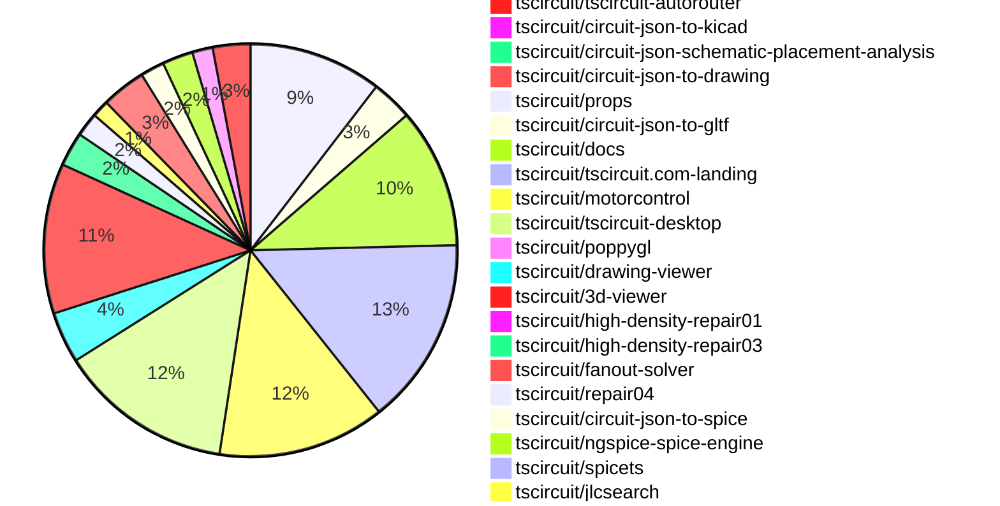

# contribution tracker

[contributions.tscircuit.com](https://contributions.tscircuit.com) ・ [tscircuit.com](https://tscircuit.com) ・ [Contribution Overviews](./contribution-overviews/) ・ [Changelogs](./changelogs/)

Generates weekly contribution overviews for tscircuit contributors. Check out all
the [contribution overviews here](./contribution-overviews/)
You can find AI-generated monthly changelogs in the [changelogs directory](./changelogs/)

- All PRs in the tscircuit org are scanned/summarized via an LLM
- The LLM classifies each Diff/PR as into a set of attributes for scoring
- All the PRs, summaries, and classifications are organized into charts and tables for [the website](https://contributions.tscircuit.com)

> Want to run locally? See the [Development Section](#development)

## Current Week

<!-- START_CURRENT_WEEK -->

# Contribution Overview 2026-11-17

The current week is shown below. There are 3 major sections:

- [Contributor Overview](#contributor-overview)
- [PRs by Repository](#prs-by-repository)
- [PRs by Contributor](#changes-by-contributor)
- [Scoring & Sponsorship Details](/docs/sponsorship-calculation-explanation.md)

## PRs by Repository



## Contributor Overview

| Contributor | 🐳 Major | 🐙 Minor | 🐌 Tiny | Score | ⭐ |
|-------------|---------|---------|---------|-------|-----|
| [ShiboSoftwareDev](#ShiboSoftwareDev) | 42 | 14 | 29 | 209 | 👑👑👑 |
| [seveibar](#seveibar) | 10 | 6 | 10 | 63 | ⭐⭐⭐ |
| [0hmX](#0hmX) | 5 | 6 | 8 | 41 | ⭐⭐ |
| [rushabhcodes](#rushabhcodes) | 4 | 5 | 9 | 35 | ⭐⭐ |
| [imrishabh18](#imrishabh18) | 2 | 8 | 3 | 28 | ⭐⭐ |
| [Abse2001](#Abse2001) | 3 | 1 | 0 | 15 | ⭐⭐ |
| [MustafaMulla29](#MustafaMulla29) | 1 | 2 | 7 | 15 | ⭐⭐ |
| [tscircuitbot](#tscircuitbot) | 0 | 0 | 233 | 12 | ⭐⭐ |
| [AnasSarkiz](#AnasSarkiz) | 1 | 0 | 2 | 7 | ⭐ |
| [VB-Blue](#VB-Blue) | 1 | 0 | 0 | 4 | ⭐ |
| [GokulPandi-M](#GokulPandi-M) | 0 | 0 | 1 | 1 |  |

## Staff Pass Ratio (SPR)

| Contributor | Reviewed PRs | Rejections | Approvals | SPR |
|-------------|--------------|------------|-----------|-----|
| [0hmX](#0hmX) | 8 | 1 | 9 | 87.5% |
| [rushabhcodes](#rushabhcodes) | 8 | 2 | 6 | 75.0% |
| [Abse2001](#Abse2001) | 2 | 0 | 2 | 100.0% |
| [MustafaMulla29](#MustafaMulla29) | 1 | 0 | 1 | 100.0% |
| [ShiboSoftwareDev](#ShiboSoftwareDev) | 1 | 0 | 1 | 100.0% |
| [VB-Blue](#VB-Blue) | 1 | 0 | 1 | 100.0% |

<details>
<summary>0hmX SPR PRs (8)</summary>

- [#5628](https://github.com/tscircuit/core/pull/5628) refactor!: remove the analog IBIS simulation API
- [#5632](https://github.com/tscircuit/core/pull/5632) feat: add <simulation.eyediagram>
- [#5650](https://github.com/tscircuit/core/pull/5650) feat: pick default pseudo-random binary sequence (PRBS) seeds across a board
- [#5647](https://github.com/tscircuit/core/pull/5647) feat: copy JLCPCB hole plating thickness into preset stackups
- [#5629](https://github.com/tscircuit/core/pull/5629) feat: add <simulation.ibismodel>
- [#5423](https://github.com/tscircuit/core/pull/5423) feat: add <simulation.pcbtransientchannelsimulation>
- [#5649](https://github.com/tscircuit/core/pull/5649) feat: add <simulation.pcbdriverreceiverchannel>
- [#11](https://github.com/tscircuit/jlcpcb-manufacturing-specs/pull/11) feat: add hole plating copper thickness to JLCPCB stackups

</details>

<details>
<summary>rushabhcodes SPR PRs (8)</summary>

- [#998](https://github.com/tscircuit/circuit-json/pull/998) Preserve arc geometry in PCB board outlines and cutouts
- [#1028](https://github.com/tscircuit/circuit-json/pull/1028) fix: preserve namespaced KiCad metadata on existing records
- [#1025](https://github.com/tscircuit/circuit-json/pull/1025) Revert "Preserve arc geometry in PCB board outlines and cutouts (#998)"
- [#1036](https://github.com/tscircuit/props/pull/1036) Preserve rectangular solder paste rotation
- [#1032](https://github.com/tscircuit/props/pull/1032) feat: add native net class authoring props
- [#5962](https://github.com/tscircuit/tscircuit.com/pull/5962) Add the Drawing tab to package previews
- [#298](https://github.com/tscircuit/circuit-json-to-gltf/pull/298) Resolve selected CAD model URLs at load time
- [#58](https://github.com/tscircuit/poppygl/pull/58) Skip shading for constant unlit opaque surfaces

</details>

<details>
<summary>Abse2001 SPR PRs (2)</summary>

- [#5502](https://github.com/tscircuit/core/pull/5502) Keep small-board mouse bites drillable (#5066)
- [#13](https://github.com/tscircuit/jlcpcb-manufacturing-specs/pull/13) Add JLCPCB panelization rules

</details>

<details>
<summary>MustafaMulla29 SPR PRs (1)</summary>

- [#580](https://github.com/tscircuit/checks/pull/580) Report schematic box width and pin-padding warnings

</details>

<details>
<summary>ShiboSoftwareDev SPR PRs (1)</summary>

- [#298](https://github.com/tscircuit/fanout-solver/pull/298) Honor crossed pour antipads in final fanout validation

</details>

<details>
<summary>VB-Blue SPR PRs (1)</summary>

- [#651](https://github.com/tscircuit/jlcsearch/pull/651) fix: include LED Indication - Discrete subcategory in led derived table

</details>

> Note: AI evaluates PRs and assigns 1-3 star ratings automatically. 4 and 5 star ratings require manual staff review.

## Review Table

[reviews-received-hover]: ## "Number of reviews received for PRs for this contributor"
[approvals-received-hover]: ## "Number of approvals received for PRs this contributor authored"
[rejections-received-hover]: ## "Number of rejections received for PRs this contributor authored"
[prs-opened-hover]: ## "Number of PRs opened by this contributor"
[issues-created-hover]: ## "Number of issues created by this contributor"

| Contributor | Reviews Received | Approvals Received | Rejections Received | Approvals | Rejections Given | PRs Opened | PRs Merged | Issues Created |
|---|---|---|---|---|---|---|---|---|
| [0hmX](#0hmX) | 24 | 8 | 0 | 11 | 0 | 41 | 19 | 0 |
| [0xNexuz](#0xNexuz) | 0 | 0 | 0 | 0 | 0 | 1 | 0 | 0 |
| [aaka3h](#aaka3h) | 0 | 0 | 0 | 0 | 0 | 1 | 0 | 0 |
| [abdalraof-albarbar](#abdalraof-albarbar) | 0 | 0 | 0 | 0 | 0 | 4 | 0 | 0 |
| [Abse2001](#Abse2001) | 2 | 2 | 0 | 19 | 0 | 14 | 4 | 0 |
| [Aming9303](#Aming9303) | 0 | 0 | 0 | 0 | 0 | 2 | 0 | 0 |
| [AnasSarkiz](#AnasSarkiz) | 3 | 3 | 0 | 1 | 0 | 12 | 3 | 0 |
| [Andresdev14](#Andresdev14) | 0 | 0 | 0 | 0 | 0 | 1 | 0 | 0 |
| [bhatipoglu](#bhatipoglu) | 0 | 0 | 0 | 0 | 0 | 1 | 0 | 0 |
| [CrazyEther](#CrazyEther) | 0 | 0 | 0 | 0 | 0 | 1 | 0 | 0 |
| [Devesh36](#Devesh36) | 0 | 0 | 0 | 0 | 0 | 5 | 0 | 0 |
| [GokulPandi-M](#GokulPandi-M) | 9 | 1 | 1 | 0 | 0 | 7 | 1 | 0 |
| [hrithik18k](#hrithik18k) | 0 | 0 | 0 | 0 | 0 | 1 | 0 | 0 |
| [imrishabh18](#imrishabh18) | 1 | 0 | 0 | 4 | 2 | 21 | 13 | 0 |
| [Kefia-02](#Kefia-02) | 0 | 0 | 0 | 0 | 0 | 1 | 0 | 0 |
| [LBCron](#LBCron) | 0 | 0 | 0 | 0 | 0 | 14 | 0 | 0 |
| [menwo535-jpg](#menwo535-jpg) | 0 | 0 | 0 | 0 | 0 | 2 | 0 | 0 |
| [mohan-bee](#mohan-bee) | 0 | 0 | 0 | 0 | 0 | 16 | 0 | 0 |
| [MustafaMulla29](#MustafaMulla29) | 16 | 4 | 0 | 0 | 0 | 23 | 10 | 0 |
| [NavaneethKSD](#NavaneethKSD) | 0 | 0 | 0 | 0 | 0 | 1 | 0 | 0 |
| [pecopeko](#pecopeko) | 0 | 0 | 0 | 0 | 0 | 8 | 0 | 0 |
| [rushabhcodes](#rushabhcodes) | 31 | 11 | 3 | 0 | 0 | 43 | 19 | 0 |
| [Semihzx](#Semihzx) | 0 | 0 | 0 | 0 | 0 | 1 | 0 | 0 |
| [seveibar](#seveibar) | 9 | 0 | 0 | 22 | 2 | 38 | 26 | 0 |
| [ShiboSoftwareDev](#ShiboSoftwareDev) | 43 | 31 | 0 | 4 | 0 | 154 | 86 | 0 |
| [singhaditya21](#singhaditya21) | 0 | 0 | 0 | 0 | 0 | 6 | 0 | 0 |
| [tscircuitbot](#tscircuitbot) | 0 | 0 | 0 | 0 | 0 | 282 | 233 | 0 |
| [U-ITACHII](#U-ITACHII) | 0 | 0 | 0 | 0 | 0 | 8 | 0 | 0 |
| [VB-Blue](#VB-Blue) | 1 | 1 | 0 | 0 | 0 | 4 | 1 | 0 |

## Changes by Repository

### [tscircuit/tscircuit](https://github.com/tscircuit/tscircuit)


<details>
<summary>🐌 Tiny Contributions (39)</summary>

| PR # | Impact | Contributor | Description |
|------|--------|-------------|-------------|
| [#6535](https://github.com/tscircuit/tscircuit/pull/6535) | 🐌 Tiny | tscircuitbot | Updates the version of the tscircuiteval package from 0.0.1821 to 0.0.1822 in package.json |
| [#6534](https://github.com/tscircuit/tscircuit/pull/6534) | 🐌 Tiny | tscircuitbot | Automated package update |
| [#6533](https://github.com/tscircuit/tscircuit/pull/6533) | 🐌 Tiny | tscircuitbot | Automated package update |
| [#6531](https://github.com/tscircuit/tscircuit/pull/6531) | 🐌 Tiny | tscircuitbot | Automated package update |
| [#6530](https://github.com/tscircuit/tscircuit/pull/6530) | 🐌 Tiny | tscircuitbot | Automated package update |
| [#6529](https://github.com/tscircuit/tscircuit/pull/6529) | 🐌 Tiny | tscircuitbot | Automated package update |
| [#6528](https://github.com/tscircuit/tscircuit/pull/6528) | 🐌 Tiny | tscircuitbot | Automated package update |
| [#6527](https://github.com/tscircuit/tscircuit/pull/6527) | 🐌 Tiny | tscircuitbot | Automated package update |
| [#6526](https://github.com/tscircuit/tscircuit/pull/6526) | 🐌 Tiny | tscircuitbot | Automated package update |
| [#6525](https://github.com/tscircuit/tscircuit/pull/6525) | 🐌 Tiny | tscircuitbot | Automated package update |
| [#6523](https://github.com/tscircuit/tscircuit/pull/6523) | 🐌 Tiny | tscircuitbot | Automated package update |
| [#6524](https://github.com/tscircuit/tscircuit/pull/6524) | 🐌 Tiny | tscircuitbot | Automated package update |
| [#6522](https://github.com/tscircuit/tscircuit/pull/6522) | 🐌 Tiny | tscircuitbot | Automated package update |
| [#6521](https://github.com/tscircuit/tscircuit/pull/6521) | 🐌 Tiny | tscircuitbot | Automated package update |
| [#6520](https://github.com/tscircuit/tscircuit/pull/6520) | 🐌 Tiny | tscircuitbot | Updates the version of tscircuitcore and other related packages in package.json |
| [#6519](https://github.com/tscircuit/tscircuit/pull/6519) | 🐌 Tiny | tscircuitbot | Automated package update |
| [#6518](https://github.com/tscircuit/tscircuit/pull/6518) | 🐌 Tiny | tscircuitbot | Automated package update |
| [#6517](https://github.com/tscircuit/tscircuit/pull/6517) | 🐌 Tiny | tscircuitbot | Automated package update |
| [#6516](https://github.com/tscircuit/tscircuit/pull/6516) | 🐌 Tiny | tscircuitbot | Automated package update |
| [#6515](https://github.com/tscircuit/tscircuit/pull/6515) | 🐌 Tiny | tscircuitbot | Automated package update |
| [#6514](https://github.com/tscircuit/tscircuit/pull/6514) | 🐌 Tiny | tscircuitbot | Automated package update |
| [#6513](https://github.com/tscircuit/tscircuit/pull/6513) | 🐌 Tiny | tscircuitbot | Automated package update |
| [#6512](https://github.com/tscircuit/tscircuit/pull/6512) | 🐌 Tiny | tscircuitbot | Automated package update |
| [#6496](https://github.com/tscircuit/tscircuit/pull/6496) | 🐌 Tiny | tscircuitbot | Update tscircuitcore from 0.0.2405 to 0.0.2406 and tscircuitcapacity-autorouter from 0.0.1120 to 0.0.1121, along with other package updates and lockfile refresh. |
| [#6510](https://github.com/tscircuit/tscircuit/pull/6510) | 🐌 Tiny | tscircuitbot | Automated package update |
| [#6509](https://github.com/tscircuit/tscircuit/pull/6509) | 🐌 Tiny | tscircuitbot | Automated package update |
| [#6508](https://github.com/tscircuit/tscircuit/pull/6508) | 🐌 Tiny | tscircuitbot | Automated package update |
| [#6502](https://github.com/tscircuit/tscircuit/pull/6502) | 🐌 Tiny | tscircuitbot | Automated package update |
| [#6494](https://github.com/tscircuit/tscircuit/pull/6494) | 🐌 Tiny | tscircuitbot | Update tscircuitcore from 0.0.2404 to 0.0.2405 and tscircuitcapacity-autorouter from 0.0.1119 to 0.0.1120, ensuring the new autorouter preserves accessible routed via bridges during layer stitching. |
| [#6511](https://github.com/tscircuit/tscircuit/pull/6511) | 🐌 Tiny | tscircuitbot | Automated package update |
| [#6506](https://github.com/tscircuit/tscircuit/pull/6506) | 🐌 Tiny | tscircuitbot | Automated package update |
| [#6505](https://github.com/tscircuit/tscircuit/pull/6505) | 🐌 Tiny | tscircuitbot | Automated package update |
| [#6499](https://github.com/tscircuit/tscircuit/pull/6499) | 🐌 Tiny | tscircuitbot | Automated package update |
| [#6498](https://github.com/tscircuit/tscircuit/pull/6498) | 🐌 Tiny | tscircuitbot | Automated package update |
| [#6497](https://github.com/tscircuit/tscircuit/pull/6497) | 🐌 Tiny | tscircuitbot | Automated package update |
| [#6504](https://github.com/tscircuit/tscircuit/pull/6504) | 🐌 Tiny | tscircuitbot | Automated package update |
| [#6507](https://github.com/tscircuit/tscircuit/pull/6507) | 🐌 Tiny | tscircuitbot | Automated package update |
| [#6503](https://github.com/tscircuit/tscircuit/pull/6503) | 🐌 Tiny | tscircuitbot | Automated package update |
| [#6495](https://github.com/tscircuit/tscircuit/pull/6495) | 🐌 Tiny | tscircuitbot | Automated package update |

</details>

### [tscircuit/circuit-json](https://github.com/tscircuit/circuit-json)

| PR # | Impact | Rating | Contributor | Description |
|------|--------|--------|-------------|-------------|
| [#1017](https://github.com/tscircuit/circuit-json/pull/1017) | 🐳 Major | ⭐⭐⭐ | seveibar | Proposes how laser-engraved text on an assembly part appears in Circuit JSON, as the counterpart of manufacturing.laserengraving.text  from tscircuitprops1025. It is two records, split the way Circuit JSON already splits source and output: - source_laser_engraving_text: the manufacturing step. What is engraved and how, with no geometry. - cad_laser_engraving_text: the 3D output. Where that text sits on the part, as a resolved world-space frame. |
| [#1023](https://github.com/tscircuit/circuit-json/pull/1023) | 🐳 Major | ⭐⭐⭐ | seveibar | Adds new elements for wire harness drawings, including cable wires, harness views, drawing tables, and balloons, enhancing the representation of cable manufacturing in the system. |
| [#1019](https://github.com/tscircuit/circuit-json/pull/1019) | 🐳 Major | ⭐⭐⭐ | seveibar | Proposes the Circuit JSON contract for per-net PCB trace clearance by storing the authoring value on source_net.min_trace_clearance as an optional finite, nonnegative number in millimeters. |
| [#998](https://github.com/tscircuit/circuit-json/pull/998) | 🐳 Major | ⭐⭐⭐ | rushabhcodes | Preserves arc geometry in PCB board outlines and cutouts by reusing the existing BRep point_with_bulge schema, preventing loss of circular arc data during KiCad export. |
| [#1034](https://github.com/tscircuit/circuit-json/pull/1034) | 🐙 Minor | ⭐⭐ | seveibar | Adds an optional corner_radius to cad_sticker so stickers with rounded corners can be described. |
| [#1018](https://github.com/tscircuit/circuit-json/pull/1018) | 🐙 Minor | ⭐⭐ | seveibar | Adds support for cad_sticker and source_sticker elements in Circuit JSON, allowing for the representation of stickers applied to components in circuit assemblies. |

<details>
<summary>🐌 Tiny Contributions (6)</summary>

| PR # | Impact | Contributor | Description |
|------|--------|-------------|-------------|
| [#1035](https://github.com/tscircuit/circuit-json/pull/1035) | 🐌 Tiny | tscircuitbot | Automated package update |
| [#1031](https://github.com/tscircuit/circuit-json/pull/1031) | 🐌 Tiny | tscircuitbot | Automated package update |
| [#1030](https://github.com/tscircuit/circuit-json/pull/1030) | 🐌 Tiny | tscircuitbot | Automated package update |
| [#1026](https://github.com/tscircuit/circuit-json/pull/1026) | 🐌 Tiny | tscircuitbot | Automated package update |
| [#1024](https://github.com/tscircuit/circuit-json/pull/1024) | 🐌 Tiny | tscircuitbot | Automated package update |
| [#1020](https://github.com/tscircuit/circuit-json/pull/1020) | 🐌 Tiny | tscircuitbot | Automated package update |

</details>

### [tscircuit/core](https://github.com/tscircuit/core)

| PR # | Impact | Rating | Contributor | Description |
|------|--------|--------|-------------|-------------|
| [#5645](https://github.com/tscircuit/core/pull/5645) | 🐳 Major | ⭐⭐⭐ | seveibar | Fixes saved-phase failures by ensuring complete phases validate copper connectivity for export and replay, allowing shared anchor pads and junctions while rejecting cross-net connections. |
| [#5707](https://github.com/tscircuit/core/pull/5707) | 🐳 Major | ⭐⭐⭐ | ShiboSoftwareDev | Bumps the tscircuitcapacity-autorouter package from version 0.0.1129 to 0.0.1132, improving regional force handling to preserve valid routes during optimization, specifically addressing via clearance issues in the H616 region. |
| [#5681](https://github.com/tscircuit/core/pull/5681) | 🐳 Major | ⭐⭐⭐ | ShiboSoftwareDev | Updates the autorouter to version 0.0.1126, enhancing BGA routing by enforcing stricter clearance and via requirements. |
| [#5659](https://github.com/tscircuit/core/pull/5659) | 🐳 Major | ⭐⭐⭐ | ShiboSoftwareDev | Fixes recursive rendering issue in routing callbacks that prevents proper copper pours from being generated during autorouting. |
| [#5637](https://github.com/tscircuit/core/pull/5637) | 🐳 Major | ⭐⭐⭐ | ShiboSoftwareDev | Publish completed trace-only routing phases while later phases continue, allowing for better visibility of routing progress on complex boards. |
| [#5673](https://github.com/tscircuit/core/pull/5673) | 🐳 Major | ⭐⭐⭐ | ShiboSoftwareDev | Updates the capacity autorouter and bus lanes solver dependencies, allowing for improved routing capabilities and fixes for cramped-port searches. |
| [#5657](https://github.com/tscircuit/core/pull/5657) | 🐳 Major | ⭐⭐⭐ | ShiboSoftwareDev | Reproduces a ground pour generated before its routed signal via when an autorouting:start listener reads getCircuitJson(). |
| [#5629](https://github.com/tscircuit/core/pull/5629) | 🐳 Major | ⭐⭐⭐ | 0hmX | Render simulation.ibismodel into a Circuit JSON IBIS model record with component, pin, and reference-port bindings, validating ambiguous, duplicate, or undeclared vendor pin bindings. |
| [#5649](https://github.com/tscircuit/core/pull/5649) | 🐳 Major | ⭐⭐⭐ | 0hmX | Adds simulation.pcbdriverreceiverchannel, resolves driver and receiver pins to IBIS models, validates PCB connectivity and routing, and writes channel records with an explicit seed when supplied. |
| [#5692](https://github.com/tscircuit/core/pull/5692) | 🐙 Minor | ⭐⭐ | rushabhcodes | Fixes the issue where a TLV75533PDBVR regulator footprint loses the requested 90 rotation on its stencil apertures, causing misalignment with copper lands. |
| [#5706](https://github.com/tscircuit/core/pull/5706) | 🐙 Minor | ⭐⭐ | ShiboSoftwareDev | Updates the ngspice engine and SPICE exporter to use newer versions of dependencies, ensuring compatibility and improved functionality in simulation tests. |
| [#5636](https://github.com/tscircuit/core/pull/5636) | 🐙 Minor | ⭐⭐ | ShiboSoftwareDev | Reproduces buffered output of completed routing work while the next autorouting phase is pending, ensuring that traces from the first phase remain accessible until the second phase is completed. |
| [#5702](https://github.com/tscircuit/core/pull/5702) | 🐙 Minor | ⭐⭐ | imrishabh18 | Recomputes NEMA 17 diagnostics by rerunning pin specification and schematic checks using the installed Checks package, while retaining source-render annotations. |
| [#5685](https://github.com/tscircuit/core/pull/5685) | 🐙 Minor | ⭐⭐ | imrishabh18 | Captures and normalizes schematic and source warnings and errors for the NEMA 17 example, ensuring stability across test orders. |
| [#5628](https://github.com/tscircuit/core/pull/5628) | 🐙 Minor | ⭐⭐ | 0hmX | Summary Bump circuit-json to 0.0.552 and tscircuitprops to 0.0.735 in the development dependencies and overrides. Remove the analog IBIS stimulus and eye declarations, IBIS pin states, and the external pcb_spice special case. Keep native analog transient analysis available through registered SPICE engines. Keep cached IBIS model restoration and narrow the copper-pour fixture to the PCB elements it renders. |
| [#5632](https://github.com/tscircuit/core/pull/5632) | 🐙 Minor | ⭐⭐ | 0hmX | Render simulation.eyediagram against transient channel records, with channel selection and timing windows expressed in milliseconds. |
| [#5650](https://github.com/tscircuit/core/pull/5650) | 🐙 Minor | ⭐⭐ | 0hmX | Allows channels using pseudo-random binary sequence (PRBS) patterns to automatically select distinct seeds based on signal names and sequence lengths, preventing identical bit transmission across channels. |
| [#5647](https://github.com/tscircuit/core/pull/5647) | 🐙 Minor | ⭐⭐ | 0hmX | Copies plated_hole_copper_thickness from the JLCPCB stackup data into pcb_stackup for boards using a JLCPCB fabricatorPreset, enabling accurate modeling of vias in PCB transient channel simulations. |
| [#5423](https://github.com/tscircuit/core/pull/5423) | 🐙 Minor | ⭐⭐ | 0hmX | Add simulation.pcbtransientchannelsimulation as a direct child of a PCB board, emitting run records with settings and covering tests for board-only rules. |
| [#5502](https://github.com/tscircuit/core/pull/5502) | 🐙 Minor | ⭐⭐ | Abse2001 | Adjusts mouse-bite drill sizes for small boards to ensure they remain drillable according to JLCPCBs specifications, while addressing clearance issues with traces. |

<details>
<summary>🐌 Tiny Contributions (21)</summary>

| PR # | Impact | Contributor | Description |
|------|--------|-------------|-------------|
| [#5699](https://github.com/tscircuit/core/pull/5699) | 🐌 Tiny | tscircuitbot | Updates the version of the tscircuitchecks package from 0.0.280 to 0.0.281 in package.json |
| [#5694](https://github.com/tscircuit/core/pull/5694) | 🐌 Tiny | tscircuitbot | Updates the version of the tscircuitfanout-solver package from 0.0.84 to 0.0.85 in package.json |
| [#5688](https://github.com/tscircuit/core/pull/5688) | 🐌 Tiny | tscircuitbot | Updates the version of the tscircuitchecks package from 0.0.279 to 0.0.280 in package.json |
| [#5643](https://github.com/tscircuit/core/pull/5643) | 🐌 Tiny | seveibar | Adds four small TSX reproductions for the saved-phase bug in 5614, providing tests for various routing scenarios that previously resulted in errors during autorouting. |
| [#5641](https://github.com/tscircuit/core/pull/5641) | 🐌 Tiny | seveibar | Adds guidance on testing patterns in AGENTS.md, specifying that tests should be simple, shallow TSX without complex logic or large imports unless they represent an entire real circuit. |
| [#5691](https://github.com/tscircuit/core/pull/5691) | 🐌 Tiny | rushabhcodes | Reproduces a bug where rotated paste-only apertures cannot be expressed, exposing a rotation bug in the Core. |
| [#5721](https://github.com/tscircuit/core/pull/5721) | 🐌 Tiny | ShiboSoftwareDev | Updates the capacity-autorouter dependency from version 0.0.1133 to 0.0.1135, which includes improvements to routing capabilities and fixes related to native regulator feedback. |
| [#5720](https://github.com/tscircuit/core/pull/5720) | 🐌 Tiny | ShiboSoftwareDev | Updates Cores canonical simulation dependency versions to published spicets 0.0.6, circuit-json-to-spice 0.0.50 and ngspice-spice-engine 0.0.25, ensuring compatibility with downstream dependencies and incorporating parser fixes and corrections. |
| [#5719](https://github.com/tscircuit/core/pull/5719) | 🐌 Tiny | ShiboSoftwareDev | Bumps the version of tscircuitfanout-solver from 0.0.90 to 0.0.91 to include improvements in conservative segment bounds and clearance decisions for obstacles. |
| [#5716](https://github.com/tscircuit/core/pull/5716) | 🐌 Tiny | ShiboSoftwareDev | Bumps tscircuitfanout-solver from 0.0.89 to 0.0.90 to optimize warm plane searches by skipping geometry construction when static clearance rejects all endpoint variants and the base plan, while maintaining cache misses, endpoint ordering, and live copper checks. |
| [#5712](https://github.com/tscircuit/core/pull/5712) | 🐌 Tiny | ShiboSoftwareDev | Updates the autorouter and fanout solver to their latest versions, improving routing capabilities and optimization. |
| [#5705](https://github.com/tscircuit/core/pull/5705) | 🐌 Tiny | ShiboSoftwareDev | Bumps tscircuitfanout-solver from 0.0.87 to 0.0.88 to include support for antipads through crossed copper pours while preserving clearance rejection on terminal layers, pads, and through-holes. |
| [#5698](https://github.com/tscircuit/core/pull/5698) | 🐌 Tiny | ShiboSoftwareDev | Bumps the tscircuitfanout-solver dependency from version 0.0.86 to 0.0.87, improving clearance-scan performance by skipping distant obstacles before scanning their aliases. |
| [#5690](https://github.com/tscircuit/core/pull/5690) | 🐌 Tiny | ShiboSoftwareDev | Updates the autorouter and fanout solver dependencies to their latest versions, ensuring compatibility and improved functionality in routing and clearance checks. |
| [#5683](https://github.com/tscircuit/core/pull/5683) | 🐌 Tiny | ShiboSoftwareDev | Updates the tscircuitcapacity-autorouter package from version 0.0.1126 to 0.0.1127, which includes improvements to the repair03 process and the native trace-pair DRC evaluator during via cleanup. |
| [#5679](https://github.com/tscircuit/core/pull/5679) | 🐌 Tiny | ShiboSoftwareDev | Updates the tscircuitcapacity-autorouter dependency from version 0.0.1124 to 0.0.1125, which includes improvements to pad-alias resolution during clearance search and a grid correction for component-pad-only A13. |
| [#5642](https://github.com/tscircuit/core/pull/5642) | 🐌 Tiny | ShiboSoftwareDev | Bumps the tscircuitcapacity-autorouter dependency from version 0.0.1120 to 0.0.1121, incorporating improvements and fixes from upstream, including enhanced clearance-grid channel builds and reduced physical findings in routing tests. |
| [#5638](https://github.com/tscircuit/core/pull/5638) | 🐌 Tiny | ShiboSoftwareDev | Bumps the tscircuitcapacity-autorouter dependency from version 0.0.1119 to 0.0.1120, improving routing preferences and connection stitching. |
| [#5696](https://github.com/tscircuit/core/pull/5696) | 🐌 Tiny | ShiboSoftwareDev | Bumps the tscircuitcapacity-autorouter package version from 0.0.1128 to 0.0.1129, ensuring improved handling of fixed-via clearance violations during autorouting processes. |
| [#5701](https://github.com/tscircuit/core/pull/5701) | 🐌 Tiny | imrishabh18 | Updates the tscircuitchecks dependency to version 0.0.282, ensuring that Core honors explicit false power and ground pin requirements. |
| [#5686](https://github.com/tscircuit/core/pull/5686) | 🐌 Tiny | GokulPandi-M | Motivation Increasing autorouter.traceClearance should change the clearance requested from the router. On this SEPIC board, requesting either 0.25 mm or 0.50 mm produces identical routing input with minTraceToPadEdgeClearance: 0.1. The larger requested spacing is silently lost before routing, so changing this setting does not enforce the intended clearance. This reproduction renders the full board TSX, retains its manual traces, and captures the input passed to the native local autorouter. The passing characterization test records the current bug; each snapshot labels the requested clearance and the received input field. Those labels describe routing settings, not measured copper gaps.  Requested: 0.25 mm  Requested: 0.50 mm   ---  ---   !Board requesting 0.25 mm; router receives 0.1 mm(https:raw.githubusercontent.comGokulPandi-Mcore5c476f43e2f901dc405c4708c5549ecfa778dd05testsrepros__snapshots__repro-autorouter-clearance-board-0.25mm-pcb.snap.svg)  !Board requesting 0.50 mm; router receives 0.1 mm(https:raw.githubusercontent.comGokulPandi-Mcore5c476f43e2f901dc405c4708c5549ecfa778dd05testsrepros__snapshots__repro-autorouter-clearance-board-0.50mm-pcb.snap.svg)   Validation Reproduction and snapshot verification pass: 1 test, 7 assertions. Type check and production build pass. Source fixture retains the boards components, placements and eight manual traces; no production code changes. |

</details>

### [tscircuit/tscircuit.com](https://github.com/tscircuit/tscircuit.com)

| PR # | Impact | Rating | Contributor | Description |
|------|--------|--------|-------------|-------------|
| [#5985](https://github.com/tscircuit/tscircuit.com/pull/5985) | 🐳 Major | ⭐⭐⭐ | seveibar | Updates the circuit-to-svg and circuit-json libraries to support custom wire colors and line patterns, ensuring that the runtime parser preserves these style fields during rendering. |
| [#6009](https://github.com/tscircuit/tscircuit.com/pull/6009) | 🐳 Major | ⭐⭐⭐ | rushabhcodes | Reduces model download time by reusing the rendered Drawing view when switching tabs, preventing unnecessary model downloads and improving performance. |
| [#5962](https://github.com/tscircuit/tscircuit.com/pull/5962) | 🐳 Major | ⭐⭐⭐ | rushabhcodes | Adds a Drawing tab to the package page for inspecting engineering drawings alongside PCB, schematic, and 3D views. |

<details>
<summary>🐌 Tiny Contributions (52)</summary>

| PR # | Impact | Contributor | Description |
|------|--------|-------------|-------------|
| [#6039](https://github.com/tscircuit/tscircuit.com/pull/6039) | 🐌 Tiny | tscircuitbot | Updates the tscircuitrunframe package from version 0.0.3298 to 0.0.3299 |
| [#6038](https://github.com/tscircuit/tscircuit.com/pull/6038) | 🐌 Tiny | tscircuitbot | Updates the tscircuiteval package from version 0.0.1820 to 0.0.1821 in the package.json file. |
| [#6037](https://github.com/tscircuit/tscircuit.com/pull/6037) | 🐌 Tiny | tscircuitbot | Updates the tscircuitrunframe package to version 0.0.3298 |
| [#6036](https://github.com/tscircuit/tscircuit.com/pull/6036) | 🐌 Tiny | tscircuitbot | Automated package update |
| [#6035](https://github.com/tscircuit/tscircuit.com/pull/6035) | 🐌 Tiny | tscircuitbot | Updates the tscircuitrunframe package from version 0.0.3296 to 0.0.3297 |
| [#6034](https://github.com/tscircuit/tscircuit.com/pull/6034) | 🐌 Tiny | tscircuitbot | Updates the tscircuiteval package from version 0.0.1818 to 0.0.1819 |
| [#6033](https://github.com/tscircuit/tscircuit.com/pull/6033) | 🐌 Tiny | tscircuitbot | Updates the tscircuitrunframe package from version 0.0.3295 to 0.0.3296 |
| [#6032](https://github.com/tscircuit/tscircuit.com/pull/6032) | 🐌 Tiny | tscircuitbot | Updates the tscircuiteval package from version 0.0.1817 to 0.0.1818 in the package.json file. |
| [#6031](https://github.com/tscircuit/tscircuit.com/pull/6031) | 🐌 Tiny | tscircuitbot | Updates the tscircuitrunframe package from version 0.0.3294 to 0.0.3295 |
| [#6030](https://github.com/tscircuit/tscircuit.com/pull/6030) | 🐌 Tiny | tscircuitbot | Updates the tscircuiteval package from version 0.0.1816 to 0.0.1817 |
| [#6029](https://github.com/tscircuit/tscircuit.com/pull/6029) | 🐌 Tiny | tscircuitbot | Updates the tscircuitrunframe package from version 0.0.3293 to 0.0.3294 |
| [#6028](https://github.com/tscircuit/tscircuit.com/pull/6028) | 🐌 Tiny | tscircuitbot | Updates the tscircuiteval package from version 0.0.1815 to 0.0.1816 |
| [#6027](https://github.com/tscircuit/tscircuit.com/pull/6027) | 🐌 Tiny | tscircuitbot | Updates the tscircuitrunframe package from version 0.0.3292 to 0.0.3293 |
| [#6026](https://github.com/tscircuit/tscircuit.com/pull/6026) | 🐌 Tiny | tscircuitbot | Updates the tscircuiteval package from version 0.0.1814 to 0.0.1815 in the package.json file. |
| [#6025](https://github.com/tscircuit/tscircuit.com/pull/6025) | 🐌 Tiny | tscircuitbot | Updates the tscircuitrunframe package from version 0.0.3291 to 0.0.3292 |
| [#6024](https://github.com/tscircuit/tscircuit.com/pull/6024) | 🐌 Tiny | tscircuitbot | Automated package update |
| [#6023](https://github.com/tscircuit/tscircuit.com/pull/6023) | 🐌 Tiny | tscircuitbot | Updates the tscircuitrunframe package version from 0.0.3290 to 0.0.3291 |
| [#6022](https://github.com/tscircuit/tscircuit.com/pull/6022) | 🐌 Tiny | tscircuitbot | Updates the tscircuiteval package from version 0.0.1812 to 0.0.1813 |
| [#6021](https://github.com/tscircuit/tscircuit.com/pull/6021) | 🐌 Tiny | tscircuitbot | Automated package update |
| [#6020](https://github.com/tscircuit/tscircuit.com/pull/6020) | 🐌 Tiny | tscircuitbot | Updates the tscircuiteval package from version 0.0.1811 to 0.0.1812 in the package.json file. |
| [#6019](https://github.com/tscircuit/tscircuit.com/pull/6019) | 🐌 Tiny | tscircuitbot | Updates the tscircuitrunframe package version from 0.0.3288 to 0.0.3289 in package.json |
| [#6018](https://github.com/tscircuit/tscircuit.com/pull/6018) | 🐌 Tiny | tscircuitbot | Updates the tscircuitrunframe package version from 0.0.3287 to 0.0.3288 in package.json |
| [#6017](https://github.com/tscircuit/tscircuit.com/pull/6017) | 🐌 Tiny | tscircuitbot | Updates the tscircuiteval package from version 0.0.1810 to 0.0.1811 |
| [#6014](https://github.com/tscircuit/tscircuit.com/pull/6014) | 🐌 Tiny | tscircuitbot | Updates the tscircuitrunframe package version from 0.0.3285 to 0.0.3286 in package.json |
| [#6011](https://github.com/tscircuit/tscircuit.com/pull/6011) | 🐌 Tiny | tscircuitbot | Updates the tscircuiteval package from version 0.0.1806 to 0.0.1808 in the package.json file. |
| [#6007](https://github.com/tscircuit/tscircuit.com/pull/6007) | 🐌 Tiny | tscircuitbot | Updates the tscircuitrunframe package from version 0.0.3283 to 0.0.3284 |
| [#6005](https://github.com/tscircuit/tscircuit.com/pull/6005) | 🐌 Tiny | tscircuitbot | Updates the tscircuitrunframe package from version 0.0.3282 to 0.0.3283 |
| [#6004](https://github.com/tscircuit/tscircuit.com/pull/6004) | 🐌 Tiny | tscircuitbot | Updates the tscircuiteval package from version 0.0.1805 to 0.0.1806 |
| [#6002](https://github.com/tscircuit/tscircuit.com/pull/6002) | 🐌 Tiny | tscircuitbot | Updates the tscircuiteval package from version 0.0.1804 to 0.0.1805 |
| [#5998](https://github.com/tscircuit/tscircuit.com/pull/5998) | 🐌 Tiny | tscircuitbot | Updates the tscircuitrunframe package version from 0.0.3278 to 0.0.3279 |
| [#5997](https://github.com/tscircuit/tscircuit.com/pull/5997) | 🐌 Tiny | tscircuitbot | Updates the tscircuiteval package from version 0.0.1802 to 0.0.1803 in the package.json file. |
| [#5995](https://github.com/tscircuit/tscircuit.com/pull/5995) | 🐌 Tiny | tscircuitbot | Updates the tscircuiteval package from version 0.0.1801 to 0.0.1802 in the package.json file. |
| [#5990](https://github.com/tscircuit/tscircuit.com/pull/5990) | 🐌 Tiny | tscircuitbot | Updates the tscircuitrunframe package version from 0.0.3274 to 0.0.3275 |
| [#5987](https://github.com/tscircuit/tscircuit.com/pull/5987) | 🐌 Tiny | tscircuitbot | Updates the tscircuitrunframe package from version 0.0.3273 to 0.0.3274 |
| [#5986](https://github.com/tscircuit/tscircuit.com/pull/5986) | 🐌 Tiny | tscircuitbot | Updates the tscircuiteval package from version 0.0.1797 to 0.0.1798 in the package.json file. |
| [#6016](https://github.com/tscircuit/tscircuit.com/pull/6016) | 🐌 Tiny | tscircuitbot | Updates the tscircuitrunframe package version from 0.0.3286 to 0.0.3287 in package.json |
| [#6015](https://github.com/tscircuit/tscircuit.com/pull/6015) | 🐌 Tiny | tscircuitbot | Automated package update |
| [#6013](https://github.com/tscircuit/tscircuit.com/pull/6013) | 🐌 Tiny | tscircuitbot | Updates the tscircuiteval package from version 0.0.1808 to 0.0.1809 in the package.json file. |
| [#6012](https://github.com/tscircuit/tscircuit.com/pull/6012) | 🐌 Tiny | tscircuitbot | Updates the tscircuitrunframe package from version 0.0.3284 to 0.0.3285 |
| [#6003](https://github.com/tscircuit/tscircuit.com/pull/6003) | 🐌 Tiny | tscircuitbot | Updates the tscircuitrunframe package from version 0.0.3281 to 0.0.3282 |
| [#6000](https://github.com/tscircuit/tscircuit.com/pull/6000) | 🐌 Tiny | tscircuitbot | Updates the tscircuiteval package from version 0.0.1803 to 0.0.1804 |
| [#5999](https://github.com/tscircuit/tscircuit.com/pull/5999) | 🐌 Tiny | tscircuitbot | Updates the tscircuitrunframe package version from 0.0.3279 to 0.0.3280 |
| [#5996](https://github.com/tscircuit/tscircuit.com/pull/5996) | 🐌 Tiny | tscircuitbot | Updates the tscircuitrunframe package from version 0.0.3277 to 0.0.3278 |
| [#5994](https://github.com/tscircuit/tscircuit.com/pull/5994) | 🐌 Tiny | tscircuitbot | Updates the tscircuitrunframe package from version 0.0.3276 to 0.0.3277 |
| [#5993](https://github.com/tscircuit/tscircuit.com/pull/5993) | 🐌 Tiny | tscircuitbot | Updates the tscircuiteval package from version 0.0.1800 to 0.0.1801 in package.json |
| [#5992](https://github.com/tscircuit/tscircuit.com/pull/5992) | 🐌 Tiny | tscircuitbot | Automated package update |
| [#5989](https://github.com/tscircuit/tscircuit.com/pull/5989) | 🐌 Tiny | tscircuitbot | Updates the tscircuiteval package from version 0.0.1798 to 0.0.1799 |
| [#6001](https://github.com/tscircuit/tscircuit.com/pull/6001) | 🐌 Tiny | tscircuitbot | Updates the tscircuitrunframe package from version 0.0.3280 to 0.0.3281 |
| [#5991](https://github.com/tscircuit/tscircuit.com/pull/5991) | 🐌 Tiny | tscircuitbot | Updates the tscircuiteval package from version 0.0.1799 to 0.0.1800 |
| [#5988](https://github.com/tscircuit/tscircuit.com/pull/5988) | 🐌 Tiny | seveibar | Apply a shared Roboto ExtraBold (800) wordmark style with normal letter spacing to both application headers and the footer, following the logo specification. Load the 800 font face through the existing Google Fonts request and update the header typography assertions. |
| [#5961](https://github.com/tscircuit/tscircuit.com/pull/5961) | 🐌 Tiny | rushabhcodes | Reproduces the issue where the Drawing tab is missing in the package preview for the Classic F1 v6.0.12 package, ensuring that the Drawing viewport opens correctly during testing. |
| [#6008](https://github.com/tscircuit/tscircuit.com/pull/6008) | 🐌 Tiny | rushabhcodes | Reproduces a bug where returning to the Drawing tab unmounts the existing DrawingViewer and causes unnecessary model downloads, impacting performance. |

</details>

### [tscircuit/eval](https://github.com/tscircuit/eval)


<details>
<summary>🐌 Tiny Contributions (49)</summary>

| PR # | Impact | Contributor | Description |
|------|--------|-------------|-------------|
| [#6001](https://github.com/tscircuit/eval/pull/6001) | 🐌 Tiny | tscircuitbot | Automated package update |
| [#6000](https://github.com/tscircuit/eval/pull/6000) | 🐌 Tiny | tscircuitbot | Automated package update |
| [#5996](https://github.com/tscircuit/eval/pull/5996) | 🐌 Tiny | tscircuitbot | Automated package update |
| [#5995](https://github.com/tscircuit/eval/pull/5995) | 🐌 Tiny | tscircuitbot | Updates the version of tscircuitcore from 0.0.2426 to 0.0.2427 and tscircuitfanout-solver from 0.0.90 to 0.0.91 in package.json |
| [#5992](https://github.com/tscircuit/eval/pull/5992) | 🐌 Tiny | tscircuitbot | Automated package update |
| [#5991](https://github.com/tscircuit/eval/pull/5991) | 🐌 Tiny | tscircuitbot | Updates various package dependencies to their latest versions in package.json |
| [#5987](https://github.com/tscircuit/eval/pull/5987) | 🐌 Tiny | tscircuitbot | Automated package update |
| [#5986](https://github.com/tscircuit/eval/pull/5986) | 🐌 Tiny | tscircuitbot | Updates package dependencies to their latest versions as part of routine maintenance. |
| [#5984](https://github.com/tscircuit/eval/pull/5984) | 🐌 Tiny | tscircuitbot | Automated package update |
| [#5983](https://github.com/tscircuit/eval/pull/5983) | 🐌 Tiny | tscircuitbot | Automated package update |
| [#5982](https://github.com/tscircuit/eval/pull/5982) | 🐌 Tiny | tscircuitbot | Automated package update |
| [#5981](https://github.com/tscircuit/eval/pull/5981) | 🐌 Tiny | tscircuitbot | Updates the version of tscircuitcore from 0.0.2421 to 0.0.2422 and tscircuitfanout-solver from 0.0.87 to 0.0.88 in package.json |
| [#5979](https://github.com/tscircuit/eval/pull/5979) | 🐌 Tiny | tscircuitbot | Automated package update |
| [#5978](https://github.com/tscircuit/eval/pull/5978) | 🐌 Tiny | tscircuitbot | Automated package update |
| [#5976](https://github.com/tscircuit/eval/pull/5976) | 🐌 Tiny | tscircuitbot | Automated package update |
| [#5975](https://github.com/tscircuit/eval/pull/5975) | 🐌 Tiny | tscircuitbot | Automated package update |
| [#5973](https://github.com/tscircuit/eval/pull/5973) | 🐌 Tiny | tscircuitbot | Automated package update |
| [#5972](https://github.com/tscircuit/eval/pull/5972) | 🐌 Tiny | tscircuitbot | Updates the version of tscircuitcore from 0.0.2418 to 0.0.2419 and tscircuitfanout-solver from 0.0.86 to 0.0.87 in package.json |
| [#5970](https://github.com/tscircuit/eval/pull/5970) | 🐌 Tiny | tscircuitbot | Automated package update |
| [#5969](https://github.com/tscircuit/eval/pull/5969) | 🐌 Tiny | tscircuitbot | Automated package update |
| [#5967](https://github.com/tscircuit/eval/pull/5967) | 🐌 Tiny | tscircuitbot | Automated package update |
| [#5966](https://github.com/tscircuit/eval/pull/5966) | 🐌 Tiny | tscircuitbot | Automated package update |
| [#5963](https://github.com/tscircuit/eval/pull/5963) | 🐌 Tiny | tscircuitbot | Updates the version of tscircuitcore from 0.0.2415 to 0.0.2416 and tscircuitfanout-solver from 0.0.84 to 0.0.85 in package.json |
| [#5955](https://github.com/tscircuit/eval/pull/5955) | 🐌 Tiny | tscircuitbot | Automated package update |
| [#5945](https://github.com/tscircuit/eval/pull/5945) | 🐌 Tiny | tscircuitbot | Automated package update |
| [#5940](https://github.com/tscircuit/eval/pull/5940) | 🐌 Tiny | tscircuitbot | Automated package update |
| [#5939](https://github.com/tscircuit/eval/pull/5939) | 🐌 Tiny | tscircuitbot | Updates the version of the tscircuitcore package from 0.0.2407 to 0.0.2408 in package.json |
| [#5934](https://github.com/tscircuit/eval/pull/5934) | 🐌 Tiny | tscircuitbot | Automated package update |
| [#5964](https://github.com/tscircuit/eval/pull/5964) | 🐌 Tiny | tscircuitbot | Automated package update |
| [#5961](https://github.com/tscircuit/eval/pull/5961) | 🐌 Tiny | tscircuitbot | Automated package update |
| [#5960](https://github.com/tscircuit/eval/pull/5960) | 🐌 Tiny | tscircuitbot | Updates the version of several dependencies in the package.json file. |
| [#5958](https://github.com/tscircuit/eval/pull/5958) | 🐌 Tiny | tscircuitbot | Automated package update |
| [#5957](https://github.com/tscircuit/eval/pull/5957) | 🐌 Tiny | tscircuitbot | Automated package update |
| [#5954](https://github.com/tscircuit/eval/pull/5954) | 🐌 Tiny | tscircuitbot | Automated package update |
| [#5953](https://github.com/tscircuit/eval/pull/5953) | 🐌 Tiny | tscircuitbot | Automated package update |
| [#5951](https://github.com/tscircuit/eval/pull/5951) | 🐌 Tiny | tscircuitbot | Automated package update |
| [#5949](https://github.com/tscircuit/eval/pull/5949) | 🐌 Tiny | tscircuitbot | Automated package update |
| [#5948](https://github.com/tscircuit/eval/pull/5948) | 🐌 Tiny | tscircuitbot | Automated package update |
| [#5946](https://github.com/tscircuit/eval/pull/5946) | 🐌 Tiny | tscircuitbot | Automated package update |
| [#5943](https://github.com/tscircuit/eval/pull/5943) | 🐌 Tiny | tscircuitbot | Automated package update |
| [#5942](https://github.com/tscircuit/eval/pull/5942) | 🐌 Tiny | tscircuitbot | Automated package update |
| [#5937](https://github.com/tscircuit/eval/pull/5937) | 🐌 Tiny | tscircuitbot | Automated package update |
| [#5936](https://github.com/tscircuit/eval/pull/5936) | 🐌 Tiny | tscircuitbot | Automated package update |
| [#5933](https://github.com/tscircuit/eval/pull/5933) | 🐌 Tiny | tscircuitbot | Automated package update |
| [#5931](https://github.com/tscircuit/eval/pull/5931) | 🐌 Tiny | tscircuitbot | Automated package update |
| [#5930](https://github.com/tscircuit/eval/pull/5930) | 🐌 Tiny | tscircuitbot | Updates package dependencies to their latest versions as part of routine maintenance. |
| [#5928](https://github.com/tscircuit/eval/pull/5928) | 🐌 Tiny | tscircuitbot | Automated package update |
| [#5927](https://github.com/tscircuit/eval/pull/5927) | 🐌 Tiny | tscircuitbot | Updates the versions of several dependencies in the package.json file. |
| [#5993](https://github.com/tscircuit/eval/pull/5993) | 🐌 Tiny | ShiboSoftwareDev | Updates eval to use Core 0.0.2429 and synchronizes dependencies with the latest versions, including spicets 0.0.6, circuit-json-to-spice 0.0.50, and ngspice-spice-engine 0.0.25, ensuring compatibility and integration of merged parser and initial-condition fixes into the simulation worker and platform configuration. |

</details>

### [tscircuit/runframe](https://github.com/tscircuit/runframe)


<details>
<summary>🐌 Tiny Contributions (51)</summary>

| PR # | Impact | Contributor | Description |
|------|--------|-------------|-------------|
| [#6444](https://github.com/tscircuit/runframe/pull/6444) | 🐌 Tiny | tscircuitbot | Automated package update |
| [#6443](https://github.com/tscircuit/runframe/pull/6443) | 🐌 Tiny | tscircuitbot | Updates the tscircuiteval package from version 0.0.1820 to 0.0.1821 |
| [#6442](https://github.com/tscircuit/runframe/pull/6442) | 🐌 Tiny | tscircuitbot | Automated package update |
| [#6441](https://github.com/tscircuit/runframe/pull/6441) | 🐌 Tiny | tscircuitbot | Updates the tscircuiteval package from version 0.0.1819 to 0.0.1820 |
| [#6440](https://github.com/tscircuit/runframe/pull/6440) | 🐌 Tiny | tscircuitbot | Automated package update |
| [#6439](https://github.com/tscircuit/runframe/pull/6439) | 🐌 Tiny | tscircuitbot | Updates the tscircuiteval package from version 0.0.1818 to 0.0.1819 |
| [#6438](https://github.com/tscircuit/runframe/pull/6438) | 🐌 Tiny | tscircuitbot | Automated package update |
| [#6437](https://github.com/tscircuit/runframe/pull/6437) | 🐌 Tiny | tscircuitbot | Updates the tscircuiteval package from version 0.0.1817 to 0.0.1818 |
| [#6436](https://github.com/tscircuit/runframe/pull/6436) | 🐌 Tiny | tscircuitbot | Automated package update |
| [#6435](https://github.com/tscircuit/runframe/pull/6435) | 🐌 Tiny | tscircuitbot | Updates the tscircuiteval package from version 0.0.1816 to 0.0.1817 |
| [#6434](https://github.com/tscircuit/runframe/pull/6434) | 🐌 Tiny | tscircuitbot | Automated package update |
| [#6433](https://github.com/tscircuit/runframe/pull/6433) | 🐌 Tiny | tscircuitbot | Updates the tscircuiteval package from version 0.0.1815 to 0.0.1816 |
| [#6432](https://github.com/tscircuit/runframe/pull/6432) | 🐌 Tiny | tscircuitbot | Automated package update |
| [#6431](https://github.com/tscircuit/runframe/pull/6431) | 🐌 Tiny | tscircuitbot | Updates the tscircuiteval package from version 0.0.1814 to 0.0.1815 |
| [#6430](https://github.com/tscircuit/runframe/pull/6430) | 🐌 Tiny | tscircuitbot | Automated package update |
| [#6429](https://github.com/tscircuit/runframe/pull/6429) | 🐌 Tiny | tscircuitbot | Updates the tscircuiteval package from version 0.0.1813 to 0.0.1814 |
| [#6428](https://github.com/tscircuit/runframe/pull/6428) | 🐌 Tiny | tscircuitbot | Automated package update |
| [#6427](https://github.com/tscircuit/runframe/pull/6427) | 🐌 Tiny | tscircuitbot | Updates the tscircuiteval package from version 0.0.1812 to 0.0.1813 |
| [#6426](https://github.com/tscircuit/runframe/pull/6426) | 🐌 Tiny | tscircuitbot | Automated package update |
| [#6425](https://github.com/tscircuit/runframe/pull/6425) | 🐌 Tiny | tscircuitbot | Updates the tscircuiteval package from version 0.0.1811 to 0.0.1812 |
| [#6424](https://github.com/tscircuit/runframe/pull/6424) | 🐌 Tiny | tscircuitbot | Automated package update |
| [#6423](https://github.com/tscircuit/runframe/pull/6423) | 🐌 Tiny | tscircuitbot | Automated package update |
| [#6422](https://github.com/tscircuit/runframe/pull/6422) | 🐌 Tiny | tscircuitbot | Automated package update |
| [#6421](https://github.com/tscircuit/runframe/pull/6421) | 🐌 Tiny | tscircuitbot | Updates the tscircuiteval package from version 0.0.1810 to 0.0.1811 |
| [#6417](https://github.com/tscircuit/runframe/pull/6417) | 🐌 Tiny | tscircuitbot | Updates the tscircuiteval package from version 0.0.1808 to 0.0.1809 in the package.json file. |
| [#6409](https://github.com/tscircuit/runframe/pull/6409) | 🐌 Tiny | tscircuitbot | Updates the tscircuiteval package from version 0.0.1804 to 0.0.1805 |
| [#6398](https://github.com/tscircuit/runframe/pull/6398) | 🐌 Tiny | tscircuitbot | Updates the tscircuiteval package from version 0.0.1800 to 0.0.1801 |
| [#6397](https://github.com/tscircuit/runframe/pull/6397) | 🐌 Tiny | tscircuitbot | Automated package update |
| [#6394](https://github.com/tscircuit/runframe/pull/6394) | 🐌 Tiny | tscircuitbot | Updates the tscircuiteval package from version 0.0.1798 to 0.0.1799 |
| [#6420](https://github.com/tscircuit/runframe/pull/6420) | 🐌 Tiny | tscircuitbot | Automated package update |
| [#6419](https://github.com/tscircuit/runframe/pull/6419) | 🐌 Tiny | tscircuitbot | Updates the tscircuiteval package from version 0.0.1809 to 0.0.1810 |
| [#6416](https://github.com/tscircuit/runframe/pull/6416) | 🐌 Tiny | tscircuitbot | Automated package update |
| [#6415](https://github.com/tscircuit/runframe/pull/6415) | 🐌 Tiny | tscircuitbot | Updates the tscircuiteval package from version 0.0.1807 to 0.0.1808 in the package.json file. |
| [#6413](https://github.com/tscircuit/runframe/pull/6413) | 🐌 Tiny | tscircuitbot | Updates the tscircuiteval package from version 0.0.1806 to 0.0.1807 |
| [#6411](https://github.com/tscircuit/runframe/pull/6411) | 🐌 Tiny | tscircuitbot | Updates the tscircuiteval package from version 0.0.1805 to 0.0.1806 in the package.json file. |
| [#6410](https://github.com/tscircuit/runframe/pull/6410) | 🐌 Tiny | tscircuitbot | Automated package update |
| [#6408](https://github.com/tscircuit/runframe/pull/6408) | 🐌 Tiny | tscircuitbot | Automated package update |
| [#6407](https://github.com/tscircuit/runframe/pull/6407) | 🐌 Tiny | tscircuitbot | Updates the tscircuiteval package from version 0.0.1803 to 0.0.1804 in the package.json file. |
| [#6406](https://github.com/tscircuit/runframe/pull/6406) | 🐌 Tiny | tscircuitbot | Automated package update |
| [#6405](https://github.com/tscircuit/runframe/pull/6405) | 🐌 Tiny | tscircuitbot | Updates the circuit-json-to-kicad package version from 0.0.278 to 0.0.279 in package.json |
| [#6403](https://github.com/tscircuit/runframe/pull/6403) | 🐌 Tiny | tscircuitbot | Automated package update |
| [#6402](https://github.com/tscircuit/runframe/pull/6402) | 🐌 Tiny | tscircuitbot | Updates the tscircuiteval package from version 0.0.1802 to 0.0.1803 |
| [#6401](https://github.com/tscircuit/runframe/pull/6401) | 🐌 Tiny | tscircuitbot | Automated package update |
| [#6399](https://github.com/tscircuit/runframe/pull/6399) | 🐌 Tiny | tscircuitbot | Automated package update |
| [#6396](https://github.com/tscircuit/runframe/pull/6396) | 🐌 Tiny | tscircuitbot | Updates the tscircuiteval package from version 0.0.1799 to 0.0.1800 |
| [#6393](https://github.com/tscircuit/runframe/pull/6393) | 🐌 Tiny | tscircuitbot | Automated package update |
| [#6392](https://github.com/tscircuit/runframe/pull/6392) | 🐌 Tiny | tscircuitbot | Updates the tscircuiteval package from version 0.0.1797 to 0.0.1798 |
| [#6418](https://github.com/tscircuit/runframe/pull/6418) | 🐌 Tiny | tscircuitbot | Automated package update |
| [#6414](https://github.com/tscircuit/runframe/pull/6414) | 🐌 Tiny | tscircuitbot | Automated package update |
| [#6400](https://github.com/tscircuit/runframe/pull/6400) | 🐌 Tiny | tscircuitbot | Updates the tscircuiteval package from version 0.0.1801 to 0.0.1802 in the package.json file. |
| [#6395](https://github.com/tscircuit/runframe/pull/6395) | 🐌 Tiny | tscircuitbot | Automated package update |

</details>

### [tscircuit/cli](https://github.com/tscircuit/cli)


<details>
<summary>🐌 Tiny Contributions (2)</summary>

| PR # | Impact | Contributor | Description |
|------|--------|-------------|-------------|
| [#5857](https://github.com/tscircuit/cli/pull/5857) | 🐌 Tiny | tscircuitbot | Automated package update |
| [#5856](https://github.com/tscircuit/cli/pull/5856) | 🐌 Tiny | ShiboSoftwareDev | Fixes CLI startup failure when using Circuit JSON 0.0.552 due to removed schemas in the bundled PCB SPICE pipeline, by updating to the renamed signal-integrity-pipeline and adjusting imports accordingly. |

</details>

### [tscircuit/svg.tscircuit.com](https://github.com/tscircuit/svg.tscircuit.com)


<details>
<summary>🐌 Tiny Contributions (15)</summary>

| PR # | Impact | Contributor | Description |
|------|--------|-------------|-------------|
| [#2979](https://github.com/tscircuit/svg.tscircuit.com/pull/2979) | 🐌 Tiny | tscircuitbot | Updates the tscircuit package version from 0.0.3244 to 0.0.3245 in package.json |
| [#2978](https://github.com/tscircuit/svg.tscircuit.com/pull/2978) | 🐌 Tiny | tscircuitbot | Updates the tscircuit package version from 0.0.3243 to 0.0.3244 in package.json |
| [#2977](https://github.com/tscircuit/svg.tscircuit.com/pull/2977) | 🐌 Tiny | tscircuitbot | Updates the tscircuit package version from 0.0.3242 to 0.0.3243 in package.json |
| [#2976](https://github.com/tscircuit/svg.tscircuit.com/pull/2976) | 🐌 Tiny | tscircuitbot | Updates the tscircuit package version from 0.0.3240 to 0.0.3242 in package.json |
| [#2975](https://github.com/tscircuit/svg.tscircuit.com/pull/2975) | 🐌 Tiny | tscircuitbot | Updates the tscircuit package version from 0.0.3238 to 0.0.3240 in package.json |
| [#2972](https://github.com/tscircuit/svg.tscircuit.com/pull/2972) | 🐌 Tiny | tscircuitbot | Updates the tscircuit package version from 0.0.3237 to 0.0.3238 in package.json |
| [#2971](https://github.com/tscircuit/svg.tscircuit.com/pull/2971) | 🐌 Tiny | tscircuitbot | Updates the tscircuit package version from 0.0.3236 to 0.0.3237 in package.json |
| [#2970](https://github.com/tscircuit/svg.tscircuit.com/pull/2970) | 🐌 Tiny | tscircuitbot | Updates the tscircuit package version from 0.0.3235 to 0.0.3236 |
| [#2969](https://github.com/tscircuit/svg.tscircuit.com/pull/2969) | 🐌 Tiny | tscircuitbot | Updates the tscircuit package version from 0.0.3234 to 0.0.3235 in package.json |
| [#2968](https://github.com/tscircuit/svg.tscircuit.com/pull/2968) | 🐌 Tiny | tscircuitbot | Updates the tscircuit package version from 0.0.3233 to 0.0.3234 in package.json |
| [#2967](https://github.com/tscircuit/svg.tscircuit.com/pull/2967) | 🐌 Tiny | tscircuitbot | Updates the tscircuit package version from 0.0.3232 to 0.0.3233 in package.json |
| [#2966](https://github.com/tscircuit/svg.tscircuit.com/pull/2966) | 🐌 Tiny | tscircuitbot | Updates the tscircuit package version from 0.0.3231 to 0.0.3232 in package.json |
| [#2965](https://github.com/tscircuit/svg.tscircuit.com/pull/2965) | 🐌 Tiny | tscircuitbot | Updates the tscircuit package version from 0.0.3230 to 0.0.3231 in package.json |
| [#2964](https://github.com/tscircuit/svg.tscircuit.com/pull/2964) | 🐌 Tiny | tscircuitbot | Updates the tscircuit package version from 0.0.3229 to 0.0.3230 in package.json |
| [#2963](https://github.com/tscircuit/svg.tscircuit.com/pull/2963) | 🐌 Tiny | tscircuitbot | Updates the tscircuit package version from 0.0.3225 to 0.0.3229 in package.json |

</details>

### [tscircuit/tscircuit-autorouter](https://github.com/tscircuit/tscircuit-autorouter)

| PR # | Impact | Rating | Contributor | Description |
|------|--------|--------|-------------|-------------|
| [#3969](https://github.com/tscircuit/tscircuit-autorouter/pull/3969) | 🐳 Major | ⭐⭐⭐ | seveibar | Fixes autorouting failure by utilizing the connectivity map for calculating the via lower bound in the polyline solver, resolving VREF fanout rejection issues. |
| [#3982](https://github.com/tscircuit/tscircuit-autorouter/pull/3982) | 🐳 Major | ⭐⭐⭐ | ShiboSoftwareDev | Fixes autorouting failure when via seeding mistakes a shared PCB pad for a foreign crossing, allowing the native C18R37R38 fanout to utilize its via limit effectively. |
| [#3981](https://github.com/tscircuit/tscircuit-autorouter/pull/3981) | 🐳 Major | ⭐⭐⭐ | ShiboSoftwareDev | Fixes via limit exhaustion in the regulator feedback fanout when branches meet at a shared pad within the same electrical net. |
| [#3967](https://github.com/tscircuit/tscircuit-autorouter/pull/3967) | 🐳 Major | ⭐⭐⭐ | ShiboSoftwareDev | Reproduces the native C2C3R1R2 VREF fanout rejection due to insufficient vias for routing. |
| [#3960](https://github.com/tscircuit/tscircuit-autorouter/pull/3960) | 🐳 Major | ⭐⭐⭐ | ShiboSoftwareDev | Preserves legal routes when a nodes optimization violates via clearance, preventing signal vias from moving too close to DDR pads. |
| [#3956](https://github.com/tscircuit/tscircuit-autorouter/pull/3956) | 🐳 Major | ⭐⭐⭐ | ShiboSoftwareDev | Captures a legal H616 regional route that force improvement moves too close to a DDR pad, creating four clearance errors. The regional solve then fails despite having a valid route available. |
| [#3893](https://github.com/tscircuit/tscircuit-autorouter/pull/3893) | 🐳 Major | ⭐⭐⭐ | ShiboSoftwareDev | Reproduces the iCEPi CPUX terminal-layer failure using 24 captured route fragments and 32 nearby pads. The passing test records 12 terminals and 3 via sites. Once stitching succeeds, it runs native simplification; 3894 naturally updates the same SVG to 22 terminals and 1 via site. Remaining DRC findings stay visible. The whole plane repro captures 8,935 fragments and fails after 537559 connections. SVG rendering lives in fixture helpers; each test checks routing behavior. Focused snapshot(https:raw.githubusercontent.comtscircuittscircuit-autorouter93193735a959e0721fc7df083aaa7ab09eebf4d0testsrepro__snapshots__icepi-planar-stitch.snap.svg)  Whole plane snapshot(https:raw.githubusercontent.comtscircuittscircuit-autorouter93193735a959e0721fc7df083aaa7ab09eebf4d0testsrepro__snapshots__icepi-plane-stitch.snap.svg). |
| [#3939](https://github.com/tscircuit/tscircuit-autorouter/pull/3939) | 🐳 Major | ⭐⭐⭐ | ShiboSoftwareDev | Validates all direct shortcuts and inset candidates against existing point and segment collision checks to prevent routing through neighboring pads, improving routing accuracy and reducing copper shorts. |
| [#3937](https://github.com/tscircuit/tscircuit-autorouter/pull/3937) | 🐳 Major | ⭐⭐⭐ | ShiboSoftwareDev | Fixes native trace clearance issue caused by via cleanup that leaves a trace gap violating clearance rules. |
| [#3931](https://github.com/tscircuit/tscircuit-autorouter/pull/3931) | 🐳 Major | ⭐⭐⭐ | ShiboSoftwareDev | Fixes the autorouting process to reuse existing vias when escaping BGA pads, improving routing efficiency and maintaining connectivity without introducing new vias. |
| [#3929](https://github.com/tscircuit/tscircuit-autorouter/pull/3929) | 🐳 Major | ⭐⭐⭐ | ShiboSoftwareDev | Fixes the issue where the BGA escape routing adds an additional via beside an existing via-in-pad instead of utilizing the existing via, leading to unnecessary complexity in the routing. |
| [#3919](https://github.com/tscircuit/tscircuit-autorouter/pull/3919) | 🐳 Major | ⭐⭐⭐ | ShiboSoftwareDev | Captures a native 4  3 mm cut of ButterSticks plane-escape search and measures repeated adjacency scans while freezing all ordered candidates and their parent chains. |
| [#3903](https://github.com/tscircuit/tscircuit-autorouter/pull/3903) | 🐳 Major | ⭐⭐⭐ | ShiboSoftwareDev | Fixes DDR routing issues on the i.MX6 PCB by implementing pad-safe via repairs, eliminating DRC errors and preventing regression. |
| [#3889](https://github.com/tscircuit/tscircuit-autorouter/pull/3889) | 🐳 Major | ⭐⭐⭐ | ShiboSoftwareDev | Reproduces the routing of the native A13 board after all data phases, capturing remaining connections and DRC findings without altering pads, placement, or layers. |
| [#3952](https://github.com/tscircuit/tscircuit-autorouter/pull/3952) | 🐳 Major | ⭐⭐⭐ | ShiboSoftwareDev | Prevents worsening existing clearance violations against fixed DDR vias during force improvement, allowing the i.MX6 to repair its remaining DRC error. |
| [#3932](https://github.com/tscircuit/tscircuit-autorouter/pull/3932) | 🐳 Major | ⭐⭐⭐ | ShiboSoftwareDev | Reduces clearance search time by 89.9 by avoiding repeated pad-alias lookups, preserving paths and empty-alias behavior. |
| [#3920](https://github.com/tscircuit/tscircuit-autorouter/pull/3920) | 🐳 Major | ⭐⭐⭐ | ShiboSoftwareDev | Avoid rescanning a capacity region when an earlier expansion already has an equal or lower cost. Cheaper later approaches still expand. Stacked on 3919. |
| [#3912](https://github.com/tscircuit/tscircuit-autorouter/pull/3912) | 🐳 Major | ⭐⭐⭐ | ShiboSoftwareDev | Fixes copper handoff validation by checking exact repairs against cached reference DRC, ensuring circuit-error priority is preserved and final fixed-copper validation is accurate. |
| [#3900](https://github.com/tscircuit/tscircuit-autorouter/pull/3900) | 🐳 Major | ⭐⭐⭐ | ShiboSoftwareDev | Fixes the issue of fixed vias adding rows and columns to the BGA pad-channel grid by generating extra channels from component pads. |
| [#3894](https://github.com/tscircuit/tscircuit-autorouter/pull/3894) | 🐳 Major | ⭐⭐⭐ | ShiboSoftwareDev | Fixes CPUX stitching bypassing an existing via and missing the bottom-layer terminal. |
| [#3938](https://github.com/tscircuit/tscircuit-autorouter/pull/3938) | 🐳 Major | ⭐⭐⭐ | ShiboSoftwareDev | Preserves a safe layer detour when via removal introduces a new native trace-pair violation, ensuring that the indexed DRC count remains unchanged while reducing native DRC errors from 10 to 9. |
| [#3964](https://github.com/tscircuit/tscircuit-autorouter/pull/3964) | 🐳 Major | ⭐⭐⭐ | imrishabh18 | Fixes phantom via repair on the RP2040 motor controller by ensuring existing plated-hole transitions are not treated as new vias. |
| [#3949](https://github.com/tscircuit/tscircuit-autorouter/pull/3949) | 🐙 Minor | ⭐⭐ | ShiboSoftwareDev | Captures i.MX6 DDR routing beside completed data-byte copper, retaining 53404 connected nets and addressing one physical clearance error. |

<details>
<summary>🐌 Tiny Contributions (21)</summary>

| PR # | Impact | Contributor | Description |
|------|--------|-------------|-------------|
| [#3991](https://github.com/tscircuit/tscircuit-autorouter/pull/3991) | 🐌 Tiny | tscircuitbot | Automated package update |
| [#3986](https://github.com/tscircuit/tscircuit-autorouter/pull/3986) | 🐌 Tiny | tscircuitbot | Automated package update |
| [#3975](https://github.com/tscircuit/tscircuit-autorouter/pull/3975) | 🐌 Tiny | tscircuitbot | Automated package update |
| [#3965](https://github.com/tscircuit/tscircuit-autorouter/pull/3965) | 🐌 Tiny | tscircuitbot | Automated package update |
| [#3961](https://github.com/tscircuit/tscircuit-autorouter/pull/3961) | 🐌 Tiny | tscircuitbot | Automated package update |
| [#3957](https://github.com/tscircuit/tscircuit-autorouter/pull/3957) | 🐌 Tiny | tscircuitbot | Automated package update |
| [#3954](https://github.com/tscircuit/tscircuit-autorouter/pull/3954) | 🐌 Tiny | tscircuitbot | Automated package update |
| [#3947](https://github.com/tscircuit/tscircuit-autorouter/pull/3947) | 🐌 Tiny | tscircuitbot | Automated package update |
| [#3942](https://github.com/tscircuit/tscircuit-autorouter/pull/3942) | 🐌 Tiny | tscircuitbot | Automated package update |
| [#3941](https://github.com/tscircuit/tscircuit-autorouter/pull/3941) | 🐌 Tiny | tscircuitbot | Automated package update |
| [#3936](https://github.com/tscircuit/tscircuit-autorouter/pull/3936) | 🐌 Tiny | tscircuitbot | Automated package update |
| [#3925](https://github.com/tscircuit/tscircuit-autorouter/pull/3925) | 🐌 Tiny | tscircuitbot | Automated package update |
| [#3916](https://github.com/tscircuit/tscircuit-autorouter/pull/3916) | 🐌 Tiny | tscircuitbot | Automated package update |
| [#3913](https://github.com/tscircuit/tscircuit-autorouter/pull/3913) | 🐌 Tiny | tscircuitbot | Automated package update |
| [#3908](https://github.com/tscircuit/tscircuit-autorouter/pull/3908) | 🐌 Tiny | tscircuitbot | Automated package update |
| [#3905](https://github.com/tscircuit/tscircuit-autorouter/pull/3905) | 🐌 Tiny | tscircuitbot | Automated package update |
| [#3911](https://github.com/tscircuit/tscircuit-autorouter/pull/3911) | 🐌 Tiny | ShiboSoftwareDev | Refreshes the existing SEPIC repro with a fixed 6  4 mm view of the native copper, surrounding pads, and measured same-layer clearance, capturing the failing route before the fix. |
| [#3917](https://github.com/tscircuit/tscircuit-autorouter/pull/3917) | 🐌 Tiny | ShiboSoftwareDev | Adds a fixed-camera native PCB view of the A13 trace contacting a neighboring RAM pad BALL_C3, while keeping the existing full-board clearance snapshot unchanged. |
| [#3902](https://github.com/tscircuit/tscircuit-autorouter/pull/3902) | 🐌 Tiny | ShiboSoftwareDev | Reproduces the remaining bank-address via clock-enable trace clearance error on the native i.MX6 PCB, with all 53 DDR nets connected. |
| [#3958](https://github.com/tscircuit/tscircuit-autorouter/pull/3958) | 🐌 Tiny | imrishabh18 | Adds the captured input, debugger fixture, and default Pipeline 9 snapshot test for the RP2040 motor controller(https:tscircuit.comimrishabh18rp2040-motor-controllerpcb) with saved routes removed. The generated snapshot reports 2 relaxed DRC errors. Validated with the focused snapshot test and TypeScript check. |
| [#3948](https://github.com/tscircuit/tscircuit-autorouter/pull/3948) | 🐌 Tiny | imrishabh18 | The BeaglePlay DDR4 fixture needs pad-to-port metadata so DRC can recognize its 102 terminals. Add that metadata and run the existing input through Pipeline 9 in the BeaglePlay test. The test checks all 51 routes, all 102 connected ports, zero DRC error messages under the boards 0.081 mm clearance, and the platforms routed SVG snapshot. Linux and macOS each have a recorded snapshot. Remove the provenance Markdown and routedunrouted PNGs. Keep the original hardware license and interactive fixture. CI assigns this test the existing full-board routing timeout. The annotated input routes cleanly with the existing solver. Validation runs use effort 1 with caching disabled. |

</details>

### [tscircuit/circuit-json-to-kicad](https://github.com/tscircuit/circuit-json-to-kicad)


<details>
<summary>🐌 Tiny Contributions (3)</summary>

| PR # | Impact | Contributor | Description |
|------|--------|-------------|-------------|
| [#939](https://github.com/tscircuit/circuit-json-to-kicad/pull/939) | 🐌 Tiny | tscircuitbot | Automated package update |
| [#913](https://github.com/tscircuit/circuit-json-to-kicad/pull/913) | 🐌 Tiny | rushabhcodes | Maps Circuit JSONs allow_placements to KiCads footprints and pads flags, enabling proper handling of component placements within keepouts. |
| [#912](https://github.com/tscircuit/circuit-json-to-kicad/pull/912) | 🐌 Tiny | rushabhcodes | Reproduces a bug where KiCad incorrectly flags allowed placements in keepouts, ensuring that the exported rules reflect the correct restrictions on tracks, vias, and copper pours. |

</details>

### [tscircuit/circuit-json-schematic-placement-analysis](https://github.com/tscircuit/circuit-json-schematic-placement-analysis)

| PR # | Impact | Rating | Contributor | Description |
|------|--------|--------|-------------|-------------|
| [#467](https://github.com/tscircuit/circuit-json-schematic-placement-analysis/pull/467) | 🐙 Minor | ⭐⭐ | seveibar | Emit a warning when a fuse is drawn as a generic box instead of a dedicated fuse symbol, and skip the vertical rail-orientation warning for two-terminal generic chips connected between distinct power nets. |
| [#473](https://github.com/tscircuit/circuit-json-schematic-placement-analysis/pull/473) | 🐙 Minor | ⭐⭐ | MustafaMulla29 | Fixes crystal positioning issue when load capacitors are stacked above and below the crystal, ensuring the crystal is centered vertically between the capacitor bodies. |

<details>
<summary>🐌 Tiny Contributions (8)</summary>

| PR # | Impact | Contributor | Description |
|------|--------|-------------|-------------|
| [#478](https://github.com/tscircuit/circuit-json-schematic-placement-analysis/pull/478) | 🐌 Tiny | tscircuitbot | Automated package update |
| [#468](https://github.com/tscircuit/circuit-json-schematic-placement-analysis/pull/468) | 🐌 Tiny | tscircuitbot | Automated package update |
| [#466](https://github.com/tscircuit/circuit-json-schematic-placement-analysis/pull/466) | 🐌 Tiny | tscircuitbot | Automated package update |
| [#472](https://github.com/tscircuit/circuit-json-schematic-placement-analysis/pull/472) | 🐌 Tiny | MustafaMulla29 | Reproduces a false warning for crystal centering when load capacitors are stacked, ensuring the warning is correctly asserted in tests. |
| [#476](https://github.com/tscircuit/circuit-json-schematic-placement-analysis/pull/476) | 🐌 Tiny | MustafaMulla29 | Fixes orientation rules for bootstrap capacitors and series supply resistors to allow horizontal placement based on TI reference designs. |
| [#475](https://github.com/tscircuit/circuit-json-schematic-placement-analysis/pull/475) | 🐌 Tiny | MustafaMulla29 | Reproduces false vertical-orientation warnings for two horizontal components in the TPS25751EVM schematic, specifically the bootstrap capacitor and a do-not-place resistor, without altering the solver. |
| [#464](https://github.com/tscircuit/circuit-json-schematic-placement-analysis/pull/464) | 🐌 Tiny | MustafaMulla29 | Restricts inversion warnings to components with a positive-supply terminal below its ground terminal, removing false positives from valid layouts. |
| [#463](https://github.com/tscircuit/circuit-json-schematic-placement-analysis/pull/463) | 🐌 Tiny | MustafaMulla29 | Reproduces false inverted-rail warnings for TI schematics by adding tests that capture incorrect behavior in the analyzer. |

</details>

### [tscircuit/circuit-json-to-drawing](https://github.com/tscircuit/circuit-json-to-drawing)

| PR # | Impact | Rating | Contributor | Description |
|------|--------|--------|-------------|-------------|
| [#14](https://github.com/tscircuit/circuit-json-to-drawing/pull/14) | 🐳 Major | ⭐⭐⭐ | seveibar | Renders wire harness (cable manufacturing) sheets from the elements proposed in tscircuitcircuit-json1023. TSX spec: tscircuitprops1030. |

<details>
<summary>🐌 Tiny Contributions (1)</summary>

| PR # | Impact | Contributor | Description |
|------|--------|-------------|-------------|
| [#15](https://github.com/tscircuit/circuit-json-to-drawing/pull/15) | 🐌 Tiny | tscircuitbot | Automated package update |

</details>

### [tscircuit/props](https://github.com/tscircuit/props)

| PR # | Impact | Rating | Contributor | Description |
|------|--------|--------|-------------|-------------|
| [#1030](https://github.com/tscircuit/props/pull/1030) | 🐳 Major | ⭐⭐⭐ | seveibar | Add support for wire harness drawings including cable specifications, wiring tables, and BOM tables in TSX format. |
| [#1027](https://github.com/tscircuit/props/pull/1027) | 🐳 Major | ⭐⭐⭐ | seveibar | Proposes the optional minTraceClearance?: Distance prop on net. |
| [#1025](https://github.com/tscircuit/props/pull/1025) | 🐳 Major | ⭐⭐⭐ | seveibar | Proposes a manufacturing namespace with two elements for laser-engraved marks on a part surface. They are children of assembly.printedpart or assembly.part. Elements are named for the process, so a mark says how it is made and not only how it looks. |
| [#1044](https://github.com/tscircuit/props/pull/1044) | 🐙 Minor | ⭐⭐ | seveibar | Adds cornerRadius to assembly.sticker  for stickers with rounded corners, allowing for customizable rounded corners up to half the width or height of the sticker. |
| [#1026](https://github.com/tscircuit/props/pull/1026) | 🐙 Minor | ⭐⭐ | seveibar | Adds assemblyProps.sticker for an assembly.sticker  element, allowing users to apply adhesive stickers to parts in their assemblies. |
| [#1036](https://github.com/tscircuit/props/pull/1036) | 🐙 Minor | ⭐⭐ | rushabhcodes | Retains the existing pcbRotation placement prop in the rectangular solder-paste interface and schema to address the rotation input gap reported by Jan Mrzek. |
| [#1035](https://github.com/tscircuit/props/pull/1035) | 🐙 Minor | ⭐⭐ | rushabhcodes | Fixes the issue where rotated paste-only apertures lose their requested rotation during props validation. |

### [tscircuit/circuit-json-to-gltf](https://github.com/tscircuit/circuit-json-to-gltf)

| PR # | Impact | Rating | Contributor | Description |
|------|--------|--------|-------------|-------------|
| [#302](https://github.com/tscircuit/circuit-json-to-gltf/pull/302) | 🐙 Minor | ⭐⭐ | seveibar | Adds functionality to render the proposed cad_sticker record, allowing for the display of stickers on 3D models with specified artwork and dimensions. |
| [#298](https://github.com/tscircuit/circuit-json-to-gltf/pull/298) | 🐙 Minor | ⭐⭐ | rushabhcodes | Allows the glTF converter to resolve CAD model URLs at load time, preventing missing models in the 3D scene by utilizing a shared lookup function from the website. |

<details>
<summary>🐌 Tiny Contributions (1)</summary>

| PR # | Impact | Contributor | Description |
|------|--------|-------------|-------------|
| [#297](https://github.com/tscircuit/circuit-json-to-gltf/pull/297) | 🐌 Tiny | rushabhcodes | Adds a test to reproduce the missing geometry for the Classic F1 LCD model when using a relative model URL, ensuring the converter correctly resolves and loads the LCD triangles. |

</details>

### [tscircuit/docs](https://github.com/tscircuit/docs)


<details>
<summary>🐌 Tiny Contributions (1)</summary>

| PR # | Impact | Contributor | Description |
|------|--------|-------------|-------------|
| [#1049](https://github.com/tscircuit/docs/pull/1049) | 🐌 Tiny | seveibar | Render the tscircuit wordmark in Roboto ExtraBold (800) with normal letter spacing in the desktop navbar and mobile navigation. |

</details>

### [tscircuit/tscircuit.com-landing](https://github.com/tscircuit/tscircuit.com-landing)


<details>
<summary>🐌 Tiny Contributions (1)</summary>

| PR # | Impact | Contributor | Description |
|------|--------|-------------|-------------|
| [#79](https://github.com/tscircuit/tscircuit.com-landing/pull/79) | 🐌 Tiny | seveibar | Render the header and footer tscircuit wordmarks in Roboto ExtraBold (800) with normal letter spacing and the existing black color, including on hover. |

</details>

### [tscircuit/motorcontrol](https://github.com/tscircuit/motorcontrol)


<details>
<summary>🐌 Tiny Contributions (5)</summary>

| PR # | Impact | Contributor | Description |
|------|--------|-------------|-------------|
| [#51](https://github.com/tscircuit/motorcontrol/pull/51) | 🐌 Tiny | seveibar | Applies the blue Roboto ExtraBold wordmark from the product packaging brand guide to the NEMA17 booklet cover in the editable, reading, and duplex print files. |
| [#50](https://github.com/tscircuit/motorcontrol/pull/50) | 🐌 Tiny | seveibar | Replaces the logo on the NEMA17 kit booklet with the primary tscircuit logo across all formats including Word and PDF. |
| [#49](https://github.com/tscircuit/motorcontrol/pull/49) | 🐌 Tiny | seveibar | Adds Motorcontrol Desktop for Apple silicon and Windows x64, enabling USB serial communication and firmware updates for NEMA17 controllers, along with an editable kit booklet and associated documentation. |
| [#47](https://github.com/tscircuit/motorcontrol/pull/47) | 🐌 Tiny | seveibar | Summary Match the Assets pages light Tailwind palette across the motor dashboards and firmware page. Add consistent navigation, including the three-axis gantry, and update chart, alarm, and Stop colors for light backgrounds. Build the shared dashboard stylesheet from its Tailwind source and check the generated CSS in CI.  Verification Checked all seven pages in Chrome at 320, 390, 768, and 1440 px. Passed the dashboard, Python, and native host suites and both firmware staging commands. |
| [#46](https://github.com/tscircuit/motorcontrol/pull/46) | 🐌 Tiny | AnasSarkiz | Add the existing NEMA17 controller enclosure to the Assets page alongside all seven retained spacer entries. The editable page is React TSX, rendered at build time into the existing static distassets.html route. Downloads remain ordinary HTML links and work without JavaScript; preview controls remain typed browser TypeScript. |

</details>

### [tscircuit/tscircuit-desktop](https://github.com/tscircuit/tscircuit-desktop)


<details>
<summary>🐌 Tiny Contributions (1)</summary>

| PR # | Impact | Contributor | Description |
|------|--------|-------------|-------------|
| [#32](https://github.com/tscircuit/tscircuit-desktop/pull/32) | 🐌 Tiny | seveibar | Adds a manual release workflow for the native USB companion in tscircuitmotorcontrol, enabling signing and distribution of the Motorcontrol Desktop application for macOS and Windows. |

</details>

### [tscircuit/poppygl](https://github.com/tscircuit/poppygl)

| PR # | Impact | Rating | Contributor | Description |
|------|--------|--------|-------------|-------------|
| [#58](https://github.com/tscircuit/poppygl/pull/58) | 🐳 Major | ⭐⭐⭐ | rushabhcodes | Optimizes rendering by skipping shading calculations for constant unlit opaque surfaces, reducing computational load and improving performance without altering visual output. |

<details>
<summary>🐌 Tiny Contributions (1)</summary>

| PR # | Impact | Contributor | Description |
|------|--------|-------------|-------------|
| [#57](https://github.com/tscircuit/poppygl/pull/57) | 🐌 Tiny | rushabhcodes | Reproduces a bug where Classic F1s constant white outline surfaces incorrectly compute shader interpolations, leading to unnecessary CPU work and allocations. |

</details>

### [tscircuit/drawing-viewer](https://github.com/tscircuit/drawing-viewer)

| PR # | Impact | Rating | Contributor | Description |
|------|--------|--------|-------------|-------------|
| [#16](https://github.com/tscircuit/drawing-viewer/pull/16) | 🐙 Minor | ⭐⭐ | rushabhcodes | Allows the website to pass the CAD file lookup to DrawingViewer through an optional resolveStaticAsset function, enabling proper rendering of the LCD model in the drawing. |

<details>
<summary>🐌 Tiny Contributions (1)</summary>

| PR # | Impact | Contributor | Description |
|------|--------|-------------|-------------|
| [#15](https://github.com/tscircuit/drawing-viewer/pull/15) | 🐌 Tiny | rushabhcodes | Reproduces a bug where the LCD geometry is missing in the Classic F1 drawing by implementing a test case that validates the renderers asset resolution for the LCD path. |

</details>

### [tscircuit/3d-viewer](https://github.com/tscircuit/3d-viewer)


<details>
<summary>🐌 Tiny Contributions (1)</summary>

| PR # | Impact | Contributor | Description |
|------|--------|-------------|-------------|
| [#1144](https://github.com/tscircuit/3d-viewer/pull/1144) | 🐌 Tiny | rushabhcodes | Adds an Unhide Components hover submenu to the 3D viewer context menu, allowing users to restore hidden components individually or unhide all at once, while preserving the visibility of other objects during isolation. |

</details>

### [tscircuit/high-density-repair01](https://github.com/tscircuit/high-density-repair01)

| PR # | Impact | Rating | Contributor | Description |
|------|--------|--------|-------------|-------------|
| [#55](https://github.com/tscircuit/high-density-repair01/pull/55) | 🐳 Major | ⭐⭐⭐ | ShiboSoftwareDev | Exports RegionalForceImproveSolver to allow callers to reject a nodes force improvement while preserving its original legal routes, addressing issues with signal via placement near DDR pads on H616. |

### [tscircuit/high-density-repair03](https://github.com/tscircuit/high-density-repair03)

| PR # | Impact | Rating | Contributor | Description |
|------|--------|--------|-------------|-------------|
| [#216](https://github.com/tscircuit/high-density-repair03/pull/216) | 🐳 Major | ⭐⭐⭐ | ShiboSoftwareDev | Checks via-removal shortcuts against the callers reference DRC before accepting them to prevent new trace-pair clearance violations. |
| [#214](https://github.com/tscircuit/high-density-repair03/pull/214) | 🐳 Major | ⭐⭐⭐ | ShiboSoftwareDev | Keeps displacement chains under the existing near-convergence guard so the Game Boy repair stays at 28 errors instead of 29 while allowing the i.MX6 via-clearance repair. |
| [#217](https://github.com/tscircuit/high-density-repair03/pull/217) | 🐙 Minor | ⭐⭐ | imrishabh18 | Fixes the issue where existing plated holes were incorrectly treated as new vias, causing pad-clearance violations in the RP2040 motor-controller trace. |

### [tscircuit/fanout-solver](https://github.com/tscircuit/fanout-solver)

| PR # | Impact | Rating | Contributor | Description |
|------|--------|--------|-------------|-------------|
| [#317](https://github.com/tscircuit/fanout-solver/pull/317) | 🐳 Major | ⭐⭐⭐ | ShiboSoftwareDev | Uses getBoundsFromPoints from tscircuitmath-utils for segment bounds, then skips exact distances to clearly separated obstacles, optimizing the obstacle clearance check in routing calculations. |
| [#316](https://github.com/tscircuit/fanout-solver/pull/316) | 🐳 Major | ⭐⭐⭐ | ShiboSoftwareDev | Reproduces exact segmentobstacle distance checks for pads far from source segments in the native iCEPi U22 escape, preserving original geometry and rules while validating the check count against rotatedcircular obstacles. |
| [#313](https://github.com/tscircuit/fanout-solver/pull/313) | 🐳 Major | ⭐⭐⭐ | ShiboSoftwareDev | Skips plane candidates that were previously rejected by static clearance during warm plane searches, improving search efficiency and reducing computation time significantly. |
| [#302](https://github.com/tscircuit/fanout-solver/pull/302) | 🐳 Major | ⭐⭐⭐ | ShiboSoftwareDev | Skips unused boundary geometry while preserving layered winding for plane drops ending at their via. |
| [#303](https://github.com/tscircuit/fanout-solver/pull/303) | 🐳 Major | ⭐⭐⭐ | ShiboSoftwareDev | route-bus.ts mixed candidate search, geometry construction, and clearance validation in 4,333 lines. Split those responsibilities into focused modules, preserving the public exports. |
| [#298](https://github.com/tscircuit/fanout-solver/pull/298) | 🐳 Major | ⭐⭐⭐ | ShiboSoftwareDev | Fixes validation issues by allowing vias to cross copper-pour reservations while preserving clearance against pours on both terminal layers, resulting in a significant increase in acceptance rates for isolated native plane buses. |
| [#294](https://github.com/tscircuit/fanout-solver/pull/294) | 🐳 Major | ⭐⭐⭐ | ShiboSoftwareDev | Moves the existing distance check ahead of alias scans in fanout clearance checks, significantly reducing CPU time and improving search efficiency. |
| [#290](https://github.com/tscircuit/fanout-solver/pull/290) | 🐳 Major | ⭐⭐⭐ | ShiboSoftwareDev | Allows fanout vias to cross reserved inner-layer pours, improving route validation and reducing unresolved connections in autorouting. |
| [#289](https://github.com/tscircuit/fanout-solver/pull/289) | 🐳 Major | ⭐⭐⭐ | ShiboSoftwareDev | Reproduces the native iCEPi U22 ground plane drop while retaining reserved pours that previously blocked routing. |
| [#312](https://github.com/tscircuit/fanout-solver/pull/312) | 🐙 Minor | ⭐⭐ | ShiboSoftwareDev | Reproduces the rebuilding of statically rejected native plane candidates when the clearance cache is warm, ensuring proper geometry retention and validation of routed copper DRC. |
| [#293](https://github.com/tscircuit/fanout-solver/pull/293) | 🐙 Minor | ⭐⭐ | ShiboSoftwareDev | Replays the captured iCEPi U22 plane drop at its actual path and via, validating clearance checks and alias reads without altering the routed path. |

<details>
<summary>🐌 Tiny Contributions (2)</summary>

| PR # | Impact | Contributor | Description |
|------|--------|-------------|-------------|
| [#301](https://github.com/tscircuit/fanout-solver/pull/301) | 🐌 Tiny | ShiboSoftwareDev | Reproduces the unused boundary layout for native U22 plane drops, ensuring no unnecessary boundary calculations are made during routing. |
| [#297](https://github.com/tscircuit/fanout-solver/pull/297) | 🐌 Tiny | ShiboSoftwareDev | Reproduces a native plane drop routing issue where the final fanout validation rejects it due to a via-to-pour clearance violation. |

</details>

### [tscircuit/repair04](https://github.com/tscircuit/repair04)

| PR # | Impact | Rating | Contributor | Description |
|------|--------|--------|-------------|-------------|
| [#83](https://github.com/tscircuit/repair04/pull/83) | 🐳 Major | ⭐⭐⭐ | ShiboSoftwareDev | Reduces clearance search time by 89.9 by using one representative of each obstacles already joined aliases while preserving paths and empty-alias behavior. |
| [#82](https://github.com/tscircuit/repair04/pull/82) | 🐳 Major | ⭐⭐⭐ | ShiboSoftwareDev | Replays a native OrangeCrab clearance search with the original board connectivity, addressing repeated pad alias lookups during the clearance search process. |
| [#79](https://github.com/tscircuit/repair04/pull/79) | 🐳 Major | ⭐⭐⭐ | ShiboSoftwareDev | Reproduces the clearance grid for completed DDR vias as component pads, adding extra rows, columns, and midpoints across the repair region. |
| [#80](https://github.com/tscircuit/repair04/pull/80) | 🐳 Major | ⭐⭐⭐ | ShiboSoftwareDev | Fixes the contribution of fixed-copper vias to the BGA pad-channel grid by using single-layer component pads for extra channels, improving grid state and reducing clearance issues. |

### [tscircuit/circuit-json-to-spice](https://github.com/tscircuit/circuit-json-to-spice)

| PR # | Impact | Rating | Contributor | Description |
|------|--------|--------|-------------|-------------|
| [#86](https://github.com/tscircuit/circuit-json-to-spice/pull/86) | 🐙 Minor | ⭐⭐ | ShiboSoftwareDev | Fixes the TPS54320 load-step bench to complete its requested 8 ms stop and reports DC regulation over the final 100 s, alongside peak-to-peak voltage and the final sample, while preserving diagnostics when acceptance fails. |
| [#82](https://github.com/tscircuit/circuit-json-to-spice/pull/82) | 🐙 Minor | ⭐⭐ | ShiboSoftwareDev | Isolates imported SPICE model libraries by giving each its own nested scope to prevent name collisions and unintended behavior changes. |
| [#78](https://github.com/tscircuit/circuit-json-to-spice/pull/78) | 🐙 Minor | ⭐⭐ | ShiboSoftwareDev | Fixes the issue of SPICE subcircuit parameters being incorrectly included as instance pins in the simulation output. |
| [#77](https://github.com/tscircuit/circuit-json-to-spice/pull/77) | 🐙 Minor | ⭐⭐ | ShiboSoftwareDev | Reproduces a three-pin .subckt whose PARAMS header is counted as extra instance pins, ensuring accurate pin-count diagnostics in simulations. |

<details>
<summary>🐌 Tiny Contributions (3)</summary>

| PR # | Impact | Contributor | Description |
|------|--------|-------------|-------------|
| [#90](https://github.com/tscircuit/circuit-json-to-spice/pull/90) | 🐌 Tiny | ShiboSoftwareDev | Updates the SPICE parser and adapter dependencies to their latest versions to include fixes and improvements for model-expression parsing and initial conditions. |
| [#85](https://github.com/tscircuit/circuit-json-to-spice/pull/85) | 🐌 Tiny | ShiboSoftwareDev | Add runnable reproductions of the latest Desktop-generated TI simulations: LDO startup and load step, buck startupload stepripple, and the four-stage power tree. Include an isolated LMZM33602 startup bench for the remaining tree convergence failure. Reuse the existing hash-verified TI model downloads, exporter library isolation, and bounded child-process runner. Keep the original all selection unchanged. The Desktop benches preserve the generated external circuits and source conditions. Convert native control blocks to batch analysis directives and save only the requested probes. These are diagnostic reproductions; the power-tree test bench remains electrically unvalidated. Document the TI macro-models simulation return separately from the hardware AGND pin instructions. The separate initial-condition whitespace issue has a CI-passing visual repro in https:github.comtscircuitngspice-spice-enginepull42 and a stacked fix in https:github.comtscircuitngspice-spice-enginepull43. Validation: all 70 exporter tests and 32 snapshots pass; format check and typecheck pass. Full TI runs are manual and are not added to CI. Manual results: with published adapter 0.0.23, the Desktop LDO load-step and startup benches complete at 2.79995 V and 2.78551 V. The buck startup bench completes at 3.32269 V with the stacked adapter fix at 8 ms. The full tree still exceeds ten minutes; native ngspice also reproduces startup convergence trouble. The isolated LMZM bench times out in both the adapter (60 seconds) and native ngspice (120 seconds). No full-tree fix is claimed. Paired native comparison: native ngspice 47 versus the adapters ngspice 46 WASM build with the initial-condition fix. LDO waveforms agree within 1.2e-12 V on the aligned grid; buck startup final 100 us means differ by 2.28 mV, with instantaneous differences up to 98 mV. Buck load-step runs fail in both builds at different times. The original tree using trapezoidal integration fails in both at exactly 0.765744 ms. The README links TI hardware measurements and explains the LDO model-versus-measurement discrepancy. Add a recorded final-window buck voltage trace and CI-passing textSVG snapshots reproducing the phase-dependent regulation check. The stacked correction is 86, which also applies the complete TI solver profile. Original failing bench settings are preserved in this repro. |
| [#81](https://github.com/tscircuit/circuit-json-to-spice/pull/81) | 🐌 Tiny | ShiboSoftwareDev | Reproduces two chip libraries defining different BUFFER helpers to validate their behavior in simulations. |

</details>

### [tscircuit/ngspice-spice-engine](https://github.com/tscircuit/ngspice-spice-engine)

| PR # | Impact | Rating | Contributor | Description |
|------|--------|--------|-------------|-------------|
| [#43](https://github.com/tscircuit/ngspice-spice-engine/pull/43) | 🐙 Minor | ⭐⭐ | ShiboSoftwareDev | Normalizes whitespace in PSpice initial-condition voltage node expressions to prevent transient output errors in simulations. |
| [#40](https://github.com/tscircuit/ngspice-spice-engine/pull/40) | 🐙 Minor | ⭐⭐ | ShiboSoftwareDev | Rejects transient results that stop before the last requested output sample, ensuring valid output-grid endpoints are preserved when the stop time falls between samples. |
| [#38](https://github.com/tscircuit/ngspice-spice-engine/pull/38) | 🐙 Minor | ⭐⭐ | ShiboSoftwareDev | Preserves explicit PSpice ampere units on numeric DC sources, ensuring correct representation in waveform snapshots and parser functionality. |
| [#36](https://github.com/tscircuit/ngspice-spice-engine/pull/36) | 🐙 Minor | ⭐⭐ | ShiboSoftwareDev | Normalizes the resistance and control endpoints for reversed PSpice switches to ensure correct voltage switching response. |

<details>
<summary>🐌 Tiny Contributions (5)</summary>

| PR # | Impact | Contributor | Description |
|------|--------|-------------|-------------|
| [#45](https://github.com/tscircuit/ngspice-spice-engine/pull/45) | 🐌 Tiny | ShiboSoftwareDev | Updates the spicets dependency to version 0.0.6 for the ngspice adapter, ensuring compatibility with the latest features and fixes from spicets. |
| [#42](https://github.com/tscircuit/ngspice-spice-engine/pull/42) | 🐌 Tiny | ShiboSoftwareDev | Reproduces a bug where a TI-style initial condition with whitespace is ignored in ngspice, affecting simulation results. |
| [#39](https://github.com/tscircuit/ngspice-spice-engine/pull/39) | 🐌 Tiny | ShiboSoftwareDev | Reproduces a result ending at 2 ms being extended to 10 ms by repeating its final voltage, ensuring accurate simulation output after an early transient stop. |
| [#37](https://github.com/tscircuit/ngspice-spice-engine/pull/37) | 🐌 Tiny | ShiboSoftwareDev | Reproduces PSpices explicit 1Adc unit being interpreted as 1e-18 A with a test case for validation. |
| [#35](https://github.com/tscircuit/ngspice-spice-engine/pull/35) | 🐌 Tiny | ShiboSoftwareDev | Reproduces a TPS7A20-style output switch with reversed RONROFF endpoints and validates the current behavior through a comprehensive test. |

</details>

### [tscircuit/spicets](https://github.com/tscircuit/spicets)

| PR # | Impact | Rating | Contributor | Description |
|------|--------|--------|-------------|-------------|
| [#66](https://github.com/tscircuit/spicets/pull/66) | 🐙 Minor | ⭐⭐ | ShiboSoftwareDev | Fixes truncation of valid braced model parameters to their first token, ensuring complete parameter token spans are preserved for correct SPICE output. |

<details>
<summary>🐌 Tiny Contributions (1)</summary>

| PR # | Impact | Contributor | Description |
|------|--------|-------------|-------------|
| [#65](https://github.com/tscircuit/spicets/pull/65) | 🐌 Tiny | ShiboSoftwareDev | Reproduces a bug where valid switch model parameters are truncated during parsing, leading to malformed SPICE serialization. |

</details>

### [tscircuit/jlcsearch](https://github.com/tscircuit/jlcsearch)

| PR # | Impact | Rating | Contributor | Description |
|------|--------|--------|-------------|-------------|
| [#657](https://github.com/tscircuit/jlcsearch/pull/657) | 🐳 Major | ⭐⭐⭐ | imrishabh18 | Optimizes search functionality by incorporating package codes into the text index, reducing candidate results and improving search speed. |
| [#651](https://github.com/tscircuit/jlcsearch/pull/651) | 🐳 Major | ⭐⭐⭐ | VB-Blue | Adds LED Indication - Discrete to ledTableSpec.listCandidateComponents so standard indicator LEDs are included in the led derived table and ledslist, while updating metadata parsing for discrete indicator LEDs. |

### [tscircuit/circuit-to-svg](https://github.com/tscircuit/circuit-to-svg)

| PR # | Impact | Rating | Contributor | Description |
|------|--------|--------|-------------|-------------|
| [#955](https://github.com/tscircuit/circuit-to-svg/pull/955) | 🐙 Minor | ⭐⭐ | imrishabh18 | Fixes PCB bounds calculation by excluding system diagram geometry from SVG bounds, ensuring accurate rendering of PCB outlines. |
| [#954](https://github.com/tscircuit/circuit-to-svg/pull/954) | 🐙 Minor | ⭐⭐ | imrishabh18 | Adds a visual snapshot of a PCB exported from Circuit JSON that captures the current output from the unmodified renderer, addressing the issue of PCB shrinking inside a large white bounds rectangle. |

### [tscircuit/checks](https://github.com/tscircuit/checks)

| PR # | Impact | Rating | Contributor | Description |
|------|--------|--------|-------------|-------------|
| [#578](https://github.com/tscircuit/checks/pull/578) | 🐳 Major | ⭐⭐⭐ | MustafaMulla29 | Adds the reviewed seven-sheet TI TPS25751EVM schematic under testsreference-schematics. The test asserts the exact list of schematic warnings the board produces, so any added, removed or changed warning shows up in review. This catches new false positives when schematic checks are added or changed. The editable TSX contains 261 physical components with native symbols, functional pin labels and pin attributes, automatic trace routing, and the reference section outlines and table borders. The fixture is schematic-only. Reference: TI TPS25751EVM User Guide, SLVUCP9B(https:www.ti.comlitugslvucp9bslvucp9b.pdf), figures 5-1 through 5-7, pages 3944. Component placement follows the recreated reference; wire routing is generated by tscircuit. The test renders all seven sheets, calls runAllSchematicChecks, and compares a sorted sheet component warning-type summary against the expected list. It then snapshots each sheet as SVG. Expected warnings (27): 13 schematic_box_too_wide: all legitimate. 14 schematic_pin_padding_to_edge_too_large: 6 are legitimate (U1, U4, U6, U7, U8, U11). 8 are known false positives, marked  FP in the test (U5, J2J7, J11). The padding solver compares against the nominal 0.2 pin_spacing instead of the drawn pin pitch (0.4 or 0.8, set through schPinStyle margins), and uses a 1e-9 tolerance. When the analyzer is fixed, those lines should be removed from the expected list. The inverted_rails warnings from earlier revisions were false positives. They were fixed in the analyzer and are gone since the bump to v0.0.98. Validation: bun test testsreference-schematicstps25751evm.test.tsx passes (about 10 s locally; the test timeout is 30 s). tsc --noEmit and formatting pass. |
| [#585](https://github.com/tscircuit/checks/pull/585) | 🐙 Minor | ⭐⭐ | imrishabh18 | Fixes the issue where chips with explicitly declared absent power or ground requirements still trigger missing-pin warnings. |
| [#584](https://github.com/tscircuit/checks/pull/584) | 🐙 Minor | ⭐⭐ | imrishabh18 | Honor explicit false values for power and ground requirements independently, skipping missing-role warnings when all connectable pins declare that requirement false. |
| [#580](https://github.com/tscircuit/checks/pull/580) | 🐙 Minor | ⭐⭐ | MustafaMulla29 | Enable SchematicBoxTooWideSolver and SchematicPinPaddingToEdgeSolver in the existing schematic-placement check, reporting excessive chippin-header widths and excessive space between pin banks and box edges. |

<details>
<summary>🐌 Tiny Contributions (2)</summary>

| PR # | Impact | Contributor | Description |
|------|--------|-------------|-------------|
| [#583](https://github.com/tscircuit/checks/pull/583) | 🐌 Tiny | MustafaMulla29 | Bumps tscircuitcircuit-json-schematic-placement-analysis to v0.0.98, removing false inverted rails warnings for specific components in the schematic. |
| [#581](https://github.com/tscircuit/checks/pull/581) | 🐌 Tiny | MustafaMulla29 | Reproduces the missing checks integration for the TI TPS25751EVM regulator, ensuring that box sizing warnings are correctly identified and reported during schematic checks. |

</details>

### [tscircuit/nema17-motor-controller](https://github.com/tscircuit/nema17-motor-controller)

| PR # | Impact | Rating | Contributor | Description |
|------|--------|--------|-------------|-------------|
| [#1](https://github.com/tscircuit/nema17-motor-controller/pull/1) | 🐙 Minor | ⭐⭐ | imrishabh18 | Adds the trace-free RP2040DRV8825 circuit from v1.0.58, retaining its electrical connections and PCB placement with the default local autorouter. Includes only the circuits required source, footprints, layout assets, licenses, compatibility patches, and build configuration. Generated outputs, reports, snapshots, and unrelated files are excluded. Validation: TypeScript, netlist check, frozen install, and the unrouted build pass. Existing placement and routing validation findings are documented in the README; the autorouter reproduction is tscircuittscircuit-autorouter3958. |

### [tscircuit/signal-integrity-pipeline](https://github.com/tscircuit/signal-integrity-pipeline)

| PR # | Impact | Rating | Contributor | Description |
|------|--------|--------|-------------|-------------|
| [#116](https://github.com/tscircuit/signal-integrity-pipeline/pull/116) | 🐳 Major | ⭐⭐⭐ | 0hmX | Adds circuit-json-to-connectivity-map 0.0.35 as a direct dependency and uses it for source-net membership, introducing helpers for source connection groups and passive bridges for signal analysis. |
| [#127](https://github.com/tscircuit/signal-integrity-pipeline/pull/127) | 🐳 Major | ⭐⭐⭐ | 0hmX | Remove the local Circuit JSON schema overrides, the obsolete AM3352 fixture and its attribution, and the two tests for legacy forms. Keep the malformed-record checks.  Input checked against circuit-json 0.0.552  Failures   ---  ---:   Private DDR3 board  0   Fresh core 0.0.2409 render of examplesroutedtwo-trace-board.tsx  0   testsfixturesstraight.circuit.json  0   Old AM3352 core export  234  Old exports that use the removed forms now fail with a circuit_schema error identifying the record. Re-export those boards with current core. This follows ShiboSoftwareDevs review comment(https:github.comtscircuitsignal-integrity-pipelinepull125discussion_r4618728046) and is stacked on 125.  Generated with Claude Code(https:claude.comclaude-code) |
| [#98](https://github.com/tscircuit/signal-integrity-pipeline/pull/98) | 🐳 Major | ⭐⭐⭐ | 0hmX | Removes the 3D extraction pipeline, DDR report and viewer, old observation folding, and their examples and tests. Retains the independently usable board, simulation, and adapter utilities. |

<details>
<summary>🐌 Tiny Contributions (8)</summary>

| PR # | Impact | Contributor | Description |
|------|--------|-------------|-------------|
| [#137](https://github.com/tscircuit/signal-integrity-pipeline/pull/137) | 🐌 Tiny | 0hmX | Allows multiple behaviour files under testsmodulesource while maintaining source mapping in ESLint, producing lint errors for unmatched paths. |
| [#131](https://github.com/tscircuit/signal-integrity-pipeline/pull/131) | 🐌 Tiny | 0hmX | Formats the base repository with Biome 2.0.0 and checks formatting in CI. This is the third tooling layer, stacked on 129 above the contributor guide in 124.  New concepts Biome configuration. Uses the tscircuit template with repository-specific exclusions for generated output, models, and snapshots. Lint ownership. Biome handles layout and import order. ESLint retains JSDoc, typed signatures, enum restrictions, file length, and test-to-source rules. Feature layers above this PR are Biome-formatted and run their tests with bun:test. |
| [#129](https://github.com/tscircuit/signal-integrity-pipeline/pull/129) | 🐌 Tiny | 0hmX | Replaces the pnpm lockfile and workspace configuration with a frozen Bun 1.3.14 install, updating CI and release jobs to use Bun instead of pnpm. |
| [#135](https://github.com/tscircuit/signal-integrity-pipeline/pull/135) | 🐌 Tiny | 0hmX | Migrates the test suite to Bun, updates CI workflows, and renames SVG snapshot files while ensuring byte-identical outputs. |
| [#124](https://github.com/tscircuit/signal-integrity-pipeline/pull/124) | 🐌 Tiny | 0hmX | Records the code, test, and PR conventions used across the routed pipeline. |
| [#133](https://github.com/tscircuit/signal-integrity-pipeline/pull/133) | 🐌 Tiny | 0hmX | Stacked on main, directly below 117. Use named inputs for internal pipeline and tooling calls. Move stateful helpers to module scope and name return shapes and limits so callers can read their intent at the call site. The public transmittedBits helper now takes a named input object.  New concepts Named inputs make the roles of multiple arguments explicit at a call site. The circuit-node lookup factory captures the same per-circuit maps and returns the node lookup used by declarations and deck assembly. Compiled buffers are typed as groups in experiment order, with each groups buffers in model order.  Generated with Claude Code(https:claude.comclaude-code) |
| [#115](https://github.com/tscircuit/signal-integrity-pipeline/pull/115) | 🐌 Tiny | 0hmX | Updates dependencies to the latest versions, including tscircuitcore, tscircuitprops, and circuit-json, while adjusting peer dependencies and removing unused packages. |
| [#125](https://github.com/tscircuit/signal-integrity-pipeline/pull/125) | 🐌 Tiny | 0hmX | Makes pnpm lint enforce a 120-character limit for TypeScript, TSX, and MJS files, with an exception for URL-only lines. It also enforces one type member or multiline object property per line and keeps the existing one-statement rule. This repository has no formatter. Review feedback called out long lines and multiple declarations on one line, so this PR fixes the existing violations and makes ESLint catch new ones. Stacked on 98. |

</details>

### [tscircuit/jlcpcb-manufacturing-specs](https://github.com/tscircuit/jlcpcb-manufacturing-specs)

| PR # | Impact | Rating | Contributor | Description |
|------|--------|--------|-------------|-------------|
| [#13](https://github.com/tscircuit/jlcpcb-manufacturing-specs/pull/13) | 🐳 Major | ⭐⭐⭐ | Abse2001 | Adds JLCPCBs published panelization rules for PCB manufacturing, including specifications for mouse-bite drills, breakaway tabs, and board spacing. |
| [#11](https://github.com/tscircuit/jlcpcb-manufacturing-specs/pull/11) | 🐙 Minor | ⭐⭐ | 0hmX | Adds plated_hole_copper_thickness to every JLCPCB stackup, setting it to JLCPCBs published average hole plating thickness of 0.018 mm for all stackups. |

### [tscircuit/manufacturing-simulation](https://github.com/tscircuit/manufacturing-simulation)

| PR # | Impact | Rating | Contributor | Description |
|------|--------|--------|-------------|-------------|
| [#8](https://github.com/tscircuit/manufacturing-simulation/pull/8) | 🐳 Major | ⭐⭐⭐ | Abse2001 | A second simulation on the same unit 322 floor: the bare unit (no motor), bagged and shipped to Amazon FBA. The full kit line is unchanged. Open it in Cosmos as manufacturing-simulation-bare-unit (listed after the main simulation), or add ?linebagged in the vite dev server.  Whats in the bag The RP2040 board, one 4 mm backface spacer, four long M3 screws in a pink 23 anti-static pouch, and the motor-to-board cable. The parts go in an Ellbest 80  120 mm ESD shielding zip bag(https:www.amazon.comdpB07QFZBT9Z) with a yellow ESD caution sticker on the back.  The line No assembly bench. That table is gone. QC, bagging and ship-ready move up into its place, and the layout drives benches, navigation and parking. QC: boards wait in a black ESD tray. Each is set on a mat beside the one test motor, never screwed on. The test motors cable, DATA and PWR are plugged in, the motor is spun, and everything is unplugged. The board goes into the passed tray, which is carried to bagging. Bagging, by hand (no bag holder): 1. Fill the screw pouch, zip it and fold it. 2. Hold the bag open in the left hand. Put in the spacer, the board on top of it, the coiled cable and the pouch, in two piles side by side, then zip. 3. Lay the bag flat. Put the original tscircuit 24 label on the front, unchanged from tscircuitproduct-packaging. 4. Turn the bag over and put the FNSKU label on the back. Then the bag goes into the tote. Ship-ready: the bags stand on edge in a 1086 carton. The seal step is mains, which prints the 46 FBA box ID on the label printer. The label goes on sideways here because the carton is only 6 tall.  Merge with main Uses mains 25-unit BATCH_SIZE. The board tray keeps 30 pockets and the bag carton 30 places. My earlier pre-placed box ID sticker is gone in favour of mains printed label. Cartons now carry a boxIdLabelSpot, which keeps the kit cartons label where it was. Keeps mains mobile viewer, with the productLine prop added back on top.  Docs docsbare-unit-packaging.md covers: the bag-fit math: the parts fit the 80  120 mm bag with about 11 mm and 5 mm to spare, and the 24 label only just fits the front; the screw pouches to buy; Amazons poly bag, label and carton rules.  Checks biome check, format check and tsc are clean. bun test: 31 pass, including a full bagged batch, one at a time, and the jump to ship-ready. Checked visually in screenshots: the QC tray and test, pouch filling, hand bagging, labels, and the box ID on both cartons. https:claude.aicodesession_01PiJ1d2PYfhr4CWFK6CKzrp |
| [#10](https://github.com/tscircuit/manufacturing-simulation/pull/10) | 🐳 Major | ⭐⭐⭐ | Abse2001 | Brings the full-kit line up to its real packaging process, smooths the camera, and lists the main simulation first in Cosmos. Replaces tscircuitmanufacturing-simulation9. |

### [tscircuit/tiny-hypergraph](https://github.com/tscircuit/tiny-hypergraph)

| PR # | Impact | Rating | Contributor | Description |
|------|--------|--------|-------------|-------------|
| [#330](https://github.com/tscircuit/tiny-hypergraph/pull/330) | 🐳 Major | ⭐⭐⭐ | AnasSarkiz | Adds an optional per-region viaAreaFraction to the region cost, for regions where vias fit in only part of the area. |

### [tscircuit/bus-lanes-solver](https://github.com/tscircuit/bus-lanes-solver)


<details>
<summary>🐌 Tiny Contributions (1)</summary>

| PR # | Impact | Contributor | Description |
|------|--------|-------------|-------------|
| [#215](https://github.com/tscircuit/bus-lanes-solver/pull/215) | 🐌 Tiny | AnasSarkiz | This PR modifies the CI workflow to run tests in parallel across 6 shards based on recorded timings, significantly reducing the total test execution time from 55 minutes to approximately 13.5 minutes for the critical path. |

</details>

## Changes by Contributor

### [tscircuitbot](https://github.com/tscircuitbot)


<details>
<summary>🐌 Tiny Contributions (233)</summary>

| PR # | Impact | Description |
|------|--------|-------------|
| [#6535](https://github.com/tscircuit/tscircuit/pull/6535) | 🐌 Tiny | Updates the version of the tscircuiteval package from 0.0.1821 to 0.0.1822 in package.json |
| [#6534](https://github.com/tscircuit/tscircuit/pull/6534) | 🐌 Tiny | Automated package update |
| [#6533](https://github.com/tscircuit/tscircuit/pull/6533) | 🐌 Tiny | Automated package update |
| [#6531](https://github.com/tscircuit/tscircuit/pull/6531) | 🐌 Tiny | Automated package update |
| [#6530](https://github.com/tscircuit/tscircuit/pull/6530) | 🐌 Tiny | Automated package update |
| [#6529](https://github.com/tscircuit/tscircuit/pull/6529) | 🐌 Tiny | Automated package update |
| [#6528](https://github.com/tscircuit/tscircuit/pull/6528) | 🐌 Tiny | Automated package update |
| [#6527](https://github.com/tscircuit/tscircuit/pull/6527) | 🐌 Tiny | Automated package update |
| [#6526](https://github.com/tscircuit/tscircuit/pull/6526) | 🐌 Tiny | Automated package update |
| [#6525](https://github.com/tscircuit/tscircuit/pull/6525) | 🐌 Tiny | Automated package update |
| [#6523](https://github.com/tscircuit/tscircuit/pull/6523) | 🐌 Tiny | Automated package update |
| [#6524](https://github.com/tscircuit/tscircuit/pull/6524) | 🐌 Tiny | Automated package update |
| [#6522](https://github.com/tscircuit/tscircuit/pull/6522) | 🐌 Tiny | Automated package update |
| [#6521](https://github.com/tscircuit/tscircuit/pull/6521) | 🐌 Tiny | Automated package update |
| [#6520](https://github.com/tscircuit/tscircuit/pull/6520) | 🐌 Tiny | Updates the version of tscircuitcore and other related packages in package.json |
| [#6519](https://github.com/tscircuit/tscircuit/pull/6519) | 🐌 Tiny | Automated package update |
| [#6518](https://github.com/tscircuit/tscircuit/pull/6518) | 🐌 Tiny | Automated package update |
| [#6517](https://github.com/tscircuit/tscircuit/pull/6517) | 🐌 Tiny | Automated package update |
| [#6516](https://github.com/tscircuit/tscircuit/pull/6516) | 🐌 Tiny | Automated package update |
| [#6515](https://github.com/tscircuit/tscircuit/pull/6515) | 🐌 Tiny | Automated package update |
| [#6514](https://github.com/tscircuit/tscircuit/pull/6514) | 🐌 Tiny | Automated package update |
| [#6513](https://github.com/tscircuit/tscircuit/pull/6513) | 🐌 Tiny | Automated package update |
| [#6512](https://github.com/tscircuit/tscircuit/pull/6512) | 🐌 Tiny | Automated package update |
| [#6496](https://github.com/tscircuit/tscircuit/pull/6496) | 🐌 Tiny | Update tscircuitcore from 0.0.2405 to 0.0.2406 and tscircuitcapacity-autorouter from 0.0.1120 to 0.0.1121, along with other package updates and lockfile refresh. |
| [#6510](https://github.com/tscircuit/tscircuit/pull/6510) | 🐌 Tiny | Automated package update |
| [#6509](https://github.com/tscircuit/tscircuit/pull/6509) | 🐌 Tiny | Automated package update |
| [#6508](https://github.com/tscircuit/tscircuit/pull/6508) | 🐌 Tiny | Automated package update |
| [#6502](https://github.com/tscircuit/tscircuit/pull/6502) | 🐌 Tiny | Automated package update |
| [#6494](https://github.com/tscircuit/tscircuit/pull/6494) | 🐌 Tiny | Update tscircuitcore from 0.0.2404 to 0.0.2405 and tscircuitcapacity-autorouter from 0.0.1119 to 0.0.1120, ensuring the new autorouter preserves accessible routed via bridges during layer stitching. |
| [#6511](https://github.com/tscircuit/tscircuit/pull/6511) | 🐌 Tiny | Automated package update |
| [#6506](https://github.com/tscircuit/tscircuit/pull/6506) | 🐌 Tiny | Automated package update |
| [#6505](https://github.com/tscircuit/tscircuit/pull/6505) | 🐌 Tiny | Automated package update |
| [#6499](https://github.com/tscircuit/tscircuit/pull/6499) | 🐌 Tiny | Automated package update |
| [#6498](https://github.com/tscircuit/tscircuit/pull/6498) | 🐌 Tiny | Automated package update |
| [#6497](https://github.com/tscircuit/tscircuit/pull/6497) | 🐌 Tiny | Automated package update |
| [#6504](https://github.com/tscircuit/tscircuit/pull/6504) | 🐌 Tiny | Automated package update |
| [#6507](https://github.com/tscircuit/tscircuit/pull/6507) | 🐌 Tiny | Automated package update |
| [#6503](https://github.com/tscircuit/tscircuit/pull/6503) | 🐌 Tiny | Automated package update |
| [#6495](https://github.com/tscircuit/tscircuit/pull/6495) | 🐌 Tiny | Automated package update |
| [#1035](https://github.com/tscircuit/circuit-json/pull/1035) | 🐌 Tiny | Automated package update |
| [#1031](https://github.com/tscircuit/circuit-json/pull/1031) | 🐌 Tiny | Automated package update |
| [#1030](https://github.com/tscircuit/circuit-json/pull/1030) | 🐌 Tiny | Automated package update |
| [#1026](https://github.com/tscircuit/circuit-json/pull/1026) | 🐌 Tiny | Automated package update |
| [#1024](https://github.com/tscircuit/circuit-json/pull/1024) | 🐌 Tiny | Automated package update |
| [#1020](https://github.com/tscircuit/circuit-json/pull/1020) | 🐌 Tiny | Automated package update |
| [#5699](https://github.com/tscircuit/core/pull/5699) | 🐌 Tiny | Updates the version of the tscircuitchecks package from 0.0.280 to 0.0.281 in package.json |
| [#5694](https://github.com/tscircuit/core/pull/5694) | 🐌 Tiny | Updates the version of the tscircuitfanout-solver package from 0.0.84 to 0.0.85 in package.json |
| [#5688](https://github.com/tscircuit/core/pull/5688) | 🐌 Tiny | Updates the version of the tscircuitchecks package from 0.0.279 to 0.0.280 in package.json |
| [#6039](https://github.com/tscircuit/tscircuit.com/pull/6039) | 🐌 Tiny | Updates the tscircuitrunframe package from version 0.0.3298 to 0.0.3299 |
| [#6038](https://github.com/tscircuit/tscircuit.com/pull/6038) | 🐌 Tiny | Updates the tscircuiteval package from version 0.0.1820 to 0.0.1821 in the package.json file. |
| [#6037](https://github.com/tscircuit/tscircuit.com/pull/6037) | 🐌 Tiny | Updates the tscircuitrunframe package to version 0.0.3298 |
| [#6036](https://github.com/tscircuit/tscircuit.com/pull/6036) | 🐌 Tiny | Automated package update |
| [#6035](https://github.com/tscircuit/tscircuit.com/pull/6035) | 🐌 Tiny | Updates the tscircuitrunframe package from version 0.0.3296 to 0.0.3297 |
| [#6034](https://github.com/tscircuit/tscircuit.com/pull/6034) | 🐌 Tiny | Updates the tscircuiteval package from version 0.0.1818 to 0.0.1819 |
| [#6033](https://github.com/tscircuit/tscircuit.com/pull/6033) | 🐌 Tiny | Updates the tscircuitrunframe package from version 0.0.3295 to 0.0.3296 |
| [#6032](https://github.com/tscircuit/tscircuit.com/pull/6032) | 🐌 Tiny | Updates the tscircuiteval package from version 0.0.1817 to 0.0.1818 in the package.json file. |
| [#6031](https://github.com/tscircuit/tscircuit.com/pull/6031) | 🐌 Tiny | Updates the tscircuitrunframe package from version 0.0.3294 to 0.0.3295 |
| [#6030](https://github.com/tscircuit/tscircuit.com/pull/6030) | 🐌 Tiny | Updates the tscircuiteval package from version 0.0.1816 to 0.0.1817 |
| [#6029](https://github.com/tscircuit/tscircuit.com/pull/6029) | 🐌 Tiny | Updates the tscircuitrunframe package from version 0.0.3293 to 0.0.3294 |
| [#6028](https://github.com/tscircuit/tscircuit.com/pull/6028) | 🐌 Tiny | Updates the tscircuiteval package from version 0.0.1815 to 0.0.1816 |
| [#6027](https://github.com/tscircuit/tscircuit.com/pull/6027) | 🐌 Tiny | Updates the tscircuitrunframe package from version 0.0.3292 to 0.0.3293 |
| [#6026](https://github.com/tscircuit/tscircuit.com/pull/6026) | 🐌 Tiny | Updates the tscircuiteval package from version 0.0.1814 to 0.0.1815 in the package.json file. |
| [#6025](https://github.com/tscircuit/tscircuit.com/pull/6025) | 🐌 Tiny | Updates the tscircuitrunframe package from version 0.0.3291 to 0.0.3292 |
| [#6024](https://github.com/tscircuit/tscircuit.com/pull/6024) | 🐌 Tiny | Automated package update |
| [#6023](https://github.com/tscircuit/tscircuit.com/pull/6023) | 🐌 Tiny | Updates the tscircuitrunframe package version from 0.0.3290 to 0.0.3291 |
| [#6022](https://github.com/tscircuit/tscircuit.com/pull/6022) | 🐌 Tiny | Updates the tscircuiteval package from version 0.0.1812 to 0.0.1813 |
| [#6021](https://github.com/tscircuit/tscircuit.com/pull/6021) | 🐌 Tiny | Automated package update |
| [#6020](https://github.com/tscircuit/tscircuit.com/pull/6020) | 🐌 Tiny | Updates the tscircuiteval package from version 0.0.1811 to 0.0.1812 in the package.json file. |
| [#6019](https://github.com/tscircuit/tscircuit.com/pull/6019) | 🐌 Tiny | Updates the tscircuitrunframe package version from 0.0.3288 to 0.0.3289 in package.json |
| [#6018](https://github.com/tscircuit/tscircuit.com/pull/6018) | 🐌 Tiny | Updates the tscircuitrunframe package version from 0.0.3287 to 0.0.3288 in package.json |
| [#6017](https://github.com/tscircuit/tscircuit.com/pull/6017) | 🐌 Tiny | Updates the tscircuiteval package from version 0.0.1810 to 0.0.1811 |
| [#6014](https://github.com/tscircuit/tscircuit.com/pull/6014) | 🐌 Tiny | Updates the tscircuitrunframe package version from 0.0.3285 to 0.0.3286 in package.json |
| [#6011](https://github.com/tscircuit/tscircuit.com/pull/6011) | 🐌 Tiny | Updates the tscircuiteval package from version 0.0.1806 to 0.0.1808 in the package.json file. |
| [#6007](https://github.com/tscircuit/tscircuit.com/pull/6007) | 🐌 Tiny | Updates the tscircuitrunframe package from version 0.0.3283 to 0.0.3284 |
| [#6005](https://github.com/tscircuit/tscircuit.com/pull/6005) | 🐌 Tiny | Updates the tscircuitrunframe package from version 0.0.3282 to 0.0.3283 |
| [#6004](https://github.com/tscircuit/tscircuit.com/pull/6004) | 🐌 Tiny | Updates the tscircuiteval package from version 0.0.1805 to 0.0.1806 |
| [#6002](https://github.com/tscircuit/tscircuit.com/pull/6002) | 🐌 Tiny | Updates the tscircuiteval package from version 0.0.1804 to 0.0.1805 |
| [#5998](https://github.com/tscircuit/tscircuit.com/pull/5998) | 🐌 Tiny | Updates the tscircuitrunframe package version from 0.0.3278 to 0.0.3279 |
| [#5997](https://github.com/tscircuit/tscircuit.com/pull/5997) | 🐌 Tiny | Updates the tscircuiteval package from version 0.0.1802 to 0.0.1803 in the package.json file. |
| [#5995](https://github.com/tscircuit/tscircuit.com/pull/5995) | 🐌 Tiny | Updates the tscircuiteval package from version 0.0.1801 to 0.0.1802 in the package.json file. |
| [#5990](https://github.com/tscircuit/tscircuit.com/pull/5990) | 🐌 Tiny | Updates the tscircuitrunframe package version from 0.0.3274 to 0.0.3275 |
| [#5987](https://github.com/tscircuit/tscircuit.com/pull/5987) | 🐌 Tiny | Updates the tscircuitrunframe package from version 0.0.3273 to 0.0.3274 |
| [#5986](https://github.com/tscircuit/tscircuit.com/pull/5986) | 🐌 Tiny | Updates the tscircuiteval package from version 0.0.1797 to 0.0.1798 in the package.json file. |
| [#6016](https://github.com/tscircuit/tscircuit.com/pull/6016) | 🐌 Tiny | Updates the tscircuitrunframe package version from 0.0.3286 to 0.0.3287 in package.json |
| [#6015](https://github.com/tscircuit/tscircuit.com/pull/6015) | 🐌 Tiny | Automated package update |
| [#6013](https://github.com/tscircuit/tscircuit.com/pull/6013) | 🐌 Tiny | Updates the tscircuiteval package from version 0.0.1808 to 0.0.1809 in the package.json file. |
| [#6012](https://github.com/tscircuit/tscircuit.com/pull/6012) | 🐌 Tiny | Updates the tscircuitrunframe package from version 0.0.3284 to 0.0.3285 |
| [#6003](https://github.com/tscircuit/tscircuit.com/pull/6003) | 🐌 Tiny | Updates the tscircuitrunframe package from version 0.0.3281 to 0.0.3282 |
| [#6000](https://github.com/tscircuit/tscircuit.com/pull/6000) | 🐌 Tiny | Updates the tscircuiteval package from version 0.0.1803 to 0.0.1804 |
| [#5999](https://github.com/tscircuit/tscircuit.com/pull/5999) | 🐌 Tiny | Updates the tscircuitrunframe package version from 0.0.3279 to 0.0.3280 |
| [#5996](https://github.com/tscircuit/tscircuit.com/pull/5996) | 🐌 Tiny | Updates the tscircuitrunframe package from version 0.0.3277 to 0.0.3278 |
| [#5994](https://github.com/tscircuit/tscircuit.com/pull/5994) | 🐌 Tiny | Updates the tscircuitrunframe package from version 0.0.3276 to 0.0.3277 |
| [#5993](https://github.com/tscircuit/tscircuit.com/pull/5993) | 🐌 Tiny | Updates the tscircuiteval package from version 0.0.1800 to 0.0.1801 in package.json |
| [#5992](https://github.com/tscircuit/tscircuit.com/pull/5992) | 🐌 Tiny | Automated package update |
| [#5989](https://github.com/tscircuit/tscircuit.com/pull/5989) | 🐌 Tiny | Updates the tscircuiteval package from version 0.0.1798 to 0.0.1799 |
| [#6001](https://github.com/tscircuit/tscircuit.com/pull/6001) | 🐌 Tiny | Updates the tscircuitrunframe package from version 0.0.3280 to 0.0.3281 |
| [#5991](https://github.com/tscircuit/tscircuit.com/pull/5991) | 🐌 Tiny | Updates the tscircuiteval package from version 0.0.1799 to 0.0.1800 |
| [#6001](https://github.com/tscircuit/eval/pull/6001) | 🐌 Tiny | Automated package update |
| [#6000](https://github.com/tscircuit/eval/pull/6000) | 🐌 Tiny | Automated package update |
| [#5996](https://github.com/tscircuit/eval/pull/5996) | 🐌 Tiny | Automated package update |
| [#5995](https://github.com/tscircuit/eval/pull/5995) | 🐌 Tiny | Updates the version of tscircuitcore from 0.0.2426 to 0.0.2427 and tscircuitfanout-solver from 0.0.90 to 0.0.91 in package.json |
| [#5992](https://github.com/tscircuit/eval/pull/5992) | 🐌 Tiny | Automated package update |
| [#5991](https://github.com/tscircuit/eval/pull/5991) | 🐌 Tiny | Updates various package dependencies to their latest versions in package.json |
| [#5987](https://github.com/tscircuit/eval/pull/5987) | 🐌 Tiny | Automated package update |
| [#5986](https://github.com/tscircuit/eval/pull/5986) | 🐌 Tiny | Updates package dependencies to their latest versions as part of routine maintenance. |
| [#5984](https://github.com/tscircuit/eval/pull/5984) | 🐌 Tiny | Automated package update |
| [#5983](https://github.com/tscircuit/eval/pull/5983) | 🐌 Tiny | Automated package update |
| [#5982](https://github.com/tscircuit/eval/pull/5982) | 🐌 Tiny | Automated package update |
| [#5981](https://github.com/tscircuit/eval/pull/5981) | 🐌 Tiny | Updates the version of tscircuitcore from 0.0.2421 to 0.0.2422 and tscircuitfanout-solver from 0.0.87 to 0.0.88 in package.json |
| [#5979](https://github.com/tscircuit/eval/pull/5979) | 🐌 Tiny | Automated package update |
| [#5978](https://github.com/tscircuit/eval/pull/5978) | 🐌 Tiny | Automated package update |
| [#5976](https://github.com/tscircuit/eval/pull/5976) | 🐌 Tiny | Automated package update |
| [#5975](https://github.com/tscircuit/eval/pull/5975) | 🐌 Tiny | Automated package update |
| [#5973](https://github.com/tscircuit/eval/pull/5973) | 🐌 Tiny | Automated package update |
| [#5972](https://github.com/tscircuit/eval/pull/5972) | 🐌 Tiny | Updates the version of tscircuitcore from 0.0.2418 to 0.0.2419 and tscircuitfanout-solver from 0.0.86 to 0.0.87 in package.json |
| [#5970](https://github.com/tscircuit/eval/pull/5970) | 🐌 Tiny | Automated package update |
| [#5969](https://github.com/tscircuit/eval/pull/5969) | 🐌 Tiny | Automated package update |
| [#5967](https://github.com/tscircuit/eval/pull/5967) | 🐌 Tiny | Automated package update |
| [#5966](https://github.com/tscircuit/eval/pull/5966) | 🐌 Tiny | Automated package update |
| [#5963](https://github.com/tscircuit/eval/pull/5963) | 🐌 Tiny | Updates the version of tscircuitcore from 0.0.2415 to 0.0.2416 and tscircuitfanout-solver from 0.0.84 to 0.0.85 in package.json |
| [#5955](https://github.com/tscircuit/eval/pull/5955) | 🐌 Tiny | Automated package update |
| [#5945](https://github.com/tscircuit/eval/pull/5945) | 🐌 Tiny | Automated package update |
| [#5940](https://github.com/tscircuit/eval/pull/5940) | 🐌 Tiny | Automated package update |
| [#5939](https://github.com/tscircuit/eval/pull/5939) | 🐌 Tiny | Updates the version of the tscircuitcore package from 0.0.2407 to 0.0.2408 in package.json |
| [#5934](https://github.com/tscircuit/eval/pull/5934) | 🐌 Tiny | Automated package update |
| [#5964](https://github.com/tscircuit/eval/pull/5964) | 🐌 Tiny | Automated package update |
| [#5961](https://github.com/tscircuit/eval/pull/5961) | 🐌 Tiny | Automated package update |
| [#5960](https://github.com/tscircuit/eval/pull/5960) | 🐌 Tiny | Updates the version of several dependencies in the package.json file. |
| [#5958](https://github.com/tscircuit/eval/pull/5958) | 🐌 Tiny | Automated package update |
| [#5957](https://github.com/tscircuit/eval/pull/5957) | 🐌 Tiny | Automated package update |
| [#5954](https://github.com/tscircuit/eval/pull/5954) | 🐌 Tiny | Automated package update |
| [#5953](https://github.com/tscircuit/eval/pull/5953) | 🐌 Tiny | Automated package update |
| [#5951](https://github.com/tscircuit/eval/pull/5951) | 🐌 Tiny | Automated package update |
| [#5949](https://github.com/tscircuit/eval/pull/5949) | 🐌 Tiny | Automated package update |
| [#5948](https://github.com/tscircuit/eval/pull/5948) | 🐌 Tiny | Automated package update |
| [#5946](https://github.com/tscircuit/eval/pull/5946) | 🐌 Tiny | Automated package update |
| [#5943](https://github.com/tscircuit/eval/pull/5943) | 🐌 Tiny | Automated package update |
| [#5942](https://github.com/tscircuit/eval/pull/5942) | 🐌 Tiny | Automated package update |
| [#5937](https://github.com/tscircuit/eval/pull/5937) | 🐌 Tiny | Automated package update |
| [#5936](https://github.com/tscircuit/eval/pull/5936) | 🐌 Tiny | Automated package update |
| [#5933](https://github.com/tscircuit/eval/pull/5933) | 🐌 Tiny | Automated package update |
| [#5931](https://github.com/tscircuit/eval/pull/5931) | 🐌 Tiny | Automated package update |
| [#5930](https://github.com/tscircuit/eval/pull/5930) | 🐌 Tiny | Updates package dependencies to their latest versions as part of routine maintenance. |
| [#5928](https://github.com/tscircuit/eval/pull/5928) | 🐌 Tiny | Automated package update |
| [#5927](https://github.com/tscircuit/eval/pull/5927) | 🐌 Tiny | Updates the versions of several dependencies in the package.json file. |
| [#6444](https://github.com/tscircuit/runframe/pull/6444) | 🐌 Tiny | Automated package update |
| [#6443](https://github.com/tscircuit/runframe/pull/6443) | 🐌 Tiny | Updates the tscircuiteval package from version 0.0.1820 to 0.0.1821 |
| [#6442](https://github.com/tscircuit/runframe/pull/6442) | 🐌 Tiny | Automated package update |
| [#6441](https://github.com/tscircuit/runframe/pull/6441) | 🐌 Tiny | Updates the tscircuiteval package from version 0.0.1819 to 0.0.1820 |
| [#6440](https://github.com/tscircuit/runframe/pull/6440) | 🐌 Tiny | Automated package update |
| [#6439](https://github.com/tscircuit/runframe/pull/6439) | 🐌 Tiny | Updates the tscircuiteval package from version 0.0.1818 to 0.0.1819 |
| [#6438](https://github.com/tscircuit/runframe/pull/6438) | 🐌 Tiny | Automated package update |
| [#6437](https://github.com/tscircuit/runframe/pull/6437) | 🐌 Tiny | Updates the tscircuiteval package from version 0.0.1817 to 0.0.1818 |
| [#6436](https://github.com/tscircuit/runframe/pull/6436) | 🐌 Tiny | Automated package update |
| [#6435](https://github.com/tscircuit/runframe/pull/6435) | 🐌 Tiny | Updates the tscircuiteval package from version 0.0.1816 to 0.0.1817 |
| [#6434](https://github.com/tscircuit/runframe/pull/6434) | 🐌 Tiny | Automated package update |
| [#6433](https://github.com/tscircuit/runframe/pull/6433) | 🐌 Tiny | Updates the tscircuiteval package from version 0.0.1815 to 0.0.1816 |
| [#6432](https://github.com/tscircuit/runframe/pull/6432) | 🐌 Tiny | Automated package update |
| [#6431](https://github.com/tscircuit/runframe/pull/6431) | 🐌 Tiny | Updates the tscircuiteval package from version 0.0.1814 to 0.0.1815 |
| [#6430](https://github.com/tscircuit/runframe/pull/6430) | 🐌 Tiny | Automated package update |
| [#6429](https://github.com/tscircuit/runframe/pull/6429) | 🐌 Tiny | Updates the tscircuiteval package from version 0.0.1813 to 0.0.1814 |
| [#6428](https://github.com/tscircuit/runframe/pull/6428) | 🐌 Tiny | Automated package update |
| [#6427](https://github.com/tscircuit/runframe/pull/6427) | 🐌 Tiny | Updates the tscircuiteval package from version 0.0.1812 to 0.0.1813 |
| [#6426](https://github.com/tscircuit/runframe/pull/6426) | 🐌 Tiny | Automated package update |
| [#6425](https://github.com/tscircuit/runframe/pull/6425) | 🐌 Tiny | Updates the tscircuiteval package from version 0.0.1811 to 0.0.1812 |
| [#6424](https://github.com/tscircuit/runframe/pull/6424) | 🐌 Tiny | Automated package update |
| [#6423](https://github.com/tscircuit/runframe/pull/6423) | 🐌 Tiny | Automated package update |
| [#6422](https://github.com/tscircuit/runframe/pull/6422) | 🐌 Tiny | Automated package update |
| [#6421](https://github.com/tscircuit/runframe/pull/6421) | 🐌 Tiny | Updates the tscircuiteval package from version 0.0.1810 to 0.0.1811 |
| [#6417](https://github.com/tscircuit/runframe/pull/6417) | 🐌 Tiny | Updates the tscircuiteval package from version 0.0.1808 to 0.0.1809 in the package.json file. |
| [#6409](https://github.com/tscircuit/runframe/pull/6409) | 🐌 Tiny | Updates the tscircuiteval package from version 0.0.1804 to 0.0.1805 |
| [#6398](https://github.com/tscircuit/runframe/pull/6398) | 🐌 Tiny | Updates the tscircuiteval package from version 0.0.1800 to 0.0.1801 |
| [#6397](https://github.com/tscircuit/runframe/pull/6397) | 🐌 Tiny | Automated package update |
| [#6394](https://github.com/tscircuit/runframe/pull/6394) | 🐌 Tiny | Updates the tscircuiteval package from version 0.0.1798 to 0.0.1799 |
| [#6420](https://github.com/tscircuit/runframe/pull/6420) | 🐌 Tiny | Automated package update |
| [#6419](https://github.com/tscircuit/runframe/pull/6419) | 🐌 Tiny | Updates the tscircuiteval package from version 0.0.1809 to 0.0.1810 |
| [#6416](https://github.com/tscircuit/runframe/pull/6416) | 🐌 Tiny | Automated package update |
| [#6415](https://github.com/tscircuit/runframe/pull/6415) | 🐌 Tiny | Updates the tscircuiteval package from version 0.0.1807 to 0.0.1808 in the package.json file. |
| [#6413](https://github.com/tscircuit/runframe/pull/6413) | 🐌 Tiny | Updates the tscircuiteval package from version 0.0.1806 to 0.0.1807 |
| [#6411](https://github.com/tscircuit/runframe/pull/6411) | 🐌 Tiny | Updates the tscircuiteval package from version 0.0.1805 to 0.0.1806 in the package.json file. |
| [#6410](https://github.com/tscircuit/runframe/pull/6410) | 🐌 Tiny | Automated package update |
| [#6408](https://github.com/tscircuit/runframe/pull/6408) | 🐌 Tiny | Automated package update |
| [#6407](https://github.com/tscircuit/runframe/pull/6407) | 🐌 Tiny | Updates the tscircuiteval package from version 0.0.1803 to 0.0.1804 in the package.json file. |
| [#6406](https://github.com/tscircuit/runframe/pull/6406) | 🐌 Tiny | Automated package update |
| [#6405](https://github.com/tscircuit/runframe/pull/6405) | 🐌 Tiny | Updates the circuit-json-to-kicad package version from 0.0.278 to 0.0.279 in package.json |
| [#6403](https://github.com/tscircuit/runframe/pull/6403) | 🐌 Tiny | Automated package update |
| [#6402](https://github.com/tscircuit/runframe/pull/6402) | 🐌 Tiny | Updates the tscircuiteval package from version 0.0.1802 to 0.0.1803 |
| [#6401](https://github.com/tscircuit/runframe/pull/6401) | 🐌 Tiny | Automated package update |
| [#6399](https://github.com/tscircuit/runframe/pull/6399) | 🐌 Tiny | Automated package update |
| [#6396](https://github.com/tscircuit/runframe/pull/6396) | 🐌 Tiny | Updates the tscircuiteval package from version 0.0.1799 to 0.0.1800 |
| [#6393](https://github.com/tscircuit/runframe/pull/6393) | 🐌 Tiny | Automated package update |
| [#6392](https://github.com/tscircuit/runframe/pull/6392) | 🐌 Tiny | Updates the tscircuiteval package from version 0.0.1797 to 0.0.1798 |
| [#6418](https://github.com/tscircuit/runframe/pull/6418) | 🐌 Tiny | Automated package update |
| [#6414](https://github.com/tscircuit/runframe/pull/6414) | 🐌 Tiny | Automated package update |
| [#6400](https://github.com/tscircuit/runframe/pull/6400) | 🐌 Tiny | Updates the tscircuiteval package from version 0.0.1801 to 0.0.1802 in the package.json file. |
| [#6395](https://github.com/tscircuit/runframe/pull/6395) | 🐌 Tiny | Automated package update |
| [#5857](https://github.com/tscircuit/cli/pull/5857) | 🐌 Tiny | Automated package update |
| [#2979](https://github.com/tscircuit/svg.tscircuit.com/pull/2979) | 🐌 Tiny | Updates the tscircuit package version from 0.0.3244 to 0.0.3245 in package.json |
| [#2978](https://github.com/tscircuit/svg.tscircuit.com/pull/2978) | 🐌 Tiny | Updates the tscircuit package version from 0.0.3243 to 0.0.3244 in package.json |
| [#2977](https://github.com/tscircuit/svg.tscircuit.com/pull/2977) | 🐌 Tiny | Updates the tscircuit package version from 0.0.3242 to 0.0.3243 in package.json |
| [#2976](https://github.com/tscircuit/svg.tscircuit.com/pull/2976) | 🐌 Tiny | Updates the tscircuit package version from 0.0.3240 to 0.0.3242 in package.json |
| [#2975](https://github.com/tscircuit/svg.tscircuit.com/pull/2975) | 🐌 Tiny | Updates the tscircuit package version from 0.0.3238 to 0.0.3240 in package.json |
| [#2972](https://github.com/tscircuit/svg.tscircuit.com/pull/2972) | 🐌 Tiny | Updates the tscircuit package version from 0.0.3237 to 0.0.3238 in package.json |
| [#2971](https://github.com/tscircuit/svg.tscircuit.com/pull/2971) | 🐌 Tiny | Updates the tscircuit package version from 0.0.3236 to 0.0.3237 in package.json |
| [#2970](https://github.com/tscircuit/svg.tscircuit.com/pull/2970) | 🐌 Tiny | Updates the tscircuit package version from 0.0.3235 to 0.0.3236 |
| [#2969](https://github.com/tscircuit/svg.tscircuit.com/pull/2969) | 🐌 Tiny | Updates the tscircuit package version from 0.0.3234 to 0.0.3235 in package.json |
| [#2968](https://github.com/tscircuit/svg.tscircuit.com/pull/2968) | 🐌 Tiny | Updates the tscircuit package version from 0.0.3233 to 0.0.3234 in package.json |
| [#2967](https://github.com/tscircuit/svg.tscircuit.com/pull/2967) | 🐌 Tiny | Updates the tscircuit package version from 0.0.3232 to 0.0.3233 in package.json |
| [#2966](https://github.com/tscircuit/svg.tscircuit.com/pull/2966) | 🐌 Tiny | Updates the tscircuit package version from 0.0.3231 to 0.0.3232 in package.json |
| [#2965](https://github.com/tscircuit/svg.tscircuit.com/pull/2965) | 🐌 Tiny | Updates the tscircuit package version from 0.0.3230 to 0.0.3231 in package.json |
| [#2964](https://github.com/tscircuit/svg.tscircuit.com/pull/2964) | 🐌 Tiny | Updates the tscircuit package version from 0.0.3229 to 0.0.3230 in package.json |
| [#2963](https://github.com/tscircuit/svg.tscircuit.com/pull/2963) | 🐌 Tiny | Updates the tscircuit package version from 0.0.3225 to 0.0.3229 in package.json |
| [#3991](https://github.com/tscircuit/tscircuit-autorouter/pull/3991) | 🐌 Tiny | Automated package update |
| [#3986](https://github.com/tscircuit/tscircuit-autorouter/pull/3986) | 🐌 Tiny | Automated package update |
| [#3975](https://github.com/tscircuit/tscircuit-autorouter/pull/3975) | 🐌 Tiny | Automated package update |
| [#3965](https://github.com/tscircuit/tscircuit-autorouter/pull/3965) | 🐌 Tiny | Automated package update |
| [#3961](https://github.com/tscircuit/tscircuit-autorouter/pull/3961) | 🐌 Tiny | Automated package update |
| [#3957](https://github.com/tscircuit/tscircuit-autorouter/pull/3957) | 🐌 Tiny | Automated package update |
| [#3954](https://github.com/tscircuit/tscircuit-autorouter/pull/3954) | 🐌 Tiny | Automated package update |
| [#3947](https://github.com/tscircuit/tscircuit-autorouter/pull/3947) | 🐌 Tiny | Automated package update |
| [#3942](https://github.com/tscircuit/tscircuit-autorouter/pull/3942) | 🐌 Tiny | Automated package update |
| [#3941](https://github.com/tscircuit/tscircuit-autorouter/pull/3941) | 🐌 Tiny | Automated package update |
| [#3936](https://github.com/tscircuit/tscircuit-autorouter/pull/3936) | 🐌 Tiny | Automated package update |
| [#3925](https://github.com/tscircuit/tscircuit-autorouter/pull/3925) | 🐌 Tiny | Automated package update |
| [#3916](https://github.com/tscircuit/tscircuit-autorouter/pull/3916) | 🐌 Tiny | Automated package update |
| [#3913](https://github.com/tscircuit/tscircuit-autorouter/pull/3913) | 🐌 Tiny | Automated package update |
| [#3908](https://github.com/tscircuit/tscircuit-autorouter/pull/3908) | 🐌 Tiny | Automated package update |
| [#3905](https://github.com/tscircuit/tscircuit-autorouter/pull/3905) | 🐌 Tiny | Automated package update |
| [#939](https://github.com/tscircuit/circuit-json-to-kicad/pull/939) | 🐌 Tiny | Automated package update |
| [#478](https://github.com/tscircuit/circuit-json-schematic-placement-analysis/pull/478) | 🐌 Tiny | Automated package update |
| [#468](https://github.com/tscircuit/circuit-json-schematic-placement-analysis/pull/468) | 🐌 Tiny | Automated package update |
| [#466](https://github.com/tscircuit/circuit-json-schematic-placement-analysis/pull/466) | 🐌 Tiny | Automated package update |
| [#15](https://github.com/tscircuit/circuit-json-to-drawing/pull/15) | 🐌 Tiny | Automated package update |

</details>

### [seveibar](https://github.com/seveibar)

| PRs # | Impact | Rating | Description |
|------|--------|--------|-------------|
| [#1017](https://github.com/tscircuit/circuit-json/pull/1017) | 🐳 Major | ⭐⭐⭐ | Proposes how laser-engraved text on an assembly part appears in Circuit JSON, as the counterpart of manufacturing.laserengraving.text  from tscircuitprops1025. It is two records, split the way Circuit JSON already splits source and output: - source_laser_engraving_text: the manufacturing step. What is engraved and how, with no geometry. - cad_laser_engraving_text: the 3D output. Where that text sits on the part, as a resolved world-space frame. |
| [#1023](https://github.com/tscircuit/circuit-json/pull/1023) | 🐳 Major | ⭐⭐⭐ | Adds new elements for wire harness drawings, including cable wires, harness views, drawing tables, and balloons, enhancing the representation of cable manufacturing in the system. |
| [#1019](https://github.com/tscircuit/circuit-json/pull/1019) | 🐳 Major | ⭐⭐⭐ | Proposes the Circuit JSON contract for per-net PCB trace clearance by storing the authoring value on source_net.min_trace_clearance as an optional finite, nonnegative number in millimeters. |
| [#1030](https://github.com/tscircuit/props/pull/1030) | 🐳 Major | ⭐⭐⭐ | Add support for wire harness drawings including cable specifications, wiring tables, and BOM tables in TSX format. |
| [#1027](https://github.com/tscircuit/props/pull/1027) | 🐳 Major | ⭐⭐⭐ | Proposes the optional minTraceClearance?: Distance prop on net. |
| [#1025](https://github.com/tscircuit/props/pull/1025) | 🐳 Major | ⭐⭐⭐ | Proposes a manufacturing namespace with two elements for laser-engraved marks on a part surface. They are children of assembly.printedpart or assembly.part. Elements are named for the process, so a mark says how it is made and not only how it looks. |
| [#5645](https://github.com/tscircuit/core/pull/5645) | 🐳 Major | ⭐⭐⭐ | Fixes saved-phase failures by ensuring complete phases validate copper connectivity for export and replay, allowing shared anchor pads and junctions while rejecting cross-net connections. |
| [#5985](https://github.com/tscircuit/tscircuit.com/pull/5985) | 🐳 Major | ⭐⭐⭐ | Updates the circuit-to-svg and circuit-json libraries to support custom wire colors and line patterns, ensuring that the runtime parser preserves these style fields during rendering. |
| [#3969](https://github.com/tscircuit/tscircuit-autorouter/pull/3969) | 🐳 Major | ⭐⭐⭐ | Fixes autorouting failure by utilizing the connectivity map for calculating the via lower bound in the polyline solver, resolving VREF fanout rejection issues. |
| [#14](https://github.com/tscircuit/circuit-json-to-drawing/pull/14) | 🐳 Major | ⭐⭐⭐ | Renders wire harness (cable manufacturing) sheets from the elements proposed in tscircuitcircuit-json1023. TSX spec: tscircuitprops1030. |
| [#1034](https://github.com/tscircuit/circuit-json/pull/1034) | 🐙 Minor | ⭐⭐ | Adds an optional corner_radius to cad_sticker so stickers with rounded corners can be described. |
| [#1018](https://github.com/tscircuit/circuit-json/pull/1018) | 🐙 Minor | ⭐⭐ | Adds support for cad_sticker and source_sticker elements in Circuit JSON, allowing for the representation of stickers applied to components in circuit assemblies. |
| [#1044](https://github.com/tscircuit/props/pull/1044) | 🐙 Minor | ⭐⭐ | Adds cornerRadius to assembly.sticker  for stickers with rounded corners, allowing for customizable rounded corners up to half the width or height of the sticker. |
| [#1026](https://github.com/tscircuit/props/pull/1026) | 🐙 Minor | ⭐⭐ | Adds assemblyProps.sticker for an assembly.sticker  element, allowing users to apply adhesive stickers to parts in their assemblies. |
| [#302](https://github.com/tscircuit/circuit-json-to-gltf/pull/302) | 🐙 Minor | ⭐⭐ | Adds functionality to render the proposed cad_sticker record, allowing for the display of stickers on 3D models with specified artwork and dimensions. |
| [#467](https://github.com/tscircuit/circuit-json-schematic-placement-analysis/pull/467) | 🐙 Minor | ⭐⭐ | Emit a warning when a fuse is drawn as a generic box instead of a dedicated fuse symbol, and skip the vertical rail-orientation warning for two-terminal generic chips connected between distinct power nets. |

<details>
<summary>🐌 Tiny Contributions (10)</summary>

| PR # | Impact | Description |
|------|--------|-------------|
| [#5643](https://github.com/tscircuit/core/pull/5643) | 🐌 Tiny | Adds four small TSX reproductions for the saved-phase bug in 5614, providing tests for various routing scenarios that previously resulted in errors during autorouting. |
| [#5641](https://github.com/tscircuit/core/pull/5641) | 🐌 Tiny | Adds guidance on testing patterns in AGENTS.md, specifying that tests should be simple, shallow TSX without complex logic or large imports unless they represent an entire real circuit. |
| [#5988](https://github.com/tscircuit/tscircuit.com/pull/5988) | 🐌 Tiny | Apply a shared Roboto ExtraBold (800) wordmark style with normal letter spacing to both application headers and the footer, following the logo specification. Load the 800 font face through the existing Google Fonts request and update the header typography assertions. |
| [#1049](https://github.com/tscircuit/docs/pull/1049) | 🐌 Tiny | Render the tscircuit wordmark in Roboto ExtraBold (800) with normal letter spacing in the desktop navbar and mobile navigation. |
| [#79](https://github.com/tscircuit/tscircuit.com-landing/pull/79) | 🐌 Tiny | Render the header and footer tscircuit wordmarks in Roboto ExtraBold (800) with normal letter spacing and the existing black color, including on hover. |
| [#51](https://github.com/tscircuit/motorcontrol/pull/51) | 🐌 Tiny | Applies the blue Roboto ExtraBold wordmark from the product packaging brand guide to the NEMA17 booklet cover in the editable, reading, and duplex print files. |
| [#50](https://github.com/tscircuit/motorcontrol/pull/50) | 🐌 Tiny | Replaces the logo on the NEMA17 kit booklet with the primary tscircuit logo across all formats including Word and PDF. |
| [#49](https://github.com/tscircuit/motorcontrol/pull/49) | 🐌 Tiny | Adds Motorcontrol Desktop for Apple silicon and Windows x64, enabling USB serial communication and firmware updates for NEMA17 controllers, along with an editable kit booklet and associated documentation. |
| [#47](https://github.com/tscircuit/motorcontrol/pull/47) | 🐌 Tiny | Summary Match the Assets pages light Tailwind palette across the motor dashboards and firmware page. Add consistent navigation, including the three-axis gantry, and update chart, alarm, and Stop colors for light backgrounds. Build the shared dashboard stylesheet from its Tailwind source and check the generated CSS in CI.  Verification Checked all seven pages in Chrome at 320, 390, 768, and 1440 px. Passed the dashboard, Python, and native host suites and both firmware staging commands. |
| [#32](https://github.com/tscircuit/tscircuit-desktop/pull/32) | 🐌 Tiny | Adds a manual release workflow for the native USB companion in tscircuitmotorcontrol, enabling signing and distribution of the Motorcontrol Desktop application for macOS and Windows. |

</details>

### [rushabhcodes](https://github.com/rushabhcodes)

| PRs # | Impact | Rating | Description |
|------|--------|--------|-------------|
| [#998](https://github.com/tscircuit/circuit-json/pull/998) | 🐳 Major | ⭐⭐⭐ | Preserves arc geometry in PCB board outlines and cutouts by reusing the existing BRep point_with_bulge schema, preventing loss of circular arc data during KiCad export. |
| [#6009](https://github.com/tscircuit/tscircuit.com/pull/6009) | 🐳 Major | ⭐⭐⭐ | Reduces model download time by reusing the rendered Drawing view when switching tabs, preventing unnecessary model downloads and improving performance. |
| [#5962](https://github.com/tscircuit/tscircuit.com/pull/5962) | 🐳 Major | ⭐⭐⭐ | Adds a Drawing tab to the package page for inspecting engineering drawings alongside PCB, schematic, and 3D views. |
| [#58](https://github.com/tscircuit/poppygl/pull/58) | 🐳 Major | ⭐⭐⭐ | Optimizes rendering by skipping shading calculations for constant unlit opaque surfaces, reducing computational load and improving performance without altering visual output. |
| [#1036](https://github.com/tscircuit/props/pull/1036) | 🐙 Minor | ⭐⭐ | Retains the existing pcbRotation placement prop in the rectangular solder-paste interface and schema to address the rotation input gap reported by Jan Mrzek. |
| [#1035](https://github.com/tscircuit/props/pull/1035) | 🐙 Minor | ⭐⭐ | Fixes the issue where rotated paste-only apertures lose their requested rotation during props validation. |
| [#5692](https://github.com/tscircuit/core/pull/5692) | 🐙 Minor | ⭐⭐ | Fixes the issue where a TLV75533PDBVR regulator footprint loses the requested 90 rotation on its stencil apertures, causing misalignment with copper lands. |
| [#298](https://github.com/tscircuit/circuit-json-to-gltf/pull/298) | 🐙 Minor | ⭐⭐ | Allows the glTF converter to resolve CAD model URLs at load time, preventing missing models in the 3D scene by utilizing a shared lookup function from the website. |
| [#16](https://github.com/tscircuit/drawing-viewer/pull/16) | 🐙 Minor | ⭐⭐ | Allows the website to pass the CAD file lookup to DrawingViewer through an optional resolveStaticAsset function, enabling proper rendering of the LCD model in the drawing. |

<details>
<summary>🐌 Tiny Contributions (9)</summary>

| PR # | Impact | Description |
|------|--------|-------------|
| [#1144](https://github.com/tscircuit/3d-viewer/pull/1144) | 🐌 Tiny | Adds an Unhide Components hover submenu to the 3D viewer context menu, allowing users to restore hidden components individually or unhide all at once, while preserving the visibility of other objects during isolation. |
| [#5691](https://github.com/tscircuit/core/pull/5691) | 🐌 Tiny | Reproduces a bug where rotated paste-only apertures cannot be expressed, exposing a rotation bug in the Core. |
| [#5961](https://github.com/tscircuit/tscircuit.com/pull/5961) | 🐌 Tiny | Reproduces the issue where the Drawing tab is missing in the package preview for the Classic F1 v6.0.12 package, ensuring that the Drawing viewport opens correctly during testing. |
| [#6008](https://github.com/tscircuit/tscircuit.com/pull/6008) | 🐌 Tiny | Reproduces a bug where returning to the Drawing tab unmounts the existing DrawingViewer and causes unnecessary model downloads, impacting performance. |
| [#297](https://github.com/tscircuit/circuit-json-to-gltf/pull/297) | 🐌 Tiny | Adds a test to reproduce the missing geometry for the Classic F1 LCD model when using a relative model URL, ensuring the converter correctly resolves and loads the LCD triangles. |
| [#57](https://github.com/tscircuit/poppygl/pull/57) | 🐌 Tiny | Reproduces a bug where Classic F1s constant white outline surfaces incorrectly compute shader interpolations, leading to unnecessary CPU work and allocations. |
| [#913](https://github.com/tscircuit/circuit-json-to-kicad/pull/913) | 🐌 Tiny | Maps Circuit JSONs allow_placements to KiCads footprints and pads flags, enabling proper handling of component placements within keepouts. |
| [#912](https://github.com/tscircuit/circuit-json-to-kicad/pull/912) | 🐌 Tiny | Reproduces a bug where KiCad incorrectly flags allowed placements in keepouts, ensuring that the exported rules reflect the correct restrictions on tracks, vias, and copper pours. |
| [#15](https://github.com/tscircuit/drawing-viewer/pull/15) | 🐌 Tiny | Reproduces a bug where the LCD geometry is missing in the Classic F1 drawing by implementing a test case that validates the renderers asset resolution for the LCD path. |

</details>

### [ShiboSoftwareDev](https://github.com/ShiboSoftwareDev)

| PRs # | Impact | Rating | Description |
|------|--------|--------|-------------|
| [#5707](https://github.com/tscircuit/core/pull/5707) | 🐳 Major | ⭐⭐⭐ | Bumps the tscircuitcapacity-autorouter package from version 0.0.1129 to 0.0.1132, improving regional force handling to preserve valid routes during optimization, specifically addressing via clearance issues in the H616 region. |
| [#5681](https://github.com/tscircuit/core/pull/5681) | 🐳 Major | ⭐⭐⭐ | Updates the autorouter to version 0.0.1126, enhancing BGA routing by enforcing stricter clearance and via requirements. |
| [#5659](https://github.com/tscircuit/core/pull/5659) | 🐳 Major | ⭐⭐⭐ | Fixes recursive rendering issue in routing callbacks that prevents proper copper pours from being generated during autorouting. |
| [#5637](https://github.com/tscircuit/core/pull/5637) | 🐳 Major | ⭐⭐⭐ | Publish completed trace-only routing phases while later phases continue, allowing for better visibility of routing progress on complex boards. |
| [#5673](https://github.com/tscircuit/core/pull/5673) | 🐳 Major | ⭐⭐⭐ | Updates the capacity autorouter and bus lanes solver dependencies, allowing for improved routing capabilities and fixes for cramped-port searches. |
| [#5657](https://github.com/tscircuit/core/pull/5657) | 🐳 Major | ⭐⭐⭐ | Reproduces a ground pour generated before its routed signal via when an autorouting:start listener reads getCircuitJson(). |
| [#3982](https://github.com/tscircuit/tscircuit-autorouter/pull/3982) | 🐳 Major | ⭐⭐⭐ | Fixes autorouting failure when via seeding mistakes a shared PCB pad for a foreign crossing, allowing the native C18R37R38 fanout to utilize its via limit effectively. |
| [#3981](https://github.com/tscircuit/tscircuit-autorouter/pull/3981) | 🐳 Major | ⭐⭐⭐ | Fixes via limit exhaustion in the regulator feedback fanout when branches meet at a shared pad within the same electrical net. |
| [#3967](https://github.com/tscircuit/tscircuit-autorouter/pull/3967) | 🐳 Major | ⭐⭐⭐ | Reproduces the native C2C3R1R2 VREF fanout rejection due to insufficient vias for routing. |
| [#3960](https://github.com/tscircuit/tscircuit-autorouter/pull/3960) | 🐳 Major | ⭐⭐⭐ | Preserves legal routes when a nodes optimization violates via clearance, preventing signal vias from moving too close to DDR pads. |
| [#3956](https://github.com/tscircuit/tscircuit-autorouter/pull/3956) | 🐳 Major | ⭐⭐⭐ | Captures a legal H616 regional route that force improvement moves too close to a DDR pad, creating four clearance errors. The regional solve then fails despite having a valid route available. |
| [#3893](https://github.com/tscircuit/tscircuit-autorouter/pull/3893) | 🐳 Major | ⭐⭐⭐ | Reproduces the iCEPi CPUX terminal-layer failure using 24 captured route fragments and 32 nearby pads. The passing test records 12 terminals and 3 via sites. Once stitching succeeds, it runs native simplification; 3894 naturally updates the same SVG to 22 terminals and 1 via site. Remaining DRC findings stay visible. The whole plane repro captures 8,935 fragments and fails after 537559 connections. SVG rendering lives in fixture helpers; each test checks routing behavior. Focused snapshot(https:raw.githubusercontent.comtscircuittscircuit-autorouter93193735a959e0721fc7df083aaa7ab09eebf4d0testsrepro__snapshots__icepi-planar-stitch.snap.svg)  Whole plane snapshot(https:raw.githubusercontent.comtscircuittscircuit-autorouter93193735a959e0721fc7df083aaa7ab09eebf4d0testsrepro__snapshots__icepi-plane-stitch.snap.svg). |
| [#3939](https://github.com/tscircuit/tscircuit-autorouter/pull/3939) | 🐳 Major | ⭐⭐⭐ | Validates all direct shortcuts and inset candidates against existing point and segment collision checks to prevent routing through neighboring pads, improving routing accuracy and reducing copper shorts. |
| [#3937](https://github.com/tscircuit/tscircuit-autorouter/pull/3937) | 🐳 Major | ⭐⭐⭐ | Fixes native trace clearance issue caused by via cleanup that leaves a trace gap violating clearance rules. |
| [#3931](https://github.com/tscircuit/tscircuit-autorouter/pull/3931) | 🐳 Major | ⭐⭐⭐ | Fixes the autorouting process to reuse existing vias when escaping BGA pads, improving routing efficiency and maintaining connectivity without introducing new vias. |
| [#3929](https://github.com/tscircuit/tscircuit-autorouter/pull/3929) | 🐳 Major | ⭐⭐⭐ | Fixes the issue where the BGA escape routing adds an additional via beside an existing via-in-pad instead of utilizing the existing via, leading to unnecessary complexity in the routing. |
| [#3919](https://github.com/tscircuit/tscircuit-autorouter/pull/3919) | 🐳 Major | ⭐⭐⭐ | Captures a native 4  3 mm cut of ButterSticks plane-escape search and measures repeated adjacency scans while freezing all ordered candidates and their parent chains. |
| [#3903](https://github.com/tscircuit/tscircuit-autorouter/pull/3903) | 🐳 Major | ⭐⭐⭐ | Fixes DDR routing issues on the i.MX6 PCB by implementing pad-safe via repairs, eliminating DRC errors and preventing regression. |
| [#3889](https://github.com/tscircuit/tscircuit-autorouter/pull/3889) | 🐳 Major | ⭐⭐⭐ | Reproduces the routing of the native A13 board after all data phases, capturing remaining connections and DRC findings without altering pads, placement, or layers. |
| [#3952](https://github.com/tscircuit/tscircuit-autorouter/pull/3952) | 🐳 Major | ⭐⭐⭐ | Prevents worsening existing clearance violations against fixed DDR vias during force improvement, allowing the i.MX6 to repair its remaining DRC error. |
| [#3932](https://github.com/tscircuit/tscircuit-autorouter/pull/3932) | 🐳 Major | ⭐⭐⭐ | Reduces clearance search time by 89.9 by avoiding repeated pad-alias lookups, preserving paths and empty-alias behavior. |
| [#3920](https://github.com/tscircuit/tscircuit-autorouter/pull/3920) | 🐳 Major | ⭐⭐⭐ | Avoid rescanning a capacity region when an earlier expansion already has an equal or lower cost. Cheaper later approaches still expand. Stacked on 3919. |
| [#3912](https://github.com/tscircuit/tscircuit-autorouter/pull/3912) | 🐳 Major | ⭐⭐⭐ | Fixes copper handoff validation by checking exact repairs against cached reference DRC, ensuring circuit-error priority is preserved and final fixed-copper validation is accurate. |
| [#3900](https://github.com/tscircuit/tscircuit-autorouter/pull/3900) | 🐳 Major | ⭐⭐⭐ | Fixes the issue of fixed vias adding rows and columns to the BGA pad-channel grid by generating extra channels from component pads. |
| [#3894](https://github.com/tscircuit/tscircuit-autorouter/pull/3894) | 🐳 Major | ⭐⭐⭐ | Fixes CPUX stitching bypassing an existing via and missing the bottom-layer terminal. |
| [#3938](https://github.com/tscircuit/tscircuit-autorouter/pull/3938) | 🐳 Major | ⭐⭐⭐ | Preserves a safe layer detour when via removal introduces a new native trace-pair violation, ensuring that the indexed DRC count remains unchanged while reducing native DRC errors from 10 to 9. |
| [#55](https://github.com/tscircuit/high-density-repair01/pull/55) | 🐳 Major | ⭐⭐⭐ | Exports RegionalForceImproveSolver to allow callers to reject a nodes force improvement while preserving its original legal routes, addressing issues with signal via placement near DDR pads on H616. |
| [#216](https://github.com/tscircuit/high-density-repair03/pull/216) | 🐳 Major | ⭐⭐⭐ | Checks via-removal shortcuts against the callers reference DRC before accepting them to prevent new trace-pair clearance violations. |
| [#214](https://github.com/tscircuit/high-density-repair03/pull/214) | 🐳 Major | ⭐⭐⭐ | Keeps displacement chains under the existing near-convergence guard so the Game Boy repair stays at 28 errors instead of 29 while allowing the i.MX6 via-clearance repair. |
| [#317](https://github.com/tscircuit/fanout-solver/pull/317) | 🐳 Major | ⭐⭐⭐ | Uses getBoundsFromPoints from tscircuitmath-utils for segment bounds, then skips exact distances to clearly separated obstacles, optimizing the obstacle clearance check in routing calculations. |
| [#316](https://github.com/tscircuit/fanout-solver/pull/316) | 🐳 Major | ⭐⭐⭐ | Reproduces exact segmentobstacle distance checks for pads far from source segments in the native iCEPi U22 escape, preserving original geometry and rules while validating the check count against rotatedcircular obstacles. |
| [#313](https://github.com/tscircuit/fanout-solver/pull/313) | 🐳 Major | ⭐⭐⭐ | Skips plane candidates that were previously rejected by static clearance during warm plane searches, improving search efficiency and reducing computation time significantly. |
| [#302](https://github.com/tscircuit/fanout-solver/pull/302) | 🐳 Major | ⭐⭐⭐ | Skips unused boundary geometry while preserving layered winding for plane drops ending at their via. |
| [#303](https://github.com/tscircuit/fanout-solver/pull/303) | 🐳 Major | ⭐⭐⭐ | route-bus.ts mixed candidate search, geometry construction, and clearance validation in 4,333 lines. Split those responsibilities into focused modules, preserving the public exports. |
| [#298](https://github.com/tscircuit/fanout-solver/pull/298) | 🐳 Major | ⭐⭐⭐ | Fixes validation issues by allowing vias to cross copper-pour reservations while preserving clearance against pours on both terminal layers, resulting in a significant increase in acceptance rates for isolated native plane buses. |
| [#294](https://github.com/tscircuit/fanout-solver/pull/294) | 🐳 Major | ⭐⭐⭐ | Moves the existing distance check ahead of alias scans in fanout clearance checks, significantly reducing CPU time and improving search efficiency. |
| [#290](https://github.com/tscircuit/fanout-solver/pull/290) | 🐳 Major | ⭐⭐⭐ | Allows fanout vias to cross reserved inner-layer pours, improving route validation and reducing unresolved connections in autorouting. |
| [#289](https://github.com/tscircuit/fanout-solver/pull/289) | 🐳 Major | ⭐⭐⭐ | Reproduces the native iCEPi U22 ground plane drop while retaining reserved pours that previously blocked routing. |
| [#83](https://github.com/tscircuit/repair04/pull/83) | 🐳 Major | ⭐⭐⭐ | Reduces clearance search time by 89.9 by using one representative of each obstacles already joined aliases while preserving paths and empty-alias behavior. |
| [#82](https://github.com/tscircuit/repair04/pull/82) | 🐳 Major | ⭐⭐⭐ | Replays a native OrangeCrab clearance search with the original board connectivity, addressing repeated pad alias lookups during the clearance search process. |
| [#79](https://github.com/tscircuit/repair04/pull/79) | 🐳 Major | ⭐⭐⭐ | Reproduces the clearance grid for completed DDR vias as component pads, adding extra rows, columns, and midpoints across the repair region. |
| [#80](https://github.com/tscircuit/repair04/pull/80) | 🐳 Major | ⭐⭐⭐ | Fixes the contribution of fixed-copper vias to the BGA pad-channel grid by using single-layer component pads for extra channels, improving grid state and reducing clearance issues. |
| [#5706](https://github.com/tscircuit/core/pull/5706) | 🐙 Minor | ⭐⭐ | Updates the ngspice engine and SPICE exporter to use newer versions of dependencies, ensuring compatibility and improved functionality in simulation tests. |
| [#5636](https://github.com/tscircuit/core/pull/5636) | 🐙 Minor | ⭐⭐ | Reproduces buffered output of completed routing work while the next autorouting phase is pending, ensuring that traces from the first phase remain accessible until the second phase is completed. |
| [#86](https://github.com/tscircuit/circuit-json-to-spice/pull/86) | 🐙 Minor | ⭐⭐ | Fixes the TPS54320 load-step bench to complete its requested 8 ms stop and reports DC regulation over the final 100 s, alongside peak-to-peak voltage and the final sample, while preserving diagnostics when acceptance fails. |
| [#82](https://github.com/tscircuit/circuit-json-to-spice/pull/82) | 🐙 Minor | ⭐⭐ | Isolates imported SPICE model libraries by giving each its own nested scope to prevent name collisions and unintended behavior changes. |
| [#78](https://github.com/tscircuit/circuit-json-to-spice/pull/78) | 🐙 Minor | ⭐⭐ | Fixes the issue of SPICE subcircuit parameters being incorrectly included as instance pins in the simulation output. |
| [#77](https://github.com/tscircuit/circuit-json-to-spice/pull/77) | 🐙 Minor | ⭐⭐ | Reproduces a three-pin .subckt whose PARAMS header is counted as extra instance pins, ensuring accurate pin-count diagnostics in simulations. |
| [#3949](https://github.com/tscircuit/tscircuit-autorouter/pull/3949) | 🐙 Minor | ⭐⭐ | Captures i.MX6 DDR routing beside completed data-byte copper, retaining 53404 connected nets and addressing one physical clearance error. |
| [#43](https://github.com/tscircuit/ngspice-spice-engine/pull/43) | 🐙 Minor | ⭐⭐ | Normalizes whitespace in PSpice initial-condition voltage node expressions to prevent transient output errors in simulations. |
| [#40](https://github.com/tscircuit/ngspice-spice-engine/pull/40) | 🐙 Minor | ⭐⭐ | Rejects transient results that stop before the last requested output sample, ensuring valid output-grid endpoints are preserved when the stop time falls between samples. |
| [#38](https://github.com/tscircuit/ngspice-spice-engine/pull/38) | 🐙 Minor | ⭐⭐ | Preserves explicit PSpice ampere units on numeric DC sources, ensuring correct representation in waveform snapshots and parser functionality. |
| [#36](https://github.com/tscircuit/ngspice-spice-engine/pull/36) | 🐙 Minor | ⭐⭐ | Normalizes the resistance and control endpoints for reversed PSpice switches to ensure correct voltage switching response. |
| [#66](https://github.com/tscircuit/spicets/pull/66) | 🐙 Minor | ⭐⭐ | Fixes truncation of valid braced model parameters to their first token, ensuring complete parameter token spans are preserved for correct SPICE output. |
| [#312](https://github.com/tscircuit/fanout-solver/pull/312) | 🐙 Minor | ⭐⭐ | Reproduces the rebuilding of statically rejected native plane candidates when the clearance cache is warm, ensuring proper geometry retention and validation of routed copper DRC. |
| [#293](https://github.com/tscircuit/fanout-solver/pull/293) | 🐙 Minor | ⭐⭐ | Replays the captured iCEPi U22 plane drop at its actual path and via, validating clearance checks and alias reads without altering the routed path. |

<details>
<summary>🐌 Tiny Contributions (29)</summary>

| PR # | Impact | Description |
|------|--------|-------------|
| [#5721](https://github.com/tscircuit/core/pull/5721) | 🐌 Tiny | Updates the capacity-autorouter dependency from version 0.0.1133 to 0.0.1135, which includes improvements to routing capabilities and fixes related to native regulator feedback. |
| [#5720](https://github.com/tscircuit/core/pull/5720) | 🐌 Tiny | Updates Cores canonical simulation dependency versions to published spicets 0.0.6, circuit-json-to-spice 0.0.50 and ngspice-spice-engine 0.0.25, ensuring compatibility with downstream dependencies and incorporating parser fixes and corrections. |
| [#5719](https://github.com/tscircuit/core/pull/5719) | 🐌 Tiny | Bumps the version of tscircuitfanout-solver from 0.0.90 to 0.0.91 to include improvements in conservative segment bounds and clearance decisions for obstacles. |
| [#5716](https://github.com/tscircuit/core/pull/5716) | 🐌 Tiny | Bumps tscircuitfanout-solver from 0.0.89 to 0.0.90 to optimize warm plane searches by skipping geometry construction when static clearance rejects all endpoint variants and the base plan, while maintaining cache misses, endpoint ordering, and live copper checks. |
| [#5712](https://github.com/tscircuit/core/pull/5712) | 🐌 Tiny | Updates the autorouter and fanout solver to their latest versions, improving routing capabilities and optimization. |
| [#5705](https://github.com/tscircuit/core/pull/5705) | 🐌 Tiny | Bumps tscircuitfanout-solver from 0.0.87 to 0.0.88 to include support for antipads through crossed copper pours while preserving clearance rejection on terminal layers, pads, and through-holes. |
| [#5698](https://github.com/tscircuit/core/pull/5698) | 🐌 Tiny | Bumps the tscircuitfanout-solver dependency from version 0.0.86 to 0.0.87, improving clearance-scan performance by skipping distant obstacles before scanning their aliases. |
| [#5690](https://github.com/tscircuit/core/pull/5690) | 🐌 Tiny | Updates the autorouter and fanout solver dependencies to their latest versions, ensuring compatibility and improved functionality in routing and clearance checks. |
| [#5683](https://github.com/tscircuit/core/pull/5683) | 🐌 Tiny | Updates the tscircuitcapacity-autorouter package from version 0.0.1126 to 0.0.1127, which includes improvements to the repair03 process and the native trace-pair DRC evaluator during via cleanup. |
| [#5679](https://github.com/tscircuit/core/pull/5679) | 🐌 Tiny | Updates the tscircuitcapacity-autorouter dependency from version 0.0.1124 to 0.0.1125, which includes improvements to pad-alias resolution during clearance search and a grid correction for component-pad-only A13. |
| [#5642](https://github.com/tscircuit/core/pull/5642) | 🐌 Tiny | Bumps the tscircuitcapacity-autorouter dependency from version 0.0.1120 to 0.0.1121, incorporating improvements and fixes from upstream, including enhanced clearance-grid channel builds and reduced physical findings in routing tests. |
| [#5638](https://github.com/tscircuit/core/pull/5638) | 🐌 Tiny | Bumps the tscircuitcapacity-autorouter dependency from version 0.0.1119 to 0.0.1120, improving routing preferences and connection stitching. |
| [#5696](https://github.com/tscircuit/core/pull/5696) | 🐌 Tiny | Bumps the tscircuitcapacity-autorouter package version from 0.0.1128 to 0.0.1129, ensuring improved handling of fixed-via clearance violations during autorouting processes. |
| [#5993](https://github.com/tscircuit/eval/pull/5993) | 🐌 Tiny | Updates eval to use Core 0.0.2429 and synchronizes dependencies with the latest versions, including spicets 0.0.6, circuit-json-to-spice 0.0.50, and ngspice-spice-engine 0.0.25, ensuring compatibility and integration of merged parser and initial-condition fixes into the simulation worker and platform configuration. |
| [#90](https://github.com/tscircuit/circuit-json-to-spice/pull/90) | 🐌 Tiny | Updates the SPICE parser and adapter dependencies to their latest versions to include fixes and improvements for model-expression parsing and initial conditions. |
| [#85](https://github.com/tscircuit/circuit-json-to-spice/pull/85) | 🐌 Tiny | Add runnable reproductions of the latest Desktop-generated TI simulations: LDO startup and load step, buck startupload stepripple, and the four-stage power tree. Include an isolated LMZM33602 startup bench for the remaining tree convergence failure. Reuse the existing hash-verified TI model downloads, exporter library isolation, and bounded child-process runner. Keep the original all selection unchanged. The Desktop benches preserve the generated external circuits and source conditions. Convert native control blocks to batch analysis directives and save only the requested probes. These are diagnostic reproductions; the power-tree test bench remains electrically unvalidated. Document the TI macro-models simulation return separately from the hardware AGND pin instructions. The separate initial-condition whitespace issue has a CI-passing visual repro in https:github.comtscircuitngspice-spice-enginepull42 and a stacked fix in https:github.comtscircuitngspice-spice-enginepull43. Validation: all 70 exporter tests and 32 snapshots pass; format check and typecheck pass. Full TI runs are manual and are not added to CI. Manual results: with published adapter 0.0.23, the Desktop LDO load-step and startup benches complete at 2.79995 V and 2.78551 V. The buck startup bench completes at 3.32269 V with the stacked adapter fix at 8 ms. The full tree still exceeds ten minutes; native ngspice also reproduces startup convergence trouble. The isolated LMZM bench times out in both the adapter (60 seconds) and native ngspice (120 seconds). No full-tree fix is claimed. Paired native comparison: native ngspice 47 versus the adapters ngspice 46 WASM build with the initial-condition fix. LDO waveforms agree within 1.2e-12 V on the aligned grid; buck startup final 100 us means differ by 2.28 mV, with instantaneous differences up to 98 mV. Buck load-step runs fail in both builds at different times. The original tree using trapezoidal integration fails in both at exactly 0.765744 ms. The README links TI hardware measurements and explains the LDO model-versus-measurement discrepancy. Add a recorded final-window buck voltage trace and CI-passing textSVG snapshots reproducing the phase-dependent regulation check. The stacked correction is 86, which also applies the complete TI solver profile. Original failing bench settings are preserved in this repro. |
| [#81](https://github.com/tscircuit/circuit-json-to-spice/pull/81) | 🐌 Tiny | Reproduces two chip libraries defining different BUFFER helpers to validate their behavior in simulations. |
| [#5856](https://github.com/tscircuit/cli/pull/5856) | 🐌 Tiny | Fixes CLI startup failure when using Circuit JSON 0.0.552 due to removed schemas in the bundled PCB SPICE pipeline, by updating to the renamed signal-integrity-pipeline and adjusting imports accordingly. |
| [#3911](https://github.com/tscircuit/tscircuit-autorouter/pull/3911) | 🐌 Tiny | Refreshes the existing SEPIC repro with a fixed 6  4 mm view of the native copper, surrounding pads, and measured same-layer clearance, capturing the failing route before the fix. |
| [#3917](https://github.com/tscircuit/tscircuit-autorouter/pull/3917) | 🐌 Tiny | Adds a fixed-camera native PCB view of the A13 trace contacting a neighboring RAM pad BALL_C3, while keeping the existing full-board clearance snapshot unchanged. |
| [#3902](https://github.com/tscircuit/tscircuit-autorouter/pull/3902) | 🐌 Tiny | Reproduces the remaining bank-address via clock-enable trace clearance error on the native i.MX6 PCB, with all 53 DDR nets connected. |
| [#45](https://github.com/tscircuit/ngspice-spice-engine/pull/45) | 🐌 Tiny | Updates the spicets dependency to version 0.0.6 for the ngspice adapter, ensuring compatibility with the latest features and fixes from spicets. |
| [#42](https://github.com/tscircuit/ngspice-spice-engine/pull/42) | 🐌 Tiny | Reproduces a bug where a TI-style initial condition with whitespace is ignored in ngspice, affecting simulation results. |
| [#39](https://github.com/tscircuit/ngspice-spice-engine/pull/39) | 🐌 Tiny | Reproduces a result ending at 2 ms being extended to 10 ms by repeating its final voltage, ensuring accurate simulation output after an early transient stop. |
| [#37](https://github.com/tscircuit/ngspice-spice-engine/pull/37) | 🐌 Tiny | Reproduces PSpices explicit 1Adc unit being interpreted as 1e-18 A with a test case for validation. |
| [#35](https://github.com/tscircuit/ngspice-spice-engine/pull/35) | 🐌 Tiny | Reproduces a TPS7A20-style output switch with reversed RONROFF endpoints and validates the current behavior through a comprehensive test. |
| [#65](https://github.com/tscircuit/spicets/pull/65) | 🐌 Tiny | Reproduces a bug where valid switch model parameters are truncated during parsing, leading to malformed SPICE serialization. |
| [#301](https://github.com/tscircuit/fanout-solver/pull/301) | 🐌 Tiny | Reproduces the unused boundary layout for native U22 plane drops, ensuring no unnecessary boundary calculations are made during routing. |
| [#297](https://github.com/tscircuit/fanout-solver/pull/297) | 🐌 Tiny | Reproduces a native plane drop routing issue where the final fanout validation rejects it due to a via-to-pour clearance violation. |

</details>

### [imrishabh18](https://github.com/imrishabh18)

| PRs # | Impact | Rating | Description |
|------|--------|--------|-------------|
| [#657](https://github.com/tscircuit/jlcsearch/pull/657) | 🐳 Major | ⭐⭐⭐ | Optimizes search functionality by incorporating package codes into the text index, reducing candidate results and improving search speed. |
| [#3964](https://github.com/tscircuit/tscircuit-autorouter/pull/3964) | 🐳 Major | ⭐⭐⭐ | Fixes phantom via repair on the RP2040 motor controller by ensuring existing plated-hole transitions are not treated as new vias. |
| [#5702](https://github.com/tscircuit/core/pull/5702) | 🐙 Minor | ⭐⭐ | Recomputes NEMA 17 diagnostics by rerunning pin specification and schematic checks using the installed Checks package, while retaining source-render annotations. |
| [#5685](https://github.com/tscircuit/core/pull/5685) | 🐙 Minor | ⭐⭐ | Captures and normalizes schematic and source warnings and errors for the NEMA 17 example, ensuring stability across test orders. |
| [#955](https://github.com/tscircuit/circuit-to-svg/pull/955) | 🐙 Minor | ⭐⭐ | Fixes PCB bounds calculation by excluding system diagram geometry from SVG bounds, ensuring accurate rendering of PCB outlines. |
| [#954](https://github.com/tscircuit/circuit-to-svg/pull/954) | 🐙 Minor | ⭐⭐ | Adds a visual snapshot of a PCB exported from Circuit JSON that captures the current output from the unmodified renderer, addressing the issue of PCB shrinking inside a large white bounds rectangle. |
| [#585](https://github.com/tscircuit/checks/pull/585) | 🐙 Minor | ⭐⭐ | Fixes the issue where chips with explicitly declared absent power or ground requirements still trigger missing-pin warnings. |
| [#584](https://github.com/tscircuit/checks/pull/584) | 🐙 Minor | ⭐⭐ | Honor explicit false values for power and ground requirements independently, skipping missing-role warnings when all connectable pins declare that requirement false. |
| [#217](https://github.com/tscircuit/high-density-repair03/pull/217) | 🐙 Minor | ⭐⭐ | Fixes the issue where existing plated holes were incorrectly treated as new vias, causing pad-clearance violations in the RP2040 motor-controller trace. |
| [#1](https://github.com/tscircuit/nema17-motor-controller/pull/1) | 🐙 Minor | ⭐⭐ | Adds the trace-free RP2040DRV8825 circuit from v1.0.58, retaining its electrical connections and PCB placement with the default local autorouter. Includes only the circuits required source, footprints, layout assets, licenses, compatibility patches, and build configuration. Generated outputs, reports, snapshots, and unrelated files are excluded. Validation: TypeScript, netlist check, frozen install, and the unrouted build pass. Existing placement and routing validation findings are documented in the README; the autorouter reproduction is tscircuittscircuit-autorouter3958. |

<details>
<summary>🐌 Tiny Contributions (3)</summary>

| PR # | Impact | Description |
|------|--------|-------------|
| [#5701](https://github.com/tscircuit/core/pull/5701) | 🐌 Tiny | Updates the tscircuitchecks dependency to version 0.0.282, ensuring that Core honors explicit false power and ground pin requirements. |
| [#3958](https://github.com/tscircuit/tscircuit-autorouter/pull/3958) | 🐌 Tiny | Adds the captured input, debugger fixture, and default Pipeline 9 snapshot test for the RP2040 motor controller(https:tscircuit.comimrishabh18rp2040-motor-controllerpcb) with saved routes removed. The generated snapshot reports 2 relaxed DRC errors. Validated with the focused snapshot test and TypeScript check. |
| [#3948](https://github.com/tscircuit/tscircuit-autorouter/pull/3948) | 🐌 Tiny | The BeaglePlay DDR4 fixture needs pad-to-port metadata so DRC can recognize its 102 terminals. Add that metadata and run the existing input through Pipeline 9 in the BeaglePlay test. The test checks all 51 routes, all 102 connected ports, zero DRC error messages under the boards 0.081 mm clearance, and the platforms routed SVG snapshot. Linux and macOS each have a recorded snapshot. Remove the provenance Markdown and routedunrouted PNGs. Keep the original hardware license and interactive fixture. CI assigns this test the existing full-board routing timeout. The annotated input routes cleanly with the existing solver. Validation runs use effort 1 with caching disabled. |

</details>

### [GokulPandi-M](https://github.com/GokulPandi-M)


<details>
<summary>🐌 Tiny Contributions (1)</summary>

| PR # | Impact | Description |
|------|--------|-------------|
| [#5686](https://github.com/tscircuit/core/pull/5686) | 🐌 Tiny | Motivation Increasing autorouter.traceClearance should change the clearance requested from the router. On this SEPIC board, requesting either 0.25 mm or 0.50 mm produces identical routing input with minTraceToPadEdgeClearance: 0.1. The larger requested spacing is silently lost before routing, so changing this setting does not enforce the intended clearance. This reproduction renders the full board TSX, retains its manual traces, and captures the input passed to the native local autorouter. The passing characterization test records the current bug; each snapshot labels the requested clearance and the received input field. Those labels describe routing settings, not measured copper gaps.  Requested: 0.25 mm  Requested: 0.50 mm   ---  ---   !Board requesting 0.25 mm; router receives 0.1 mm(https:raw.githubusercontent.comGokulPandi-Mcore5c476f43e2f901dc405c4708c5549ecfa778dd05testsrepros__snapshots__repro-autorouter-clearance-board-0.25mm-pcb.snap.svg)  !Board requesting 0.50 mm; router receives 0.1 mm(https:raw.githubusercontent.comGokulPandi-Mcore5c476f43e2f901dc405c4708c5549ecfa778dd05testsrepros__snapshots__repro-autorouter-clearance-board-0.50mm-pcb.snap.svg)   Validation Reproduction and snapshot verification pass: 1 test, 7 assertions. Type check and production build pass. Source fixture retains the boards components, placements and eight manual traces; no production code changes. |

</details>

### [0hmX](https://github.com/0hmX)

| PRs # | Impact | Rating | Description |
|------|--------|--------|-------------|
| [#5629](https://github.com/tscircuit/core/pull/5629) | 🐳 Major | ⭐⭐⭐ | Render simulation.ibismodel into a Circuit JSON IBIS model record with component, pin, and reference-port bindings, validating ambiguous, duplicate, or undeclared vendor pin bindings. |
| [#5649](https://github.com/tscircuit/core/pull/5649) | 🐳 Major | ⭐⭐⭐ | Adds simulation.pcbdriverreceiverchannel, resolves driver and receiver pins to IBIS models, validates PCB connectivity and routing, and writes channel records with an explicit seed when supplied. |
| [#116](https://github.com/tscircuit/signal-integrity-pipeline/pull/116) | 🐳 Major | ⭐⭐⭐ | Adds circuit-json-to-connectivity-map 0.0.35 as a direct dependency and uses it for source-net membership, introducing helpers for source connection groups and passive bridges for signal analysis. |
| [#127](https://github.com/tscircuit/signal-integrity-pipeline/pull/127) | 🐳 Major | ⭐⭐⭐ | Remove the local Circuit JSON schema overrides, the obsolete AM3352 fixture and its attribution, and the two tests for legacy forms. Keep the malformed-record checks.  Input checked against circuit-json 0.0.552  Failures   ---  ---:   Private DDR3 board  0   Fresh core 0.0.2409 render of examplesroutedtwo-trace-board.tsx  0   testsfixturesstraight.circuit.json  0   Old AM3352 core export  234  Old exports that use the removed forms now fail with a circuit_schema error identifying the record. Re-export those boards with current core. This follows ShiboSoftwareDevs review comment(https:github.comtscircuitsignal-integrity-pipelinepull125discussion_r4618728046) and is stacked on 125.  Generated with Claude Code(https:claude.comclaude-code) |
| [#98](https://github.com/tscircuit/signal-integrity-pipeline/pull/98) | 🐳 Major | ⭐⭐⭐ | Removes the 3D extraction pipeline, DDR report and viewer, old observation folding, and their examples and tests. Retains the independently usable board, simulation, and adapter utilities. |
| [#5628](https://github.com/tscircuit/core/pull/5628) | 🐙 Minor | ⭐⭐ | Summary Bump circuit-json to 0.0.552 and tscircuitprops to 0.0.735 in the development dependencies and overrides. Remove the analog IBIS stimulus and eye declarations, IBIS pin states, and the external pcb_spice special case. Keep native analog transient analysis available through registered SPICE engines. Keep cached IBIS model restoration and narrow the copper-pour fixture to the PCB elements it renders. |
| [#5632](https://github.com/tscircuit/core/pull/5632) | 🐙 Minor | ⭐⭐ | Render simulation.eyediagram against transient channel records, with channel selection and timing windows expressed in milliseconds. |
| [#5650](https://github.com/tscircuit/core/pull/5650) | 🐙 Minor | ⭐⭐ | Allows channels using pseudo-random binary sequence (PRBS) patterns to automatically select distinct seeds based on signal names and sequence lengths, preventing identical bit transmission across channels. |
| [#5647](https://github.com/tscircuit/core/pull/5647) | 🐙 Minor | ⭐⭐ | Copies plated_hole_copper_thickness from the JLCPCB stackup data into pcb_stackup for boards using a JLCPCB fabricatorPreset, enabling accurate modeling of vias in PCB transient channel simulations. |
| [#5423](https://github.com/tscircuit/core/pull/5423) | 🐙 Minor | ⭐⭐ | Add simulation.pcbtransientchannelsimulation as a direct child of a PCB board, emitting run records with settings and covering tests for board-only rules. |
| [#11](https://github.com/tscircuit/jlcpcb-manufacturing-specs/pull/11) | 🐙 Minor | ⭐⭐ | Adds plated_hole_copper_thickness to every JLCPCB stackup, setting it to JLCPCBs published average hole plating thickness of 0.018 mm for all stackups. |

<details>
<summary>🐌 Tiny Contributions (8)</summary>

| PR # | Impact | Description |
|------|--------|-------------|
| [#137](https://github.com/tscircuit/signal-integrity-pipeline/pull/137) | 🐌 Tiny | Allows multiple behaviour files under testsmodulesource while maintaining source mapping in ESLint, producing lint errors for unmatched paths. |
| [#131](https://github.com/tscircuit/signal-integrity-pipeline/pull/131) | 🐌 Tiny | Formats the base repository with Biome 2.0.0 and checks formatting in CI. This is the third tooling layer, stacked on 129 above the contributor guide in 124.  New concepts Biome configuration. Uses the tscircuit template with repository-specific exclusions for generated output, models, and snapshots. Lint ownership. Biome handles layout and import order. ESLint retains JSDoc, typed signatures, enum restrictions, file length, and test-to-source rules. Feature layers above this PR are Biome-formatted and run their tests with bun:test. |
| [#129](https://github.com/tscircuit/signal-integrity-pipeline/pull/129) | 🐌 Tiny | Replaces the pnpm lockfile and workspace configuration with a frozen Bun 1.3.14 install, updating CI and release jobs to use Bun instead of pnpm. |
| [#135](https://github.com/tscircuit/signal-integrity-pipeline/pull/135) | 🐌 Tiny | Migrates the test suite to Bun, updates CI workflows, and renames SVG snapshot files while ensuring byte-identical outputs. |
| [#124](https://github.com/tscircuit/signal-integrity-pipeline/pull/124) | 🐌 Tiny | Records the code, test, and PR conventions used across the routed pipeline. |
| [#133](https://github.com/tscircuit/signal-integrity-pipeline/pull/133) | 🐌 Tiny | Stacked on main, directly below 117. Use named inputs for internal pipeline and tooling calls. Move stateful helpers to module scope and name return shapes and limits so callers can read their intent at the call site. The public transmittedBits helper now takes a named input object.  New concepts Named inputs make the roles of multiple arguments explicit at a call site. The circuit-node lookup factory captures the same per-circuit maps and returns the node lookup used by declarations and deck assembly. Compiled buffers are typed as groups in experiment order, with each groups buffers in model order.  Generated with Claude Code(https:claude.comclaude-code) |
| [#115](https://github.com/tscircuit/signal-integrity-pipeline/pull/115) | 🐌 Tiny | Updates dependencies to the latest versions, including tscircuitcore, tscircuitprops, and circuit-json, while adjusting peer dependencies and removing unused packages. |
| [#125](https://github.com/tscircuit/signal-integrity-pipeline/pull/125) | 🐌 Tiny | Makes pnpm lint enforce a 120-character limit for TypeScript, TSX, and MJS files, with an exception for URL-only lines. It also enforces one type member or multiline object property per line and keeps the existing one-statement rule. This repository has no formatter. Review feedback called out long lines and multiple declarations on one line, so this PR fixes the existing violations and makes ESLint catch new ones. Stacked on 98. |

</details>

### [Abse2001](https://github.com/Abse2001)

| PRs # | Impact | Rating | Description |
|------|--------|--------|-------------|
| [#13](https://github.com/tscircuit/jlcpcb-manufacturing-specs/pull/13) | 🐳 Major | ⭐⭐⭐ | Adds JLCPCBs published panelization rules for PCB manufacturing, including specifications for mouse-bite drills, breakaway tabs, and board spacing. |
| [#8](https://github.com/tscircuit/manufacturing-simulation/pull/8) | 🐳 Major | ⭐⭐⭐ | A second simulation on the same unit 322 floor: the bare unit (no motor), bagged and shipped to Amazon FBA. The full kit line is unchanged. Open it in Cosmos as manufacturing-simulation-bare-unit (listed after the main simulation), or add ?linebagged in the vite dev server.  Whats in the bag The RP2040 board, one 4 mm backface spacer, four long M3 screws in a pink 23 anti-static pouch, and the motor-to-board cable. The parts go in an Ellbest 80  120 mm ESD shielding zip bag(https:www.amazon.comdpB07QFZBT9Z) with a yellow ESD caution sticker on the back.  The line No assembly bench. That table is gone. QC, bagging and ship-ready move up into its place, and the layout drives benches, navigation and parking. QC: boards wait in a black ESD tray. Each is set on a mat beside the one test motor, never screwed on. The test motors cable, DATA and PWR are plugged in, the motor is spun, and everything is unplugged. The board goes into the passed tray, which is carried to bagging. Bagging, by hand (no bag holder): 1. Fill the screw pouch, zip it and fold it. 2. Hold the bag open in the left hand. Put in the spacer, the board on top of it, the coiled cable and the pouch, in two piles side by side, then zip. 3. Lay the bag flat. Put the original tscircuit 24 label on the front, unchanged from tscircuitproduct-packaging. 4. Turn the bag over and put the FNSKU label on the back. Then the bag goes into the tote. Ship-ready: the bags stand on edge in a 1086 carton. The seal step is mains, which prints the 46 FBA box ID on the label printer. The label goes on sideways here because the carton is only 6 tall.  Merge with main Uses mains 25-unit BATCH_SIZE. The board tray keeps 30 pockets and the bag carton 30 places. My earlier pre-placed box ID sticker is gone in favour of mains printed label. Cartons now carry a boxIdLabelSpot, which keeps the kit cartons label where it was. Keeps mains mobile viewer, with the productLine prop added back on top.  Docs docsbare-unit-packaging.md covers: the bag-fit math: the parts fit the 80  120 mm bag with about 11 mm and 5 mm to spare, and the 24 label only just fits the front; the screw pouches to buy; Amazons poly bag, label and carton rules.  Checks biome check, format check and tsc are clean. bun test: 31 pass, including a full bagged batch, one at a time, and the jump to ship-ready. Checked visually in screenshots: the QC tray and test, pouch filling, hand bagging, labels, and the box ID on both cartons. https:claude.aicodesession_01PiJ1d2PYfhr4CWFK6CKzrp |
| [#10](https://github.com/tscircuit/manufacturing-simulation/pull/10) | 🐳 Major | ⭐⭐⭐ | Brings the full-kit line up to its real packaging process, smooths the camera, and lists the main simulation first in Cosmos. Replaces tscircuitmanufacturing-simulation9. |
| [#5502](https://github.com/tscircuit/core/pull/5502) | 🐙 Minor | ⭐⭐ | Adjusts mouse-bite drill sizes for small boards to ensure they remain drillable according to JLCPCBs specifications, while addressing clearance issues with traces. |

### [MustafaMulla29](https://github.com/MustafaMulla29)

| PRs # | Impact | Rating | Description |
|------|--------|--------|-------------|
| [#578](https://github.com/tscircuit/checks/pull/578) | 🐳 Major | ⭐⭐⭐ | Adds the reviewed seven-sheet TI TPS25751EVM schematic under testsreference-schematics. The test asserts the exact list of schematic warnings the board produces, so any added, removed or changed warning shows up in review. This catches new false positives when schematic checks are added or changed. The editable TSX contains 261 physical components with native symbols, functional pin labels and pin attributes, automatic trace routing, and the reference section outlines and table borders. The fixture is schematic-only. Reference: TI TPS25751EVM User Guide, SLVUCP9B(https:www.ti.comlitugslvucp9bslvucp9b.pdf), figures 5-1 through 5-7, pages 3944. Component placement follows the recreated reference; wire routing is generated by tscircuit. The test renders all seven sheets, calls runAllSchematicChecks, and compares a sorted sheet component warning-type summary against the expected list. It then snapshots each sheet as SVG. Expected warnings (27): 13 schematic_box_too_wide: all legitimate. 14 schematic_pin_padding_to_edge_too_large: 6 are legitimate (U1, U4, U6, U7, U8, U11). 8 are known false positives, marked  FP in the test (U5, J2J7, J11). The padding solver compares against the nominal 0.2 pin_spacing instead of the drawn pin pitch (0.4 or 0.8, set through schPinStyle margins), and uses a 1e-9 tolerance. When the analyzer is fixed, those lines should be removed from the expected list. The inverted_rails warnings from earlier revisions were false positives. They were fixed in the analyzer and are gone since the bump to v0.0.98. Validation: bun test testsreference-schematicstps25751evm.test.tsx passes (about 10 s locally; the test timeout is 30 s). tsc --noEmit and formatting pass. |
| [#580](https://github.com/tscircuit/checks/pull/580) | 🐙 Minor | ⭐⭐ | Enable SchematicBoxTooWideSolver and SchematicPinPaddingToEdgeSolver in the existing schematic-placement check, reporting excessive chippin-header widths and excessive space between pin banks and box edges. |
| [#473](https://github.com/tscircuit/circuit-json-schematic-placement-analysis/pull/473) | 🐙 Minor | ⭐⭐ | Fixes crystal positioning issue when load capacitors are stacked above and below the crystal, ensuring the crystal is centered vertically between the capacitor bodies. |

<details>
<summary>🐌 Tiny Contributions (7)</summary>

| PR # | Impact | Description |
|------|--------|-------------|
| [#583](https://github.com/tscircuit/checks/pull/583) | 🐌 Tiny | Bumps tscircuitcircuit-json-schematic-placement-analysis to v0.0.98, removing false inverted rails warnings for specific components in the schematic. |
| [#581](https://github.com/tscircuit/checks/pull/581) | 🐌 Tiny | Reproduces the missing checks integration for the TI TPS25751EVM regulator, ensuring that box sizing warnings are correctly identified and reported during schematic checks. |
| [#472](https://github.com/tscircuit/circuit-json-schematic-placement-analysis/pull/472) | 🐌 Tiny | Reproduces a false warning for crystal centering when load capacitors are stacked, ensuring the warning is correctly asserted in tests. |
| [#476](https://github.com/tscircuit/circuit-json-schematic-placement-analysis/pull/476) | 🐌 Tiny | Fixes orientation rules for bootstrap capacitors and series supply resistors to allow horizontal placement based on TI reference designs. |
| [#475](https://github.com/tscircuit/circuit-json-schematic-placement-analysis/pull/475) | 🐌 Tiny | Reproduces false vertical-orientation warnings for two horizontal components in the TPS25751EVM schematic, specifically the bootstrap capacitor and a do-not-place resistor, without altering the solver. |
| [#464](https://github.com/tscircuit/circuit-json-schematic-placement-analysis/pull/464) | 🐌 Tiny | Restricts inversion warnings to components with a positive-supply terminal below its ground terminal, removing false positives from valid layouts. |
| [#463](https://github.com/tscircuit/circuit-json-schematic-placement-analysis/pull/463) | 🐌 Tiny | Reproduces false inverted-rail warnings for TI schematics by adding tests that capture incorrect behavior in the analyzer. |

</details>

### [VB-Blue](https://github.com/VB-Blue)

| PRs # | Impact | Rating | Description |
|------|--------|--------|-------------|
| [#651](https://github.com/tscircuit/jlcsearch/pull/651) | 🐳 Major | ⭐⭐⭐ | Adds LED Indication - Discrete to ledTableSpec.listCandidateComponents so standard indicator LEDs are included in the led derived table and ledslist, while updating metadata parsing for discrete indicator LEDs. |

### [AnasSarkiz](https://github.com/AnasSarkiz)

| PRs # | Impact | Rating | Description |
|------|--------|--------|-------------|
| [#330](https://github.com/tscircuit/tiny-hypergraph/pull/330) | 🐳 Major | ⭐⭐⭐ | Adds an optional per-region viaAreaFraction to the region cost, for regions where vias fit in only part of the area. |

<details>
<summary>🐌 Tiny Contributions (2)</summary>

| PR # | Impact | Description |
|------|--------|-------------|
| [#215](https://github.com/tscircuit/bus-lanes-solver/pull/215) | 🐌 Tiny | This PR modifies the CI workflow to run tests in parallel across 6 shards based on recorded timings, significantly reducing the total test execution time from 55 minutes to approximately 13.5 minutes for the critical path. |
| [#46](https://github.com/tscircuit/motorcontrol/pull/46) | 🐌 Tiny | Add the existing NEMA17 controller enclosure to the Assets page alongside all seven retained spacer entries. The editable page is React TSX, rendered at build time into the existing static distassets.html route. Downloads remain ordinary HTML links and work without JavaScript; preview controls remain typed browser TypeScript. |

</details>

## Repository Owners

| Repository | Codeowners |
|------------|------------|
| [builder](https://github.com/tscircuit/builder/blob/main/.github/CODEOWNERS) | [seveibar](https://github.com/seveibar)
| [pcb-viewer](https://github.com/tscircuit/pcb-viewer/blob/main/.github/CODEOWNERS) | [seveibar](https://github.com/seveibar), [ShiboSoftwareDev](https://github.com/ShiboSoftwareDev), [Abse2001](https://github.com/Abse2001)
| [footprints-old](https://github.com/tscircuit/footprints-old/blob/main/.github/CODEOWNERS) | [seveibar](https://github.com/seveibar)
| [footprinter](https://github.com/tscircuit/footprinter/blob/main/.github/CODEOWNERS) | [seveibar](https://github.com/seveibar), [techmannih](https://github.com/techmannih)
| [3d-viewer](https://github.com/tscircuit/3d-viewer/blob/main/.github/CODEOWNERS) | [ShiboSoftwareDev](https://github.com/ShiboSoftwareDev), [Abse2001](https://github.com/Abse2001)
| [winterspec](https://github.com/tscircuit/winterspec/blob/main/.github/CODEOWNERS) | [seveibar](https://github.com/seveibar), [ShiboSoftwareDev](https://github.com/ShiboSoftwareDev)
| [jscad-electronics](https://github.com/tscircuit/jscad-electronics/blob/main/.github/CODEOWNERS) | [seveibar](https://github.com/seveibar), [techmannih](https://github.com/techmannih), [ShiboSoftwareDev](https://github.com/ShiboSoftwareDev), [anas-sarkez](https://github.com/anas-sarkez)
| [circuit-to-svg](https://github.com/tscircuit/circuit-to-svg/blob/main/.github/CODEOWNERS) | [imrishabh18](https://github.com/imrishabh18)
| [schematic-symbols](https://github.com/tscircuit/schematic-symbols/blob/main/.github/CODEOWNERS) | [seveibar](https://github.com/seveibar), [imrishabh18](https://github.com/imrishabh18), [techmannih](https://github.com/techmannih)
| [circuit-json-to-gerber](https://github.com/tscircuit/circuit-json-to-gerber/blob/main/.github/CODEOWNERS) | [seveibar](https://github.com/seveibar), [ShiboSoftwareDev](https://github.com/ShiboSoftwareDev)
| [tscircuit.com](https://github.com/tscircuit/tscircuit.com/blob/main/.github/CODEOWNERS) | [seveibar](https://github.com/seveibar), [imrishabh18](https://github.com/imrishabh18)
| [issue-roulette](https://github.com/tscircuit/issue-roulette/blob/main/.github/CODEOWNERS) | [Anshgrover23](https://github.com/Anshgrover23)
| [tscircuit-autorouter](https://github.com/tscircuit/tscircuit-autorouter/blob/main/.github/CODEOWNERS) | [ShiboSoftwareDev](https://github.com/ShiboSoftwareDev), [0hmX](https://github.com/0hmX), [seveibar](https://github.com/seveibar)
| [schematic-corpus](https://github.com/tscircuit/schematic-corpus/blob/main/.github/CODEOWNERS) | [Abse2001](https://github.com/Abse2001)
| [copper-pour-solver](https://github.com/tscircuit/copper-pour-solver/blob/main/.github/CODEOWNERS) | [seveibar](https://github.com/seveibar), [ShiboSoftwareDev](https://github.com/ShiboSoftwareDev)
| [common](https://github.com/tscircuit/common/blob/main/.github/CODEOWNERS) | [seveibar](https://github.com/seveibar), [Abse2001](https://github.com/Abse2001)
| [circuit-json-to-kicad](https://github.com/tscircuit/circuit-json-to-kicad/blob/main/.github/CODEOWNERS) | [mustafamulla29](https://github.com/mustafamulla29), [ShiboSoftwareDev](https://github.com/ShiboSoftwareDev)
| [circuit-to-canvas](https://github.com/tscircuit/circuit-to-canvas/blob/main/.github/CODEOWNERS) | [ShiboSoftwareDev](https://github.com/ShiboSoftwareDev), [Abse2001](https://github.com/Abse2001), [techmannih](https://github.com/techmannih)
| [circuit-json-to-lbrn](https://github.com/tscircuit/circuit-json-to-lbrn/blob/main/.github/CODEOWNERS) | [AnasSarkiz](https://github.com/AnasSarkiz)
| [pcbburn.com](https://github.com/tscircuit/pcbburn.com/blob/main/.github/CODEOWNERS) | [AnasSarkiz](https://github.com/AnasSarkiz)
| [high-density-repair03](https://github.com/tscircuit/high-density-repair03/blob/main/.github/CODEOWNERS) | [Abse2001](https://github.com/Abse2001)
| [fabrication-operator-ui](https://github.com/tscircuit/fabrication-operator-ui/blob/main/.github/CODEOWNERS) | [AnasSarkiz](https://github.com/AnasSarkiz)
| [layerweaver](https://github.com/tscircuit/layerweaver/blob/main/.github/CODEOWNERS) | [0hmx](https://github.com/0hmx)

## Repositories by Owner

| User | Repo |
|------|------|
| [seveibar](https://github.com/seveibar) | [builder](https://github.com/tscircuit/builder/blob/main/.github/CODEOWNERS) |
|  | [pcb-viewer](https://github.com/tscircuit/pcb-viewer/blob/main/.github/CODEOWNERS) |
|  | [footprints-old](https://github.com/tscircuit/footprints-old/blob/main/.github/CODEOWNERS) |
|  | [footprinter](https://github.com/tscircuit/footprinter/blob/main/.github/CODEOWNERS) |
|  | [winterspec](https://github.com/tscircuit/winterspec/blob/main/.github/CODEOWNERS) |
|  | [jscad-electronics](https://github.com/tscircuit/jscad-electronics/blob/main/.github/CODEOWNERS) |
|  | [schematic-symbols](https://github.com/tscircuit/schematic-symbols/blob/main/.github/CODEOWNERS) |
|  | [circuit-json-to-gerber](https://github.com/tscircuit/circuit-json-to-gerber/blob/main/.github/CODEOWNERS) |
|  | [tscircuit.com](https://github.com/tscircuit/tscircuit.com/blob/main/.github/CODEOWNERS) |
|  | [tscircuit-autorouter](https://github.com/tscircuit/tscircuit-autorouter/blob/main/.github/CODEOWNERS) |
|  | [copper-pour-solver](https://github.com/tscircuit/copper-pour-solver/blob/main/.github/CODEOWNERS) |
|  | [common](https://github.com/tscircuit/common/blob/main/.github/CODEOWNERS) |
| [ShiboSoftwareDev](https://github.com/ShiboSoftwareDev) | [pcb-viewer](https://github.com/tscircuit/pcb-viewer/blob/main/.github/CODEOWNERS) |
|  | [3d-viewer](https://github.com/tscircuit/3d-viewer/blob/main/.github/CODEOWNERS) |
|  | [winterspec](https://github.com/tscircuit/winterspec/blob/main/.github/CODEOWNERS) |
|  | [jscad-electronics](https://github.com/tscircuit/jscad-electronics/blob/main/.github/CODEOWNERS) |
|  | [circuit-json-to-gerber](https://github.com/tscircuit/circuit-json-to-gerber/blob/main/.github/CODEOWNERS) |
|  | [tscircuit-autorouter](https://github.com/tscircuit/tscircuit-autorouter/blob/main/.github/CODEOWNERS) |
|  | [copper-pour-solver](https://github.com/tscircuit/copper-pour-solver/blob/main/.github/CODEOWNERS) |
|  | [circuit-json-to-kicad](https://github.com/tscircuit/circuit-json-to-kicad/blob/main/.github/CODEOWNERS) |
|  | [circuit-to-canvas](https://github.com/tscircuit/circuit-to-canvas/blob/main/.github/CODEOWNERS) |
| [Abse2001](https://github.com/Abse2001) | [pcb-viewer](https://github.com/tscircuit/pcb-viewer/blob/main/.github/CODEOWNERS) |
|  | [3d-viewer](https://github.com/tscircuit/3d-viewer/blob/main/.github/CODEOWNERS) |
|  | [schematic-corpus](https://github.com/tscircuit/schematic-corpus/blob/main/.github/CODEOWNERS) |
|  | [common](https://github.com/tscircuit/common/blob/main/.github/CODEOWNERS) |
|  | [circuit-to-canvas](https://github.com/tscircuit/circuit-to-canvas/blob/main/.github/CODEOWNERS) |
|  | [high-density-repair03](https://github.com/tscircuit/high-density-repair03/blob/main/.github/CODEOWNERS) |
| [techmannih](https://github.com/techmannih) | [footprinter](https://github.com/tscircuit/footprinter/blob/main/.github/CODEOWNERS) |
|  | [jscad-electronics](https://github.com/tscircuit/jscad-electronics/blob/main/.github/CODEOWNERS) |
|  | [schematic-symbols](https://github.com/tscircuit/schematic-symbols/blob/main/.github/CODEOWNERS) |
|  | [circuit-to-canvas](https://github.com/tscircuit/circuit-to-canvas/blob/main/.github/CODEOWNERS) |
| [anas-sarkez](https://github.com/anas-sarkez) | [jscad-electronics](https://github.com/tscircuit/jscad-electronics/blob/main/.github/CODEOWNERS) |
| [imrishabh18](https://github.com/imrishabh18) | [circuit-to-svg](https://github.com/tscircuit/circuit-to-svg/blob/main/.github/CODEOWNERS) |
|  | [schematic-symbols](https://github.com/tscircuit/schematic-symbols/blob/main/.github/CODEOWNERS) |
|  | [tscircuit.com](https://github.com/tscircuit/tscircuit.com/blob/main/.github/CODEOWNERS) |
| [Anshgrover23](https://github.com/Anshgrover23) | [issue-roulette](https://github.com/tscircuit/issue-roulette/blob/main/.github/CODEOWNERS) |
| [0hmX](https://github.com/0hmX) | [tscircuit-autorouter](https://github.com/tscircuit/tscircuit-autorouter/blob/main/.github/CODEOWNERS) |
| [mustafamulla29](https://github.com/mustafamulla29) | [circuit-json-to-kicad](https://github.com/tscircuit/circuit-json-to-kicad/blob/main/.github/CODEOWNERS) |
| [AnasSarkiz](https://github.com/AnasSarkiz) | [circuit-json-to-lbrn](https://github.com/tscircuit/circuit-json-to-lbrn/blob/main/.github/CODEOWNERS) |
|  | [pcbburn.com](https://github.com/tscircuit/pcbburn.com/blob/main/.github/CODEOWNERS) |
|  | [fabrication-operator-ui](https://github.com/tscircuit/fabrication-operator-ui/blob/main/.github/CODEOWNERS) |
| [0hmx](https://github.com/0hmx) | [layerweaver](https://github.com/tscircuit/layerweaver/blob/main/.github/CODEOWNERS) |


<!-- END_CURRENT_WEEK -->


## Open Collective profile registration

Add your public Open Collective profile link in [sponsorship-profiles.json](./sponsorship-profiles.json).
See [how to add your profile](./docs/sponsorship-profiles.md).

## Development

### Prerequisites

- [Bun](https://bun.sh/) runtime
- `.env` file with required API keys:
  ```
  GITHUB_TOKEN=your_github_token
  OPENAI_API_KEY=your_openai_api_key
  DISCORD_TOKEN=your_discord_token (optional, for Discord integration)
  SLACK_BOT_TOKEN=your_slack_token (optional, for Slack integration)
  ```

### Available Scripts

#### Core Generation Scripts

- `bun run generate:weekly` - Generate current week's contribution overview
- `bun run generate:monthly` - Generate current month's contribution overview
- `bun run generate:changelog` - Generate monthly changelog from PRs

#### Analysis & Testing

- `bun run analyze-pr` - Analyze a single PR (interactive prompt)
- `bun run test:github` - Test GitHub API integration

#### Notifications & Sync

- `bun run notifications:issues` - Send notifications for new issues
- `bun run notifications:pr` - Send notifications for new PRs
- `bun run sync:discord` - Sync contributor roles with Discord

#### Data Export

- `bun run export:sponsorship` - Generate sponsorship data CSV

Payment CSV generation is disabled for November 2026 and all later payment
months by `DISABLE_PAYMENT_ARTIFACTS` in `lib/payment-artifacts.ts` while CSV
uploads are unavailable. Scheduled runs, manual workflows, and local exports
skip these months successfully before reading payment data or writing files.
October 2026 and earlier exports remain available. Set the flag to `false` to
resume generation. Existing payment files and contribution overviews are preserved.

#### Development

- `bun run dev` - Start development server for web UI
- `bun run build` - Build for production
- `bun run format` - Format code with Biome

### Usage Examples

```bash
# Generate this week's contribution overview
bun run generate:weekly

# Generate current month's overview
bun run generate:monthly

# Analyze a specific PR
bun run analyze-pr

# Test your GitHub token setup
bun run test:github
```
