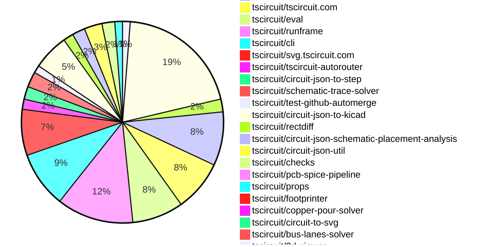

# contribution tracker

[contributions.tscircuit.com](https://contributions.tscircuit.com) ・ [tscircuit.com](https://tscircuit.com) ・ [Contribution Overviews](./contribution-overviews/) ・ [Changelogs](./changelogs/)

Generates weekly contribution overviews for tscircuit contributors. Check out all
the [contribution overviews here](./contribution-overviews/)
You can find AI-generated monthly changelogs in the [changelogs directory](./changelogs/)

- All PRs in the tscircuit org are scanned/summarized via an LLM
- The LLM classifies each Diff/PR as into a set of attributes for scoring
- All the PRs, summaries, and classifications are organized into charts and tables for [the website](https://contributions.tscircuit.com)

> Want to run locally? See the [Development Section](#development)

## Current Week

<!-- START_CURRENT_WEEK -->

# Contribution Overview 2026-10-20

The current week is shown below. There are 3 major sections:

- [Contributor Overview](#contributor-overview)
- [PRs by Repository](#prs-by-repository)
- [PRs by Contributor](#changes-by-contributor)
- [Scoring & Sponsorship Details](/docs/sponsorship-calculation-explanation.md)

## PRs by Repository



## Contributor Overview

| Contributor | 🐳 Major | 🐙 Minor | 🐌 Tiny | Score | ⭐ |
|-------------|---------|---------|---------|-------|-----|
| [MustafaMulla29](#MustafaMulla29) | 2 | 5 | 11 | 30 | ⭐⭐ |
| [ShiboSoftwareDev](#ShiboSoftwareDev) | 2 | 0 | 3 | 21 | ⭐⭐ |
| [Abse2001](#Abse2001) | 1 | 4 | 7 | 20 | ⭐⭐ |
| [mohan-bee](#mohan-bee) | 1 | 4 | 5 | 20 | ⭐⭐ |
| [0hmX](#0hmX) | 3 | 0 | 2 | 15 | ⭐⭐ |
| [Devesh36](#Devesh36) | 0 | 5 | 3 | 14 | ⭐⭐ |
| [rushabhcodes](#rushabhcodes) | 0 | 4 | 4 | 13 | ⭐⭐ |
| [seveibar](#seveibar) | 1 | 3 | 2 | 13 | ⭐⭐ |
| [tscircuitbot](#tscircuitbot) | 0 | 0 | 175 | 12 | ⭐⭐ |
| [GokulPandi-M](#GokulPandi-M) | 0 | 1 | 2 | 4 | ⭐ |
| [AnasSarkiz](#AnasSarkiz) | 1 | 0 | 0 | 4 | ⭐ |
| [imrishabh18](#imrishabh18) | 0 | 0 | 2 | 3 |  |
| [hrithik18k](#hrithik18k) | 0 | 0 | 3 | 3 |  |
| [anil08607](#anil08607) | 0 | 1 | 0 | 2 |  |
| [KrishnaX12](#KrishnaX12) | 0 | 0 | 1 | 1 |  |

## Staff Pass Ratio (SPR)

| Contributor | Reviewed PRs | Rejections | Approvals | SPR |
|-------------|--------------|------------|-----------|-----|
| [Abse2001](#Abse2001) | 2 | 0 | 2 | 100.0% |
| [0hmX](#0hmX) | 1 | 0 | 1 | 100.0% |
| [MustafaMulla29](#MustafaMulla29) | 1 | 0 | 1 | 100.0% |
| [ShiboSoftwareDev](#ShiboSoftwareDev) | 1 | 0 | 1 | 100.0% |

<details>
<summary>Abse2001 SPR PRs (2)</summary>

- [#256](https://github.com/tscircuit/circuit-json-util/pull/256) fix: transform footprint origins with PCB placement
- [#457](https://github.com/tscircuit/checks/pull/457) fix: check trace thickness against its own routed copper

</details>

<details>
<summary>0hmX SPR PRs (1)</summary>

- [#4765](https://github.com/tscircuit/core/pull/4765) Render external IBIS simulation declarations from TSX

</details>

<details>
<summary>MustafaMulla29 SPR PRs (1)</summary>

- [#338](https://github.com/tscircuit/circuit-json-schematic-placement-analysis/pull/338) Detect fuse connector misalignment

</details>

<details>
<summary>ShiboSoftwareDev SPR PRs (1)</summary>

- [#1108](https://github.com/tscircuit/pcb-viewer/pull/1108) Improve large-board interaction latency

</details>

> Note: AI evaluates PRs and assigns 1-3 star ratings automatically. 4 and 5 star ratings require manual staff review.

## Review Table

[reviews-received-hover]: ## "Number of reviews received for PRs for this contributor"
[approvals-received-hover]: ## "Number of approvals received for PRs this contributor authored"
[rejections-received-hover]: ## "Number of rejections received for PRs this contributor authored"
[prs-opened-hover]: ## "Number of PRs opened by this contributor"
[issues-created-hover]: ## "Number of issues created by this contributor"

| Contributor | Reviews Received | Approvals Received | Rejections Received | Approvals | Rejections Given | PRs Opened | PRs Merged | Issues Created |
|---|---|---|---|---|---|---|---|---|
| [0hmX](#0hmX) | 10 | 2 | 0 | 1 | 0 | 7 | 5 | 0 |
| [Abse2001](#Abse2001) | 5 | 5 | 0 | 1 | 1 | 19 | 12 | 0 |
| [AnasSarkiz](#AnasSarkiz) | 1 | 1 | 0 | 0 | 0 | 1 | 1 | 0 |
| [anil08607](#anil08607) | 2 | 2 | 0 | 0 | 0 | 4 | 1 | 0 |
| [bacourosp](#bacourosp) | 0 | 0 | 0 | 0 | 0 | 1 | 0 | 0 |
| [Devesh36](#Devesh36) | 13 | 9 | 0 | 1 | 0 | 11 | 8 | 0 |
| [dinoksb](#dinoksb) | 0 | 0 | 0 | 0 | 0 | 2 | 0 | 0 |
| [godgamerex3-boop](#godgamerex3-boop) | 0 | 0 | 0 | 0 | 0 | 1 | 0 | 0 |
| [GokulPandi-M](#GokulPandi-M) | 4 | 4 | 0 | 0 | 0 | 3 | 3 | 0 |
| [hrithik18k](#hrithik18k) | 7 | 5 | 2 | 0 | 0 | 8 | 3 | 0 |
| [imrishabh18](#imrishabh18) | 0 | 0 | 0 | 13 | 1 | 7 | 2 | 0 |
| [KrishnaX12](#KrishnaX12) | 3 | 2 | 0 | 0 | 0 | 1 | 1 | 0 |
| [mohan-bee](#mohan-bee) | 5 | 4 | 1 | 3 | 0 | 17 | 10 | 0 |
| [MustafaMulla29](#MustafaMulla29) | 7 | 6 | 0 | 9 | 2 | 22 | 18 | 0 |
| [rushabhcodes](#rushabhcodes) | 25 | 5 | 0 | 2 | 0 | 17 | 8 | 0 |
| [seveibar](#seveibar) | 5 | 0 | 0 | 8 | 0 | 13 | 7 | 0 |
| [ShiboSoftwareDev](#ShiboSoftwareDev) | 2 | 2 | 0 | 10 | 0 | 13 | 5 | 0 |
| [Shmanya](#Shmanya) | 0 | 0 | 0 | 0 | 0 | 1 | 0 | 0 |
| [techmannih](#techmannih) | 1 | 0 | 1 | 0 | 0 | 5 | 0 | 0 |
| [trixie010](#trixie010) | 1 | 1 | 0 | 0 | 0 | 3 | 0 | 0 |
| [tscircuitbot](#tscircuitbot) | 0 | 0 | 0 | 0 | 0 | 217 | 175 | 0 |

## Changes by Repository

### [tscircuit/pcb-viewer](https://github.com/tscircuit/pcb-viewer)

| PR # | Impact | Rating | Contributor | Description |
|------|--------|--------|-------------|-------------|
| [#1108](https://github.com/tscircuit/pcb-viewer/pull/1108) | 🐳 Major | ⭐⭐⭐ | ShiboSoftwareDev | Caches primitive and trace lookups instead of rescanning the full Circuit JSON during hover and navigation. Camera updates are also limited to one React update per animation frame. The spatial index preserves original primitive order, so overlapping same-layer hits keep their existing selection priority. Median of six fixed-build runs, compared with the three-run baseline, on the 100,548-element TMDS62LEVM fixture:  Interaction  Before  After  Speedup   ---  ---:  ---:  ---:   Hover  489 ms  58 ms  8.5   20 zoom events  1,366 ms  699 ms  2.0   20 drag steps  1,766 ms  384 ms  4.6   React render time during navigation  1,997 ms  90 ms  22.3 |

<details>
<summary>🐌 Tiny Contributions (2)</summary>

| PR # | Impact | Contributor | Description |
|------|--------|-------------|-------------|
| [#1110](https://github.com/tscircuit/pcb-viewer/pull/1110) | 🐌 Tiny | tscircuitbot | Automated package update |
| [#1107](https://github.com/tscircuit/pcb-viewer/pull/1107) | 🐌 Tiny | ShiboSoftwareDev | Adds a browser benchmark using the full 100,548-element TMDS62LEVM board to measure interaction latency before optimization. |

</details>

### [tscircuit/tscircuit](https://github.com/tscircuit/tscircuit)


<details>
<summary>🐌 Tiny Contributions (49)</summary>

| PR # | Impact | Contributor | Description |
|------|--------|-------------|-------------|
| [#5985](https://github.com/tscircuit/tscircuit/pull/5985) | 🐌 Tiny | tscircuitbot | Automated package update |
| [#5984](https://github.com/tscircuit/tscircuit/pull/5984) | 🐌 Tiny | tscircuitbot | Updates the tscircuitcli package to version 0.1.2395 in package.json |
| [#5983](https://github.com/tscircuit/tscircuit/pull/5983) | 🐌 Tiny | tscircuitbot | Automated package update |
| [#5982](https://github.com/tscircuit/tscircuit/pull/5982) | 🐌 Tiny | tscircuitbot | Updates the tscircuitcli package from version 0.1.2393 to 0.1.2394 |
| [#5981](https://github.com/tscircuit/tscircuit/pull/5981) | 🐌 Tiny | tscircuitbot | Automated package update |
| [#5980](https://github.com/tscircuit/tscircuit/pull/5980) | 🐌 Tiny | tscircuitbot | Automated package update |
| [#5979](https://github.com/tscircuit/tscircuit/pull/5979) | 🐌 Tiny | tscircuitbot | Automated package update |
| [#5978](https://github.com/tscircuit/tscircuit/pull/5978) | 🐌 Tiny | tscircuitbot | Updates the tscircuitcli package to version 0.1.2393 |
| [#5976](https://github.com/tscircuit/tscircuit/pull/5976) | 🐌 Tiny | tscircuitbot | Automated package update |
| [#5975](https://github.com/tscircuit/tscircuit/pull/5975) | 🐌 Tiny | tscircuitbot | Automated package update |
| [#5973](https://github.com/tscircuit/tscircuit/pull/5973) | 🐌 Tiny | tscircuitbot | Automated package update |
| [#5971](https://github.com/tscircuit/tscircuit/pull/5971) | 🐌 Tiny | tscircuitbot | Automated package update |
| [#5970](https://github.com/tscircuit/tscircuit/pull/5970) | 🐌 Tiny | tscircuitbot | Updates the tscircuitcli package to version 0.1.2392 |
| [#5969](https://github.com/tscircuit/tscircuit/pull/5969) | 🐌 Tiny | tscircuitbot | Automated package update |
| [#5968](https://github.com/tscircuit/tscircuit/pull/5968) | 🐌 Tiny | tscircuitbot | Automated package update |
| [#5967](https://github.com/tscircuit/tscircuit/pull/5967) | 🐌 Tiny | tscircuitbot | Automated package update |
| [#5966](https://github.com/tscircuit/tscircuit/pull/5966) | 🐌 Tiny | tscircuitbot | Updates the tscircuitcli package to version 0.1.2391 |
| [#5965](https://github.com/tscircuit/tscircuit/pull/5965) | 🐌 Tiny | tscircuitbot | Automated package update |
| [#5963](https://github.com/tscircuit/tscircuit/pull/5963) | 🐌 Tiny | tscircuitbot | Updates the tscircuitcli package to version 0.1.2390 |
| [#5964](https://github.com/tscircuit/tscircuit/pull/5964) | 🐌 Tiny | tscircuitbot | Automated package update |
| [#5962](https://github.com/tscircuit/tscircuit/pull/5962) | 🐌 Tiny | tscircuitbot | Automated package update |
| [#5961](https://github.com/tscircuit/tscircuit/pull/5961) | 🐌 Tiny | tscircuitbot | Automated package update |
| [#5959](https://github.com/tscircuit/tscircuit/pull/5959) | 🐌 Tiny | tscircuitbot | Automated package update |
| [#5958](https://github.com/tscircuit/tscircuit/pull/5958) | 🐌 Tiny | tscircuitbot | Updates the tscircuitcli package version from 0.1.2388 to 0.1.2389 |
| [#5957](https://github.com/tscircuit/tscircuit/pull/5957) | 🐌 Tiny | tscircuitbot | Automated package update |
| [#5956](https://github.com/tscircuit/tscircuit/pull/5956) | 🐌 Tiny | tscircuitbot | Updates the versions of several dependencies in the package.json file. |
| [#5955](https://github.com/tscircuit/tscircuit/pull/5955) | 🐌 Tiny | tscircuitbot | Automated package update |
| [#5954](https://github.com/tscircuit/tscircuit/pull/5954) | 🐌 Tiny | tscircuitbot | Automated package update |
| [#5953](https://github.com/tscircuit/tscircuit/pull/5953) | 🐌 Tiny | tscircuitbot | Automated package update |
| [#5952](https://github.com/tscircuit/tscircuit/pull/5952) | 🐌 Tiny | tscircuitbot | Updates the tscircuitcli package version from 0.1.2386 to 0.1.2387 |
| [#5951](https://github.com/tscircuit/tscircuit/pull/5951) | 🐌 Tiny | tscircuitbot | Automated package update |
| [#5950](https://github.com/tscircuit/tscircuit/pull/5950) | 🐌 Tiny | tscircuitbot | Automated package update |
| [#5949](https://github.com/tscircuit/tscircuit/pull/5949) | 🐌 Tiny | tscircuitbot | Automated package update |
| [#5948](https://github.com/tscircuit/tscircuit/pull/5948) | 🐌 Tiny | tscircuitbot | Updates the tscircuitcli package to version 0.1.2386 |
| [#5947](https://github.com/tscircuit/tscircuit/pull/5947) | 🐌 Tiny | tscircuitbot | Automated package update |
| [#5946](https://github.com/tscircuit/tscircuit/pull/5946) | 🐌 Tiny | tscircuitbot | Automated package update |
| [#5945](https://github.com/tscircuit/tscircuit/pull/5945) | 🐌 Tiny | tscircuitbot | Automated package update |
| [#5944](https://github.com/tscircuit/tscircuit/pull/5944) | 🐌 Tiny | tscircuitbot | Updates the tscircuitcli package to version 0.1.2385 |
| [#5943](https://github.com/tscircuit/tscircuit/pull/5943) | 🐌 Tiny | tscircuitbot | Automated package update |
| [#5942](https://github.com/tscircuit/tscircuit/pull/5942) | 🐌 Tiny | tscircuitbot | Automated package update |
| [#5941](https://github.com/tscircuit/tscircuit/pull/5941) | 🐌 Tiny | tscircuitbot | Automated package update |
| [#5940](https://github.com/tscircuit/tscircuit/pull/5940) | 🐌 Tiny | tscircuitbot | Updates the tscircuitcli package to version 0.1.2384 |
| [#5939](https://github.com/tscircuit/tscircuit/pull/5939) | 🐌 Tiny | tscircuitbot | Automated package update |
| [#5938](https://github.com/tscircuit/tscircuit/pull/5938) | 🐌 Tiny | tscircuitbot | Updates the tscircuitcli package from version 0.1.2382 to 0.1.2383 and the tscircuitrunframe package from version 0.0.3033 to 0.0.3034 in package.json |
| [#5937](https://github.com/tscircuit/tscircuit/pull/5937) | 🐌 Tiny | tscircuitbot | Automated package update |
| [#5936](https://github.com/tscircuit/tscircuit/pull/5936) | 🐌 Tiny | tscircuitbot | Automated package update |
| [#5974](https://github.com/tscircuit/tscircuit/pull/5974) | 🐌 Tiny | MustafaMulla29 | Update tscircuitcircuit-json-util from 0.0.123 to 0.0.126 and refresh the Bun lockfile, resolving parsel-js dependency from 1.2.2 to 1.2.3. |
| [#5972](https://github.com/tscircuit/tscircuit/pull/5972) | 🐌 Tiny | MustafaMulla29 | Updates the dependencies for tscircuitcore, tscircuiteval, and tscircuitchecks to their latest versions. |
| [#5960](https://github.com/tscircuit/tscircuit/pull/5960) | 🐌 Tiny | MustafaMulla29 | Updates the tscircuitcircuit-json-util dependency from version 0.0.123 to 0.0.125, incorporating the isRouteViaCoveredByPhysicalVia helper for enhanced functionality in subsequent releases. |

</details>

### [tscircuit/circuit-json](https://github.com/tscircuit/circuit-json)

| PR # | Impact | Rating | Contributor | Description |
|------|--------|--------|-------------|-------------|
| [#911](https://github.com/tscircuit/circuit-json/pull/911) | 🐳 Major | ⭐⭐⭐ | 0hmX | Adds a new pcb_stackup element to Circuit JSON for carrying resolved physical layer data alongside the board, allowing consumers to access material properties without needing to re-resolve templates or read side files. |

<details>
<summary>🐌 Tiny Contributions (4)</summary>

| PR # | Impact | Contributor | Description |
|------|--------|-------------|-------------|
| [#916](https://github.com/tscircuit/circuit-json/pull/916) | 🐌 Tiny | tscircuitbot | Automated package update |
| [#915](https://github.com/tscircuit/circuit-json/pull/915) | 🐌 Tiny | tscircuitbot | Automated package update |
| [#913](https://github.com/tscircuit/circuit-json/pull/913) | 🐌 Tiny | Abse2001 | Adds optional footprint origin to PCB components, allowing for independent placement from copper bounds while maintaining backward compatibility with older records. |
| [#914](https://github.com/tscircuit/circuit-json/pull/914) | 🐌 Tiny | Abse2001 | Adds optional footprint origin to PCB components, allowing for independent placement from copper bounds while maintaining existing semantics. |

</details>

### [tscircuit/core](https://github.com/tscircuit/core)

| PR # | Impact | Rating | Contributor | Description |
|------|--------|--------|-------------|-------------|
| [#4765](https://github.com/tscircuit/core/pull/4765) | 🐳 Major | ⭐⭐⭐ | 0hmX | Add native TSX declarations for IBIS models, binary traffic, and eye requests, exporting them as Circuit JSON for the local PCB extractionSPICE runner. Existing spiceEnginepcb_spice selects that backend; no executionMode prop or execution_mode record field is introduced. The built-in render phase skips that backend while native experiments continue to execute. Models use the shared Asset object and explicit vendor componentpinmodel names. Core maps port labels to physical source_port_id values, translates Boolean directionoutput-enable states, and preserves the requested IBIS data column and package parasitics choice. Reference roles identify physical supplyclamp ports. Duplicate physical pin mappings, unmapped referencemodel keys, stimuli without an enabled output, and pin states without exactly one model binding are rejected. Model binding validation runs after all declarations render, so JSX order does not matter. Dependencies  merge order: https:github.comtscircuitcircuit-jsonpull908, https:github.comtscircuitpropspull945, then this PR. The verified preview pins must be replaced with published versions before merging. The repository dependency guard remains unchanged. Validation: all 43 targeted simulation tests pass, including eight IBIS integration tests and a PCB snapshot. Schemaprops suites pass (479 and 687 tests). Independent Opus review confirmed the schema review changes and both additional pin-binding fixes. TypeScript and the package build (ESM and declarations) pass. GitHub build, smoke-test, type-check, and all ten test shards pass. No new enums, ternaries, docs, or README edits are included. Rendering does not fetch assets, install tools, or execute external solvers. CLIlocal-runner wiring and CSVHTML result commands remain follow-ups. No Python or solver binaries are added; the prototype backends three-selected-trace limit is unchanged. |
| [#4807](https://github.com/tscircuit/core/pull/4807) | 🐳 Major | ⭐⭐⭐ | Abse2001 | Preserves authored footprint origins for CAD placement, ensuring accurate positioning of components during layout. |
| [#4541](https://github.com/tscircuit/core/pull/4541) | 🐳 Major | ⭐⭐⭐ | mohan-bee | Fixes PCB trace saving failure when using custom schematic symbols by correcting the port selector logic. |
| [#4812](https://github.com/tscircuit/core/pull/4812) | 🐙 Minor | ⭐⭐ | MustafaMulla29 | Reproduces inline schematic text positions for labels away from their wires in the TB67S579FTG breakout, validating current behavior with comprehensive tests and snapshots. |
| [#4811](https://github.com/tscircuit/core/pull/4811) | 🐙 Minor | ⭐⭐ | MustafaMulla29 | Saves inline text positions on schematic wires, preserving alignment and relationships, while updating the schematic-trace-solver dependency. |
| [#4818](https://github.com/tscircuit/core/pull/4818) | 🐙 Minor | ⭐⭐ | Devesh36 | Fixes polygon-pad overlap in PCB flex layout by accurately calculating bounds for nonrectangular polygons and circular primitives, ensuring proper spacing between pads. |
| [#4816](https://github.com/tscircuit/core/pull/4816) | 🐙 Minor | ⭐⭐ | Devesh36 | Fixes the LED outline rotation reproduced in 4622, ensuring that rotating LED footprints also rotates their corresponding silkscreen rectangles correctly. |
| [#4817](https://github.com/tscircuit/core/pull/4817) | 🐙 Minor | ⭐⭐ | Devesh36 | Fixes the connector mounting-slot rotation reproduced in 4623, ensuring vertical mounting slots align with silkscreen guides and pads when a connector is rotated 90. |
| [#4699](https://github.com/tscircuit/core/pull/4699) | 🐙 Minor | ⭐⭐ | mohan-bee | Fixes the issue where metal-lined connector holes in four-layer boards inside panels do not connect to the inner copper layers, only recording the top and bottom layers. |
| [#4700](https://github.com/tscircuit/core/pull/4700) | 🐙 Minor | ⭐⭐ | mohan-bee | Reproduces missing inner copper layers on plated connector holes inside native panels, ensuring that both inner and outer layers are correctly represented in the test. |

<details>
<summary>🐌 Tiny Contributions (11)</summary>

| PR # | Impact | Contributor | Description |
|------|--------|-------------|-------------|
| [#4822](https://github.com/tscircuit/core/pull/4822) | 🐌 Tiny | tscircuitbot | Updates the version of the tscircuitchecks package from 0.0.260 to 0.0.261 in package.json |
| [#4820](https://github.com/tscircuit/core/pull/4820) | 🐌 Tiny | tscircuitbot | Updates the version of the tscircuitchecks package from 0.0.259 to 0.0.260 in package.json |
| [#4819](https://github.com/tscircuit/core/pull/4819) | 🐌 Tiny | tscircuitbot | Updates the version of the tscircuitchecks package from 0.0.259 to 0.0.260 in package.json |
| [#4809](https://github.com/tscircuit/core/pull/4809) | 🐌 Tiny | tscircuitbot | Updates the version of the tscircuitchecks package from 0.0.258 to 0.0.259 in package.json |
| [#4808](https://github.com/tscircuit/core/pull/4808) | 🐌 Tiny | tscircuitbot | Updates the version of the tscircuitchecks package from 0.0.258 to 0.0.259 in package.json |
| [#4825](https://github.com/tscircuit/core/pull/4825) | 🐌 Tiny | rushabhcodes | Updates circuit-to-svg to version 0.0.453, fixing rotated polygon plated holes and PCB bounds for traces containing vias, and refreshes SVG snapshots for display-label and SOIC8 fanout phase. |
| [#4805](https://github.com/tscircuit/core/pull/4805) | 🐌 Tiny | seveibar | Updates the bundled tscircuitbus-lanes-solver from version 0.0.21 to 0.0.27, incorporating fixes for AM3352 byte routing stalls and default-layer escapes. |
| [#4673](https://github.com/tscircuit/core/pull/4673) | 🐌 Tiny | Devesh36 | Reproduces a bug where the PCB note rectangle does not rotate with its parent chip, demonstrating the issue with a test case and snapshot. |
| [#4540](https://github.com/tscircuit/core/pull/4540) | 🐌 Tiny | mohan-bee | Reproduces the saved PCB path export failure observed with the LoRaLink custom schematic symbol. |
| [#4815](https://github.com/tscircuit/core/pull/4815) | 🐌 Tiny | mohan-bee | Updates the tscircuitmatchpack dependency to version 0.0.100 in the package.json file. |
| [#4814](https://github.com/tscircuit/core/pull/4814) | 🐌 Tiny | mohan-bee | Updates the schematic trace solver dependency from version 0.0.230 to 0.0.236. |

</details>

### [tscircuit/tscircuit.com](https://github.com/tscircuit/tscircuit.com)

| PR # | Impact | Rating | Contributor | Description |
|------|--------|--------|-------------|-------------|
| [#5495](https://github.com/tscircuit/tscircuit.com/pull/5495) | 🐙 Minor | ⭐⭐ | anil08607 | Fixes the issue where downloading a hierarchical KiCad project only included the root schematic file, ensuring all child schematic sheets are included in the download. |

<details>
<summary>🐌 Tiny Contributions (19)</summary>

| PR # | Impact | Contributor | Description |
|------|--------|-------------|-------------|
| [#5542](https://github.com/tscircuit/tscircuit.com/pull/5542) | 🐌 Tiny | tscircuitbot | Updates the tscircuitrunframe package version from 0.0.3044 to 0.0.3046 |
| [#5541](https://github.com/tscircuit/tscircuit.com/pull/5541) | 🐌 Tiny | tscircuitbot | Updates the tscircuiteval package from version 0.0.1649 to 0.0.1650 |
| [#5540](https://github.com/tscircuit/tscircuit.com/pull/5540) | 🐌 Tiny | tscircuitbot | Automated package update |
| [#5539](https://github.com/tscircuit/tscircuit.com/pull/5539) | 🐌 Tiny | tscircuitbot | Automated package update |
| [#5537](https://github.com/tscircuit/tscircuit.com/pull/5537) | 🐌 Tiny | tscircuitbot | Updates the tscircuitrunframe package from version 0.0.3042 to 0.0.3043 |
| [#5536](https://github.com/tscircuit/tscircuit.com/pull/5536) | 🐌 Tiny | tscircuitbot | Updates the tscircuitrunframe package from version 0.0.3041 to 0.0.3042 |
| [#5534](https://github.com/tscircuit/tscircuit.com/pull/5534) | 🐌 Tiny | tscircuitbot | Automated package update |
| [#5533](https://github.com/tscircuit/tscircuit.com/pull/5533) | 🐌 Tiny | tscircuitbot | Automated package update |
| [#5531](https://github.com/tscircuit/tscircuit.com/pull/5531) | 🐌 Tiny | tscircuitbot | Updates the tscircuitrunframe package from version 0.0.3038 to 0.0.3039 |
| [#5530](https://github.com/tscircuit/tscircuit.com/pull/5530) | 🐌 Tiny | tscircuitbot | Updates the tscircuiteval package from version 0.0.1644 to 0.0.1645 |
| [#5529](https://github.com/tscircuit/tscircuit.com/pull/5529) | 🐌 Tiny | tscircuitbot | Updates the tscircuitrunframe package from version 0.0.3036 to 0.0.3038 |
| [#5528](https://github.com/tscircuit/tscircuit.com/pull/5528) | 🐌 Tiny | tscircuitbot | Updates the tscircuiteval package from version 0.0.1643 to 0.0.1644 in the package.json file. |
| [#5526](https://github.com/tscircuit/tscircuit.com/pull/5526) | 🐌 Tiny | tscircuitbot | Updates the tscircuiteval package from version 0.0.1642 to 0.0.1643 |
| [#5525](https://github.com/tscircuit/tscircuit.com/pull/5525) | 🐌 Tiny | tscircuitbot | Automated package update |
| [#5524](https://github.com/tscircuit/tscircuit.com/pull/5524) | 🐌 Tiny | tscircuitbot | Updates the tscircuitrunframe package to version 0.0.3035 |
| [#5523](https://github.com/tscircuit/tscircuit.com/pull/5523) | 🐌 Tiny | tscircuitbot | Automated package update |
| [#5522](https://github.com/tscircuit/tscircuit.com/pull/5522) | 🐌 Tiny | tscircuitbot | Updates the tscircuiteval package from version 0.0.1641 to 0.0.1642 |
| [#5521](https://github.com/tscircuit/tscircuit.com/pull/5521) | 🐌 Tiny | tscircuitbot | Automated package update |
| [#5519](https://github.com/tscircuit/tscircuit.com/pull/5519) | 🐌 Tiny | tscircuitbot | Updates the tscircuiteval package from version 0.0.1640 to 0.0.1641 |

</details>

### [tscircuit/eval](https://github.com/tscircuit/eval)


<details>
<summary>🐌 Tiny Contributions (20)</summary>

| PR # | Impact | Contributor | Description |
|------|--------|-------------|-------------|
| [#5362](https://github.com/tscircuit/eval/pull/5362) | 🐌 Tiny | tscircuitbot | Automated package update |
| [#5361](https://github.com/tscircuit/eval/pull/5361) | 🐌 Tiny | tscircuitbot | Automated package update |
| [#5359](https://github.com/tscircuit/eval/pull/5359) | 🐌 Tiny | tscircuitbot | Automated package update |
| [#5358](https://github.com/tscircuit/eval/pull/5358) | 🐌 Tiny | tscircuitbot | Automated package update |
| [#5356](https://github.com/tscircuit/eval/pull/5356) | 🐌 Tiny | tscircuitbot | Automated package update |
| [#5355](https://github.com/tscircuit/eval/pull/5355) | 🐌 Tiny | tscircuitbot | Automated package update |
| [#5352](https://github.com/tscircuit/eval/pull/5352) | 🐌 Tiny | tscircuitbot | Automated package update |
| [#5351](https://github.com/tscircuit/eval/pull/5351) | 🐌 Tiny | tscircuitbot | Updates package dependencies to their latest versions as part of routine maintenance. |
| [#5349](https://github.com/tscircuit/eval/pull/5349) | 🐌 Tiny | tscircuitbot | Automated package update |
| [#5348](https://github.com/tscircuit/eval/pull/5348) | 🐌 Tiny | tscircuitbot | Updates the version of the tscircuitcore package from 0.0.2184 to 0.0.2185 in package.json |
| [#5346](https://github.com/tscircuit/eval/pull/5346) | 🐌 Tiny | tscircuitbot | Automated package update |
| [#5345](https://github.com/tscircuit/eval/pull/5345) | 🐌 Tiny | tscircuitbot | Automated package update |
| [#5343](https://github.com/tscircuit/eval/pull/5343) | 🐌 Tiny | tscircuitbot | Automated package update |
| [#5342](https://github.com/tscircuit/eval/pull/5342) | 🐌 Tiny | tscircuitbot | Automated package update |
| [#5340](https://github.com/tscircuit/eval/pull/5340) | 🐌 Tiny | tscircuitbot | Automated package update |
| [#5339](https://github.com/tscircuit/eval/pull/5339) | 🐌 Tiny | tscircuitbot | Updates package dependencies to their latest versions as part of routine maintenance. |
| [#5337](https://github.com/tscircuit/eval/pull/5337) | 🐌 Tiny | tscircuitbot | Automated package update |
| [#5336](https://github.com/tscircuit/eval/pull/5336) | 🐌 Tiny | tscircuitbot | Automated package update |
| [#5334](https://github.com/tscircuit/eval/pull/5334) | 🐌 Tiny | tscircuitbot | Automated package update |
| [#5333](https://github.com/tscircuit/eval/pull/5333) | 🐌 Tiny | tscircuitbot | Updates the version of the tscircuitcore package from 0.0.2179 to 0.0.2180 in package.json |

</details>

### [tscircuit/runframe](https://github.com/tscircuit/runframe)


<details>
<summary>🐌 Tiny Contributions (30)</summary>

| PR # | Impact | Contributor | Description |
|------|--------|-------------|-------------|
| [#5866](https://github.com/tscircuit/runframe/pull/5866) | 🐌 Tiny | tscircuitbot | Automated package update |
| [#5865](https://github.com/tscircuit/runframe/pull/5865) | 🐌 Tiny | tscircuitbot | Updates the tscircuiteval package from version 0.0.1649 to 0.0.1650 in the package.json file. |
| [#5864](https://github.com/tscircuit/runframe/pull/5864) | 🐌 Tiny | tscircuitbot | Automated package update |
| [#5863](https://github.com/tscircuit/runframe/pull/5863) | 🐌 Tiny | tscircuitbot | Updates the tscircuiteval package from version 0.0.1647 to 0.0.1649 in the package.json file. |
| [#5862](https://github.com/tscircuit/runframe/pull/5862) | 🐌 Tiny | tscircuitbot | Automated package update |
| [#5861](https://github.com/tscircuit/runframe/pull/5861) | 🐌 Tiny | tscircuitbot | Updates the circuit-json-to-kicad package version from 0.0.246 to 0.0.248 in package.json |
| [#5858](https://github.com/tscircuit/runframe/pull/5858) | 🐌 Tiny | tscircuitbot | Automated package update |
| [#5856](https://github.com/tscircuit/runframe/pull/5856) | 🐌 Tiny | tscircuitbot | Automated package update |
| [#5855](https://github.com/tscircuit/runframe/pull/5855) | 🐌 Tiny | tscircuitbot | Updates the tscircuiteval package from version 0.0.1646 to 0.0.1647 |
| [#5854](https://github.com/tscircuit/runframe/pull/5854) | 🐌 Tiny | tscircuitbot | Automated package update |
| [#5853](https://github.com/tscircuit/runframe/pull/5853) | 🐌 Tiny | tscircuitbot | Updates the circuit-json-to-kicad package version from 0.0.244 to 0.0.246 in package.json |
| [#5851](https://github.com/tscircuit/runframe/pull/5851) | 🐌 Tiny | tscircuitbot | Automated package update |
| [#5850](https://github.com/tscircuit/runframe/pull/5850) | 🐌 Tiny | tscircuitbot | Updates the tscircuiteval package from version 0.0.1645 to 0.0.1646 |
| [#5849](https://github.com/tscircuit/runframe/pull/5849) | 🐌 Tiny | tscircuitbot | Automated package update |
| [#5848](https://github.com/tscircuit/runframe/pull/5848) | 🐌 Tiny | tscircuitbot | Updates the tscircuiteval package from version 0.0.1644 to 0.0.1645 |
| [#5847](https://github.com/tscircuit/runframe/pull/5847) | 🐌 Tiny | tscircuitbot | Automated package update |
| [#5846](https://github.com/tscircuit/runframe/pull/5846) | 🐌 Tiny | tscircuitbot | Updates the tscircuiteval package from version 0.0.1643 to 0.0.1644 |
| [#5845](https://github.com/tscircuit/runframe/pull/5845) | 🐌 Tiny | tscircuitbot | Automated package update |
| [#5844](https://github.com/tscircuit/runframe/pull/5844) | 🐌 Tiny | tscircuitbot | Updates the tscircuiteval package from version 0.0.1642 to 0.0.1643 |
| [#5843](https://github.com/tscircuit/runframe/pull/5843) | 🐌 Tiny | tscircuitbot | Automated package update |
| [#5842](https://github.com/tscircuit/runframe/pull/5842) | 🐌 Tiny | tscircuitbot | Updates the circuit-json-to-kicad package version from 0.0.243 to 0.0.244 in package.json |
| [#5840](https://github.com/tscircuit/runframe/pull/5840) | 🐌 Tiny | tscircuitbot | Automated package update |
| [#5839](https://github.com/tscircuit/runframe/pull/5839) | 🐌 Tiny | tscircuitbot | Updates the circuit-json-to-kicad package version from 0.0.242 to 0.0.243 in package.json |
| [#5837](https://github.com/tscircuit/runframe/pull/5837) | 🐌 Tiny | tscircuitbot | Automated package update |
| [#5836](https://github.com/tscircuit/runframe/pull/5836) | 🐌 Tiny | tscircuitbot | Updates the tscircuiteval package from version 0.0.1641 to 0.0.1642 |
| [#5835](https://github.com/tscircuit/runframe/pull/5835) | 🐌 Tiny | tscircuitbot | Automated package update |
| [#5834](https://github.com/tscircuit/runframe/pull/5834) | 🐌 Tiny | tscircuitbot | Automated package update |
| [#5833](https://github.com/tscircuit/runframe/pull/5833) | 🐌 Tiny | tscircuitbot | Automated package update |
| [#5832](https://github.com/tscircuit/runframe/pull/5832) | 🐌 Tiny | tscircuitbot | Updates the tscircuiteval package from version 0.0.1640 to 0.0.1641 |
| [#5857](https://github.com/tscircuit/runframe/pull/5857) | 🐌 Tiny | imrishabh18 | Updates the tscircuit3d-viewer dependency from version 0.0.627 to 0.0.628 in package.json. |

</details>

### [tscircuit/cli](https://github.com/tscircuit/cli)

| PR # | Impact | Rating | Contributor | Description |
|------|--------|--------|-------------|-------------|
| [#5445](https://github.com/tscircuit/cli/pull/5445) | 🐳 Major | ⭐⭐⭐ | AnasSarkiz | Add project-configured iframe tabs to dev and static sites, allowing external pages to be configured as RunFrame views and refreshed automatically during development. |
| [#5516](https://github.com/tscircuit/cli/pull/5516) | 🐙 Minor | ⭐⭐ | GokulPandi-M | Fixes the package entry point in newly initialized projects to correctly point to the generated circuit file instead of a nonexistent file. |

<details>
<summary>🐌 Tiny Contributions (20)</summary>

| PR # | Impact | Contributor | Description |
|------|--------|-------------|-------------|
| [#5524](https://github.com/tscircuit/cli/pull/5524) | 🐌 Tiny | tscircuitbot | Automated package update |
| [#5523](https://github.com/tscircuit/cli/pull/5523) | 🐌 Tiny | tscircuitbot | Updates the tscircuitrunframe package version from 0.0.3044 to 0.0.3046 in package.json |
| [#5521](https://github.com/tscircuit/cli/pull/5521) | 🐌 Tiny | tscircuitbot | Automated package update |
| [#5520](https://github.com/tscircuit/cli/pull/5520) | 🐌 Tiny | tscircuitbot | Updates the tscircuitrunframe package from version 0.0.3043 to 0.0.3044 |
| [#5519](https://github.com/tscircuit/cli/pull/5519) | 🐌 Tiny | tscircuitbot | Automated package update |
| [#5518](https://github.com/tscircuit/cli/pull/5518) | 🐌 Tiny | tscircuitbot | Updates the tscircuitrunframe package version from 0.0.3041 to 0.0.3043 in package.json |
| [#5514](https://github.com/tscircuit/cli/pull/5514) | 🐌 Tiny | tscircuitbot | Automated package update |
| [#5513](https://github.com/tscircuit/cli/pull/5513) | 🐌 Tiny | tscircuitbot | Updates the tscircuitrunframe package version from 0.0.3040 to 0.0.3041 in package.json |
| [#5511](https://github.com/tscircuit/cli/pull/5511) | 🐌 Tiny | tscircuitbot | Automated package update |
| [#5510](https://github.com/tscircuit/cli/pull/5510) | 🐌 Tiny | tscircuitbot | Updates the tscircuitrunframe package version from 0.0.3038 to 0.0.3040 in package.json |
| [#5507](https://github.com/tscircuit/cli/pull/5507) | 🐌 Tiny | tscircuitbot | Updates the tscircuitrunframe package version from 0.0.3036 to 0.0.3038 in package.json |
| [#5505](https://github.com/tscircuit/cli/pull/5505) | 🐌 Tiny | tscircuitbot | Automated package update |
| [#5504](https://github.com/tscircuit/cli/pull/5504) | 🐌 Tiny | tscircuitbot | Updates the tscircuitrunframe package to version 0.0.3036 in package.json |
| [#5503](https://github.com/tscircuit/cli/pull/5503) | 🐌 Tiny | tscircuitbot | Automated package update |
| [#5499](https://github.com/tscircuit/cli/pull/5499) | 🐌 Tiny | tscircuitbot | Updates the tscircuitrunframe package version from 0.0.3034 to 0.0.3035 in package.json |
| [#5498](https://github.com/tscircuit/cli/pull/5498) | 🐌 Tiny | tscircuitbot | Automated package update |
| [#5497](https://github.com/tscircuit/cli/pull/5497) | 🐌 Tiny | tscircuitbot | Updates the tscircuitrunframe package version from 0.0.3032 to 0.0.3034 in package.json |
| [#5496](https://github.com/tscircuit/cli/pull/5496) | 🐌 Tiny | tscircuitbot | Automated package update |
| [#5493](https://github.com/tscircuit/cli/pull/5493) | 🐌 Tiny | tscircuitbot | Updates the tscircuitrunframe package from version 0.0.3031 to 0.0.3032 |
| [#5512](https://github.com/tscircuit/cli/pull/5512) | 🐌 Tiny | GokulPandi-M | Reproduces a bug where tsci init generates a project with a package.json that incorrectly points to a nonexistent main file, causing confusion for users and tools. |

</details>

### [tscircuit/svg.tscircuit.com](https://github.com/tscircuit/svg.tscircuit.com)


<details>
<summary>🐌 Tiny Contributions (18)</summary>

| PR # | Impact | Contributor | Description |
|------|--------|-------------|-------------|
| [#2726](https://github.com/tscircuit/svg.tscircuit.com/pull/2726) | 🐌 Tiny | tscircuitbot | Updates the tscircuit package version from 0.0.2992 to 0.0.2995 in package.json |
| [#2723](https://github.com/tscircuit/svg.tscircuit.com/pull/2723) | 🐌 Tiny | tscircuitbot | Updates the tscircuit package version from 0.0.2990 to 0.0.2992 in package.json |
| [#2722](https://github.com/tscircuit/svg.tscircuit.com/pull/2722) | 🐌 Tiny | tscircuitbot | Updates the tscircuit package version from 0.0.2987 to 0.0.2990 in package.json |
| [#2719](https://github.com/tscircuit/svg.tscircuit.com/pull/2719) | 🐌 Tiny | tscircuitbot | Updates the tscircuit package version from 0.0.2986 to 0.0.2987 in package.json |
| [#2718](https://github.com/tscircuit/svg.tscircuit.com/pull/2718) | 🐌 Tiny | tscircuitbot | Updates the tscircuit package version from 0.0.2985 to 0.0.2986 in package.json |
| [#2717](https://github.com/tscircuit/svg.tscircuit.com/pull/2717) | 🐌 Tiny | tscircuitbot | Updates the tscircuit package version from 0.0.2983 to 0.0.2985 in package.json |
| [#2715](https://github.com/tscircuit/svg.tscircuit.com/pull/2715) | 🐌 Tiny | tscircuitbot | Updates the tscircuit package version from 0.0.2982 to 0.0.2983 in package.json |
| [#2714](https://github.com/tscircuit/svg.tscircuit.com/pull/2714) | 🐌 Tiny | tscircuitbot | Updates the tscircuit package version from 0.0.2981 to 0.0.2982 in package.json |
| [#2713](https://github.com/tscircuit/svg.tscircuit.com/pull/2713) | 🐌 Tiny | tscircuitbot | Updates the tscircuit package version from 0.0.2980 to 0.0.2981 in package.json |
| [#2712](https://github.com/tscircuit/svg.tscircuit.com/pull/2712) | 🐌 Tiny | tscircuitbot | Updates the tscircuit package version from 0.0.2979 to 0.0.2980 in package.json |
| [#2711](https://github.com/tscircuit/svg.tscircuit.com/pull/2711) | 🐌 Tiny | tscircuitbot | Updates the tscircuit package version from 0.0.2978 to 0.0.2979 in package.json |
| [#2710](https://github.com/tscircuit/svg.tscircuit.com/pull/2710) | 🐌 Tiny | tscircuitbot | Updates the tscircuit package version from 0.0.2977 to 0.0.2978 in package.json |
| [#2709](https://github.com/tscircuit/svg.tscircuit.com/pull/2709) | 🐌 Tiny | tscircuitbot | Updates the tscircuit package version from 0.0.2976 to 0.0.2977 in package.json |
| [#2708](https://github.com/tscircuit/svg.tscircuit.com/pull/2708) | 🐌 Tiny | tscircuitbot | Updates the tscircuit package version from 0.0.2975 to 0.0.2976 in package.json |
| [#2707](https://github.com/tscircuit/svg.tscircuit.com/pull/2707) | 🐌 Tiny | tscircuitbot | Updates the tscircuit package version from 0.0.2974 to 0.0.2975 in package.json |
| [#2706](https://github.com/tscircuit/svg.tscircuit.com/pull/2706) | 🐌 Tiny | tscircuitbot | Updates the tscircuit package version from 0.0.2973 to 0.0.2974 in package.json |
| [#2705](https://github.com/tscircuit/svg.tscircuit.com/pull/2705) | 🐌 Tiny | tscircuitbot | Updates the tscircuit package version from 0.0.2971 to 0.0.2973 in package.json |
| [#2704](https://github.com/tscircuit/svg.tscircuit.com/pull/2704) | 🐌 Tiny | tscircuitbot | Automated package update |

</details>

### [tscircuit/tscircuit-autorouter](https://github.com/tscircuit/tscircuit-autorouter)

| PR # | Impact | Rating | Contributor | Description |
|------|--------|--------|-------------|-------------|
| [#3125](https://github.com/tscircuit/tscircuit-autorouter/pull/3125) | 🐳 Major | ⭐⭐⭐ | seveibar | Pipeline9 can route independent high-density batches through a host-owned SolverRuntime while retaining its existing synchronous solvestep behavior. |
| [#3164](https://github.com/tscircuit/tscircuit-autorouter/pull/3164) | 🐙 Minor | ⭐⭐ | seveibar | A benchmark comparison now runs four fresh passes sequentially on the same machine: base inline, PR inline, base with four routing workers, and PR with four routing workers, providing detailed performance metrics for each configuration. |

<details>
<summary>🐌 Tiny Contributions (2)</summary>

| PR # | Impact | Contributor | Description |
|------|--------|-------------|-------------|
| [#3166](https://github.com/tscircuit/tscircuit-autorouter/pull/3166) | 🐌 Tiny | tscircuitbot | Automated package update |
| [#3161](https://github.com/tscircuit/tscircuit-autorouter/pull/3161) | 🐌 Tiny | tscircuitbot | Automated package update |

</details>

### [tscircuit/circuit-json-to-step](https://github.com/tscircuit/circuit-json-to-step)

| PR # | Impact | Rating | Contributor | Description |
|------|--------|--------|-------------|-------------|
| [#168](https://github.com/tscircuit/circuit-json-to-step/pull/168) | 🐙 Minor | ⭐⭐ | Devesh36 | Fixes the imported STEP color override bug where a printed part requesting colorff6600 now exports orange instead of keeping the STEP files original blue. |
| [#169](https://github.com/tscircuit/circuit-json-to-step/pull/169) | 🐙 Minor | ⭐⭐ | Devesh36 | Fixes the missing rectangular mounting hole reproduced in 152, ensuring that exporting a board with a rectangular opening retains the opening instead of producing a solid board. |

<details>
<summary>🐌 Tiny Contributions (3)</summary>

| PR # | Impact | Contributor | Description |
|------|--------|-------------|-------------|
| [#172](https://github.com/tscircuit/circuit-json-to-step/pull/172) | 🐌 Tiny | tscircuitbot | Automated package update |
| [#171](https://github.com/tscircuit/circuit-json-to-step/pull/171) | 🐌 Tiny | tscircuitbot | Automated package update |
| [#155](https://github.com/tscircuit/circuit-json-to-step/pull/155) | 🐌 Tiny | Devesh36 | Fixes the incorrect placement of a bottom-mounted STEP component that appears above the PCB during export, ensuring it sits below the board as intended. |

</details>

### [tscircuit/schematic-trace-solver](https://github.com/tscircuit/schematic-trace-solver)

| PR # | Impact | Rating | Contributor | Description |
|------|--------|--------|-------------|-------------|
| [#1339](https://github.com/tscircuit/schematic-trace-solver/pull/1339) | 🐳 Major | ⭐⭐⭐ | MustafaMulla29 | Fixes inline label attachment points on routed traces to ensure accurate alignment and attachment, preventing misplacement when labels span jogs in the traces. |
| [#1343](https://github.com/tscircuit/schematic-trace-solver/pull/1343) | 🐙 Minor | ⭐⭐ | mohan-bee | Extends VM trace branches to connect at clean T-junctions, ensuring proper connectivity and eliminating overlaps after cleanup. |

<details>
<summary>🐌 Tiny Contributions (4)</summary>

| PR # | Impact | Contributor | Description |
|------|--------|-------------|-------------|
| [#1347](https://github.com/tscircuit/schematic-trace-solver/pull/1347) | 🐌 Tiny | tscircuitbot | Updates the package version to v0.0.237 for jscdn publication. |
| [#1345](https://github.com/tscircuit/schematic-trace-solver/pull/1345) | 🐌 Tiny | tscircuitbot | Updates the package version from 0.0.234 to 0.0.236 in package.json for jscdn publishing. |
| [#1344](https://github.com/tscircuit/schematic-trace-solver/pull/1344) | 🐌 Tiny | MustafaMulla29 | Reproduce inline attachment points falling off bent wires in cores existing TB67S579FTG breakout. Only J4s schematic position changes, from (7, -0.4) to (4.6, 0.5); the captured solver input retains the original components and connections. The test generates an overview and a close-up of OUT_A_P  OUT_B_P. Dashed boxes show the solvers actual text bounds, and blue dots show its returned anchorPoint. On the current implementation, both dots are 0.1 mm off their wires. The guides use graphics-debug only in the test and do not change routing or placement. The repro also includes a vertical layout of the same TB67 circuit, captured from a layout variant of cores existing repro-tb67s579ftg-inline-net-labels.test.tsx circuit. Components and connections are unchanged; normal schematic layout props place the pin rows at the topbottom and J4 above U1. Open repro-core-tb67s579ftg-vertical-inline-label-attachments-detail.snap.svg: both blue attachment points are 0.1 mm off their wires before the fix. This PR records the current behavior and passes without the fix. It adds the regression tests, captured inputs, and snapshots without changing the solver implementation. The fix in 1339 will be stacked on this branch, adding on-wire assertions and updating these same snapshots so reviewers can see the points move onto the wires while the text boxes stay in place. Validation: the repro test and bunx tsc --noEmit pass on the unmodified solver implementation. Straight vertical terminal coverage: repro-core-tb67s579ftg-vertical-inline-label-attachments-straight-stub.snap.svg shows AGC_OUT from that same captured input, with the text bounds and attachment point. Its attachment is already on the straight wire on main, so this snapshot is unchanged by 1339. |
| [#1340](https://github.com/tscircuit/schematic-trace-solver/pull/1340) | 🐌 Tiny | mohan-bee | Adds a new test case and input JSON for the Gimbal One power sheet routing in the schematic trace solver. |

</details>

### [tscircuit/test-github-automerge](https://github.com/tscircuit/test-github-automerge)


<details>
<summary>🐌 Tiny Contributions (3)</summary>

| PR # | Impact | Contributor | Description |
|------|--------|-------------|-------------|
| [#100](https://github.com/tscircuit/test-github-automerge/pull/100) | 🐌 Tiny | tscircuitbot | Updates the tscircuitcircuit-json-util package to version 0.0.125 in the project dependencies. |
| [#99](https://github.com/tscircuit/test-github-automerge/pull/99) | 🐌 Tiny | tscircuitbot | Automated package update |
| [#97](https://github.com/tscircuit/test-github-automerge/pull/97) | 🐌 Tiny | tscircuitbot | Updates the tscircuitcircuit-json-util package from version 0.0.122 to 0.0.123 in the development dependencies. |

</details>

### [tscircuit/circuit-json-to-kicad](https://github.com/tscircuit/circuit-json-to-kicad)


<details>
<summary>🐌 Tiny Contributions (14)</summary>

| PR # | Impact | Contributor | Description |
|------|--------|-------------|-------------|
| [#727](https://github.com/tscircuit/circuit-json-to-kicad/pull/727) | 🐌 Tiny | tscircuitbot | Automated package update |
| [#724](https://github.com/tscircuit/circuit-json-to-kicad/pull/724) | 🐌 Tiny | tscircuitbot | Automated package update |
| [#720](https://github.com/tscircuit/circuit-json-to-kicad/pull/720) | 🐌 Tiny | tscircuitbot | Automated package update |
| [#717](https://github.com/tscircuit/circuit-json-to-kicad/pull/717) | 🐌 Tiny | tscircuitbot | Automated package update |
| [#714](https://github.com/tscircuit/circuit-json-to-kicad/pull/714) | 🐌 Tiny | tscircuitbot | Updates the package version from v0.0.243 to v0.0.244 in package.json |
| [#697](https://github.com/tscircuit/circuit-json-to-kicad/pull/697) | 🐌 Tiny | MustafaMulla29 | Fixes duplicate route transitions by ensuring that only unique physical vias are exported, reducing the number of exported vias from 10 to 6 when they overlap at the same positions. |
| [#696](https://github.com/tscircuit/circuit-json-to-kicad/pull/696) | 🐌 Tiny | MustafaMulla29 | Reproduces duplicate inner-layer vias from TSX with a focused test that verifies the count and positions of physical and exported vias. |
| [#723](https://github.com/tscircuit/circuit-json-to-kicad/pull/723) | 🐌 Tiny | MustafaMulla29 | Update tscircuit from 0.0.2210 to 0.0.2984, which includes tscircuitcircuit-json-util0.0.125 from tscircuittscircuit5960. This makes the released via coverage helper available through the existing dependency before updating 697. Align the existing circuit-json dependency to 0.0.529; the newer core imports schema exports missing from 0.0.480. Use the main tscircuit import in seven tests whose older alias returns incompatible Circuit JSON types. The alias declaration remains unchanged. Refresh affected PCB, schematic, and 3D snapshots and capacitor footprintmodel expectations (cap0402, cap0603, cap0805). The two changed generated-system SVGs use the actual Linux CI output. Pin Biome to 2.5.15, the version used by the last passing main CI run, to avoid unrelated MarkdownYAML formatting changes from 2.6.2. No converter implementation, test tolerances, or assertions were removed. Known issue deferred from this PR: the newer pushbutton symbol origin shifts pins when exporting older saved Circuit JSON. KiCads netlist confirms that S1.1 and S1.2 become isolated in the blood-pressure-monitor fixture. These snapshots record the current output; they do not fix the connectivity issue. The converter compatibility fix will be handled separately. Validation: typecheck, build, and formatting of tracked files pass. The first Linux CI run passed 221 of 223 tests, with only the two SVG snapshot comparisons failing. Those snapshots are now refreshed from the CI artifacts; the new CI run is pending. Local macOS KiCad also has four exact SVG comparison failures reproduced on unchanged main. An existing wire gap in the legacy simple-circuit JSON fixture also reproduces with the original dependencies and is outside this dependency update. |
| [#716](https://github.com/tscircuit/circuit-json-to-kicad/pull/716) | 🐌 Tiny | MustafaMulla29 | Update tscircuit from 0.0.2046 to 0.0.2210, which supplies connectivity-map 0.0.27 and math-utils 0.0.36 through the existing dependency. Refresh seven reviewed Linux KiCad SVG snapshots for bundled symbol changes, plus the MOSFET library-ID expectation and equivalent footprint angle (-90  270). |
| [#713](https://github.com/tscircuit/circuit-json-to-kicad/pull/713) | 🐌 Tiny | Abse2001 | Fixes KiCad footprint placement by using authored footprint origins instead of default center positions, ensuring accurate geometry offsets during export. |
| [#711](https://github.com/tscircuit/circuit-json-to-kicad/pull/711) | 🐌 Tiny | Abse2001 | Fixes the KiCad board-default export gap in tscircuitcore3903. |
| [#722](https://github.com/tscircuit/circuit-json-to-kicad/pull/722) | 🐌 Tiny | hrithik18k | Reproduces the issue where standalone PCB note rectangles, lines, and paths rendered correctly in Circuit JSON disappear during KiCad export, ensuring board annotations remain visible after export. |
| [#715](https://github.com/tscircuit/circuit-json-to-kicad/pull/715) | 🐌 Tiny | hrithik18k | Preserves standalone PCB notes in KiCad exports by exporting them through the fabrication-text converter, maintaining their attributes while ensuring component notes are exported once. |
| [#709](https://github.com/tscircuit/circuit-json-to-kicad/pull/709) | 🐌 Tiny | hrithik18k | Reproduces a bug where standalone PCB notes are dropped during KiCad export, ensuring that both board-level and footprint notes are preserved in the exported output. |

</details>

### [tscircuit/rectdiff](https://github.com/tscircuit/rectdiff)

| PR # | Impact | Rating | Contributor | Description |
|------|--------|--------|-------------|-------------|
| [#166](https://github.com/tscircuit/rectdiff/pull/166) | 🐳 Major | ⭐⭐⭐ | ShiboSoftwareDev | Fixes floating-point slivers in outline grid coordinates for board109 by coalescing near-identical coordinates, significantly reducing redundant blockers. |

<details>
<summary>🐌 Tiny Contributions (3)</summary>

| PR # | Impact | Contributor | Description |
|------|--------|-------------|-------------|
| [#169](https://github.com/tscircuit/rectdiff/pull/169) | 🐌 Tiny | tscircuitbot | Automated package update |
| [#170](https://github.com/tscircuit/rectdiff/pull/170) | 🐌 Tiny | ShiboSoftwareDev | Fixes formatting issues in the README and release workflow to ensure compliance with Biome 2.6.2 formatting checks. |
| [#165](https://github.com/tscircuit/rectdiff/pull/165) | 🐌 Tiny | ShiboSoftwareDev | Reproduces a bug where board 109s circular outline generates excessive void rectangles, including many below the minimum width, by adding a regression test and fixture without changing production code. |

</details>

### [tscircuit/circuit-json-schematic-placement-analysis](https://github.com/tscircuit/circuit-json-schematic-placement-analysis)

| PR # | Impact | Rating | Contributor | Description |
|------|--------|--------|-------------|-------------|
| [#338](https://github.com/tscircuit/circuit-json-schematic-placement-analysis/pull/338) | 🐳 Major | ⭐⭐⭐ | MustafaMulla29 | Detects misalignment of fuse connectors and ensures proper alignment with grounded two-pin headers in schematic designs. |
| [#336](https://github.com/tscircuit/circuit-json-schematic-placement-analysis/pull/336) | 🐙 Minor | ⭐⭐ | MustafaMulla29 | Detects misalignment between a transistor and LED in a rail-to-rail indicator branch, ensuring proper alignment for electrical connections. |

<details>
<summary>🐌 Tiny Contributions (3)</summary>

| PR # | Impact | Contributor | Description |
|------|--------|-------------|-------------|
| [#347](https://github.com/tscircuit/circuit-json-schematic-placement-analysis/pull/347) | 🐌 Tiny | tscircuitbot | Automated package update |
| [#335](https://github.com/tscircuit/circuit-json-schematic-placement-analysis/pull/335) | 🐌 Tiny | MustafaMulla29 | Reproduces the tracker transistor LED placement with original positions and pin connections for the ESP32 GPS trackers NETLIGHT indicator. |
| [#337](https://github.com/tscircuit/circuit-json-schematic-placement-analysis/pull/337) | 🐌 Tiny | MustafaMulla29 | Reproduces the phone-stand boards F_QIJ_QI connection as a runnable TSX extract, preserving original coordinates and pin geometry while omitting other circuitry and PCB placements. |

</details>

### [tscircuit/circuit-json-util](https://github.com/tscircuit/circuit-json-util)

| PR # | Impact | Rating | Contributor | Description |
|------|--------|--------|-------------|-------------|
| [#258](https://github.com/tscircuit/circuit-json-util/pull/258) | 🐙 Minor | ⭐⭐ | MustafaMulla29 | Add isRouteViaCoveredByPhysicalVia to check whether a physical via covers a traces layer transition at the same coordinates and with compatible diameters. |
| [#257](https://github.com/tscircuit/circuit-json-util/pull/257) | 🐙 Minor | ⭐⭐ | Abse2001 | Applies the existing PCB transformation matrix to the footprint origin of PCB components, ensuring it remains attached during transformations. |
| [#263](https://github.com/tscircuit/circuit-json-util/pull/263) | 🐙 Minor | ⭐⭐ | rushabhcodes | Fixes the orientation of silkscreen text labels to follow the correct rotation after mirroring components, ensuring readability and proper alignment in PCB designs. |
| [#262](https://github.com/tscircuit/circuit-json-util/pull/262) | 🐙 Minor | ⭐⭐ | rushabhcodes | Fixes the issue where mirroring a tilted 0603 resistor did not adjust the SMT pad angles accordingly, ensuring that rotated and reflected pads maintain their correct orientation. |
| [#260](https://github.com/tscircuit/circuit-json-util/pull/260) | 🐙 Minor | ⭐⭐ | rushabhcodes | Fixes courtyard rectangle orientation to correctly follow mirrored placements by reusing the existing rectangle-orientation helper. |

<details>
<summary>🐌 Tiny Contributions (2)</summary>

| PR # | Impact | Contributor | Description |
|------|--------|-------------|-------------|
| [#259](https://github.com/tscircuit/circuit-json-util/pull/259) | 🐌 Tiny | rushabhcodes | Captures transform failures for a rotated 30 0603 resistor, including issues with courtyard orientation, SMT pad angles, and label placement, while adding regression tests for these cases. |
| [#221](https://github.com/tscircuit/circuit-json-util/pull/221) | 🐌 Tiny | GokulPandi-M | Reproduces a bug where the analyzer fails to determine pin 1 orientation for slightly skewed two-pad LED and diode footprints due to small coordinate differences, without changing the analyzers functionality. |

</details>

### [tscircuit/checks](https://github.com/tscircuit/checks)

| PR # | Impact | Rating | Contributor | Description |
|------|--------|--------|-------------|-------------|
| [#460](https://github.com/tscircuit/checks/pull/460) | 🐙 Minor | ⭐⭐ | MustafaMulla29 | Fixes copper-contact DRC crashes when checks and a geometry producer load independent Flatten instances by reconstructing foreign polygons with the local Polygon constructor through Flattens supported JSON representation. |
| [#457](https://github.com/tscircuit/checks/pull/457) | 🐙 Minor | ⭐⭐ | Abse2001 | Fixes incorrect warnings when traces sharing a net request different widths by ensuring checks are made against their own routed segments. |
| [#458](https://github.com/tscircuit/checks/pull/458) | 🐙 Minor | ⭐⭐ | Abse2001 | Fixes routing width checks to match the owning source trace instead of all traces on the same net, ensuring accurate thickness validation for PCB traces. |

<details>
<summary>🐌 Tiny Contributions (2)</summary>

| PR # | Impact | Contributor | Description |
|------|--------|-------------|-------------|
| [#459](https://github.com/tscircuit/checks/pull/459) | 🐌 Tiny | MustafaMulla29 | Reproduces a routing DRC crash caused by a copper-pour boundary issue in the RP2040 BLDC motor-controller board. |
| [#455](https://github.com/tscircuit/checks/pull/455) | 🐌 Tiny | rushabhcodes | Update circuit-to-svg from 0.0.416 to 0.0.453 and refresh 58 affected PCB SVG snapshots for the embedded alphabet font now used for PCB note text. |

</details>

### [tscircuit/pcb-spice-pipeline](https://github.com/tscircuit/pcb-spice-pipeline)

| PR # | Impact | Rating | Contributor | Description |
|------|--------|--------|-------------|-------------|
| [#1](https://github.com/tscircuit/pcb-spice-pipeline/pull/1) | 🐳 Major | ⭐⭐⭐ | 0hmX | Imports the pcb-spice-pipeline implementation (previously developed in 0hmXpcb-spice-pipeline) into the tscircuit org, with its full commit history.  What it does Native tscircuit TSX  routed PCB geometry  FastHenryFasterCap extraction  tscircuitibis-to-spice  ngspice  measured waveforms and eye diagrams. Runtime is plain code, no LLM. src  geometry extraction, RLGC matrices, SPICE assembly, native IBIS consumption, eye-diagram metrics, CLI (pcb-spice-pipeline), --repeat determinism check scripts  pinned native toolchain setup (setup-tools.py), plotting, proveaudit-eye repeatability proofs, reproduce.sh examples  straight trace, routed AM3352 JSON, and the real AM3352 DDR TSX eye example tests  unit tests plus nativereal-board integration tests vendor  experimental tscircuitcoreprops IBIS builds and ibis-to-spice tarball .githubworkflowsci.yml  Linux CI (not yet exercised; the proof was run on Darwin arm64)  Usage sh pnpm exec pcb-spice-pipeline --setup pnpm exec pcb-spice-pipeline index.circuit.tsx pnpm exec pcb-spice-pipeline --repeat index.circuit.tsx  Runnable board project: https:github.com0hmXam3352-ddr-eye  Testing sh pnpm install --frozen-lockfile pnpm typecheck  pnpm test  pnpm test:native |

<details>
<summary>🐌 Tiny Contributions (1)</summary>

| PR # | Impact | Contributor | Description |
|------|--------|-------------|-------------|
| [#2](https://github.com/tscircuit/pcb-spice-pipeline/pull/2) | 🐌 Tiny | 0hmX | Upstream the latest native IBIS simulation pipeline so am3352-ddr-eye can consume this repository as a GitHub dependency instead of a stale workspace copy. prepare builds dist; the package exports its main API and .tsx and installs the pcb-spice-pipeline CLI. Use the existing board fabricatorPreset API with layers, thickness and material. ImportedBoard forwards fabricatorPreset  material, preserves an existing saved pcb_stackup, and binds a generated stackup to the saved board ID. For example, jlcpcb_standard  4 layers  1.6 mm  fr4 resolves JLC04161H-3313. There is no separate stackup-selection prop. Read physical construction exclusively from Circuit JSON pcb_stackup: bottom-copper z frame, each copper layers conductivity (default 5.8e7 Sm), and dielectric r. Missing construction identifies the board and directs callers to fabricatorPreset. Obsolete side-file stackup  conductivity  copper-layer fields are rejected. Both historical straightened-stage return-strip profiles and routed-copper extraction remain supported, with documented homogeneous dielectric assumptions. Dependencies retain released core 0.0.2188  props 0.0.705  Circuit JSON 0.0.531. Actual fabricatorPreset generation, all unit tests, buildtypecheck and a packed consumer were validated against the sibling core tarball. The serializer unit test supplies a stackup emission independently of upstream generation, so it also runs against the released baseline. Blocked before merge: core 4826s pkg.pr.new publication failed across three attempts with check returning 404, and the expected public URL also returned 404. There is no verified preview URL to pin. Add that URL to devDependenciesoverrides once publication works, and replace it with a released core version before merge. No local tarball paths are committed. Existing saved Circuit JSON stackups remain usable on the released baseline. Validation: pnpm typecheck: pass on the committed released-core configuration and sibling core tarball. pnpm test:  tests 137,  pass 137,  fail 0 (both released-core configuration and sibling core tarball). pnpm build, pnpm pack: pass. Scratch consumer under tmppcbsimconsumer-smoke installs the packed tarball and passes main API  pcb-spice-pipelinetsx imports, CLI --help and NodeNext typechecking. Document pnpm 11 consumer URL-dependencybuild-script settings discovered by this clean install. pnpm test:native:  tests 2,  pass 2,  fail 0. Reused the completed shared FastHenryFasterCapngspice setup via PCB_SPICE_TOOLStmppcbsimtoolstools.json. Both manufacturer-backed CMOS  RS485 examples completed actual extraction, native waveforms and eye measurements; the three-signal full mutual RLC ngspice regression also passed. Verified manufacturer IBIS SHA-256 hashes locally and corrected the documented asset destination to the project root models folder (ignored, never committed). git diff --check: pass. Sibling PRs: https:github.comtscircuitcorepull4826 and https:github.com0hmXam3352-ddr-eyepull18.  Generated with Claude Code(https:claude.comclaude-code) |

</details>

### [tscircuit/props](https://github.com/tscircuit/props)

| PR # | Impact | Rating | Contributor | Description |
|------|--------|--------|-------------|-------------|
| [#948](https://github.com/tscircuit/props/pull/948) | 🐙 Minor | ⭐⭐ | Abse2001 | Adds validation for symbol viewboxes to ensure they contain required bounds, improving error diagnostics for malformed inputs. |
| [#949](https://github.com/tscircuit/props/pull/949) | 🐙 Minor | ⭐⭐ | seveibar | Platforms can now specify a local autorouting thread request with platformConfig:  autorouterThreads: 4 . The optional value must be a positive safe integer: 1 requests inline solving, and omission preserves the host default. Parsed values are preserved alongside cloudautorouter settings; browsers remain single-threaded. This PR defines the config contract; supporting hosts must consume it to activate workers. Includes input validation coverage and regenerated READMEprops overview documentation. Ran all four required generation scripts; full suite: 712 passed, 0 failed. Type checking, formatting, and package build pass. |

<details>
<summary>🐌 Tiny Contributions (1)</summary>

| PR # | Impact | Contributor | Description |
|------|--------|-------------|-------------|
| [#945](https://github.com/tscircuit/props/pull/945) | 🐌 Tiny | 0hmX | Add typed ibismodel, analog.digitalstimulus, and analog.eyediagram declarations plus per-experiment IBIS pin states on analog.transientsimulation. |

</details>

### [tscircuit/footprinter](https://github.com/tscircuit/footprinter)


<details>
<summary>🐌 Tiny Contributions (1)</summary>

| PR # | Impact | Contributor | Description |
|------|--------|-------------|-------------|
| [#933](https://github.com/tscircuit/footprinter/pull/933) | 🐌 Tiny | Abse2001 | Adds a polarized option to generic capacitor footprints, allowing for a positive pin marking and specific silkscreen placement without altering existing pad geometry. |

</details>

### [tscircuit/copper-pour-solver](https://github.com/tscircuit/copper-pour-solver)


<details>
<summary>🐌 Tiny Contributions (2)</summary>

| PR # | Impact | Contributor | Description |
|------|--------|-------------|-------------|
| [#128](https://github.com/tscircuit/copper-pour-solver/pull/128) | 🐌 Tiny | Abse2001 | Fixes the automatic release version-bump process to ensure proper versioning and publication of releases without errors. |
| [#129](https://github.com/tscircuit/copper-pour-solver/pull/129) | 🐌 Tiny | Abse2001 | Fixes the release-checkout regression by changing the checkout reference from a commit SHA to the attached main branch, ensuring version commits are preserved in automatic release PRs. |

</details>

### [tscircuit/circuit-to-svg](https://github.com/tscircuit/circuit-to-svg)

| PR # | Impact | Rating | Contributor | Description |
|------|--------|--------|-------------|-------------|
| [#869](https://github.com/tscircuit/circuit-to-svg/pull/869) | 🐙 Minor | ⭐⭐ | rushabhcodes | Fixes the issue where rotating polygon plated holes in PCB SVGs does not rotate their copper outlines and offset drills, ensuring they move together with the pad group during rotation. |

<details>
<summary>🐌 Tiny Contributions (1)</summary>

| PR # | Impact | Contributor | Description |
|------|--------|-------------|-------------|
| [#868](https://github.com/tscircuit/circuit-to-svg/pull/868) | 🐌 Tiny | rushabhcodes | Reproduces a bug where polygon plated pads do not render correctly at specified rotations, specifically asserting that a pad with a 90 rotation is rendered incorrectly. |

</details>

### [tscircuit/bus-lanes-solver](https://github.com/tscircuit/bus-lanes-solver)

| PR # | Impact | Rating | Contributor | Description |
|------|--------|--------|-------------|-------------|
| [#67](https://github.com/tscircuit/bus-lanes-solver/pull/67) | 🐙 Minor | ⭐⭐ | seveibar | Stacks on 66. When global allowedLayers is omitted, explicit per-bus surface restrictions now retain native pad carriers and select the same allocation, routing strategy and search budget as equivalent global TOPBOTTOM restrictions. The shared helper intersects physicalglobalall owning-bus restrictions. The pipeline uses an inferred surface restriction only in its private routing view; public input, constructor parameters, output declarations and supplied copper are preserved. Uncovered signals, empty domains and inner-carrier inputs keep their existing paths. The pipeline diff primarily moves internal reads to that private view. Both reproduction assertions pass. Tests cover intersectingconflicting restrictions, explicit exclusions, defaults, complete small-board output equivalence, and identical escape geometryterminal alternativesdispatch on the exact 46-signal DDR capture. The existing DDR escape regression now stops at allocation rather than assuming a generic planar child. Validation: 492 tests pass; typecheck, formatting and isolated NodebrowserTypeScript package consumers pass. Fresh .benchmark.sh workers solve 1111 legacy placements, each with 4747 connectivity, combined copper DRC, total copper bus matching and pair coupling. Fixed power copper remains unchanged. Every fresh legacy trace array and all eleven reviewed PNGs exactly match the previous successful proof. Measurements, provenance and complete gallery(https:github.comtscircuitbus-lanes-solvertreefixeffective-surface-carrier-layersdocsrouted-am3352-surface-constraints). Up to three benchmark workers ran concurrently; timings are correctness-run measurements, not a paired performance comparison. The real 46-signal SBC capture now selects route_shared_layers with equivalent layer declarations. A bounded 60-second run did not complete. This fixes layer handling; full DDR routing and shared-pair convergence remain unproven. No completed SBC route is claimed by the legacy gallery. |

<details>
<summary>🐌 Tiny Contributions (1)</summary>

| PR # | Impact | Contributor | Description |
|------|--------|-------------|-------------|
| [#66](https://github.com/tscircuit/bus-lanes-solver/pull/66) | 🐌 Tiny | seveibar | Reproduces a bug related to per-bus surface layer restrictions and AM3352 DDR dispatch mismatch without claiming a routing fix. |

</details>

### [tscircuit/3d-viewer](https://github.com/tscircuit/3d-viewer)


<details>
<summary>🐌 Tiny Contributions (1)</summary>

| PR # | Impact | Contributor | Description |
|------|--------|-------------|-------------|
| [#1062](https://github.com/tscircuit/3d-viewer/pull/1062) | 🐌 Tiny | imrishabh18 | Fixes rendering issues in the 3D viewer for flex PCB tails with nonparallel bend axes by updating flex-utils and restoring Float32 boundary precision. |

</details>

### [tscircuit/docs](https://github.com/tscircuit/docs)


<details>
<summary>🐌 Tiny Contributions (1)</summary>

| PR # | Impact | Contributor | Description |
|------|--------|-------------|-------------|
| [#943](https://github.com/tscircuit/docs/pull/943) | 🐌 Tiny | Devesh36 | Fixes the issue where the mobile search container overlaps the theme toggle button in the navbar, ensuring both controls are visible with an 8px gap at mobile widths. |

</details>

### [tscircuit/circuit-json-webgpu](https://github.com/tscircuit/circuit-json-webgpu)

| PR # | Impact | Rating | Contributor | Description |
|------|--------|--------|-------------|-------------|
| [#69](https://github.com/tscircuit/circuit-json-webgpu/pull/69) | 🐙 Minor | ⭐⭐ | mohan-bee | Fixes rendering issue where silkscreen text appears beneath overlapping holes in the circuit design. |

<details>
<summary>🐌 Tiny Contributions (1)</summary>

| PR # | Impact | Contributor | Description |
|------|--------|-------------|-------------|
| [#68](https://github.com/tscircuit/circuit-json-webgpu/pull/68) | 🐌 Tiny | mohan-bee | Reproduces the issue of silkscreen text being hidden where it overlaps a hole, providing a gallery reproduction and pixel checks for occlusion without changing the renderer. |

</details>

### [tscircuit/kicad-to-circuit-json](https://github.com/tscircuit/kicad-to-circuit-json)


<details>
<summary>🐌 Tiny Contributions (1)</summary>

| PR # | Impact | Contributor | Description |
|------|--------|-------------|-------------|
| [#260](https://github.com/tscircuit/kicad-to-circuit-json/pull/260) | 🐌 Tiny | KrishnaX12 | Fixes the issue of missing filled copper footprint polygons during import, ensuring all antenna copper polygons are preserved. |

</details>

## Changes by Contributor

### [tscircuitbot](https://github.com/tscircuitbot)


<details>
<summary>🐌 Tiny Contributions (175)</summary>

| PR # | Impact | Description |
|------|--------|-------------|
| [#1110](https://github.com/tscircuit/pcb-viewer/pull/1110) | 🐌 Tiny | Automated package update |
| [#5985](https://github.com/tscircuit/tscircuit/pull/5985) | 🐌 Tiny | Automated package update |
| [#5984](https://github.com/tscircuit/tscircuit/pull/5984) | 🐌 Tiny | Updates the tscircuitcli package to version 0.1.2395 in package.json |
| [#5983](https://github.com/tscircuit/tscircuit/pull/5983) | 🐌 Tiny | Automated package update |
| [#5982](https://github.com/tscircuit/tscircuit/pull/5982) | 🐌 Tiny | Updates the tscircuitcli package from version 0.1.2393 to 0.1.2394 |
| [#5981](https://github.com/tscircuit/tscircuit/pull/5981) | 🐌 Tiny | Automated package update |
| [#5980](https://github.com/tscircuit/tscircuit/pull/5980) | 🐌 Tiny | Automated package update |
| [#5979](https://github.com/tscircuit/tscircuit/pull/5979) | 🐌 Tiny | Automated package update |
| [#5978](https://github.com/tscircuit/tscircuit/pull/5978) | 🐌 Tiny | Updates the tscircuitcli package to version 0.1.2393 |
| [#5976](https://github.com/tscircuit/tscircuit/pull/5976) | 🐌 Tiny | Automated package update |
| [#5975](https://github.com/tscircuit/tscircuit/pull/5975) | 🐌 Tiny | Automated package update |
| [#5973](https://github.com/tscircuit/tscircuit/pull/5973) | 🐌 Tiny | Automated package update |
| [#5971](https://github.com/tscircuit/tscircuit/pull/5971) | 🐌 Tiny | Automated package update |
| [#5970](https://github.com/tscircuit/tscircuit/pull/5970) | 🐌 Tiny | Updates the tscircuitcli package to version 0.1.2392 |
| [#5969](https://github.com/tscircuit/tscircuit/pull/5969) | 🐌 Tiny | Automated package update |
| [#5968](https://github.com/tscircuit/tscircuit/pull/5968) | 🐌 Tiny | Automated package update |
| [#5967](https://github.com/tscircuit/tscircuit/pull/5967) | 🐌 Tiny | Automated package update |
| [#5966](https://github.com/tscircuit/tscircuit/pull/5966) | 🐌 Tiny | Updates the tscircuitcli package to version 0.1.2391 |
| [#5965](https://github.com/tscircuit/tscircuit/pull/5965) | 🐌 Tiny | Automated package update |
| [#5963](https://github.com/tscircuit/tscircuit/pull/5963) | 🐌 Tiny | Updates the tscircuitcli package to version 0.1.2390 |
| [#5964](https://github.com/tscircuit/tscircuit/pull/5964) | 🐌 Tiny | Automated package update |
| [#5962](https://github.com/tscircuit/tscircuit/pull/5962) | 🐌 Tiny | Automated package update |
| [#5961](https://github.com/tscircuit/tscircuit/pull/5961) | 🐌 Tiny | Automated package update |
| [#5959](https://github.com/tscircuit/tscircuit/pull/5959) | 🐌 Tiny | Automated package update |
| [#5958](https://github.com/tscircuit/tscircuit/pull/5958) | 🐌 Tiny | Updates the tscircuitcli package version from 0.1.2388 to 0.1.2389 |
| [#5957](https://github.com/tscircuit/tscircuit/pull/5957) | 🐌 Tiny | Automated package update |
| [#5956](https://github.com/tscircuit/tscircuit/pull/5956) | 🐌 Tiny | Updates the versions of several dependencies in the package.json file. |
| [#5955](https://github.com/tscircuit/tscircuit/pull/5955) | 🐌 Tiny | Automated package update |
| [#5954](https://github.com/tscircuit/tscircuit/pull/5954) | 🐌 Tiny | Automated package update |
| [#5953](https://github.com/tscircuit/tscircuit/pull/5953) | 🐌 Tiny | Automated package update |
| [#5952](https://github.com/tscircuit/tscircuit/pull/5952) | 🐌 Tiny | Updates the tscircuitcli package version from 0.1.2386 to 0.1.2387 |
| [#5951](https://github.com/tscircuit/tscircuit/pull/5951) | 🐌 Tiny | Automated package update |
| [#5950](https://github.com/tscircuit/tscircuit/pull/5950) | 🐌 Tiny | Automated package update |
| [#5949](https://github.com/tscircuit/tscircuit/pull/5949) | 🐌 Tiny | Automated package update |
| [#5948](https://github.com/tscircuit/tscircuit/pull/5948) | 🐌 Tiny | Updates the tscircuitcli package to version 0.1.2386 |
| [#5947](https://github.com/tscircuit/tscircuit/pull/5947) | 🐌 Tiny | Automated package update |
| [#5946](https://github.com/tscircuit/tscircuit/pull/5946) | 🐌 Tiny | Automated package update |
| [#5945](https://github.com/tscircuit/tscircuit/pull/5945) | 🐌 Tiny | Automated package update |
| [#5944](https://github.com/tscircuit/tscircuit/pull/5944) | 🐌 Tiny | Updates the tscircuitcli package to version 0.1.2385 |
| [#5943](https://github.com/tscircuit/tscircuit/pull/5943) | 🐌 Tiny | Automated package update |
| [#5942](https://github.com/tscircuit/tscircuit/pull/5942) | 🐌 Tiny | Automated package update |
| [#5941](https://github.com/tscircuit/tscircuit/pull/5941) | 🐌 Tiny | Automated package update |
| [#5940](https://github.com/tscircuit/tscircuit/pull/5940) | 🐌 Tiny | Updates the tscircuitcli package to version 0.1.2384 |
| [#5939](https://github.com/tscircuit/tscircuit/pull/5939) | 🐌 Tiny | Automated package update |
| [#5938](https://github.com/tscircuit/tscircuit/pull/5938) | 🐌 Tiny | Updates the tscircuitcli package from version 0.1.2382 to 0.1.2383 and the tscircuitrunframe package from version 0.0.3033 to 0.0.3034 in package.json |
| [#5937](https://github.com/tscircuit/tscircuit/pull/5937) | 🐌 Tiny | Automated package update |
| [#5936](https://github.com/tscircuit/tscircuit/pull/5936) | 🐌 Tiny | Automated package update |
| [#916](https://github.com/tscircuit/circuit-json/pull/916) | 🐌 Tiny | Automated package update |
| [#915](https://github.com/tscircuit/circuit-json/pull/915) | 🐌 Tiny | Automated package update |
| [#4822](https://github.com/tscircuit/core/pull/4822) | 🐌 Tiny | Updates the version of the tscircuitchecks package from 0.0.260 to 0.0.261 in package.json |
| [#4820](https://github.com/tscircuit/core/pull/4820) | 🐌 Tiny | Updates the version of the tscircuitchecks package from 0.0.259 to 0.0.260 in package.json |
| [#4819](https://github.com/tscircuit/core/pull/4819) | 🐌 Tiny | Updates the version of the tscircuitchecks package from 0.0.259 to 0.0.260 in package.json |
| [#4809](https://github.com/tscircuit/core/pull/4809) | 🐌 Tiny | Updates the version of the tscircuitchecks package from 0.0.258 to 0.0.259 in package.json |
| [#4808](https://github.com/tscircuit/core/pull/4808) | 🐌 Tiny | Updates the version of the tscircuitchecks package from 0.0.258 to 0.0.259 in package.json |
| [#5542](https://github.com/tscircuit/tscircuit.com/pull/5542) | 🐌 Tiny | Updates the tscircuitrunframe package version from 0.0.3044 to 0.0.3046 |
| [#5541](https://github.com/tscircuit/tscircuit.com/pull/5541) | 🐌 Tiny | Updates the tscircuiteval package from version 0.0.1649 to 0.0.1650 |
| [#5540](https://github.com/tscircuit/tscircuit.com/pull/5540) | 🐌 Tiny | Automated package update |
| [#5539](https://github.com/tscircuit/tscircuit.com/pull/5539) | 🐌 Tiny | Automated package update |
| [#5537](https://github.com/tscircuit/tscircuit.com/pull/5537) | 🐌 Tiny | Updates the tscircuitrunframe package from version 0.0.3042 to 0.0.3043 |
| [#5536](https://github.com/tscircuit/tscircuit.com/pull/5536) | 🐌 Tiny | Updates the tscircuitrunframe package from version 0.0.3041 to 0.0.3042 |
| [#5534](https://github.com/tscircuit/tscircuit.com/pull/5534) | 🐌 Tiny | Automated package update |
| [#5533](https://github.com/tscircuit/tscircuit.com/pull/5533) | 🐌 Tiny | Automated package update |
| [#5531](https://github.com/tscircuit/tscircuit.com/pull/5531) | 🐌 Tiny | Updates the tscircuitrunframe package from version 0.0.3038 to 0.0.3039 |
| [#5530](https://github.com/tscircuit/tscircuit.com/pull/5530) | 🐌 Tiny | Updates the tscircuiteval package from version 0.0.1644 to 0.0.1645 |
| [#5529](https://github.com/tscircuit/tscircuit.com/pull/5529) | 🐌 Tiny | Updates the tscircuitrunframe package from version 0.0.3036 to 0.0.3038 |
| [#5528](https://github.com/tscircuit/tscircuit.com/pull/5528) | 🐌 Tiny | Updates the tscircuiteval package from version 0.0.1643 to 0.0.1644 in the package.json file. |
| [#5526](https://github.com/tscircuit/tscircuit.com/pull/5526) | 🐌 Tiny | Updates the tscircuiteval package from version 0.0.1642 to 0.0.1643 |
| [#5525](https://github.com/tscircuit/tscircuit.com/pull/5525) | 🐌 Tiny | Automated package update |
| [#5524](https://github.com/tscircuit/tscircuit.com/pull/5524) | 🐌 Tiny | Updates the tscircuitrunframe package to version 0.0.3035 |
| [#5523](https://github.com/tscircuit/tscircuit.com/pull/5523) | 🐌 Tiny | Automated package update |
| [#5522](https://github.com/tscircuit/tscircuit.com/pull/5522) | 🐌 Tiny | Updates the tscircuiteval package from version 0.0.1641 to 0.0.1642 |
| [#5521](https://github.com/tscircuit/tscircuit.com/pull/5521) | 🐌 Tiny | Automated package update |
| [#5519](https://github.com/tscircuit/tscircuit.com/pull/5519) | 🐌 Tiny | Updates the tscircuiteval package from version 0.0.1640 to 0.0.1641 |
| [#5362](https://github.com/tscircuit/eval/pull/5362) | 🐌 Tiny | Automated package update |
| [#5361](https://github.com/tscircuit/eval/pull/5361) | 🐌 Tiny | Automated package update |
| [#5359](https://github.com/tscircuit/eval/pull/5359) | 🐌 Tiny | Automated package update |
| [#5358](https://github.com/tscircuit/eval/pull/5358) | 🐌 Tiny | Automated package update |
| [#5356](https://github.com/tscircuit/eval/pull/5356) | 🐌 Tiny | Automated package update |
| [#5355](https://github.com/tscircuit/eval/pull/5355) | 🐌 Tiny | Automated package update |
| [#5352](https://github.com/tscircuit/eval/pull/5352) | 🐌 Tiny | Automated package update |
| [#5351](https://github.com/tscircuit/eval/pull/5351) | 🐌 Tiny | Updates package dependencies to their latest versions as part of routine maintenance. |
| [#5349](https://github.com/tscircuit/eval/pull/5349) | 🐌 Tiny | Automated package update |
| [#5348](https://github.com/tscircuit/eval/pull/5348) | 🐌 Tiny | Updates the version of the tscircuitcore package from 0.0.2184 to 0.0.2185 in package.json |
| [#5346](https://github.com/tscircuit/eval/pull/5346) | 🐌 Tiny | Automated package update |
| [#5345](https://github.com/tscircuit/eval/pull/5345) | 🐌 Tiny | Automated package update |
| [#5343](https://github.com/tscircuit/eval/pull/5343) | 🐌 Tiny | Automated package update |
| [#5342](https://github.com/tscircuit/eval/pull/5342) | 🐌 Tiny | Automated package update |
| [#5340](https://github.com/tscircuit/eval/pull/5340) | 🐌 Tiny | Automated package update |
| [#5339](https://github.com/tscircuit/eval/pull/5339) | 🐌 Tiny | Updates package dependencies to their latest versions as part of routine maintenance. |
| [#5337](https://github.com/tscircuit/eval/pull/5337) | 🐌 Tiny | Automated package update |
| [#5336](https://github.com/tscircuit/eval/pull/5336) | 🐌 Tiny | Automated package update |
| [#5334](https://github.com/tscircuit/eval/pull/5334) | 🐌 Tiny | Automated package update |
| [#5333](https://github.com/tscircuit/eval/pull/5333) | 🐌 Tiny | Updates the version of the tscircuitcore package from 0.0.2179 to 0.0.2180 in package.json |
| [#5866](https://github.com/tscircuit/runframe/pull/5866) | 🐌 Tiny | Automated package update |
| [#5865](https://github.com/tscircuit/runframe/pull/5865) | 🐌 Tiny | Updates the tscircuiteval package from version 0.0.1649 to 0.0.1650 in the package.json file. |
| [#5864](https://github.com/tscircuit/runframe/pull/5864) | 🐌 Tiny | Automated package update |
| [#5863](https://github.com/tscircuit/runframe/pull/5863) | 🐌 Tiny | Updates the tscircuiteval package from version 0.0.1647 to 0.0.1649 in the package.json file. |
| [#5862](https://github.com/tscircuit/runframe/pull/5862) | 🐌 Tiny | Automated package update |
| [#5861](https://github.com/tscircuit/runframe/pull/5861) | 🐌 Tiny | Updates the circuit-json-to-kicad package version from 0.0.246 to 0.0.248 in package.json |
| [#5858](https://github.com/tscircuit/runframe/pull/5858) | 🐌 Tiny | Automated package update |
| [#5856](https://github.com/tscircuit/runframe/pull/5856) | 🐌 Tiny | Automated package update |
| [#5855](https://github.com/tscircuit/runframe/pull/5855) | 🐌 Tiny | Updates the tscircuiteval package from version 0.0.1646 to 0.0.1647 |
| [#5854](https://github.com/tscircuit/runframe/pull/5854) | 🐌 Tiny | Automated package update |
| [#5853](https://github.com/tscircuit/runframe/pull/5853) | 🐌 Tiny | Updates the circuit-json-to-kicad package version from 0.0.244 to 0.0.246 in package.json |
| [#5851](https://github.com/tscircuit/runframe/pull/5851) | 🐌 Tiny | Automated package update |
| [#5850](https://github.com/tscircuit/runframe/pull/5850) | 🐌 Tiny | Updates the tscircuiteval package from version 0.0.1645 to 0.0.1646 |
| [#5849](https://github.com/tscircuit/runframe/pull/5849) | 🐌 Tiny | Automated package update |
| [#5848](https://github.com/tscircuit/runframe/pull/5848) | 🐌 Tiny | Updates the tscircuiteval package from version 0.0.1644 to 0.0.1645 |
| [#5847](https://github.com/tscircuit/runframe/pull/5847) | 🐌 Tiny | Automated package update |
| [#5846](https://github.com/tscircuit/runframe/pull/5846) | 🐌 Tiny | Updates the tscircuiteval package from version 0.0.1643 to 0.0.1644 |
| [#5845](https://github.com/tscircuit/runframe/pull/5845) | 🐌 Tiny | Automated package update |
| [#5844](https://github.com/tscircuit/runframe/pull/5844) | 🐌 Tiny | Updates the tscircuiteval package from version 0.0.1642 to 0.0.1643 |
| [#5843](https://github.com/tscircuit/runframe/pull/5843) | 🐌 Tiny | Automated package update |
| [#5842](https://github.com/tscircuit/runframe/pull/5842) | 🐌 Tiny | Updates the circuit-json-to-kicad package version from 0.0.243 to 0.0.244 in package.json |
| [#5840](https://github.com/tscircuit/runframe/pull/5840) | 🐌 Tiny | Automated package update |
| [#5839](https://github.com/tscircuit/runframe/pull/5839) | 🐌 Tiny | Updates the circuit-json-to-kicad package version from 0.0.242 to 0.0.243 in package.json |
| [#5837](https://github.com/tscircuit/runframe/pull/5837) | 🐌 Tiny | Automated package update |
| [#5836](https://github.com/tscircuit/runframe/pull/5836) | 🐌 Tiny | Updates the tscircuiteval package from version 0.0.1641 to 0.0.1642 |
| [#5835](https://github.com/tscircuit/runframe/pull/5835) | 🐌 Tiny | Automated package update |
| [#5834](https://github.com/tscircuit/runframe/pull/5834) | 🐌 Tiny | Automated package update |
| [#5833](https://github.com/tscircuit/runframe/pull/5833) | 🐌 Tiny | Automated package update |
| [#5832](https://github.com/tscircuit/runframe/pull/5832) | 🐌 Tiny | Updates the tscircuiteval package from version 0.0.1640 to 0.0.1641 |
| [#5524](https://github.com/tscircuit/cli/pull/5524) | 🐌 Tiny | Automated package update |
| [#5523](https://github.com/tscircuit/cli/pull/5523) | 🐌 Tiny | Updates the tscircuitrunframe package version from 0.0.3044 to 0.0.3046 in package.json |
| [#5521](https://github.com/tscircuit/cli/pull/5521) | 🐌 Tiny | Automated package update |
| [#5520](https://github.com/tscircuit/cli/pull/5520) | 🐌 Tiny | Updates the tscircuitrunframe package from version 0.0.3043 to 0.0.3044 |
| [#5519](https://github.com/tscircuit/cli/pull/5519) | 🐌 Tiny | Automated package update |
| [#5518](https://github.com/tscircuit/cli/pull/5518) | 🐌 Tiny | Updates the tscircuitrunframe package version from 0.0.3041 to 0.0.3043 in package.json |
| [#5514](https://github.com/tscircuit/cli/pull/5514) | 🐌 Tiny | Automated package update |
| [#5513](https://github.com/tscircuit/cli/pull/5513) | 🐌 Tiny | Updates the tscircuitrunframe package version from 0.0.3040 to 0.0.3041 in package.json |
| [#5511](https://github.com/tscircuit/cli/pull/5511) | 🐌 Tiny | Automated package update |
| [#5510](https://github.com/tscircuit/cli/pull/5510) | 🐌 Tiny | Updates the tscircuitrunframe package version from 0.0.3038 to 0.0.3040 in package.json |
| [#5507](https://github.com/tscircuit/cli/pull/5507) | 🐌 Tiny | Updates the tscircuitrunframe package version from 0.0.3036 to 0.0.3038 in package.json |
| [#5505](https://github.com/tscircuit/cli/pull/5505) | 🐌 Tiny | Automated package update |
| [#5504](https://github.com/tscircuit/cli/pull/5504) | 🐌 Tiny | Updates the tscircuitrunframe package to version 0.0.3036 in package.json |
| [#5503](https://github.com/tscircuit/cli/pull/5503) | 🐌 Tiny | Automated package update |
| [#5499](https://github.com/tscircuit/cli/pull/5499) | 🐌 Tiny | Updates the tscircuitrunframe package version from 0.0.3034 to 0.0.3035 in package.json |
| [#5498](https://github.com/tscircuit/cli/pull/5498) | 🐌 Tiny | Automated package update |
| [#5497](https://github.com/tscircuit/cli/pull/5497) | 🐌 Tiny | Updates the tscircuitrunframe package version from 0.0.3032 to 0.0.3034 in package.json |
| [#5496](https://github.com/tscircuit/cli/pull/5496) | 🐌 Tiny | Automated package update |
| [#5493](https://github.com/tscircuit/cli/pull/5493) | 🐌 Tiny | Updates the tscircuitrunframe package from version 0.0.3031 to 0.0.3032 |
| [#2726](https://github.com/tscircuit/svg.tscircuit.com/pull/2726) | 🐌 Tiny | Updates the tscircuit package version from 0.0.2992 to 0.0.2995 in package.json |
| [#2723](https://github.com/tscircuit/svg.tscircuit.com/pull/2723) | 🐌 Tiny | Updates the tscircuit package version from 0.0.2990 to 0.0.2992 in package.json |
| [#2722](https://github.com/tscircuit/svg.tscircuit.com/pull/2722) | 🐌 Tiny | Updates the tscircuit package version from 0.0.2987 to 0.0.2990 in package.json |
| [#2719](https://github.com/tscircuit/svg.tscircuit.com/pull/2719) | 🐌 Tiny | Updates the tscircuit package version from 0.0.2986 to 0.0.2987 in package.json |
| [#2718](https://github.com/tscircuit/svg.tscircuit.com/pull/2718) | 🐌 Tiny | Updates the tscircuit package version from 0.0.2985 to 0.0.2986 in package.json |
| [#2717](https://github.com/tscircuit/svg.tscircuit.com/pull/2717) | 🐌 Tiny | Updates the tscircuit package version from 0.0.2983 to 0.0.2985 in package.json |
| [#2715](https://github.com/tscircuit/svg.tscircuit.com/pull/2715) | 🐌 Tiny | Updates the tscircuit package version from 0.0.2982 to 0.0.2983 in package.json |
| [#2714](https://github.com/tscircuit/svg.tscircuit.com/pull/2714) | 🐌 Tiny | Updates the tscircuit package version from 0.0.2981 to 0.0.2982 in package.json |
| [#2713](https://github.com/tscircuit/svg.tscircuit.com/pull/2713) | 🐌 Tiny | Updates the tscircuit package version from 0.0.2980 to 0.0.2981 in package.json |
| [#2712](https://github.com/tscircuit/svg.tscircuit.com/pull/2712) | 🐌 Tiny | Updates the tscircuit package version from 0.0.2979 to 0.0.2980 in package.json |
| [#2711](https://github.com/tscircuit/svg.tscircuit.com/pull/2711) | 🐌 Tiny | Updates the tscircuit package version from 0.0.2978 to 0.0.2979 in package.json |
| [#2710](https://github.com/tscircuit/svg.tscircuit.com/pull/2710) | 🐌 Tiny | Updates the tscircuit package version from 0.0.2977 to 0.0.2978 in package.json |
| [#2709](https://github.com/tscircuit/svg.tscircuit.com/pull/2709) | 🐌 Tiny | Updates the tscircuit package version from 0.0.2976 to 0.0.2977 in package.json |
| [#2708](https://github.com/tscircuit/svg.tscircuit.com/pull/2708) | 🐌 Tiny | Updates the tscircuit package version from 0.0.2975 to 0.0.2976 in package.json |
| [#2707](https://github.com/tscircuit/svg.tscircuit.com/pull/2707) | 🐌 Tiny | Updates the tscircuit package version from 0.0.2974 to 0.0.2975 in package.json |
| [#2706](https://github.com/tscircuit/svg.tscircuit.com/pull/2706) | 🐌 Tiny | Updates the tscircuit package version from 0.0.2973 to 0.0.2974 in package.json |
| [#2705](https://github.com/tscircuit/svg.tscircuit.com/pull/2705) | 🐌 Tiny | Updates the tscircuit package version from 0.0.2971 to 0.0.2973 in package.json |
| [#2704](https://github.com/tscircuit/svg.tscircuit.com/pull/2704) | 🐌 Tiny | Automated package update |
| [#3166](https://github.com/tscircuit/tscircuit-autorouter/pull/3166) | 🐌 Tiny | Automated package update |
| [#3161](https://github.com/tscircuit/tscircuit-autorouter/pull/3161) | 🐌 Tiny | Automated package update |
| [#172](https://github.com/tscircuit/circuit-json-to-step/pull/172) | 🐌 Tiny | Automated package update |
| [#171](https://github.com/tscircuit/circuit-json-to-step/pull/171) | 🐌 Tiny | Automated package update |
| [#1347](https://github.com/tscircuit/schematic-trace-solver/pull/1347) | 🐌 Tiny | Updates the package version to v0.0.237 for jscdn publication. |
| [#1345](https://github.com/tscircuit/schematic-trace-solver/pull/1345) | 🐌 Tiny | Updates the package version from 0.0.234 to 0.0.236 in package.json for jscdn publishing. |
| [#100](https://github.com/tscircuit/test-github-automerge/pull/100) | 🐌 Tiny | Updates the tscircuitcircuit-json-util package to version 0.0.125 in the project dependencies. |
| [#99](https://github.com/tscircuit/test-github-automerge/pull/99) | 🐌 Tiny | Automated package update |
| [#97](https://github.com/tscircuit/test-github-automerge/pull/97) | 🐌 Tiny | Updates the tscircuitcircuit-json-util package from version 0.0.122 to 0.0.123 in the development dependencies. |
| [#727](https://github.com/tscircuit/circuit-json-to-kicad/pull/727) | 🐌 Tiny | Automated package update |
| [#724](https://github.com/tscircuit/circuit-json-to-kicad/pull/724) | 🐌 Tiny | Automated package update |
| [#720](https://github.com/tscircuit/circuit-json-to-kicad/pull/720) | 🐌 Tiny | Automated package update |
| [#717](https://github.com/tscircuit/circuit-json-to-kicad/pull/717) | 🐌 Tiny | Automated package update |
| [#714](https://github.com/tscircuit/circuit-json-to-kicad/pull/714) | 🐌 Tiny | Updates the package version from v0.0.243 to v0.0.244 in package.json |
| [#169](https://github.com/tscircuit/rectdiff/pull/169) | 🐌 Tiny | Automated package update |
| [#347](https://github.com/tscircuit/circuit-json-schematic-placement-analysis/pull/347) | 🐌 Tiny | Automated package update |

</details>

### [ShiboSoftwareDev](https://github.com/ShiboSoftwareDev)

| PRs # | Impact | Rating | Description |
|------|--------|--------|-------------|
| [#1108](https://github.com/tscircuit/pcb-viewer/pull/1108) | 🐳 Major | ⭐⭐⭐ | Caches primitive and trace lookups instead of rescanning the full Circuit JSON during hover and navigation. Camera updates are also limited to one React update per animation frame. The spatial index preserves original primitive order, so overlapping same-layer hits keep their existing selection priority. Median of six fixed-build runs, compared with the three-run baseline, on the 100,548-element TMDS62LEVM fixture:  Interaction  Before  After  Speedup   ---  ---:  ---:  ---:   Hover  489 ms  58 ms  8.5   20 zoom events  1,366 ms  699 ms  2.0   20 drag steps  1,766 ms  384 ms  4.6   React render time during navigation  1,997 ms  90 ms  22.3 |
| [#166](https://github.com/tscircuit/rectdiff/pull/166) | 🐳 Major | ⭐⭐⭐ | Fixes floating-point slivers in outline grid coordinates for board109 by coalescing near-identical coordinates, significantly reducing redundant blockers. |

<details>
<summary>🐌 Tiny Contributions (3)</summary>

| PR # | Impact | Description |
|------|--------|-------------|
| [#1107](https://github.com/tscircuit/pcb-viewer/pull/1107) | 🐌 Tiny | Adds a browser benchmark using the full 100,548-element TMDS62LEVM board to measure interaction latency before optimization. |
| [#170](https://github.com/tscircuit/rectdiff/pull/170) | 🐌 Tiny | Fixes formatting issues in the README and release workflow to ensure compliance with Biome 2.6.2 formatting checks. |
| [#165](https://github.com/tscircuit/rectdiff/pull/165) | 🐌 Tiny | Reproduces a bug where board 109s circular outline generates excessive void rectangles, including many below the minimum width, by adding a regression test and fixture without changing production code. |

</details>

### [MustafaMulla29](https://github.com/MustafaMulla29)

| PRs # | Impact | Rating | Description |
|------|--------|--------|-------------|
| [#1339](https://github.com/tscircuit/schematic-trace-solver/pull/1339) | 🐳 Major | ⭐⭐⭐ | Fixes inline label attachment points on routed traces to ensure accurate alignment and attachment, preventing misplacement when labels span jogs in the traces. |
| [#338](https://github.com/tscircuit/circuit-json-schematic-placement-analysis/pull/338) | 🐳 Major | ⭐⭐⭐ | Detects misalignment of fuse connectors and ensures proper alignment with grounded two-pin headers in schematic designs. |
| [#258](https://github.com/tscircuit/circuit-json-util/pull/258) | 🐙 Minor | ⭐⭐ | Add isRouteViaCoveredByPhysicalVia to check whether a physical via covers a traces layer transition at the same coordinates and with compatible diameters. |
| [#4812](https://github.com/tscircuit/core/pull/4812) | 🐙 Minor | ⭐⭐ | Reproduces inline schematic text positions for labels away from their wires in the TB67S579FTG breakout, validating current behavior with comprehensive tests and snapshots. |
| [#4811](https://github.com/tscircuit/core/pull/4811) | 🐙 Minor | ⭐⭐ | Saves inline text positions on schematic wires, preserving alignment and relationships, while updating the schematic-trace-solver dependency. |
| [#460](https://github.com/tscircuit/checks/pull/460) | 🐙 Minor | ⭐⭐ | Fixes copper-contact DRC crashes when checks and a geometry producer load independent Flatten instances by reconstructing foreign polygons with the local Polygon constructor through Flattens supported JSON representation. |
| [#336](https://github.com/tscircuit/circuit-json-schematic-placement-analysis/pull/336) | 🐙 Minor | ⭐⭐ | Detects misalignment between a transistor and LED in a rail-to-rail indicator branch, ensuring proper alignment for electrical connections. |

<details>
<summary>🐌 Tiny Contributions (11)</summary>

| PR # | Impact | Description |
|------|--------|-------------|
| [#5974](https://github.com/tscircuit/tscircuit/pull/5974) | 🐌 Tiny | Update tscircuitcircuit-json-util from 0.0.123 to 0.0.126 and refresh the Bun lockfile, resolving parsel-js dependency from 1.2.2 to 1.2.3. |
| [#5972](https://github.com/tscircuit/tscircuit/pull/5972) | 🐌 Tiny | Updates the dependencies for tscircuitcore, tscircuiteval, and tscircuitchecks to their latest versions. |
| [#5960](https://github.com/tscircuit/tscircuit/pull/5960) | 🐌 Tiny | Updates the tscircuitcircuit-json-util dependency from version 0.0.123 to 0.0.125, incorporating the isRouteViaCoveredByPhysicalVia helper for enhanced functionality in subsequent releases. |
| [#459](https://github.com/tscircuit/checks/pull/459) | 🐌 Tiny | Reproduces a routing DRC crash caused by a copper-pour boundary issue in the RP2040 BLDC motor-controller board. |
| [#1344](https://github.com/tscircuit/schematic-trace-solver/pull/1344) | 🐌 Tiny | Reproduce inline attachment points falling off bent wires in cores existing TB67S579FTG breakout. Only J4s schematic position changes, from (7, -0.4) to (4.6, 0.5); the captured solver input retains the original components and connections. The test generates an overview and a close-up of OUT_A_P  OUT_B_P. Dashed boxes show the solvers actual text bounds, and blue dots show its returned anchorPoint. On the current implementation, both dots are 0.1 mm off their wires. The guides use graphics-debug only in the test and do not change routing or placement. The repro also includes a vertical layout of the same TB67 circuit, captured from a layout variant of cores existing repro-tb67s579ftg-inline-net-labels.test.tsx circuit. Components and connections are unchanged; normal schematic layout props place the pin rows at the topbottom and J4 above U1. Open repro-core-tb67s579ftg-vertical-inline-label-attachments-detail.snap.svg: both blue attachment points are 0.1 mm off their wires before the fix. This PR records the current behavior and passes without the fix. It adds the regression tests, captured inputs, and snapshots without changing the solver implementation. The fix in 1339 will be stacked on this branch, adding on-wire assertions and updating these same snapshots so reviewers can see the points move onto the wires while the text boxes stay in place. Validation: the repro test and bunx tsc --noEmit pass on the unmodified solver implementation. Straight vertical terminal coverage: repro-core-tb67s579ftg-vertical-inline-label-attachments-straight-stub.snap.svg shows AGC_OUT from that same captured input, with the text bounds and attachment point. Its attachment is already on the straight wire on main, so this snapshot is unchanged by 1339. |
| [#697](https://github.com/tscircuit/circuit-json-to-kicad/pull/697) | 🐌 Tiny | Fixes duplicate route transitions by ensuring that only unique physical vias are exported, reducing the number of exported vias from 10 to 6 when they overlap at the same positions. |
| [#696](https://github.com/tscircuit/circuit-json-to-kicad/pull/696) | 🐌 Tiny | Reproduces duplicate inner-layer vias from TSX with a focused test that verifies the count and positions of physical and exported vias. |
| [#723](https://github.com/tscircuit/circuit-json-to-kicad/pull/723) | 🐌 Tiny | Update tscircuit from 0.0.2210 to 0.0.2984, which includes tscircuitcircuit-json-util0.0.125 from tscircuittscircuit5960. This makes the released via coverage helper available through the existing dependency before updating 697. Align the existing circuit-json dependency to 0.0.529; the newer core imports schema exports missing from 0.0.480. Use the main tscircuit import in seven tests whose older alias returns incompatible Circuit JSON types. The alias declaration remains unchanged. Refresh affected PCB, schematic, and 3D snapshots and capacitor footprintmodel expectations (cap0402, cap0603, cap0805). The two changed generated-system SVGs use the actual Linux CI output. Pin Biome to 2.5.15, the version used by the last passing main CI run, to avoid unrelated MarkdownYAML formatting changes from 2.6.2. No converter implementation, test tolerances, or assertions were removed. Known issue deferred from this PR: the newer pushbutton symbol origin shifts pins when exporting older saved Circuit JSON. KiCads netlist confirms that S1.1 and S1.2 become isolated in the blood-pressure-monitor fixture. These snapshots record the current output; they do not fix the connectivity issue. The converter compatibility fix will be handled separately. Validation: typecheck, build, and formatting of tracked files pass. The first Linux CI run passed 221 of 223 tests, with only the two SVG snapshot comparisons failing. Those snapshots are now refreshed from the CI artifacts; the new CI run is pending. Local macOS KiCad also has four exact SVG comparison failures reproduced on unchanged main. An existing wire gap in the legacy simple-circuit JSON fixture also reproduces with the original dependencies and is outside this dependency update. |
| [#716](https://github.com/tscircuit/circuit-json-to-kicad/pull/716) | 🐌 Tiny | Update tscircuit from 0.0.2046 to 0.0.2210, which supplies connectivity-map 0.0.27 and math-utils 0.0.36 through the existing dependency. Refresh seven reviewed Linux KiCad SVG snapshots for bundled symbol changes, plus the MOSFET library-ID expectation and equivalent footprint angle (-90  270). |
| [#335](https://github.com/tscircuit/circuit-json-schematic-placement-analysis/pull/335) | 🐌 Tiny | Reproduces the tracker transistor LED placement with original positions and pin connections for the ESP32 GPS trackers NETLIGHT indicator. |
| [#337](https://github.com/tscircuit/circuit-json-schematic-placement-analysis/pull/337) | 🐌 Tiny | Reproduces the phone-stand boards F_QIJ_QI connection as a runnable TSX extract, preserving original coordinates and pin geometry while omitting other circuitry and PCB placements. |

</details>

### [0hmX](https://github.com/0hmX)

| PRs # | Impact | Rating | Description |
|------|--------|--------|-------------|
| [#911](https://github.com/tscircuit/circuit-json/pull/911) | 🐳 Major | ⭐⭐⭐ | Adds a new pcb_stackup element to Circuit JSON for carrying resolved physical layer data alongside the board, allowing consumers to access material properties without needing to re-resolve templates or read side files. |
| [#4765](https://github.com/tscircuit/core/pull/4765) | 🐳 Major | ⭐⭐⭐ | Add native TSX declarations for IBIS models, binary traffic, and eye requests, exporting them as Circuit JSON for the local PCB extractionSPICE runner. Existing spiceEnginepcb_spice selects that backend; no executionMode prop or execution_mode record field is introduced. The built-in render phase skips that backend while native experiments continue to execute. Models use the shared Asset object and explicit vendor componentpinmodel names. Core maps port labels to physical source_port_id values, translates Boolean directionoutput-enable states, and preserves the requested IBIS data column and package parasitics choice. Reference roles identify physical supplyclamp ports. Duplicate physical pin mappings, unmapped referencemodel keys, stimuli without an enabled output, and pin states without exactly one model binding are rejected. Model binding validation runs after all declarations render, so JSX order does not matter. Dependencies  merge order: https:github.comtscircuitcircuit-jsonpull908, https:github.comtscircuitpropspull945, then this PR. The verified preview pins must be replaced with published versions before merging. The repository dependency guard remains unchanged. Validation: all 43 targeted simulation tests pass, including eight IBIS integration tests and a PCB snapshot. Schemaprops suites pass (479 and 687 tests). Independent Opus review confirmed the schema review changes and both additional pin-binding fixes. TypeScript and the package build (ESM and declarations) pass. GitHub build, smoke-test, type-check, and all ten test shards pass. No new enums, ternaries, docs, or README edits are included. Rendering does not fetch assets, install tools, or execute external solvers. CLIlocal-runner wiring and CSVHTML result commands remain follow-ups. No Python or solver binaries are added; the prototype backends three-selected-trace limit is unchanged. |
| [#1](https://github.com/tscircuit/pcb-spice-pipeline/pull/1) | 🐳 Major | ⭐⭐⭐ | Imports the pcb-spice-pipeline implementation (previously developed in 0hmXpcb-spice-pipeline) into the tscircuit org, with its full commit history.  What it does Native tscircuit TSX  routed PCB geometry  FastHenryFasterCap extraction  tscircuitibis-to-spice  ngspice  measured waveforms and eye diagrams. Runtime is plain code, no LLM. src  geometry extraction, RLGC matrices, SPICE assembly, native IBIS consumption, eye-diagram metrics, CLI (pcb-spice-pipeline), --repeat determinism check scripts  pinned native toolchain setup (setup-tools.py), plotting, proveaudit-eye repeatability proofs, reproduce.sh examples  straight trace, routed AM3352 JSON, and the real AM3352 DDR TSX eye example tests  unit tests plus nativereal-board integration tests vendor  experimental tscircuitcoreprops IBIS builds and ibis-to-spice tarball .githubworkflowsci.yml  Linux CI (not yet exercised; the proof was run on Darwin arm64)  Usage sh pnpm exec pcb-spice-pipeline --setup pnpm exec pcb-spice-pipeline index.circuit.tsx pnpm exec pcb-spice-pipeline --repeat index.circuit.tsx  Runnable board project: https:github.com0hmXam3352-ddr-eye  Testing sh pnpm install --frozen-lockfile pnpm typecheck  pnpm test  pnpm test:native |

<details>
<summary>🐌 Tiny Contributions (2)</summary>

| PR # | Impact | Description |
|------|--------|-------------|
| [#945](https://github.com/tscircuit/props/pull/945) | 🐌 Tiny | Add typed ibismodel, analog.digitalstimulus, and analog.eyediagram declarations plus per-experiment IBIS pin states on analog.transientsimulation. |
| [#2](https://github.com/tscircuit/pcb-spice-pipeline/pull/2) | 🐌 Tiny | Upstream the latest native IBIS simulation pipeline so am3352-ddr-eye can consume this repository as a GitHub dependency instead of a stale workspace copy. prepare builds dist; the package exports its main API and .tsx and installs the pcb-spice-pipeline CLI. Use the existing board fabricatorPreset API with layers, thickness and material. ImportedBoard forwards fabricatorPreset  material, preserves an existing saved pcb_stackup, and binds a generated stackup to the saved board ID. For example, jlcpcb_standard  4 layers  1.6 mm  fr4 resolves JLC04161H-3313. There is no separate stackup-selection prop. Read physical construction exclusively from Circuit JSON pcb_stackup: bottom-copper z frame, each copper layers conductivity (default 5.8e7 Sm), and dielectric r. Missing construction identifies the board and directs callers to fabricatorPreset. Obsolete side-file stackup  conductivity  copper-layer fields are rejected. Both historical straightened-stage return-strip profiles and routed-copper extraction remain supported, with documented homogeneous dielectric assumptions. Dependencies retain released core 0.0.2188  props 0.0.705  Circuit JSON 0.0.531. Actual fabricatorPreset generation, all unit tests, buildtypecheck and a packed consumer were validated against the sibling core tarball. The serializer unit test supplies a stackup emission independently of upstream generation, so it also runs against the released baseline. Blocked before merge: core 4826s pkg.pr.new publication failed across three attempts with check returning 404, and the expected public URL also returned 404. There is no verified preview URL to pin. Add that URL to devDependenciesoverrides once publication works, and replace it with a released core version before merge. No local tarball paths are committed. Existing saved Circuit JSON stackups remain usable on the released baseline. Validation: pnpm typecheck: pass on the committed released-core configuration and sibling core tarball. pnpm test:  tests 137,  pass 137,  fail 0 (both released-core configuration and sibling core tarball). pnpm build, pnpm pack: pass. Scratch consumer under tmppcbsimconsumer-smoke installs the packed tarball and passes main API  pcb-spice-pipelinetsx imports, CLI --help and NodeNext typechecking. Document pnpm 11 consumer URL-dependencybuild-script settings discovered by this clean install. pnpm test:native:  tests 2,  pass 2,  fail 0. Reused the completed shared FastHenryFasterCapngspice setup via PCB_SPICE_TOOLStmppcbsimtoolstools.json. Both manufacturer-backed CMOS  RS485 examples completed actual extraction, native waveforms and eye measurements; the three-signal full mutual RLC ngspice regression also passed. Verified manufacturer IBIS SHA-256 hashes locally and corrected the documented asset destination to the project root models folder (ignored, never committed). git diff --check: pass. Sibling PRs: https:github.comtscircuitcorepull4826 and https:github.com0hmXam3352-ddr-eyepull18.  Generated with Claude Code(https:claude.comclaude-code) |

</details>

### [Abse2001](https://github.com/Abse2001)

| PRs # | Impact | Rating | Description |
|------|--------|--------|-------------|
| [#4807](https://github.com/tscircuit/core/pull/4807) | 🐳 Major | ⭐⭐⭐ | Preserves authored footprint origins for CAD placement, ensuring accurate positioning of components during layout. |
| [#257](https://github.com/tscircuit/circuit-json-util/pull/257) | 🐙 Minor | ⭐⭐ | Applies the existing PCB transformation matrix to the footprint origin of PCB components, ensuring it remains attached during transformations. |
| [#948](https://github.com/tscircuit/props/pull/948) | 🐙 Minor | ⭐⭐ | Adds validation for symbol viewboxes to ensure they contain required bounds, improving error diagnostics for malformed inputs. |
| [#457](https://github.com/tscircuit/checks/pull/457) | 🐙 Minor | ⭐⭐ | Fixes incorrect warnings when traces sharing a net request different widths by ensuring checks are made against their own routed segments. |
| [#458](https://github.com/tscircuit/checks/pull/458) | 🐙 Minor | ⭐⭐ | Fixes routing width checks to match the owning source trace instead of all traces on the same net, ensuring accurate thickness validation for PCB traces. |

<details>
<summary>🐌 Tiny Contributions (7)</summary>

| PR # | Impact | Description |
|------|--------|-------------|
| [#913](https://github.com/tscircuit/circuit-json/pull/913) | 🐌 Tiny | Adds optional footprint origin to PCB components, allowing for independent placement from copper bounds while maintaining backward compatibility with older records. |
| [#914](https://github.com/tscircuit/circuit-json/pull/914) | 🐌 Tiny | Adds optional footprint origin to PCB components, allowing for independent placement from copper bounds while maintaining existing semantics. |
| [#933](https://github.com/tscircuit/footprinter/pull/933) | 🐌 Tiny | Adds a polarized option to generic capacitor footprints, allowing for a positive pin marking and specific silkscreen placement without altering existing pad geometry. |
| [#128](https://github.com/tscircuit/copper-pour-solver/pull/128) | 🐌 Tiny | Fixes the automatic release version-bump process to ensure proper versioning and publication of releases without errors. |
| [#129](https://github.com/tscircuit/copper-pour-solver/pull/129) | 🐌 Tiny | Fixes the release-checkout regression by changing the checkout reference from a commit SHA to the attached main branch, ensuring version commits are preserved in automatic release PRs. |
| [#713](https://github.com/tscircuit/circuit-json-to-kicad/pull/713) | 🐌 Tiny | Fixes KiCad footprint placement by using authored footprint origins instead of default center positions, ensuring accurate geometry offsets during export. |
| [#711](https://github.com/tscircuit/circuit-json-to-kicad/pull/711) | 🐌 Tiny | Fixes the KiCad board-default export gap in tscircuitcore3903. |

</details>

### [rushabhcodes](https://github.com/rushabhcodes)

| PRs # | Impact | Rating | Description |
|------|--------|--------|-------------|
| [#263](https://github.com/tscircuit/circuit-json-util/pull/263) | 🐙 Minor | ⭐⭐ | Fixes the orientation of silkscreen text labels to follow the correct rotation after mirroring components, ensuring readability and proper alignment in PCB designs. |
| [#262](https://github.com/tscircuit/circuit-json-util/pull/262) | 🐙 Minor | ⭐⭐ | Fixes the issue where mirroring a tilted 0603 resistor did not adjust the SMT pad angles accordingly, ensuring that rotated and reflected pads maintain their correct orientation. |
| [#260](https://github.com/tscircuit/circuit-json-util/pull/260) | 🐙 Minor | ⭐⭐ | Fixes courtyard rectangle orientation to correctly follow mirrored placements by reusing the existing rectangle-orientation helper. |
| [#869](https://github.com/tscircuit/circuit-to-svg/pull/869) | 🐙 Minor | ⭐⭐ | Fixes the issue where rotating polygon plated holes in PCB SVGs does not rotate their copper outlines and offset drills, ensuring they move together with the pad group during rotation. |

<details>
<summary>🐌 Tiny Contributions (4)</summary>

| PR # | Impact | Description |
|------|--------|-------------|
| [#259](https://github.com/tscircuit/circuit-json-util/pull/259) | 🐌 Tiny | Captures transform failures for a rotated 30 0603 resistor, including issues with courtyard orientation, SMT pad angles, and label placement, while adding regression tests for these cases. |
| [#4825](https://github.com/tscircuit/core/pull/4825) | 🐌 Tiny | Updates circuit-to-svg to version 0.0.453, fixing rotated polygon plated holes and PCB bounds for traces containing vias, and refreshes SVG snapshots for display-label and SOIC8 fanout phase. |
| [#868](https://github.com/tscircuit/circuit-to-svg/pull/868) | 🐌 Tiny | Reproduces a bug where polygon plated pads do not render correctly at specified rotations, specifically asserting that a pad with a 90 rotation is rendered incorrectly. |
| [#455](https://github.com/tscircuit/checks/pull/455) | 🐌 Tiny | Update circuit-to-svg from 0.0.416 to 0.0.453 and refresh 58 affected PCB SVG snapshots for the embedded alphabet font now used for PCB note text. |

</details>

### [GokulPandi-M](https://github.com/GokulPandi-M)

| PRs # | Impact | Rating | Description |
|------|--------|--------|-------------|
| [#5516](https://github.com/tscircuit/cli/pull/5516) | 🐙 Minor | ⭐⭐ | Fixes the package entry point in newly initialized projects to correctly point to the generated circuit file instead of a nonexistent file. |

<details>
<summary>🐌 Tiny Contributions (2)</summary>

| PR # | Impact | Description |
|------|--------|-------------|
| [#221](https://github.com/tscircuit/circuit-json-util/pull/221) | 🐌 Tiny | Reproduces a bug where the analyzer fails to determine pin 1 orientation for slightly skewed two-pad LED and diode footprints due to small coordinate differences, without changing the analyzers functionality. |
| [#5512](https://github.com/tscircuit/cli/pull/5512) | 🐌 Tiny | Reproduces a bug where tsci init generates a project with a package.json that incorrectly points to a nonexistent main file, causing confusion for users and tools. |

</details>

### [seveibar](https://github.com/seveibar)

| PRs # | Impact | Rating | Description |
|------|--------|--------|-------------|
| [#3125](https://github.com/tscircuit/tscircuit-autorouter/pull/3125) | 🐳 Major | ⭐⭐⭐ | Pipeline9 can route independent high-density batches through a host-owned SolverRuntime while retaining its existing synchronous solvestep behavior. |
| [#949](https://github.com/tscircuit/props/pull/949) | 🐙 Minor | ⭐⭐ | Platforms can now specify a local autorouting thread request with platformConfig:  autorouterThreads: 4 . The optional value must be a positive safe integer: 1 requests inline solving, and omission preserves the host default. Parsed values are preserved alongside cloudautorouter settings; browsers remain single-threaded. This PR defines the config contract; supporting hosts must consume it to activate workers. Includes input validation coverage and regenerated READMEprops overview documentation. Ran all four required generation scripts; full suite: 712 passed, 0 failed. Type checking, formatting, and package build pass. |
| [#3164](https://github.com/tscircuit/tscircuit-autorouter/pull/3164) | 🐙 Minor | ⭐⭐ | A benchmark comparison now runs four fresh passes sequentially on the same machine: base inline, PR inline, base with four routing workers, and PR with four routing workers, providing detailed performance metrics for each configuration. |
| [#67](https://github.com/tscircuit/bus-lanes-solver/pull/67) | 🐙 Minor | ⭐⭐ | Stacks on 66. When global allowedLayers is omitted, explicit per-bus surface restrictions now retain native pad carriers and select the same allocation, routing strategy and search budget as equivalent global TOPBOTTOM restrictions. The shared helper intersects physicalglobalall owning-bus restrictions. The pipeline uses an inferred surface restriction only in its private routing view; public input, constructor parameters, output declarations and supplied copper are preserved. Uncovered signals, empty domains and inner-carrier inputs keep their existing paths. The pipeline diff primarily moves internal reads to that private view. Both reproduction assertions pass. Tests cover intersectingconflicting restrictions, explicit exclusions, defaults, complete small-board output equivalence, and identical escape geometryterminal alternativesdispatch on the exact 46-signal DDR capture. The existing DDR escape regression now stops at allocation rather than assuming a generic planar child. Validation: 492 tests pass; typecheck, formatting and isolated NodebrowserTypeScript package consumers pass. Fresh .benchmark.sh workers solve 1111 legacy placements, each with 4747 connectivity, combined copper DRC, total copper bus matching and pair coupling. Fixed power copper remains unchanged. Every fresh legacy trace array and all eleven reviewed PNGs exactly match the previous successful proof. Measurements, provenance and complete gallery(https:github.comtscircuitbus-lanes-solvertreefixeffective-surface-carrier-layersdocsrouted-am3352-surface-constraints). Up to three benchmark workers ran concurrently; timings are correctness-run measurements, not a paired performance comparison. The real 46-signal SBC capture now selects route_shared_layers with equivalent layer declarations. A bounded 60-second run did not complete. This fixes layer handling; full DDR routing and shared-pair convergence remain unproven. No completed SBC route is claimed by the legacy gallery. |

<details>
<summary>🐌 Tiny Contributions (2)</summary>

| PR # | Impact | Description |
|------|--------|-------------|
| [#4805](https://github.com/tscircuit/core/pull/4805) | 🐌 Tiny | Updates the bundled tscircuitbus-lanes-solver from version 0.0.21 to 0.0.27, incorporating fixes for AM3352 byte routing stalls and default-layer escapes. |
| [#66](https://github.com/tscircuit/bus-lanes-solver/pull/66) | 🐌 Tiny | Reproduces a bug related to per-bus surface layer restrictions and AM3352 DDR dispatch mismatch without claiming a routing fix. |

</details>

### [imrishabh18](https://github.com/imrishabh18)


<details>
<summary>🐌 Tiny Contributions (2)</summary>

| PR # | Impact | Description |
|------|--------|-------------|
| [#1062](https://github.com/tscircuit/3d-viewer/pull/1062) | 🐌 Tiny | Fixes rendering issues in the 3D viewer for flex PCB tails with nonparallel bend axes by updating flex-utils and restoring Float32 boundary precision. |
| [#5857](https://github.com/tscircuit/runframe/pull/5857) | 🐌 Tiny | Updates the tscircuit3d-viewer dependency from version 0.0.627 to 0.0.628 in package.json. |

</details>

### [Devesh36](https://github.com/Devesh36)

| PRs # | Impact | Rating | Description |
|------|--------|--------|-------------|
| [#4818](https://github.com/tscircuit/core/pull/4818) | 🐙 Minor | ⭐⭐ | Fixes polygon-pad overlap in PCB flex layout by accurately calculating bounds for nonrectangular polygons and circular primitives, ensuring proper spacing between pads. |
| [#4816](https://github.com/tscircuit/core/pull/4816) | 🐙 Minor | ⭐⭐ | Fixes the LED outline rotation reproduced in 4622, ensuring that rotating LED footprints also rotates their corresponding silkscreen rectangles correctly. |
| [#4817](https://github.com/tscircuit/core/pull/4817) | 🐙 Minor | ⭐⭐ | Fixes the connector mounting-slot rotation reproduced in 4623, ensuring vertical mounting slots align with silkscreen guides and pads when a connector is rotated 90. |
| [#168](https://github.com/tscircuit/circuit-json-to-step/pull/168) | 🐙 Minor | ⭐⭐ | Fixes the imported STEP color override bug where a printed part requesting colorff6600 now exports orange instead of keeping the STEP files original blue. |
| [#169](https://github.com/tscircuit/circuit-json-to-step/pull/169) | 🐙 Minor | ⭐⭐ | Fixes the missing rectangular mounting hole reproduced in 152, ensuring that exporting a board with a rectangular opening retains the opening instead of producing a solid board. |

<details>
<summary>🐌 Tiny Contributions (3)</summary>

| PR # | Impact | Description |
|------|--------|-------------|
| [#4673](https://github.com/tscircuit/core/pull/4673) | 🐌 Tiny | Reproduces a bug where the PCB note rectangle does not rotate with its parent chip, demonstrating the issue with a test case and snapshot. |
| [#943](https://github.com/tscircuit/docs/pull/943) | 🐌 Tiny | Fixes the issue where the mobile search container overlaps the theme toggle button in the navbar, ensuring both controls are visible with an 8px gap at mobile widths. |
| [#155](https://github.com/tscircuit/circuit-json-to-step/pull/155) | 🐌 Tiny | Fixes the incorrect placement of a bottom-mounted STEP component that appears above the PCB during export, ensuring it sits below the board as intended. |

</details>

### [mohan-bee](https://github.com/mohan-bee)

| PRs # | Impact | Rating | Description |
|------|--------|--------|-------------|
| [#4541](https://github.com/tscircuit/core/pull/4541) | 🐳 Major | ⭐⭐⭐ | Fixes PCB trace saving failure when using custom schematic symbols by correcting the port selector logic. |
| [#4699](https://github.com/tscircuit/core/pull/4699) | 🐙 Minor | ⭐⭐ | Fixes the issue where metal-lined connector holes in four-layer boards inside panels do not connect to the inner copper layers, only recording the top and bottom layers. |
| [#4700](https://github.com/tscircuit/core/pull/4700) | 🐙 Minor | ⭐⭐ | Reproduces missing inner copper layers on plated connector holes inside native panels, ensuring that both inner and outer layers are correctly represented in the test. |
| [#1343](https://github.com/tscircuit/schematic-trace-solver/pull/1343) | 🐙 Minor | ⭐⭐ | Extends VM trace branches to connect at clean T-junctions, ensuring proper connectivity and eliminating overlaps after cleanup. |
| [#69](https://github.com/tscircuit/circuit-json-webgpu/pull/69) | 🐙 Minor | ⭐⭐ | Fixes rendering issue where silkscreen text appears beneath overlapping holes in the circuit design. |

<details>
<summary>🐌 Tiny Contributions (5)</summary>

| PR # | Impact | Description |
|------|--------|-------------|
| [#4540](https://github.com/tscircuit/core/pull/4540) | 🐌 Tiny | Reproduces the saved PCB path export failure observed with the LoRaLink custom schematic symbol. |
| [#4815](https://github.com/tscircuit/core/pull/4815) | 🐌 Tiny | Updates the tscircuitmatchpack dependency to version 0.0.100 in the package.json file. |
| [#4814](https://github.com/tscircuit/core/pull/4814) | 🐌 Tiny | Updates the schematic trace solver dependency from version 0.0.230 to 0.0.236. |
| [#1340](https://github.com/tscircuit/schematic-trace-solver/pull/1340) | 🐌 Tiny | Adds a new test case and input JSON for the Gimbal One power sheet routing in the schematic trace solver. |
| [#68](https://github.com/tscircuit/circuit-json-webgpu/pull/68) | 🐌 Tiny | Reproduces the issue of silkscreen text being hidden where it overlaps a hole, providing a gallery reproduction and pixel checks for occlusion without changing the renderer. |

</details>

### [anil08607](https://github.com/anil08607)

| PRs # | Impact | Rating | Description |
|------|--------|--------|-------------|
| [#5495](https://github.com/tscircuit/tscircuit.com/pull/5495) | 🐙 Minor | ⭐⭐ | Fixes the issue where downloading a hierarchical KiCad project only included the root schematic file, ensuring all child schematic sheets are included in the download. |

### [AnasSarkiz](https://github.com/AnasSarkiz)

| PRs # | Impact | Rating | Description |
|------|--------|--------|-------------|
| [#5445](https://github.com/tscircuit/cli/pull/5445) | 🐳 Major | ⭐⭐⭐ | Add project-configured iframe tabs to dev and static sites, allowing external pages to be configured as RunFrame views and refreshed automatically during development. |

### [hrithik18k](https://github.com/hrithik18k)


<details>
<summary>🐌 Tiny Contributions (3)</summary>

| PR # | Impact | Description |
|------|--------|-------------|
| [#722](https://github.com/tscircuit/circuit-json-to-kicad/pull/722) | 🐌 Tiny | Reproduces the issue where standalone PCB note rectangles, lines, and paths rendered correctly in Circuit JSON disappear during KiCad export, ensuring board annotations remain visible after export. |
| [#715](https://github.com/tscircuit/circuit-json-to-kicad/pull/715) | 🐌 Tiny | Preserves standalone PCB notes in KiCad exports by exporting them through the fabrication-text converter, maintaining their attributes while ensuring component notes are exported once. |
| [#709](https://github.com/tscircuit/circuit-json-to-kicad/pull/709) | 🐌 Tiny | Reproduces a bug where standalone PCB notes are dropped during KiCad export, ensuring that both board-level and footprint notes are preserved in the exported output. |

</details>

### [KrishnaX12](https://github.com/KrishnaX12)


<details>
<summary>🐌 Tiny Contributions (1)</summary>

| PR # | Impact | Description |
|------|--------|-------------|
| [#260](https://github.com/tscircuit/kicad-to-circuit-json/pull/260) | 🐌 Tiny | Fixes the issue of missing filled copper footprint polygons during import, ensuring all antenna copper polygons are preserved. |

</details>

## Repository Owners

| Repository | Codeowners |
|------------|------------|
| [builder](https://github.com/tscircuit/builder/blob/main/.github/CODEOWNERS) | [seveibar](https://github.com/seveibar)
| [pcb-viewer](https://github.com/tscircuit/pcb-viewer/blob/main/.github/CODEOWNERS) | [seveibar](https://github.com/seveibar), [ShiboSoftwareDev](https://github.com/ShiboSoftwareDev), [Abse2001](https://github.com/Abse2001)
| [footprints-old](https://github.com/tscircuit/footprints-old/blob/main/.github/CODEOWNERS) | [seveibar](https://github.com/seveibar)
| [footprinter](https://github.com/tscircuit/footprinter/blob/main/.github/CODEOWNERS) | [seveibar](https://github.com/seveibar), [techmannih](https://github.com/techmannih)
| [3d-viewer](https://github.com/tscircuit/3d-viewer/blob/main/.github/CODEOWNERS) | [ShiboSoftwareDev](https://github.com/ShiboSoftwareDev), [Abse2001](https://github.com/Abse2001)
| [winterspec](https://github.com/tscircuit/winterspec/blob/main/.github/CODEOWNERS) | [seveibar](https://github.com/seveibar), [ShiboSoftwareDev](https://github.com/ShiboSoftwareDev)
| [jscad-electronics](https://github.com/tscircuit/jscad-electronics/blob/main/.github/CODEOWNERS) | [seveibar](https://github.com/seveibar), [techmannih](https://github.com/techmannih), [ShiboSoftwareDev](https://github.com/ShiboSoftwareDev), [anas-sarkez](https://github.com/anas-sarkez)
| [circuit-to-svg](https://github.com/tscircuit/circuit-to-svg/blob/main/.github/CODEOWNERS) | [imrishabh18](https://github.com/imrishabh18)
| [schematic-symbols](https://github.com/tscircuit/schematic-symbols/blob/main/.github/CODEOWNERS) | [seveibar](https://github.com/seveibar), [imrishabh18](https://github.com/imrishabh18), [techmannih](https://github.com/techmannih)
| [circuit-json-to-gerber](https://github.com/tscircuit/circuit-json-to-gerber/blob/main/.github/CODEOWNERS) | [seveibar](https://github.com/seveibar), [ShiboSoftwareDev](https://github.com/ShiboSoftwareDev)
| [tscircuit.com](https://github.com/tscircuit/tscircuit.com/blob/main/.github/CODEOWNERS) | [seveibar](https://github.com/seveibar), [imrishabh18](https://github.com/imrishabh18)
| [issue-roulette](https://github.com/tscircuit/issue-roulette/blob/main/.github/CODEOWNERS) | [Anshgrover23](https://github.com/Anshgrover23)
| [tscircuit-autorouter](https://github.com/tscircuit/tscircuit-autorouter/blob/main/.github/CODEOWNERS) | [ShiboSoftwareDev](https://github.com/ShiboSoftwareDev), [0hmX](https://github.com/0hmX), [seveibar](https://github.com/seveibar)
| [schematic-corpus](https://github.com/tscircuit/schematic-corpus/blob/main/.github/CODEOWNERS) | [Abse2001](https://github.com/Abse2001)
| [copper-pour-solver](https://github.com/tscircuit/copper-pour-solver/blob/main/.github/CODEOWNERS) | [seveibar](https://github.com/seveibar), [ShiboSoftwareDev](https://github.com/ShiboSoftwareDev)
| [common](https://github.com/tscircuit/common/blob/main/.github/CODEOWNERS) | [seveibar](https://github.com/seveibar), [Abse2001](https://github.com/Abse2001)
| [circuit-json-to-kicad](https://github.com/tscircuit/circuit-json-to-kicad/blob/main/.github/CODEOWNERS) | [mustafamulla29](https://github.com/mustafamulla29), [ShiboSoftwareDev](https://github.com/ShiboSoftwareDev)
| [circuit-to-canvas](https://github.com/tscircuit/circuit-to-canvas/blob/main/.github/CODEOWNERS) | [ShiboSoftwareDev](https://github.com/ShiboSoftwareDev), [Abse2001](https://github.com/Abse2001), [techmannih](https://github.com/techmannih)
| [circuit-json-to-lbrn](https://github.com/tscircuit/circuit-json-to-lbrn/blob/main/.github/CODEOWNERS) | [AnasSarkiz](https://github.com/AnasSarkiz)
| [pcbburn.com](https://github.com/tscircuit/pcbburn.com/blob/main/.github/CODEOWNERS) | [AnasSarkiz](https://github.com/AnasSarkiz)
| [high-density-repair03](https://github.com/tscircuit/high-density-repair03/blob/main/.github/CODEOWNERS) | [Abse2001](https://github.com/Abse2001)
| [fabrication-operator-ui](https://github.com/tscircuit/fabrication-operator-ui/blob/main/.github/CODEOWNERS) | [AnasSarkiz](https://github.com/AnasSarkiz)
| [layerweaver](https://github.com/tscircuit/layerweaver/blob/main/.github/CODEOWNERS) | [0hmx](https://github.com/0hmx)

## Repositories by Owner

| User | Repo |
|------|------|
| [seveibar](https://github.com/seveibar) | [builder](https://github.com/tscircuit/builder/blob/main/.github/CODEOWNERS) |
|  | [pcb-viewer](https://github.com/tscircuit/pcb-viewer/blob/main/.github/CODEOWNERS) |
|  | [footprints-old](https://github.com/tscircuit/footprints-old/blob/main/.github/CODEOWNERS) |
|  | [footprinter](https://github.com/tscircuit/footprinter/blob/main/.github/CODEOWNERS) |
|  | [winterspec](https://github.com/tscircuit/winterspec/blob/main/.github/CODEOWNERS) |
|  | [jscad-electronics](https://github.com/tscircuit/jscad-electronics/blob/main/.github/CODEOWNERS) |
|  | [schematic-symbols](https://github.com/tscircuit/schematic-symbols/blob/main/.github/CODEOWNERS) |
|  | [circuit-json-to-gerber](https://github.com/tscircuit/circuit-json-to-gerber/blob/main/.github/CODEOWNERS) |
|  | [tscircuit.com](https://github.com/tscircuit/tscircuit.com/blob/main/.github/CODEOWNERS) |
|  | [tscircuit-autorouter](https://github.com/tscircuit/tscircuit-autorouter/blob/main/.github/CODEOWNERS) |
|  | [copper-pour-solver](https://github.com/tscircuit/copper-pour-solver/blob/main/.github/CODEOWNERS) |
|  | [common](https://github.com/tscircuit/common/blob/main/.github/CODEOWNERS) |
| [ShiboSoftwareDev](https://github.com/ShiboSoftwareDev) | [pcb-viewer](https://github.com/tscircuit/pcb-viewer/blob/main/.github/CODEOWNERS) |
|  | [3d-viewer](https://github.com/tscircuit/3d-viewer/blob/main/.github/CODEOWNERS) |
|  | [winterspec](https://github.com/tscircuit/winterspec/blob/main/.github/CODEOWNERS) |
|  | [jscad-electronics](https://github.com/tscircuit/jscad-electronics/blob/main/.github/CODEOWNERS) |
|  | [circuit-json-to-gerber](https://github.com/tscircuit/circuit-json-to-gerber/blob/main/.github/CODEOWNERS) |
|  | [tscircuit-autorouter](https://github.com/tscircuit/tscircuit-autorouter/blob/main/.github/CODEOWNERS) |
|  | [copper-pour-solver](https://github.com/tscircuit/copper-pour-solver/blob/main/.github/CODEOWNERS) |
|  | [circuit-json-to-kicad](https://github.com/tscircuit/circuit-json-to-kicad/blob/main/.github/CODEOWNERS) |
|  | [circuit-to-canvas](https://github.com/tscircuit/circuit-to-canvas/blob/main/.github/CODEOWNERS) |
| [Abse2001](https://github.com/Abse2001) | [pcb-viewer](https://github.com/tscircuit/pcb-viewer/blob/main/.github/CODEOWNERS) |
|  | [3d-viewer](https://github.com/tscircuit/3d-viewer/blob/main/.github/CODEOWNERS) |
|  | [schematic-corpus](https://github.com/tscircuit/schematic-corpus/blob/main/.github/CODEOWNERS) |
|  | [common](https://github.com/tscircuit/common/blob/main/.github/CODEOWNERS) |
|  | [circuit-to-canvas](https://github.com/tscircuit/circuit-to-canvas/blob/main/.github/CODEOWNERS) |
|  | [high-density-repair03](https://github.com/tscircuit/high-density-repair03/blob/main/.github/CODEOWNERS) |
| [techmannih](https://github.com/techmannih) | [footprinter](https://github.com/tscircuit/footprinter/blob/main/.github/CODEOWNERS) |
|  | [jscad-electronics](https://github.com/tscircuit/jscad-electronics/blob/main/.github/CODEOWNERS) |
|  | [schematic-symbols](https://github.com/tscircuit/schematic-symbols/blob/main/.github/CODEOWNERS) |
|  | [circuit-to-canvas](https://github.com/tscircuit/circuit-to-canvas/blob/main/.github/CODEOWNERS) |
| [anas-sarkez](https://github.com/anas-sarkez) | [jscad-electronics](https://github.com/tscircuit/jscad-electronics/blob/main/.github/CODEOWNERS) |
| [imrishabh18](https://github.com/imrishabh18) | [circuit-to-svg](https://github.com/tscircuit/circuit-to-svg/blob/main/.github/CODEOWNERS) |
|  | [schematic-symbols](https://github.com/tscircuit/schematic-symbols/blob/main/.github/CODEOWNERS) |
|  | [tscircuit.com](https://github.com/tscircuit/tscircuit.com/blob/main/.github/CODEOWNERS) |
| [Anshgrover23](https://github.com/Anshgrover23) | [issue-roulette](https://github.com/tscircuit/issue-roulette/blob/main/.github/CODEOWNERS) |
| [0hmX](https://github.com/0hmX) | [tscircuit-autorouter](https://github.com/tscircuit/tscircuit-autorouter/blob/main/.github/CODEOWNERS) |
| [mustafamulla29](https://github.com/mustafamulla29) | [circuit-json-to-kicad](https://github.com/tscircuit/circuit-json-to-kicad/blob/main/.github/CODEOWNERS) |
| [AnasSarkiz](https://github.com/AnasSarkiz) | [circuit-json-to-lbrn](https://github.com/tscircuit/circuit-json-to-lbrn/blob/main/.github/CODEOWNERS) |
|  | [pcbburn.com](https://github.com/tscircuit/pcbburn.com/blob/main/.github/CODEOWNERS) |
|  | [fabrication-operator-ui](https://github.com/tscircuit/fabrication-operator-ui/blob/main/.github/CODEOWNERS) |
| [0hmx](https://github.com/0hmx) | [layerweaver](https://github.com/tscircuit/layerweaver/blob/main/.github/CODEOWNERS) |


<!-- END_CURRENT_WEEK -->


## Development

### Prerequisites

- [Bun](https://bun.sh/) runtime
- `.env` file with required API keys:
  ```
  GITHUB_TOKEN=your_github_token
  OPENAI_API_KEY=your_openai_api_key
  DISCORD_TOKEN=your_discord_token (optional, for Discord integration)
  SLACK_BOT_TOKEN=your_slack_token (optional, for Slack integration)
  ```

### Available Scripts

#### Core Generation Scripts

- `bun run generate:weekly` - Generate current week's contribution overview
- `bun run generate:monthly` - Generate current month's contribution overview
- `bun run generate:changelog` - Generate monthly changelog from PRs

#### Analysis & Testing

- `bun run analyze-pr` - Analyze a single PR (interactive prompt)
- `bun run test:github` - Test GitHub API integration

#### Notifications & Sync

- `bun run notifications:issues` - Send notifications for new issues
- `bun run notifications:pr` - Send notifications for new PRs
- `bun run sync:discord` - Sync contributor roles with Discord

#### Data Export

- `bun run export:sponsorship` - Generate sponsorship data CSV

#### Development

- `bun run dev` - Start development server for web UI
- `bun run build` - Build for production
- `bun run format` - Format code with Biome

### Usage Examples

```bash
# Generate this week's contribution overview
bun run generate:weekly

# Generate current month's overview
bun run generate:monthly

# Analyze a specific PR
bun run analyze-pr

# Test your GitHub token setup
bun run test:github
```
