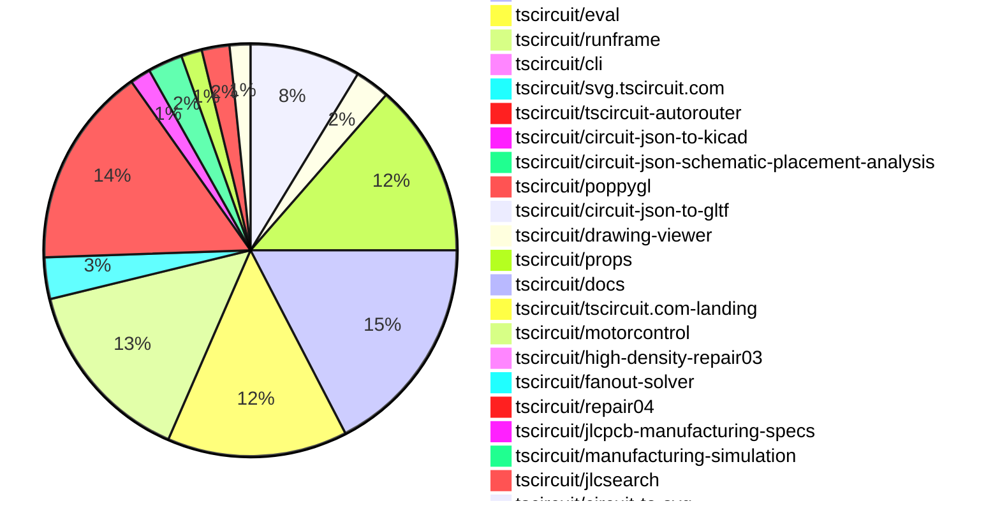

# contribution tracker

[contributions.tscircuit.com](https://contributions.tscircuit.com) ・ [tscircuit.com](https://tscircuit.com) ・ [Contribution Overviews](./contribution-overviews/) ・ [Changelogs](./changelogs/)

Generates weekly contribution overviews for tscircuit contributors. Check out all
the [contribution overviews here](./contribution-overviews/)
You can find AI-generated monthly changelogs in the [changelogs directory](./changelogs/)

- All PRs in the tscircuit org are scanned/summarized via an LLM
- The LLM classifies each Diff/PR as into a set of attributes for scoring
- All the PRs, summaries, and classifications are organized into charts and tables for [the website](https://contributions.tscircuit.com)

> Want to run locally? See the [Development Section](#development)

## Current Week

<!-- START_CURRENT_WEEK -->

# Contribution Overview 2026-11-17

The current week is shown below. There are 3 major sections:

- [Contributor Overview](#contributor-overview)
- [PRs by Repository](#prs-by-repository)
- [PRs by Contributor](#changes-by-contributor)
- [Scoring & Sponsorship Details](/docs/sponsorship-calculation-explanation.md)

## PRs by Repository



## Contributor Overview

| Contributor | 🐳 Major | 🐙 Minor | 🐌 Tiny | Score | ⭐ |
|-------------|---------|---------|---------|-------|-----|
| [ShiboSoftwareDev](#ShiboSoftwareDev) | 28 | 2 | 9 | 126 | 👑👑 |
| [seveibar](#seveibar) | 5 | 2 | 6 | 31 | ⭐⭐ |
| [rushabhcodes](#rushabhcodes) | 4 | 2 | 7 | 27 | ⭐⭐ |
| [0hmX](#0hmX) | 2 | 6 | 0 | 21 | ⭐⭐ |
| [Abse2001](#Abse2001) | 3 | 1 | 0 | 15 | ⭐⭐ |
| [tscircuitbot](#tscircuitbot) | 0 | 0 | 120 | 12 | ⭐⭐ |
| [imrishabh18](#imrishabh18) | 1 | 2 | 0 | 9 | ⭐ |
| [AnasSarkiz](#AnasSarkiz) | 1 | 0 | 2 | 7 | ⭐ |
| [MustafaMulla29](#MustafaMulla29) | 0 | 1 | 4 | 6 | ⭐ |
| [VB-Blue](#VB-Blue) | 1 | 0 | 0 | 4 | ⭐ |
| [GokulPandi-M](#GokulPandi-M) | 0 | 0 | 1 | 1 |  |

## Staff Pass Ratio (SPR)

| Contributor | Reviewed PRs | Rejections | Approvals | SPR |
|-------------|--------------|------------|-----------|-----|
| [0hmX](#0hmX) | 8 | 1 | 9 | 87.5% |
| [rushabhcodes](#rushabhcodes) | 7 | 2 | 5 | 71.4% |
| [Abse2001](#Abse2001) | 2 | 0 | 2 | 100.0% |
| [MustafaMulla29](#MustafaMulla29) | 1 | 0 | 1 | 100.0% |
| [VB-Blue](#VB-Blue) | 1 | 0 | 1 | 100.0% |

<details>
<summary>0hmX SPR PRs (8)</summary>

- [#5650](https://github.com/tscircuit/core/pull/5650) feat: pick default pseudo-random binary sequence (PRBS) seeds across a board
- [#5632](https://github.com/tscircuit/core/pull/5632) feat: add <simulation.eyediagram>
- [#5649](https://github.com/tscircuit/core/pull/5649) feat: add <simulation.pcbdriverreceiverchannel>
- [#5423](https://github.com/tscircuit/core/pull/5423) feat: add <simulation.pcbtransientchannelsimulation>
- [#5647](https://github.com/tscircuit/core/pull/5647) feat: copy JLCPCB hole plating thickness into preset stackups
- [#5629](https://github.com/tscircuit/core/pull/5629) feat: add <simulation.ibismodel>
- [#5628](https://github.com/tscircuit/core/pull/5628) refactor!: remove the analog IBIS simulation API
- [#11](https://github.com/tscircuit/jlcpcb-manufacturing-specs/pull/11) feat: add hole plating copper thickness to JLCPCB stackups

</details>

<details>
<summary>rushabhcodes SPR PRs (7)</summary>

- [#1028](https://github.com/tscircuit/circuit-json/pull/1028) fix: preserve namespaced KiCad metadata on existing records
- [#1025](https://github.com/tscircuit/circuit-json/pull/1025) Revert "Preserve arc geometry in PCB board outlines and cutouts (#998)"
- [#998](https://github.com/tscircuit/circuit-json/pull/998) Preserve arc geometry in PCB board outlines and cutouts
- [#1032](https://github.com/tscircuit/props/pull/1032) feat: add native net class authoring props
- [#5962](https://github.com/tscircuit/tscircuit.com/pull/5962) Add the Drawing tab to package previews
- [#298](https://github.com/tscircuit/circuit-json-to-gltf/pull/298) Resolve selected CAD model URLs at load time
- [#58](https://github.com/tscircuit/poppygl/pull/58) Skip shading for constant unlit opaque surfaces

</details>

<details>
<summary>Abse2001 SPR PRs (2)</summary>

- [#5502](https://github.com/tscircuit/core/pull/5502) Keep small-board mouse bites drillable (#5066)
- [#13](https://github.com/tscircuit/jlcpcb-manufacturing-specs/pull/13) Add JLCPCB panelization rules

</details>

<details>
<summary>MustafaMulla29 SPR PRs (1)</summary>

- [#580](https://github.com/tscircuit/checks/pull/580) Report schematic box width and pin-padding warnings

</details>

<details>
<summary>VB-Blue SPR PRs (1)</summary>

- [#651](https://github.com/tscircuit/jlcsearch/pull/651) fix: include LED Indication - Discrete subcategory in led derived table

</details>

> Note: AI evaluates PRs and assigns 1-3 star ratings automatically. 4 and 5 star ratings require manual staff review.

## Review Table

[reviews-received-hover]: ## "Number of reviews received for PRs for this contributor"
[approvals-received-hover]: ## "Number of approvals received for PRs this contributor authored"
[rejections-received-hover]: ## "Number of rejections received for PRs this contributor authored"
[prs-opened-hover]: ## "Number of PRs opened by this contributor"
[issues-created-hover]: ## "Number of issues created by this contributor"

| Contributor | Reviews Received | Approvals Received | Rejections Received | Approvals | Rejections Given | PRs Opened | PRs Merged | Issues Created |
|---|---|---|---|---|---|---|---|---|
| [0hmX](#0hmX) | 17 | 8 | 0 | 9 | 0 | 31 | 8 | 0 |
| [0xNexuz](#0xNexuz) | 0 | 0 | 0 | 0 | 0 | 1 | 0 | 0 |
| [aaka3h](#aaka3h) | 0 | 0 | 0 | 0 | 0 | 1 | 0 | 0 |
| [abdalraof-albarbar](#abdalraof-albarbar) | 0 | 0 | 0 | 0 | 0 | 4 | 0 | 0 |
| [Abse2001](#Abse2001) | 2 | 2 | 0 | 5 | 0 | 14 | 4 | 0 |
| [Aming9303](#Aming9303) | 0 | 0 | 0 | 0 | 0 | 1 | 0 | 0 |
| [AnasSarkiz](#AnasSarkiz) | 3 | 3 | 0 | 1 | 0 | 9 | 3 | 0 |
| [Devesh36](#Devesh36) | 0 | 0 | 0 | 0 | 0 | 3 | 0 | 0 |
| [GokulPandi-M](#GokulPandi-M) | 2 | 1 | 0 | 0 | 0 | 4 | 1 | 0 |
| [imrishabh18](#imrishabh18) | 0 | 0 | 0 | 1 | 1 | 8 | 3 | 0 |
| [menwo535-jpg](#menwo535-jpg) | 0 | 0 | 0 | 0 | 0 | 2 | 0 | 0 |
| [MustafaMulla29](#MustafaMulla29) | 2 | 2 | 0 | 0 | 0 | 8 | 5 | 0 |
| [NavaneethKSD](#NavaneethKSD) | 0 | 0 | 0 | 0 | 0 | 1 | 0 | 0 |
| [pecopeko](#pecopeko) | 0 | 0 | 0 | 0 | 0 | 5 | 0 | 0 |
| [rushabhcodes](#rushabhcodes) | 26 | 8 | 3 | 0 | 0 | 37 | 14 | 0 |
| [Semihzx](#Semihzx) | 0 | 0 | 0 | 0 | 0 | 1 | 0 | 0 |
| [seveibar](#seveibar) | 7 | 0 | 0 | 19 | 2 | 23 | 13 | 0 |
| [ShiboSoftwareDev](#ShiboSoftwareDev) | 17 | 14 | 0 | 4 | 0 | 75 | 39 | 0 |
| [tscircuitbot](#tscircuitbot) | 0 | 0 | 0 | 0 | 0 | 143 | 120 | 0 |
| [U-ITACHII](#U-ITACHII) | 0 | 0 | 0 | 0 | 0 | 1 | 0 | 0 |
| [VB-Blue](#VB-Blue) | 1 | 1 | 0 | 0 | 0 | 3 | 1 | 0 |

## Changes by Repository

### [tscircuit/tscircuit](https://github.com/tscircuit/tscircuit)


<details>
<summary>🐌 Tiny Contributions (16)</summary>

| PR # | Impact | Contributor | Description |
|------|--------|-------------|-------------|
| [#6511](https://github.com/tscircuit/tscircuit/pull/6511) | 🐌 Tiny | tscircuitbot | Automated package update |
| [#6510](https://github.com/tscircuit/tscircuit/pull/6510) | 🐌 Tiny | tscircuitbot | Automated package update |
| [#6509](https://github.com/tscircuit/tscircuit/pull/6509) | 🐌 Tiny | tscircuitbot | Automated package update |
| [#6508](https://github.com/tscircuit/tscircuit/pull/6508) | 🐌 Tiny | tscircuitbot | Automated package update |
| [#6507](https://github.com/tscircuit/tscircuit/pull/6507) | 🐌 Tiny | tscircuitbot | Automated package update |
| [#6506](https://github.com/tscircuit/tscircuit/pull/6506) | 🐌 Tiny | tscircuitbot | Automated package update |
| [#6505](https://github.com/tscircuit/tscircuit/pull/6505) | 🐌 Tiny | tscircuitbot | Automated package update |
| [#6504](https://github.com/tscircuit/tscircuit/pull/6504) | 🐌 Tiny | tscircuitbot | Automated package update |
| [#6503](https://github.com/tscircuit/tscircuit/pull/6503) | 🐌 Tiny | tscircuitbot | Automated package update |
| [#6502](https://github.com/tscircuit/tscircuit/pull/6502) | 🐌 Tiny | tscircuitbot | Automated package update |
| [#6499](https://github.com/tscircuit/tscircuit/pull/6499) | 🐌 Tiny | tscircuitbot | Automated package update |
| [#6498](https://github.com/tscircuit/tscircuit/pull/6498) | 🐌 Tiny | tscircuitbot | Automated package update |
| [#6496](https://github.com/tscircuit/tscircuit/pull/6496) | 🐌 Tiny | tscircuitbot | Update tscircuitcore from 0.0.2405 to 0.0.2406 and tscircuitcapacity-autorouter from 0.0.1120 to 0.0.1121, along with other package updates and lockfile refresh. |
| [#6497](https://github.com/tscircuit/tscircuit/pull/6497) | 🐌 Tiny | tscircuitbot | Automated package update |
| [#6494](https://github.com/tscircuit/tscircuit/pull/6494) | 🐌 Tiny | tscircuitbot | Update tscircuitcore from 0.0.2404 to 0.0.2405 and tscircuitcapacity-autorouter from 0.0.1119 to 0.0.1120, ensuring the new autorouter preserves accessible routed via bridges during layer stitching. |
| [#6495](https://github.com/tscircuit/tscircuit/pull/6495) | 🐌 Tiny | tscircuitbot | Automated package update |

</details>

### [tscircuit/circuit-json](https://github.com/tscircuit/circuit-json)

| PR # | Impact | Rating | Contributor | Description |
|------|--------|--------|-------------|-------------|
| [#998](https://github.com/tscircuit/circuit-json/pull/998) | 🐳 Major | ⭐⭐⭐ | rushabhcodes | Preserves arc geometry in PCB board outlines and cutouts by reusing the existing BRep point_with_bulge schema, preventing loss of circular arc data during KiCad export. |
| [#1019](https://github.com/tscircuit/circuit-json/pull/1019) | 🐳 Major | ⭐⭐⭐ | seveibar | Proposes the Circuit JSON contract for per-net PCB trace clearance by storing the authoring value on source_net.min_trace_clearance as an optional finite, nonnegative number in millimeters. |

<details>
<summary>🐌 Tiny Contributions (3)</summary>

| PR # | Impact | Contributor | Description |
|------|--------|-------------|-------------|
| [#1026](https://github.com/tscircuit/circuit-json/pull/1026) | 🐌 Tiny | tscircuitbot | Automated package update |
| [#1024](https://github.com/tscircuit/circuit-json/pull/1024) | 🐌 Tiny | tscircuitbot | Automated package update |
| [#1020](https://github.com/tscircuit/circuit-json/pull/1020) | 🐌 Tiny | tscircuitbot | Automated package update |

</details>

### [tscircuit/core](https://github.com/tscircuit/core)

| PR # | Impact | Rating | Contributor | Description |
|------|--------|--------|-------------|-------------|
| [#5645](https://github.com/tscircuit/core/pull/5645) | 🐳 Major | ⭐⭐⭐ | seveibar | Fixes saved-phase failures by ensuring complete phases validate copper connectivity for export and replay, allowing shared anchor pads and junctions while rejecting cross-net connections. |
| [#5659](https://github.com/tscircuit/core/pull/5659) | 🐳 Major | ⭐⭐⭐ | ShiboSoftwareDev | Fixes recursive rendering issue in routing callbacks that prevents proper copper pours from being generated during autorouting. |
| [#5657](https://github.com/tscircuit/core/pull/5657) | 🐳 Major | ⭐⭐⭐ | ShiboSoftwareDev | Reproduces a ground pour generated before its routed signal via when an autorouting:start listener reads getCircuitJson(). |
| [#5681](https://github.com/tscircuit/core/pull/5681) | 🐳 Major | ⭐⭐⭐ | ShiboSoftwareDev | Updates the autorouter to version 0.0.1126, enhancing BGA routing by enforcing stricter clearance and via requirements. |
| [#5673](https://github.com/tscircuit/core/pull/5673) | 🐳 Major | ⭐⭐⭐ | ShiboSoftwareDev | Updates the capacity autorouter and bus lanes solver dependencies, allowing for improved routing capabilities and fixes for cramped-port searches. |
| [#5637](https://github.com/tscircuit/core/pull/5637) | 🐳 Major | ⭐⭐⭐ | ShiboSoftwareDev | Publish completed trace-only routing phases while later phases continue, allowing for better visibility of routing progress on complex boards. |
| [#5649](https://github.com/tscircuit/core/pull/5649) | 🐳 Major | ⭐⭐⭐ | 0hmX | Adds simulation.pcbdriverreceiverchannel, resolves driver and receiver pins to IBIS models, validates PCB connectivity and routing, and writes channel records with an explicit seed when supplied. |
| [#5629](https://github.com/tscircuit/core/pull/5629) | 🐳 Major | ⭐⭐⭐ | 0hmX | Render simulation.ibismodel into a Circuit JSON IBIS model record with component, pin, and reference-port bindings, validating ambiguous, duplicate, or undeclared vendor pin bindings. |
| [#5636](https://github.com/tscircuit/core/pull/5636) | 🐙 Minor | ⭐⭐ | ShiboSoftwareDev | Reproduces buffered output of completed routing work while the next autorouting phase is pending, ensuring that traces from the first phase remain accessible until the second phase is completed. |
| [#5502](https://github.com/tscircuit/core/pull/5502) | 🐙 Minor | ⭐⭐ | Abse2001 | Adjusts mouse-bite drill sizes for small boards to ensure they remain drillable according to JLCPCBs specifications, while addressing clearance issues with traces. |
| [#5650](https://github.com/tscircuit/core/pull/5650) | 🐙 Minor | ⭐⭐ | 0hmX | Allows channels using pseudo-random binary sequence (PRBS) patterns to automatically select distinct seeds based on signal names and sequence lengths, preventing identical bit transmission across channels. |
| [#5632](https://github.com/tscircuit/core/pull/5632) | 🐙 Minor | ⭐⭐ | 0hmX | Render simulation.eyediagram against transient channel records, with channel selection and timing windows expressed in milliseconds. |
| [#5423](https://github.com/tscircuit/core/pull/5423) | 🐙 Minor | ⭐⭐ | 0hmX | Add simulation.pcbtransientchannelsimulation as a direct child of a PCB board, emitting run records with settings and covering tests for board-only rules. |
| [#5647](https://github.com/tscircuit/core/pull/5647) | 🐙 Minor | ⭐⭐ | 0hmX | Copies plated_hole_copper_thickness from the JLCPCB stackup data into pcb_stackup for boards using a JLCPCB fabricatorPreset, enabling accurate modeling of vias in PCB transient channel simulations. |
| [#5628](https://github.com/tscircuit/core/pull/5628) | 🐙 Minor | ⭐⭐ | 0hmX | Summary Bump circuit-json to 0.0.552 and tscircuitprops to 0.0.735 in the development dependencies and overrides. Remove the analog IBIS stimulus and eye declarations, IBIS pin states, and the external pcb_spice special case. Keep native analog transient analysis available through registered SPICE engines. Keep cached IBIS model restoration and narrow the copper-pour fixture to the PCB elements it renders. |

<details>
<summary>🐌 Tiny Contributions (10)</summary>

| PR # | Impact | Contributor | Description |
|------|--------|-------------|-------------|
| [#5694](https://github.com/tscircuit/core/pull/5694) | 🐌 Tiny | tscircuitbot | Updates the version of the tscircuitfanout-solver package from 0.0.84 to 0.0.85 in package.json |
| [#5688](https://github.com/tscircuit/core/pull/5688) | 🐌 Tiny | tscircuitbot | Updates the version of the tscircuitchecks package from 0.0.279 to 0.0.280 in package.json |
| [#5643](https://github.com/tscircuit/core/pull/5643) | 🐌 Tiny | seveibar | Adds four small TSX reproductions for the saved-phase bug in 5614, providing tests for various routing scenarios that previously resulted in errors during autorouting. |
| [#5641](https://github.com/tscircuit/core/pull/5641) | 🐌 Tiny | seveibar | Adds guidance on testing patterns in AGENTS.md, specifying that tests should be simple, shallow TSX without complex logic or large imports unless they represent an entire real circuit. |
| [#5686](https://github.com/tscircuit/core/pull/5686) | 🐌 Tiny | GokulPandi-M | Motivation Increasing autorouter.traceClearance should change the clearance requested from the router. On this SEPIC board, requesting either 0.25 mm or 0.50 mm produces identical routing input with minTraceToPadEdgeClearance: 0.1. The larger requested spacing is silently lost before routing, so changing this setting does not enforce the intended clearance. This reproduction renders the full board TSX, retains its manual traces, and captures the input passed to the native local autorouter. The passing characterization test records the current bug; each snapshot labels the requested clearance and the received input field. Those labels describe routing settings, not measured copper gaps.  Requested: 0.25 mm  Requested: 0.50 mm   ---  ---   !Board requesting 0.25 mm; router receives 0.1 mm(https:raw.githubusercontent.comGokulPandi-Mcore5c476f43e2f901dc405c4708c5549ecfa778dd05testsrepros__snapshots__repro-autorouter-clearance-board-0.25mm-pcb.snap.svg)  !Board requesting 0.50 mm; router receives 0.1 mm(https:raw.githubusercontent.comGokulPandi-Mcore5c476f43e2f901dc405c4708c5549ecfa778dd05testsrepros__snapshots__repro-autorouter-clearance-board-0.50mm-pcb.snap.svg)   Validation Reproduction and snapshot verification pass: 1 test, 7 assertions. Type check and production build pass. Source fixture retains the boards components, placements and eight manual traces; no production code changes. |
| [#5690](https://github.com/tscircuit/core/pull/5690) | 🐌 Tiny | ShiboSoftwareDev | Updates the autorouter and fanout solver dependencies to their latest versions, ensuring compatibility and improved functionality in routing and clearance checks. |
| [#5683](https://github.com/tscircuit/core/pull/5683) | 🐌 Tiny | ShiboSoftwareDev | Updates the tscircuitcapacity-autorouter package from version 0.0.1126 to 0.0.1127, which includes improvements to the repair03 process and the native trace-pair DRC evaluator during via cleanup. |
| [#5679](https://github.com/tscircuit/core/pull/5679) | 🐌 Tiny | ShiboSoftwareDev | Updates the tscircuitcapacity-autorouter dependency from version 0.0.1124 to 0.0.1125, which includes improvements to pad-alias resolution during clearance search and a grid correction for component-pad-only A13. |
| [#5642](https://github.com/tscircuit/core/pull/5642) | 🐌 Tiny | ShiboSoftwareDev | Bumps the tscircuitcapacity-autorouter dependency from version 0.0.1120 to 0.0.1121, incorporating improvements and fixes from upstream, including enhanced clearance-grid channel builds and reduced physical findings in routing tests. |
| [#5638](https://github.com/tscircuit/core/pull/5638) | 🐌 Tiny | ShiboSoftwareDev | Bumps the tscircuitcapacity-autorouter dependency from version 0.0.1119 to 0.0.1120, improving routing preferences and connection stitching. |

</details>

### [tscircuit/tscircuit.com](https://github.com/tscircuit/tscircuit.com)

| PR # | Impact | Rating | Contributor | Description |
|------|--------|--------|-------------|-------------|
| [#6009](https://github.com/tscircuit/tscircuit.com/pull/6009) | 🐳 Major | ⭐⭐⭐ | rushabhcodes | Reduces model download time by reusing the rendered Drawing view when switching tabs, preventing unnecessary model downloads and improving performance. |
| [#5962](https://github.com/tscircuit/tscircuit.com/pull/5962) | 🐳 Major | ⭐⭐⭐ | rushabhcodes | Adds a Drawing tab to the package page for inspecting engineering drawings alongside PCB, schematic, and 3D views. |
| [#5985](https://github.com/tscircuit/tscircuit.com/pull/5985) | 🐳 Major | ⭐⭐⭐ | seveibar | Updates the circuit-to-svg and circuit-json libraries to support custom wire colors and line patterns, ensuring that the runtime parser preserves these style fields during rendering. |

<details>
<summary>🐌 Tiny Contributions (29)</summary>

| PR # | Impact | Contributor | Description |
|------|--------|-------------|-------------|
| [#6016](https://github.com/tscircuit/tscircuit.com/pull/6016) | 🐌 Tiny | tscircuitbot | Updates the tscircuitrunframe package version from 0.0.3286 to 0.0.3287 in package.json |
| [#6015](https://github.com/tscircuit/tscircuit.com/pull/6015) | 🐌 Tiny | tscircuitbot | Automated package update |
| [#6014](https://github.com/tscircuit/tscircuit.com/pull/6014) | 🐌 Tiny | tscircuitbot | Updates the tscircuitrunframe package version from 0.0.3285 to 0.0.3286 in package.json |
| [#6013](https://github.com/tscircuit/tscircuit.com/pull/6013) | 🐌 Tiny | tscircuitbot | Updates the tscircuiteval package from version 0.0.1808 to 0.0.1809 in the package.json file. |
| [#6012](https://github.com/tscircuit/tscircuit.com/pull/6012) | 🐌 Tiny | tscircuitbot | Updates the tscircuitrunframe package from version 0.0.3284 to 0.0.3285 |
| [#6011](https://github.com/tscircuit/tscircuit.com/pull/6011) | 🐌 Tiny | tscircuitbot | Updates the tscircuiteval package from version 0.0.1806 to 0.0.1808 in the package.json file. |
| [#6007](https://github.com/tscircuit/tscircuit.com/pull/6007) | 🐌 Tiny | tscircuitbot | Updates the tscircuitrunframe package from version 0.0.3283 to 0.0.3284 |
| [#6005](https://github.com/tscircuit/tscircuit.com/pull/6005) | 🐌 Tiny | tscircuitbot | Updates the tscircuitrunframe package from version 0.0.3282 to 0.0.3283 |
| [#6004](https://github.com/tscircuit/tscircuit.com/pull/6004) | 🐌 Tiny | tscircuitbot | Updates the tscircuiteval package from version 0.0.1805 to 0.0.1806 |
| [#6003](https://github.com/tscircuit/tscircuit.com/pull/6003) | 🐌 Tiny | tscircuitbot | Updates the tscircuitrunframe package from version 0.0.3281 to 0.0.3282 |
| [#6002](https://github.com/tscircuit/tscircuit.com/pull/6002) | 🐌 Tiny | tscircuitbot | Updates the tscircuiteval package from version 0.0.1804 to 0.0.1805 |
| [#6001](https://github.com/tscircuit/tscircuit.com/pull/6001) | 🐌 Tiny | tscircuitbot | Updates the tscircuitrunframe package from version 0.0.3280 to 0.0.3281 |
| [#6000](https://github.com/tscircuit/tscircuit.com/pull/6000) | 🐌 Tiny | tscircuitbot | Updates the tscircuiteval package from version 0.0.1803 to 0.0.1804 |
| [#5999](https://github.com/tscircuit/tscircuit.com/pull/5999) | 🐌 Tiny | tscircuitbot | Updates the tscircuitrunframe package version from 0.0.3279 to 0.0.3280 |
| [#5998](https://github.com/tscircuit/tscircuit.com/pull/5998) | 🐌 Tiny | tscircuitbot | Updates the tscircuitrunframe package version from 0.0.3278 to 0.0.3279 |
| [#5997](https://github.com/tscircuit/tscircuit.com/pull/5997) | 🐌 Tiny | tscircuitbot | Updates the tscircuiteval package from version 0.0.1802 to 0.0.1803 in the package.json file. |
| [#5996](https://github.com/tscircuit/tscircuit.com/pull/5996) | 🐌 Tiny | tscircuitbot | Updates the tscircuitrunframe package from version 0.0.3277 to 0.0.3278 |
| [#5995](https://github.com/tscircuit/tscircuit.com/pull/5995) | 🐌 Tiny | tscircuitbot | Updates the tscircuiteval package from version 0.0.1801 to 0.0.1802 in the package.json file. |
| [#5994](https://github.com/tscircuit/tscircuit.com/pull/5994) | 🐌 Tiny | tscircuitbot | Updates the tscircuitrunframe package from version 0.0.3276 to 0.0.3277 |
| [#5993](https://github.com/tscircuit/tscircuit.com/pull/5993) | 🐌 Tiny | tscircuitbot | Updates the tscircuiteval package from version 0.0.1800 to 0.0.1801 in package.json |
| [#5992](https://github.com/tscircuit/tscircuit.com/pull/5992) | 🐌 Tiny | tscircuitbot | Automated package update |
| [#5991](https://github.com/tscircuit/tscircuit.com/pull/5991) | 🐌 Tiny | tscircuitbot | Updates the tscircuiteval package from version 0.0.1799 to 0.0.1800 |
| [#5990](https://github.com/tscircuit/tscircuit.com/pull/5990) | 🐌 Tiny | tscircuitbot | Updates the tscircuitrunframe package version from 0.0.3274 to 0.0.3275 |
| [#5989](https://github.com/tscircuit/tscircuit.com/pull/5989) | 🐌 Tiny | tscircuitbot | Updates the tscircuiteval package from version 0.0.1798 to 0.0.1799 |
| [#5987](https://github.com/tscircuit/tscircuit.com/pull/5987) | 🐌 Tiny | tscircuitbot | Updates the tscircuitrunframe package from version 0.0.3273 to 0.0.3274 |
| [#5986](https://github.com/tscircuit/tscircuit.com/pull/5986) | 🐌 Tiny | tscircuitbot | Updates the tscircuiteval package from version 0.0.1797 to 0.0.1798 in the package.json file. |
| [#6008](https://github.com/tscircuit/tscircuit.com/pull/6008) | 🐌 Tiny | rushabhcodes | Reproduces a bug where returning to the Drawing tab unmounts the existing DrawingViewer and causes unnecessary model downloads, impacting performance. |
| [#5961](https://github.com/tscircuit/tscircuit.com/pull/5961) | 🐌 Tiny | rushabhcodes | Reproduces the issue where the Drawing tab is missing in the package preview for the Classic F1 v6.0.12 package, ensuring that the Drawing viewport opens correctly during testing. |
| [#5988](https://github.com/tscircuit/tscircuit.com/pull/5988) | 🐌 Tiny | seveibar | Apply a shared Roboto ExtraBold (800) wordmark style with normal letter spacing to both application headers and the footer, following the logo specification. Load the 800 font face through the existing Google Fonts request and update the header typography assertions. |

</details>

### [tscircuit/eval](https://github.com/tscircuit/eval)


<details>
<summary>🐌 Tiny Contributions (26)</summary>

| PR # | Impact | Contributor | Description |
|------|--------|-------------|-------------|
| [#5964](https://github.com/tscircuit/eval/pull/5964) | 🐌 Tiny | tscircuitbot | Automated package update |
| [#5963](https://github.com/tscircuit/eval/pull/5963) | 🐌 Tiny | tscircuitbot | Updates the version of tscircuitcore from 0.0.2415 to 0.0.2416 and tscircuitfanout-solver from 0.0.84 to 0.0.85 in package.json |
| [#5961](https://github.com/tscircuit/eval/pull/5961) | 🐌 Tiny | tscircuitbot | Automated package update |
| [#5960](https://github.com/tscircuit/eval/pull/5960) | 🐌 Tiny | tscircuitbot | Updates the version of several dependencies in the package.json file. |
| [#5958](https://github.com/tscircuit/eval/pull/5958) | 🐌 Tiny | tscircuitbot | Automated package update |
| [#5957](https://github.com/tscircuit/eval/pull/5957) | 🐌 Tiny | tscircuitbot | Automated package update |
| [#5955](https://github.com/tscircuit/eval/pull/5955) | 🐌 Tiny | tscircuitbot | Automated package update |
| [#5954](https://github.com/tscircuit/eval/pull/5954) | 🐌 Tiny | tscircuitbot | Automated package update |
| [#5953](https://github.com/tscircuit/eval/pull/5953) | 🐌 Tiny | tscircuitbot | Automated package update |
| [#5951](https://github.com/tscircuit/eval/pull/5951) | 🐌 Tiny | tscircuitbot | Automated package update |
| [#5949](https://github.com/tscircuit/eval/pull/5949) | 🐌 Tiny | tscircuitbot | Automated package update |
| [#5948](https://github.com/tscircuit/eval/pull/5948) | 🐌 Tiny | tscircuitbot | Automated package update |
| [#5946](https://github.com/tscircuit/eval/pull/5946) | 🐌 Tiny | tscircuitbot | Automated package update |
| [#5945](https://github.com/tscircuit/eval/pull/5945) | 🐌 Tiny | tscircuitbot | Automated package update |
| [#5943](https://github.com/tscircuit/eval/pull/5943) | 🐌 Tiny | tscircuitbot | Automated package update |
| [#5942](https://github.com/tscircuit/eval/pull/5942) | 🐌 Tiny | tscircuitbot | Automated package update |
| [#5940](https://github.com/tscircuit/eval/pull/5940) | 🐌 Tiny | tscircuitbot | Automated package update |
| [#5939](https://github.com/tscircuit/eval/pull/5939) | 🐌 Tiny | tscircuitbot | Updates the version of the tscircuitcore package from 0.0.2407 to 0.0.2408 in package.json |
| [#5937](https://github.com/tscircuit/eval/pull/5937) | 🐌 Tiny | tscircuitbot | Automated package update |
| [#5936](https://github.com/tscircuit/eval/pull/5936) | 🐌 Tiny | tscircuitbot | Automated package update |
| [#5934](https://github.com/tscircuit/eval/pull/5934) | 🐌 Tiny | tscircuitbot | Automated package update |
| [#5933](https://github.com/tscircuit/eval/pull/5933) | 🐌 Tiny | tscircuitbot | Automated package update |
| [#5931](https://github.com/tscircuit/eval/pull/5931) | 🐌 Tiny | tscircuitbot | Automated package update |
| [#5930](https://github.com/tscircuit/eval/pull/5930) | 🐌 Tiny | tscircuitbot | Updates package dependencies to their latest versions as part of routine maintenance. |
| [#5928](https://github.com/tscircuit/eval/pull/5928) | 🐌 Tiny | tscircuitbot | Automated package update |
| [#5927](https://github.com/tscircuit/eval/pull/5927) | 🐌 Tiny | tscircuitbot | Updates the versions of several dependencies in the package.json file. |

</details>

### [tscircuit/runframe](https://github.com/tscircuit/runframe)


<details>
<summary>🐌 Tiny Contributions (27)</summary>

| PR # | Impact | Contributor | Description |
|------|--------|-------------|-------------|
| [#6420](https://github.com/tscircuit/runframe/pull/6420) | 🐌 Tiny | tscircuitbot | Automated package update |
| [#6419](https://github.com/tscircuit/runframe/pull/6419) | 🐌 Tiny | tscircuitbot | Updates the tscircuiteval package from version 0.0.1809 to 0.0.1810 |
| [#6418](https://github.com/tscircuit/runframe/pull/6418) | 🐌 Tiny | tscircuitbot | Automated package update |
| [#6417](https://github.com/tscircuit/runframe/pull/6417) | 🐌 Tiny | tscircuitbot | Updates the tscircuiteval package from version 0.0.1808 to 0.0.1809 in the package.json file. |
| [#6416](https://github.com/tscircuit/runframe/pull/6416) | 🐌 Tiny | tscircuitbot | Automated package update |
| [#6415](https://github.com/tscircuit/runframe/pull/6415) | 🐌 Tiny | tscircuitbot | Updates the tscircuiteval package from version 0.0.1807 to 0.0.1808 in the package.json file. |
| [#6414](https://github.com/tscircuit/runframe/pull/6414) | 🐌 Tiny | tscircuitbot | Automated package update |
| [#6413](https://github.com/tscircuit/runframe/pull/6413) | 🐌 Tiny | tscircuitbot | Updates the tscircuiteval package from version 0.0.1806 to 0.0.1807 |
| [#6411](https://github.com/tscircuit/runframe/pull/6411) | 🐌 Tiny | tscircuitbot | Updates the tscircuiteval package from version 0.0.1805 to 0.0.1806 in the package.json file. |
| [#6410](https://github.com/tscircuit/runframe/pull/6410) | 🐌 Tiny | tscircuitbot | Automated package update |
| [#6409](https://github.com/tscircuit/runframe/pull/6409) | 🐌 Tiny | tscircuitbot | Updates the tscircuiteval package from version 0.0.1804 to 0.0.1805 |
| [#6408](https://github.com/tscircuit/runframe/pull/6408) | 🐌 Tiny | tscircuitbot | Automated package update |
| [#6407](https://github.com/tscircuit/runframe/pull/6407) | 🐌 Tiny | tscircuitbot | Updates the tscircuiteval package from version 0.0.1803 to 0.0.1804 in the package.json file. |
| [#6406](https://github.com/tscircuit/runframe/pull/6406) | 🐌 Tiny | tscircuitbot | Automated package update |
| [#6405](https://github.com/tscircuit/runframe/pull/6405) | 🐌 Tiny | tscircuitbot | Updates the circuit-json-to-kicad package version from 0.0.278 to 0.0.279 in package.json |
| [#6403](https://github.com/tscircuit/runframe/pull/6403) | 🐌 Tiny | tscircuitbot | Automated package update |
| [#6402](https://github.com/tscircuit/runframe/pull/6402) | 🐌 Tiny | tscircuitbot | Updates the tscircuiteval package from version 0.0.1802 to 0.0.1803 |
| [#6401](https://github.com/tscircuit/runframe/pull/6401) | 🐌 Tiny | tscircuitbot | Automated package update |
| [#6400](https://github.com/tscircuit/runframe/pull/6400) | 🐌 Tiny | tscircuitbot | Updates the tscircuiteval package from version 0.0.1801 to 0.0.1802 in the package.json file. |
| [#6399](https://github.com/tscircuit/runframe/pull/6399) | 🐌 Tiny | tscircuitbot | Automated package update |
| [#6398](https://github.com/tscircuit/runframe/pull/6398) | 🐌 Tiny | tscircuitbot | Updates the tscircuiteval package from version 0.0.1800 to 0.0.1801 |
| [#6397](https://github.com/tscircuit/runframe/pull/6397) | 🐌 Tiny | tscircuitbot | Automated package update |
| [#6396](https://github.com/tscircuit/runframe/pull/6396) | 🐌 Tiny | tscircuitbot | Updates the tscircuiteval package from version 0.0.1799 to 0.0.1800 |
| [#6395](https://github.com/tscircuit/runframe/pull/6395) | 🐌 Tiny | tscircuitbot | Automated package update |
| [#6394](https://github.com/tscircuit/runframe/pull/6394) | 🐌 Tiny | tscircuitbot | Updates the tscircuiteval package from version 0.0.1798 to 0.0.1799 |
| [#6393](https://github.com/tscircuit/runframe/pull/6393) | 🐌 Tiny | tscircuitbot | Automated package update |
| [#6392](https://github.com/tscircuit/runframe/pull/6392) | 🐌 Tiny | tscircuitbot | Updates the tscircuiteval package from version 0.0.1797 to 0.0.1798 |

</details>

### [tscircuit/cli](https://github.com/tscircuit/cli)


<details>
<summary>🐌 Tiny Contributions (2)</summary>

| PR # | Impact | Contributor | Description |
|------|--------|-------------|-------------|
| [#5857](https://github.com/tscircuit/cli/pull/5857) | 🐌 Tiny | tscircuitbot | Automated package update |
| [#5856](https://github.com/tscircuit/cli/pull/5856) | 🐌 Tiny | ShiboSoftwareDev | Fixes CLI startup failure when using Circuit JSON 0.0.552 due to removed schemas in the bundled PCB SPICE pipeline, by updating to the renamed signal-integrity-pipeline and adjusting imports accordingly. |

</details>

### [tscircuit/svg.tscircuit.com](https://github.com/tscircuit/svg.tscircuit.com)


<details>
<summary>🐌 Tiny Contributions (6)</summary>

| PR # | Impact | Contributor | Description |
|------|--------|-------------|-------------|
| [#2968](https://github.com/tscircuit/svg.tscircuit.com/pull/2968) | 🐌 Tiny | tscircuitbot | Updates the tscircuit package version from 0.0.3233 to 0.0.3234 in package.json |
| [#2967](https://github.com/tscircuit/svg.tscircuit.com/pull/2967) | 🐌 Tiny | tscircuitbot | Updates the tscircuit package version from 0.0.3232 to 0.0.3233 in package.json |
| [#2966](https://github.com/tscircuit/svg.tscircuit.com/pull/2966) | 🐌 Tiny | tscircuitbot | Updates the tscircuit package version from 0.0.3231 to 0.0.3232 in package.json |
| [#2965](https://github.com/tscircuit/svg.tscircuit.com/pull/2965) | 🐌 Tiny | tscircuitbot | Updates the tscircuit package version from 0.0.3230 to 0.0.3231 in package.json |
| [#2964](https://github.com/tscircuit/svg.tscircuit.com/pull/2964) | 🐌 Tiny | tscircuitbot | Updates the tscircuit package version from 0.0.3229 to 0.0.3230 in package.json |
| [#2963](https://github.com/tscircuit/svg.tscircuit.com/pull/2963) | 🐌 Tiny | tscircuitbot | Updates the tscircuit package version from 0.0.3225 to 0.0.3229 in package.json |

</details>

### [tscircuit/tscircuit-autorouter](https://github.com/tscircuit/tscircuit-autorouter)

| PR # | Impact | Rating | Contributor | Description |
|------|--------|--------|-------------|-------------|
| [#3952](https://github.com/tscircuit/tscircuit-autorouter/pull/3952) | 🐳 Major | ⭐⭐⭐ | ShiboSoftwareDev | Prevents worsening existing clearance violations against fixed DDR vias during force improvement, allowing the i.MX6 to repair its remaining DRC error. |
| [#3939](https://github.com/tscircuit/tscircuit-autorouter/pull/3939) | 🐳 Major | ⭐⭐⭐ | ShiboSoftwareDev | Validates all direct shortcuts and inset candidates against existing point and segment collision checks to prevent routing through neighboring pads, improving routing accuracy and reducing copper shorts. |
| [#3938](https://github.com/tscircuit/tscircuit-autorouter/pull/3938) | 🐳 Major | ⭐⭐⭐ | ShiboSoftwareDev | Preserves a safe layer detour when via removal introduces a new native trace-pair violation, ensuring that the indexed DRC count remains unchanged while reducing native DRC errors from 10 to 9. |
| [#3937](https://github.com/tscircuit/tscircuit-autorouter/pull/3937) | 🐳 Major | ⭐⭐⭐ | ShiboSoftwareDev | Fixes native trace clearance issue caused by via cleanup that leaves a trace gap violating clearance rules. |
| [#3931](https://github.com/tscircuit/tscircuit-autorouter/pull/3931) | 🐳 Major | ⭐⭐⭐ | ShiboSoftwareDev | Fixes the autorouting process to reuse existing vias when escaping BGA pads, improving routing efficiency and maintaining connectivity without introducing new vias. |
| [#3929](https://github.com/tscircuit/tscircuit-autorouter/pull/3929) | 🐳 Major | ⭐⭐⭐ | ShiboSoftwareDev | Fixes the issue where the BGA escape routing adds an additional via beside an existing via-in-pad instead of utilizing the existing via, leading to unnecessary complexity in the routing. |
| [#3932](https://github.com/tscircuit/tscircuit-autorouter/pull/3932) | 🐳 Major | ⭐⭐⭐ | ShiboSoftwareDev | Reduces clearance search time by 89.9 by avoiding repeated pad-alias lookups, preserving paths and empty-alias behavior. |
| [#3920](https://github.com/tscircuit/tscircuit-autorouter/pull/3920) | 🐳 Major | ⭐⭐⭐ | ShiboSoftwareDev | Avoid rescanning a capacity region when an earlier expansion already has an equal or lower cost. Cheaper later approaches still expand. Stacked on 3919. |
| [#3919](https://github.com/tscircuit/tscircuit-autorouter/pull/3919) | 🐳 Major | ⭐⭐⭐ | ShiboSoftwareDev | Captures a native 4  3 mm cut of ButterSticks plane-escape search and measures repeated adjacency scans while freezing all ordered candidates and their parent chains. |
| [#3912](https://github.com/tscircuit/tscircuit-autorouter/pull/3912) | 🐳 Major | ⭐⭐⭐ | ShiboSoftwareDev | Fixes copper handoff validation by checking exact repairs against cached reference DRC, ensuring circuit-error priority is preserved and final fixed-copper validation is accurate. |
| [#3903](https://github.com/tscircuit/tscircuit-autorouter/pull/3903) | 🐳 Major | ⭐⭐⭐ | ShiboSoftwareDev | Fixes DDR routing issues on the i.MX6 PCB by implementing pad-safe via repairs, eliminating DRC errors and preventing regression. |
| [#3900](https://github.com/tscircuit/tscircuit-autorouter/pull/3900) | 🐳 Major | ⭐⭐⭐ | ShiboSoftwareDev | Fixes the issue of fixed vias adding rows and columns to the BGA pad-channel grid by generating extra channels from component pads. |
| [#3889](https://github.com/tscircuit/tscircuit-autorouter/pull/3889) | 🐳 Major | ⭐⭐⭐ | ShiboSoftwareDev | Reproduces the routing of the native A13 board after all data phases, capturing remaining connections and DRC findings without altering pads, placement, or layers. |
| [#3894](https://github.com/tscircuit/tscircuit-autorouter/pull/3894) | 🐳 Major | ⭐⭐⭐ | ShiboSoftwareDev | Fixes CPUX stitching bypassing an existing via and missing the bottom-layer terminal. |
| [#3893](https://github.com/tscircuit/tscircuit-autorouter/pull/3893) | 🐳 Major | ⭐⭐⭐ | ShiboSoftwareDev | Reproduces the iCEPi CPUX terminal-layer failure using 24 captured route fragments and 32 nearby pads. The passing test records 12 terminals and 3 via sites. Once stitching succeeds, it runs native simplification; 3894 naturally updates the same SVG to 22 terminals and 1 via site. Remaining DRC findings stay visible. The whole plane repro captures 8,935 fragments and fails after 537559 connections. SVG rendering lives in fixture helpers; each test checks routing behavior. Focused snapshot(https:raw.githubusercontent.comtscircuittscircuit-autorouter93193735a959e0721fc7df083aaa7ab09eebf4d0testsrepro__snapshots__icepi-planar-stitch.snap.svg)  Whole plane snapshot(https:raw.githubusercontent.comtscircuittscircuit-autorouter93193735a959e0721fc7df083aaa7ab09eebf4d0testsrepro__snapshots__icepi-plane-stitch.snap.svg). |
| [#3949](https://github.com/tscircuit/tscircuit-autorouter/pull/3949) | 🐙 Minor | ⭐⭐ | ShiboSoftwareDev | Captures i.MX6 DDR routing beside completed data-byte copper, retaining 53404 connected nets and addressing one physical clearance error. |

<details>
<summary>🐌 Tiny Contributions (13)</summary>

| PR # | Impact | Contributor | Description |
|------|--------|-------------|-------------|
| [#3954](https://github.com/tscircuit/tscircuit-autorouter/pull/3954) | 🐌 Tiny | tscircuitbot | Automated package update |
| [#3947](https://github.com/tscircuit/tscircuit-autorouter/pull/3947) | 🐌 Tiny | tscircuitbot | Automated package update |
| [#3942](https://github.com/tscircuit/tscircuit-autorouter/pull/3942) | 🐌 Tiny | tscircuitbot | Automated package update |
| [#3941](https://github.com/tscircuit/tscircuit-autorouter/pull/3941) | 🐌 Tiny | tscircuitbot | Automated package update |
| [#3936](https://github.com/tscircuit/tscircuit-autorouter/pull/3936) | 🐌 Tiny | tscircuitbot | Automated package update |
| [#3925](https://github.com/tscircuit/tscircuit-autorouter/pull/3925) | 🐌 Tiny | tscircuitbot | Automated package update |
| [#3916](https://github.com/tscircuit/tscircuit-autorouter/pull/3916) | 🐌 Tiny | tscircuitbot | Automated package update |
| [#3913](https://github.com/tscircuit/tscircuit-autorouter/pull/3913) | 🐌 Tiny | tscircuitbot | Automated package update |
| [#3908](https://github.com/tscircuit/tscircuit-autorouter/pull/3908) | 🐌 Tiny | tscircuitbot | Automated package update |
| [#3905](https://github.com/tscircuit/tscircuit-autorouter/pull/3905) | 🐌 Tiny | tscircuitbot | Automated package update |
| [#3917](https://github.com/tscircuit/tscircuit-autorouter/pull/3917) | 🐌 Tiny | ShiboSoftwareDev | Adds a fixed-camera native PCB view of the A13 trace contacting a neighboring RAM pad BALL_C3, while keeping the existing full-board clearance snapshot unchanged. |
| [#3911](https://github.com/tscircuit/tscircuit-autorouter/pull/3911) | 🐌 Tiny | ShiboSoftwareDev | Refreshes the existing SEPIC repro with a fixed 6  4 mm view of the native copper, surrounding pads, and measured same-layer clearance, capturing the failing route before the fix. |
| [#3902](https://github.com/tscircuit/tscircuit-autorouter/pull/3902) | 🐌 Tiny | ShiboSoftwareDev | Reproduces the remaining bank-address via clock-enable trace clearance error on the native i.MX6 PCB, with all 53 DDR nets connected. |

</details>

### [tscircuit/circuit-json-to-kicad](https://github.com/tscircuit/circuit-json-to-kicad)


<details>
<summary>🐌 Tiny Contributions (3)</summary>

| PR # | Impact | Contributor | Description |
|------|--------|-------------|-------------|
| [#939](https://github.com/tscircuit/circuit-json-to-kicad/pull/939) | 🐌 Tiny | tscircuitbot | Automated package update |
| [#913](https://github.com/tscircuit/circuit-json-to-kicad/pull/913) | 🐌 Tiny | rushabhcodes | Maps Circuit JSONs allow_placements to KiCads footprints and pads flags, enabling proper handling of component placements within keepouts. |
| [#912](https://github.com/tscircuit/circuit-json-to-kicad/pull/912) | 🐌 Tiny | rushabhcodes | Reproduces a bug where KiCad incorrectly flags allowed placements in keepouts, ensuring that the exported rules reflect the correct restrictions on tracks, vias, and copper pours. |

</details>

### [tscircuit/circuit-json-schematic-placement-analysis](https://github.com/tscircuit/circuit-json-schematic-placement-analysis)

| PR # | Impact | Rating | Contributor | Description |
|------|--------|--------|-------------|-------------|
| [#467](https://github.com/tscircuit/circuit-json-schematic-placement-analysis/pull/467) | 🐙 Minor | ⭐⭐ | seveibar | Emit a warning when a fuse is drawn as a generic box instead of a dedicated fuse symbol, and skip the vertical rail-orientation warning for two-terminal generic chips connected between distinct power nets. |

<details>
<summary>🐌 Tiny Contributions (4)</summary>

| PR # | Impact | Contributor | Description |
|------|--------|-------------|-------------|
| [#468](https://github.com/tscircuit/circuit-json-schematic-placement-analysis/pull/468) | 🐌 Tiny | tscircuitbot | Automated package update |
| [#466](https://github.com/tscircuit/circuit-json-schematic-placement-analysis/pull/466) | 🐌 Tiny | tscircuitbot | Automated package update |
| [#464](https://github.com/tscircuit/circuit-json-schematic-placement-analysis/pull/464) | 🐌 Tiny | MustafaMulla29 | Restricts inversion warnings to components with a positive-supply terminal below its ground terminal, removing false positives from valid layouts. |
| [#463](https://github.com/tscircuit/circuit-json-schematic-placement-analysis/pull/463) | 🐌 Tiny | MustafaMulla29 | Reproduces false inverted-rail warnings for TI schematics by adding tests that capture incorrect behavior in the analyzer. |

</details>

### [tscircuit/poppygl](https://github.com/tscircuit/poppygl)

| PR # | Impact | Rating | Contributor | Description |
|------|--------|--------|-------------|-------------|
| [#58](https://github.com/tscircuit/poppygl/pull/58) | 🐳 Major | ⭐⭐⭐ | rushabhcodes | Optimizes rendering by skipping shading calculations for constant unlit opaque surfaces, reducing computational load and improving performance without altering visual output. |

<details>
<summary>🐌 Tiny Contributions (1)</summary>

| PR # | Impact | Contributor | Description |
|------|--------|-------------|-------------|
| [#57](https://github.com/tscircuit/poppygl/pull/57) | 🐌 Tiny | rushabhcodes | Reproduces a bug where Classic F1s constant white outline surfaces incorrectly compute shader interpolations, leading to unnecessary CPU work and allocations. |

</details>

### [tscircuit/circuit-json-to-gltf](https://github.com/tscircuit/circuit-json-to-gltf)

| PR # | Impact | Rating | Contributor | Description |
|------|--------|--------|-------------|-------------|
| [#298](https://github.com/tscircuit/circuit-json-to-gltf/pull/298) | 🐙 Minor | ⭐⭐ | rushabhcodes | Allows the glTF converter to resolve CAD model URLs at load time, preventing missing models in the 3D scene by utilizing a shared lookup function from the website. |

<details>
<summary>🐌 Tiny Contributions (1)</summary>

| PR # | Impact | Contributor | Description |
|------|--------|-------------|-------------|
| [#297](https://github.com/tscircuit/circuit-json-to-gltf/pull/297) | 🐌 Tiny | rushabhcodes | Adds a test to reproduce the missing geometry for the Classic F1 LCD model when using a relative model URL, ensuring the converter correctly resolves and loads the LCD triangles. |

</details>

### [tscircuit/drawing-viewer](https://github.com/tscircuit/drawing-viewer)

| PR # | Impact | Rating | Contributor | Description |
|------|--------|--------|-------------|-------------|
| [#16](https://github.com/tscircuit/drawing-viewer/pull/16) | 🐙 Minor | ⭐⭐ | rushabhcodes | Allows the website to pass the CAD file lookup to DrawingViewer through an optional resolveStaticAsset function, enabling proper rendering of the LCD model in the drawing. |

<details>
<summary>🐌 Tiny Contributions (1)</summary>

| PR # | Impact | Contributor | Description |
|------|--------|-------------|-------------|
| [#15](https://github.com/tscircuit/drawing-viewer/pull/15) | 🐌 Tiny | rushabhcodes | Reproduces a bug where the LCD geometry is missing in the Classic F1 drawing by implementing a test case that validates the renderers asset resolution for the LCD path. |

</details>

### [tscircuit/props](https://github.com/tscircuit/props)

| PR # | Impact | Rating | Contributor | Description |
|------|--------|--------|-------------|-------------|
| [#1027](https://github.com/tscircuit/props/pull/1027) | 🐳 Major | ⭐⭐⭐ | seveibar | Proposes the optional minTraceClearance?: Distance prop on net. |
| [#1025](https://github.com/tscircuit/props/pull/1025) | 🐳 Major | ⭐⭐⭐ | seveibar | Proposes a manufacturing namespace with two elements for laser-engraved marks on a part surface. They are children of assembly.printedpart or assembly.part. Elements are named for the process, so a mark says how it is made and not only how it looks. |
| [#1026](https://github.com/tscircuit/props/pull/1026) | 🐙 Minor | ⭐⭐ | seveibar | Adds assemblyProps.sticker for an assembly.sticker  element, allowing users to apply adhesive stickers to parts in their assemblies. |

### [tscircuit/docs](https://github.com/tscircuit/docs)


<details>
<summary>🐌 Tiny Contributions (1)</summary>

| PR # | Impact | Contributor | Description |
|------|--------|-------------|-------------|
| [#1049](https://github.com/tscircuit/docs/pull/1049) | 🐌 Tiny | seveibar | Render the tscircuit wordmark in Roboto ExtraBold (800) with normal letter spacing in the desktop navbar and mobile navigation. |

</details>

### [tscircuit/tscircuit.com-landing](https://github.com/tscircuit/tscircuit.com-landing)


<details>
<summary>🐌 Tiny Contributions (1)</summary>

| PR # | Impact | Contributor | Description |
|------|--------|-------------|-------------|
| [#79](https://github.com/tscircuit/tscircuit.com-landing/pull/79) | 🐌 Tiny | seveibar | Render the header and footer tscircuit wordmarks in Roboto ExtraBold (800) with normal letter spacing and the existing black color, including on hover. |

</details>

### [tscircuit/motorcontrol](https://github.com/tscircuit/motorcontrol)


<details>
<summary>🐌 Tiny Contributions (2)</summary>

| PR # | Impact | Contributor | Description |
|------|--------|-------------|-------------|
| [#47](https://github.com/tscircuit/motorcontrol/pull/47) | 🐌 Tiny | seveibar | Summary Match the Assets pages light Tailwind palette across the motor dashboards and firmware page. Add consistent navigation, including the three-axis gantry, and update chart, alarm, and Stop colors for light backgrounds. Build the shared dashboard stylesheet from its Tailwind source and check the generated CSS in CI.  Verification Checked all seven pages in Chrome at 320, 390, 768, and 1440 px. Passed the dashboard, Python, and native host suites and both firmware staging commands. |
| [#46](https://github.com/tscircuit/motorcontrol/pull/46) | 🐌 Tiny | AnasSarkiz | Add the existing NEMA17 controller enclosure to the Assets page alongside all seven retained spacer entries. The editable page is React TSX, rendered at build time into the existing static distassets.html route. Downloads remain ordinary HTML links and work without JavaScript; preview controls remain typed browser TypeScript. |

</details>

### [tscircuit/high-density-repair03](https://github.com/tscircuit/high-density-repair03)

| PR # | Impact | Rating | Contributor | Description |
|------|--------|--------|-------------|-------------|
| [#216](https://github.com/tscircuit/high-density-repair03/pull/216) | 🐳 Major | ⭐⭐⭐ | ShiboSoftwareDev | Checks via-removal shortcuts against the callers reference DRC before accepting them to prevent new trace-pair clearance violations. |
| [#214](https://github.com/tscircuit/high-density-repair03/pull/214) | 🐳 Major | ⭐⭐⭐ | ShiboSoftwareDev | Keeps displacement chains under the existing near-convergence guard so the Game Boy repair stays at 28 errors instead of 29 while allowing the i.MX6 via-clearance repair. |

### [tscircuit/fanout-solver](https://github.com/tscircuit/fanout-solver)

| PR # | Impact | Rating | Contributor | Description |
|------|--------|--------|-------------|-------------|
| [#290](https://github.com/tscircuit/fanout-solver/pull/290) | 🐳 Major | ⭐⭐⭐ | ShiboSoftwareDev | Allows fanout vias to cross reserved inner-layer pours, improving route validation and reducing unresolved connections in autorouting. |
| [#289](https://github.com/tscircuit/fanout-solver/pull/289) | 🐳 Major | ⭐⭐⭐ | ShiboSoftwareDev | Reproduces the native iCEPi U22 ground plane drop while retaining reserved pours that previously blocked routing. |

### [tscircuit/repair04](https://github.com/tscircuit/repair04)

| PR # | Impact | Rating | Contributor | Description |
|------|--------|--------|-------------|-------------|
| [#83](https://github.com/tscircuit/repair04/pull/83) | 🐳 Major | ⭐⭐⭐ | ShiboSoftwareDev | Reduces clearance search time by 89.9 by using one representative of each obstacles already joined aliases while preserving paths and empty-alias behavior. |
| [#82](https://github.com/tscircuit/repair04/pull/82) | 🐳 Major | ⭐⭐⭐ | ShiboSoftwareDev | Replays a native OrangeCrab clearance search with the original board connectivity, addressing repeated pad alias lookups during the clearance search process. |
| [#80](https://github.com/tscircuit/repair04/pull/80) | 🐳 Major | ⭐⭐⭐ | ShiboSoftwareDev | Fixes the contribution of fixed-copper vias to the BGA pad-channel grid by using single-layer component pads for extra channels, improving grid state and reducing clearance issues. |
| [#79](https://github.com/tscircuit/repair04/pull/79) | 🐳 Major | ⭐⭐⭐ | ShiboSoftwareDev | Reproduces the clearance grid for completed DDR vias as component pads, adding extra rows, columns, and midpoints across the repair region. |

### [tscircuit/jlcpcb-manufacturing-specs](https://github.com/tscircuit/jlcpcb-manufacturing-specs)

| PR # | Impact | Rating | Contributor | Description |
|------|--------|--------|-------------|-------------|
| [#13](https://github.com/tscircuit/jlcpcb-manufacturing-specs/pull/13) | 🐳 Major | ⭐⭐⭐ | Abse2001 | Adds JLCPCBs published panelization rules for PCB manufacturing, including specifications for mouse-bite drills, breakaway tabs, and board spacing. |
| [#11](https://github.com/tscircuit/jlcpcb-manufacturing-specs/pull/11) | 🐙 Minor | ⭐⭐ | 0hmX | Adds plated_hole_copper_thickness to every JLCPCB stackup, setting it to JLCPCBs published average hole plating thickness of 0.018 mm for all stackups. |

### [tscircuit/manufacturing-simulation](https://github.com/tscircuit/manufacturing-simulation)

| PR # | Impact | Rating | Contributor | Description |
|------|--------|--------|-------------|-------------|
| [#10](https://github.com/tscircuit/manufacturing-simulation/pull/10) | 🐳 Major | ⭐⭐⭐ | Abse2001 | Brings the full-kit line up to its real packaging process, smooths the camera, and lists the main simulation first in Cosmos. Replaces tscircuitmanufacturing-simulation9. |
| [#8](https://github.com/tscircuit/manufacturing-simulation/pull/8) | 🐳 Major | ⭐⭐⭐ | Abse2001 | A second simulation on the same unit 322 floor: the bare unit (no motor), bagged and shipped to Amazon FBA. The full kit line is unchanged. Open it in Cosmos as manufacturing-simulation-bare-unit (listed after the main simulation), or add ?linebagged in the vite dev server.  Whats in the bag The RP2040 board, one 4 mm backface spacer, four long M3 screws in a pink 23 anti-static pouch, and the motor-to-board cable. The parts go in an Ellbest 80  120 mm ESD shielding zip bag(https:www.amazon.comdpB07QFZBT9Z) with a yellow ESD caution sticker on the back.  The line No assembly bench. That table is gone. QC, bagging and ship-ready move up into its place, and the layout drives benches, navigation and parking. QC: boards wait in a black ESD tray. Each is set on a mat beside the one test motor, never screwed on. The test motors cable, DATA and PWR are plugged in, the motor is spun, and everything is unplugged. The board goes into the passed tray, which is carried to bagging. Bagging, by hand (no bag holder): 1. Fill the screw pouch, zip it and fold it. 2. Hold the bag open in the left hand. Put in the spacer, the board on top of it, the coiled cable and the pouch, in two piles side by side, then zip. 3. Lay the bag flat. Put the original tscircuit 24 label on the front, unchanged from tscircuitproduct-packaging. 4. Turn the bag over and put the FNSKU label on the back. Then the bag goes into the tote. Ship-ready: the bags stand on edge in a 1086 carton. The seal step is mains, which prints the 46 FBA box ID on the label printer. The label goes on sideways here because the carton is only 6 tall.  Merge with main Uses mains 25-unit BATCH_SIZE. The board tray keeps 30 pockets and the bag carton 30 places. My earlier pre-placed box ID sticker is gone in favour of mains printed label. Cartons now carry a boxIdLabelSpot, which keeps the kit cartons label where it was. Keeps mains mobile viewer, with the productLine prop added back on top.  Docs docsbare-unit-packaging.md covers: the bag-fit math: the parts fit the 80  120 mm bag with about 11 mm and 5 mm to spare, and the 24 label only just fits the front; the screw pouches to buy; Amazons poly bag, label and carton rules.  Checks biome check, format check and tsc are clean. bun test: 31 pass, including a full bagged batch, one at a time, and the jump to ship-ready. Checked visually in screenshots: the QC tray and test, pouch filling, hand bagging, labels, and the box ID on both cartons. https:claude.aicodesession_01PiJ1d2PYfhr4CWFK6CKzrp |

### [tscircuit/jlcsearch](https://github.com/tscircuit/jlcsearch)

| PR # | Impact | Rating | Contributor | Description |
|------|--------|--------|-------------|-------------|
| [#657](https://github.com/tscircuit/jlcsearch/pull/657) | 🐳 Major | ⭐⭐⭐ | imrishabh18 | Optimizes search functionality by incorporating package codes into the text index, reducing candidate results and improving search speed. |
| [#651](https://github.com/tscircuit/jlcsearch/pull/651) | 🐳 Major | ⭐⭐⭐ | VB-Blue | Adds LED Indication - Discrete to ledTableSpec.listCandidateComponents so standard indicator LEDs are included in the led derived table and ledslist, while updating metadata parsing for discrete indicator LEDs. |

### [tscircuit/circuit-to-svg](https://github.com/tscircuit/circuit-to-svg)

| PR # | Impact | Rating | Contributor | Description |
|------|--------|--------|-------------|-------------|
| [#955](https://github.com/tscircuit/circuit-to-svg/pull/955) | 🐙 Minor | ⭐⭐ | imrishabh18 | Fixes PCB bounds calculation by excluding system diagram geometry from SVG bounds, ensuring accurate rendering of PCB outlines. |
| [#954](https://github.com/tscircuit/circuit-to-svg/pull/954) | 🐙 Minor | ⭐⭐ | imrishabh18 | Adds a visual snapshot of a PCB exported from Circuit JSON that captures the current output from the unmodified renderer, addressing the issue of PCB shrinking inside a large white bounds rectangle. |

### [tscircuit/checks](https://github.com/tscircuit/checks)

| PR # | Impact | Rating | Contributor | Description |
|------|--------|--------|-------------|-------------|
| [#580](https://github.com/tscircuit/checks/pull/580) | 🐙 Minor | ⭐⭐ | MustafaMulla29 | Enable SchematicBoxTooWideSolver and SchematicPinPaddingToEdgeSolver in the existing schematic-placement check, reporting excessive chippin-header widths and excessive space between pin banks and box edges. |

<details>
<summary>🐌 Tiny Contributions (2)</summary>

| PR # | Impact | Contributor | Description |
|------|--------|-------------|-------------|
| [#583](https://github.com/tscircuit/checks/pull/583) | 🐌 Tiny | MustafaMulla29 | Bumps tscircuitcircuit-json-schematic-placement-analysis to v0.0.98, removing false inverted rails warnings for specific components in the schematic. |
| [#581](https://github.com/tscircuit/checks/pull/581) | 🐌 Tiny | MustafaMulla29 | Reproduces the missing checks integration for the TI TPS25751EVM regulator, ensuring that box sizing warnings are correctly identified and reported during schematic checks. |

</details>

### [tscircuit/tiny-hypergraph](https://github.com/tscircuit/tiny-hypergraph)

| PR # | Impact | Rating | Contributor | Description |
|------|--------|--------|-------------|-------------|
| [#330](https://github.com/tscircuit/tiny-hypergraph/pull/330) | 🐳 Major | ⭐⭐⭐ | AnasSarkiz | Adds an optional per-region viaAreaFraction to the region cost, for regions where vias fit in only part of the area. |

### [tscircuit/bus-lanes-solver](https://github.com/tscircuit/bus-lanes-solver)


<details>
<summary>🐌 Tiny Contributions (1)</summary>

| PR # | Impact | Contributor | Description |
|------|--------|-------------|-------------|
| [#215](https://github.com/tscircuit/bus-lanes-solver/pull/215) | 🐌 Tiny | AnasSarkiz | This PR modifies the CI workflow to run tests in parallel across 6 shards based on recorded timings, significantly reducing the total test execution time from 55 minutes to approximately 13.5 minutes for the critical path. |

</details>

## Changes by Contributor

### [tscircuitbot](https://github.com/tscircuitbot)


<details>
<summary>🐌 Tiny Contributions (120)</summary>

| PR # | Impact | Description |
|------|--------|-------------|
| [#6511](https://github.com/tscircuit/tscircuit/pull/6511) | 🐌 Tiny | Automated package update |
| [#6510](https://github.com/tscircuit/tscircuit/pull/6510) | 🐌 Tiny | Automated package update |
| [#6509](https://github.com/tscircuit/tscircuit/pull/6509) | 🐌 Tiny | Automated package update |
| [#6508](https://github.com/tscircuit/tscircuit/pull/6508) | 🐌 Tiny | Automated package update |
| [#6507](https://github.com/tscircuit/tscircuit/pull/6507) | 🐌 Tiny | Automated package update |
| [#6506](https://github.com/tscircuit/tscircuit/pull/6506) | 🐌 Tiny | Automated package update |
| [#6505](https://github.com/tscircuit/tscircuit/pull/6505) | 🐌 Tiny | Automated package update |
| [#6504](https://github.com/tscircuit/tscircuit/pull/6504) | 🐌 Tiny | Automated package update |
| [#6503](https://github.com/tscircuit/tscircuit/pull/6503) | 🐌 Tiny | Automated package update |
| [#6502](https://github.com/tscircuit/tscircuit/pull/6502) | 🐌 Tiny | Automated package update |
| [#6499](https://github.com/tscircuit/tscircuit/pull/6499) | 🐌 Tiny | Automated package update |
| [#6498](https://github.com/tscircuit/tscircuit/pull/6498) | 🐌 Tiny | Automated package update |
| [#6496](https://github.com/tscircuit/tscircuit/pull/6496) | 🐌 Tiny | Update tscircuitcore from 0.0.2405 to 0.0.2406 and tscircuitcapacity-autorouter from 0.0.1120 to 0.0.1121, along with other package updates and lockfile refresh. |
| [#6497](https://github.com/tscircuit/tscircuit/pull/6497) | 🐌 Tiny | Automated package update |
| [#6494](https://github.com/tscircuit/tscircuit/pull/6494) | 🐌 Tiny | Update tscircuitcore from 0.0.2404 to 0.0.2405 and tscircuitcapacity-autorouter from 0.0.1119 to 0.0.1120, ensuring the new autorouter preserves accessible routed via bridges during layer stitching. |
| [#6495](https://github.com/tscircuit/tscircuit/pull/6495) | 🐌 Tiny | Automated package update |
| [#1026](https://github.com/tscircuit/circuit-json/pull/1026) | 🐌 Tiny | Automated package update |
| [#1024](https://github.com/tscircuit/circuit-json/pull/1024) | 🐌 Tiny | Automated package update |
| [#1020](https://github.com/tscircuit/circuit-json/pull/1020) | 🐌 Tiny | Automated package update |
| [#5694](https://github.com/tscircuit/core/pull/5694) | 🐌 Tiny | Updates the version of the tscircuitfanout-solver package from 0.0.84 to 0.0.85 in package.json |
| [#5688](https://github.com/tscircuit/core/pull/5688) | 🐌 Tiny | Updates the version of the tscircuitchecks package from 0.0.279 to 0.0.280 in package.json |
| [#6016](https://github.com/tscircuit/tscircuit.com/pull/6016) | 🐌 Tiny | Updates the tscircuitrunframe package version from 0.0.3286 to 0.0.3287 in package.json |
| [#6015](https://github.com/tscircuit/tscircuit.com/pull/6015) | 🐌 Tiny | Automated package update |
| [#6014](https://github.com/tscircuit/tscircuit.com/pull/6014) | 🐌 Tiny | Updates the tscircuitrunframe package version from 0.0.3285 to 0.0.3286 in package.json |
| [#6013](https://github.com/tscircuit/tscircuit.com/pull/6013) | 🐌 Tiny | Updates the tscircuiteval package from version 0.0.1808 to 0.0.1809 in the package.json file. |
| [#6012](https://github.com/tscircuit/tscircuit.com/pull/6012) | 🐌 Tiny | Updates the tscircuitrunframe package from version 0.0.3284 to 0.0.3285 |
| [#6011](https://github.com/tscircuit/tscircuit.com/pull/6011) | 🐌 Tiny | Updates the tscircuiteval package from version 0.0.1806 to 0.0.1808 in the package.json file. |
| [#6007](https://github.com/tscircuit/tscircuit.com/pull/6007) | 🐌 Tiny | Updates the tscircuitrunframe package from version 0.0.3283 to 0.0.3284 |
| [#6005](https://github.com/tscircuit/tscircuit.com/pull/6005) | 🐌 Tiny | Updates the tscircuitrunframe package from version 0.0.3282 to 0.0.3283 |
| [#6004](https://github.com/tscircuit/tscircuit.com/pull/6004) | 🐌 Tiny | Updates the tscircuiteval package from version 0.0.1805 to 0.0.1806 |
| [#6003](https://github.com/tscircuit/tscircuit.com/pull/6003) | 🐌 Tiny | Updates the tscircuitrunframe package from version 0.0.3281 to 0.0.3282 |
| [#6002](https://github.com/tscircuit/tscircuit.com/pull/6002) | 🐌 Tiny | Updates the tscircuiteval package from version 0.0.1804 to 0.0.1805 |
| [#6001](https://github.com/tscircuit/tscircuit.com/pull/6001) | 🐌 Tiny | Updates the tscircuitrunframe package from version 0.0.3280 to 0.0.3281 |
| [#6000](https://github.com/tscircuit/tscircuit.com/pull/6000) | 🐌 Tiny | Updates the tscircuiteval package from version 0.0.1803 to 0.0.1804 |
| [#5999](https://github.com/tscircuit/tscircuit.com/pull/5999) | 🐌 Tiny | Updates the tscircuitrunframe package version from 0.0.3279 to 0.0.3280 |
| [#5998](https://github.com/tscircuit/tscircuit.com/pull/5998) | 🐌 Tiny | Updates the tscircuitrunframe package version from 0.0.3278 to 0.0.3279 |
| [#5997](https://github.com/tscircuit/tscircuit.com/pull/5997) | 🐌 Tiny | Updates the tscircuiteval package from version 0.0.1802 to 0.0.1803 in the package.json file. |
| [#5996](https://github.com/tscircuit/tscircuit.com/pull/5996) | 🐌 Tiny | Updates the tscircuitrunframe package from version 0.0.3277 to 0.0.3278 |
| [#5995](https://github.com/tscircuit/tscircuit.com/pull/5995) | 🐌 Tiny | Updates the tscircuiteval package from version 0.0.1801 to 0.0.1802 in the package.json file. |
| [#5994](https://github.com/tscircuit/tscircuit.com/pull/5994) | 🐌 Tiny | Updates the tscircuitrunframe package from version 0.0.3276 to 0.0.3277 |
| [#5993](https://github.com/tscircuit/tscircuit.com/pull/5993) | 🐌 Tiny | Updates the tscircuiteval package from version 0.0.1800 to 0.0.1801 in package.json |
| [#5992](https://github.com/tscircuit/tscircuit.com/pull/5992) | 🐌 Tiny | Automated package update |
| [#5991](https://github.com/tscircuit/tscircuit.com/pull/5991) | 🐌 Tiny | Updates the tscircuiteval package from version 0.0.1799 to 0.0.1800 |
| [#5990](https://github.com/tscircuit/tscircuit.com/pull/5990) | 🐌 Tiny | Updates the tscircuitrunframe package version from 0.0.3274 to 0.0.3275 |
| [#5989](https://github.com/tscircuit/tscircuit.com/pull/5989) | 🐌 Tiny | Updates the tscircuiteval package from version 0.0.1798 to 0.0.1799 |
| [#5987](https://github.com/tscircuit/tscircuit.com/pull/5987) | 🐌 Tiny | Updates the tscircuitrunframe package from version 0.0.3273 to 0.0.3274 |
| [#5986](https://github.com/tscircuit/tscircuit.com/pull/5986) | 🐌 Tiny | Updates the tscircuiteval package from version 0.0.1797 to 0.0.1798 in the package.json file. |
| [#5964](https://github.com/tscircuit/eval/pull/5964) | 🐌 Tiny | Automated package update |
| [#5963](https://github.com/tscircuit/eval/pull/5963) | 🐌 Tiny | Updates the version of tscircuitcore from 0.0.2415 to 0.0.2416 and tscircuitfanout-solver from 0.0.84 to 0.0.85 in package.json |
| [#5961](https://github.com/tscircuit/eval/pull/5961) | 🐌 Tiny | Automated package update |
| [#5960](https://github.com/tscircuit/eval/pull/5960) | 🐌 Tiny | Updates the version of several dependencies in the package.json file. |
| [#5958](https://github.com/tscircuit/eval/pull/5958) | 🐌 Tiny | Automated package update |
| [#5957](https://github.com/tscircuit/eval/pull/5957) | 🐌 Tiny | Automated package update |
| [#5955](https://github.com/tscircuit/eval/pull/5955) | 🐌 Tiny | Automated package update |
| [#5954](https://github.com/tscircuit/eval/pull/5954) | 🐌 Tiny | Automated package update |
| [#5953](https://github.com/tscircuit/eval/pull/5953) | 🐌 Tiny | Automated package update |
| [#5951](https://github.com/tscircuit/eval/pull/5951) | 🐌 Tiny | Automated package update |
| [#5949](https://github.com/tscircuit/eval/pull/5949) | 🐌 Tiny | Automated package update |
| [#5948](https://github.com/tscircuit/eval/pull/5948) | 🐌 Tiny | Automated package update |
| [#5946](https://github.com/tscircuit/eval/pull/5946) | 🐌 Tiny | Automated package update |
| [#5945](https://github.com/tscircuit/eval/pull/5945) | 🐌 Tiny | Automated package update |
| [#5943](https://github.com/tscircuit/eval/pull/5943) | 🐌 Tiny | Automated package update |
| [#5942](https://github.com/tscircuit/eval/pull/5942) | 🐌 Tiny | Automated package update |
| [#5940](https://github.com/tscircuit/eval/pull/5940) | 🐌 Tiny | Automated package update |
| [#5939](https://github.com/tscircuit/eval/pull/5939) | 🐌 Tiny | Updates the version of the tscircuitcore package from 0.0.2407 to 0.0.2408 in package.json |
| [#5937](https://github.com/tscircuit/eval/pull/5937) | 🐌 Tiny | Automated package update |
| [#5936](https://github.com/tscircuit/eval/pull/5936) | 🐌 Tiny | Automated package update |
| [#5934](https://github.com/tscircuit/eval/pull/5934) | 🐌 Tiny | Automated package update |
| [#5933](https://github.com/tscircuit/eval/pull/5933) | 🐌 Tiny | Automated package update |
| [#5931](https://github.com/tscircuit/eval/pull/5931) | 🐌 Tiny | Automated package update |
| [#5930](https://github.com/tscircuit/eval/pull/5930) | 🐌 Tiny | Updates package dependencies to their latest versions as part of routine maintenance. |
| [#5928](https://github.com/tscircuit/eval/pull/5928) | 🐌 Tiny | Automated package update |
| [#5927](https://github.com/tscircuit/eval/pull/5927) | 🐌 Tiny | Updates the versions of several dependencies in the package.json file. |
| [#6420](https://github.com/tscircuit/runframe/pull/6420) | 🐌 Tiny | Automated package update |
| [#6419](https://github.com/tscircuit/runframe/pull/6419) | 🐌 Tiny | Updates the tscircuiteval package from version 0.0.1809 to 0.0.1810 |
| [#6418](https://github.com/tscircuit/runframe/pull/6418) | 🐌 Tiny | Automated package update |
| [#6417](https://github.com/tscircuit/runframe/pull/6417) | 🐌 Tiny | Updates the tscircuiteval package from version 0.0.1808 to 0.0.1809 in the package.json file. |
| [#6416](https://github.com/tscircuit/runframe/pull/6416) | 🐌 Tiny | Automated package update |
| [#6415](https://github.com/tscircuit/runframe/pull/6415) | 🐌 Tiny | Updates the tscircuiteval package from version 0.0.1807 to 0.0.1808 in the package.json file. |
| [#6414](https://github.com/tscircuit/runframe/pull/6414) | 🐌 Tiny | Automated package update |
| [#6413](https://github.com/tscircuit/runframe/pull/6413) | 🐌 Tiny | Updates the tscircuiteval package from version 0.0.1806 to 0.0.1807 |
| [#6411](https://github.com/tscircuit/runframe/pull/6411) | 🐌 Tiny | Updates the tscircuiteval package from version 0.0.1805 to 0.0.1806 in the package.json file. |
| [#6410](https://github.com/tscircuit/runframe/pull/6410) | 🐌 Tiny | Automated package update |
| [#6409](https://github.com/tscircuit/runframe/pull/6409) | 🐌 Tiny | Updates the tscircuiteval package from version 0.0.1804 to 0.0.1805 |
| [#6408](https://github.com/tscircuit/runframe/pull/6408) | 🐌 Tiny | Automated package update |
| [#6407](https://github.com/tscircuit/runframe/pull/6407) | 🐌 Tiny | Updates the tscircuiteval package from version 0.0.1803 to 0.0.1804 in the package.json file. |
| [#6406](https://github.com/tscircuit/runframe/pull/6406) | 🐌 Tiny | Automated package update |
| [#6405](https://github.com/tscircuit/runframe/pull/6405) | 🐌 Tiny | Updates the circuit-json-to-kicad package version from 0.0.278 to 0.0.279 in package.json |
| [#6403](https://github.com/tscircuit/runframe/pull/6403) | 🐌 Tiny | Automated package update |
| [#6402](https://github.com/tscircuit/runframe/pull/6402) | 🐌 Tiny | Updates the tscircuiteval package from version 0.0.1802 to 0.0.1803 |
| [#6401](https://github.com/tscircuit/runframe/pull/6401) | 🐌 Tiny | Automated package update |
| [#6400](https://github.com/tscircuit/runframe/pull/6400) | 🐌 Tiny | Updates the tscircuiteval package from version 0.0.1801 to 0.0.1802 in the package.json file. |
| [#6399](https://github.com/tscircuit/runframe/pull/6399) | 🐌 Tiny | Automated package update |
| [#6398](https://github.com/tscircuit/runframe/pull/6398) | 🐌 Tiny | Updates the tscircuiteval package from version 0.0.1800 to 0.0.1801 |
| [#6397](https://github.com/tscircuit/runframe/pull/6397) | 🐌 Tiny | Automated package update |
| [#6396](https://github.com/tscircuit/runframe/pull/6396) | 🐌 Tiny | Updates the tscircuiteval package from version 0.0.1799 to 0.0.1800 |
| [#6395](https://github.com/tscircuit/runframe/pull/6395) | 🐌 Tiny | Automated package update |
| [#6394](https://github.com/tscircuit/runframe/pull/6394) | 🐌 Tiny | Updates the tscircuiteval package from version 0.0.1798 to 0.0.1799 |
| [#6393](https://github.com/tscircuit/runframe/pull/6393) | 🐌 Tiny | Automated package update |
| [#6392](https://github.com/tscircuit/runframe/pull/6392) | 🐌 Tiny | Updates the tscircuiteval package from version 0.0.1797 to 0.0.1798 |
| [#5857](https://github.com/tscircuit/cli/pull/5857) | 🐌 Tiny | Automated package update |
| [#2968](https://github.com/tscircuit/svg.tscircuit.com/pull/2968) | 🐌 Tiny | Updates the tscircuit package version from 0.0.3233 to 0.0.3234 in package.json |
| [#2967](https://github.com/tscircuit/svg.tscircuit.com/pull/2967) | 🐌 Tiny | Updates the tscircuit package version from 0.0.3232 to 0.0.3233 in package.json |
| [#2966](https://github.com/tscircuit/svg.tscircuit.com/pull/2966) | 🐌 Tiny | Updates the tscircuit package version from 0.0.3231 to 0.0.3232 in package.json |
| [#2965](https://github.com/tscircuit/svg.tscircuit.com/pull/2965) | 🐌 Tiny | Updates the tscircuit package version from 0.0.3230 to 0.0.3231 in package.json |
| [#2964](https://github.com/tscircuit/svg.tscircuit.com/pull/2964) | 🐌 Tiny | Updates the tscircuit package version from 0.0.3229 to 0.0.3230 in package.json |
| [#2963](https://github.com/tscircuit/svg.tscircuit.com/pull/2963) | 🐌 Tiny | Updates the tscircuit package version from 0.0.3225 to 0.0.3229 in package.json |
| [#3954](https://github.com/tscircuit/tscircuit-autorouter/pull/3954) | 🐌 Tiny | Automated package update |
| [#3947](https://github.com/tscircuit/tscircuit-autorouter/pull/3947) | 🐌 Tiny | Automated package update |
| [#3942](https://github.com/tscircuit/tscircuit-autorouter/pull/3942) | 🐌 Tiny | Automated package update |
| [#3941](https://github.com/tscircuit/tscircuit-autorouter/pull/3941) | 🐌 Tiny | Automated package update |
| [#3936](https://github.com/tscircuit/tscircuit-autorouter/pull/3936) | 🐌 Tiny | Automated package update |
| [#3925](https://github.com/tscircuit/tscircuit-autorouter/pull/3925) | 🐌 Tiny | Automated package update |
| [#3916](https://github.com/tscircuit/tscircuit-autorouter/pull/3916) | 🐌 Tiny | Automated package update |
| [#3913](https://github.com/tscircuit/tscircuit-autorouter/pull/3913) | 🐌 Tiny | Automated package update |
| [#3908](https://github.com/tscircuit/tscircuit-autorouter/pull/3908) | 🐌 Tiny | Automated package update |
| [#3905](https://github.com/tscircuit/tscircuit-autorouter/pull/3905) | 🐌 Tiny | Automated package update |
| [#939](https://github.com/tscircuit/circuit-json-to-kicad/pull/939) | 🐌 Tiny | Automated package update |
| [#468](https://github.com/tscircuit/circuit-json-schematic-placement-analysis/pull/468) | 🐌 Tiny | Automated package update |
| [#466](https://github.com/tscircuit/circuit-json-schematic-placement-analysis/pull/466) | 🐌 Tiny | Automated package update |

</details>

### [rushabhcodes](https://github.com/rushabhcodes)

| PRs # | Impact | Rating | Description |
|------|--------|--------|-------------|
| [#998](https://github.com/tscircuit/circuit-json/pull/998) | 🐳 Major | ⭐⭐⭐ | Preserves arc geometry in PCB board outlines and cutouts by reusing the existing BRep point_with_bulge schema, preventing loss of circular arc data during KiCad export. |
| [#6009](https://github.com/tscircuit/tscircuit.com/pull/6009) | 🐳 Major | ⭐⭐⭐ | Reduces model download time by reusing the rendered Drawing view when switching tabs, preventing unnecessary model downloads and improving performance. |
| [#5962](https://github.com/tscircuit/tscircuit.com/pull/5962) | 🐳 Major | ⭐⭐⭐ | Adds a Drawing tab to the package page for inspecting engineering drawings alongside PCB, schematic, and 3D views. |
| [#58](https://github.com/tscircuit/poppygl/pull/58) | 🐳 Major | ⭐⭐⭐ | Optimizes rendering by skipping shading calculations for constant unlit opaque surfaces, reducing computational load and improving performance without altering visual output. |
| [#298](https://github.com/tscircuit/circuit-json-to-gltf/pull/298) | 🐙 Minor | ⭐⭐ | Allows the glTF converter to resolve CAD model URLs at load time, preventing missing models in the 3D scene by utilizing a shared lookup function from the website. |
| [#16](https://github.com/tscircuit/drawing-viewer/pull/16) | 🐙 Minor | ⭐⭐ | Allows the website to pass the CAD file lookup to DrawingViewer through an optional resolveStaticAsset function, enabling proper rendering of the LCD model in the drawing. |

<details>
<summary>🐌 Tiny Contributions (7)</summary>

| PR # | Impact | Description |
|------|--------|-------------|
| [#6008](https://github.com/tscircuit/tscircuit.com/pull/6008) | 🐌 Tiny | Reproduces a bug where returning to the Drawing tab unmounts the existing DrawingViewer and causes unnecessary model downloads, impacting performance. |
| [#5961](https://github.com/tscircuit/tscircuit.com/pull/5961) | 🐌 Tiny | Reproduces the issue where the Drawing tab is missing in the package preview for the Classic F1 v6.0.12 package, ensuring that the Drawing viewport opens correctly during testing. |
| [#297](https://github.com/tscircuit/circuit-json-to-gltf/pull/297) | 🐌 Tiny | Adds a test to reproduce the missing geometry for the Classic F1 LCD model when using a relative model URL, ensuring the converter correctly resolves and loads the LCD triangles. |
| [#57](https://github.com/tscircuit/poppygl/pull/57) | 🐌 Tiny | Reproduces a bug where Classic F1s constant white outline surfaces incorrectly compute shader interpolations, leading to unnecessary CPU work and allocations. |
| [#913](https://github.com/tscircuit/circuit-json-to-kicad/pull/913) | 🐌 Tiny | Maps Circuit JSONs allow_placements to KiCads footprints and pads flags, enabling proper handling of component placements within keepouts. |
| [#912](https://github.com/tscircuit/circuit-json-to-kicad/pull/912) | 🐌 Tiny | Reproduces a bug where KiCad incorrectly flags allowed placements in keepouts, ensuring that the exported rules reflect the correct restrictions on tracks, vias, and copper pours. |
| [#15](https://github.com/tscircuit/drawing-viewer/pull/15) | 🐌 Tiny | Reproduces a bug where the LCD geometry is missing in the Classic F1 drawing by implementing a test case that validates the renderers asset resolution for the LCD path. |

</details>

### [seveibar](https://github.com/seveibar)

| PRs # | Impact | Rating | Description |
|------|--------|--------|-------------|
| [#1019](https://github.com/tscircuit/circuit-json/pull/1019) | 🐳 Major | ⭐⭐⭐ | Proposes the Circuit JSON contract for per-net PCB trace clearance by storing the authoring value on source_net.min_trace_clearance as an optional finite, nonnegative number in millimeters. |
| [#1027](https://github.com/tscircuit/props/pull/1027) | 🐳 Major | ⭐⭐⭐ | Proposes the optional minTraceClearance?: Distance prop on net. |
| [#1025](https://github.com/tscircuit/props/pull/1025) | 🐳 Major | ⭐⭐⭐ | Proposes a manufacturing namespace with two elements for laser-engraved marks on a part surface. They are children of assembly.printedpart or assembly.part. Elements are named for the process, so a mark says how it is made and not only how it looks. |
| [#5645](https://github.com/tscircuit/core/pull/5645) | 🐳 Major | ⭐⭐⭐ | Fixes saved-phase failures by ensuring complete phases validate copper connectivity for export and replay, allowing shared anchor pads and junctions while rejecting cross-net connections. |
| [#5985](https://github.com/tscircuit/tscircuit.com/pull/5985) | 🐳 Major | ⭐⭐⭐ | Updates the circuit-to-svg and circuit-json libraries to support custom wire colors and line patterns, ensuring that the runtime parser preserves these style fields during rendering. |
| [#1026](https://github.com/tscircuit/props/pull/1026) | 🐙 Minor | ⭐⭐ | Adds assemblyProps.sticker for an assembly.sticker  element, allowing users to apply adhesive stickers to parts in their assemblies. |
| [#467](https://github.com/tscircuit/circuit-json-schematic-placement-analysis/pull/467) | 🐙 Minor | ⭐⭐ | Emit a warning when a fuse is drawn as a generic box instead of a dedicated fuse symbol, and skip the vertical rail-orientation warning for two-terminal generic chips connected between distinct power nets. |

<details>
<summary>🐌 Tiny Contributions (6)</summary>

| PR # | Impact | Description |
|------|--------|-------------|
| [#5643](https://github.com/tscircuit/core/pull/5643) | 🐌 Tiny | Adds four small TSX reproductions for the saved-phase bug in 5614, providing tests for various routing scenarios that previously resulted in errors during autorouting. |
| [#5641](https://github.com/tscircuit/core/pull/5641) | 🐌 Tiny | Adds guidance on testing patterns in AGENTS.md, specifying that tests should be simple, shallow TSX without complex logic or large imports unless they represent an entire real circuit. |
| [#5988](https://github.com/tscircuit/tscircuit.com/pull/5988) | 🐌 Tiny | Apply a shared Roboto ExtraBold (800) wordmark style with normal letter spacing to both application headers and the footer, following the logo specification. Load the 800 font face through the existing Google Fonts request and update the header typography assertions. |
| [#1049](https://github.com/tscircuit/docs/pull/1049) | 🐌 Tiny | Render the tscircuit wordmark in Roboto ExtraBold (800) with normal letter spacing in the desktop navbar and mobile navigation. |
| [#79](https://github.com/tscircuit/tscircuit.com-landing/pull/79) | 🐌 Tiny | Render the header and footer tscircuit wordmarks in Roboto ExtraBold (800) with normal letter spacing and the existing black color, including on hover. |
| [#47](https://github.com/tscircuit/motorcontrol/pull/47) | 🐌 Tiny | Summary Match the Assets pages light Tailwind palette across the motor dashboards and firmware page. Add consistent navigation, including the three-axis gantry, and update chart, alarm, and Stop colors for light backgrounds. Build the shared dashboard stylesheet from its Tailwind source and check the generated CSS in CI.  Verification Checked all seven pages in Chrome at 320, 390, 768, and 1440 px. Passed the dashboard, Python, and native host suites and both firmware staging commands. |

</details>

### [GokulPandi-M](https://github.com/GokulPandi-M)


<details>
<summary>🐌 Tiny Contributions (1)</summary>

| PR # | Impact | Description |
|------|--------|-------------|
| [#5686](https://github.com/tscircuit/core/pull/5686) | 🐌 Tiny | Motivation Increasing autorouter.traceClearance should change the clearance requested from the router. On this SEPIC board, requesting either 0.25 mm or 0.50 mm produces identical routing input with minTraceToPadEdgeClearance: 0.1. The larger requested spacing is silently lost before routing, so changing this setting does not enforce the intended clearance. This reproduction renders the full board TSX, retains its manual traces, and captures the input passed to the native local autorouter. The passing characterization test records the current bug; each snapshot labels the requested clearance and the received input field. Those labels describe routing settings, not measured copper gaps.  Requested: 0.25 mm  Requested: 0.50 mm   ---  ---   !Board requesting 0.25 mm; router receives 0.1 mm(https:raw.githubusercontent.comGokulPandi-Mcore5c476f43e2f901dc405c4708c5549ecfa778dd05testsrepros__snapshots__repro-autorouter-clearance-board-0.25mm-pcb.snap.svg)  !Board requesting 0.50 mm; router receives 0.1 mm(https:raw.githubusercontent.comGokulPandi-Mcore5c476f43e2f901dc405c4708c5549ecfa778dd05testsrepros__snapshots__repro-autorouter-clearance-board-0.50mm-pcb.snap.svg)   Validation Reproduction and snapshot verification pass: 1 test, 7 assertions. Type check and production build pass. Source fixture retains the boards components, placements and eight manual traces; no production code changes. |

</details>

### [ShiboSoftwareDev](https://github.com/ShiboSoftwareDev)

| PRs # | Impact | Rating | Description |
|------|--------|--------|-------------|
| [#5659](https://github.com/tscircuit/core/pull/5659) | 🐳 Major | ⭐⭐⭐ | Fixes recursive rendering issue in routing callbacks that prevents proper copper pours from being generated during autorouting. |
| [#5657](https://github.com/tscircuit/core/pull/5657) | 🐳 Major | ⭐⭐⭐ | Reproduces a ground pour generated before its routed signal via when an autorouting:start listener reads getCircuitJson(). |
| [#5681](https://github.com/tscircuit/core/pull/5681) | 🐳 Major | ⭐⭐⭐ | Updates the autorouter to version 0.0.1126, enhancing BGA routing by enforcing stricter clearance and via requirements. |
| [#5673](https://github.com/tscircuit/core/pull/5673) | 🐳 Major | ⭐⭐⭐ | Updates the capacity autorouter and bus lanes solver dependencies, allowing for improved routing capabilities and fixes for cramped-port searches. |
| [#5637](https://github.com/tscircuit/core/pull/5637) | 🐳 Major | ⭐⭐⭐ | Publish completed trace-only routing phases while later phases continue, allowing for better visibility of routing progress on complex boards. |
| [#3952](https://github.com/tscircuit/tscircuit-autorouter/pull/3952) | 🐳 Major | ⭐⭐⭐ | Prevents worsening existing clearance violations against fixed DDR vias during force improvement, allowing the i.MX6 to repair its remaining DRC error. |
| [#3939](https://github.com/tscircuit/tscircuit-autorouter/pull/3939) | 🐳 Major | ⭐⭐⭐ | Validates all direct shortcuts and inset candidates against existing point and segment collision checks to prevent routing through neighboring pads, improving routing accuracy and reducing copper shorts. |
| [#3938](https://github.com/tscircuit/tscircuit-autorouter/pull/3938) | 🐳 Major | ⭐⭐⭐ | Preserves a safe layer detour when via removal introduces a new native trace-pair violation, ensuring that the indexed DRC count remains unchanged while reducing native DRC errors from 10 to 9. |
| [#3937](https://github.com/tscircuit/tscircuit-autorouter/pull/3937) | 🐳 Major | ⭐⭐⭐ | Fixes native trace clearance issue caused by via cleanup that leaves a trace gap violating clearance rules. |
| [#3931](https://github.com/tscircuit/tscircuit-autorouter/pull/3931) | 🐳 Major | ⭐⭐⭐ | Fixes the autorouting process to reuse existing vias when escaping BGA pads, improving routing efficiency and maintaining connectivity without introducing new vias. |
| [#3929](https://github.com/tscircuit/tscircuit-autorouter/pull/3929) | 🐳 Major | ⭐⭐⭐ | Fixes the issue where the BGA escape routing adds an additional via beside an existing via-in-pad instead of utilizing the existing via, leading to unnecessary complexity in the routing. |
| [#3932](https://github.com/tscircuit/tscircuit-autorouter/pull/3932) | 🐳 Major | ⭐⭐⭐ | Reduces clearance search time by 89.9 by avoiding repeated pad-alias lookups, preserving paths and empty-alias behavior. |
| [#3920](https://github.com/tscircuit/tscircuit-autorouter/pull/3920) | 🐳 Major | ⭐⭐⭐ | Avoid rescanning a capacity region when an earlier expansion already has an equal or lower cost. Cheaper later approaches still expand. Stacked on 3919. |
| [#3919](https://github.com/tscircuit/tscircuit-autorouter/pull/3919) | 🐳 Major | ⭐⭐⭐ | Captures a native 4  3 mm cut of ButterSticks plane-escape search and measures repeated adjacency scans while freezing all ordered candidates and their parent chains. |
| [#3912](https://github.com/tscircuit/tscircuit-autorouter/pull/3912) | 🐳 Major | ⭐⭐⭐ | Fixes copper handoff validation by checking exact repairs against cached reference DRC, ensuring circuit-error priority is preserved and final fixed-copper validation is accurate. |
| [#3903](https://github.com/tscircuit/tscircuit-autorouter/pull/3903) | 🐳 Major | ⭐⭐⭐ | Fixes DDR routing issues on the i.MX6 PCB by implementing pad-safe via repairs, eliminating DRC errors and preventing regression. |
| [#3900](https://github.com/tscircuit/tscircuit-autorouter/pull/3900) | 🐳 Major | ⭐⭐⭐ | Fixes the issue of fixed vias adding rows and columns to the BGA pad-channel grid by generating extra channels from component pads. |
| [#3889](https://github.com/tscircuit/tscircuit-autorouter/pull/3889) | 🐳 Major | ⭐⭐⭐ | Reproduces the routing of the native A13 board after all data phases, capturing remaining connections and DRC findings without altering pads, placement, or layers. |
| [#3894](https://github.com/tscircuit/tscircuit-autorouter/pull/3894) | 🐳 Major | ⭐⭐⭐ | Fixes CPUX stitching bypassing an existing via and missing the bottom-layer terminal. |
| [#3893](https://github.com/tscircuit/tscircuit-autorouter/pull/3893) | 🐳 Major | ⭐⭐⭐ | Reproduces the iCEPi CPUX terminal-layer failure using 24 captured route fragments and 32 nearby pads. The passing test records 12 terminals and 3 via sites. Once stitching succeeds, it runs native simplification; 3894 naturally updates the same SVG to 22 terminals and 1 via site. Remaining DRC findings stay visible. The whole plane repro captures 8,935 fragments and fails after 537559 connections. SVG rendering lives in fixture helpers; each test checks routing behavior. Focused snapshot(https:raw.githubusercontent.comtscircuittscircuit-autorouter93193735a959e0721fc7df083aaa7ab09eebf4d0testsrepro__snapshots__icepi-planar-stitch.snap.svg)  Whole plane snapshot(https:raw.githubusercontent.comtscircuittscircuit-autorouter93193735a959e0721fc7df083aaa7ab09eebf4d0testsrepro__snapshots__icepi-plane-stitch.snap.svg). |
| [#216](https://github.com/tscircuit/high-density-repair03/pull/216) | 🐳 Major | ⭐⭐⭐ | Checks via-removal shortcuts against the callers reference DRC before accepting them to prevent new trace-pair clearance violations. |
| [#214](https://github.com/tscircuit/high-density-repair03/pull/214) | 🐳 Major | ⭐⭐⭐ | Keeps displacement chains under the existing near-convergence guard so the Game Boy repair stays at 28 errors instead of 29 while allowing the i.MX6 via-clearance repair. |
| [#290](https://github.com/tscircuit/fanout-solver/pull/290) | 🐳 Major | ⭐⭐⭐ | Allows fanout vias to cross reserved inner-layer pours, improving route validation and reducing unresolved connections in autorouting. |
| [#289](https://github.com/tscircuit/fanout-solver/pull/289) | 🐳 Major | ⭐⭐⭐ | Reproduces the native iCEPi U22 ground plane drop while retaining reserved pours that previously blocked routing. |
| [#83](https://github.com/tscircuit/repair04/pull/83) | 🐳 Major | ⭐⭐⭐ | Reduces clearance search time by 89.9 by using one representative of each obstacles already joined aliases while preserving paths and empty-alias behavior. |
| [#82](https://github.com/tscircuit/repair04/pull/82) | 🐳 Major | ⭐⭐⭐ | Replays a native OrangeCrab clearance search with the original board connectivity, addressing repeated pad alias lookups during the clearance search process. |
| [#80](https://github.com/tscircuit/repair04/pull/80) | 🐳 Major | ⭐⭐⭐ | Fixes the contribution of fixed-copper vias to the BGA pad-channel grid by using single-layer component pads for extra channels, improving grid state and reducing clearance issues. |
| [#79](https://github.com/tscircuit/repair04/pull/79) | 🐳 Major | ⭐⭐⭐ | Reproduces the clearance grid for completed DDR vias as component pads, adding extra rows, columns, and midpoints across the repair region. |
| [#5636](https://github.com/tscircuit/core/pull/5636) | 🐙 Minor | ⭐⭐ | Reproduces buffered output of completed routing work while the next autorouting phase is pending, ensuring that traces from the first phase remain accessible until the second phase is completed. |
| [#3949](https://github.com/tscircuit/tscircuit-autorouter/pull/3949) | 🐙 Minor | ⭐⭐ | Captures i.MX6 DDR routing beside completed data-byte copper, retaining 53404 connected nets and addressing one physical clearance error. |

<details>
<summary>🐌 Tiny Contributions (9)</summary>

| PR # | Impact | Description |
|------|--------|-------------|
| [#5690](https://github.com/tscircuit/core/pull/5690) | 🐌 Tiny | Updates the autorouter and fanout solver dependencies to their latest versions, ensuring compatibility and improved functionality in routing and clearance checks. |
| [#5683](https://github.com/tscircuit/core/pull/5683) | 🐌 Tiny | Updates the tscircuitcapacity-autorouter package from version 0.0.1126 to 0.0.1127, which includes improvements to the repair03 process and the native trace-pair DRC evaluator during via cleanup. |
| [#5679](https://github.com/tscircuit/core/pull/5679) | 🐌 Tiny | Updates the tscircuitcapacity-autorouter dependency from version 0.0.1124 to 0.0.1125, which includes improvements to pad-alias resolution during clearance search and a grid correction for component-pad-only A13. |
| [#5642](https://github.com/tscircuit/core/pull/5642) | 🐌 Tiny | Bumps the tscircuitcapacity-autorouter dependency from version 0.0.1120 to 0.0.1121, incorporating improvements and fixes from upstream, including enhanced clearance-grid channel builds and reduced physical findings in routing tests. |
| [#5638](https://github.com/tscircuit/core/pull/5638) | 🐌 Tiny | Bumps the tscircuitcapacity-autorouter dependency from version 0.0.1119 to 0.0.1120, improving routing preferences and connection stitching. |
| [#5856](https://github.com/tscircuit/cli/pull/5856) | 🐌 Tiny | Fixes CLI startup failure when using Circuit JSON 0.0.552 due to removed schemas in the bundled PCB SPICE pipeline, by updating to the renamed signal-integrity-pipeline and adjusting imports accordingly. |
| [#3917](https://github.com/tscircuit/tscircuit-autorouter/pull/3917) | 🐌 Tiny | Adds a fixed-camera native PCB view of the A13 trace contacting a neighboring RAM pad BALL_C3, while keeping the existing full-board clearance snapshot unchanged. |
| [#3911](https://github.com/tscircuit/tscircuit-autorouter/pull/3911) | 🐌 Tiny | Refreshes the existing SEPIC repro with a fixed 6  4 mm view of the native copper, surrounding pads, and measured same-layer clearance, capturing the failing route before the fix. |
| [#3902](https://github.com/tscircuit/tscircuit-autorouter/pull/3902) | 🐌 Tiny | Reproduces the remaining bank-address via clock-enable trace clearance error on the native i.MX6 PCB, with all 53 DDR nets connected. |

</details>

### [Abse2001](https://github.com/Abse2001)

| PRs # | Impact | Rating | Description |
|------|--------|--------|-------------|
| [#13](https://github.com/tscircuit/jlcpcb-manufacturing-specs/pull/13) | 🐳 Major | ⭐⭐⭐ | Adds JLCPCBs published panelization rules for PCB manufacturing, including specifications for mouse-bite drills, breakaway tabs, and board spacing. |
| [#10](https://github.com/tscircuit/manufacturing-simulation/pull/10) | 🐳 Major | ⭐⭐⭐ | Brings the full-kit line up to its real packaging process, smooths the camera, and lists the main simulation first in Cosmos. Replaces tscircuitmanufacturing-simulation9. |
| [#8](https://github.com/tscircuit/manufacturing-simulation/pull/8) | 🐳 Major | ⭐⭐⭐ | A second simulation on the same unit 322 floor: the bare unit (no motor), bagged and shipped to Amazon FBA. The full kit line is unchanged. Open it in Cosmos as manufacturing-simulation-bare-unit (listed after the main simulation), or add ?linebagged in the vite dev server.  Whats in the bag The RP2040 board, one 4 mm backface spacer, four long M3 screws in a pink 23 anti-static pouch, and the motor-to-board cable. The parts go in an Ellbest 80  120 mm ESD shielding zip bag(https:www.amazon.comdpB07QFZBT9Z) with a yellow ESD caution sticker on the back.  The line No assembly bench. That table is gone. QC, bagging and ship-ready move up into its place, and the layout drives benches, navigation and parking. QC: boards wait in a black ESD tray. Each is set on a mat beside the one test motor, never screwed on. The test motors cable, DATA and PWR are plugged in, the motor is spun, and everything is unplugged. The board goes into the passed tray, which is carried to bagging. Bagging, by hand (no bag holder): 1. Fill the screw pouch, zip it and fold it. 2. Hold the bag open in the left hand. Put in the spacer, the board on top of it, the coiled cable and the pouch, in two piles side by side, then zip. 3. Lay the bag flat. Put the original tscircuit 24 label on the front, unchanged from tscircuitproduct-packaging. 4. Turn the bag over and put the FNSKU label on the back. Then the bag goes into the tote. Ship-ready: the bags stand on edge in a 1086 carton. The seal step is mains, which prints the 46 FBA box ID on the label printer. The label goes on sideways here because the carton is only 6 tall.  Merge with main Uses mains 25-unit BATCH_SIZE. The board tray keeps 30 pockets and the bag carton 30 places. My earlier pre-placed box ID sticker is gone in favour of mains printed label. Cartons now carry a boxIdLabelSpot, which keeps the kit cartons label where it was. Keeps mains mobile viewer, with the productLine prop added back on top.  Docs docsbare-unit-packaging.md covers: the bag-fit math: the parts fit the 80  120 mm bag with about 11 mm and 5 mm to spare, and the 24 label only just fits the front; the screw pouches to buy; Amazons poly bag, label and carton rules.  Checks biome check, format check and tsc are clean. bun test: 31 pass, including a full bagged batch, one at a time, and the jump to ship-ready. Checked visually in screenshots: the QC tray and test, pouch filling, hand bagging, labels, and the box ID on both cartons. https:claude.aicodesession_01PiJ1d2PYfhr4CWFK6CKzrp |
| [#5502](https://github.com/tscircuit/core/pull/5502) | 🐙 Minor | ⭐⭐ | Adjusts mouse-bite drill sizes for small boards to ensure they remain drillable according to JLCPCBs specifications, while addressing clearance issues with traces. |

### [0hmX](https://github.com/0hmX)

| PRs # | Impact | Rating | Description |
|------|--------|--------|-------------|
| [#5649](https://github.com/tscircuit/core/pull/5649) | 🐳 Major | ⭐⭐⭐ | Adds simulation.pcbdriverreceiverchannel, resolves driver and receiver pins to IBIS models, validates PCB connectivity and routing, and writes channel records with an explicit seed when supplied. |
| [#5629](https://github.com/tscircuit/core/pull/5629) | 🐳 Major | ⭐⭐⭐ | Render simulation.ibismodel into a Circuit JSON IBIS model record with component, pin, and reference-port bindings, validating ambiguous, duplicate, or undeclared vendor pin bindings. |
| [#5650](https://github.com/tscircuit/core/pull/5650) | 🐙 Minor | ⭐⭐ | Allows channels using pseudo-random binary sequence (PRBS) patterns to automatically select distinct seeds based on signal names and sequence lengths, preventing identical bit transmission across channels. |
| [#5632](https://github.com/tscircuit/core/pull/5632) | 🐙 Minor | ⭐⭐ | Render simulation.eyediagram against transient channel records, with channel selection and timing windows expressed in milliseconds. |
| [#5423](https://github.com/tscircuit/core/pull/5423) | 🐙 Minor | ⭐⭐ | Add simulation.pcbtransientchannelsimulation as a direct child of a PCB board, emitting run records with settings and covering tests for board-only rules. |
| [#5647](https://github.com/tscircuit/core/pull/5647) | 🐙 Minor | ⭐⭐ | Copies plated_hole_copper_thickness from the JLCPCB stackup data into pcb_stackup for boards using a JLCPCB fabricatorPreset, enabling accurate modeling of vias in PCB transient channel simulations. |
| [#5628](https://github.com/tscircuit/core/pull/5628) | 🐙 Minor | ⭐⭐ | Summary Bump circuit-json to 0.0.552 and tscircuitprops to 0.0.735 in the development dependencies and overrides. Remove the analog IBIS stimulus and eye declarations, IBIS pin states, and the external pcb_spice special case. Keep native analog transient analysis available through registered SPICE engines. Keep cached IBIS model restoration and narrow the copper-pour fixture to the PCB elements it renders. |
| [#11](https://github.com/tscircuit/jlcpcb-manufacturing-specs/pull/11) | 🐙 Minor | ⭐⭐ | Adds plated_hole_copper_thickness to every JLCPCB stackup, setting it to JLCPCBs published average hole plating thickness of 0.018 mm for all stackups. |

### [imrishabh18](https://github.com/imrishabh18)

| PRs # | Impact | Rating | Description |
|------|--------|--------|-------------|
| [#657](https://github.com/tscircuit/jlcsearch/pull/657) | 🐳 Major | ⭐⭐⭐ | Optimizes search functionality by incorporating package codes into the text index, reducing candidate results and improving search speed. |
| [#955](https://github.com/tscircuit/circuit-to-svg/pull/955) | 🐙 Minor | ⭐⭐ | Fixes PCB bounds calculation by excluding system diagram geometry from SVG bounds, ensuring accurate rendering of PCB outlines. |
| [#954](https://github.com/tscircuit/circuit-to-svg/pull/954) | 🐙 Minor | ⭐⭐ | Adds a visual snapshot of a PCB exported from Circuit JSON that captures the current output from the unmodified renderer, addressing the issue of PCB shrinking inside a large white bounds rectangle. |

### [MustafaMulla29](https://github.com/MustafaMulla29)

| PRs # | Impact | Rating | Description |
|------|--------|--------|-------------|
| [#580](https://github.com/tscircuit/checks/pull/580) | 🐙 Minor | ⭐⭐ | Enable SchematicBoxTooWideSolver and SchematicPinPaddingToEdgeSolver in the existing schematic-placement check, reporting excessive chippin-header widths and excessive space between pin banks and box edges. |

<details>
<summary>🐌 Tiny Contributions (4)</summary>

| PR # | Impact | Description |
|------|--------|-------------|
| [#583](https://github.com/tscircuit/checks/pull/583) | 🐌 Tiny | Bumps tscircuitcircuit-json-schematic-placement-analysis to v0.0.98, removing false inverted rails warnings for specific components in the schematic. |
| [#581](https://github.com/tscircuit/checks/pull/581) | 🐌 Tiny | Reproduces the missing checks integration for the TI TPS25751EVM regulator, ensuring that box sizing warnings are correctly identified and reported during schematic checks. |
| [#464](https://github.com/tscircuit/circuit-json-schematic-placement-analysis/pull/464) | 🐌 Tiny | Restricts inversion warnings to components with a positive-supply terminal below its ground terminal, removing false positives from valid layouts. |
| [#463](https://github.com/tscircuit/circuit-json-schematic-placement-analysis/pull/463) | 🐌 Tiny | Reproduces false inverted-rail warnings for TI schematics by adding tests that capture incorrect behavior in the analyzer. |

</details>

### [VB-Blue](https://github.com/VB-Blue)

| PRs # | Impact | Rating | Description |
|------|--------|--------|-------------|
| [#651](https://github.com/tscircuit/jlcsearch/pull/651) | 🐳 Major | ⭐⭐⭐ | Adds LED Indication - Discrete to ledTableSpec.listCandidateComponents so standard indicator LEDs are included in the led derived table and ledslist, while updating metadata parsing for discrete indicator LEDs. |

### [AnasSarkiz](https://github.com/AnasSarkiz)

| PRs # | Impact | Rating | Description |
|------|--------|--------|-------------|
| [#330](https://github.com/tscircuit/tiny-hypergraph/pull/330) | 🐳 Major | ⭐⭐⭐ | Adds an optional per-region viaAreaFraction to the region cost, for regions where vias fit in only part of the area. |

<details>
<summary>🐌 Tiny Contributions (2)</summary>

| PR # | Impact | Description |
|------|--------|-------------|
| [#215](https://github.com/tscircuit/bus-lanes-solver/pull/215) | 🐌 Tiny | This PR modifies the CI workflow to run tests in parallel across 6 shards based on recorded timings, significantly reducing the total test execution time from 55 minutes to approximately 13.5 minutes for the critical path. |
| [#46](https://github.com/tscircuit/motorcontrol/pull/46) | 🐌 Tiny | Add the existing NEMA17 controller enclosure to the Assets page alongside all seven retained spacer entries. The editable page is React TSX, rendered at build time into the existing static distassets.html route. Downloads remain ordinary HTML links and work without JavaScript; preview controls remain typed browser TypeScript. |

</details>

## Repository Owners

| Repository | Codeowners |
|------------|------------|
| [builder](https://github.com/tscircuit/builder/blob/main/.github/CODEOWNERS) | [seveibar](https://github.com/seveibar)
| [pcb-viewer](https://github.com/tscircuit/pcb-viewer/blob/main/.github/CODEOWNERS) | [seveibar](https://github.com/seveibar), [ShiboSoftwareDev](https://github.com/ShiboSoftwareDev), [Abse2001](https://github.com/Abse2001)
| [footprints-old](https://github.com/tscircuit/footprints-old/blob/main/.github/CODEOWNERS) | [seveibar](https://github.com/seveibar)
| [footprinter](https://github.com/tscircuit/footprinter/blob/main/.github/CODEOWNERS) | [seveibar](https://github.com/seveibar), [techmannih](https://github.com/techmannih)
| [3d-viewer](https://github.com/tscircuit/3d-viewer/blob/main/.github/CODEOWNERS) | [ShiboSoftwareDev](https://github.com/ShiboSoftwareDev), [Abse2001](https://github.com/Abse2001)
| [winterspec](https://github.com/tscircuit/winterspec/blob/main/.github/CODEOWNERS) | [seveibar](https://github.com/seveibar), [ShiboSoftwareDev](https://github.com/ShiboSoftwareDev)
| [jscad-electronics](https://github.com/tscircuit/jscad-electronics/blob/main/.github/CODEOWNERS) | [seveibar](https://github.com/seveibar), [techmannih](https://github.com/techmannih), [ShiboSoftwareDev](https://github.com/ShiboSoftwareDev), [anas-sarkez](https://github.com/anas-sarkez)
| [circuit-to-svg](https://github.com/tscircuit/circuit-to-svg/blob/main/.github/CODEOWNERS) | [imrishabh18](https://github.com/imrishabh18)
| [schematic-symbols](https://github.com/tscircuit/schematic-symbols/blob/main/.github/CODEOWNERS) | [seveibar](https://github.com/seveibar), [imrishabh18](https://github.com/imrishabh18), [techmannih](https://github.com/techmannih)
| [circuit-json-to-gerber](https://github.com/tscircuit/circuit-json-to-gerber/blob/main/.github/CODEOWNERS) | [seveibar](https://github.com/seveibar), [ShiboSoftwareDev](https://github.com/ShiboSoftwareDev)
| [tscircuit.com](https://github.com/tscircuit/tscircuit.com/blob/main/.github/CODEOWNERS) | [seveibar](https://github.com/seveibar), [imrishabh18](https://github.com/imrishabh18)
| [issue-roulette](https://github.com/tscircuit/issue-roulette/blob/main/.github/CODEOWNERS) | [Anshgrover23](https://github.com/Anshgrover23)
| [tscircuit-autorouter](https://github.com/tscircuit/tscircuit-autorouter/blob/main/.github/CODEOWNERS) | [ShiboSoftwareDev](https://github.com/ShiboSoftwareDev), [0hmX](https://github.com/0hmX), [seveibar](https://github.com/seveibar)
| [schematic-corpus](https://github.com/tscircuit/schematic-corpus/blob/main/.github/CODEOWNERS) | [Abse2001](https://github.com/Abse2001)
| [copper-pour-solver](https://github.com/tscircuit/copper-pour-solver/blob/main/.github/CODEOWNERS) | [seveibar](https://github.com/seveibar), [ShiboSoftwareDev](https://github.com/ShiboSoftwareDev)
| [common](https://github.com/tscircuit/common/blob/main/.github/CODEOWNERS) | [seveibar](https://github.com/seveibar), [Abse2001](https://github.com/Abse2001)
| [circuit-json-to-kicad](https://github.com/tscircuit/circuit-json-to-kicad/blob/main/.github/CODEOWNERS) | [mustafamulla29](https://github.com/mustafamulla29), [ShiboSoftwareDev](https://github.com/ShiboSoftwareDev)
| [circuit-to-canvas](https://github.com/tscircuit/circuit-to-canvas/blob/main/.github/CODEOWNERS) | [ShiboSoftwareDev](https://github.com/ShiboSoftwareDev), [Abse2001](https://github.com/Abse2001), [techmannih](https://github.com/techmannih)
| [circuit-json-to-lbrn](https://github.com/tscircuit/circuit-json-to-lbrn/blob/main/.github/CODEOWNERS) | [AnasSarkiz](https://github.com/AnasSarkiz)
| [pcbburn.com](https://github.com/tscircuit/pcbburn.com/blob/main/.github/CODEOWNERS) | [AnasSarkiz](https://github.com/AnasSarkiz)
| [high-density-repair03](https://github.com/tscircuit/high-density-repair03/blob/main/.github/CODEOWNERS) | [Abse2001](https://github.com/Abse2001)
| [fabrication-operator-ui](https://github.com/tscircuit/fabrication-operator-ui/blob/main/.github/CODEOWNERS) | [AnasSarkiz](https://github.com/AnasSarkiz)
| [layerweaver](https://github.com/tscircuit/layerweaver/blob/main/.github/CODEOWNERS) | [0hmx](https://github.com/0hmx)

## Repositories by Owner

| User | Repo |
|------|------|
| [seveibar](https://github.com/seveibar) | [builder](https://github.com/tscircuit/builder/blob/main/.github/CODEOWNERS) |
|  | [pcb-viewer](https://github.com/tscircuit/pcb-viewer/blob/main/.github/CODEOWNERS) |
|  | [footprints-old](https://github.com/tscircuit/footprints-old/blob/main/.github/CODEOWNERS) |
|  | [footprinter](https://github.com/tscircuit/footprinter/blob/main/.github/CODEOWNERS) |
|  | [winterspec](https://github.com/tscircuit/winterspec/blob/main/.github/CODEOWNERS) |
|  | [jscad-electronics](https://github.com/tscircuit/jscad-electronics/blob/main/.github/CODEOWNERS) |
|  | [schematic-symbols](https://github.com/tscircuit/schematic-symbols/blob/main/.github/CODEOWNERS) |
|  | [circuit-json-to-gerber](https://github.com/tscircuit/circuit-json-to-gerber/blob/main/.github/CODEOWNERS) |
|  | [tscircuit.com](https://github.com/tscircuit/tscircuit.com/blob/main/.github/CODEOWNERS) |
|  | [tscircuit-autorouter](https://github.com/tscircuit/tscircuit-autorouter/blob/main/.github/CODEOWNERS) |
|  | [copper-pour-solver](https://github.com/tscircuit/copper-pour-solver/blob/main/.github/CODEOWNERS) |
|  | [common](https://github.com/tscircuit/common/blob/main/.github/CODEOWNERS) |
| [ShiboSoftwareDev](https://github.com/ShiboSoftwareDev) | [pcb-viewer](https://github.com/tscircuit/pcb-viewer/blob/main/.github/CODEOWNERS) |
|  | [3d-viewer](https://github.com/tscircuit/3d-viewer/blob/main/.github/CODEOWNERS) |
|  | [winterspec](https://github.com/tscircuit/winterspec/blob/main/.github/CODEOWNERS) |
|  | [jscad-electronics](https://github.com/tscircuit/jscad-electronics/blob/main/.github/CODEOWNERS) |
|  | [circuit-json-to-gerber](https://github.com/tscircuit/circuit-json-to-gerber/blob/main/.github/CODEOWNERS) |
|  | [tscircuit-autorouter](https://github.com/tscircuit/tscircuit-autorouter/blob/main/.github/CODEOWNERS) |
|  | [copper-pour-solver](https://github.com/tscircuit/copper-pour-solver/blob/main/.github/CODEOWNERS) |
|  | [circuit-json-to-kicad](https://github.com/tscircuit/circuit-json-to-kicad/blob/main/.github/CODEOWNERS) |
|  | [circuit-to-canvas](https://github.com/tscircuit/circuit-to-canvas/blob/main/.github/CODEOWNERS) |
| [Abse2001](https://github.com/Abse2001) | [pcb-viewer](https://github.com/tscircuit/pcb-viewer/blob/main/.github/CODEOWNERS) |
|  | [3d-viewer](https://github.com/tscircuit/3d-viewer/blob/main/.github/CODEOWNERS) |
|  | [schematic-corpus](https://github.com/tscircuit/schematic-corpus/blob/main/.github/CODEOWNERS) |
|  | [common](https://github.com/tscircuit/common/blob/main/.github/CODEOWNERS) |
|  | [circuit-to-canvas](https://github.com/tscircuit/circuit-to-canvas/blob/main/.github/CODEOWNERS) |
|  | [high-density-repair03](https://github.com/tscircuit/high-density-repair03/blob/main/.github/CODEOWNERS) |
| [techmannih](https://github.com/techmannih) | [footprinter](https://github.com/tscircuit/footprinter/blob/main/.github/CODEOWNERS) |
|  | [jscad-electronics](https://github.com/tscircuit/jscad-electronics/blob/main/.github/CODEOWNERS) |
|  | [schematic-symbols](https://github.com/tscircuit/schematic-symbols/blob/main/.github/CODEOWNERS) |
|  | [circuit-to-canvas](https://github.com/tscircuit/circuit-to-canvas/blob/main/.github/CODEOWNERS) |
| [anas-sarkez](https://github.com/anas-sarkez) | [jscad-electronics](https://github.com/tscircuit/jscad-electronics/blob/main/.github/CODEOWNERS) |
| [imrishabh18](https://github.com/imrishabh18) | [circuit-to-svg](https://github.com/tscircuit/circuit-to-svg/blob/main/.github/CODEOWNERS) |
|  | [schematic-symbols](https://github.com/tscircuit/schematic-symbols/blob/main/.github/CODEOWNERS) |
|  | [tscircuit.com](https://github.com/tscircuit/tscircuit.com/blob/main/.github/CODEOWNERS) |
| [Anshgrover23](https://github.com/Anshgrover23) | [issue-roulette](https://github.com/tscircuit/issue-roulette/blob/main/.github/CODEOWNERS) |
| [0hmX](https://github.com/0hmX) | [tscircuit-autorouter](https://github.com/tscircuit/tscircuit-autorouter/blob/main/.github/CODEOWNERS) |
| [mustafamulla29](https://github.com/mustafamulla29) | [circuit-json-to-kicad](https://github.com/tscircuit/circuit-json-to-kicad/blob/main/.github/CODEOWNERS) |
| [AnasSarkiz](https://github.com/AnasSarkiz) | [circuit-json-to-lbrn](https://github.com/tscircuit/circuit-json-to-lbrn/blob/main/.github/CODEOWNERS) |
|  | [pcbburn.com](https://github.com/tscircuit/pcbburn.com/blob/main/.github/CODEOWNERS) |
|  | [fabrication-operator-ui](https://github.com/tscircuit/fabrication-operator-ui/blob/main/.github/CODEOWNERS) |
| [0hmx](https://github.com/0hmx) | [layerweaver](https://github.com/tscircuit/layerweaver/blob/main/.github/CODEOWNERS) |


<!-- END_CURRENT_WEEK -->


## Open Collective profile registration

Add your public Open Collective profile link in [sponsorship-profiles.json](./sponsorship-profiles.json).
See [how to add your profile](./docs/sponsorship-profiles.md).

## Development

### Prerequisites

- [Bun](https://bun.sh/) runtime
- `.env` file with required API keys:
  ```
  GITHUB_TOKEN=your_github_token
  OPENAI_API_KEY=your_openai_api_key
  DISCORD_TOKEN=your_discord_token (optional, for Discord integration)
  SLACK_BOT_TOKEN=your_slack_token (optional, for Slack integration)
  ```

### Available Scripts

#### Core Generation Scripts

- `bun run generate:weekly` - Generate current week's contribution overview
- `bun run generate:monthly` - Generate current month's contribution overview
- `bun run generate:changelog` - Generate monthly changelog from PRs

#### Analysis & Testing

- `bun run analyze-pr` - Analyze a single PR (interactive prompt)
- `bun run test:github` - Test GitHub API integration

#### Notifications & Sync

- `bun run notifications:issues` - Send notifications for new issues
- `bun run notifications:pr` - Send notifications for new PRs
- `bun run sync:discord` - Sync contributor roles with Discord

#### Data Export

- `bun run export:sponsorship` - Generate sponsorship data CSV

Payment CSV generation is disabled for November 2026 and all later payment
months by `DISABLE_PAYMENT_ARTIFACTS` in `lib/payment-artifacts.ts` while CSV
uploads are unavailable. Scheduled runs, manual workflows, and local exports
skip these months successfully before reading payment data or writing files.
October 2026 and earlier exports remain available. Set the flag to `false` to
resume generation. Existing payment files and contribution overviews are preserved.

#### Development

- `bun run dev` - Start development server for web UI
- `bun run build` - Build for production
- `bun run format` - Format code with Biome

### Usage Examples

```bash
# Generate this week's contribution overview
bun run generate:weekly

# Generate current month's overview
bun run generate:monthly

# Analyze a specific PR
bun run analyze-pr

# Test your GitHub token setup
bun run test:github
```
