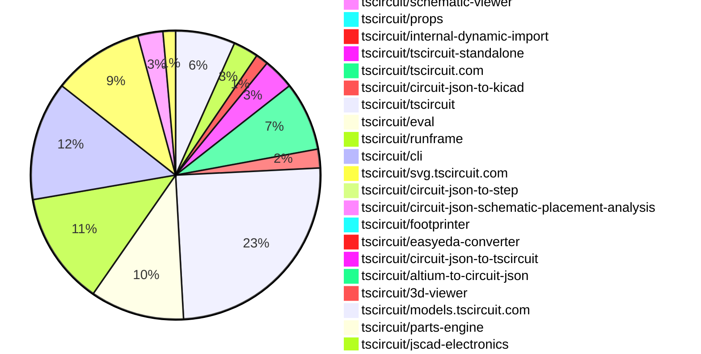

# Contribution Overview 2026-10-13

The current week is shown below. There are 3 major sections:

- [Contributor Overview](#contributor-overview)
- [PRs by Repository](#prs-by-repository)
- [PRs by Contributor](#changes-by-contributor)
- [Scoring & Sponsorship Details](/docs/sponsorship-calculation-explanation.md)

## PRs by Repository

## Contributor Overview

| Contributor | 🐳 Major | 🐙 Minor | 🐌 Tiny | Score | ⭐ |
|-------------|---------|---------|---------|-------|-----|
| [imrishabh18](#imrishabh18) | 9 | 10 | 10 | 67 | ⭐⭐⭐ |
| [seveibar](#seveibar) | 9 | 5 | 10 | 57 | ⭐⭐⭐ |
| [MustafaMulla29](#MustafaMulla29) | 3 | 2 | 8 | 25 | ⭐⭐ |
| [ShiboSoftwareDev](#ShiboSoftwareDev) | 2 | 6 | 1 | 24 | ⭐⭐ |
| [tscircuitbot](#tscircuitbot) | 0 | 0 | 217 | 18 | ⭐⭐ |
| [rushabhcodes](#rushabhcodes) | 1 | 3 | 4 | 14 | ⭐⭐ |
| [0hmX](#0hmX) | 2 | 1 | 2 | 12 | ⭐⭐ |
| [techmannih](#techmannih) | 1 | 1 | 1 | 8 | ⭐ |
| [AnasSarkiz](#AnasSarkiz) | 1 | 1 | 2 | 8 | ⭐ |
| [trixie010](#trixie010) | 0 | 1 | 0 | 2 |  |
| [hrithik18k](#hrithik18k) | 0 | 1 | 0 | 2 |  |
| [GokulPandi-M](#GokulPandi-M) | 0 | 1 | 0 | 2 |  |

## Staff Pass Ratio (SPR)

| Contributor | Reviewed PRs | Rejections | Approvals | SPR |
|-------------|--------------|------------|-----------|-----|
| [imrishabh18](#imrishabh18) | 10 | 0 | 10 | 100.0% |
| [MustafaMulla29](#MustafaMulla29) | 4 | 1 | 4 | 75.0% |
| [rushabhcodes](#rushabhcodes) | 3 | 0 | 3 | 100.0% |
| [0hmX](#0hmX) | 1 | 0 | 1 | 100.0% |
| [raykholo](#raykholo) | 1 | 0 | 1 | 100.0% |
| [trixie010](#trixie010) | 1 | 0 | 1 | 100.0% |

imrishabh18 SPR PRs (10)

- [#5388](https://github.com/tscircuit/cli/pull/5388) Block network fallbacks for standalone imports
- [#5384](https://github.com/tscircuit/cli/pull/5384) Use embedded eval worker configuration for standalone dev
- [#5368](https://github.com/tscircuit/cli/pull/5368) Serve baked assets and expose parts-engine base URLs
- [#5344](https://github.com/tscircuit/cli/pull/5344) Copy prepared JS CDN packages for static site builds
- [#5348](https://github.com/tscircuit/cli/pull/5348) Serve prepared JS CDN packages in tsci dev
- [#5324](https://github.com/tscircuit/cli/pull/5324) Add --jscdn-base-url to static site builds
- [#67](https://github.com/tscircuit/parts-engine/pull/67) Support configurable provider base URLs
- [#38](https://github.com/tscircuit/internal-dynamic-import/pull/38) Support window.TSCIRCUIT_JSCDN_BASE_URL for browser imports
- [#16](https://github.com/tscircuit/tscircuit-standalone/pull/16) Add macOS terminal installation without browser quarantine
- [#11](https://github.com/tscircuit/tscircuit-standalone/pull/11) Launch shared CLI with bundled RunFrame JS CDN packages

MustafaMulla29 SPR PRs (4)

- [#4596](https://github.com/tscircuit/core/pull/4596) Add standalone solder paste apertures
- [#271](https://github.com/tscircuit/circuit-json-schematic-placement-analysis/pull/271) feat: detect ungrouped switch RC networks
- [#249](https://github.com/tscircuit/circuit-json-schematic-placement-analysis/pull/249) feat: detect separated switch diodes and excessive matrix spacing
- [#277](https://github.com/tscircuit/circuit-json-schematic-placement-analysis/pull/277) feat: detect inline parallel capacitor pairs

rushabhcodes SPR PRs (3)

- [#4624](https://github.com/tscircuit/core/pull/4624) fix: honor oval plated-hole rotation during autorouting
- [#4571](https://github.com/tscircuit/core/pull/4571) Fix footprint keepouts staying behind after PCB layout
- [#4570](https://github.com/tscircuit/core/pull/4570) fix: respect rotated pad geometry when assigning routed source traces

0hmX SPR PRs (1)

- [#4529](https://github.com/tscircuit/core/pull/4529) fix: report disallowed blind/buried vias in manual paths

raykholo SPR PRs (1)

- [#636](https://github.com/tscircuit/circuit-json-to-kicad/pull/636) Export pcb_via tenting to KiCad vias

trixie010 SPR PRs (1)

- [#598](https://github.com/tscircuit/easyeda-converter/pull/598) fix: stop emitting a duplicate pcb_cutout for every HOLE record

> Note: AI evaluates PRs and assigns 1-3 star ratings automatically. 4 and 5 star ratings require manual staff review.

## Review Table

[reviews-received-hover]: ## "Number of reviews received for PRs for this contributor"
[approvals-received-hover]: ## "Number of approvals received for PRs this contributor authored"
[rejections-received-hover]: ## "Number of rejections received for PRs this contributor authored"
[prs-opened-hover]: ## "Number of PRs opened by this contributor"
[issues-created-hover]: ## "Number of issues created by this contributor"

| Contributor | Reviews Received | Approvals Received | Rejections Received | Approvals | Rejections Given | PRs Opened | PRs Merged | Issues Created |
|---|---|---|---|---|---|---|---|---|
| [0hmX](#0hmX) | 2 | 1 | 0 | 1 | 0 | 10 | 5 | 0 |
| [Abse2001](#Abse2001) | 0 | 0 | 0 | 11 | 0 | 8 | 0 | 0 |
| [AnasSarkiz](#AnasSarkiz) | 3 | 3 | 0 | 0 | 0 | 4 | 4 | 0 |
| [atani](#atani) | 24 | 0 | 0 | 0 | 0 | 16 | 0 | 0 |
| [CreedTech](#CreedTech) | 0 | 0 | 0 | 0 | 0 | 1 | 0 | 0 |
| [daniellachev](#daniellachev) | 0 | 0 | 0 | 0 | 0 | 1 | 0 | 0 |
| [deus-intus](#deus-intus) | 0 | 0 | 0 | 0 | 0 | 1 | 0 | 0 |
| [Devesh36](#Devesh36) | 0 | 0 | 0 | 0 | 0 | 8 | 0 | 0 |
| [GokulPandi-M](#GokulPandi-M) | 2 | 2 | 0 | 0 | 0 | 1 | 1 | 0 |
| [hrithik18k](#hrithik18k) | 1 | 1 | 0 | 0 | 0 | 2 | 1 | 0 |
| [imrishabh18](#imrishabh18) | 14 | 12 | 0 | 9 | 4 | 41 | 30 | 0 |
| [jloa-dev](#jloa-dev) | 0 | 0 | 0 | 0 | 0 | 1 | 0 | 0 |
| [LuisaW07](#LuisaW07) | 0 | 0 | 0 | 0 | 0 | 1 | 0 | 0 |
| [mohan-bee](#mohan-bee) | 3 | 1 | 1 | 1 | 0 | 23 | 0 | 0 |
| [MustafaMulla29](#MustafaMulla29) | 10 | 7 | 0 | 4 | 0 | 26 | 13 | 0 |
| [oziass](#oziass) | 0 | 0 | 0 | 0 | 0 | 1 | 0 | 0 |
| [Pr1yansu](#Pr1yansu) | 0 | 0 | 0 | 0 | 0 | 2 | 0 | 0 |
| [prajwal-0706](#prajwal-0706) | 0 | 0 | 0 | 0 | 0 | 3 | 0 | 0 |
| [Ratanlavate](#Ratanlavate) | 0 | 0 | 0 | 0 | 0 | 1 | 0 | 0 |
| [raykholo](#raykholo) | 1 | 1 | 0 | 0 | 0 | 5 | 1 | 0 |
| [rushabhcodes](#rushabhcodes) | 28 | 12 | 0 | 0 | 0 | 10 | 8 | 0 |
| [Sayandevxyz](#Sayandevxyz) | 0 | 0 | 0 | 0 | 0 | 5 | 0 | 0 |
| [seveibar](#seveibar) | 7 | 1 | 0 | 23 | 0 | 47 | 24 | 0 |
| [ShiboSoftwareDev](#ShiboSoftwareDev) | 11 | 8 | 0 | 3 | 0 | 74 | 9 | 0 |
| [smartcalsystems-sketch](#smartcalsystems-sketch) | 0 | 0 | 0 | 0 | 0 | 2 | 0 | 0 |
| [tarazum](#tarazum) | 0 | 0 | 0 | 0 | 0 | 1 | 0 | 0 |
| [techmannih](#techmannih) | 6 | 2 | 0 | 1 | 0 | 9 | 3 | 0 |
| [trixie010](#trixie010) | 5 | 2 | 3 | 0 | 0 | 4 | 1 | 0 |
| [tscircuitbot](#tscircuitbot) | 0 | 0 | 0 | 0 | 0 | 281 | 217 | 0 |
| [vreview](#vreview) | 0 | 0 | 0 | 0 | 0 | 1 | 0 | 0 |

## Changes by Repository

### [tscircuit/core](https://github.com/tscircuit/core)

| PR # | Impact | Rating | Contributor | Description |
|------|--------|--------|-------------|-------------|
| [#4604](https://github.com/tscircuit/core/pull/4604) | 🐳 Major | ⭐⭐⭐ | seveibar | Allows chips and connectors to use physical BGA ball names directly in pinLabels, connections, footprint hints, schematic arrangements, and pin styles, resolving previous issues with alias resolution. |
| [#4603](https://github.com/tscircuit/core/pull/4603) | 🐳 Major | ⭐⭐⭐ | seveibar | Fixes autorouting failure by resolving bare trace names and explicit trace selectors, ensuring proper diagnostics for unmatched or ambiguous selectors. |
| [#4624](https://github.com/tscircuit/core/pull/4624) | 🐳 Major | ⭐⭐⭐ | rushabhcodes | Fixes autorouting issues by ensuring that oval plated-hole dimensions are correctly rotated and used as routing obstacles during PCB design. |
| [#4596](https://github.com/tscircuit/core/pull/4596) | 🐳 Major | ⭐⭐⭐ | MustafaMulla29 | Problem and change solderpaste is defined by tscircuitprops, but Core rejects it as an unregistered element. This adds the native primitive so one continuous copper pad can carry several independent stencil apertures. The renderer uses the existing props and pcb_solder_paste schemas, supports rectangles and circles on either outer layer, and preserves parent rotations, footprint flips, layout movement, and removal. Cached subcircuits retain independent apertures and their orientation, including suppressed full-pad openings. User props remain immutable. Uses the published tscircuitcircuit-json-util0.0.122, which includes https:github.comtscircuitcircuit-json-utilpull238. Cached PCB primitives use the shared transform utility. Circuit JSON import retains an apertures existing rotation as derived state because authored solder-paste props only expose axis-aligned shapes. Cached circular through-hole paste is restored as independent paste geometry, so inflated round holes must not generate it again. This uses Cores existing _isInflatedFromCircuitJson state. Two focused regressions verify that a mixed footprint keeps three automatic paste records and that an explicitly overlapping aperture is preserved, with caching on and off. Each new regression has its own file and labeled snapshot. Pill and oval generation are unchanged. Includes ten solder-paste tests, including a six-window pattern over a single exposed copper pad. Updated to mains isSmt support; keeps tscircuitprops0.0.701 and the released paste transformation fix. Fixes 3577.  Validation All 10 solder-paste tests pass. The two new cache regressions failed before the fix (5 instead of 3 records, and 6 instead of 4). Focused suite: 34 pass, 1 existing pill-paste snapshot mismatch. The 0.12 mismatch reproduces on unchanged main f518678 with the same dependencies and produces an identical diff image; its snapshot is unchanged. Existing isSmt tests, manual-via regression, and standalone primitive caching pass. The manual-via test now matches main exactly. Polygon plated-hole test and both new snapshot comparisons pass after removing ternaries from the newly touched primitive. bunx tsc --noEmit, bun run build, and bun run smoke-test:dist pass. bun run format, git diff --check, and INPUT_PACKAGE_TYPEinternal_lib bunx tscircuitdependency-check pass. Zero ternaries in the 17 changed TSTSX files. The neighboring polygon-paste caching snapshot previously showed a 0.04 mismatch on both this PR and unchanged code with the same dependencies. That baseline is unchanged. The full test suite was not rerun for this update.  Scope This implements Core rendering and Circuit JSON importcache support. It does not change downstream Gerber or KiCad exporters; they must consume independent pcb_solder_paste records to preserve these apertures. |
| [#4636](https://github.com/tscircuit/core/pull/4636) | 🐙 Minor | ⭐⭐ | seveibar | Exposed testprobe pads can now use smtpad noSolderPaste  to omit pcb_solder_paste while keeping copper exposed, affecting all six pad shapes and ensuring proper paste creation checks. |
| [#4571](https://github.com/tscircuit/core/pull/4571) | 🐙 Minor | ⭐⭐ | rushabhcodes | Fixes the issue where footprint keepouts do not move with their associated PCB components during layout, allowing copper to intrude into designated clearance areas. |
| [#4570](https://github.com/tscircuit/core/pull/4570) | 🐙 Minor | ⭐⭐ | rushabhcodes | Fixes incorrect source trace assignments for routed traces on rotated SMT pads, resolving trace-continuity validation failures. |
| [#4627](https://github.com/tscircuit/core/pull/4627) | 🐙 Minor | ⭐⭐ | ShiboSoftwareDev | Prefers exact PCB-port matches for routed endpoints to avoid incorrect source trace attribution when endpoints fall inside adjacent pads. |
| [#4632](https://github.com/tscircuit/core/pull/4632) | 🐙 Minor | ⭐⭐ | ShiboSoftwareDev | Fixes incorrect source trace attribution for routed endpoints overlapping adjacent pads in PCB designs. |
| [#4621](https://github.com/tscircuit/core/pull/4621) | 🐙 Minor | ⭐⭐ | ShiboSoftwareDev | Fixes the issue where a requested teardrop is missing when routed copper is attributed to another source trace on the same physical net. |
| [#4619](https://github.com/tscircuit/core/pull/4619) | 🐙 Minor | ⭐⭐ | ShiboSoftwareDev | Fixes the issue where teardrops for equivalent source traces were not rendered correctly, leading to missing teardrops on routed copper. |
| [#4656](https://github.com/tscircuit/core/pull/4656) | 🐙 Minor | ⭐⭐ | imrishabh18 | Fixes alignment of generated rounded board outlines with the resolved board center during rendering, preventing false outside-board errors. |
| [#4645](https://github.com/tscircuit/core/pull/4645) | 🐙 Minor | ⭐⭐ | MustafaMulla29 | Fixes the issue of extra built-in terminals being created when a custom symbol declares its own ports, preventing false unconnected-pin warnings. |
| [#4593](https://github.com/tscircuit/core/pull/4593) | 🐙 Minor | ⭐⭐ | hrithik18k | Modifies solder paste generation logic to respect the isSmt property, preventing unwanted paste for through-hole components while retaining paste for mixed footprints. |
| [#4529](https://github.com/tscircuit/core/pull/4529) | 🐙 Minor | ⭐⭐ | 0hmX | Reports disallowed blind or buried vias in manual paths when the board disables them, preserving saved copper and aggregating all disallowed vias. |

🐌 Tiny Contributions (4)

| PR # | Impact | Contributor | Description |
|------|--------|-------------|-------------|
| [#4609](https://github.com/tscircuit/core/pull/4609) | 🐌 Tiny | seveibar | Updates tscircuitcapacity-autorouter from 0.0.974 to 0.0.982. |
| [#4618](https://github.com/tscircuit/core/pull/4618) | 🐌 Tiny | rushabhcodes | Reproduces a bug where CC traces of a rotated USB-C connector touch grounded shield slots, providing a comprehensive test to validate the issue. |
| [#4617](https://github.com/tscircuit/core/pull/4617) | 🐌 Tiny | rushabhcodes | Update the circuit-json development dependency and override from 0.0.525 to 0.0.528, ensuring the installed schema and public types recognize the ownership field for components. |
| [#4644](https://github.com/tscircuit/core/pull/4644) | 🐌 Tiny | MustafaMulla29 | Fixes the issue where the custom DPDT symbol incorrectly inherits an extra phantom pin4, leading to missing trace warnings. |

### [tscircuit/checks](https://github.com/tscircuit/checks)

| PR # | Impact | Rating | Contributor | Description |
|------|--------|--------|-------------|-------------|
| [#427](https://github.com/tscircuit/checks/pull/427) | 🐳 Major | ⭐⭐⭐ | seveibar | Reduces unnecessary computation in continuity validation by deferring the construction of the physical trace graph until needed, optimizing the process of checking connectivity between traces. |

### [tscircuit/tscircuit-autorouter](https://github.com/tscircuit/tscircuit-autorouter)

| PR # | Impact | Rating | Contributor | Description |
|------|--------|--------|-------------|-------------|
| [#2998](https://github.com/tscircuit/tscircuit-autorouter/pull/2998) | 🐳 Major | ⭐⭐⭐ | seveibar | Adds a post-repair cleanup stage that commits only valid improvements and preserves route endpoints while reducing via counts in autorouting. |

🐌 Tiny Contributions (7)

| PR # | Impact | Contributor | Description |
|------|--------|-------------|-------------|
| [#3063](https://github.com/tscircuit/tscircuit-autorouter/pull/3063) | 🐌 Tiny | seveibar | Updates the tscircuitchecks dependency to version 0.0.255 to recover via-cleanup performance by incorporating continuity geometry optimization. |
| [#3044](https://github.com/tscircuit/tscircuit-autorouter/pull/3044) | 🐌 Tiny | seveibar | Updates the trace simplification solver dependency to a specific upstream commit, improving the handling of routed-copper vias and related cache test instrumentation. |
| [#3052](https://github.com/tscircuit/tscircuit-autorouter/pull/3052) | 🐌 Tiny | seveibar | Updates the dependency on tscircuitchecks to version 0.0.249 and modifies two tests for upstream readable-name diagnostics, ensuring tracegap assertions and structured trace-pair identity are retained. |
| [#3064](https://github.com/tscircuit/tscircuit-autorouter/pull/3064) | 🐌 Tiny | seveibar | Updates the high-density-repair02 dependency to optimize sequential repair by implementing conservative obstacle pruning, cached clearances, boundary checks, and reused spatial-query hits, while preserving candidate ordering and acceptance checks. |
| [#3069](https://github.com/tscircuit/tscircuit-autorouter/pull/3069) | 🐌 Tiny | tscircuitbot | Automated package update |
| [#3062](https://github.com/tscircuit/tscircuit-autorouter/pull/3062) | 🐌 Tiny | tscircuitbot | Automated package update |
| [#3057](https://github.com/tscircuit/tscircuit-autorouter/pull/3057) | 🐌 Tiny | tscircuitbot | Automated package update |

### [tscircuit/circuit-json-to-gltf](https://github.com/tscircuit/circuit-json-to-gltf)

| PR # | Impact | Rating | Contributor | Description |
|------|--------|--------|-------------|-------------|
| [#256](https://github.com/tscircuit/circuit-json-to-gltf/pull/256) | 🐳 Major | ⭐⭐⭐ | seveibar | Fixes GLB import issues by correctly decoding interleaved vertex data and applying glTF normalization for various component types, ensuring accurate rendering of positions and normals. |

🐌 Tiny Contributions (1)

| PR # | Impact | Contributor | Description |
|------|--------|-------------|-------------|
| [#257](https://github.com/tscircuit/circuit-json-to-gltf/pull/257) | 🐌 Tiny | seveibar | Reproduces issue 255 through generated component GLBs, convertCircuitJsonToGltf, and PoppyGL, capturing broken behavior in GLB accessors for further debugging and fixing. |

### [tscircuit/motor-driver-firmware](https://github.com/tscircuit/motor-driver-firmware)

| PR # | Impact | Rating | Contributor | Description |
|------|--------|--------|-------------|-------------|
| [#15](https://github.com/tscircuit/motor-driver-firmware/pull/15) | 🐳 Major | ⭐⭐⭐ | seveibar | DRV8825 controllers currently generate STEP edges in MicroPython, so higher requested speeds can exceed the interpreters pulse throughput. Add a native Pico SDK C application that generates pulses in PIO and counts emitted edges with a separate PIO state machine and DMA. The application retains protocol 3, the existing dashboardgantry commands, 400 ms ramps, deferred GOTO starts, RGBUSB-PD controls, alarms, songs, and temperaturedriverheartbeatwatchdog protections. Native settings use two reserved flash sectors with checksum and partial-write recovery. A build fingerprint identifies the image on live boards. The legacy DRV8847 MicroPython implementation remains available; this native image targets the DRV8825RGB PCB. Validation: Cross-built the UF2 with Pico SDK 2.3.1; native motion, protocolprotection, and settings tests passed with UBSan. Existing 45 Python tests and dashboard, song, single-motor, gantry, and saved-position checks passed. Flashed both physical controllers and checked their build fingerprints. Driver-disabled electrical tests emitted exact requested counts at 1k, 64k, 128k, and 200k physical pulsessec with zero PIO queue underruns. At the 200k setting, observed throughput was approximately 199.7k pulsessec on both boards. Verified heartbeat expiry and USB disconnect stop pulse generation, heartbeats do not resume it, settings survive restart, and restarts return to disabled 5 V with fresh position sessions. No shaft movement or loaded mechanical performance was tested. Independent pulse-widthjitter measurement, loaded torque, and physical positional accuracy remain unverified. CI adds host native tests and an ARM UF2 build. |
| [#13](https://github.com/tscircuit/motor-driver-firmware/pull/13) | 🐳 Major | ⭐⭐⭐ | seveibar | The latest RP2040 motor controller uses DRV8825 STEPDIR, transistor-driven RGB outputs, winding-current ADC inputs and GPIO-controlled CH224K voltage selection. The firmware and dashboard, single-motor jog and gantry pages now support that board while retaining the original DRV8847 profile. Startup keeps the motor disabled at 5 V. Voltage changes disable the driver and enforce a settling interval; temperature, heartbeat, watchdog and driver-fault protection remain active. Automatic RGB status and manual colors are available, with alarms taking priority. The hardware fixes 116 microsteps; larger selected increments group pulses and saved-position GOTO uses the finest supported increment. Validation: 45 Python tests and all dashboardjogGOTOsong checks pass; CI stages both board profiles. On board e66568714f117e21, all 21 uploaded files matched SHA-256. Live Web Serial controls applied RGB settings and the user confirmed LED operation. With the replacement charger and an explicit 9 V request, two 800-microstep forwardreverse moves completed with exact commanded counts, about 0.87 A peak absolute winding samples and no reported faults; the user confirmed the motor spun. Temperature stayed around 28 C and the motor was stopped afterward. Use 9 V with the tested charger. A 15 V request yielded a measured 9 V input and no movement; the actual PG behavior was not measured. Voltage telemetry represents the request and settling timer, not measured rail voltage. Current samples are uncalibrated, and high-speedloadphysical return accuracy remain unverified. |
| [#14](https://github.com/tscircuit/motor-driver-firmware/pull/14) | 🐳 Major | ⭐⭐⭐ | seveibar | The single-motor jogging page now exposes supported quarter, 18 and 116 step sizes with angular increments and RPM estimates, allowing for more precise motor control. |

### [tscircuit/single-layer-grid-router](https://github.com/tscircuit/single-layer-grid-router)

| PR # | Impact | Rating | Contributor | Description |
|------|--------|--------|-------------|-------------|
| [#1](https://github.com/tscircuit/single-layer-grid-router/pull/1) | 🐳 Major | ⭐⭐⭐ | seveibar | Add a single-layer PCB grid routing solver and custom tscircuit algorithmFn. The supplied 74HC00 breakout is reconstructed as a fixture and solves all 14 nets through 20 branches, entirely on one copper layer, without vias or jumpers. The solver extends BaseSolver, uses conservative clearance-aware A, groups shared electrical terminals, and retries deterministic net orders after ripping up generated copper. The event adapter supports async routing, progress, cancellationrestart, and synchronous solves. Include a React Cosmos debugger and handbookplop bootstrap configuration. Every test has a committed visual SVG snapshot, with brief test bodies and setupverification in testsfixtures; AGENTS.md documents this rule. The board dimensions are estimated from the screenshot and documented in the fixture and README. Validation: 11 Bun tests passed, including a real tscircuit layers1 integration, independent continuous connectivityclearance checks, existing copper, rotated obstacles, off-grid terminals, rip-up retries, and failurecancellation behavior. Type checking, format checking, and the Cosmos production export passed. All SVG snapshots were visually inspected. |

### [tscircuit/schematic-viewer](https://github.com/tscircuit/schematic-viewer)

| PR # | Impact | Rating | Contributor | Description |
|------|--------|--------|-------------|-------------|
| [#291](https://github.com/tscircuit/schematic-viewer/pull/291) | 🐙 Minor | ⭐⭐ | seveibar | Fixes dropdown menus appearing behind schematic toolbar controls due to z-index conflict by raising the view-menu layer to 110. |

### [tscircuit/props](https://github.com/tscircuit/props)

| PR # | Impact | Rating | Contributor | Description |
|------|--------|--------|-------------|-------------|
| [#938](https://github.com/tscircuit/props/pull/938) | 🐙 Minor | ⭐⭐ | seveibar | Adds noSolderPaste?: boolean to the TypeScript interfaces and Zod schemas for every smtpad shape: rect, rotated rect, circle, pill, rotated pill, and polygon, allowing TSX authors to express testprobe pads with exposed copper and no solder paste. |

### [tscircuit/internal-dynamic-import](https://github.com/tscircuit/internal-dynamic-import)

| PR # | Impact | Rating | Contributor | Description |
|------|--------|--------|-------------|-------------|
| [#37](https://github.com/tscircuit/internal-dynamic-import/pull/37) | 🐙 Minor | ⭐⭐ | seveibar | Adds support for lazy loading of JSCAD STEP and Parasolid exporters, including versioned imports and declaration synchronization. |
| [#38](https://github.com/tscircuit/internal-dynamic-import/pull/38) | 🐙 Minor | ⭐⭐ | imrishabh18 | Allows hosts to set window.TSCIRCUIT_JSCDN_BASE_URL for importing optional modules, enabling a standalone CLI to serve bundled dependencies without custom importers. |

🐌 Tiny Contributions (2)

| PR # | Impact | Contributor | Description |
|------|--------|-------------|-------------|
| [#40](https://github.com/tscircuit/internal-dynamic-import/pull/40) | 🐌 Tiny | seveibar | Fixes the issue where exporter declaration snapshots were not aligned with the installed published packages, causing build failures during releases. |
| [#39](https://github.com/tscircuit/internal-dynamic-import/pull/39) | 🐌 Tiny | tscircuitbot | Automated package update |

### [tscircuit/tscircuit-standalone](https://github.com/tscircuit/tscircuit-standalone)

| PR # | Impact | Rating | Contributor | Description |
|------|--------|--------|-------------|-------------|
| [#18](https://github.com/tscircuit/tscircuit-standalone/pull/18) | 🐳 Major | ⭐⭐⭐ | imrishabh18 | Publish direct binaries for all five targets and link to them first in release notes. Keep optional archives, companion license notices, and checksums for every asset. Documentation edits are limited to the download table and usagechecksum details. |
| [#16](https://github.com/tscircuit/tscircuit-standalone/pull/16) | 🐳 Major | ⭐⭐⭐ | imrishabh18 | Add a macOS terminal installer that downloads a specified release with curl, selects arm64 or x64 automatically, verifies the selected archive against SHA256SUMS before extracting, and preserves all redistribution notices. |
| [#15](https://github.com/tscircuit/tscircuit-standalone/pull/15) | 🐳 Major | ⭐⭐⭐ | imrishabh18 | Embed complete datasheet API responses, including generated TSX and pin attributes, and set TSCIRCUIT_BAKED_ASSET_SERVER_DIR to their extracted directory before launching the shared CLI. Reuse the catalog downloader and asset embedding, update the CLI pin to its merged server support, and share the baked snapshot across release targets. |
| [#11](https://github.com/tscircuit/tscircuit-standalone/pull/11) | 🐳 Major | ⭐⭐⭐ | imrishabh18 | The standalone executable now launches the shared tscircuitcli and supplies the prepared JS CDN directory expected by its merged devsite support. The CLI dependency is pinned to merged commit fc0f4e0739ce3b93b1fb1c332387c9ce9449ae98 (tscircuitcli5350). At build time, follow that CLIs RunFrame dependency graph to discover internal-dynamic-import calls, bundle the 11 requested packages from existing dependencies, and reuse the browserWASM adapters. At startup, extract the embedded files into a temporary directory and set TSCIRCUIT_STANDALONE1 and TSCIRCUIT_JSCDN_DIR before loading the CLI. tsci dev serves jscdn; tsci build --site automatically copies the files into distjscdn. Asset URLs remain relative for sites hosted below a subpath. Include the shared CLIs buildsnapshot workers and runtime module registration. Use portable RollupResvg WASM loaders for compilation. The previous prototype CLI remains available from source; the README and CI now describe and exercise the shared CLI. This bundles the JS CDN packages, not every remote service used by the CLI or RunFrame. No CLI package.json dependencies are added. Validation: Typechecks and the two small JS CDN unit tests pass. Compiled executable smoke passes on macOS arm64Bun 1.3.14: versionhelp, sequential and worker TSX builds, PNG output, automatic site copying, and real tsci dev, with no project dependencies or runtime on PATH. Chromium imports all 11 bundled packages and runs a WASM-backed FDM exporter from both dev and nested static-site URLs, with external browser requests blocked. Linux x64 cross-compilation and license inventory pass with CIs pinned Bun 1.3.12; the graph contains no native .node addons. Bun 1.3.12s compiled executables could not run on this Mac, so native local smoke used 1.3.14. Existing suite: 149 pass; one existing archive test requires GNU tar (--sortname), unavailable with this Macs BSD tar. Ubuntu CI covers the full suite, loopback-only browser check, and five compilation targets. |
| [#10](https://github.com/tscircuit/tscircuit-standalone/pull/10) | 🐙 Minor | ⭐⭐ | seveibar | Fixes the LED fixtures warning emissions to ensure only the correct components emit manufacturer-part-number warnings, allowing successful nightly release qualifications. |
| [#14](https://github.com/tscircuit/tscircuit-standalone/pull/14) | 🐙 Minor | ⭐⭐ | imrishabh18 | Fixes startup issues for the development environment when the standalone binary is located within the project directory, ensuring the executable is excluded during the process. |

🐌 Tiny Contributions (4)

| PR # | Impact | Contributor | Description |
|------|--------|-------------|-------------|
| [#12](https://github.com/tscircuit/tscircuit-standalone/pull/12) | 🐌 Tiny | seveibar | Add a manual standalone release workflow that allows users to publish prereleases with a specific version or the latest version, even if a daily release has already been published. |
| [#19](https://github.com/tscircuit/tscircuit-standalone/pull/19) | 🐌 Tiny | imrishabh18 | Pins the CLI to a specific commit to ensure unavailable standalone imports return a representative message instead of falling back to EasyEDA or the registry. |
| [#17](https://github.com/tscircuit/tscircuit-standalone/pull/17) | 🐌 Tiny | imrishabh18 | Embed the CLIs eval worker through RunFrames existing INJECT_TSCIRCUIT_EVAL_WEB_WORKER_BLOB_URL placeholder during binary compilation, allowing the browser to start the embedded code from a Blob URL without a separate worker file or endpoint. |
| [#13](https://github.com/tscircuit/tscircuit-standalone/pull/13) | 🐌 Tiny | imrishabh18 | Fixes macOS standalone binaries being killed on startup due to malformed signature by updating Bun version and ensuring proper signing and verification of binaries. |

### [tscircuit/tscircuit.com](https://github.com/tscircuit/tscircuit.com)

🐌 Tiny Contributions (22)

| PR # | Impact | Contributor | Description |
|------|--------|-------------|-------------|
| [#5437](https://github.com/tscircuit/tscircuit.com/pull/5437) | 🐌 Tiny | seveibar | Removes the blue introduction label, the entire Downloads and versions section, and the closing local-project sentence, while adjusting typography for consistency. |
| [#5453](https://github.com/tscircuit/tscircuit.com/pull/5453) | 🐌 Tiny | tscircuitbot | Automated package update |
| [#5452](https://github.com/tscircuit/tscircuit.com/pull/5452) | 🐌 Tiny | tscircuitbot | Updates the tscircuiteval package from version 0.0.1619 to 0.0.1622 in the package.json file. |
| [#5451](https://github.com/tscircuit/tscircuit.com/pull/5451) | 🐌 Tiny | tscircuitbot | Updates the tscircuitrunframe package to version 0.0.2996 |
| [#5449](https://github.com/tscircuit/tscircuit.com/pull/5449) | 🐌 Tiny | tscircuitbot | Automated package update |
| [#5447](https://github.com/tscircuit/tscircuit.com/pull/5447) | 🐌 Tiny | tscircuitbot | Updates the tscircuiteval package from version 0.0.1618 to 0.0.1619 |
| [#5446](https://github.com/tscircuit/tscircuit.com/pull/5446) | 🐌 Tiny | tscircuitbot | Updates the tscircuitrunframe package from version 0.0.2992 to 0.0.2993 |
| [#5445](https://github.com/tscircuit/tscircuit.com/pull/5445) | 🐌 Tiny | tscircuitbot | Updates the tscircuiteval package from version 0.0.1616 to 0.0.1618. |
| [#5444](https://github.com/tscircuit/tscircuit.com/pull/5444) | 🐌 Tiny | tscircuitbot | Automated package update |
| [#5441](https://github.com/tscircuit/tscircuit.com/pull/5441) | 🐌 Tiny | tscircuitbot | Updates the tscircuiteval package from version 0.0.1613 to 0.0.1616 |
| [#5426](https://github.com/tscircuit/tscircuit.com/pull/5426) | 🐌 Tiny | tscircuitbot | Automated package update |
| [#5436](https://github.com/tscircuit/tscircuit.com/pull/5436) | 🐌 Tiny | tscircuitbot | Automated package update |
| [#5434](https://github.com/tscircuit/tscircuit.com/pull/5434) | 🐌 Tiny | tscircuitbot | Automated package update |
| [#5425](https://github.com/tscircuit/tscircuit.com/pull/5425) | 🐌 Tiny | tscircuitbot | Updates the tscircuiteval package from version 0.0.1609 to 0.0.1611 |
| [#5424](https://github.com/tscircuit/tscircuit.com/pull/5424) | 🐌 Tiny | tscircuitbot | Automated package update |
| [#5422](https://github.com/tscircuit/tscircuit.com/pull/5422) | 🐌 Tiny | tscircuitbot | Automated package update |
| [#5421](https://github.com/tscircuit/tscircuit.com/pull/5421) | 🐌 Tiny | tscircuitbot | Updates the tscircuiteval package from version 0.0.1607 to 0.0.1609 in the package.json file. |
| [#5420](https://github.com/tscircuit/tscircuit.com/pull/5420) | 🐌 Tiny | tscircuitbot | Updates the tscircuitrunframe package to version 0.0.2981 |
| [#5419](https://github.com/tscircuit/tscircuit.com/pull/5419) | 🐌 Tiny | tscircuitbot | Automated package update |
| [#5433](https://github.com/tscircuit/tscircuit.com/pull/5433) | 🐌 Tiny | tscircuitbot | Updates the tscircuitrunframe package to version 0.0.2987 in package.json |
| [#5429](https://github.com/tscircuit/tscircuit.com/pull/5429) | 🐌 Tiny | tscircuitbot | Automated package update |
| [#5427](https://github.com/tscircuit/tscircuit.com/pull/5427) | 🐌 Tiny | tscircuitbot | Updates the tscircuiteval package from version 0.0.1611 to 0.0.1612 in the package.json file. |

### [tscircuit/circuit-json-to-kicad](https://github.com/tscircuit/circuit-json-to-kicad)

🐌 Tiny Contributions (6)

| PR # | Impact | Contributor | Description |
|------|--------|-------------|-------------|
| [#634](https://github.com/tscircuit/circuit-json-to-kicad/pull/634) | 🐌 Tiny | seveibar | Ensures physical ball names such as A1 are consistent across KiCad PCB pads, library symbol pins, and placed symbol pin instances, preventing disconnection between schematic and footprint. |
| [#637](https://github.com/tscircuit/circuit-json-to-kicad/pull/637) | 🐌 Tiny | tscircuitbot | Automated package update |
| [#644](https://github.com/tscircuit/circuit-json-to-kicad/pull/644) | 🐌 Tiny | MustafaMulla29 | Fixes incorrect reference display for custom symbols in KiCad export, ensuring each instance shows its correct reference instead of duplicating the first instances reference. |
| [#643](https://github.com/tscircuit/circuit-json-to-kicad/pull/643) | 🐌 Tiny | MustafaMulla29 | Reproduces a bug where shared custom symbol reference labels incorrectly display the same reference for multiple instances in KiCad. |
| [#647](https://github.com/tscircuit/circuit-json-to-kicad/pull/647) | 🐌 Tiny | MustafaMulla29 | Fixes the export path for custom footprints with prefixed metadata names to ensure they are correctly classified in the project library. |
| [#645](https://github.com/tscircuit/circuit-json-to-kicad/pull/645) | 🐌 Tiny | MustafaMulla29 | Fixes the export paths for custom footprints with prefixes, ensuring both prefixed and unprefixed versions are correctly exported and validated in the library. |

### [tscircuit/tscircuit](https://github.com/tscircuit/tscircuit)

🐌 Tiny Contributions (71)

| PR # | Impact | Contributor | Description |
|------|--------|-------------|-------------|
| [#5712](https://github.com/tscircuit/tscircuit/pull/5712) | 🐌 Tiny | tscircuitbot | Updates the package version from 0.0.2902 to 0.0.2903 in package.json |
| [#5711](https://github.com/tscircuit/tscircuit/pull/5711) | 🐌 Tiny | tscircuitbot | Automated package update |
| [#5710](https://github.com/tscircuit/tscircuit/pull/5710) | 🐌 Tiny | tscircuitbot | Automated package update |
| [#5709](https://github.com/tscircuit/tscircuit/pull/5709) | 🐌 Tiny | tscircuitbot | Updates the version of the tscircuitcli and other related packages in package.json |
| [#5708](https://github.com/tscircuit/tscircuit/pull/5708) | 🐌 Tiny | tscircuitbot | Automated package update |
| [#5707](https://github.com/tscircuit/tscircuit/pull/5707) | 🐌 Tiny | tscircuitbot | Automated package update |
| [#5706](https://github.com/tscircuit/tscircuit/pull/5706) | 🐌 Tiny | tscircuitbot | Automated package update to version 0.0.2900 |
| [#5705](https://github.com/tscircuit/tscircuit/pull/5705) | 🐌 Tiny | tscircuitbot | Updates the tscircuitcli package to version 0.1.2341 |
| [#5703](https://github.com/tscircuit/tscircuit/pull/5703) | 🐌 Tiny | tscircuitbot | Updates the package version from 0.0.2898 to 0.0.2899 in package.json |
| [#5702](https://github.com/tscircuit/tscircuit/pull/5702) | 🐌 Tiny | tscircuitbot | Automated package update |
| [#5701](https://github.com/tscircuit/tscircuit/pull/5701) | 🐌 Tiny | tscircuitbot | Automated package update |
| [#5700](https://github.com/tscircuit/tscircuit/pull/5700) | 🐌 Tiny | tscircuitbot | Automated package update |
| [#5699](https://github.com/tscircuit/tscircuit/pull/5699) | 🐌 Tiny | tscircuitbot | Updates the package version from 0.0.2896 to 0.0.2897 in package.json |
| [#5698](https://github.com/tscircuit/tscircuit/pull/5698) | 🐌 Tiny | tscircuitbot | Updates the tscircuitcli package to version 0.1.2339 |
| [#5697](https://github.com/tscircuit/tscircuit/pull/5697) | 🐌 Tiny | tscircuitbot | Automated package update |
| [#5696](https://github.com/tscircuit/tscircuit/pull/5696) | 🐌 Tiny | tscircuitbot | Automated package update |
| [#5695](https://github.com/tscircuit/tscircuit/pull/5695) | 🐌 Tiny | tscircuitbot | Automated package update |
| [#5694](https://github.com/tscircuit/tscircuit/pull/5694) | 🐌 Tiny | tscircuitbot | Automated package update |
| [#5693](https://github.com/tscircuit/tscircuit/pull/5693) | 🐌 Tiny | tscircuitbot | Automated package update |
| [#5692](https://github.com/tscircuit/tscircuit/pull/5692) | 🐌 Tiny | tscircuitbot | Updates the tscircuitcli package to version 0.1.2337 |
| [#5691](https://github.com/tscircuit/tscircuit/pull/5691) | 🐌 Tiny | tscircuitbot | Automated package update |
| [#5690](https://github.com/tscircuit/tscircuit/pull/5690) | 🐌 Tiny | tscircuitbot | Automated package update |
| [#5689](https://github.com/tscircuit/tscircuit/pull/5689) | 🐌 Tiny | tscircuitbot | Automated package update |
| [#5688](https://github.com/tscircuit/tscircuit/pull/5688) | 🐌 Tiny | tscircuitbot | Updates the tscircuitcli package from version 0.1.2334 to 0.1.2335 |
| [#5687](https://github.com/tscircuit/tscircuit/pull/5687) | 🐌 Tiny | tscircuitbot | Updates the package version from 0.0.2890 to 0.0.2891 in package.json |
| [#5686](https://github.com/tscircuit/tscircuit/pull/5686) | 🐌 Tiny | tscircuitbot | Automated package update |
| [#5684](https://github.com/tscircuit/tscircuit/pull/5684) | 🐌 Tiny | tscircuitbot | Updates the tscircuitcli package to version 0.1.2334 |
| [#5683](https://github.com/tscircuit/tscircuit/pull/5683) | 🐌 Tiny | tscircuitbot | Automated package update |
| [#5681](https://github.com/tscircuit/tscircuit/pull/5681) | 🐌 Tiny | tscircuitbot | Updates the tscircuitcli package from version 0.1.2331 to 0.1.2332 and the tscircuitrunframe package from version 0.0.2988 to 0.0.2989 in package.json |
| [#5680](https://github.com/tscircuit/tscircuit/pull/5680) | 🐌 Tiny | tscircuitbot | Automated package update |
| [#5679](https://github.com/tscircuit/tscircuit/pull/5679) | 🐌 Tiny | tscircuitbot | Automated package update |
| [#5673](https://github.com/tscircuit/tscircuit/pull/5673) | 🐌 Tiny | tscircuitbot | Updates the tscircuitcli package to version 0.1.2331 in the package.json file. |
| [#5671](https://github.com/tscircuit/tscircuit/pull/5671) | 🐌 Tiny | tscircuitbot | Automated package update |
| [#5664](https://github.com/tscircuit/tscircuit/pull/5664) | 🐌 Tiny | tscircuitbot | Updates the tscircuitcli package to version 0.1.2330 in the package.json file. |
| [#5663](https://github.com/tscircuit/tscircuit/pull/5663) | 🐌 Tiny | tscircuitbot | Updates the package version from 0.0.2881 to 0.0.2882 in package.json |
| [#5660](https://github.com/tscircuit/tscircuit/pull/5660) | 🐌 Tiny | tscircuitbot | Updates the tscircuitcli package version from 0.1.2328 to 0.1.2329 |
| [#5658](https://github.com/tscircuit/tscircuit/pull/5658) | 🐌 Tiny | tscircuitbot | Automated package update |
| [#5652](https://github.com/tscircuit/tscircuit/pull/5652) | 🐌 Tiny | tscircuitbot | Updates the tscircuitcli package version from 0.1.2325 to 0.1.2327 |
| [#5647](https://github.com/tscircuit/tscircuit/pull/5647) | 🐌 Tiny | tscircuitbot | Automated package update |
| [#5645](https://github.com/tscircuit/tscircuit/pull/5645) | 🐌 Tiny | tscircuitbot | Automated package update |
| [#5641](https://github.com/tscircuit/tscircuit/pull/5641) | 🐌 Tiny | tscircuitbot | Updates the tscircuitcli package to version 0.1.2322 in the package.json file |
| [#5636](https://github.com/tscircuit/tscircuit/pull/5636) | 🐌 Tiny | tscircuitbot | Updates the tscircuitcli package to version 0.1.2321 |
| [#5634](https://github.com/tscircuit/tscircuit/pull/5634) | 🐌 Tiny | tscircuitbot | Automated package update |
| [#5685](https://github.com/tscircuit/tscircuit/pull/5685) | 🐌 Tiny | tscircuitbot | Automated package update |
| [#5682](https://github.com/tscircuit/tscircuit/pull/5682) | 🐌 Tiny | tscircuitbot | Automated package update |
| [#5678](https://github.com/tscircuit/tscircuit/pull/5678) | 🐌 Tiny | tscircuitbot | Automated package update |
| [#5674](https://github.com/tscircuit/tscircuit/pull/5674) | 🐌 Tiny | tscircuitbot | Automated package update |
| [#5672](https://github.com/tscircuit/tscircuit/pull/5672) | 🐌 Tiny | tscircuitbot | Updates the package version from 0.0.2883 to 0.0.2884 in package.json |
| [#5665](https://github.com/tscircuit/tscircuit/pull/5665) | 🐌 Tiny | tscircuitbot | Updates the package version from 0.0.2882 to 0.0.2883 in package.json |
| [#5662](https://github.com/tscircuit/tscircuit/pull/5662) | 🐌 Tiny | tscircuitbot | Automated package update |
| [#5661](https://github.com/tscircuit/tscircuit/pull/5661) | 🐌 Tiny | tscircuitbot | Automated package update |
| [#5659](https://github.com/tscircuit/tscircuit/pull/5659) | 🐌 Tiny | tscircuitbot | Updates the package version from 0.0.2879 to 0.0.2880 in package.json |
| [#5657](https://github.com/tscircuit/tscircuit/pull/5657) | 🐌 Tiny | tscircuitbot | Automated package update |
| [#5656](https://github.com/tscircuit/tscircuit/pull/5656) | 🐌 Tiny | tscircuitbot | Updates the tscircuitcli package to version 0.1.2328 |
| [#5655](https://github.com/tscircuit/tscircuit/pull/5655) | 🐌 Tiny | tscircuitbot | Automated package update |
| [#5654](https://github.com/tscircuit/tscircuit/pull/5654) | 🐌 Tiny | tscircuitbot | Automated package update |
| [#5653](https://github.com/tscircuit/tscircuit/pull/5653) | 🐌 Tiny | tscircuitbot | Automated package update |
| [#5651](https://github.com/tscircuit/tscircuit/pull/5651) | 🐌 Tiny | tscircuitbot | Automated package update |
| [#5650](https://github.com/tscircuit/tscircuit/pull/5650) | 🐌 Tiny | tscircuitbot | Automated package update |
| [#5648](https://github.com/tscircuit/tscircuit/pull/5648) | 🐌 Tiny | tscircuitbot | Automated package update |
| [#5646](https://github.com/tscircuit/tscircuit/pull/5646) | 🐌 Tiny | tscircuitbot | Automated package update |
| [#5644](https://github.com/tscircuit/tscircuit/pull/5644) | 🐌 Tiny | tscircuitbot | Automated package update |
| [#5643](https://github.com/tscircuit/tscircuit/pull/5643) | 🐌 Tiny | tscircuitbot | Automated package update |
| [#5642](https://github.com/tscircuit/tscircuit/pull/5642) | 🐌 Tiny | tscircuitbot | Updates the package version from 0.0.2871 to 0.0.2872 in package.json |
| [#5638](https://github.com/tscircuit/tscircuit/pull/5638) | 🐌 Tiny | tscircuitbot | Automated package update |
| [#5637](https://github.com/tscircuit/tscircuit/pull/5637) | 🐌 Tiny | tscircuitbot | Automated package update |
| [#5635](https://github.com/tscircuit/tscircuit/pull/5635) | 🐌 Tiny | tscircuitbot | Automated package update |
| [#5633](https://github.com/tscircuit/tscircuit/pull/5633) | 🐌 Tiny | tscircuitbot | Automated package update |
| [#5632](https://github.com/tscircuit/tscircuit/pull/5632) | 🐌 Tiny | tscircuitbot | Updates the tscircuitcli package to version 0.1.2320 in the package.json file. |
| [#5677](https://github.com/tscircuit/tscircuit/pull/5677) | 🐌 Tiny | tscircuitbot | Automated package update |
| [#5639](https://github.com/tscircuit/tscircuit/pull/5639) | 🐌 Tiny | tscircuitbot | Automated package update |

### [tscircuit/eval](https://github.com/tscircuit/eval)

| PR # | Impact | Rating | Contributor | Description |
|------|--------|--------|-------------|-------------|
| [#5252](https://github.com/tscircuit/eval/pull/5252) | 🐙 Minor | ⭐⭐ | imrishabh18 | Allows CircuitRunner and createCircuitWebWorker to pass serializable jlcSearchBaseUrl and datasheetApiBaseUrl options into the default parts engine, preserving custom engines and EasyEDA proxy configuration, while updating the parts-engine dependency to 0.0.39. |

🐌 Tiny Contributions (29)

| PR # | Impact | Contributor | Description |
|------|--------|-------------|-------------|
| [#5271](https://github.com/tscircuit/eval/pull/5271) | 🐌 Tiny | tscircuitbot | Automated package update |
| [#5270](https://github.com/tscircuit/eval/pull/5270) | 🐌 Tiny | tscircuitbot | Updates the version of the tscircuitcore package from 0.0.2158 to 0.0.2159 in package.json |
| [#5268](https://github.com/tscircuit/eval/pull/5268) | 🐌 Tiny | tscircuitbot | Automated package update to version 0.0.1622 |
| [#5267](https://github.com/tscircuit/eval/pull/5267) | 🐌 Tiny | tscircuitbot | Automated package update |
| [#5265](https://github.com/tscircuit/eval/pull/5265) | 🐌 Tiny | tscircuitbot | Automated package update |
| [#5264](https://github.com/tscircuit/eval/pull/5264) | 🐌 Tiny | tscircuitbot | Updates the version of the tscircuitcore package from 0.0.2156 to 0.0.2157 in package.json |
| [#5262](https://github.com/tscircuit/eval/pull/5262) | 🐌 Tiny | tscircuitbot | Automated package version bump from 0.0.1619 to 0.0.1620 |
| [#5261](https://github.com/tscircuit/eval/pull/5261) | 🐌 Tiny | tscircuitbot | Updates the version of the tscircuitcore package from 0.0.2154 to 0.0.2156 in package.json |
| [#5257](https://github.com/tscircuit/eval/pull/5257) | 🐌 Tiny | tscircuitbot | Automated package update to version 0.0.1619 |
| [#5256](https://github.com/tscircuit/eval/pull/5256) | 🐌 Tiny | tscircuitbot | Automated package update |
| [#5255](https://github.com/tscircuit/eval/pull/5255) | 🐌 Tiny | tscircuitbot | Updates the version of the tscircuitcore package from 0.0.2153 to 0.0.2154 in package.json |
| [#5253](https://github.com/tscircuit/eval/pull/5253) | 🐌 Tiny | tscircuitbot | Automated package update |
| [#5251](https://github.com/tscircuit/eval/pull/5251) | 🐌 Tiny | tscircuitbot | Updates the version of the tscircuitcore package from 0.0.2152 to 0.0.2153 in package.json |
| [#5236](https://github.com/tscircuit/eval/pull/5236) | 🐌 Tiny | tscircuitbot | Updates the version of the tscircuitcore package from 0.0.2147 to 0.0.2148 in package.json |
| [#5230](https://github.com/tscircuit/eval/pull/5230) | 🐌 Tiny | tscircuitbot | Updates the version of the tscircuitcore and tscircuitprops packages in package.json |
| [#5245](https://github.com/tscircuit/eval/pull/5245) | 🐌 Tiny | tscircuitbot | Automated package update |
| [#5243](https://github.com/tscircuit/eval/pull/5243) | 🐌 Tiny | tscircuitbot | Automated package update |
| [#5249](https://github.com/tscircuit/eval/pull/5249) | 🐌 Tiny | tscircuitbot | Automated package update to version 0.0.1616 |
| [#5248](https://github.com/tscircuit/eval/pull/5248) | 🐌 Tiny | tscircuitbot | Automated package update |
| [#5246](https://github.com/tscircuit/eval/pull/5246) | 🐌 Tiny | tscircuitbot | Automated package update to version 0.0.1615 |
| [#5240](https://github.com/tscircuit/eval/pull/5240) | 🐌 Tiny | tscircuitbot | Automated package update |
| [#5239](https://github.com/tscircuit/eval/pull/5239) | 🐌 Tiny | tscircuitbot | Updates the version of the tscircuitcore package from 0.0.2148 to 0.0.2149 |
| [#5237](https://github.com/tscircuit/eval/pull/5237) | 🐌 Tiny | tscircuitbot | Automated package update |
| [#5234](https://github.com/tscircuit/eval/pull/5234) | 🐌 Tiny | tscircuitbot | Automated package update |
| [#5233](https://github.com/tscircuit/eval/pull/5233) | 🐌 Tiny | tscircuitbot | Automated package update |
| [#5231](https://github.com/tscircuit/eval/pull/5231) | 🐌 Tiny | tscircuitbot | Automated package update |
| [#5228](https://github.com/tscircuit/eval/pull/5228) | 🐌 Tiny | tscircuitbot | Automated package update |
| [#5242](https://github.com/tscircuit/eval/pull/5242) | 🐌 Tiny | tscircuitbot | Automated package update |
| [#5227](https://github.com/tscircuit/eval/pull/5227) | 🐌 Tiny | tscircuitbot | Updates the version of the tscircuitcore package from 0.0.2144 to 0.0.2145 in package.json |

### [tscircuit/runframe](https://github.com/tscircuit/runframe)

🐌 Tiny Contributions (36)

| PR # | Impact | Contributor | Description |
|------|--------|-------------|-------------|
| [#5752](https://github.com/tscircuit/runframe/pull/5752) | 🐌 Tiny | tscircuitbot | Automated package update |
| [#5751](https://github.com/tscircuit/runframe/pull/5751) | 🐌 Tiny | tscircuitbot | Updates the tscircuiteval package from version 0.0.1621 to 0.0.1622 in the package.json file. |
| [#5750](https://github.com/tscircuit/runframe/pull/5750) | 🐌 Tiny | tscircuitbot | Automated package update |
| [#5749](https://github.com/tscircuit/runframe/pull/5749) | 🐌 Tiny | tscircuitbot | Updates the tscircuiteval package from version 0.0.1620 to 0.0.1621 |
| [#5748](https://github.com/tscircuit/runframe/pull/5748) | 🐌 Tiny | tscircuitbot | Automated package update |
| [#5747](https://github.com/tscircuit/runframe/pull/5747) | 🐌 Tiny | tscircuitbot | Updates the tscircuiteval package from version 0.0.1619 to 0.0.1620 |
| [#5745](https://github.com/tscircuit/runframe/pull/5745) | 🐌 Tiny | tscircuitbot | Automated package update |
| [#5744](https://github.com/tscircuit/runframe/pull/5744) | 🐌 Tiny | tscircuitbot | Automated package update |
| [#5743](https://github.com/tscircuit/runframe/pull/5743) | 🐌 Tiny | tscircuitbot | Updates the tscircuiteval package from version 0.0.1617 to 0.0.1618 |
| [#5742](https://github.com/tscircuit/runframe/pull/5742) | 🐌 Tiny | tscircuitbot | Updates the package version from 0.0.2992 to 0.0.2993 in package.json |
| [#5741](https://github.com/tscircuit/runframe/pull/5741) | 🐌 Tiny | tscircuitbot | Automated package update |
| [#5740](https://github.com/tscircuit/runframe/pull/5740) | 🐌 Tiny | tscircuitbot | Automated package update |
| [#5738](https://github.com/tscircuit/runframe/pull/5738) | 🐌 Tiny | tscircuitbot | Updates the tscircuiteval package from version 0.0.1615 to 0.0.1616 |
| [#5724](https://github.com/tscircuit/runframe/pull/5724) | 🐌 Tiny | tscircuitbot | Updates the tscircuiteval package from version 0.0.1611 to 0.0.1612 in the package.json file. |
| [#5736](https://github.com/tscircuit/runframe/pull/5736) | 🐌 Tiny | tscircuitbot | Updates the circuit-json-to-kicad package version from 0.0.229 to 0.0.231 in package.json |
| [#5734](https://github.com/tscircuit/runframe/pull/5734) | 🐌 Tiny | tscircuitbot | Automated package update |
| [#5733](https://github.com/tscircuit/runframe/pull/5733) | 🐌 Tiny | tscircuitbot | Automated package update |
| [#5731](https://github.com/tscircuit/runframe/pull/5731) | 🐌 Tiny | tscircuitbot | Automated package update |
| [#5730](https://github.com/tscircuit/runframe/pull/5730) | 🐌 Tiny | tscircuitbot | Automated package update |
| [#5729](https://github.com/tscircuit/runframe/pull/5729) | 🐌 Tiny | tscircuitbot | Updates the tscircuiteval package from version 0.0.1613 to 0.0.1614 |
| [#5719](https://github.com/tscircuit/runframe/pull/5719) | 🐌 Tiny | tscircuitbot | Updates the tscircuiteval package from version 0.0.1609 to 0.0.1610 |
| [#5714](https://github.com/tscircuit/runframe/pull/5714) | 🐌 Tiny | tscircuitbot | Automated package update |
| [#5737](https://github.com/tscircuit/runframe/pull/5737) | 🐌 Tiny | tscircuitbot | Automated package update |
| [#5732](https://github.com/tscircuit/runframe/pull/5732) | 🐌 Tiny | tscircuitbot | Automated package update |
| [#5727](https://github.com/tscircuit/runframe/pull/5727) | 🐌 Tiny | tscircuitbot | Automated package update |
| [#5725](https://github.com/tscircuit/runframe/pull/5725) | 🐌 Tiny | tscircuitbot | Automated package update |
| [#5721](https://github.com/tscircuit/runframe/pull/5721) | 🐌 Tiny | tscircuitbot | Automated package update |
| [#5720](https://github.com/tscircuit/runframe/pull/5720) | 🐌 Tiny | tscircuitbot | Automated package update |
| [#5718](https://github.com/tscircuit/runframe/pull/5718) | 🐌 Tiny | tscircuitbot | Automated package update |
| [#5713](https://github.com/tscircuit/runframe/pull/5713) | 🐌 Tiny | tscircuitbot | Updates the tscircuiteval package from version 0.0.1607 to 0.0.1608 |
| [#5726](https://github.com/tscircuit/runframe/pull/5726) | 🐌 Tiny | tscircuitbot | Automated package update |
| [#5722](https://github.com/tscircuit/runframe/pull/5722) | 🐌 Tiny | tscircuitbot | Automated package update |
| [#5717](https://github.com/tscircuit/runframe/pull/5717) | 🐌 Tiny | tscircuitbot | Updates the tscircuiteval package from version 0.0.1608 to 0.0.1609 |
| [#5716](https://github.com/tscircuit/runframe/pull/5716) | 🐌 Tiny | tscircuitbot | Automated package update |
| [#5739](https://github.com/tscircuit/runframe/pull/5739) | 🐌 Tiny | imrishabh18 | Forwards TSCIRCUIT_JLCSEARCH_BASE_URL and TSCIRCUIT_DATASHEET_API_BASE_URL from the page to evals partsEngineOptions whenever a worker is created, reusing existing lifecycle tests to cover configured and absent URLs. |
| [#5715](https://github.com/tscircuit/runframe/pull/5715) | 🐌 Tiny | imrishabh18 | Updates the tscircuitinternal-dynamic-import package from version 0.0.15 to 0.0.18 and tscircuitprops from 0.0.697 to 0.0.702, enabling support for local JS CDN imports with a new base URL configuration. |

### [tscircuit/cli](https://github.com/tscircuit/cli)

| PR # | Impact | Rating | Contributor | Description |
|------|--------|--------|-------------|-------------|
| [#5384](https://github.com/tscircuit/cli/pull/5384) | 🐳 Major | ⭐⭐⭐ | imrishabh18 | When TSCIRCUIT_STANDALONE1, serve the bundled RunFrame and preset the CLIs pinned eval version through the existing TSCIRCUIT_LATEST_EVAL_VERSION global. Disable online version selection, telemetry, and hosted page resources. Normal CLI behavior is unchanged. |
| [#5368](https://github.com/tscircuit/cli/pull/5368) | 🐳 Major | ⭐⭐⭐ | imrishabh18 | Starts a loopback asset server for every command when TSCIRCUIT_BAKED_ASSET_SERVER_DIR is set, sets provider base URLs, and honors them in CLI searchimport lookups. |
| [#5324](https://github.com/tscircuit/cli/pull/5324) | 🐳 Major | ⭐⭐⭐ | imrishabh18 | Add --jscdn-base-url url to tsci build, allowing users to set the JS CDN base URL for dynamic imports in the generated static site. |
| [#5371](https://github.com/tscircuit/cli/pull/5371) | 🐙 Minor | ⭐⭐ | rushabhcodes | Fixes the issue where the diode identity and polarity were lost during the import of footprint strings, ensuring accurate representation in the PCB design. |
| [#5388](https://github.com/tscircuit/cli/pull/5388) | 🐙 Minor | ⭐⭐ | imrishabh18 | Standalone imports that cannot use the baked TSX now exit with code 1 and display a message indicating unavailability in tscircuit standalone, preventing fallback to online sources. |
| [#5380](https://github.com/tscircuit/cli/pull/5380) | 🐙 Minor | ⭐⭐ | imrishabh18 | Adds functionality to import generated datasheet TSX files in standalone mode, saving them to the imports directory before searching JLCSearch. |
| [#5350](https://github.com/tscircuit/cli/pull/5350) | 🐙 Minor | ⭐⭐ | imrishabh18 | Copies prepared JS CDN packages to distjscdn when TSCIRCUIT_STANDALONE is set, allowing for automatic site builds with a default base URL. |
| [#5344](https://github.com/tscircuit/cli/pull/5344) | 🐙 Minor | ⭐⭐ | imrishabh18 | Copies prepared JS CDN packages from TSCIRCUIT_JSCDN_DIR into distjscdn for static site builds, preserving paths and contents without downloading or rebuilding packages. |
| [#5348](https://github.com/tscircuit/cli/pull/5348) | 🐙 Minor | ⭐⭐ | imrishabh18 | Serve prepared packages from TSCIRCUIT_JSCDN_DIR at jscdn and set window.TSCIRCUIT_JSCDN_BASE_URL  jscdn before runframe loads, with support for local testing via --jscdn-dir path. |
| [#5218](https://github.com/tscircuit/cli/pull/5218) | 🐙 Minor | ⭐⭐ | GokulPandi-M | Fixes the issue where KiCad exports do not include hierarchical child schematic files, resulting in blank pages when attempting to open them. |

🐌 Tiny Contributions (28)

| PR # | Impact | Contributor | Description |
|------|--------|-------------|-------------|
| [#5391](https://github.com/tscircuit/cli/pull/5391) | 🐌 Tiny | tscircuitbot | Updates the tscircuitrunframe package version from 0.0.2995 to 0.0.2997 in package.json |
| [#5389](https://github.com/tscircuit/cli/pull/5389) | 🐌 Tiny | tscircuitbot | Automated package update |
| [#5387](https://github.com/tscircuit/cli/pull/5387) | 🐌 Tiny | tscircuitbot | Automated package update |
| [#5383](https://github.com/tscircuit/cli/pull/5383) | 🐌 Tiny | tscircuitbot | Automated package update |
| [#5379](https://github.com/tscircuit/cli/pull/5379) | 🐌 Tiny | tscircuitbot | Automated package update |
| [#5337](https://github.com/tscircuit/cli/pull/5337) | 🐌 Tiny | tscircuitbot | Automated package update |
| [#5334](https://github.com/tscircuit/cli/pull/5334) | 🐌 Tiny | tscircuitbot | Updates the tscircuitrunframe package to version 0.0.2980 in package.json |
| [#5361](https://github.com/tscircuit/cli/pull/5361) | 🐌 Tiny | tscircuitbot | Updates the tscircuitrunframe package from version 0.0.2988 to 0.0.2989 |
| [#5359](https://github.com/tscircuit/cli/pull/5359) | 🐌 Tiny | tscircuitbot | Updates the tscircuitrunframe package from version 0.0.2987 to 0.0.2988 |
| [#5357](https://github.com/tscircuit/cli/pull/5357) | 🐌 Tiny | tscircuitbot | Updates the tscircuitrunframe package to version 0.0.2987 in the package.json file |
| [#5356](https://github.com/tscircuit/cli/pull/5356) | 🐌 Tiny | tscircuitbot | Automated package update |
| [#5355](https://github.com/tscircuit/cli/pull/5355) | 🐌 Tiny | tscircuitbot | Updates the tscircuitrunframe package to version 0.0.2986 |
| [#5354](https://github.com/tscircuit/cli/pull/5354) | 🐌 Tiny | tscircuitbot | Automated package update |
| [#5353](https://github.com/tscircuit/cli/pull/5353) | 🐌 Tiny | tscircuitbot | Updates the tscircuitrunframe package from version 0.0.2984 to 0.0.2985 |
| [#5347](https://github.com/tscircuit/cli/pull/5347) | 🐌 Tiny | tscircuitbot | Automated package update |
| [#5345](https://github.com/tscircuit/cli/pull/5345) | 🐌 Tiny | tscircuitbot | Updates the tscircuitrunframe package version from 0.0.2983 to 0.0.2984 in package.json |
| [#5342](https://github.com/tscircuit/cli/pull/5342) | 🐌 Tiny | tscircuitbot | Updates the tscircuitrunframe package from version 0.0.2982 to 0.0.2983 |
| [#5336](https://github.com/tscircuit/cli/pull/5336) | 🐌 Tiny | tscircuitbot | Updates the tscircuitrunframe package from version 0.0.2980 to 0.0.2981 |
| [#5335](https://github.com/tscircuit/cli/pull/5335) | 🐌 Tiny | tscircuitbot | Automated package update |
| [#5362](https://github.com/tscircuit/cli/pull/5362) | 🐌 Tiny | tscircuitbot | Automated package update |
| [#5358](https://github.com/tscircuit/cli/pull/5358) | 🐌 Tiny | tscircuitbot | Automated package update |
| [#5349](https://github.com/tscircuit/cli/pull/5349) | 🐌 Tiny | tscircuitbot | Automated package update |
| [#5343](https://github.com/tscircuit/cli/pull/5343) | 🐌 Tiny | tscircuitbot | Automated package update |
| [#5340](https://github.com/tscircuit/cli/pull/5340) | 🐌 Tiny | tscircuitbot | Automated package update |
| [#5351](https://github.com/tscircuit/cli/pull/5351) | 🐌 Tiny | tscircuitbot | Automated package update |
| [#5370](https://github.com/tscircuit/cli/pull/5370) | 🐌 Tiny | rushabhcodes | Reproduces a bug where the import of the C82046 component loses diode identity and polarity markings during the import process. |
| [#5378](https://github.com/tscircuit/cli/pull/5378) | 🐌 Tiny | imrishabh18 | Update tscircuiteval to 0.0.1619 and tscircuitrunframe to 0.0.2995 to consume the merged parts-engine base URL support in the CLI and browser worker. |
| [#5363](https://github.com/tscircuit/cli/pull/5363) | 🐌 Tiny | imrishabh18 | Excludes the running executable from initial file synchronization and filesystem watching during tsci dev, preventing upload timeouts. |

### [tscircuit/svg.tscircuit.com](https://github.com/tscircuit/svg.tscircuit.com)

🐌 Tiny Contributions (29)

| PR # | Impact | Contributor | Description |
|------|--------|-------------|-------------|
| [#2641](https://github.com/tscircuit/svg.tscircuit.com/pull/2641) | 🐌 Tiny | tscircuitbot | Updates the tscircuit package version from 0.0.2901 to 0.0.2902 in package.json |
| [#2640](https://github.com/tscircuit/svg.tscircuit.com/pull/2640) | 🐌 Tiny | tscircuitbot | Updates the tscircuit package version from 0.0.2900 to 0.0.2901 in package.json |
| [#2639](https://github.com/tscircuit/svg.tscircuit.com/pull/2639) | 🐌 Tiny | tscircuitbot | Updates the tscircuit package version from 0.0.2899 to 0.0.2900 in package.json |
| [#2638](https://github.com/tscircuit/svg.tscircuit.com/pull/2638) | 🐌 Tiny | tscircuitbot | Updates the tscircuit package version from 0.0.2897 to 0.0.2899 in package.json |
| [#2636](https://github.com/tscircuit/svg.tscircuit.com/pull/2636) | 🐌 Tiny | tscircuitbot | Updates the tscircuit package version from 0.0.2896 to 0.0.2897 in package.json |
| [#2635](https://github.com/tscircuit/svg.tscircuit.com/pull/2635) | 🐌 Tiny | tscircuitbot | Updates the tscircuit package version from 0.0.2895 to 0.0.2896 in package.json |
| [#2634](https://github.com/tscircuit/svg.tscircuit.com/pull/2634) | 🐌 Tiny | tscircuitbot | Updates the tscircuit package version from 0.0.2894 to 0.0.2895 in package.json |
| [#2633](https://github.com/tscircuit/svg.tscircuit.com/pull/2633) | 🐌 Tiny | tscircuitbot | Updates the tscircuit package version from 0.0.2893 to 0.0.2894 in package.json |
| [#2632](https://github.com/tscircuit/svg.tscircuit.com/pull/2632) | 🐌 Tiny | tscircuitbot | Updates the tscircuit package version from 0.0.2892 to 0.0.2893 in package.json |
| [#2631](https://github.com/tscircuit/svg.tscircuit.com/pull/2631) | 🐌 Tiny | tscircuitbot | Updates the tscircuit package version from 0.0.2891 to 0.0.2892 |
| [#2630](https://github.com/tscircuit/svg.tscircuit.com/pull/2630) | 🐌 Tiny | tscircuitbot | Updates the tscircuit package version from 0.0.2890 to 0.0.2891 in package.json |
| [#2629](https://github.com/tscircuit/svg.tscircuit.com/pull/2629) | 🐌 Tiny | tscircuitbot | Updates the tscircuit package version from 0.0.2889 to 0.0.2890 in package.json |
| [#2621](https://github.com/tscircuit/svg.tscircuit.com/pull/2621) | 🐌 Tiny | tscircuitbot | Updates the tscircuit package version from 0.0.2879 to 0.0.2881 in package.json |
| [#2628](https://github.com/tscircuit/svg.tscircuit.com/pull/2628) | 🐌 Tiny | tscircuitbot | Updates the tscircuit package version from 0.0.2888 to 0.0.2889 in package.json |
| [#2627](https://github.com/tscircuit/svg.tscircuit.com/pull/2627) | 🐌 Tiny | tscircuitbot | Updates the tscircuit package version from 0.0.2886 to 0.0.2888 in package.json |
| [#2626](https://github.com/tscircuit/svg.tscircuit.com/pull/2626) | 🐌 Tiny | tscircuitbot | Updates the tscircuit package version from 0.0.2883 to 0.0.2886 in package.json |
| [#2624](https://github.com/tscircuit/svg.tscircuit.com/pull/2624) | 🐌 Tiny | tscircuitbot | Updates the tscircuit package version from 0.0.2882 to 0.0.2883 |
| [#2620](https://github.com/tscircuit/svg.tscircuit.com/pull/2620) | 🐌 Tiny | tscircuitbot | Updates the tscircuit package version from 0.0.2878 to 0.0.2879 in package.json |
| [#2619](https://github.com/tscircuit/svg.tscircuit.com/pull/2619) | 🐌 Tiny | tscircuitbot | Updates the tscircuit package version from 0.0.2877 to 0.0.2878 in package.json |
| [#2618](https://github.com/tscircuit/svg.tscircuit.com/pull/2618) | 🐌 Tiny | tscircuitbot | Updates the tscircuit package version from 0.0.2876 to 0.0.2877 in package.json |
| [#2617](https://github.com/tscircuit/svg.tscircuit.com/pull/2617) | 🐌 Tiny | tscircuitbot | Updates the tscircuit package version from 0.0.2875 to 0.0.2876 in package.json |
| [#2616](https://github.com/tscircuit/svg.tscircuit.com/pull/2616) | 🐌 Tiny | tscircuitbot | Automated package update |
| [#2614](https://github.com/tscircuit/svg.tscircuit.com/pull/2614) | 🐌 Tiny | tscircuitbot | Updates the tscircuit package version from 0.0.2871 to 0.0.2873 in package.json |
| [#2611](https://github.com/tscircuit/svg.tscircuit.com/pull/2611) | 🐌 Tiny | tscircuitbot | Updates the tscircuit package version from 0.0.2869 to 0.0.2870 in package.json |
| [#2610](https://github.com/tscircuit/svg.tscircuit.com/pull/2610) | 🐌 Tiny | tscircuitbot | Updates the tscircuit package version from 0.0.2867 to 0.0.2869 in package.json |
| [#2608](https://github.com/tscircuit/svg.tscircuit.com/pull/2608) | 🐌 Tiny | tscircuitbot | Updates the tscircuit package from version 0.0.2866 to 0.0.2867 |
| [#2622](https://github.com/tscircuit/svg.tscircuit.com/pull/2622) | 🐌 Tiny | tscircuitbot | Updates the tscircuit package version from 0.0.2881 to 0.0.2882 in package.json |
| [#2615](https://github.com/tscircuit/svg.tscircuit.com/pull/2615) | 🐌 Tiny | tscircuitbot | Updates the tscircuit package version from 0.0.2873 to 0.0.2874 in package.json |
| [#2612](https://github.com/tscircuit/svg.tscircuit.com/pull/2612) | 🐌 Tiny | tscircuitbot | Updates the tscircuit package version from 0.0.2870 to 0.0.2871 in package.json |

### [tscircuit/circuit-json-to-step](https://github.com/tscircuit/circuit-json-to-step)

| PR # | Impact | Rating | Contributor | Description |
|------|--------|--------|-------------|-------------|
| [#142](https://github.com/tscircuit/circuit-json-to-step/pull/142) | 🐳 Major | ⭐⭐⭐ | imrishabh18 | STEP exports currently split printed parts into a filename map, which consumers package as ZIPs while omitting boards and ordinary assembly parts. Make circuitJsonToStep(circuitJson) return one STEP string containing the complete named assembly by default, including all supported PCB boards, components, printed parts, and other CAD parts. No exportMode or component-inclusion flags are needed for the default export; explicit exportMode: pcb retains the existing PCB-only path. Preserve colors, model origins, unit scale, rotations, and placement for JSCAD and imported STEP parts. Include supported external meshes with shared topology and scope holes to each board in multi-board designs. Missing geometry and nested imported STEP assemblies fail explicitly rather than producing incomplete assemblies. Update public types, the demo, documentation, and regression snapshots. Migration: Assembly output changes from Recordstring, string to string, and the default now includes the complete design even without assembly-part tags. Consumers requiring the previous PCB-only behavior must explicitly select exportMode: pcb. Validation: 29 converter tests (279 assertions), TypeScript, formatting, ESMdeclaration build, and whitespace checks passed. OCCT checks verify default exports for ordinary PCBs, mixed assemblies, multiple boards, and bare CAD, plus names, body counts, colors, transforms, cached STEP instances, and external meshes. The demo browser build remains blocked by the existing native resvgresvg-js .node dependency; the same error was reproduced at the prior PR head f3eca47. Consumer update: https:github.comtscircuittscircuit.compull5409 (draft until a release containing this default behavior is available). |

🐌 Tiny Contributions (1)

| PR # | Impact | Contributor | Description |
|------|--------|-------------|-------------|
| [#143](https://github.com/tscircuit/circuit-json-to-step/pull/143) | 🐌 Tiny | tscircuitbot | Automated package update |

### [tscircuit/circuit-json-schematic-placement-analysis](https://github.com/tscircuit/circuit-json-schematic-placement-analysis)

| PR # | Impact | Rating | Contributor | Description |
|------|--------|--------|-------------|-------------|
| [#271](https://github.com/tscircuit/circuit-json-schematic-placement-analysis/pull/271) | 🐳 Major | ⭐⭐⭐ | MustafaMulla29 | Adds SwitchRcNetworkGroupingSolver, reporting SwitchRcNetworkNotGrouped when a grounded switch, its parallel capacitor, or its local pull resistor is separated from the group. It checks both switchcapacitor spacing and the pull resistors distance from the nearer member of that pair. A distant resistor is reported even when the switch and capacitor are already together. The complete controls sheet from AnasSarkizGame-Boy-Enhance v1.0.3(https:tscircuit.comAnasSarkizGame-Boy-Enhance?version1.0.3schematic) supplies ten real networks: SW3SW12, C45C54, and R26R35. Stacked on the TSX-only repro 270. The analyzer reports placement advice; the TSX fixture demonstrates the correction.  Complete 30-component controls sheet  Existing findings  New grouping findings   ---  ---:  ---:   Original published placement  10  10   Only rotate the capacitors as previously advised  0  10   Group and rotate all ten switchresistorcapacitor networks  0  0   Regression variant: corrected layout with only R26 moved away  0  1  The last row is a deliberate TSX regression variant, not the published placement. Its test verifies that moving only R26 back clears the finding, with every electrical record unchanged.  Reference and original rendering TI SCEA094, page 1(https:www.ti.comlitabscea094scea094.pdfpage1) draws the switch and capacitor as adjacent parallel branches with a pull resistor above their shared signal. Its buffer is not part of this boards controls sheet; the example supports the drawing convention, not a debounce-function inference or a numeric spacing requirement.  Published TI reference  Original tscircuit controls sheet   ---  ---   !TI switch RC network(https:www.ti.comodsimagesSCEA094GUID-D22D0495-3892-4401-908A-5C89503658D6-low.gif)  !Original complete controls sheet(https:raw.githubusercontent.comtscircuitcircuit-json-schematic-placement-analysisd19716adbff5a596c984788fe731b012b74e9454testscases__snapshots__gameboy-switch-capacitor-repro-full-sheet.snap.svg)   Correction Single-network detail, at equal scale with a divider. The switch, capacitor, and resistor share one numbered finding: !SW3 C45 R26 before and after(https:raw.githubusercontent.comtscircuitcircuit-json-schematic-placement-analysis9bf448fbfa268d04ea013c8ffbcbbbd9e234615atestscases__snapshots__gameboy-switch-capacitor-pair-comparison.snap.svg) All ten networks together, with matching numbered diagnostics: !Complete controls before and after(https:raw.githubusercontent.comtscircuitcircuit-json-schematic-placement-analysis9bf448fbfa268d04ea013c8ffbcbbbd9e234615atestscases__snapshots__gameboy-switch-capacitor-correction-comparison.snap.svg) Complete corrected sheet at readable scale(https:raw.githubusercontent.comtscircuitcircuit-json-schematic-placement-analysis9bf448fbfa268d04ea013c8ffbcbbbd9e234615atestscases__snapshots__gameboy-switch-capacitor-correction-full-sheet.snap.svg)  Full original with the new findings(https:raw.githubusercontent.comtscircuitcircuit-json-schematic-placement-analysis9bf448fbfa268d04ea013c8ffbcbbbd9e234615atestscases__snapshots__gameboy-switch-capacitor-repro-full-sheet.snap.svg) The correction retains all 30 components and their symbol definitions, movesrotates the networks, and reduces the section headings font size to avoid crowding the supply label. Full placement analysis reports zero findings on the entire controls sheet; this does not refer to the other five board sheets.  Detection and checks Uses typed switchcapacitorresistor records, connectivity, explicit groundpower flags, and schematic scope. No name, pin-label, net-label, or port_hints matching establishes a role. Requires one grounded two-terminal switch and one capacitor across the same two nets. When present, one local resistor from their signal to an explicitly identified supply joins the group and has its spacing checked. The switchcapacitor check also works without a pull resistor. Measures body gaps: switch to capacitor, then resistor to the nearer switchcapacitor. Reports separation beyond the larger of 4 schematic units or twice the larger symbol dimension for the measured pair. This readability heuristic permits staggered placements and label space; it does not demand exact coordinates. Skips competing switchescapacitors or pull resistors, a same-sheet signal consumer, unsupported or missing placementsports, DNPDNC parts, separate scopes, and intervening unrelated bodies. Off-sheet signal consumers are allowed. Guard tests cover both drawing axes, a resistor close to either member, a separated resistor, and ambiguous or obstructed cases. The R26-only regression verifies a single finding before and zero full-sheet findings after moving R26. Original-to-corrected tests compare all 163 electrical records. Cores rotation-dependent removal of posneg aliases on the 20 capacitor ports is explicitly checked; all other source fields match. Wire-graph checks verify continuous signal and ground connections on every corrected network. Validation: 225 tests pass, typecheck and formatting checks pass, and all four snapshots were rendered and inspected. No dependency changes or unrelated snapshot updates. Shared snapshot helpers only gain an optional subject heading and singularplural footer wording; existing unrelated snapshots remain unchanged. |
| [#249](https://github.com/tscircuit/circuit-json-schematic-placement-analysis/pull/249) | 🐳 Major | ⭐⭐⭐ | MustafaMulla29 | Stacked on 248, the complete TSX repro from pmdroidkey-pcb v1.0.4. Adds SwitchMatrixDiodePlacementSolver to identify two placement problems: 1. A matrix diode is far from its connected switch. 2. Connected matrix rows or columns have excessive unused space after their switchdiode pairs are nearby. The corrected layout uses a compact 34 matrix, reducing the row pitch from 9 to 4 schematic units. All twelve switchdiode connections are drawn as continuous straight wires. Full-sheet placement analysis reports 0 findings with every analyzer enabled; tests verify that electrical source records and pin connections remain unchanged. |
| [#277](https://github.com/tscircuit/circuit-json-schematic-placement-analysis/pull/277) | 🐙 Minor | ⭐⭐ | MustafaMulla29 | Adds functionality to detect and report inline parallel capacitor pairs in schematic designs, ensuring they are drawn as separate branches for improved readability and compliance with design standards. |

🐌 Tiny Contributions (5)

| PR # | Impact | Contributor | Description |
|------|--------|-------------|-------------|
| [#280](https://github.com/tscircuit/circuit-json-schematic-placement-analysis/pull/280) | 🐌 Tiny | tscircuitbot | Automated package update |
| [#279](https://github.com/tscircuit/circuit-json-schematic-placement-analysis/pull/279) | 🐌 Tiny | tscircuitbot | Automated package update |
| [#248](https://github.com/tscircuit/circuit-json-schematic-placement-analysis/pull/248) | 🐌 Tiny | MustafaMulla29 | Adds the complete 92-component TSX sheet from pmdroidkey-pcb v1.0.4. Each of its 12 matrix diodes (D1D12) sits diagonally away from its corresponding switch (SW1SW12), creating a long bent connection. The current analyzers report 17 other findings and do not identify these separated pairs. The 19 files contain the original board TSX, its 15 component imports, a render wrapper, one test, and an unhighlighted full-sheet snapshot with diagnostics below. Original component positions and physical pin connections are preserved; the repositorys core 0.0.2132 regenerates the routes. The imported C81598 diode declares its manufacturer pin mapping, pin 1  cathode and pin 2  anode. Apart from that explicit TSX mapping, provenance comments, and formatting, the source files are unchanged. Validation: the full-sheet repro test passes against current main. The repro verifies all 12 switchdiode placements, diode ports, private branch connections, and the distinct rowcolumn buses. |
| [#276](https://github.com/tscircuit/circuit-json-schematic-placement-analysis/pull/276) | 🐌 Tiny | MustafaMulla29 | Reproduces C_SD_HF (100 nF) and C_SD_BULK (10 F) on the complete 16-component microSD boot sheet from ShiboSoftwareDevt113-s3-linux-computer-p9 v0.1.4, ensuring correct placement and connectivity without introducing new dependencies or changes to the core functionality. |
| [#270](https://github.com/tscircuit/circuit-json-schematic-placement-analysis/pull/270) | 🐌 Tiny | MustafaMulla29 | Reproduces the complete GAME INPUTS  GPIO FILTERS sheet from AnasSarkizGame-Boy-Enhance v1.0.3, including 30 components with preserved placements and connections. |

### [tscircuit/footprinter](https://github.com/tscircuit/footprinter)

🐌 Tiny Contributions (1)

| PR # | Impact | Contributor | Description |
|------|--------|-------------|-------------|
| [#929](https://github.com/tscircuit/footprinter/pull/929) | 🐌 Tiny | rushabhcodes | Fixes the parsing of explicit polarity pins in diode footprint strings to ensure correct polarity markings without altering copper pad numbers or retaining supplier artwork. |

### [tscircuit/easyeda-converter](https://github.com/tscircuit/easyeda-converter)

| PR # | Impact | Rating | Contributor | Description |
|------|--------|--------|-------------|-------------|
| [#598](https://github.com/tscircuit/easyeda-converter/pull/598) | 🐙 Minor | ⭐⭐ | trixie010 | Fixes the issue of duplicate pcb_cutout emissions for each HOLE record in EasyEDA, ensuring that only a single pcb_hole is reported for component mounting holes. |

### [tscircuit/circuit-json-to-tscircuit](https://github.com/tscircuit/circuit-json-to-tscircuit)

| PR # | Impact | Rating | Contributor | Description |
|------|--------|--------|-------------|-------------|
| [#207](https://github.com/tscircuit/circuit-json-to-tscircuit/pull/207) | 🐳 Major | ⭐⭐⭐ | ShiboSoftwareDev | Generates procedural component models through the supported cadModel jscad  prop instead of the unsupported cadmodel jscad element. URL models continue to use the existing cadmodel and cadassembly paths. When one component contains both URL and JSCAD bodies, the URL representation takes precedence because the current component API accepts one CAD model value. This avoids synthetic components and preserves sourcePCB ownership. Regressions cover a single translucent JSCAD model, grouped multi-axis JSCAD geometry, and the mixed-model behavior. |
| [#205](https://github.com/tscircuit/circuit-json-to-tscircuit/pull/205) | 🐳 Major | ⭐⭐⭐ | ShiboSoftwareDev | Board conversion now emits one chip per imported PCB component instead of flattening every footprint into ImportedBoard. Net selectors, compound-pad ports, bottom-side geometry, linked CAD models, and component-local BREPtext placement stay associated with the owning component. Multiple CAD groups for the same component are accumulated instead of overwriting one another. Existing TI board snapshots update in place and focused regressions cover child components and topbottom CAD groups. |
| [#206](https://github.com/tscircuit/circuit-json-to-tscircuit/pull/206) | 🐙 Minor | ⭐⭐ | ShiboSoftwareDev | Component-owned URL and JSCAD bodies are emitted as separate cadmodel elements inside the existing cadassembly. This preserves each bodys position, rotation, origin, scale, board-normal direction, and color without boolean-union geometry loss or custom rotation rebasing. |

### [tscircuit/altium-to-circuit-json](https://github.com/tscircuit/altium-to-circuit-json)

| PR # | Impact | Rating | Contributor | Description |
|------|--------|--------|-------------|-------------|
| [#208](https://github.com/tscircuit/altium-to-circuit-json/pull/208) | 🐙 Minor | ⭐⭐ | ShiboSoftwareDev | Converts non-embedded Altium ComponentBody geometry into Circuit JSON model_jscad operations instead of dropping it, ensuring independent primitive bodies remain present with or without a model URL resolver. |

### [tscircuit/3d-viewer](https://github.com/tscircuit/3d-viewer)

🐌 Tiny Contributions (1)

| PR # | Impact | Contributor | Description |
|------|--------|-------------|-------------|
| [#1038](https://github.com/tscircuit/3d-viewer/pull/1038) | 🐌 Tiny | ShiboSoftwareDev | Aligns the viewers direct Circuit JSON dependency with the current Core peer API to prevent production bundling failures due to missing exports. |

### [tscircuit/models.tscircuit.com](https://github.com/tscircuit/models.tscircuit.com)

| PR # | Impact | Rating | Contributor | Description |
|------|--------|--------|-------------|-------------|
| [#12](https://github.com/tscircuit/models.tscircuit.com/pull/12) | 🐳 Major | ⭐⭐⭐ | imrishabh18 | Required compatibility changes for 11: replace removed enum parameters with the current boolean selectors, preserve legacy hex-bolt links, and regenerate catalogssource pins for ModelPrinter 0.0.35. Includes NEMA23 rear-spacing and arc controls. This PR is stacked on 11 so that 11 stays limited to package versions and the lockfile. Validation: all 239 unit tests, 16 production browser tests, type checking, and the production build passed locally. CI checks the combined changes. |

🐌 Tiny Contributions (1)

| PR # | Impact | Contributor | Description |
|------|--------|-------------|-------------|
| [#11](https://github.com/tscircuit/models.tscircuit.com/pull/11) | 🐌 Tiny | imrishabh18 | Update tscircuitmodelprinter to 0.0.35 and jscad-electronics to 0.0.238, including the merged NEMA23 model correction. Update the lockfile for frozen installs. Required site API compatibility is isolated in 12. Its CI validates both changes together. |

### [tscircuit/parts-engine](https://github.com/tscircuit/parts-engine)

| PR # | Impact | Rating | Contributor | Description |
|------|--------|--------|-------------|-------------|
| [#67](https://github.com/tscircuit/parts-engine/pull/67) | 🐙 Minor | ⭐⭐ | imrishabh18 | Allows JLC, DigiKey, Mouser, and datasheet requests to use serialized base URL options or their TSCIRCUIT__BASE_URL environment variables, preserving local server path prefixes and isolating cached responses by request URL. |

### [tscircuit/jscad-electronics](https://github.com/tscircuit/jscad-electronics)

🐌 Tiny Contributions (1)

| PR # | Impact | Contributor | Description |
|------|--------|-------------|-------------|
| [#503](https://github.com/tscircuit/jscad-electronics/pull/503) | 🐌 Tiny | imrishabh18 | Aligns the NEMA23 motor body with a newly designed curved rear cap, ensuring a flush fit without side overhang, while maintaining existing front features and improving rear mounting options. |

### [tscircuit/modelprinter](https://github.com/tscircuit/modelprinter)

🐌 Tiny Contributions (1)

| PR # | Impact | Contributor | Description |
|------|--------|-------------|-------------|
| [#119](https://github.com/tscircuit/modelprinter/pull/119) | 🐌 Tiny | imrishabh18 | Aligns the NEMA23 rear cap with a new curved design and rectangular rear pattern, ensuring proper fit and validation against existing dimensions. |

### [tscircuit/dataset-tsx35-kicad-boards](https://github.com/tscircuit/dataset-tsx35-kicad-boards)

| PR # | Impact | Rating | Contributor | Description |
|------|--------|--------|-------------|-------------|
| [#3](https://github.com/tscircuit/dataset-tsx35-kicad-boards/pull/3) | 🐳 Major | ⭐⭐⭐ | 0hmX | Replace the imported KiCad copper-zone geometry with standard solid GND pours on the top and bottom of every board. The 50 native copperpour  elements use tscircuits default 0.2 mm clearance, thermal reliefs, and solder mask coverage. All routing layers remain available to the normal autorouter. Keep routeRemainingtrue, the standard init configuration, and every component, footprint, electrical connection, schematic, and board outline unchanged. This removes 1,147 imported zone regions and their custom boundaries. Validation: full typecheck, executed configuration audit for all 25 boards, and byte-for-byte preservation of board content after excluding pour declarations. CI successfully builds inspection HTML with routing disabled and the standard placement-check override. The override preserves imported placement and avoids a 0.200 mm copper-edge rounding finding at the default 0.200 mm clearance. Generated routing outputs and images are kept outside the source package. |
| [#2](https://github.com/tscircuit/dataset-tsx35-kicad-boards/pull/2) | 🐳 Major | ⭐⭐⭐ | 0hmX | Board sources previously disabled routing by default and most lacked copper-pour declarations. Enable the normal autorouter on all 25 boards with routeRemainingtrue and add 1,147 native pour regions from the pinned KiCad zones, preserving their nets, layers, priorities, and board boundaries. Component placement, footprints, electrical net definitions, and schematics are unchanged. Validation: full typecheck; configuration audit for every board and all 1,147 pour declarations; routing-disabled copper generation for all 25 boards; rendered comparisons confirm unchanged component placement, padhole geometry, and electrical net names. Existing board definitions also match byte-for-byte after excluding routing flags and added pour declarations. GitHub CI passed and generated inspection HTML. Routing-disabled previews run normal floating-copper cleanup, so disconnected inner planes can disappear until routed vias connect them. No additional PCB autorouter invocations were made; only the earlier single FTDI JTAG run has occurred. |

🐌 Tiny Contributions (2)

| PR # | Impact | Contributor | Description |
|------|--------|-------------|-------------|
| [#4](https://github.com/tscircuit/dataset-tsx35-kicad-boards/pull/4) | 🐌 Tiny | 0hmX | Removes the GitHub Actions workflow for checks and updates the README to reflect this change. |
| [#1](https://github.com/tscircuit/dataset-tsx35-kicad-boards/pull/1) | 🐌 Tiny | 0hmX | The standard tsci init configuration already loads tscircuit types globally. Remove 75 redundant empty tscircuitcore type imports from the board, footprint, and schematic sources. Validation: full typecheck and FTDI HTML3D build pass. All 75 changed files emit identical JavaScript before and after the cleanup. |

### [tscircuit/circuit-to-canvas](https://github.com/tscircuit/circuit-to-canvas)

| PR # | Impact | Rating | Contributor | Description |
|------|--------|--------|-------------|-------------|
| [#308](https://github.com/tscircuit/circuit-to-canvas/pull/308) | 🐳 Major | ⭐⭐⭐ | techmannih | Canvas currently ignores margins when is_covered_with_solder_mask is true and applies them when the flag is missing or false. This aligns pad and hole coverage with the unmodified published circuit-to-svg0.0.450 reference while preserving Canvass existing colors and opaque board mask. Apply margins only with explicit coverage. Zero-margin SMT pads remain covered; non-plated and plated holes remain exposed. Match asymmetric openings and rounded corner expansion. Positive-margin substrate borders remain visible when board material is hidden. Enable showSolderMask in the existing SVG comparison helper and explicitly enable coverage in margin fixtures. Add 80 regression tests covering flag states, margins, layers, shapes, disabled masks, pour overlap, and preservation of the original paletteopacity. Comparison labels use the bundled stroke alphabet so MacLinux system fonts cannot change the snapshot. The test reference is pinned to SVG 0.0.450, with the compatible circuit-json development dependency updated. No SVG patches or input rewriting are used. Canvas retains its correctly rotated positive pill-hole opening (the reference omits rotation), and its existing margin support for ovalpolygon plated pads, which SVG does not yet support. Validation: bun test (271 passed), bunx tsc --noEmit, bun run build (ESM and DTS), and bun run format:check passed locally. Formatting reports only the existing oversized JSON fixture warning. |

### [tscircuit/circuit-json-placement-analysis](https://github.com/tscircuit/circuit-json-placement-analysis)

| PR # | Impact | Rating | Contributor | Description |
|------|--------|--------|-------------|-------------|
| [#43](https://github.com/tscircuit/circuit-json-placement-analysis/pull/43) | 🐙 Minor | ⭐⭐ | techmannih | Fixes incorrect PCB vertical direction calculations that led to mislabeling of board edges and incorrect placement suggestions, improving the accuracy of component placement analysis. |

🐌 Tiny Contributions (1)

| PR # | Impact | Contributor | Description |
|------|--------|-------------|-------------|
| [#42](https://github.com/tscircuit/circuit-json-placement-analysis/pull/42) | 🐌 Tiny | techmannih | Reproduces a bug where PCB placement analysis suggests moving an overlapping component in the wrong vertical direction and labels the nearest top board edge as bottom, capturing this behavior before applying the fix. |

### [tscircuit/ti](https://github.com/tscircuit/ti)

| PR # | Impact | Rating | Contributor | Description |
|------|--------|--------|-------------|-------------|
| [#267](https://github.com/tscircuit/ti/pull/267) | 🐳 Major | ⭐⭐⭐ | AnasSarkiz | Adds ti generate-sysconfig-url command to generate a URL for hosted read-only viewer links from a .syscfg file without requiring private viewer installation or TI tools. |

🐌 Tiny Contributions (2)

| PR # | Impact | Contributor | Description |
|------|--------|-------------|-------------|
| [#265](https://github.com/tscircuit/ti/pull/265) | 🐌 Tiny | AnasSarkiz | Updates the SysConfig site setup guide to reflect the merged viewer revision from PR 9, correcting installation instructions and clarifying user requirements for HTML regeneration. |
| [#262](https://github.com/tscircuit/ti/pull/262) | 🐌 Tiny | AnasSarkiz | Add ti generate-sysconfig-site file to generate a self-contained, read-only HTML page from .syscfg, Circuit JSON, or TSTSX without requiring TI software or SDK installation. |

### [tscircuit/sysconfigts](https://github.com/tscircuit/sysconfigts)

| PR # | Impact | Rating | Contributor | Description |
|------|--------|--------|-------------|-------------|
| [#3](https://github.com/tscircuit/sysconfigts/pull/3) | 🐙 Minor | ⭐⭐ | AnasSarkiz | Adds sysconfigtsurl so the public TI CLI can generate links without installing the private viewer, validating source size, filenames, Unicode, HTTP(S) viewer addresses, and bounded decompression. |

## Changes by Contributor

### [seveibar](https://github.com/seveibar)

| PRs # | Impact | Rating | Description |
|------|--------|--------|-------------|
| [#4604](https://github.com/tscircuit/core/pull/4604) | 🐳 Major | ⭐⭐⭐ | Allows chips and connectors to use physical BGA ball names directly in pinLabels, connections, footprint hints, schematic arrangements, and pin styles, resolving previous issues with alias resolution. |
| [#4603](https://github.com/tscircuit/core/pull/4603) | 🐳 Major | ⭐⭐⭐ | Fixes autorouting failure by resolving bare trace names and explicit trace selectors, ensuring proper diagnostics for unmatched or ambiguous selectors. |
| [#427](https://github.com/tscircuit/checks/pull/427) | 🐳 Major | ⭐⭐⭐ | Reduces unnecessary computation in continuity validation by deferring the construction of the physical trace graph until needed, optimizing the process of checking connectivity between traces. |
| [#2998](https://github.com/tscircuit/tscircuit-autorouter/pull/2998) | 🐳 Major | ⭐⭐⭐ | Adds a post-repair cleanup stage that commits only valid improvements and preserves route endpoints while reducing via counts in autorouting. |
| [#256](https://github.com/tscircuit/circuit-json-to-gltf/pull/256) | 🐳 Major | ⭐⭐⭐ | Fixes GLB import issues by correctly decoding interleaved vertex data and applying glTF normalization for various component types, ensuring accurate rendering of positions and normals. |
| [#15](https://github.com/tscircuit/motor-driver-firmware/pull/15) | 🐳 Major | ⭐⭐⭐ | DRV8825 controllers currently generate STEP edges in MicroPython, so higher requested speeds can exceed the interpreters pulse throughput. Add a native Pico SDK C application that generates pulses in PIO and counts emitted edges with a separate PIO state machine and DMA. The application retains protocol 3, the existing dashboardgantry commands, 400 ms ramps, deferred GOTO starts, RGBUSB-PD controls, alarms, songs, and temperaturedriverheartbeatwatchdog protections. Native settings use two reserved flash sectors with checksum and partial-write recovery. A build fingerprint identifies the image on live boards. The legacy DRV8847 MicroPython implementation remains available; this native image targets the DRV8825RGB PCB. Validation: Cross-built the UF2 with Pico SDK 2.3.1; native motion, protocolprotection, and settings tests passed with UBSan. Existing 45 Python tests and dashboard, song, single-motor, gantry, and saved-position checks passed. Flashed both physical controllers and checked their build fingerprints. Driver-disabled electrical tests emitted exact requested counts at 1k, 64k, 128k, and 200k physical pulsessec with zero PIO queue underruns. At the 200k setting, observed throughput was approximately 199.7k pulsessec on both boards. Verified heartbeat expiry and USB disconnect stop pulse generation, heartbeats do not resume it, settings survive restart, and restarts return to disabled 5 V with fresh position sessions. No shaft movement or loaded mechanical performance was tested. Independent pulse-widthjitter measurement, loaded torque, and physical positional accuracy remain unverified. CI adds host native tests and an ARM UF2 build. |
| [#13](https://github.com/tscircuit/motor-driver-firmware/pull/13) | 🐳 Major | ⭐⭐⭐ | The latest RP2040 motor controller uses DRV8825 STEPDIR, transistor-driven RGB outputs, winding-current ADC inputs and GPIO-controlled CH224K voltage selection. The firmware and dashboard, single-motor jog and gantry pages now support that board while retaining the original DRV8847 profile. Startup keeps the motor disabled at 5 V. Voltage changes disable the driver and enforce a settling interval; temperature, heartbeat, watchdog and driver-fault protection remain active. Automatic RGB status and manual colors are available, with alarms taking priority. The hardware fixes 116 microsteps; larger selected increments group pulses and saved-position GOTO uses the finest supported increment. Validation: 45 Python tests and all dashboardjogGOTOsong checks pass; CI stages both board profiles. On board e66568714f117e21, all 21 uploaded files matched SHA-256. Live Web Serial controls applied RGB settings and the user confirmed LED operation. With the replacement charger and an explicit 9 V request, two 800-microstep forwardreverse moves completed with exact commanded counts, about 0.87 A peak absolute winding samples and no reported faults; the user confirmed the motor spun. Temperature stayed around 28 C and the motor was stopped afterward. Use 9 V with the tested charger. A 15 V request yielded a measured 9 V input and no movement; the actual PG behavior was not measured. Voltage telemetry represents the request and settling timer, not measured rail voltage. Current samples are uncalibrated, and high-speedloadphysical return accuracy remain unverified. |
| [#14](https://github.com/tscircuit/motor-driver-firmware/pull/14) | 🐳 Major | ⭐⭐⭐ | The single-motor jogging page now exposes supported quarter, 18 and 116 step sizes with angular increments and RPM estimates, allowing for more precise motor control. |
| [#1](https://github.com/tscircuit/single-layer-grid-router/pull/1) | 🐳 Major | ⭐⭐⭐ | Add a single-layer PCB grid routing solver and custom tscircuit algorithmFn. The supplied 74HC00 breakout is reconstructed as a fixture and solves all 14 nets through 20 branches, entirely on one copper layer, without vias or jumpers. The solver extends BaseSolver, uses conservative clearance-aware A, groups shared electrical terminals, and retries deterministic net orders after ripping up generated copper. The event adapter supports async routing, progress, cancellationrestart, and synchronous solves. Include a React Cosmos debugger and handbookplop bootstrap configuration. Every test has a committed visual SVG snapshot, with brief test bodies and setupverification in testsfixtures; AGENTS.md documents this rule. The board dimensions are estimated from the screenshot and documented in the fixture and README. Validation: 11 Bun tests passed, including a real tscircuit layers1 integration, independent continuous connectivityclearance checks, existing copper, rotated obstacles, off-grid terminals, rip-up retries, and failurecancellation behavior. Type checking, format checking, and the Cosmos production export passed. All SVG snapshots were visually inspected. |
| [#291](https://github.com/tscircuit/schematic-viewer/pull/291) | 🐙 Minor | ⭐⭐ | Fixes dropdown menus appearing behind schematic toolbar controls due to z-index conflict by raising the view-menu layer to 110. |
| [#938](https://github.com/tscircuit/props/pull/938) | 🐙 Minor | ⭐⭐ | Adds noSolderPaste?: boolean to the TypeScript interfaces and Zod schemas for every smtpad shape: rect, rotated rect, circle, pill, rotated pill, and polygon, allowing TSX authors to express testprobe pads with exposed copper and no solder paste. |
| [#4636](https://github.com/tscircuit/core/pull/4636) | 🐙 Minor | ⭐⭐ | Exposed testprobe pads can now use smtpad noSolderPaste  to omit pcb_solder_paste while keeping copper exposed, affecting all six pad shapes and ensuring proper paste creation checks. |
| [#37](https://github.com/tscircuit/internal-dynamic-import/pull/37) | 🐙 Minor | ⭐⭐ | Adds support for lazy loading of JSCAD STEP and Parasolid exporters, including versioned imports and declaration synchronization. |
| [#10](https://github.com/tscircuit/tscircuit-standalone/pull/10) | 🐙 Minor | ⭐⭐ | Fixes the LED fixtures warning emissions to ensure only the correct components emit manufacturer-part-number warnings, allowing successful nightly release qualifications. |

🐌 Tiny Contributions (10)

| PR # | Impact | Description |
|------|--------|-------------|
| [#4609](https://github.com/tscircuit/core/pull/4609) | 🐌 Tiny | Updates tscircuitcapacity-autorouter from 0.0.974 to 0.0.982. |
| [#5437](https://github.com/tscircuit/tscircuit.com/pull/5437) | 🐌 Tiny | Removes the blue introduction label, the entire Downloads and versions section, and the closing local-project sentence, while adjusting typography for consistency. |
| [#3063](https://github.com/tscircuit/tscircuit-autorouter/pull/3063) | 🐌 Tiny | Updates the tscircuitchecks dependency to version 0.0.255 to recover via-cleanup performance by incorporating continuity geometry optimization. |
| [#3044](https://github.com/tscircuit/tscircuit-autorouter/pull/3044) | 🐌 Tiny | Updates the trace simplification solver dependency to a specific upstream commit, improving the handling of routed-copper vias and related cache test instrumentation. |
| [#3052](https://github.com/tscircuit/tscircuit-autorouter/pull/3052) | 🐌 Tiny | Updates the dependency on tscircuitchecks to version 0.0.249 and modifies two tests for upstream readable-name diagnostics, ensuring tracegap assertions and structured trace-pair identity are retained. |
| [#3064](https://github.com/tscircuit/tscircuit-autorouter/pull/3064) | 🐌 Tiny | Updates the high-density-repair02 dependency to optimize sequential repair by implementing conservative obstacle pruning, cached clearances, boundary checks, and reused spatial-query hits, while preserving candidate ordering and acceptance checks. |
| [#257](https://github.com/tscircuit/circuit-json-to-gltf/pull/257) | 🐌 Tiny | Reproduces issue 255 through generated component GLBs, convertCircuitJsonToGltf, and PoppyGL, capturing broken behavior in GLB accessors for further debugging and fixing. |
| [#634](https://github.com/tscircuit/circuit-json-to-kicad/pull/634) | 🐌 Tiny | Ensures physical ball names such as A1 are consistent across KiCad PCB pads, library symbol pins, and placed symbol pin instances, preventing disconnection between schematic and footprint. |
| [#40](https://github.com/tscircuit/internal-dynamic-import/pull/40) | 🐌 Tiny | Fixes the issue where exporter declaration snapshots were not aligned with the installed published packages, causing build failures during releases. |
| [#12](https://github.com/tscircuit/tscircuit-standalone/pull/12) | 🐌 Tiny | Add a manual standalone release workflow that allows users to publish prereleases with a specific version or the latest version, even if a daily release has already been published. |

### [tscircuitbot](https://github.com/tscircuitbot)

🐌 Tiny Contributions (217)

| PR # | Impact | Description |
|------|--------|-------------|
| [#5712](https://github.com/tscircuit/tscircuit/pull/5712) | 🐌 Tiny | Updates the package version from 0.0.2902 to 0.0.2903 in package.json |
| [#5711](https://github.com/tscircuit/tscircuit/pull/5711) | 🐌 Tiny | Automated package update |
| [#5710](https://github.com/tscircuit/tscircuit/pull/5710) | 🐌 Tiny | Automated package update |
| [#5709](https://github.com/tscircuit/tscircuit/pull/5709) | 🐌 Tiny | Updates the version of the tscircuitcli and other related packages in package.json |
| [#5708](https://github.com/tscircuit/tscircuit/pull/5708) | 🐌 Tiny | Automated package update |
| [#5707](https://github.com/tscircuit/tscircuit/pull/5707) | 🐌 Tiny | Automated package update |
| [#5706](https://github.com/tscircuit/tscircuit/pull/5706) | 🐌 Tiny | Automated package update to version 0.0.2900 |
| [#5705](https://github.com/tscircuit/tscircuit/pull/5705) | 🐌 Tiny | Updates the tscircuitcli package to version 0.1.2341 |
| [#5703](https://github.com/tscircuit/tscircuit/pull/5703) | 🐌 Tiny | Updates the package version from 0.0.2898 to 0.0.2899 in package.json |
| [#5702](https://github.com/tscircuit/tscircuit/pull/5702) | 🐌 Tiny | Automated package update |
| [#5701](https://github.com/tscircuit/tscircuit/pull/5701) | 🐌 Tiny | Automated package update |
| [#5700](https://github.com/tscircuit/tscircuit/pull/5700) | 🐌 Tiny | Automated package update |
| [#5699](https://github.com/tscircuit/tscircuit/pull/5699) | 🐌 Tiny | Updates the package version from 0.0.2896 to 0.0.2897 in package.json |
| [#5698](https://github.com/tscircuit/tscircuit/pull/5698) | 🐌 Tiny | Updates the tscircuitcli package to version 0.1.2339 |
| [#5697](https://github.com/tscircuit/tscircuit/pull/5697) | 🐌 Tiny | Automated package update |
| [#5696](https://github.com/tscircuit/tscircuit/pull/5696) | 🐌 Tiny | Automated package update |
| [#5695](https://github.com/tscircuit/tscircuit/pull/5695) | 🐌 Tiny | Automated package update |
| [#5694](https://github.com/tscircuit/tscircuit/pull/5694) | 🐌 Tiny | Automated package update |
| [#5693](https://github.com/tscircuit/tscircuit/pull/5693) | 🐌 Tiny | Automated package update |
| [#5692](https://github.com/tscircuit/tscircuit/pull/5692) | 🐌 Tiny | Updates the tscircuitcli package to version 0.1.2337 |
| [#5691](https://github.com/tscircuit/tscircuit/pull/5691) | 🐌 Tiny | Automated package update |
| [#5690](https://github.com/tscircuit/tscircuit/pull/5690) | 🐌 Tiny | Automated package update |
| [#5689](https://github.com/tscircuit/tscircuit/pull/5689) | 🐌 Tiny | Automated package update |
| [#5688](https://github.com/tscircuit/tscircuit/pull/5688) | 🐌 Tiny | Updates the tscircuitcli package from version 0.1.2334 to 0.1.2335 |
| [#5687](https://github.com/tscircuit/tscircuit/pull/5687) | 🐌 Tiny | Updates the package version from 0.0.2890 to 0.0.2891 in package.json |
| [#5686](https://github.com/tscircuit/tscircuit/pull/5686) | 🐌 Tiny | Automated package update |
| [#5684](https://github.com/tscircuit/tscircuit/pull/5684) | 🐌 Tiny | Updates the tscircuitcli package to version 0.1.2334 |
| [#5683](https://github.com/tscircuit/tscircuit/pull/5683) | 🐌 Tiny | Automated package update |
| [#5681](https://github.com/tscircuit/tscircuit/pull/5681) | 🐌 Tiny | Updates the tscircuitcli package from version 0.1.2331 to 0.1.2332 and the tscircuitrunframe package from version 0.0.2988 to 0.0.2989 in package.json |
| [#5680](https://github.com/tscircuit/tscircuit/pull/5680) | 🐌 Tiny | Automated package update |
| [#5679](https://github.com/tscircuit/tscircuit/pull/5679) | 🐌 Tiny | Automated package update |
| [#5673](https://github.com/tscircuit/tscircuit/pull/5673) | 🐌 Tiny | Updates the tscircuitcli package to version 0.1.2331 in the package.json file. |
| [#5671](https://github.com/tscircuit/tscircuit/pull/5671) | 🐌 Tiny | Automated package update |
| [#5664](https://github.com/tscircuit/tscircuit/pull/5664) | 🐌 Tiny | Updates the tscircuitcli package to version 0.1.2330 in the package.json file. |
| [#5663](https://github.com/tscircuit/tscircuit/pull/5663) | 🐌 Tiny | Updates the package version from 0.0.2881 to 0.0.2882 in package.json |
| [#5660](https://github.com/tscircuit/tscircuit/pull/5660) | 🐌 Tiny | Updates the tscircuitcli package version from 0.1.2328 to 0.1.2329 |
| [#5658](https://github.com/tscircuit/tscircuit/pull/5658) | 🐌 Tiny | Automated package update |
| [#5652](https://github.com/tscircuit/tscircuit/pull/5652) | 🐌 Tiny | Updates the tscircuitcli package version from 0.1.2325 to 0.1.2327 |
| [#5647](https://github.com/tscircuit/tscircuit/pull/5647) | 🐌 Tiny | Automated package update |
| [#5645](https://github.com/tscircuit/tscircuit/pull/5645) | 🐌 Tiny | Automated package update |
| [#5641](https://github.com/tscircuit/tscircuit/pull/5641) | 🐌 Tiny | Updates the tscircuitcli package to version 0.1.2322 in the package.json file |
| [#5636](https://github.com/tscircuit/tscircuit/pull/5636) | 🐌 Tiny | Updates the tscircuitcli package to version 0.1.2321 |
| [#5634](https://github.com/tscircuit/tscircuit/pull/5634) | 🐌 Tiny | Automated package update |
| [#5685](https://github.com/tscircuit/tscircuit/pull/5685) | 🐌 Tiny | Automated package update |
| [#5682](https://github.com/tscircuit/tscircuit/pull/5682) | 🐌 Tiny | Automated package update |
| [#5678](https://github.com/tscircuit/tscircuit/pull/5678) | 🐌 Tiny | Automated package update |
| [#5674](https://github.com/tscircuit/tscircuit/pull/5674) | 🐌 Tiny | Automated package update |
| [#5672](https://github.com/tscircuit/tscircuit/pull/5672) | 🐌 Tiny | Updates the package version from 0.0.2883 to 0.0.2884 in package.json |
| [#5665](https://github.com/tscircuit/tscircuit/pull/5665) | 🐌 Tiny | Updates the package version from 0.0.2882 to 0.0.2883 in package.json |
| [#5662](https://github.com/tscircuit/tscircuit/pull/5662) | 🐌 Tiny | Automated package update |
| [#5661](https://github.com/tscircuit/tscircuit/pull/5661) | 🐌 Tiny | Automated package update |
| [#5659](https://github.com/tscircuit/tscircuit/pull/5659) | 🐌 Tiny | Updates the package version from 0.0.2879 to 0.0.2880 in package.json |
| [#5657](https://github.com/tscircuit/tscircuit/pull/5657) | 🐌 Tiny | Automated package update |
| [#5656](https://github.com/tscircuit/tscircuit/pull/5656) | 🐌 Tiny | Updates the tscircuitcli package to version 0.1.2328 |
| [#5655](https://github.com/tscircuit/tscircuit/pull/5655) | 🐌 Tiny | Automated package update |
| [#5654](https://github.com/tscircuit/tscircuit/pull/5654) | 🐌 Tiny | Automated package update |
| [#5653](https://github.com/tscircuit/tscircuit/pull/5653) | 🐌 Tiny | Automated package update |
| [#5651](https://github.com/tscircuit/tscircuit/pull/5651) | 🐌 Tiny | Automated package update |
| [#5650](https://github.com/tscircuit/tscircuit/pull/5650) | 🐌 Tiny | Automated package update |
| [#5648](https://github.com/tscircuit/tscircuit/pull/5648) | 🐌 Tiny | Automated package update |
| [#5646](https://github.com/tscircuit/tscircuit/pull/5646) | 🐌 Tiny | Automated package update |
| [#5644](https://github.com/tscircuit/tscircuit/pull/5644) | 🐌 Tiny | Automated package update |
| [#5643](https://github.com/tscircuit/tscircuit/pull/5643) | 🐌 Tiny | Automated package update |
| [#5642](https://github.com/tscircuit/tscircuit/pull/5642) | 🐌 Tiny | Updates the package version from 0.0.2871 to 0.0.2872 in package.json |
| [#5638](https://github.com/tscircuit/tscircuit/pull/5638) | 🐌 Tiny | Automated package update |
| [#5637](https://github.com/tscircuit/tscircuit/pull/5637) | 🐌 Tiny | Automated package update |
| [#5635](https://github.com/tscircuit/tscircuit/pull/5635) | 🐌 Tiny | Automated package update |
| [#5633](https://github.com/tscircuit/tscircuit/pull/5633) | 🐌 Tiny | Automated package update |
| [#5632](https://github.com/tscircuit/tscircuit/pull/5632) | 🐌 Tiny | Updates the tscircuitcli package to version 0.1.2320 in the package.json file. |
| [#5677](https://github.com/tscircuit/tscircuit/pull/5677) | 🐌 Tiny | Automated package update |
| [#5639](https://github.com/tscircuit/tscircuit/pull/5639) | 🐌 Tiny | Automated package update |
| [#5453](https://github.com/tscircuit/tscircuit.com/pull/5453) | 🐌 Tiny | Automated package update |
| [#5452](https://github.com/tscircuit/tscircuit.com/pull/5452) | 🐌 Tiny | Updates the tscircuiteval package from version 0.0.1619 to 0.0.1622 in the package.json file. |
| [#5451](https://github.com/tscircuit/tscircuit.com/pull/5451) | 🐌 Tiny | Updates the tscircuitrunframe package to version 0.0.2996 |
| [#5449](https://github.com/tscircuit/tscircuit.com/pull/5449) | 🐌 Tiny | Automated package update |
| [#5447](https://github.com/tscircuit/tscircuit.com/pull/5447) | 🐌 Tiny | Updates the tscircuiteval package from version 0.0.1618 to 0.0.1619 |
| [#5446](https://github.com/tscircuit/tscircuit.com/pull/5446) | 🐌 Tiny | Updates the tscircuitrunframe package from version 0.0.2992 to 0.0.2993 |
| [#5445](https://github.com/tscircuit/tscircuit.com/pull/5445) | 🐌 Tiny | Updates the tscircuiteval package from version 0.0.1616 to 0.0.1618. |
| [#5444](https://github.com/tscircuit/tscircuit.com/pull/5444) | 🐌 Tiny | Automated package update |
| [#5441](https://github.com/tscircuit/tscircuit.com/pull/5441) | 🐌 Tiny | Updates the tscircuiteval package from version 0.0.1613 to 0.0.1616 |
| [#5426](https://github.com/tscircuit/tscircuit.com/pull/5426) | 🐌 Tiny | Automated package update |
| [#5436](https://github.com/tscircuit/tscircuit.com/pull/5436) | 🐌 Tiny | Automated package update |
| [#5434](https://github.com/tscircuit/tscircuit.com/pull/5434) | 🐌 Tiny | Automated package update |
| [#5425](https://github.com/tscircuit/tscircuit.com/pull/5425) | 🐌 Tiny | Updates the tscircuiteval package from version 0.0.1609 to 0.0.1611 |
| [#5424](https://github.com/tscircuit/tscircuit.com/pull/5424) | 🐌 Tiny | Automated package update |
| [#5422](https://github.com/tscircuit/tscircuit.com/pull/5422) | 🐌 Tiny | Automated package update |
| [#5421](https://github.com/tscircuit/tscircuit.com/pull/5421) | 🐌 Tiny | Updates the tscircuiteval package from version 0.0.1607 to 0.0.1609 in the package.json file. |
| [#5420](https://github.com/tscircuit/tscircuit.com/pull/5420) | 🐌 Tiny | Updates the tscircuitrunframe package to version 0.0.2981 |
| [#5419](https://github.com/tscircuit/tscircuit.com/pull/5419) | 🐌 Tiny | Automated package update |
| [#5433](https://github.com/tscircuit/tscircuit.com/pull/5433) | 🐌 Tiny | Updates the tscircuitrunframe package to version 0.0.2987 in package.json |
| [#5429](https://github.com/tscircuit/tscircuit.com/pull/5429) | 🐌 Tiny | Automated package update |
| [#5427](https://github.com/tscircuit/tscircuit.com/pull/5427) | 🐌 Tiny | Updates the tscircuiteval package from version 0.0.1611 to 0.0.1612 in the package.json file. |
| [#5271](https://github.com/tscircuit/eval/pull/5271) | 🐌 Tiny | Automated package update |
| [#5270](https://github.com/tscircuit/eval/pull/5270) | 🐌 Tiny | Updates the version of the tscircuitcore package from 0.0.2158 to 0.0.2159 in package.json |
| [#5268](https://github.com/tscircuit/eval/pull/5268) | 🐌 Tiny | Automated package update to version 0.0.1622 |
| [#5267](https://github.com/tscircuit/eval/pull/5267) | 🐌 Tiny | Automated package update |
| [#5265](https://github.com/tscircuit/eval/pull/5265) | 🐌 Tiny | Automated package update |
| [#5264](https://github.com/tscircuit/eval/pull/5264) | 🐌 Tiny | Updates the version of the tscircuitcore package from 0.0.2156 to 0.0.2157 in package.json |
| [#5262](https://github.com/tscircuit/eval/pull/5262) | 🐌 Tiny | Automated package version bump from 0.0.1619 to 0.0.1620 |
| [#5261](https://github.com/tscircuit/eval/pull/5261) | 🐌 Tiny | Updates the version of the tscircuitcore package from 0.0.2154 to 0.0.2156 in package.json |
| [#5257](https://github.com/tscircuit/eval/pull/5257) | 🐌 Tiny | Automated package update to version 0.0.1619 |
| [#5256](https://github.com/tscircuit/eval/pull/5256) | 🐌 Tiny | Automated package update |
| [#5255](https://github.com/tscircuit/eval/pull/5255) | 🐌 Tiny | Updates the version of the tscircuitcore package from 0.0.2153 to 0.0.2154 in package.json |
| [#5253](https://github.com/tscircuit/eval/pull/5253) | 🐌 Tiny | Automated package update |
| [#5251](https://github.com/tscircuit/eval/pull/5251) | 🐌 Tiny | Updates the version of the tscircuitcore package from 0.0.2152 to 0.0.2153 in package.json |
| [#5236](https://github.com/tscircuit/eval/pull/5236) | 🐌 Tiny | Updates the version of the tscircuitcore package from 0.0.2147 to 0.0.2148 in package.json |
| [#5230](https://github.com/tscircuit/eval/pull/5230) | 🐌 Tiny | Updates the version of the tscircuitcore and tscircuitprops packages in package.json |
| [#5245](https://github.com/tscircuit/eval/pull/5245) | 🐌 Tiny | Automated package update |
| [#5243](https://github.com/tscircuit/eval/pull/5243) | 🐌 Tiny | Automated package update |
| [#5249](https://github.com/tscircuit/eval/pull/5249) | 🐌 Tiny | Automated package update to version 0.0.1616 |
| [#5248](https://github.com/tscircuit/eval/pull/5248) | 🐌 Tiny | Automated package update |
| [#5246](https://github.com/tscircuit/eval/pull/5246) | 🐌 Tiny | Automated package update to version 0.0.1615 |
| [#5240](https://github.com/tscircuit/eval/pull/5240) | 🐌 Tiny | Automated package update |
| [#5239](https://github.com/tscircuit/eval/pull/5239) | 🐌 Tiny | Updates the version of the tscircuitcore package from 0.0.2148 to 0.0.2149 |
| [#5237](https://github.com/tscircuit/eval/pull/5237) | 🐌 Tiny | Automated package update |
| [#5234](https://github.com/tscircuit/eval/pull/5234) | 🐌 Tiny | Automated package update |
| [#5233](https://github.com/tscircuit/eval/pull/5233) | 🐌 Tiny | Automated package update |
| [#5231](https://github.com/tscircuit/eval/pull/5231) | 🐌 Tiny | Automated package update |
| [#5228](https://github.com/tscircuit/eval/pull/5228) | 🐌 Tiny | Automated package update |
| [#5242](https://github.com/tscircuit/eval/pull/5242) | 🐌 Tiny | Automated package update |
| [#5227](https://github.com/tscircuit/eval/pull/5227) | 🐌 Tiny | Updates the version of the tscircuitcore package from 0.0.2144 to 0.0.2145 in package.json |
| [#5752](https://github.com/tscircuit/runframe/pull/5752) | 🐌 Tiny | Automated package update |
| [#5751](https://github.com/tscircuit/runframe/pull/5751) | 🐌 Tiny | Updates the tscircuiteval package from version 0.0.1621 to 0.0.1622 in the package.json file. |
| [#5750](https://github.com/tscircuit/runframe/pull/5750) | 🐌 Tiny | Automated package update |
| [#5749](https://github.com/tscircuit/runframe/pull/5749) | 🐌 Tiny | Updates the tscircuiteval package from version 0.0.1620 to 0.0.1621 |
| [#5748](https://github.com/tscircuit/runframe/pull/5748) | 🐌 Tiny | Automated package update |
| [#5747](https://github.com/tscircuit/runframe/pull/5747) | 🐌 Tiny | Updates the tscircuiteval package from version 0.0.1619 to 0.0.1620 |
| [#5745](https://github.com/tscircuit/runframe/pull/5745) | 🐌 Tiny | Automated package update |
| [#5744](https://github.com/tscircuit/runframe/pull/5744) | 🐌 Tiny | Automated package update |
| [#5743](https://github.com/tscircuit/runframe/pull/5743) | 🐌 Tiny | Updates the tscircuiteval package from version 0.0.1617 to 0.0.1618 |
| [#5742](https://github.com/tscircuit/runframe/pull/5742) | 🐌 Tiny | Updates the package version from 0.0.2992 to 0.0.2993 in package.json |
| [#5741](https://github.com/tscircuit/runframe/pull/5741) | 🐌 Tiny | Automated package update |
| [#5740](https://github.com/tscircuit/runframe/pull/5740) | 🐌 Tiny | Automated package update |
| [#5738](https://github.com/tscircuit/runframe/pull/5738) | 🐌 Tiny | Updates the tscircuiteval package from version 0.0.1615 to 0.0.1616 |
| [#5724](https://github.com/tscircuit/runframe/pull/5724) | 🐌 Tiny | Updates the tscircuiteval package from version 0.0.1611 to 0.0.1612 in the package.json file. |
| [#5736](https://github.com/tscircuit/runframe/pull/5736) | 🐌 Tiny | Updates the circuit-json-to-kicad package version from 0.0.229 to 0.0.231 in package.json |
| [#5734](https://github.com/tscircuit/runframe/pull/5734) | 🐌 Tiny | Automated package update |
| [#5733](https://github.com/tscircuit/runframe/pull/5733) | 🐌 Tiny | Automated package update |
| [#5731](https://github.com/tscircuit/runframe/pull/5731) | 🐌 Tiny | Automated package update |
| [#5730](https://github.com/tscircuit/runframe/pull/5730) | 🐌 Tiny | Automated package update |
| [#5729](https://github.com/tscircuit/runframe/pull/5729) | 🐌 Tiny | Updates the tscircuiteval package from version 0.0.1613 to 0.0.1614 |
| [#5719](https://github.com/tscircuit/runframe/pull/5719) | 🐌 Tiny | Updates the tscircuiteval package from version 0.0.1609 to 0.0.1610 |
| [#5714](https://github.com/tscircuit/runframe/pull/5714) | 🐌 Tiny | Automated package update |
| [#5737](https://github.com/tscircuit/runframe/pull/5737) | 🐌 Tiny | Automated package update |
| [#5732](https://github.com/tscircuit/runframe/pull/5732) | 🐌 Tiny | Automated package update |
| [#5727](https://github.com/tscircuit/runframe/pull/5727) | 🐌 Tiny | Automated package update |
| [#5725](https://github.com/tscircuit/runframe/pull/5725) | 🐌 Tiny | Automated package update |
| [#5721](https://github.com/tscircuit/runframe/pull/5721) | 🐌 Tiny | Automated package update |
| [#5720](https://github.com/tscircuit/runframe/pull/5720) | 🐌 Tiny | Automated package update |
| [#5718](https://github.com/tscircuit/runframe/pull/5718) | 🐌 Tiny | Automated package update |
| [#5713](https://github.com/tscircuit/runframe/pull/5713) | 🐌 Tiny | Updates the tscircuiteval package from version 0.0.1607 to 0.0.1608 |
| [#5726](https://github.com/tscircuit/runframe/pull/5726) | 🐌 Tiny | Automated package update |
| [#5722](https://github.com/tscircuit/runframe/pull/5722) | 🐌 Tiny | Automated package update |
| [#5717](https://github.com/tscircuit/runframe/pull/5717) | 🐌 Tiny | Updates the tscircuiteval package from version 0.0.1608 to 0.0.1609 |
| [#5716](https://github.com/tscircuit/runframe/pull/5716) | 🐌 Tiny | Automated package update |
| [#5391](https://github.com/tscircuit/cli/pull/5391) | 🐌 Tiny | Updates the tscircuitrunframe package version from 0.0.2995 to 0.0.2997 in package.json |
| [#5389](https://github.com/tscircuit/cli/pull/5389) | 🐌 Tiny | Automated package update |
| [#5387](https://github.com/tscircuit/cli/pull/5387) | 🐌 Tiny | Automated package update |
| [#5383](https://github.com/tscircuit/cli/pull/5383) | 🐌 Tiny | Automated package update |
| [#5379](https://github.com/tscircuit/cli/pull/5379) | 🐌 Tiny | Automated package update |
| [#5337](https://github.com/tscircuit/cli/pull/5337) | 🐌 Tiny | Automated package update |
| [#5334](https://github.com/tscircuit/cli/pull/5334) | 🐌 Tiny | Updates the tscircuitrunframe package to version 0.0.2980 in package.json |
| [#5361](https://github.com/tscircuit/cli/pull/5361) | 🐌 Tiny | Updates the tscircuitrunframe package from version 0.0.2988 to 0.0.2989 |
| [#5359](https://github.com/tscircuit/cli/pull/5359) | 🐌 Tiny | Updates the tscircuitrunframe package from version 0.0.2987 to 0.0.2988 |
| [#5357](https://github.com/tscircuit/cli/pull/5357) | 🐌 Tiny | Updates the tscircuitrunframe package to version 0.0.2987 in the package.json file |
| [#5356](https://github.com/tscircuit/cli/pull/5356) | 🐌 Tiny | Automated package update |
| [#5355](https://github.com/tscircuit/cli/pull/5355) | 🐌 Tiny | Updates the tscircuitrunframe package to version 0.0.2986 |
| [#5354](https://github.com/tscircuit/cli/pull/5354) | 🐌 Tiny | Automated package update |
| [#5353](https://github.com/tscircuit/cli/pull/5353) | 🐌 Tiny | Updates the tscircuitrunframe package from version 0.0.2984 to 0.0.2985 |
| [#5347](https://github.com/tscircuit/cli/pull/5347) | 🐌 Tiny | Automated package update |
| [#5345](https://github.com/tscircuit/cli/pull/5345) | 🐌 Tiny | Updates the tscircuitrunframe package version from 0.0.2983 to 0.0.2984 in package.json |
| [#5342](https://github.com/tscircuit/cli/pull/5342) | 🐌 Tiny | Updates the tscircuitrunframe package from version 0.0.2982 to 0.0.2983 |
| [#5336](https://github.com/tscircuit/cli/pull/5336) | 🐌 Tiny | Updates the tscircuitrunframe package from version 0.0.2980 to 0.0.2981 |
| [#5335](https://github.com/tscircuit/cli/pull/5335) | 🐌 Tiny | Automated package update |
| [#5362](https://github.com/tscircuit/cli/pull/5362) | 🐌 Tiny | Automated package update |
| [#5358](https://github.com/tscircuit/cli/pull/5358) | 🐌 Tiny | Automated package update |
| [#5349](https://github.com/tscircuit/cli/pull/5349) | 🐌 Tiny | Automated package update |
| [#5343](https://github.com/tscircuit/cli/pull/5343) | 🐌 Tiny | Automated package update |
| [#5340](https://github.com/tscircuit/cli/pull/5340) | 🐌 Tiny | Automated package update |
| [#5351](https://github.com/tscircuit/cli/pull/5351) | 🐌 Tiny | Automated package update |
| [#2641](https://github.com/tscircuit/svg.tscircuit.com/pull/2641) | 🐌 Tiny | Updates the tscircuit package version from 0.0.2901 to 0.0.2902 in package.json |
| [#2640](https://github.com/tscircuit/svg.tscircuit.com/pull/2640) | 🐌 Tiny | Updates the tscircuit package version from 0.0.2900 to 0.0.2901 in package.json |
| [#2639](https://github.com/tscircuit/svg.tscircuit.com/pull/2639) | 🐌 Tiny | Updates the tscircuit package version from 0.0.2899 to 0.0.2900 in package.json |
| [#2638](https://github.com/tscircuit/svg.tscircuit.com/pull/2638) | 🐌 Tiny | Updates the tscircuit package version from 0.0.2897 to 0.0.2899 in package.json |
| [#2636](https://github.com/tscircuit/svg.tscircuit.com/pull/2636) | 🐌 Tiny | Updates the tscircuit package version from 0.0.2896 to 0.0.2897 in package.json |
| [#2635](https://github.com/tscircuit/svg.tscircuit.com/pull/2635) | 🐌 Tiny | Updates the tscircuit package version from 0.0.2895 to 0.0.2896 in package.json |
| [#2634](https://github.com/tscircuit/svg.tscircuit.com/pull/2634) | 🐌 Tiny | Updates the tscircuit package version from 0.0.2894 to 0.0.2895 in package.json |
| [#2633](https://github.com/tscircuit/svg.tscircuit.com/pull/2633) | 🐌 Tiny | Updates the tscircuit package version from 0.0.2893 to 0.0.2894 in package.json |
| [#2632](https://github.com/tscircuit/svg.tscircuit.com/pull/2632) | 🐌 Tiny | Updates the tscircuit package version from 0.0.2892 to 0.0.2893 in package.json |
| [#2631](https://github.com/tscircuit/svg.tscircuit.com/pull/2631) | 🐌 Tiny | Updates the tscircuit package version from 0.0.2891 to 0.0.2892 |
| [#2630](https://github.com/tscircuit/svg.tscircuit.com/pull/2630) | 🐌 Tiny | Updates the tscircuit package version from 0.0.2890 to 0.0.2891 in package.json |
| [#2629](https://github.com/tscircuit/svg.tscircuit.com/pull/2629) | 🐌 Tiny | Updates the tscircuit package version from 0.0.2889 to 0.0.2890 in package.json |
| [#2621](https://github.com/tscircuit/svg.tscircuit.com/pull/2621) | 🐌 Tiny | Updates the tscircuit package version from 0.0.2879 to 0.0.2881 in package.json |
| [#2628](https://github.com/tscircuit/svg.tscircuit.com/pull/2628) | 🐌 Tiny | Updates the tscircuit package version from 0.0.2888 to 0.0.2889 in package.json |
| [#2627](https://github.com/tscircuit/svg.tscircuit.com/pull/2627) | 🐌 Tiny | Updates the tscircuit package version from 0.0.2886 to 0.0.2888 in package.json |
| [#2626](https://github.com/tscircuit/svg.tscircuit.com/pull/2626) | 🐌 Tiny | Updates the tscircuit package version from 0.0.2883 to 0.0.2886 in package.json |
| [#2624](https://github.com/tscircuit/svg.tscircuit.com/pull/2624) | 🐌 Tiny | Updates the tscircuit package version from 0.0.2882 to 0.0.2883 |
| [#2620](https://github.com/tscircuit/svg.tscircuit.com/pull/2620) | 🐌 Tiny | Updates the tscircuit package version from 0.0.2878 to 0.0.2879 in package.json |
| [#2619](https://github.com/tscircuit/svg.tscircuit.com/pull/2619) | 🐌 Tiny | Updates the tscircuit package version from 0.0.2877 to 0.0.2878 in package.json |
| [#2618](https://github.com/tscircuit/svg.tscircuit.com/pull/2618) | 🐌 Tiny | Updates the tscircuit package version from 0.0.2876 to 0.0.2877 in package.json |
| [#2617](https://github.com/tscircuit/svg.tscircuit.com/pull/2617) | 🐌 Tiny | Updates the tscircuit package version from 0.0.2875 to 0.0.2876 in package.json |
| [#2616](https://github.com/tscircuit/svg.tscircuit.com/pull/2616) | 🐌 Tiny | Automated package update |
| [#2614](https://github.com/tscircuit/svg.tscircuit.com/pull/2614) | 🐌 Tiny | Updates the tscircuit package version from 0.0.2871 to 0.0.2873 in package.json |
| [#2611](https://github.com/tscircuit/svg.tscircuit.com/pull/2611) | 🐌 Tiny | Updates the tscircuit package version from 0.0.2869 to 0.0.2870 in package.json |
| [#2610](https://github.com/tscircuit/svg.tscircuit.com/pull/2610) | 🐌 Tiny | Updates the tscircuit package version from 0.0.2867 to 0.0.2869 in package.json |
| [#2608](https://github.com/tscircuit/svg.tscircuit.com/pull/2608) | 🐌 Tiny | Updates the tscircuit package from version 0.0.2866 to 0.0.2867 |
| [#2622](https://github.com/tscircuit/svg.tscircuit.com/pull/2622) | 🐌 Tiny | Updates the tscircuit package version from 0.0.2881 to 0.0.2882 in package.json |
| [#2615](https://github.com/tscircuit/svg.tscircuit.com/pull/2615) | 🐌 Tiny | Updates the tscircuit package version from 0.0.2873 to 0.0.2874 in package.json |
| [#2612](https://github.com/tscircuit/svg.tscircuit.com/pull/2612) | 🐌 Tiny | Updates the tscircuit package version from 0.0.2870 to 0.0.2871 in package.json |
| [#3069](https://github.com/tscircuit/tscircuit-autorouter/pull/3069) | 🐌 Tiny | Automated package update |
| [#3062](https://github.com/tscircuit/tscircuit-autorouter/pull/3062) | 🐌 Tiny | Automated package update |
| [#3057](https://github.com/tscircuit/tscircuit-autorouter/pull/3057) | 🐌 Tiny | Automated package update |
| [#143](https://github.com/tscircuit/circuit-json-to-step/pull/143) | 🐌 Tiny | Automated package update |
| [#637](https://github.com/tscircuit/circuit-json-to-kicad/pull/637) | 🐌 Tiny | Automated package update |
| [#39](https://github.com/tscircuit/internal-dynamic-import/pull/39) | 🐌 Tiny | Automated package update |
| [#280](https://github.com/tscircuit/circuit-json-schematic-placement-analysis/pull/280) | 🐌 Tiny | Automated package update |
| [#279](https://github.com/tscircuit/circuit-json-schematic-placement-analysis/pull/279) | 🐌 Tiny | Automated package update |

### [rushabhcodes](https://github.com/rushabhcodes)

| PRs # | Impact | Rating | Description |
|------|--------|--------|-------------|
| [#4624](https://github.com/tscircuit/core/pull/4624) | 🐳 Major | ⭐⭐⭐ | Fixes autorouting issues by ensuring that oval plated-hole dimensions are correctly rotated and used as routing obstacles during PCB design. |
| [#4571](https://github.com/tscircuit/core/pull/4571) | 🐙 Minor | ⭐⭐ | Fixes the issue where footprint keepouts do not move with their associated PCB components during layout, allowing copper to intrude into designated clearance areas. |
| [#4570](https://github.com/tscircuit/core/pull/4570) | 🐙 Minor | ⭐⭐ | Fixes incorrect source trace assignments for routed traces on rotated SMT pads, resolving trace-continuity validation failures. |
| [#5371](https://github.com/tscircuit/cli/pull/5371) | 🐙 Minor | ⭐⭐ | Fixes the issue where the diode identity and polarity were lost during the import of footprint strings, ensuring accurate representation in the PCB design. |

🐌 Tiny Contributions (4)

| PR # | Impact | Description |
|------|--------|-------------|
| [#929](https://github.com/tscircuit/footprinter/pull/929) | 🐌 Tiny | Fixes the parsing of explicit polarity pins in diode footprint strings to ensure correct polarity markings without altering copper pad numbers or retaining supplier artwork. |
| [#4618](https://github.com/tscircuit/core/pull/4618) | 🐌 Tiny | Reproduces a bug where CC traces of a rotated USB-C connector touch grounded shield slots, providing a comprehensive test to validate the issue. |
| [#4617](https://github.com/tscircuit/core/pull/4617) | 🐌 Tiny | Update the circuit-json development dependency and override from 0.0.525 to 0.0.528, ensuring the installed schema and public types recognize the ownership field for components. |
| [#5370](https://github.com/tscircuit/cli/pull/5370) | 🐌 Tiny | Reproduces a bug where the import of the C82046 component loses diode identity and polarity markings during the import process. |

### [trixie010](https://github.com/trixie010)

| PRs # | Impact | Rating | Description |
|------|--------|--------|-------------|
| [#598](https://github.com/tscircuit/easyeda-converter/pull/598) | 🐙 Minor | ⭐⭐ | Fixes the issue of duplicate pcb_cutout emissions for each HOLE record in EasyEDA, ensuring that only a single pcb_hole is reported for component mounting holes. |

### [ShiboSoftwareDev](https://github.com/ShiboSoftwareDev)

| PRs # | Impact | Rating | Description |
|------|--------|--------|-------------|
| [#207](https://github.com/tscircuit/circuit-json-to-tscircuit/pull/207) | 🐳 Major | ⭐⭐⭐ | Generates procedural component models through the supported cadModel jscad  prop instead of the unsupported cadmodel jscad element. URL models continue to use the existing cadmodel and cadassembly paths. When one component contains both URL and JSCAD bodies, the URL representation takes precedence because the current component API accepts one CAD model value. This avoids synthetic components and preserves sourcePCB ownership. Regressions cover a single translucent JSCAD model, grouped multi-axis JSCAD geometry, and the mixed-model behavior. |
| [#205](https://github.com/tscircuit/circuit-json-to-tscircuit/pull/205) | 🐳 Major | ⭐⭐⭐ | Board conversion now emits one chip per imported PCB component instead of flattening every footprint into ImportedBoard. Net selectors, compound-pad ports, bottom-side geometry, linked CAD models, and component-local BREPtext placement stay associated with the owning component. Multiple CAD groups for the same component are accumulated instead of overwriting one another. Existing TI board snapshots update in place and focused regressions cover child components and topbottom CAD groups. |
| [#4627](https://github.com/tscircuit/core/pull/4627) | 🐙 Minor | ⭐⭐ | Prefers exact PCB-port matches for routed endpoints to avoid incorrect source trace attribution when endpoints fall inside adjacent pads. |
| [#4632](https://github.com/tscircuit/core/pull/4632) | 🐙 Minor | ⭐⭐ | Fixes incorrect source trace attribution for routed endpoints overlapping adjacent pads in PCB designs. |
| [#4621](https://github.com/tscircuit/core/pull/4621) | 🐙 Minor | ⭐⭐ | Fixes the issue where a requested teardrop is missing when routed copper is attributed to another source trace on the same physical net. |
| [#4619](https://github.com/tscircuit/core/pull/4619) | 🐙 Minor | ⭐⭐ | Fixes the issue where teardrops for equivalent source traces were not rendered correctly, leading to missing teardrops on routed copper. |
| [#206](https://github.com/tscircuit/circuit-json-to-tscircuit/pull/206) | 🐙 Minor | ⭐⭐ | Component-owned URL and JSCAD bodies are emitted as separate cadmodel elements inside the existing cadassembly. This preserves each bodys position, rotation, origin, scale, board-normal direction, and color without boolean-union geometry loss or custom rotation rebasing. |
| [#208](https://github.com/tscircuit/altium-to-circuit-json/pull/208) | 🐙 Minor | ⭐⭐ | Converts non-embedded Altium ComponentBody geometry into Circuit JSON model_jscad operations instead of dropping it, ensuring independent primitive bodies remain present with or without a model URL resolver. |

🐌 Tiny Contributions (1)

| PR # | Impact | Description |
|------|--------|-------------|
| [#1038](https://github.com/tscircuit/3d-viewer/pull/1038) | 🐌 Tiny | Aligns the viewers direct Circuit JSON dependency with the current Core peer API to prevent production bundling failures due to missing exports. |

### [imrishabh18](https://github.com/imrishabh18)

| PRs # | Impact | Rating | Description |
|------|--------|--------|-------------|
| [#5384](https://github.com/tscircuit/cli/pull/5384) | 🐳 Major | ⭐⭐⭐ | When TSCIRCUIT_STANDALONE1, serve the bundled RunFrame and preset the CLIs pinned eval version through the existing TSCIRCUIT_LATEST_EVAL_VERSION global. Disable online version selection, telemetry, and hosted page resources. Normal CLI behavior is unchanged. |
| [#5368](https://github.com/tscircuit/cli/pull/5368) | 🐳 Major | ⭐⭐⭐ | Starts a loopback asset server for every command when TSCIRCUIT_BAKED_ASSET_SERVER_DIR is set, sets provider base URLs, and honors them in CLI searchimport lookups. |
| [#5324](https://github.com/tscircuit/cli/pull/5324) | 🐳 Major | ⭐⭐⭐ | Add --jscdn-base-url url to tsci build, allowing users to set the JS CDN base URL for dynamic imports in the generated static site. |
| [#142](https://github.com/tscircuit/circuit-json-to-step/pull/142) | 🐳 Major | ⭐⭐⭐ | STEP exports currently split printed parts into a filename map, which consumers package as ZIPs while omitting boards and ordinary assembly parts. Make circuitJsonToStep(circuitJson) return one STEP string containing the complete named assembly by default, including all supported PCB boards, components, printed parts, and other CAD parts. No exportMode or component-inclusion flags are needed for the default export; explicit exportMode: pcb retains the existing PCB-only path. Preserve colors, model origins, unit scale, rotations, and placement for JSCAD and imported STEP parts. Include supported external meshes with shared topology and scope holes to each board in multi-board designs. Missing geometry and nested imported STEP assemblies fail explicitly rather than producing incomplete assemblies. Update public types, the demo, documentation, and regression snapshots. Migration: Assembly output changes from Recordstring, string to string, and the default now includes the complete design even without assembly-part tags. Consumers requiring the previous PCB-only behavior must explicitly select exportMode: pcb. Validation: 29 converter tests (279 assertions), TypeScript, formatting, ESMdeclaration build, and whitespace checks passed. OCCT checks verify default exports for ordinary PCBs, mixed assemblies, multiple boards, and bare CAD, plus names, body counts, colors, transforms, cached STEP instances, and external meshes. The demo browser build remains blocked by the existing native resvgresvg-js .node dependency; the same error was reproduced at the prior PR head f3eca47. Consumer update: https:github.comtscircuittscircuit.compull5409 (draft until a release containing this default behavior is available). |
| [#12](https://github.com/tscircuit/models.tscircuit.com/pull/12) | 🐳 Major | ⭐⭐⭐ | Required compatibility changes for 11: replace removed enum parameters with the current boolean selectors, preserve legacy hex-bolt links, and regenerate catalogssource pins for ModelPrinter 0.0.35. Includes NEMA23 rear-spacing and arc controls. This PR is stacked on 11 so that 11 stays limited to package versions and the lockfile. Validation: all 239 unit tests, 16 production browser tests, type checking, and the production build passed locally. CI checks the combined changes. |
| [#18](https://github.com/tscircuit/tscircuit-standalone/pull/18) | 🐳 Major | ⭐⭐⭐ | Publish direct binaries for all five targets and link to them first in release notes. Keep optional archives, companion license notices, and checksums for every asset. Documentation edits are limited to the download table and usagechecksum details. |
| [#16](https://github.com/tscircuit/tscircuit-standalone/pull/16) | 🐳 Major | ⭐⭐⭐ | Add a macOS terminal installer that downloads a specified release with curl, selects arm64 or x64 automatically, verifies the selected archive against SHA256SUMS before extracting, and preserves all redistribution notices. |
| [#15](https://github.com/tscircuit/tscircuit-standalone/pull/15) | 🐳 Major | ⭐⭐⭐ | Embed complete datasheet API responses, including generated TSX and pin attributes, and set TSCIRCUIT_BAKED_ASSET_SERVER_DIR to their extracted directory before launching the shared CLI. Reuse the catalog downloader and asset embedding, update the CLI pin to its merged server support, and share the baked snapshot across release targets. |
| [#11](https://github.com/tscircuit/tscircuit-standalone/pull/11) | 🐳 Major | ⭐⭐⭐ | The standalone executable now launches the shared tscircuitcli and supplies the prepared JS CDN directory expected by its merged devsite support. The CLI dependency is pinned to merged commit fc0f4e0739ce3b93b1fb1c332387c9ce9449ae98 (tscircuitcli5350). At build time, follow that CLIs RunFrame dependency graph to discover internal-dynamic-import calls, bundle the 11 requested packages from existing dependencies, and reuse the browserWASM adapters. At startup, extract the embedded files into a temporary directory and set TSCIRCUIT_STANDALONE1 and TSCIRCUIT_JSCDN_DIR before loading the CLI. tsci dev serves jscdn; tsci build --site automatically copies the files into distjscdn. Asset URLs remain relative for sites hosted below a subpath. Include the shared CLIs buildsnapshot workers and runtime module registration. Use portable RollupResvg WASM loaders for compilation. The previous prototype CLI remains available from source; the README and CI now describe and exercise the shared CLI. This bundles the JS CDN packages, not every remote service used by the CLI or RunFrame. No CLI package.json dependencies are added. Validation: Typechecks and the two small JS CDN unit tests pass. Compiled executable smoke passes on macOS arm64Bun 1.3.14: versionhelp, sequential and worker TSX builds, PNG output, automatic site copying, and real tsci dev, with no project dependencies or runtime on PATH. Chromium imports all 11 bundled packages and runs a WASM-backed FDM exporter from both dev and nested static-site URLs, with external browser requests blocked. Linux x64 cross-compilation and license inventory pass with CIs pinned Bun 1.3.12; the graph contains no native .node addons. Bun 1.3.12s compiled executables could not run on this Mac, so native local smoke used 1.3.14. Existing suite: 149 pass; one existing archive test requires GNU tar (--sortname), unavailable with this Macs BSD tar. Ubuntu CI covers the full suite, loopback-only browser check, and five compilation targets. |
| [#4656](https://github.com/tscircuit/core/pull/4656) | 🐙 Minor | ⭐⭐ | Fixes alignment of generated rounded board outlines with the resolved board center during rendering, preventing false outside-board errors. |
| [#5252](https://github.com/tscircuit/eval/pull/5252) | 🐙 Minor | ⭐⭐ | Allows CircuitRunner and createCircuitWebWorker to pass serializable jlcSearchBaseUrl and datasheetApiBaseUrl options into the default parts engine, preserving custom engines and EasyEDA proxy configuration, while updating the parts-engine dependency to 0.0.39. |
| [#5388](https://github.com/tscircuit/cli/pull/5388) | 🐙 Minor | ⭐⭐ | Standalone imports that cannot use the baked TSX now exit with code 1 and display a message indicating unavailability in tscircuit standalone, preventing fallback to online sources. |
| [#5380](https://github.com/tscircuit/cli/pull/5380) | 🐙 Minor | ⭐⭐ | Adds functionality to import generated datasheet TSX files in standalone mode, saving them to the imports directory before searching JLCSearch. |
| [#5350](https://github.com/tscircuit/cli/pull/5350) | 🐙 Minor | ⭐⭐ | Copies prepared JS CDN packages to distjscdn when TSCIRCUIT_STANDALONE is set, allowing for automatic site builds with a default base URL. |
| [#5344](https://github.com/tscircuit/cli/pull/5344) | 🐙 Minor | ⭐⭐ | Copies prepared JS CDN packages from TSCIRCUIT_JSCDN_DIR into distjscdn for static site builds, preserving paths and contents without downloading or rebuilding packages. |
| [#5348](https://github.com/tscircuit/cli/pull/5348) | 🐙 Minor | ⭐⭐ | Serve prepared packages from TSCIRCUIT_JSCDN_DIR at jscdn and set window.TSCIRCUIT_JSCDN_BASE_URL  jscdn before runframe loads, with support for local testing via --jscdn-dir path. |
| [#67](https://github.com/tscircuit/parts-engine/pull/67) | 🐙 Minor | ⭐⭐ | Allows JLC, DigiKey, Mouser, and datasheet requests to use serialized base URL options or their TSCIRCUIT__BASE_URL environment variables, preserving local server path prefixes and isolating cached responses by request URL. |
| [#38](https://github.com/tscircuit/internal-dynamic-import/pull/38) | 🐙 Minor | ⭐⭐ | Allows hosts to set window.TSCIRCUIT_JSCDN_BASE_URL for importing optional modules, enabling a standalone CLI to serve bundled dependencies without custom importers. |
| [#14](https://github.com/tscircuit/tscircuit-standalone/pull/14) | 🐙 Minor | ⭐⭐ | Fixes startup issues for the development environment when the standalone binary is located within the project directory, ensuring the executable is excluded during the process. |

🐌 Tiny Contributions (10)

| PR # | Impact | Description |
|------|--------|-------------|
| [#503](https://github.com/tscircuit/jscad-electronics/pull/503) | 🐌 Tiny | Aligns the NEMA23 motor body with a newly designed curved rear cap, ensuring a flush fit without side overhang, while maintaining existing front features and improving rear mounting options. |
| [#5739](https://github.com/tscircuit/runframe/pull/5739) | 🐌 Tiny | Forwards TSCIRCUIT_JLCSEARCH_BASE_URL and TSCIRCUIT_DATASHEET_API_BASE_URL from the page to evals partsEngineOptions whenever a worker is created, reusing existing lifecycle tests to cover configured and absent URLs. |
| [#5715](https://github.com/tscircuit/runframe/pull/5715) | 🐌 Tiny | Updates the tscircuitinternal-dynamic-import package from version 0.0.15 to 0.0.18 and tscircuitprops from 0.0.697 to 0.0.702, enabling support for local JS CDN imports with a new base URL configuration. |
| [#5378](https://github.com/tscircuit/cli/pull/5378) | 🐌 Tiny | Update tscircuiteval to 0.0.1619 and tscircuitrunframe to 0.0.2995 to consume the merged parts-engine base URL support in the CLI and browser worker. |
| [#5363](https://github.com/tscircuit/cli/pull/5363) | 🐌 Tiny | Excludes the running executable from initial file synchronization and filesystem watching during tsci dev, preventing upload timeouts. |
| [#119](https://github.com/tscircuit/modelprinter/pull/119) | 🐌 Tiny | Aligns the NEMA23 rear cap with a new curved design and rectangular rear pattern, ensuring proper fit and validation against existing dimensions. |
| [#11](https://github.com/tscircuit/models.tscircuit.com/pull/11) | 🐌 Tiny | Update tscircuitmodelprinter to 0.0.35 and jscad-electronics to 0.0.238, including the merged NEMA23 model correction. Update the lockfile for frozen installs. Required site API compatibility is isolated in 12. Its CI validates both changes together. |
| [#19](https://github.com/tscircuit/tscircuit-standalone/pull/19) | 🐌 Tiny | Pins the CLI to a specific commit to ensure unavailable standalone imports return a representative message instead of falling back to EasyEDA or the registry. |
| [#17](https://github.com/tscircuit/tscircuit-standalone/pull/17) | 🐌 Tiny | Embed the CLIs eval worker through RunFrames existing INJECT_TSCIRCUIT_EVAL_WEB_WORKER_BLOB_URL placeholder during binary compilation, allowing the browser to start the embedded code from a Blob URL without a separate worker file or endpoint. |
| [#13](https://github.com/tscircuit/tscircuit-standalone/pull/13) | 🐌 Tiny | Fixes macOS standalone binaries being killed on startup due to malformed signature by updating Bun version and ensuring proper signing and verification of binaries. |

### [MustafaMulla29](https://github.com/MustafaMulla29)

| PRs # | Impact | Rating | Description |
|------|--------|--------|-------------|
| [#4596](https://github.com/tscircuit/core/pull/4596) | 🐳 Major | ⭐⭐⭐ | Problem and change solderpaste is defined by tscircuitprops, but Core rejects it as an unregistered element. This adds the native primitive so one continuous copper pad can carry several independent stencil apertures. The renderer uses the existing props and pcb_solder_paste schemas, supports rectangles and circles on either outer layer, and preserves parent rotations, footprint flips, layout movement, and removal. Cached subcircuits retain independent apertures and their orientation, including suppressed full-pad openings. User props remain immutable. Uses the published tscircuitcircuit-json-util0.0.122, which includes https:github.comtscircuitcircuit-json-utilpull238. Cached PCB primitives use the shared transform utility. Circuit JSON import retains an apertures existing rotation as derived state because authored solder-paste props only expose axis-aligned shapes. Cached circular through-hole paste is restored as independent paste geometry, so inflated round holes must not generate it again. This uses Cores existing _isInflatedFromCircuitJson state. Two focused regressions verify that a mixed footprint keeps three automatic paste records and that an explicitly overlapping aperture is preserved, with caching on and off. Each new regression has its own file and labeled snapshot. Pill and oval generation are unchanged. Includes ten solder-paste tests, including a six-window pattern over a single exposed copper pad. Updated to mains isSmt support; keeps tscircuitprops0.0.701 and the released paste transformation fix. Fixes 3577.  Validation All 10 solder-paste tests pass. The two new cache regressions failed before the fix (5 instead of 3 records, and 6 instead of 4). Focused suite: 34 pass, 1 existing pill-paste snapshot mismatch. The 0.12 mismatch reproduces on unchanged main f518678 with the same dependencies and produces an identical diff image; its snapshot is unchanged. Existing isSmt tests, manual-via regression, and standalone primitive caching pass. The manual-via test now matches main exactly. Polygon plated-hole test and both new snapshot comparisons pass after removing ternaries from the newly touched primitive. bunx tsc --noEmit, bun run build, and bun run smoke-test:dist pass. bun run format, git diff --check, and INPUT_PACKAGE_TYPEinternal_lib bunx tscircuitdependency-check pass. Zero ternaries in the 17 changed TSTSX files. The neighboring polygon-paste caching snapshot previously showed a 0.04 mismatch on both this PR and unchanged code with the same dependencies. That baseline is unchanged. The full test suite was not rerun for this update.  Scope This implements Core rendering and Circuit JSON importcache support. It does not change downstream Gerber or KiCad exporters; they must consume independent pcb_solder_paste records to preserve these apertures. |
| [#271](https://github.com/tscircuit/circuit-json-schematic-placement-analysis/pull/271) | 🐳 Major | ⭐⭐⭐ | Adds SwitchRcNetworkGroupingSolver, reporting SwitchRcNetworkNotGrouped when a grounded switch, its parallel capacitor, or its local pull resistor is separated from the group. It checks both switchcapacitor spacing and the pull resistors distance from the nearer member of that pair. A distant resistor is reported even when the switch and capacitor are already together. The complete controls sheet from AnasSarkizGame-Boy-Enhance v1.0.3(https:tscircuit.comAnasSarkizGame-Boy-Enhance?version1.0.3schematic) supplies ten real networks: SW3SW12, C45C54, and R26R35. Stacked on the TSX-only repro 270. The analyzer reports placement advice; the TSX fixture demonstrates the correction.  Complete 30-component controls sheet  Existing findings  New grouping findings   ---  ---:  ---:   Original published placement  10  10   Only rotate the capacitors as previously advised  0  10   Group and rotate all ten switchresistorcapacitor networks  0  0   Regression variant: corrected layout with only R26 moved away  0  1  The last row is a deliberate TSX regression variant, not the published placement. Its test verifies that moving only R26 back clears the finding, with every electrical record unchanged.  Reference and original rendering TI SCEA094, page 1(https:www.ti.comlitabscea094scea094.pdfpage1) draws the switch and capacitor as adjacent parallel branches with a pull resistor above their shared signal. Its buffer is not part of this boards controls sheet; the example supports the drawing convention, not a debounce-function inference or a numeric spacing requirement.  Published TI reference  Original tscircuit controls sheet   ---  ---   !TI switch RC network(https:www.ti.comodsimagesSCEA094GUID-D22D0495-3892-4401-908A-5C89503658D6-low.gif)  !Original complete controls sheet(https:raw.githubusercontent.comtscircuitcircuit-json-schematic-placement-analysisd19716adbff5a596c984788fe731b012b74e9454testscases__snapshots__gameboy-switch-capacitor-repro-full-sheet.snap.svg)   Correction Single-network detail, at equal scale with a divider. The switch, capacitor, and resistor share one numbered finding: !SW3 C45 R26 before and after(https:raw.githubusercontent.comtscircuitcircuit-json-schematic-placement-analysis9bf448fbfa268d04ea013c8ffbcbbbd9e234615atestscases__snapshots__gameboy-switch-capacitor-pair-comparison.snap.svg) All ten networks together, with matching numbered diagnostics: !Complete controls before and after(https:raw.githubusercontent.comtscircuitcircuit-json-schematic-placement-analysis9bf448fbfa268d04ea013c8ffbcbbbd9e234615atestscases__snapshots__gameboy-switch-capacitor-correction-comparison.snap.svg) Complete corrected sheet at readable scale(https:raw.githubusercontent.comtscircuitcircuit-json-schematic-placement-analysis9bf448fbfa268d04ea013c8ffbcbbbd9e234615atestscases__snapshots__gameboy-switch-capacitor-correction-full-sheet.snap.svg)  Full original with the new findings(https:raw.githubusercontent.comtscircuitcircuit-json-schematic-placement-analysis9bf448fbfa268d04ea013c8ffbcbbbd9e234615atestscases__snapshots__gameboy-switch-capacitor-repro-full-sheet.snap.svg) The correction retains all 30 components and their symbol definitions, movesrotates the networks, and reduces the section headings font size to avoid crowding the supply label. Full placement analysis reports zero findings on the entire controls sheet; this does not refer to the other five board sheets.  Detection and checks Uses typed switchcapacitorresistor records, connectivity, explicit groundpower flags, and schematic scope. No name, pin-label, net-label, or port_hints matching establishes a role. Requires one grounded two-terminal switch and one capacitor across the same two nets. When present, one local resistor from their signal to an explicitly identified supply joins the group and has its spacing checked. The switchcapacitor check also works without a pull resistor. Measures body gaps: switch to capacitor, then resistor to the nearer switchcapacitor. Reports separation beyond the larger of 4 schematic units or twice the larger symbol dimension for the measured pair. This readability heuristic permits staggered placements and label space; it does not demand exact coordinates. Skips competing switchescapacitors or pull resistors, a same-sheet signal consumer, unsupported or missing placementsports, DNPDNC parts, separate scopes, and intervening unrelated bodies. Off-sheet signal consumers are allowed. Guard tests cover both drawing axes, a resistor close to either member, a separated resistor, and ambiguous or obstructed cases. The R26-only regression verifies a single finding before and zero full-sheet findings after moving R26. Original-to-corrected tests compare all 163 electrical records. Cores rotation-dependent removal of posneg aliases on the 20 capacitor ports is explicitly checked; all other source fields match. Wire-graph checks verify continuous signal and ground connections on every corrected network. Validation: 225 tests pass, typecheck and formatting checks pass, and all four snapshots were rendered and inspected. No dependency changes or unrelated snapshot updates. Shared snapshot helpers only gain an optional subject heading and singularplural footer wording; existing unrelated snapshots remain unchanged. |
| [#249](https://github.com/tscircuit/circuit-json-schematic-placement-analysis/pull/249) | 🐳 Major | ⭐⭐⭐ | Stacked on 248, the complete TSX repro from pmdroidkey-pcb v1.0.4. Adds SwitchMatrixDiodePlacementSolver to identify two placement problems: 1. A matrix diode is far from its connected switch. 2. Connected matrix rows or columns have excessive unused space after their switchdiode pairs are nearby. The corrected layout uses a compact 34 matrix, reducing the row pitch from 9 to 4 schematic units. All twelve switchdiode connections are drawn as continuous straight wires. Full-sheet placement analysis reports 0 findings with every analyzer enabled; tests verify that electrical source records and pin connections remain unchanged. |
| [#4645](https://github.com/tscircuit/core/pull/4645) | 🐙 Minor | ⭐⭐ | Fixes the issue of extra built-in terminals being created when a custom symbol declares its own ports, preventing false unconnected-pin warnings. |
| [#277](https://github.com/tscircuit/circuit-json-schematic-placement-analysis/pull/277) | 🐙 Minor | ⭐⭐ | Adds functionality to detect and report inline parallel capacitor pairs in schematic designs, ensuring they are drawn as separate branches for improved readability and compliance with design standards. |

🐌 Tiny Contributions (8)

| PR # | Impact | Description |
|------|--------|-------------|
| [#4644](https://github.com/tscircuit/core/pull/4644) | 🐌 Tiny | Fixes the issue where the custom DPDT symbol incorrectly inherits an extra phantom pin4, leading to missing trace warnings. |
| [#644](https://github.com/tscircuit/circuit-json-to-kicad/pull/644) | 🐌 Tiny | Fixes incorrect reference display for custom symbols in KiCad export, ensuring each instance shows its correct reference instead of duplicating the first instances reference. |
| [#643](https://github.com/tscircuit/circuit-json-to-kicad/pull/643) | 🐌 Tiny | Reproduces a bug where shared custom symbol reference labels incorrectly display the same reference for multiple instances in KiCad. |
| [#647](https://github.com/tscircuit/circuit-json-to-kicad/pull/647) | 🐌 Tiny | Fixes the export path for custom footprints with prefixed metadata names to ensure they are correctly classified in the project library. |
| [#645](https://github.com/tscircuit/circuit-json-to-kicad/pull/645) | 🐌 Tiny | Fixes the export paths for custom footprints with prefixes, ensuring both prefixed and unprefixed versions are correctly exported and validated in the library. |
| [#248](https://github.com/tscircuit/circuit-json-schematic-placement-analysis/pull/248) | 🐌 Tiny | Adds the complete 92-component TSX sheet from pmdroidkey-pcb v1.0.4. Each of its 12 matrix diodes (D1D12) sits diagonally away from its corresponding switch (SW1SW12), creating a long bent connection. The current analyzers report 17 other findings and do not identify these separated pairs. The 19 files contain the original board TSX, its 15 component imports, a render wrapper, one test, and an unhighlighted full-sheet snapshot with diagnostics below. Original component positions and physical pin connections are preserved; the repositorys core 0.0.2132 regenerates the routes. The imported C81598 diode declares its manufacturer pin mapping, pin 1  cathode and pin 2  anode. Apart from that explicit TSX mapping, provenance comments, and formatting, the source files are unchanged. Validation: the full-sheet repro test passes against current main. The repro verifies all 12 switchdiode placements, diode ports, private branch connections, and the distinct rowcolumn buses. |
| [#276](https://github.com/tscircuit/circuit-json-schematic-placement-analysis/pull/276) | 🐌 Tiny | Reproduces C_SD_HF (100 nF) and C_SD_BULK (10 F) on the complete 16-component microSD boot sheet from ShiboSoftwareDevt113-s3-linux-computer-p9 v0.1.4, ensuring correct placement and connectivity without introducing new dependencies or changes to the core functionality. |
| [#270](https://github.com/tscircuit/circuit-json-schematic-placement-analysis/pull/270) | 🐌 Tiny | Reproduces the complete GAME INPUTS  GPIO FILTERS sheet from AnasSarkizGame-Boy-Enhance v1.0.3, including 30 components with preserved placements and connections. |

### [hrithik18k](https://github.com/hrithik18k)

| PRs # | Impact | Rating | Description |
|------|--------|--------|-------------|
| [#4593](https://github.com/tscircuit/core/pull/4593) | 🐙 Minor | ⭐⭐ | Modifies solder paste generation logic to respect the isSmt property, preventing unwanted paste for through-hole components while retaining paste for mixed footprints. |

### [0hmX](https://github.com/0hmX)

| PRs # | Impact | Rating | Description |
|------|--------|--------|-------------|
| [#3](https://github.com/tscircuit/dataset-tsx35-kicad-boards/pull/3) | 🐳 Major | ⭐⭐⭐ | Replace the imported KiCad copper-zone geometry with standard solid GND pours on the top and bottom of every board. The 50 native copperpour  elements use tscircuits default 0.2 mm clearance, thermal reliefs, and solder mask coverage. All routing layers remain available to the normal autorouter. Keep routeRemainingtrue, the standard init configuration, and every component, footprint, electrical connection, schematic, and board outline unchanged. This removes 1,147 imported zone regions and their custom boundaries. Validation: full typecheck, executed configuration audit for all 25 boards, and byte-for-byte preservation of board content after excluding pour declarations. CI successfully builds inspection HTML with routing disabled and the standard placement-check override. The override preserves imported placement and avoids a 0.200 mm copper-edge rounding finding at the default 0.200 mm clearance. Generated routing outputs and images are kept outside the source package. |
| [#2](https://github.com/tscircuit/dataset-tsx35-kicad-boards/pull/2) | 🐳 Major | ⭐⭐⭐ | Board sources previously disabled routing by default and most lacked copper-pour declarations. Enable the normal autorouter on all 25 boards with routeRemainingtrue and add 1,147 native pour regions from the pinned KiCad zones, preserving their nets, layers, priorities, and board boundaries. Component placement, footprints, electrical net definitions, and schematics are unchanged. Validation: full typecheck; configuration audit for every board and all 1,147 pour declarations; routing-disabled copper generation for all 25 boards; rendered comparisons confirm unchanged component placement, padhole geometry, and electrical net names. Existing board definitions also match byte-for-byte after excluding routing flags and added pour declarations. GitHub CI passed and generated inspection HTML. Routing-disabled previews run normal floating-copper cleanup, so disconnected inner planes can disappear until routed vias connect them. No additional PCB autorouter invocations were made; only the earlier single FTDI JTAG run has occurred. |
| [#4529](https://github.com/tscircuit/core/pull/4529) | 🐙 Minor | ⭐⭐ | Reports disallowed blind or buried vias in manual paths when the board disables them, preserving saved copper and aggregating all disallowed vias. |

🐌 Tiny Contributions (2)

| PR # | Impact | Description |
|------|--------|-------------|
| [#4](https://github.com/tscircuit/dataset-tsx35-kicad-boards/pull/4) | 🐌 Tiny | Removes the GitHub Actions workflow for checks and updates the README to reflect this change. |
| [#1](https://github.com/tscircuit/dataset-tsx35-kicad-boards/pull/1) | 🐌 Tiny | The standard tsci init configuration already loads tscircuit types globally. Remove 75 redundant empty tscircuitcore type imports from the board, footprint, and schematic sources. Validation: full typecheck and FTDI HTML3D build pass. All 75 changed files emit identical JavaScript before and after the cleanup. |

### [GokulPandi-M](https://github.com/GokulPandi-M)

| PRs # | Impact | Rating | Description |
|------|--------|--------|-------------|
| [#5218](https://github.com/tscircuit/cli/pull/5218) | 🐙 Minor | ⭐⭐ | Fixes the issue where KiCad exports do not include hierarchical child schematic files, resulting in blank pages when attempting to open them. |

### [techmannih](https://github.com/techmannih)

| PRs # | Impact | Rating | Description |
|------|--------|--------|-------------|
| [#308](https://github.com/tscircuit/circuit-to-canvas/pull/308) | 🐳 Major | ⭐⭐⭐ | Canvas currently ignores margins when is_covered_with_solder_mask is true and applies them when the flag is missing or false. This aligns pad and hole coverage with the unmodified published circuit-to-svg0.0.450 reference while preserving Canvass existing colors and opaque board mask. Apply margins only with explicit coverage. Zero-margin SMT pads remain covered; non-plated and plated holes remain exposed. Match asymmetric openings and rounded corner expansion. Positive-margin substrate borders remain visible when board material is hidden. Enable showSolderMask in the existing SVG comparison helper and explicitly enable coverage in margin fixtures. Add 80 regression tests covering flag states, margins, layers, shapes, disabled masks, pour overlap, and preservation of the original paletteopacity. Comparison labels use the bundled stroke alphabet so MacLinux system fonts cannot change the snapshot. The test reference is pinned to SVG 0.0.450, with the compatible circuit-json development dependency updated. No SVG patches or input rewriting are used. Canvas retains its correctly rotated positive pill-hole opening (the reference omits rotation), and its existing margin support for ovalpolygon plated pads, which SVG does not yet support. Validation: bun test (271 passed), bunx tsc --noEmit, bun run build (ESM and DTS), and bun run format:check passed locally. Formatting reports only the existing oversized JSON fixture warning. |
| [#43](https://github.com/tscircuit/circuit-json-placement-analysis/pull/43) | 🐙 Minor | ⭐⭐ | Fixes incorrect PCB vertical direction calculations that led to mislabeling of board edges and incorrect placement suggestions, improving the accuracy of component placement analysis. |

🐌 Tiny Contributions (1)

| PR # | Impact | Description |
|------|--------|-------------|
| [#42](https://github.com/tscircuit/circuit-json-placement-analysis/pull/42) | 🐌 Tiny | Reproduces a bug where PCB placement analysis suggests moving an overlapping component in the wrong vertical direction and labels the nearest top board edge as bottom, capturing this behavior before applying the fix. |

### [AnasSarkiz](https://github.com/AnasSarkiz)

| PRs # | Impact | Rating | Description |
|------|--------|--------|-------------|
| [#267](https://github.com/tscircuit/ti/pull/267) | 🐳 Major | ⭐⭐⭐ | Adds ti generate-sysconfig-url command to generate a URL for hosted read-only viewer links from a .syscfg file without requiring private viewer installation or TI tools. |
| [#3](https://github.com/tscircuit/sysconfigts/pull/3) | 🐙 Minor | ⭐⭐ | Adds sysconfigtsurl so the public TI CLI can generate links without installing the private viewer, validating source size, filenames, Unicode, HTTP(S) viewer addresses, and bounded decompression. |

🐌 Tiny Contributions (2)

| PR # | Impact | Description |
|------|--------|-------------|
| [#265](https://github.com/tscircuit/ti/pull/265) | 🐌 Tiny | Updates the SysConfig site setup guide to reflect the merged viewer revision from PR 9, correcting installation instructions and clarifying user requirements for HTML regeneration. |
| [#262](https://github.com/tscircuit/ti/pull/262) | 🐌 Tiny | Add ti generate-sysconfig-site file to generate a self-contained, read-only HTML page from .syscfg, Circuit JSON, or TSTSX without requiring TI software or SDK installation. |

## Repository Owners

| Repository | Codeowners |
|------------|------------|
| [builder](https://github.com/tscircuit/builder/blob/main/.github/CODEOWNERS) | [seveibar](https://github.com/seveibar)
| [pcb-viewer](https://github.com/tscircuit/pcb-viewer/blob/main/.github/CODEOWNERS) | [seveibar](https://github.com/seveibar), [ShiboSoftwareDev](https://github.com/ShiboSoftwareDev), [Abse2001](https://github.com/Abse2001)
| [footprints-old](https://github.com/tscircuit/footprints-old/blob/main/.github/CODEOWNERS) | [seveibar](https://github.com/seveibar)
| [footprinter](https://github.com/tscircuit/footprinter/blob/main/.github/CODEOWNERS) | [seveibar](https://github.com/seveibar), [techmannih](https://github.com/techmannih)
| [3d-viewer](https://github.com/tscircuit/3d-viewer/blob/main/.github/CODEOWNERS) | [ShiboSoftwareDev](https://github.com/ShiboSoftwareDev), [Abse2001](https://github.com/Abse2001)
| [winterspec](https://github.com/tscircuit/winterspec/blob/main/.github/CODEOWNERS) | [seveibar](https://github.com/seveibar), [ShiboSoftwareDev](https://github.com/ShiboSoftwareDev)
| [jscad-electronics](https://github.com/tscircuit/jscad-electronics/blob/main/.github/CODEOWNERS) | [seveibar](https://github.com/seveibar), [techmannih](https://github.com/techmannih), [ShiboSoftwareDev](https://github.com/ShiboSoftwareDev), [anas-sarkez](https://github.com/anas-sarkez)
| [circuit-to-svg](https://github.com/tscircuit/circuit-to-svg/blob/main/.github/CODEOWNERS) | [imrishabh18](https://github.com/imrishabh18)
| [schematic-symbols](https://github.com/tscircuit/schematic-symbols/blob/main/.github/CODEOWNERS) | [seveibar](https://github.com/seveibar), [imrishabh18](https://github.com/imrishabh18), [techmannih](https://github.com/techmannih)
| [circuit-json-to-gerber](https://github.com/tscircuit/circuit-json-to-gerber/blob/main/.github/CODEOWNERS) | [seveibar](https://github.com/seveibar), [ShiboSoftwareDev](https://github.com/ShiboSoftwareDev)
| [tscircuit.com](https://github.com/tscircuit/tscircuit.com/blob/main/.github/CODEOWNERS) | [seveibar](https://github.com/seveibar), [imrishabh18](https://github.com/imrishabh18)
| [issue-roulette](https://github.com/tscircuit/issue-roulette/blob/main/.github/CODEOWNERS) | [Anshgrover23](https://github.com/Anshgrover23)
| [schematic-corpus](https://github.com/tscircuit/schematic-corpus/blob/main/.github/CODEOWNERS) | [Abse2001](https://github.com/Abse2001)
| [copper-pour-solver](https://github.com/tscircuit/copper-pour-solver/blob/main/.github/CODEOWNERS) | [seveibar](https://github.com/seveibar), [ShiboSoftwareDev](https://github.com/ShiboSoftwareDev)
| [common](https://github.com/tscircuit/common/blob/main/.github/CODEOWNERS) | [seveibar](https://github.com/seveibar), [Abse2001](https://github.com/Abse2001)
| [circuit-to-canvas](https://github.com/tscircuit/circuit-to-canvas/blob/main/.github/CODEOWNERS) | [ShiboSoftwareDev](https://github.com/ShiboSoftwareDev), [Abse2001](https://github.com/Abse2001), [techmannih](https://github.com/techmannih)
| [circuit-json-to-lbrn](https://github.com/tscircuit/circuit-json-to-lbrn/blob/main/.github/CODEOWNERS) | [AnasSarkiz](https://github.com/AnasSarkiz)
| [pcbburn.com](https://github.com/tscircuit/pcbburn.com/blob/main/.github/CODEOWNERS) | [AnasSarkiz](https://github.com/AnasSarkiz)
| [high-density-repair03](https://github.com/tscircuit/high-density-repair03/blob/main/.github/CODEOWNERS) | [Abse2001](https://github.com/Abse2001)
| [fabrication-operator-ui](https://github.com/tscircuit/fabrication-operator-ui/blob/main/.github/CODEOWNERS) | [AnasSarkiz](https://github.com/AnasSarkiz)
| [layerweaver](https://github.com/tscircuit/layerweaver/blob/main/.github/CODEOWNERS) | [0hmx](https://github.com/0hmx)

## Repositories by Owner

| User | Repo |
|------|------|
| [seveibar](https://github.com/seveibar) | [builder](https://github.com/tscircuit/builder/blob/main/.github/CODEOWNERS) |
|  | [pcb-viewer](https://github.com/tscircuit/pcb-viewer/blob/main/.github/CODEOWNERS) |
|  | [footprints-old](https://github.com/tscircuit/footprints-old/blob/main/.github/CODEOWNERS) |
|  | [footprinter](https://github.com/tscircuit/footprinter/blob/main/.github/CODEOWNERS) |
|  | [winterspec](https://github.com/tscircuit/winterspec/blob/main/.github/CODEOWNERS) |
|  | [jscad-electronics](https://github.com/tscircuit/jscad-electronics/blob/main/.github/CODEOWNERS) |
|  | [schematic-symbols](https://github.com/tscircuit/schematic-symbols/blob/main/.github/CODEOWNERS) |
|  | [circuit-json-to-gerber](https://github.com/tscircuit/circuit-json-to-gerber/blob/main/.github/CODEOWNERS) |
|  | [tscircuit.com](https://github.com/tscircuit/tscircuit.com/blob/main/.github/CODEOWNERS) |
|  | [copper-pour-solver](https://github.com/tscircuit/copper-pour-solver/blob/main/.github/CODEOWNERS) |
|  | [common](https://github.com/tscircuit/common/blob/main/.github/CODEOWNERS) |
| [ShiboSoftwareDev](https://github.com/ShiboSoftwareDev) | [pcb-viewer](https://github.com/tscircuit/pcb-viewer/blob/main/.github/CODEOWNERS) |
|  | [3d-viewer](https://github.com/tscircuit/3d-viewer/blob/main/.github/CODEOWNERS) |
|  | [winterspec](https://github.com/tscircuit/winterspec/blob/main/.github/CODEOWNERS) |
|  | [jscad-electronics](https://github.com/tscircuit/jscad-electronics/blob/main/.github/CODEOWNERS) |
|  | [circuit-json-to-gerber](https://github.com/tscircuit/circuit-json-to-gerber/blob/main/.github/CODEOWNERS) |
|  | [copper-pour-solver](https://github.com/tscircuit/copper-pour-solver/blob/main/.github/CODEOWNERS) |
|  | [circuit-to-canvas](https://github.com/tscircuit/circuit-to-canvas/blob/main/.github/CODEOWNERS) |
| [Abse2001](https://github.com/Abse2001) | [pcb-viewer](https://github.com/tscircuit/pcb-viewer/blob/main/.github/CODEOWNERS) |
|  | [3d-viewer](https://github.com/tscircuit/3d-viewer/blob/main/.github/CODEOWNERS) |
|  | [schematic-corpus](https://github.com/tscircuit/schematic-corpus/blob/main/.github/CODEOWNERS) |
|  | [common](https://github.com/tscircuit/common/blob/main/.github/CODEOWNERS) |
|  | [circuit-to-canvas](https://github.com/tscircuit/circuit-to-canvas/blob/main/.github/CODEOWNERS) |
|  | [high-density-repair03](https://github.com/tscircuit/high-density-repair03/blob/main/.github/CODEOWNERS) |
| [techmannih](https://github.com/techmannih) | [footprinter](https://github.com/tscircuit/footprinter/blob/main/.github/CODEOWNERS) |
|  | [jscad-electronics](https://github.com/tscircuit/jscad-electronics/blob/main/.github/CODEOWNERS) |
|  | [schematic-symbols](https://github.com/tscircuit/schematic-symbols/blob/main/.github/CODEOWNERS) |
|  | [circuit-to-canvas](https://github.com/tscircuit/circuit-to-canvas/blob/main/.github/CODEOWNERS) |
| [anas-sarkez](https://github.com/anas-sarkez) | [jscad-electronics](https://github.com/tscircuit/jscad-electronics/blob/main/.github/CODEOWNERS) |
| [imrishabh18](https://github.com/imrishabh18) | [circuit-to-svg](https://github.com/tscircuit/circuit-to-svg/blob/main/.github/CODEOWNERS) |
|  | [schematic-symbols](https://github.com/tscircuit/schematic-symbols/blob/main/.github/CODEOWNERS) |
|  | [tscircuit.com](https://github.com/tscircuit/tscircuit.com/blob/main/.github/CODEOWNERS) |
| [Anshgrover23](https://github.com/Anshgrover23) | [issue-roulette](https://github.com/tscircuit/issue-roulette/blob/main/.github/CODEOWNERS) |
| [AnasSarkiz](https://github.com/AnasSarkiz) | [circuit-json-to-lbrn](https://github.com/tscircuit/circuit-json-to-lbrn/blob/main/.github/CODEOWNERS) |
|  | [pcbburn.com](https://github.com/tscircuit/pcbburn.com/blob/main/.github/CODEOWNERS) |
|  | [fabrication-operator-ui](https://github.com/tscircuit/fabrication-operator-ui/blob/main/.github/CODEOWNERS) |
| [0hmx](https://github.com/0hmx) | [layerweaver](https://github.com/tscircuit/layerweaver/blob/main/.github/CODEOWNERS) |

