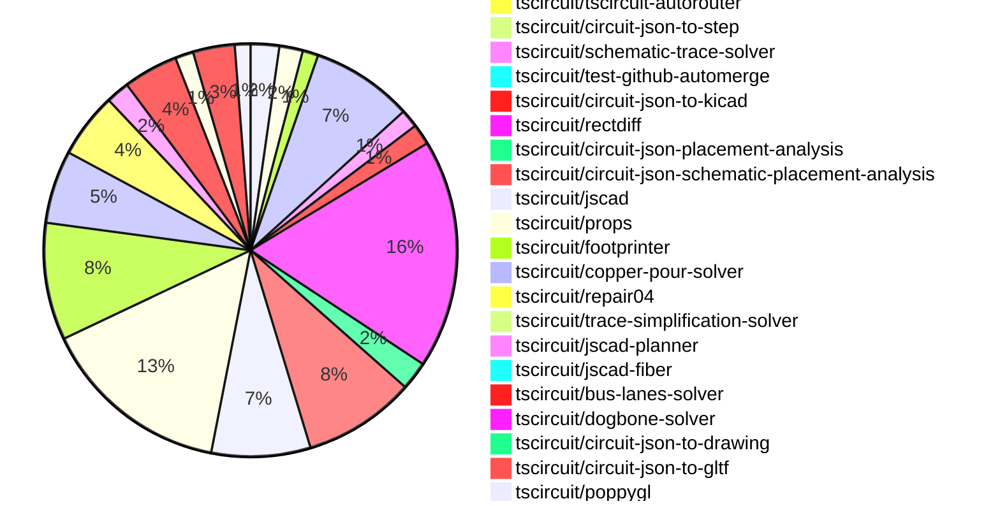

# Contribution Overview 2026-10-20

The current week is shown below. There are 3 major sections:

- [Contributor Overview](#contributor-overview)
- [PRs by Repository](#prs-by-repository)
- [PRs by Contributor](#changes-by-contributor)
- [Scoring & Sponsorship Details](/docs/sponsorship-calculation-explanation.md)

## PRs by Repository

## Contributor Overview

| Contributor | 🐳 Major | 🐙 Minor | 🐌 Tiny | Score | ⭐ |
|-------------|---------|---------|---------|-------|-----|
| [seveibar](#seveibar) | 31 | 11 | 11 | 158 | 👑👑 |
| [0hmX](#0hmX) | 10 | 7 | 3 | 58 | ⭐⭐⭐ |
| [ShiboSoftwareDev](#ShiboSoftwareDev) | 7 | 0 | 4 | 47 | ⭐⭐ |
| [imrishabh18](#imrishabh18) | 7 | 5 | 5 | 44 | ⭐⭐ |
| [Abse2001](#Abse2001) | 1 | 8 | 8 | 37 | ⭐⭐ |
| [rushabhcodes](#rushabhcodes) | 0 | 12 | 10 | 35 | ⭐⭐ |
| [MustafaMulla29](#MustafaMulla29) | 2 | 5 | 17 | 31 | ⭐⭐ |
| [mohan-bee](#mohan-bee) | 2 | 5 | 7 | 29 | ⭐⭐ |
| [techmannih](#techmannih) | 5 | 2 | 2 | 27 | ⭐⭐ |
| [GokulPandi-M](#GokulPandi-M) | 2 | 2 | 4 | 16 | ⭐⭐ |
| [Devesh36](#Devesh36) | 0 | 5 | 3 | 14 | ⭐⭐ |
| [tscircuitbot](#tscircuitbot) | 0 | 0 | 349 | 12 | ⭐⭐ |
| [AnasSarkiz](#AnasSarkiz) | 1 | 2 | 2 | 10 | ⭐ |
| [KrishnaX12](#KrishnaX12) | 1 | 0 | 2 | 6 | ⭐ |
| [trixie010](#trixie010) | 1 | 1 | 0 | 6 | ⭐ |
| [hrithik18k](#hrithik18k) | 0 | 0 | 4 | 4 | ⭐ |
| [anil08607](#anil08607) | 0 | 1 | 0 | 2 |  |

## Staff Pass Ratio (SPR)

| Contributor | Reviewed PRs | Rejections | Approvals | SPR |
|-------------|--------------|------------|-----------|-----|
| [Abse2001](#Abse2001) | 5 | 0 | 5 | 100.0% |
| [0hmX](#0hmX) | 3 | 0 | 3 | 100.0% |
| [MustafaMulla29](#MustafaMulla29) | 1 | 0 | 1 | 100.0% |
| [ShiboSoftwareDev](#ShiboSoftwareDev) | 1 | 0 | 1 | 100.0% |

Abse2001 SPR PRs (5)

- [#1090](https://github.com/tscircuit/pcb-viewer/pull/1090) Fix fabrication dimensions rendering on the wrong board side
- [#1063](https://github.com/tscircuit/3d-viewer/pull/1063) Fix green copper fallback on flex boards
- [#4806](https://github.com/tscircuit/core/pull/4806) fix: preserve authored footprint origins for CAD placement
- [#4836](https://github.com/tscircuit/core/pull/4836) fix: synchronize footprint polarity with component pin labels
- [#457](https://github.com/tscircuit/checks/pull/457) fix: check trace thickness against its own routed copper

0hmX SPR PRs (3)

- [#4765](https://github.com/tscircuit/core/pull/4765) Render external IBIS simulation declarations from TSX
- [#3187](https://github.com/tscircuit/tscircuit-autorouter/pull/3187) Use default Pipeline 9 for srj18 main-branch benchmarks
- [#6](https://github.com/tscircuit/jlcpcb-manufacturing-specs/pull/6) Add JLCPCB physical stackups through 8 layers

MustafaMulla29 SPR PRs (1)

- [#338](https://github.com/tscircuit/circuit-json-schematic-placement-analysis/pull/338) Detect fuse connector misalignment

ShiboSoftwareDev SPR PRs (1)

- [#1108](https://github.com/tscircuit/pcb-viewer/pull/1108) Improve large-board interaction latency

> Note: AI evaluates PRs and assigns 1-3 star ratings automatically. 4 and 5 star ratings require manual staff review.

## Review Table

[reviews-received-hover]: ## "Number of reviews received for PRs for this contributor"
[approvals-received-hover]: ## "Number of approvals received for PRs this contributor authored"
[rejections-received-hover]: ## "Number of rejections received for PRs this contributor authored"
[prs-opened-hover]: ## "Number of PRs opened by this contributor"
[issues-created-hover]: ## "Number of issues created by this contributor"

| Contributor | Reviews Received | Approvals Received | Rejections Received | Approvals | Rejections Given | PRs Opened | PRs Merged | Issues Created |
|---|---|---|---|---|---|---|---|---|
| [0hmX](#0hmX) | 20 | 4 | 0 | 10 | 0 | 31 | 21 | 0 |
| [1932819331hy-debug](#1932819331hy-debug) | 0 | 0 | 0 | 0 | 0 | 1 | 0 | 0 |
| [9xj89gzrtw-hue](#9xj89gzrtw-hue) | 0 | 0 | 0 | 0 | 0 | 6 | 0 | 0 |
| [Abse2001](#Abse2001) | 10 | 9 | 0 | 9 | 0 | 26 | 17 | 0 |
| [agent-102](#agent-102) | 0 | 0 | 0 | 0 | 0 | 1 | 0 | 0 |
| [AnasSarkiz](#AnasSarkiz) | 4 | 4 | 0 | 0 | 0 | 10 | 5 | 0 |
| [anil08607](#anil08607) | 5 | 2 | 1 | 0 | 0 | 4 | 1 | 0 |
| [bacourosp](#bacourosp) | 0 | 0 | 0 | 0 | 0 | 2 | 0 | 0 |
| [Brayaniglesias08](#Brayaniglesias08) | 0 | 0 | 0 | 0 | 0 | 2 | 0 | 0 |
| [Devesh36](#Devesh36) | 13 | 9 | 0 | 1 | 0 | 12 | 8 | 0 |
| [dinoksb](#dinoksb) | 0 | 0 | 0 | 0 | 0 | 2 | 0 | 0 |
| [ducanh3005](#ducanh3005) | 0 | 0 | 0 | 0 | 0 | 14 | 0 | 0 |
| [duongynhi000005-oss](#duongynhi000005-oss) | 0 | 0 | 0 | 0 | 0 | 15 | 0 | 0 |
| [gekkom](#gekkom) | 0 | 0 | 0 | 0 | 0 | 1 | 0 | 0 |
| [godgamerex3-boop](#godgamerex3-boop) | 0 | 0 | 0 | 0 | 0 | 30 | 0 | 0 |
| [GokulPandi-M](#GokulPandi-M) | 11 | 10 | 0 | 0 | 0 | 8 | 8 | 0 |
| [hrithik18k](#hrithik18k) | 16 | 7 | 5 | 0 | 0 | 18 | 4 | 0 |
| [imrishabh18](#imrishabh18) | 3 | 3 | 0 | 28 | 7 | 18 | 17 | 0 |
| [KrishnaX12](#KrishnaX12) | 11 | 4 | 0 | 0 | 0 | 7 | 3 | 0 |
| [Lingu17](#Lingu17) | 0 | 0 | 0 | 0 | 0 | 3 | 0 | 0 |
| [Lion0871](#Lion0871) | 0 | 0 | 0 | 0 | 0 | 1 | 0 | 0 |
| [mohan-bee](#mohan-bee) | 12 | 6 | 4 | 5 | 0 | 57 | 14 | 0 |
| [MustafaMulla29](#MustafaMulla29) | 15 | 11 | 0 | 12 | 3 | 32 | 24 | 0 |
| [petermm](#petermm) | 0 | 0 | 0 | 0 | 0 | 5 | 0 | 0 |
| [rushabhcodes](#rushabhcodes) | 52 | 13 | 0 | 3 | 0 | 29 | 22 | 0 |
| [ryder777777](#ryder777777) | 0 | 0 | 0 | 0 | 0 | 4 | 0 | 0 |
| [seveibar](#seveibar) | 19 | 1 | 0 | 14 | 0 | 81 | 53 | 0 |
| [ShiboSoftwareDev](#ShiboSoftwareDev) | 8 | 7 | 0 | 16 | 0 | 56 | 11 | 0 |
| [Shmanya](#Shmanya) | 0 | 0 | 0 | 0 | 0 | 1 | 0 | 0 |
| [shubhook](#shubhook) | 0 | 0 | 0 | 0 | 0 | 1 | 0 | 0 |
| [techmannih](#techmannih) | 17 | 7 | 1 | 2 | 1 | 15 | 9 | 0 |
| [trixie010](#trixie010) | 3 | 3 | 0 | 0 | 0 | 6 | 2 | 0 |
| [tscircuitbot](#tscircuitbot) | 0 | 0 | 0 | 0 | 0 | 448 | 349 | 0 |
| [ZhaZhaBei](#ZhaZhaBei) | 0 | 0 | 0 | 0 | 0 | 1 | 0 | 0 |

## Changes by Repository

### [tscircuit/pcb-viewer](https://github.com/tscircuit/pcb-viewer)

| PR # | Impact | Rating | Contributor | Description |
|------|--------|--------|-------------|-------------|
| [#1108](https://github.com/tscircuit/pcb-viewer/pull/1108) | 🐳 Major | ⭐⭐⭐ | ShiboSoftwareDev | Caches primitive and trace lookups instead of rescanning the full Circuit JSON during hover and navigation. Camera updates are also limited to one React update per animation frame. The spatial index preserves original primitive order, so overlapping same-layer hits keep their existing selection priority. Median of six fixed-build runs, compared with the three-run baseline, on the 100,548-element TMDS62LEVM fixture:  Interaction  Before  After  Speedup   ---  ---:  ---:  ---:   Hover  489 ms  58 ms  8.5   20 zoom events  1,366 ms  699 ms  2.0   20 drag steps  1,766 ms  384 ms  4.6   React render time during navigation  1,997 ms  90 ms  22.3 |
| [#1113](https://github.com/tscircuit/pcb-viewer/pull/1113) | 🐙 Minor | ⭐⭐ | rushabhcodes | Fixes incorrect rotation of polygon plated-hole primitive geometry and oval drill rendering in the PCB viewer. |
| [#1090](https://github.com/tscircuit/pcb-viewer/pull/1090) | 🐙 Minor | ⭐⭐ | Abse2001 | Fixes rendering issue where fabrication dimensions assigned to one board side were incorrectly displayed on the opposite side in the PCB viewer. |

🐌 Tiny Contributions (8)

| PR # | Impact | Contributor | Description |
|------|--------|-------------|-------------|
| [#1119](https://github.com/tscircuit/pcb-viewer/pull/1119) | 🐌 Tiny | rushabhcodes | Updates the tscircuitcircuit-json-webgpu dependency from version 0.0.9 to 0.0.10, incorporating a polygon plated-hole copper and drill-offset rotation fix. |
| [#1117](https://github.com/tscircuit/pcb-viewer/pull/1117) | 🐌 Tiny | rushabhcodes | Updates the circuit-to-canvas dependency to version 0.0.138 to include polygon copper, drill, and soldermask rotation fixes, along with soldermask coverage and margin corrections, and via layer visibility fixes. |
| [#1112](https://github.com/tscircuit/pcb-viewer/pull/1112) | 🐌 Tiny | rushabhcodes | Reproduces a bug related to polygon plated-hole primitive rotation with focused test cases for validation. |
| [#1118](https://github.com/tscircuit/pcb-viewer/pull/1118) | 🐌 Tiny | tscircuitbot | Automated package update |
| [#1121](https://github.com/tscircuit/pcb-viewer/pull/1121) | 🐌 Tiny | tscircuitbot | Automated package update |
| [#1115](https://github.com/tscircuit/pcb-viewer/pull/1115) | 🐌 Tiny | tscircuitbot | Automated package update |
| [#1110](https://github.com/tscircuit/pcb-viewer/pull/1110) | 🐌 Tiny | tscircuitbot | Automated package update |
| [#1107](https://github.com/tscircuit/pcb-viewer/pull/1107) | 🐌 Tiny | ShiboSoftwareDev | Adds a browser benchmark using the full 100,548-element TMDS62LEVM board to measure interaction latency before optimization. |

### [tscircuit/circuit-json-util](https://github.com/tscircuit/circuit-json-util)

| PR # | Impact | Rating | Contributor | Description |
|------|--------|--------|-------------|-------------|
| [#220](https://github.com/tscircuit/circuit-json-util/pull/220) | 🐳 Major | ⭐⭐⭐ | GokulPandi-M | Allows the analyzer to infer pin 1 orientation for two-pad footprints with slight coordinate differences, improving compatibility with polarized components. |
| [#263](https://github.com/tscircuit/circuit-json-util/pull/263) | 🐙 Minor | ⭐⭐ | rushabhcodes | Fixes the orientation of silkscreen text labels to follow the correct rotation after mirroring components, ensuring readability and proper alignment in PCB designs. |
| [#262](https://github.com/tscircuit/circuit-json-util/pull/262) | 🐙 Minor | ⭐⭐ | rushabhcodes | Fixes the issue where mirroring a tilted 0603 resistor did not adjust the SMT pad angles accordingly, ensuring that rotated and reflected pads maintain their correct orientation. |
| [#260](https://github.com/tscircuit/circuit-json-util/pull/260) | 🐙 Minor | ⭐⭐ | rushabhcodes | Fixes courtyard rectangle orientation to correctly follow mirrored placements by reusing the existing rectangle-orientation helper. |
| [#257](https://github.com/tscircuit/circuit-json-util/pull/257) | 🐙 Minor | ⭐⭐ | Abse2001 | Applies the existing PCB transformation matrix to the footprint origin of PCB components, ensuring it remains attached during transformations. |
| [#258](https://github.com/tscircuit/circuit-json-util/pull/258) | 🐙 Minor | ⭐⭐ | MustafaMulla29 | Add isRouteViaCoveredByPhysicalVia to check whether a physical via covers a traces layer transition at the same coordinates and with compatible diameters. |

🐌 Tiny Contributions (3)

| PR # | Impact | Contributor | Description |
|------|--------|-------------|-------------|
| [#259](https://github.com/tscircuit/circuit-json-util/pull/259) | 🐌 Tiny | rushabhcodes | Captures transform failures for a rotated 30 0603 resistor, including issues with courtyard orientation, SMT pad angles, and label placement, while adding regression tests for these cases. |
| [#256](https://github.com/tscircuit/circuit-json-util/pull/256) | 🐌 Tiny | Abse2001 | Transforms footprint origins of PCB components through the existing PCB matrix to align with physical pads during translation, rotation, and reflection, while keeping older records unchanged. |
| [#221](https://github.com/tscircuit/circuit-json-util/pull/221) | 🐌 Tiny | GokulPandi-M | Reproduces a bug where the analyzer fails to determine pin 1 orientation for slightly skewed two-pad LED and diode footprints due to small coordinate differences, without changing the analyzers functionality. |

### [tscircuit/3d-viewer](https://github.com/tscircuit/3d-viewer)

| PR # | Impact | Rating | Contributor | Description |
|------|--------|--------|-------------|-------------|
| [#1067](https://github.com/tscircuit/3d-viewer/pull/1067) | 🐳 Major | ⭐⭐⭐ | seveibar | Package previews currently rebuild the board and fetch individual component models before showing a scene. Add glbUrl and glbData inputs to CadViewer so callers can display a self-contained, pre-rendered circuit-json-to-gltf GLB directly: tsx CadViewer glbUrlpreviewsboard.glb   This path bypasses board generation and individual model loading, restores the exporters coordinate frame, fits the camera, and retains orbitcamera controls. Component node extras.tscircuit provides name tooltips, per-instance hiding, and schematic navigation without Circuit JSON. Existing GLBs without metadata still render. Geometry engine, board layer, and fold controls are omitted for baked scenes. Source changes abort pending downloads and dispose owned geometrymaterialstextures. Downloads time out after 30 seconds, failures display errors, and A-to-B-to-A source changes cannot reuse disposed scenes. Companion exporter change: https:github.comtscircuitcircuit-json-to-gltfpull261. No new exporter version is required to render an existing GLB; component identity features require metadata-enabled exports. Validation: 12 focused tests pass for actual GLB parsing, coordinate placement, shared-mesh instance selection, schematic identity, one-request loading, load errorscancellation, source replacement, and resource disposal, plus existing picking regressions. bunx tsc --noEmit and bun run build pass. Browser-verified hover names and hiding with a regenerated rushabhcodesfidget-counter assembly. The bundled GLB was generated from the pinned 1.0.12 Circuit JSON and 27 downloaded OBJ models using the companion exporter, with metadata for all 38 components. Hidden enclosure meshes are excluded from hover registration so parts underneath remain reachable. This adds library support; switching tscircuit.com previews to use published GLBs is separate consumer work. Live assembly demo: https:3d-viewer-git-feat-prerendered-glb-tscircuit.vercel.appiframe.html?idprerendered-glb--fidget-counterviewModestory The GLB is served from prerendered-glbfidget-counter.glb on that deployment. |
| [#1066](https://github.com/tscircuit/3d-viewer/pull/1066) | 🐳 Major | ⭐⭐⭐ | seveibar | Adds draggable XYZ section planes for generated scenes and pre-rendered glbUrlglbData scenes. Create sections from Advanced  Section View in the right-click menu; Advanced also contains the engine switch for generated scenes. The inactive Section toolbar button is removed. Users can drag the plane or arrow, enter a millimeter offset, flip the retained side, and look perpendicular to the cut. Cut faces use diagonal hatching with holes and cavities left empty; downloaded glTFs include the clipped geometry and caps. Merged main while preserving GLB loading, component metadata, and picking. Sourcevisibility changes invalidate pending caps immediately, and temporary material overrides are restored before GLB disposal. Fixed perpendicular dragging and moved section controls away from the orientation cube so it cannot intercept their clicks. Validation: CI tests, typechecking, formatting, and Graphite review pass. All four Chromium browser tests pass: dragging without camera movement plus closeclear, JSCAD sections, Manifold sections, and GLB URL cuts with patterned caps and no extra GLB loads during section operations. The generated-scene and GLB tests create sections through the Advanced submenu. The URL integration test uses the real GLB loader and scene attachment with transformed meshes, caps, sectioned export, metadata picking, hideunhide, source replacement, and resource disposal. Package JavaScript and declaration builds pass locally. Browser checks run with bun run test:sections. Successful browser run(https:github.comtscircuit3d-vieweractionsruns39658536420) includes screenshots and the Playwright report. |
| [#1073](https://github.com/tscircuit/3d-viewer/pull/1073) | 🐙 Minor | ⭐⭐ | rushabhcodes | Changes copper-pour rendering to use a configurable opacity, reducing redraws from eight to one and adding regression tests for various pour types. |
| [#1063](https://github.com/tscircuit/3d-viewer/pull/1063) | 🐙 Minor | ⭐⭐ | Abse2001 | Fixes the fallback color for flex boards without a custom mask color to use an amber and copper blend instead of FR4 green. |

🐌 Tiny Contributions (2)

| PR # | Impact | Contributor | Description |
|------|--------|-------------|-------------|
| [#1060](https://github.com/tscircuit/3d-viewer/pull/1060) | 🐌 Tiny | mohan-bee | Motivation I was not able to hide the assembly to view the pcb boards 3d view, https:3d-viewer-a19cxntdn-tscircuit.vercel.app?pathstoryassembly-gimbal--gimbal-assembly https:github.comuser-attachmentsassets304e75ed-b590-4e89-8fa3-43a032db4b92 |
| [#1062](https://github.com/tscircuit/3d-viewer/pull/1062) | 🐌 Tiny | imrishabh18 | Fixes rendering issues in the 3D viewer for flex PCB tails with nonparallel bend axes by updating flex-utils and restoring Float32 boundary precision. |

### [tscircuit/core](https://github.com/tscircuit/core)

| PR # | Impact | Rating | Contributor | Description |
|------|--------|--------|-------------|-------------|
| [#4807](https://github.com/tscircuit/core/pull/4807) | 🐳 Major | ⭐⭐⭐ | Abse2001 | Preserves authored footprint origins for CAD placement, ensuring accurate positioning of components during layout. |
| [#4631](https://github.com/tscircuit/core/pull/4631) | 🐳 Major | ⭐⭐⭐ | seveibar | Adds a core implementation of assembly.explosion.stage and assembly.explosion.move, including multi-target moves and rendered constrained-assembly examples. The upstream props and PoppyGL changes are merged. This PR uses their published npm releases.  Multiple targets targetRefs accepts either a comma-separated string or an array: tsx assembly.explosion.move targetRefsshade, collar offZ60mm  assembly.explosion.move targetRefsshade, collar offZ60mm   Props trims and normalizes either form to targetRefs: string. Existing targetRef remains a single-target input alias; supply exactly one selector prop. Core resolves and validates every target before evaluating progress, then moves the union of the selected subtrees using one displacement in the stage owners frame. Duplicate references and overlapping parentchild selections move each part and reference surface only once. Each distinct selected target gets its own guide, anchored before the instruction moves any target. Model-less container centroids include prior independent movements of their children. All targets share the instructions progress, and evaluation leaves assembled Circuit JSON and props unchanged. !Comma-separated and array targets, shared progress, and legacy compatibility(https:raw.githubusercontent.comtscircuitcoreb16362715bac0d1e544dc2b51eb785e44770bb66testsassembly__snapshots__assembly-explosion-target-refs-annotated.snap.png)  Staged rendering getAssemblyExplosion(circuit,  throughStageRef?, stageProgress? ) derives an immutable CAD view after mounting constraints resolve. Stages use a stable topological sort with authored order as fallback; missingambiguous references, cycles, duplicate stages, and invalid move targets produce named diagnostics. Parent movement carries descendant CAD and reference-surface centers. Repeated evaluation and backward scrubbing reconstruct the assembled starting state. Existing examples lift an intact constrained cover, move it aside, and then remove its cap in the displaced subassembly frame. Frame tests cover upright, inverted, and tilted mounts against emitted reference directions, with guide endpoints checked against emitted GLTF translations. Run bun scriptsrender-assembly-explosion.tsx workassembly-explosion-preview to export those four PNGGLBJSON states.  Dependencies tscircuitprops: 0.0.707 in dev dependencies and overrides, including the merged stagemove API and targetRefs normalization. poppygl: 0.0.36, including the merged explosion guide and arrow APIs. Updated with main and resolved the package conflict. The existing dependency check is preserved and passes with these registry versions. The compatibility refresh also removes the unsupported write: false option from the existing Bun browser-bundle test; it continues to inspect the returned bundle without an output directory.  Validation 69 assembly regressions and 4 namespaced assembly regressions pass (73 total), using Bun 1.4.0 and the published npm packages. Three new tests cover stringarraylegacy selectors, shared progress, overlap and duplicate handling in a mounted frame, reference-surface translation without orientation changes, pre-move centroids, and validation of later-stage targets. Both new annotated visual snapshots were inspected and pass on comparison. Full CI is green on the updated branch: all ten test groups, full typecheck, dependency check, distribution smoke tests, package preview build, and deployment. Local package build (including declarations), 73 assemblynamespaced regressions, browser-bundle regression, changed-TypeScript formatting, and feature diff checks pass. Behavior and approval tracking are documented in docsassembly-explosion.md. This prototype supports mechanical CAD translations and rejects PCBcable-containing targets. Swept-path collision verification remains unimplemented (collisionCheckStatus: not_implemented); diagrams do not certify assembly clearance. |
| [#4833](https://github.com/tscircuit/core/pull/4833) | 🐳 Major | ⭐⭐⭐ | seveibar | Fixes the omission of bus minLength and maxLength from source_bus and router input, ensuring proper routing constraints are applied. |
| [#4834](https://github.com/tscircuit/core/pull/4834) | 🐳 Major | ⭐⭐⭐ | seveibar | Updates props to 0.0.706 and consumes platform.autorouterThreads for local Pipeline9 routing, enabling worker-backed solveAsync for routing with counts above one, while retaining existing paths for counts of one or omitted. |
| [#4765](https://github.com/tscircuit/core/pull/4765) | 🐳 Major | ⭐⭐⭐ | 0hmX | Add native TSX declarations for IBIS models, binary traffic, and eye requests, exporting them as Circuit JSON for the local PCB extractionSPICE runner. Existing spiceEnginepcb_spice selects that backend; no executionMode prop or execution_mode record field is introduced. The built-in render phase skips that backend while native experiments continue to execute. Models use the shared Asset object and explicit vendor componentpinmodel names. Core maps port labels to physical source_port_id values, translates Boolean directionoutput-enable states, and preserves the requested IBIS data column and package parasitics choice. Reference roles identify physical supplyclamp ports. Duplicate physical pin mappings, unmapped referencemodel keys, stimuli without an enabled output, and pin states without exactly one model binding are rejected. Model binding validation runs after all declarations render, so JSX order does not matter. Dependencies  merge order: https:github.comtscircuitcircuit-jsonpull908, https:github.comtscircuitpropspull945, then this PR. The verified preview pins must be replaced with published versions before merging. The repository dependency guard remains unchanged. Validation: all 43 targeted simulation tests pass, including eight IBIS integration tests and a PCB snapshot. Schemaprops suites pass (479 and 687 tests). Independent Opus review confirmed the schema review changes and both additional pin-binding fixes. TypeScript and the package build (ESM and declarations) pass. GitHub build, smoke-test, type-check, and all ten test shards pass. No new enums, ternaries, docs, or README edits are included. Rendering does not fetch assets, install tools, or execute external solvers. CLIlocal-runner wiring and CSVHTML result commands remain follow-ups. No Python or solver binaries are added; the prototype backends three-selected-trace limit is unchanged. |
| [#4843](https://github.com/tscircuit/core/pull/4843) | 🐳 Major | ⭐⭐⭐ | GokulPandi-M | Adopts skew-tolerant pin 1 analysis for two-pad footprints to ensure accurate orientation detection in LED and diode components. |
| [#4541](https://github.com/tscircuit/core/pull/4541) | 🐳 Major | ⭐⭐⭐ | mohan-bee | Fixes PCB trace saving failure when using custom schematic symbols by correcting the port selector logic. |
| [#4763](https://github.com/tscircuit/core/pull/4763) | 🐳 Major | ⭐⭐⭐ | KrishnaX12 | Watchys J3 display connector has distinct physical pins 8 and 17 labelled GND. The full circuit routes copper, but autorouting:end omits pcbTracePaths and reports PCB port selector is not unique: .J3  port.GND. Includes the full PCBelectrical circuit from my Watchy v1.2.12 board(https:tscircuit.comkrishnax12watchy-eink-smartwatchreleases2b57e298-6436-4480-8eff-a1421b557830), alongside the original two-pad reduction. The self-contained TSX fixture retains the full circuit, footprints, wiring, board outline, pours and keepouts. J2 is moved from the right edge to the clear left-edge position (-12, 0), rotated 270, to resolve its out-of-board placement error without disabling placement checks; all other component placements and J3 pin labels are unchanged. STEP models and the non-electrical display assembly are omitted. The full circuit is kept in one fixture file alongside its test and PCB snapshot. The full-board test uses the normal autorouter, verifies that J3 has two GND ports and that copper was generated, and asserts the actual export failure. Its PCB snapshot displays that emitted error. routeRemaining enables the full route. Placement checks remain enabled, and the test asserts there are no component-outside-board or autorouting errors. It does not claim all post-routing manufacturing checks pass. No production code or dependencies are changed. Validation: Full Watchy reproduction and existing minimal reproduction pass. Biome, TypeScript, build and diff checks pass. Full-board PCB snapshot rendered and visually inspected. Run: bun test testsreprosrepro-watchy-duplicate-ground-label-path-export.test.tsx. Fix: 4764. Merge this reproduction first; the fixs exportreplay assertions must then be rebased over these failure assertions. |
| [#4830](https://github.com/tscircuit/core/pull/4830) | 🐙 Minor | ⭐⭐ | rushabhcodes | Reproduces a bug where polygon plated-hole pads do not retain correct rotation, leading to copper misalignment with the silkscreen outline. |
| [#4831](https://github.com/tscircuit/core/pull/4831) | 🐙 Minor | ⭐⭐ | rushabhcodes | Fixes the issue where polygon plated holes did not retain their rotation during Circuit JSON reconstruction, ensuring correct rendering and alignment with the chips rotation. |
| [#4806](https://github.com/tscircuit/core/pull/4806) | 🐙 Minor | ⭐⭐ | Abse2001 | Fixes CAD placement by preserving the authored footprint origins for asymmetric footprints, ensuring that changes in copper geometry do not affect model positioning. |
| [#4836](https://github.com/tscircuit/core/pull/4836) | 🐙 Minor | ⭐⭐ | Abse2001 | Fixes the mismatch between electrical anodecathode labels and footprint artwork for diodes, LEDs, and capacitors, ensuring consistent polarity representation in generated footprints. |
| [#4812](https://github.com/tscircuit/core/pull/4812) | 🐙 Minor | ⭐⭐ | MustafaMulla29 | Reproduces inline schematic text positions for labels away from their wires in the TB67S579FTG breakout, validating current behavior with comprehensive tests and snapshots. |
| [#4811](https://github.com/tscircuit/core/pull/4811) | 🐙 Minor | ⭐⭐ | MustafaMulla29 | Saves inline text positions on schematic wires, preserving alignment and relationships, while updating the schematic-trace-solver dependency. |
| [#4856](https://github.com/tscircuit/core/pull/4856) | 🐙 Minor | ⭐⭐ | 0hmX | Emit PCB SPICE channel modeling from transient simulations, allowing PCB SPICE to consume circuit declarations without separate modeling exports. |
| [#4826](https://github.com/tscircuit/core/pull/4826) | 🐙 Minor | ⭐⭐ | 0hmX | Resolves JLCPCB stackups from fabricatorPreset and the boards layer count, thickness, and material using tscircuitjlcpcb-manufacturing-specs, ensuring proper stackup handling for imported boards and maintaining existing construction data. |
| [#4699](https://github.com/tscircuit/core/pull/4699) | 🐙 Minor | ⭐⭐ | mohan-bee | Fixes the issue where metal-lined connector holes in four-layer boards inside panels do not connect to the inner copper layers, only recording the top and bottom layers. |
| [#4700](https://github.com/tscircuit/core/pull/4700) | 🐙 Minor | ⭐⭐ | mohan-bee | Reproduces missing inner copper layers on plated connector holes inside native panels, ensuring that both inner and outer layers are correctly represented in the test. |
| [#4818](https://github.com/tscircuit/core/pull/4818) | 🐙 Minor | ⭐⭐ | Devesh36 | Fixes polygon-pad overlap in PCB flex layout by accurately calculating bounds for nonrectangular polygons and circular primitives, ensuring proper spacing between pads. |
| [#4816](https://github.com/tscircuit/core/pull/4816) | 🐙 Minor | ⭐⭐ | Devesh36 | Fixes the LED outline rotation reproduced in 4622, ensuring that rotating LED footprints also rotates their corresponding silkscreen rectangles correctly. |
| [#4817](https://github.com/tscircuit/core/pull/4817) | 🐙 Minor | ⭐⭐ | Devesh36 | Fixes the connector mounting-slot rotation reproduced in 4623, ensuring vertical mounting slots align with silkscreen guides and pads when a connector is rotated 90. |

🐌 Tiny Contributions (18)

| PR # | Impact | Contributor | Description |
|------|--------|-------------|-------------|
| [#4825](https://github.com/tscircuit/core/pull/4825) | 🐌 Tiny | rushabhcodes | Updates circuit-to-svg to version 0.0.453, fixing rotated polygon plated holes and PCB bounds for traces containing vias, and refreshes SVG snapshots for display-label and SOIC8 fanout phase. |
| [#4874](https://github.com/tscircuit/core/pull/4874) | 🐌 Tiny | tscircuitbot | Updates the tscircuitchecks package from version 0.0.263 to 0.0.264 |
| [#4873](https://github.com/tscircuit/core/pull/4873) | 🐌 Tiny | tscircuitbot | Updates the tscircuitchecks package to version 0.0.263 in package.json |
| [#4871](https://github.com/tscircuit/core/pull/4871) | 🐌 Tiny | tscircuitbot | Updates the version of the tscircuitchecks package from 0.0.261 to 0.0.262 in package.json |
| [#4870](https://github.com/tscircuit/core/pull/4870) | 🐌 Tiny | tscircuitbot | Updates the version of the tscircuitchecks package from 0.0.261 to 0.0.262 in package.json |
| [#4808](https://github.com/tscircuit/core/pull/4808) | 🐌 Tiny | tscircuitbot | Updates the version of the tscircuitchecks package from 0.0.258 to 0.0.259 in package.json |
| [#4822](https://github.com/tscircuit/core/pull/4822) | 🐌 Tiny | tscircuitbot | Updates the version of the tscircuitchecks package from 0.0.260 to 0.0.261 in package.json |
| [#4820](https://github.com/tscircuit/core/pull/4820) | 🐌 Tiny | tscircuitbot | Updates the version of the tscircuitchecks package from 0.0.259 to 0.0.260 in package.json |
| [#4819](https://github.com/tscircuit/core/pull/4819) | 🐌 Tiny | tscircuitbot | Updates the version of the tscircuitchecks package from 0.0.259 to 0.0.260 in package.json |
| [#4809](https://github.com/tscircuit/core/pull/4809) | 🐌 Tiny | tscircuitbot | Updates the version of the tscircuitchecks package from 0.0.258 to 0.0.259 in package.json |
| [#4810](https://github.com/tscircuit/core/pull/4810) | 🐌 Tiny | seveibar | Updates tscircuitcapacity-autorouter from 0.0.988 to 0.0.996, bringing in the released Pipeline9 SolverRuntime support from tscircuittscircuit-autorouter3125. |
| [#4805](https://github.com/tscircuit/core/pull/4805) | 🐌 Tiny | seveibar | Updates the bundled tscircuitbus-lanes-solver from version 0.0.21 to 0.0.27, incorporating fixes for AM3352 byte routing stalls and default-layer escapes. |
| [#4869](https://github.com/tscircuit/core/pull/4869) | 🐌 Tiny | mohan-bee | Updates the tscircuitschematic-trace-solver dependency to version 0.0.238 in the package.json file. |
| [#4814](https://github.com/tscircuit/core/pull/4814) | 🐌 Tiny | mohan-bee | Updates the schematic trace solver dependency from version 0.0.230 to 0.0.236. |
| [#4815](https://github.com/tscircuit/core/pull/4815) | 🐌 Tiny | mohan-bee | Updates the tscircuitmatchpack dependency to version 0.0.100 in the package.json file. |
| [#4540](https://github.com/tscircuit/core/pull/4540) | 🐌 Tiny | mohan-bee | Reproduces the saved PCB path export failure observed with the LoRaLink custom schematic symbol. |
| [#4838](https://github.com/tscircuit/core/pull/4838) | 🐌 Tiny | techmannih | Updates tscircuitcapacity-autorouter from 0.0.996 to 0.0.999, matching autorouter main. |
| [#4673](https://github.com/tscircuit/core/pull/4673) | 🐌 Tiny | Devesh36 | Reproduces a bug where the PCB note rectangle does not rotate with its parent chip, demonstrating the issue with a test case and snapshot. |

### [tscircuit/circuit-to-svg](https://github.com/tscircuit/circuit-to-svg)

| PR # | Impact | Rating | Contributor | Description |
|------|--------|--------|-------------|-------------|
| [#869](https://github.com/tscircuit/circuit-to-svg/pull/869) | 🐙 Minor | ⭐⭐ | rushabhcodes | Fixes the issue where rotating polygon plated holes in PCB SVGs does not rotate their copper outlines and offset drills, ensuring they move together with the pad group during rotation. |

🐌 Tiny Contributions (1)

| PR # | Impact | Contributor | Description |
|------|--------|-------------|-------------|
| [#868](https://github.com/tscircuit/circuit-to-svg/pull/868) | 🐌 Tiny | rushabhcodes | Reproduces a bug where polygon plated pads do not render correctly at specified rotations, specifically asserting that a pad with a 90 rotation is rendered incorrectly. |

### [tscircuit/circuit-json-to-gerber](https://github.com/tscircuit/circuit-json-to-gerber)

| PR # | Impact | Rating | Contributor | Description |
|------|--------|--------|-------------|-------------|
| [#204](https://github.com/tscircuit/circuit-json-to-gerber/pull/204) | 🐙 Minor | ⭐⭐ | rushabhcodes | Fixes a bug where exporting Gerber files would overwrite the entire source JSON file, leading to data loss. |
| [#213](https://github.com/tscircuit/circuit-json-to-gerber/pull/213) | 🐙 Minor | ⭐⭐ | GokulPandi-M | Fixes the omission of copper-pour clearance and solder-mask openings for pill-shaped NPTH slots in Gerber outputs, ensuring accurate fabrication. |

🐌 Tiny Contributions (1)

| PR # | Impact | Contributor | Description |
|------|--------|-------------|-------------|
| [#190](https://github.com/tscircuit/circuit-json-to-gerber/pull/190) | 🐌 Tiny | GokulPandi-M | Adds a reproduction test for the omission of non-plated pill mounting slots in Gerber openings, ensuring that the fabrication layers align correctly with the drill output. |

### [tscircuit/circuit-to-canvas](https://github.com/tscircuit/circuit-to-canvas)

| PR # | Impact | Rating | Contributor | Description |
|------|--------|--------|-------------|-------------|
| [#317](https://github.com/tscircuit/circuit-to-canvas/pull/317) | 🐙 Minor | ⭐⭐ | rushabhcodes | Adds a configurable opacity parameter for copper pours in the 3D viewer, allowing for a single rendering pass instead of eight. |
| [#313](https://github.com/tscircuit/circuit-to-canvas/pull/313) | 🐙 Minor | ⭐⭐ | rushabhcodes | Fixes the issue where rotating a component with polygon plated holes does not rotate its copper, drill offsets, and soldermask openings, ensuring they align correctly in the 3D viewer. |

🐌 Tiny Contributions (5)

| PR # | Impact | Contributor | Description |
|------|--------|-------------|-------------|
| [#312](https://github.com/tscircuit/circuit-to-canvas/pull/312) | 🐌 Tiny | rushabhcodes | Fixes rendering issue where polygon plated holes ignore counter-clockwise rotation, affecting both 2D and 3D views. |
| [#318](https://github.com/tscircuit/circuit-to-canvas/pull/318) | 🐌 Tiny | tscircuitbot | Automated package update |
| [#321](https://github.com/tscircuit/circuit-to-canvas/pull/321) | 🐌 Tiny | tscircuitbot | Automated package update |
| [#316](https://github.com/tscircuit/circuit-to-canvas/pull/316) | 🐌 Tiny | tscircuitbot | Automated package update |
| [#319](https://github.com/tscircuit/circuit-to-canvas/pull/319) | 🐌 Tiny | hrithik18k | Reproduces a bug where interpolated traces narrow near bends despite consistent vertex widths, ensuring the specified copper width is preserved through trace bends. |

### [tscircuit/circuit-json-webgpu](https://github.com/tscircuit/circuit-json-webgpu)

| PR # | Impact | Rating | Contributor | Description |
|------|--------|--------|-------------|-------------|
| [#74](https://github.com/tscircuit/circuit-json-webgpu/pull/74) | 🐙 Minor | ⭐⭐ | rushabhcodes | Fixes the rotation of polygon plated-hole outlines and drill offsets around the pad anchor to ensure consistent ccw_rotation application across copper, slots, board cutouts, and soldermask openings. |
| [#69](https://github.com/tscircuit/circuit-json-webgpu/pull/69) | 🐙 Minor | ⭐⭐ | mohan-bee | Fixes rendering issue where silkscreen text appears beneath overlapping holes in the circuit design. |

🐌 Tiny Contributions (3)

| PR # | Impact | Contributor | Description |
|------|--------|-------------|-------------|
| [#73](https://github.com/tscircuit/circuit-json-webgpu/pull/73) | 🐌 Tiny | rushabhcodes | Reproduces a rendering bug where rotating a hole with a polygon pad leaves its copper outline and drill offset unrotated, adding tests to verify the issue and its resolution. |
| [#76](https://github.com/tscircuit/circuit-json-webgpu/pull/76) | 🐌 Tiny | rushabhcodes | Fixes the dependency installation failure in the publish workflow caused by the order of steps when using Bun 1.4.4. |
| [#68](https://github.com/tscircuit/circuit-json-webgpu/pull/68) | 🐌 Tiny | mohan-bee | Reproduces the issue of silkscreen text being hidden where it overlaps a hole, providing a gallery reproduction and pixel checks for occlusion without changing the renderer. |

### [tscircuit/checks](https://github.com/tscircuit/checks)

| PR # | Impact | Rating | Contributor | Description |
|------|--------|--------|-------------|-------------|
| [#457](https://github.com/tscircuit/checks/pull/457) | 🐙 Minor | ⭐⭐ | Abse2001 | Fixes incorrect warnings when traces sharing a net request different widths by ensuring checks are made against their own routed segments. |
| [#458](https://github.com/tscircuit/checks/pull/458) | 🐙 Minor | ⭐⭐ | Abse2001 | Fixes routing width checks to match the owning source trace instead of all traces on the same net, ensuring accurate thickness validation for PCB traces. |
| [#460](https://github.com/tscircuit/checks/pull/460) | 🐙 Minor | ⭐⭐ | MustafaMulla29 | Fixes copper-contact DRC crashes when checks and a geometry producer load independent Flatten instances by reconstructing foreign polygons with the local Polygon constructor through Flattens supported JSON representation. |
| [#466](https://github.com/tscircuit/checks/pull/466) | 🐙 Minor | ⭐⭐ | techmannih | Fixes the issue where a constant-width trace was incorrectly reported as not connected to a pad when its round copper endcap physically overlaps the pad, even if the endpoint center is outside the pad. |

🐌 Tiny Contributions (4)

| PR # | Impact | Contributor | Description |
|------|--------|-------------|-------------|
| [#455](https://github.com/tscircuit/checks/pull/455) | 🐌 Tiny | rushabhcodes | Update circuit-to-svg from 0.0.416 to 0.0.453 and refresh 58 affected PCB SVG snapshots for the embedded alphabet font now used for PCB note text. |
| [#459](https://github.com/tscircuit/checks/pull/459) | 🐌 Tiny | MustafaMulla29 | Reproduces a routing DRC crash caused by a copper-pour boundary issue in the RP2040 BLDC motor-controller board. |
| [#467](https://github.com/tscircuit/checks/pull/467) | 🐌 Tiny | KrishnaX12 | Reproduces a bug where the missing-reference designator hint incorrectly suggests an unresolved placeholder instead of displaying the correct reference designator for a vibration motor circuit. |
| [#472](https://github.com/tscircuit/checks/pull/472) | 🐌 Tiny | techmannih | Reproduces a bug where a trace endcap overlaps a pad but is reported as a missing connection due to its endpoint being outside the pad. |

### [tscircuit/tscircuit](https://github.com/tscircuit/tscircuit)

| PR # | Impact | Rating | Contributor | Description |
|------|--------|--------|-------------|-------------|
| [#6001](https://github.com/tscircuit/tscircuit/pull/6001) | 🐳 Major | ⭐⭐⭐ | seveibar | The README now explains tscircuit directlydesign circuit boards with TypeScript and Reactand shows real community designs across photography, 3D, schematic, and PCB views. |

🐌 Tiny Contributions (87)

| PR # | Impact | Contributor | Description |
|------|--------|-------------|-------------|
| [#6028](https://github.com/tscircuit/tscircuit/pull/6028) | 🐌 Tiny | tscircuitbot | Automated package update |
| [#6027](https://github.com/tscircuit/tscircuit/pull/6027) | 🐌 Tiny | tscircuitbot | Updates the tscircuitcli package version from 0.1.2407 to 0.1.2408 |
| [#6026](https://github.com/tscircuit/tscircuit/pull/6026) | 🐌 Tiny | tscircuitbot | Automated package update |
| [#6025](https://github.com/tscircuit/tscircuit/pull/6025) | 🐌 Tiny | tscircuitbot | Automated package update |
| [#6024](https://github.com/tscircuit/tscircuit/pull/6024) | 🐌 Tiny | tscircuitbot | Automated package update |
| [#6023](https://github.com/tscircuit/tscircuit/pull/6023) | 🐌 Tiny | tscircuitbot | Updates the tscircuitcli package version from 0.1.2406 to 0.1.2407 in package.json |
| [#6022](https://github.com/tscircuit/tscircuit/pull/6022) | 🐌 Tiny | tscircuitbot | Automated package update |
| [#6021](https://github.com/tscircuit/tscircuit/pull/6021) | 🐌 Tiny | tscircuitbot | Automated package update |
| [#6017](https://github.com/tscircuit/tscircuit/pull/6017) | 🐌 Tiny | tscircuitbot | Updates the tscircuitcli package from version 0.1.2403 to 0.1.2404 and the tscircuitrunframe package from version 0.0.3059 to 0.0.3060 in package.json |
| [#6011](https://github.com/tscircuit/tscircuit/pull/6011) | 🐌 Tiny | tscircuitbot | Updates the version of the tscircuitrunframe package from 0.0.3058 to 0.0.3059 in package.json |
| [#6009](https://github.com/tscircuit/tscircuit/pull/6009) | 🐌 Tiny | tscircuitbot | Updates the tscircuitcli package to version 0.1.2402 in package.json |
| [#6006](https://github.com/tscircuit/tscircuit/pull/6006) | 🐌 Tiny | tscircuitbot | Automated package update |
| [#6005](https://github.com/tscircuit/tscircuit/pull/6005) | 🐌 Tiny | tscircuitbot | Updates the tscircuitcli package version from 0.1.2400 to 0.1.2401 in package.json |
| [#6020](https://github.com/tscircuit/tscircuit/pull/6020) | 🐌 Tiny | tscircuitbot | Automated package update |
| [#6018](https://github.com/tscircuit/tscircuit/pull/6018) | 🐌 Tiny | tscircuitbot | Automated package update |
| [#6016](https://github.com/tscircuit/tscircuit/pull/6016) | 🐌 Tiny | tscircuitbot | Automated package update |
| [#6015](https://github.com/tscircuit/tscircuit/pull/6015) | 🐌 Tiny | tscircuitbot | Updates the tscircuitcli package to version 0.1.2403 in the package.json file. |
| [#6012](https://github.com/tscircuit/tscircuit/pull/6012) | 🐌 Tiny | tscircuitbot | Automated package update |
| [#6008](https://github.com/tscircuit/tscircuit/pull/6008) | 🐌 Tiny | tscircuitbot | Automated package update |
| [#6007](https://github.com/tscircuit/tscircuit/pull/6007) | 🐌 Tiny | tscircuitbot | Automated package update |
| [#6003](https://github.com/tscircuit/tscircuit/pull/6003) | 🐌 Tiny | tscircuitbot | Automated package update |
| [#6002](https://github.com/tscircuit/tscircuit/pull/6002) | 🐌 Tiny | tscircuitbot | Automated package update |
| [#6019](https://github.com/tscircuit/tscircuit/pull/6019) | 🐌 Tiny | tscircuitbot | Updates the tscircuitcli package version from 0.1.2404 to 0.1.2406 in package.json |
| [#6010](https://github.com/tscircuit/tscircuit/pull/6010) | 🐌 Tiny | tscircuitbot | Automated package update |
| [#5997](https://github.com/tscircuit/tscircuit/pull/5997) | 🐌 Tiny | tscircuitbot | Updates the tscircuitcli package from version 0.1.2398 to 0.1.2399 and the tscircuitrunframe package from version 0.0.3054 to 0.0.3055. |
| [#5993](https://github.com/tscircuit/tscircuit/pull/5993) | 🐌 Tiny | tscircuitbot | Updates the tscircuitcli package to version 0.1.2398 in the package.json file |
| [#6000](https://github.com/tscircuit/tscircuit/pull/6000) | 🐌 Tiny | tscircuitbot | Updates the package version from 0.0.3002 to 0.0.3003 in package.json |
| [#5999](https://github.com/tscircuit/tscircuit/pull/5999) | 🐌 Tiny | tscircuitbot | Updates the tscircuitcli package version from 0.1.2399 to 0.1.2400 |
| [#5998](https://github.com/tscircuit/tscircuit/pull/5998) | 🐌 Tiny | tscircuitbot | Automated package update |
| [#5996](https://github.com/tscircuit/tscircuit/pull/5996) | 🐌 Tiny | tscircuitbot | Automated package update |
| [#5995](https://github.com/tscircuit/tscircuit/pull/5995) | 🐌 Tiny | tscircuitbot | Automated package update |
| [#5994](https://github.com/tscircuit/tscircuit/pull/5994) | 🐌 Tiny | tscircuitbot | Automated package update |
| [#5992](https://github.com/tscircuit/tscircuit/pull/5992) | 🐌 Tiny | tscircuitbot | Automated package update |
| [#5991](https://github.com/tscircuit/tscircuit/pull/5991) | 🐌 Tiny | tscircuitbot | Automated package update |
| [#5990](https://github.com/tscircuit/tscircuit/pull/5990) | 🐌 Tiny | tscircuitbot | Automated package update |
| [#5989](https://github.com/tscircuit/tscircuit/pull/5989) | 🐌 Tiny | tscircuitbot | Automated package update |
| [#5987](https://github.com/tscircuit/tscircuit/pull/5987) | 🐌 Tiny | tscircuitbot | Automated package update |
| [#5986](https://github.com/tscircuit/tscircuit/pull/5986) | 🐌 Tiny | tscircuitbot | Automated package update |
| [#5984](https://github.com/tscircuit/tscircuit/pull/5984) | 🐌 Tiny | tscircuitbot | Updates the tscircuitcli package to version 0.1.2395 in package.json |
| [#5983](https://github.com/tscircuit/tscircuit/pull/5983) | 🐌 Tiny | tscircuitbot | Automated package update |
| [#5979](https://github.com/tscircuit/tscircuit/pull/5979) | 🐌 Tiny | tscircuitbot | Automated package update |
| [#5978](https://github.com/tscircuit/tscircuit/pull/5978) | 🐌 Tiny | tscircuitbot | Updates the tscircuitcli package to version 0.1.2393 |
| [#5976](https://github.com/tscircuit/tscircuit/pull/5976) | 🐌 Tiny | tscircuitbot | Automated package update |
| [#5963](https://github.com/tscircuit/tscircuit/pull/5963) | 🐌 Tiny | tscircuitbot | Updates the tscircuitcli package to version 0.1.2390 |
| [#5959](https://github.com/tscircuit/tscircuit/pull/5959) | 🐌 Tiny | tscircuitbot | Automated package update |
| [#5958](https://github.com/tscircuit/tscircuit/pull/5958) | 🐌 Tiny | tscircuitbot | Updates the tscircuitcli package version from 0.1.2388 to 0.1.2389 |
| [#5956](https://github.com/tscircuit/tscircuit/pull/5956) | 🐌 Tiny | tscircuitbot | Updates the versions of several dependencies in the package.json file. |
| [#5954](https://github.com/tscircuit/tscircuit/pull/5954) | 🐌 Tiny | tscircuitbot | Automated package update |
| [#5953](https://github.com/tscircuit/tscircuit/pull/5953) | 🐌 Tiny | tscircuitbot | Automated package update |
| [#5952](https://github.com/tscircuit/tscircuit/pull/5952) | 🐌 Tiny | tscircuitbot | Updates the tscircuitcli package version from 0.1.2386 to 0.1.2387 |
| [#5951](https://github.com/tscircuit/tscircuit/pull/5951) | 🐌 Tiny | tscircuitbot | Automated package update |
| [#5950](https://github.com/tscircuit/tscircuit/pull/5950) | 🐌 Tiny | tscircuitbot | Automated package update |
| [#5948](https://github.com/tscircuit/tscircuit/pull/5948) | 🐌 Tiny | tscircuitbot | Updates the tscircuitcli package to version 0.1.2386 |
| [#5944](https://github.com/tscircuit/tscircuit/pull/5944) | 🐌 Tiny | tscircuitbot | Updates the tscircuitcli package to version 0.1.2385 |
| [#5942](https://github.com/tscircuit/tscircuit/pull/5942) | 🐌 Tiny | tscircuitbot | Automated package update |
| [#5940](https://github.com/tscircuit/tscircuit/pull/5940) | 🐌 Tiny | tscircuitbot | Updates the tscircuitcli package to version 0.1.2384 |
| [#5938](https://github.com/tscircuit/tscircuit/pull/5938) | 🐌 Tiny | tscircuitbot | Updates the tscircuitcli package from version 0.1.2382 to 0.1.2383 and the tscircuitrunframe package from version 0.0.3033 to 0.0.3034 in package.json |
| [#5937](https://github.com/tscircuit/tscircuit/pull/5937) | 🐌 Tiny | tscircuitbot | Automated package update |
| [#5985](https://github.com/tscircuit/tscircuit/pull/5985) | 🐌 Tiny | tscircuitbot | Automated package update |
| [#5980](https://github.com/tscircuit/tscircuit/pull/5980) | 🐌 Tiny | tscircuitbot | Automated package update |
| [#5975](https://github.com/tscircuit/tscircuit/pull/5975) | 🐌 Tiny | tscircuitbot | Automated package update |
| [#5973](https://github.com/tscircuit/tscircuit/pull/5973) | 🐌 Tiny | tscircuitbot | Automated package update |
| [#5971](https://github.com/tscircuit/tscircuit/pull/5971) | 🐌 Tiny | tscircuitbot | Automated package update |
| [#5970](https://github.com/tscircuit/tscircuit/pull/5970) | 🐌 Tiny | tscircuitbot | Updates the tscircuitcli package to version 0.1.2392 |
| [#5969](https://github.com/tscircuit/tscircuit/pull/5969) | 🐌 Tiny | tscircuitbot | Automated package update |
| [#5968](https://github.com/tscircuit/tscircuit/pull/5968) | 🐌 Tiny | tscircuitbot | Automated package update |
| [#5965](https://github.com/tscircuit/tscircuit/pull/5965) | 🐌 Tiny | tscircuitbot | Automated package update |
| [#5964](https://github.com/tscircuit/tscircuit/pull/5964) | 🐌 Tiny | tscircuitbot | Automated package update |
| [#5962](https://github.com/tscircuit/tscircuit/pull/5962) | 🐌 Tiny | tscircuitbot | Automated package update |
| [#5961](https://github.com/tscircuit/tscircuit/pull/5961) | 🐌 Tiny | tscircuitbot | Automated package update |
| [#5957](https://github.com/tscircuit/tscircuit/pull/5957) | 🐌 Tiny | tscircuitbot | Automated package update |
| [#5949](https://github.com/tscircuit/tscircuit/pull/5949) | 🐌 Tiny | tscircuitbot | Automated package update |
| [#5945](https://github.com/tscircuit/tscircuit/pull/5945) | 🐌 Tiny | tscircuitbot | Automated package update |
| [#5943](https://github.com/tscircuit/tscircuit/pull/5943) | 🐌 Tiny | tscircuitbot | Automated package update |
| [#5941](https://github.com/tscircuit/tscircuit/pull/5941) | 🐌 Tiny | tscircuitbot | Automated package update |
| [#5939](https://github.com/tscircuit/tscircuit/pull/5939) | 🐌 Tiny | tscircuitbot | Automated package update |
| [#5936](https://github.com/tscircuit/tscircuit/pull/5936) | 🐌 Tiny | tscircuitbot | Automated package update |
| [#5982](https://github.com/tscircuit/tscircuit/pull/5982) | 🐌 Tiny | tscircuitbot | Updates the tscircuitcli package from version 0.1.2393 to 0.1.2394 |
| [#5981](https://github.com/tscircuit/tscircuit/pull/5981) | 🐌 Tiny | tscircuitbot | Automated package update |
| [#5967](https://github.com/tscircuit/tscircuit/pull/5967) | 🐌 Tiny | tscircuitbot | Automated package update |
| [#5966](https://github.com/tscircuit/tscircuit/pull/5966) | 🐌 Tiny | tscircuitbot | Updates the tscircuitcli package to version 0.1.2391 |
| [#5955](https://github.com/tscircuit/tscircuit/pull/5955) | 🐌 Tiny | tscircuitbot | Automated package update |
| [#5947](https://github.com/tscircuit/tscircuit/pull/5947) | 🐌 Tiny | tscircuitbot | Automated package update |
| [#5946](https://github.com/tscircuit/tscircuit/pull/5946) | 🐌 Tiny | tscircuitbot | Automated package update |
| [#5972](https://github.com/tscircuit/tscircuit/pull/5972) | 🐌 Tiny | MustafaMulla29 | Updates the dependencies for tscircuitcore, tscircuiteval, and tscircuitchecks to their latest versions. |
| [#5960](https://github.com/tscircuit/tscircuit/pull/5960) | 🐌 Tiny | MustafaMulla29 | Updates the tscircuitcircuit-json-util dependency from version 0.0.123 to 0.0.125, incorporating the isRouteViaCoveredByPhysicalVia helper for enhanced functionality in subsequent releases. |
| [#5974](https://github.com/tscircuit/tscircuit/pull/5974) | 🐌 Tiny | MustafaMulla29 | Update tscircuitcircuit-json-util from 0.0.123 to 0.0.126 and refresh the Bun lockfile, resolving parsel-js dependency from 1.2.2 to 1.2.3. |

### [tscircuit/circuit-json](https://github.com/tscircuit/circuit-json)

| PR # | Impact | Rating | Contributor | Description |
|------|--------|--------|-------------|-------------|
| [#918](https://github.com/tscircuit/circuit-json/pull/918) | 🐳 Major | ⭐⭐⭐ | seveibar | Proposes configuration-only drawing_page, drawing_part_view, and drawing_page_title_block elements. Pages contain numeric mm dimensions and optional ISO A0A4  ANSI AE size and orientation metadata; dimensions must match a named size. Custom dimensions remain supported. Part views reference a page and optional source groupcomponents, with camera direction, paper viewport, scale, hidden edges and section-plane configuration. Title blocks carry document metadata and a page reference, with positive sheet counts and numbering validation. No drawing_artifact, images, model URLs, or exporter-output records. References: ISO 5457  ASME Y14.1 for sheets, ISO 7200:2004 for title-block metadata, and Autodesks documented sheet dimensions. Documentation links the standards and distinguishes interoperability conventions from full template compliance. All enum values use snake_case. Also keeps Zod available as a runtime dependency. Validation: 502 tests, build, typecheck, Zod lint, snake_case checks, generated documentation, and one visual snapshot per new drawing test file. Consumers: https:github.comtscircuitpropspull951 and https:github.comtscircuitcircuit-json-to-drawingpull1. |
| [#923](https://github.com/tscircuit/circuit-json/pull/923) | 🐳 Major | ⭐⭐⭐ | 0hmX | Add optional simulation_experiment.pcb_spice_channel settings so channel lanes, extraction settings, passive scope, via geometry, and straightened-stage profiles travel in Circuit JSON. |
| [#911](https://github.com/tscircuit/circuit-json/pull/911) | 🐳 Major | ⭐⭐⭐ | 0hmX | Adds a new pcb_stackup element to Circuit JSON for carrying resolved physical layer data alongside the board, allowing consumers to access material properties without needing to re-resolve templates or read side files. |
| [#922](https://github.com/tscircuit/circuit-json/pull/922) | 🐙 Minor | ⭐⭐ | seveibar | Adds drawing_dimension_line as a resolved drawing primitive, allowing core precomputation of line placement and measurement text before serialization. |

🐌 Tiny Contributions (7)

| PR # | Impact | Contributor | Description |
|------|--------|-------------|-------------|
| [#925](https://github.com/tscircuit/circuit-json/pull/925) | 🐌 Tiny | tscircuitbot | Automated package update |
| [#924](https://github.com/tscircuit/circuit-json/pull/924) | 🐌 Tiny | tscircuitbot | Automated package update |
| [#920](https://github.com/tscircuit/circuit-json/pull/920) | 🐌 Tiny | tscircuitbot | Automated package update |
| [#916](https://github.com/tscircuit/circuit-json/pull/916) | 🐌 Tiny | tscircuitbot | Automated package update |
| [#915](https://github.com/tscircuit/circuit-json/pull/915) | 🐌 Tiny | tscircuitbot | Automated package update |
| [#913](https://github.com/tscircuit/circuit-json/pull/913) | 🐌 Tiny | Abse2001 | Adds optional footprint origin to PCB components, allowing for independent placement from copper bounds while maintaining backward compatibility with older records. |
| [#914](https://github.com/tscircuit/circuit-json/pull/914) | 🐌 Tiny | Abse2001 | Adds optional footprint origin to PCB components, allowing for independent placement from copper bounds while maintaining existing semantics. |

### [tscircuit/tscircuit.com](https://github.com/tscircuit/tscircuit.com)

| PR # | Impact | Rating | Contributor | Description |
|------|--------|--------|-------------|-------------|
| [#5553](https://github.com/tscircuit/tscircuit.com/pull/5553) | 🐳 Major | ⭐⭐⭐ | seveibar | Package 3D previews now prefer the selected releases 3d.glb file instead of downloading individual CAD models, improving efficiency and performance. |
| [#5495](https://github.com/tscircuit/tscircuit.com/pull/5495) | 🐙 Minor | ⭐⭐ | anil08607 | Fixes the issue where downloading a hierarchical KiCad project only included the root schematic file, ensuring all child schematic sheets are included in the download. |

🐌 Tiny Contributions (41)

| PR # | Impact | Contributor | Description |
|------|--------|-------------|-------------|
| [#5576](https://github.com/tscircuit/tscircuit.com/pull/5576) | 🐌 Tiny | tscircuitbot | Updates the tscircuitrunframe package to version 0.0.3067 |
| [#5575](https://github.com/tscircuit/tscircuit.com/pull/5575) | 🐌 Tiny | tscircuitbot | Updates the tscircuitrunframe package from version 0.0.3065 to 0.0.3066 |
| [#5574](https://github.com/tscircuit/tscircuit.com/pull/5574) | 🐌 Tiny | tscircuitbot | Automated package update |
| [#5573](https://github.com/tscircuit/tscircuit.com/pull/5573) | 🐌 Tiny | tscircuitbot | Updates the tscircuitrunframe package to version 0.0.3064 |
| [#5572](https://github.com/tscircuit/tscircuit.com/pull/5572) | 🐌 Tiny | tscircuitbot | Updates the tscircuitrunframe package from version 0.0.3062 to 0.0.3063 |
| [#5571](https://github.com/tscircuit/tscircuit.com/pull/5571) | 🐌 Tiny | tscircuitbot | Updates the tscircuiteval package from version 0.0.1655 to 0.0.1659 in package.json |
| [#5570](https://github.com/tscircuit/tscircuit.com/pull/5570) | 🐌 Tiny | tscircuitbot | Automated package update |
| [#5566](https://github.com/tscircuit/tscircuit.com/pull/5566) | 🐌 Tiny | tscircuitbot | Automated package update |
| [#5565](https://github.com/tscircuit/tscircuit.com/pull/5565) | 🐌 Tiny | tscircuitbot | Updates the tscircuitrunframe package version from 0.0.3058 to 0.0.3059 in package.json |
| [#5564](https://github.com/tscircuit/tscircuit.com/pull/5564) | 🐌 Tiny | tscircuitbot | Updates the tscircuitrunframe package from version 0.0.3057 to 0.0.3058 |
| [#5563](https://github.com/tscircuit/tscircuit.com/pull/5563) | 🐌 Tiny | tscircuitbot | Updates the tscircuitrunframe package to version 0.0.3057 in package.json |
| [#5561](https://github.com/tscircuit/tscircuit.com/pull/5561) | 🐌 Tiny | tscircuitbot | Updates the tscircuitrunframe package from version 0.0.3055 to 0.0.3056 and the tscircuitpcb-viewer package from version 1.11.431 to 1.11.432 in package.json |
| [#5560](https://github.com/tscircuit/tscircuit.com/pull/5560) | 🐌 Tiny | tscircuitbot | Updates the tscircuiteval package from version 0.0.1652 to 0.0.1655 |
| [#5559](https://github.com/tscircuit/tscircuit.com/pull/5559) | 🐌 Tiny | tscircuitbot | Automated package update |
| [#5557](https://github.com/tscircuit/tscircuit.com/pull/5557) | 🐌 Tiny | tscircuitbot | Automated package update |
| [#5551](https://github.com/tscircuit/tscircuit.com/pull/5551) | 🐌 Tiny | tscircuitbot | Updates the tscircuiteval package from version 0.0.1650 to 0.0.1652. |
| [#5555](https://github.com/tscircuit/tscircuit.com/pull/5555) | 🐌 Tiny | tscircuitbot | Automated package update |
| [#5549](https://github.com/tscircuit/tscircuit.com/pull/5549) | 🐌 Tiny | tscircuitbot | Automated package update |
| [#5558](https://github.com/tscircuit/tscircuit.com/pull/5558) | 🐌 Tiny | tscircuitbot | Automated package update |
| [#5552](https://github.com/tscircuit/tscircuit.com/pull/5552) | 🐌 Tiny | tscircuitbot | Automated package update |
| [#5547](https://github.com/tscircuit/tscircuit.com/pull/5547) | 🐌 Tiny | tscircuitbot | Automated package update |
| [#5546](https://github.com/tscircuit/tscircuit.com/pull/5546) | 🐌 Tiny | tscircuitbot | Updates the tscircuitrunframe package to version 0.0.3047 |
| [#5519](https://github.com/tscircuit/tscircuit.com/pull/5519) | 🐌 Tiny | tscircuitbot | Updates the tscircuiteval package from version 0.0.1640 to 0.0.1641 |
| [#5542](https://github.com/tscircuit/tscircuit.com/pull/5542) | 🐌 Tiny | tscircuitbot | Updates the tscircuitrunframe package version from 0.0.3044 to 0.0.3046 |
| [#5540](https://github.com/tscircuit/tscircuit.com/pull/5540) | 🐌 Tiny | tscircuitbot | Automated package update |
| [#5534](https://github.com/tscircuit/tscircuit.com/pull/5534) | 🐌 Tiny | tscircuitbot | Automated package update |
| [#5531](https://github.com/tscircuit/tscircuit.com/pull/5531) | 🐌 Tiny | tscircuitbot | Updates the tscircuitrunframe package from version 0.0.3038 to 0.0.3039 |
| [#5528](https://github.com/tscircuit/tscircuit.com/pull/5528) | 🐌 Tiny | tscircuitbot | Updates the tscircuiteval package from version 0.0.1643 to 0.0.1644 in the package.json file. |
| [#5526](https://github.com/tscircuit/tscircuit.com/pull/5526) | 🐌 Tiny | tscircuitbot | Updates the tscircuiteval package from version 0.0.1642 to 0.0.1643 |
| [#5524](https://github.com/tscircuit/tscircuit.com/pull/5524) | 🐌 Tiny | tscircuitbot | Updates the tscircuitrunframe package to version 0.0.3035 |
| [#5541](https://github.com/tscircuit/tscircuit.com/pull/5541) | 🐌 Tiny | tscircuitbot | Updates the tscircuiteval package from version 0.0.1649 to 0.0.1650 |
| [#5539](https://github.com/tscircuit/tscircuit.com/pull/5539) | 🐌 Tiny | tscircuitbot | Automated package update |
| [#5537](https://github.com/tscircuit/tscircuit.com/pull/5537) | 🐌 Tiny | tscircuitbot | Updates the tscircuitrunframe package from version 0.0.3042 to 0.0.3043 |
| [#5536](https://github.com/tscircuit/tscircuit.com/pull/5536) | 🐌 Tiny | tscircuitbot | Updates the tscircuitrunframe package from version 0.0.3041 to 0.0.3042 |
| [#5533](https://github.com/tscircuit/tscircuit.com/pull/5533) | 🐌 Tiny | tscircuitbot | Automated package update |
| [#5530](https://github.com/tscircuit/tscircuit.com/pull/5530) | 🐌 Tiny | tscircuitbot | Updates the tscircuiteval package from version 0.0.1644 to 0.0.1645 |
| [#5529](https://github.com/tscircuit/tscircuit.com/pull/5529) | 🐌 Tiny | tscircuitbot | Updates the tscircuitrunframe package from version 0.0.3036 to 0.0.3038 |
| [#5525](https://github.com/tscircuit/tscircuit.com/pull/5525) | 🐌 Tiny | tscircuitbot | Automated package update |
| [#5523](https://github.com/tscircuit/tscircuit.com/pull/5523) | 🐌 Tiny | tscircuitbot | Automated package update |
| [#5522](https://github.com/tscircuit/tscircuit.com/pull/5522) | 🐌 Tiny | tscircuitbot | Updates the tscircuiteval package from version 0.0.1641 to 0.0.1642 |
| [#5521](https://github.com/tscircuit/tscircuit.com/pull/5521) | 🐌 Tiny | tscircuitbot | Automated package update |

### [tscircuit/eval](https://github.com/tscircuit/eval)

🐌 Tiny Contributions (38)

| PR # | Impact | Contributor | Description |
|------|--------|-------------|-------------|
| [#5389](https://github.com/tscircuit/eval/pull/5389) | 🐌 Tiny | tscircuitbot | Automated package update |
| [#5380](https://github.com/tscircuit/eval/pull/5380) | 🐌 Tiny | tscircuitbot | Automated package update |
| [#5376](https://github.com/tscircuit/eval/pull/5376) | 🐌 Tiny | tscircuitbot | Automated package update |
| [#5388](https://github.com/tscircuit/eval/pull/5388) | 🐌 Tiny | tscircuitbot | Automated package update |
| [#5386](https://github.com/tscircuit/eval/pull/5386) | 🐌 Tiny | tscircuitbot | Automated package update |
| [#5385](https://github.com/tscircuit/eval/pull/5385) | 🐌 Tiny | tscircuitbot | Automated package update |
| [#5384](https://github.com/tscircuit/eval/pull/5384) | 🐌 Tiny | tscircuitbot | Updates package dependencies to their latest versions as part of routine maintenance. |
| [#5382](https://github.com/tscircuit/eval/pull/5382) | 🐌 Tiny | tscircuitbot | Automated package update |
| [#5379](https://github.com/tscircuit/eval/pull/5379) | 🐌 Tiny | tscircuitbot | Automated package update |
| [#5377](https://github.com/tscircuit/eval/pull/5377) | 🐌 Tiny | tscircuitbot | Automated package update |
| [#5367](https://github.com/tscircuit/eval/pull/5367) | 🐌 Tiny | tscircuitbot | Updates the version of the tscircuitcore package from 0.0.2191 to 0.0.2192 in package.json |
| [#5364](https://github.com/tscircuit/eval/pull/5364) | 🐌 Tiny | tscircuitbot | Automated package update |
| [#5374](https://github.com/tscircuit/eval/pull/5374) | 🐌 Tiny | tscircuitbot | Automated package update |
| [#5373](https://github.com/tscircuit/eval/pull/5373) | 🐌 Tiny | tscircuitbot | Automated package update |
| [#5371](https://github.com/tscircuit/eval/pull/5371) | 🐌 Tiny | tscircuitbot | Automated package update |
| [#5370](https://github.com/tscircuit/eval/pull/5370) | 🐌 Tiny | tscircuitbot | Automated package update |
| [#5368](https://github.com/tscircuit/eval/pull/5368) | 🐌 Tiny | tscircuitbot | Automated package update |
| [#5365](https://github.com/tscircuit/eval/pull/5365) | 🐌 Tiny | tscircuitbot | Automated package update |
| [#5362](https://github.com/tscircuit/eval/pull/5362) | 🐌 Tiny | tscircuitbot | Automated package update |
| [#5358](https://github.com/tscircuit/eval/pull/5358) | 🐌 Tiny | tscircuitbot | Automated package update |
| [#5356](https://github.com/tscircuit/eval/pull/5356) | 🐌 Tiny | tscircuitbot | Automated package update |
| [#5352](https://github.com/tscircuit/eval/pull/5352) | 🐌 Tiny | tscircuitbot | Automated package update |
| [#5361](https://github.com/tscircuit/eval/pull/5361) | 🐌 Tiny | tscircuitbot | Automated package update |
| [#5359](https://github.com/tscircuit/eval/pull/5359) | 🐌 Tiny | tscircuitbot | Automated package update |
| [#5355](https://github.com/tscircuit/eval/pull/5355) | 🐌 Tiny | tscircuitbot | Automated package update |
| [#5351](https://github.com/tscircuit/eval/pull/5351) | 🐌 Tiny | tscircuitbot | Updates package dependencies to their latest versions as part of routine maintenance. |
| [#5349](https://github.com/tscircuit/eval/pull/5349) | 🐌 Tiny | tscircuitbot | Automated package update |
| [#5348](https://github.com/tscircuit/eval/pull/5348) | 🐌 Tiny | tscircuitbot | Updates the version of the tscircuitcore package from 0.0.2184 to 0.0.2185 in package.json |
| [#5346](https://github.com/tscircuit/eval/pull/5346) | 🐌 Tiny | tscircuitbot | Automated package update |
| [#5345](https://github.com/tscircuit/eval/pull/5345) | 🐌 Tiny | tscircuitbot | Automated package update |
| [#5343](https://github.com/tscircuit/eval/pull/5343) | 🐌 Tiny | tscircuitbot | Automated package update |
| [#5342](https://github.com/tscircuit/eval/pull/5342) | 🐌 Tiny | tscircuitbot | Automated package update |
| [#5340](https://github.com/tscircuit/eval/pull/5340) | 🐌 Tiny | tscircuitbot | Automated package update |
| [#5339](https://github.com/tscircuit/eval/pull/5339) | 🐌 Tiny | tscircuitbot | Updates package dependencies to their latest versions as part of routine maintenance. |
| [#5337](https://github.com/tscircuit/eval/pull/5337) | 🐌 Tiny | tscircuitbot | Automated package update |
| [#5336](https://github.com/tscircuit/eval/pull/5336) | 🐌 Tiny | tscircuitbot | Automated package update |
| [#5334](https://github.com/tscircuit/eval/pull/5334) | 🐌 Tiny | tscircuitbot | Automated package update |
| [#5333](https://github.com/tscircuit/eval/pull/5333) | 🐌 Tiny | tscircuitbot | Updates the version of the tscircuitcore package from 0.0.2179 to 0.0.2180 in package.json |

### [tscircuit/runframe](https://github.com/tscircuit/runframe)

🐌 Tiny Contributions (73)

| PR # | Impact | Contributor | Description |
|------|--------|-------------|-------------|
| [#5913](https://github.com/tscircuit/runframe/pull/5913) | 🐌 Tiny | tscircuitbot | Automated package update |
| [#5912](https://github.com/tscircuit/runframe/pull/5912) | 🐌 Tiny | tscircuitbot | Updates the circuit-json-to-gerber package from version 0.0.115 to 0.0.116 |
| [#5911](https://github.com/tscircuit/runframe/pull/5911) | 🐌 Tiny | tscircuitbot | Automated package update |
| [#5910](https://github.com/tscircuit/runframe/pull/5910) | 🐌 Tiny | tscircuitbot | Updates the circuit-json-to-gerber package from version 0.0.114 to 0.0.115 |
| [#5909](https://github.com/tscircuit/runframe/pull/5909) | 🐌 Tiny | tscircuitbot | Automated package update |
| [#5908](https://github.com/tscircuit/runframe/pull/5908) | 🐌 Tiny | tscircuitbot | Updates the tscircuit3d-viewer package to version 0.0.632 in package.json |
| [#5907](https://github.com/tscircuit/runframe/pull/5907) | 🐌 Tiny | tscircuitbot | Automated package update |
| [#5906](https://github.com/tscircuit/runframe/pull/5906) | 🐌 Tiny | tscircuitbot | Updates the circuit-json-to-kicad package version from 0.0.249 to 0.0.251 in package.json |
| [#5903](https://github.com/tscircuit/runframe/pull/5903) | 🐌 Tiny | tscircuitbot | Updates the tscircuitpcb-viewer package to version 1.11.434 |
| [#5902](https://github.com/tscircuit/runframe/pull/5902) | 🐌 Tiny | tscircuitbot | Updates the tscircuiteval package from version 0.0.1658 to 0.0.1659 |
| [#5901](https://github.com/tscircuit/runframe/pull/5901) | 🐌 Tiny | tscircuitbot | Automated package update |
| [#5900](https://github.com/tscircuit/runframe/pull/5900) | 🐌 Tiny | tscircuitbot | Automated package update |
| [#5897](https://github.com/tscircuit/runframe/pull/5897) | 🐌 Tiny | tscircuitbot | Automated package update |
| [#5895](https://github.com/tscircuit/runframe/pull/5895) | 🐌 Tiny | tscircuitbot | Automated package update |
| [#5892](https://github.com/tscircuit/runframe/pull/5892) | 🐌 Tiny | tscircuitbot | Updates the version of the circuit-json-to-gerber package from 0.0.113 to 0.0.114 in package.json |
| [#5890](https://github.com/tscircuit/runframe/pull/5890) | 🐌 Tiny | tscircuitbot | Automated package update |
| [#5887](https://github.com/tscircuit/runframe/pull/5887) | 🐌 Tiny | tscircuitbot | Updates the tscircuiteval package from version 0.0.1654 to 0.0.1655 |
| [#5885](https://github.com/tscircuit/runframe/pull/5885) | 🐌 Tiny | tscircuitbot | Updates the tscircuitpcb-viewer package to version 1.11.432 |
| [#5904](https://github.com/tscircuit/runframe/pull/5904) | 🐌 Tiny | tscircuitbot | Automated package update |
| [#5899](https://github.com/tscircuit/runframe/pull/5899) | 🐌 Tiny | tscircuitbot | Updates the tscircuiteval package from version 0.0.1657 to 0.0.1658 |
| [#5898](https://github.com/tscircuit/runframe/pull/5898) | 🐌 Tiny | tscircuitbot | Updates the tscircuiteval package from version 0.0.1656 to 0.0.1657 |
| [#5896](https://github.com/tscircuit/runframe/pull/5896) | 🐌 Tiny | tscircuitbot | Automated package update |
| [#5894](https://github.com/tscircuit/runframe/pull/5894) | 🐌 Tiny | tscircuitbot | Updates the tscircuitpcb-viewer package to version 1.11.433 in the package.json file. |
| [#5893](https://github.com/tscircuit/runframe/pull/5893) | 🐌 Tiny | tscircuitbot | Automated package update |
| [#5889](https://github.com/tscircuit/runframe/pull/5889) | 🐌 Tiny | tscircuitbot | Updates the tscircuiteval package from version 0.0.1655 to 0.0.1656 |
| [#5886](https://github.com/tscircuit/runframe/pull/5886) | 🐌 Tiny | tscircuitbot | Automated package update |
| [#5888](https://github.com/tscircuit/runframe/pull/5888) | 🐌 Tiny | tscircuitbot | Automated package update |
| [#5872](https://github.com/tscircuit/runframe/pull/5872) | 🐌 Tiny | tscircuitbot | Automated package update |
| [#5883](https://github.com/tscircuit/runframe/pull/5883) | 🐌 Tiny | tscircuitbot | Updates the circuit-json-to-kicad package version from 0.0.248 to 0.0.249 in package.json |
| [#5877](https://github.com/tscircuit/runframe/pull/5877) | 🐌 Tiny | tscircuitbot | Updates the tscircuiteval package from version 0.0.1652 to 0.0.1653 |
| [#5884](https://github.com/tscircuit/runframe/pull/5884) | 🐌 Tiny | tscircuitbot | Automated package update |
| [#5881](https://github.com/tscircuit/runframe/pull/5881) | 🐌 Tiny | tscircuitbot | Automated package update |
| [#5878](https://github.com/tscircuit/runframe/pull/5878) | 🐌 Tiny | tscircuitbot | Automated package update |
| [#5876](https://github.com/tscircuit/runframe/pull/5876) | 🐌 Tiny | tscircuitbot | Automated package update |
| [#5875](https://github.com/tscircuit/runframe/pull/5875) | 🐌 Tiny | tscircuitbot | Updates the tscircuiteval package from version 0.0.1651 to 0.0.1652 |
| [#5874](https://github.com/tscircuit/runframe/pull/5874) | 🐌 Tiny | tscircuitbot | Automated package update |
| [#5873](https://github.com/tscircuit/runframe/pull/5873) | 🐌 Tiny | tscircuitbot | Automated package update |
| [#5871](https://github.com/tscircuit/runframe/pull/5871) | 🐌 Tiny | tscircuitbot | Automated package update |
| [#5870](https://github.com/tscircuit/runframe/pull/5870) | 🐌 Tiny | tscircuitbot | Automated package update |
| [#5869](https://github.com/tscircuit/runframe/pull/5869) | 🐌 Tiny | tscircuitbot | Automated package update |
| [#5868](https://github.com/tscircuit/runframe/pull/5868) | 🐌 Tiny | tscircuitbot | Automated package update |
| [#5880](https://github.com/tscircuit/runframe/pull/5880) | 🐌 Tiny | tscircuitbot | Updates the tscircuiteval package from version 0.0.1653 to 0.0.1654 |
| [#5867](https://github.com/tscircuit/runframe/pull/5867) | 🐌 Tiny | tscircuitbot | Updates the tscircuitpcb-viewer package to version 1.11.431 |
| [#5848](https://github.com/tscircuit/runframe/pull/5848) | 🐌 Tiny | tscircuitbot | Updates the tscircuiteval package from version 0.0.1644 to 0.0.1645 |
| [#5840](https://github.com/tscircuit/runframe/pull/5840) | 🐌 Tiny | tscircuitbot | Automated package update |
| [#5866](https://github.com/tscircuit/runframe/pull/5866) | 🐌 Tiny | tscircuitbot | Automated package update |
| [#5865](https://github.com/tscircuit/runframe/pull/5865) | 🐌 Tiny | tscircuitbot | Updates the tscircuiteval package from version 0.0.1649 to 0.0.1650 in the package.json file. |
| [#5864](https://github.com/tscircuit/runframe/pull/5864) | 🐌 Tiny | tscircuitbot | Automated package update |
| [#5863](https://github.com/tscircuit/runframe/pull/5863) | 🐌 Tiny | tscircuitbot | Updates the tscircuiteval package from version 0.0.1647 to 0.0.1649 in the package.json file. |
| [#5862](https://github.com/tscircuit/runframe/pull/5862) | 🐌 Tiny | tscircuitbot | Automated package update |
| [#5861](https://github.com/tscircuit/runframe/pull/5861) | 🐌 Tiny | tscircuitbot | Updates the circuit-json-to-kicad package version from 0.0.246 to 0.0.248 in package.json |
| [#5858](https://github.com/tscircuit/runframe/pull/5858) | 🐌 Tiny | tscircuitbot | Automated package update |
| [#5856](https://github.com/tscircuit/runframe/pull/5856) | 🐌 Tiny | tscircuitbot | Automated package update |
| [#5855](https://github.com/tscircuit/runframe/pull/5855) | 🐌 Tiny | tscircuitbot | Updates the tscircuiteval package from version 0.0.1646 to 0.0.1647 |
| [#5854](https://github.com/tscircuit/runframe/pull/5854) | 🐌 Tiny | tscircuitbot | Automated package update |
| [#5853](https://github.com/tscircuit/runframe/pull/5853) | 🐌 Tiny | tscircuitbot | Updates the circuit-json-to-kicad package version from 0.0.244 to 0.0.246 in package.json |
| [#5851](https://github.com/tscircuit/runframe/pull/5851) | 🐌 Tiny | tscircuitbot | Automated package update |
| [#5850](https://github.com/tscircuit/runframe/pull/5850) | 🐌 Tiny | tscircuitbot | Updates the tscircuiteval package from version 0.0.1645 to 0.0.1646 |
| [#5849](https://github.com/tscircuit/runframe/pull/5849) | 🐌 Tiny | tscircuitbot | Automated package update |
| [#5846](https://github.com/tscircuit/runframe/pull/5846) | 🐌 Tiny | tscircuitbot | Updates the tscircuiteval package from version 0.0.1643 to 0.0.1644 |
| [#5845](https://github.com/tscircuit/runframe/pull/5845) | 🐌 Tiny | tscircuitbot | Automated package update |
| [#5843](https://github.com/tscircuit/runframe/pull/5843) | 🐌 Tiny | tscircuitbot | Automated package update |
| [#5842](https://github.com/tscircuit/runframe/pull/5842) | 🐌 Tiny | tscircuitbot | Updates the circuit-json-to-kicad package version from 0.0.243 to 0.0.244 in package.json |
| [#5839](https://github.com/tscircuit/runframe/pull/5839) | 🐌 Tiny | tscircuitbot | Updates the circuit-json-to-kicad package version from 0.0.242 to 0.0.243 in package.json |
| [#5837](https://github.com/tscircuit/runframe/pull/5837) | 🐌 Tiny | tscircuitbot | Automated package update |
| [#5836](https://github.com/tscircuit/runframe/pull/5836) | 🐌 Tiny | tscircuitbot | Updates the tscircuiteval package from version 0.0.1641 to 0.0.1642 |
| [#5835](https://github.com/tscircuit/runframe/pull/5835) | 🐌 Tiny | tscircuitbot | Automated package update |
| [#5834](https://github.com/tscircuit/runframe/pull/5834) | 🐌 Tiny | tscircuitbot | Automated package update |
| [#5833](https://github.com/tscircuit/runframe/pull/5833) | 🐌 Tiny | tscircuitbot | Automated package update |
| [#5832](https://github.com/tscircuit/runframe/pull/5832) | 🐌 Tiny | tscircuitbot | Updates the tscircuiteval package from version 0.0.1640 to 0.0.1641 |
| [#5847](https://github.com/tscircuit/runframe/pull/5847) | 🐌 Tiny | tscircuitbot | Automated package update |
| [#5844](https://github.com/tscircuit/runframe/pull/5844) | 🐌 Tiny | tscircuitbot | Updates the tscircuiteval package from version 0.0.1642 to 0.0.1643 |
| [#5857](https://github.com/tscircuit/runframe/pull/5857) | 🐌 Tiny | imrishabh18 | Updates the tscircuit3d-viewer dependency from version 0.0.627 to 0.0.628 in package.json. |

### [tscircuit/cli](https://github.com/tscircuit/cli)

| PR # | Impact | Rating | Contributor | Description |
|------|--------|--------|-------------|-------------|
| [#5551](https://github.com/tscircuit/cli/pull/5551) | 🐳 Major | ⭐⭐⭐ | 0hmX | Removes the analog subcommand for running SPICE simulations, allowing direct simulation with tsci simulate file. |
| [#5445](https://github.com/tscircuit/cli/pull/5445) | 🐳 Major | ⭐⭐⭐ | AnasSarkiz | Add project-configured iframe tabs to dev and static sites, allowing external pages to be configured as RunFrame views and refreshed automatically during development. |
| [#5550](https://github.com/tscircuit/cli/pull/5550) | 🐳 Major | ⭐⭐⭐ | imrishabh18 | Fixes CDN static sites that reference outdated JavaScript files, ensuring they use the latest version of the RunFrame library and properly embed circuit data in the generated HTML. |
| [#5559](https://github.com/tscircuit/cli/pull/5559) | 🐙 Minor | ⭐⭐ | 0hmX | Changes the output directory for PCB simulation reports to be more descriptive and organized by saving them under the .tscircuit directory with a name derived from the input circuit file. |
| [#5547](https://github.com/tscircuit/cli/pull/5547) | 🐙 Minor | ⭐⭐ | 0hmX | Allows PCB SPICE analog simulations to derive channel settings from Circuit JSON, enabling entries without separate modeling exports to run while maintaining authority of explicit modeling files. |
| [#5541](https://github.com/tscircuit/cli/pull/5541) | 🐙 Minor | ⭐⭐ | 0hmX | Adds pcb_spice support to tsci simulate analog, allowing a TSX simulation entry to run native PCB SPICE analysis and write reports while preserving existing ngspice behavior. |
| [#5516](https://github.com/tscircuit/cli/pull/5516) | 🐙 Minor | ⭐⭐ | GokulPandi-M | Fixes the package entry point in newly initialized projects to correctly point to the generated circuit file instead of a nonexistent file. |

🐌 Tiny Contributions (38)

| PR # | Impact | Contributor | Description |
|------|--------|-------------|-------------|
| [#5574](https://github.com/tscircuit/cli/pull/5574) | 🐌 Tiny | tscircuitbot | Automated package update |
| [#5570](https://github.com/tscircuit/cli/pull/5570) | 🐌 Tiny | tscircuitbot | Automated package update |
| [#5554](https://github.com/tscircuit/cli/pull/5554) | 🐌 Tiny | tscircuitbot | Automated package update |
| [#5553](https://github.com/tscircuit/cli/pull/5553) | 🐌 Tiny | tscircuitbot | Updates the CLI usage section in the README to reflect the latest command options for the simulate command. |
| [#5560](https://github.com/tscircuit/cli/pull/5560) | 🐌 Tiny | tscircuitbot | Automated package update |
| [#5549](https://github.com/tscircuit/cli/pull/5549) | 🐌 Tiny | tscircuitbot | Automated package update |
| [#5546](https://github.com/tscircuit/cli/pull/5546) | 🐌 Tiny | tscircuitbot | Automated package update |
| [#5538](https://github.com/tscircuit/cli/pull/5538) | 🐌 Tiny | tscircuitbot | Updates the tscircuitrunframe package version from 0.0.3053 to 0.0.3054 in package.json |
| [#5536](https://github.com/tscircuit/cli/pull/5536) | 🐌 Tiny | tscircuitbot | Updates the tscircuitrunframe package version from 0.0.3052 to 0.0.3053 in package.json |
| [#5535](https://github.com/tscircuit/cli/pull/5535) | 🐌 Tiny | tscircuitbot | Automated package update |
| [#5533](https://github.com/tscircuit/cli/pull/5533) | 🐌 Tiny | tscircuitbot | Updates the tscircuitrunframe package from version 0.0.3051 to 0.0.3052 |
| [#5531](https://github.com/tscircuit/cli/pull/5531) | 🐌 Tiny | tscircuitbot | Automated package update |
| [#5530](https://github.com/tscircuit/cli/pull/5530) | 🐌 Tiny | tscircuitbot | Updates the tscircuitrunframe package version from 0.0.3046 to 0.0.3051 in package.json |
| [#5539](https://github.com/tscircuit/cli/pull/5539) | 🐌 Tiny | tscircuitbot | Automated package update |
| [#5524](https://github.com/tscircuit/cli/pull/5524) | 🐌 Tiny | tscircuitbot | Automated package update |
| [#5523](https://github.com/tscircuit/cli/pull/5523) | 🐌 Tiny | tscircuitbot | Updates the tscircuitrunframe package version from 0.0.3044 to 0.0.3046 in package.json |
| [#5521](https://github.com/tscircuit/cli/pull/5521) | 🐌 Tiny | tscircuitbot | Automated package update |
| [#5520](https://github.com/tscircuit/cli/pull/5520) | 🐌 Tiny | tscircuitbot | Updates the tscircuitrunframe package from version 0.0.3043 to 0.0.3044 |
| [#5519](https://github.com/tscircuit/cli/pull/5519) | 🐌 Tiny | tscircuitbot | Automated package update |
| [#5518](https://github.com/tscircuit/cli/pull/5518) | 🐌 Tiny | tscircuitbot | Updates the tscircuitrunframe package version from 0.0.3041 to 0.0.3043 in package.json |
| [#5514](https://github.com/tscircuit/cli/pull/5514) | 🐌 Tiny | tscircuitbot | Automated package update |
| [#5513](https://github.com/tscircuit/cli/pull/5513) | 🐌 Tiny | tscircuitbot | Updates the tscircuitrunframe package version from 0.0.3040 to 0.0.3041 in package.json |
| [#5511](https://github.com/tscircuit/cli/pull/5511) | 🐌 Tiny | tscircuitbot | Automated package update |
| [#5510](https://github.com/tscircuit/cli/pull/5510) | 🐌 Tiny | tscircuitbot | Updates the tscircuitrunframe package version from 0.0.3038 to 0.0.3040 in package.json |
| [#5507](https://github.com/tscircuit/cli/pull/5507) | 🐌 Tiny | tscircuitbot | Updates the tscircuitrunframe package version from 0.0.3036 to 0.0.3038 in package.json |
| [#5505](https://github.com/tscircuit/cli/pull/5505) | 🐌 Tiny | tscircuitbot | Automated package update |
| [#5504](https://github.com/tscircuit/cli/pull/5504) | 🐌 Tiny | tscircuitbot | Updates the tscircuitrunframe package to version 0.0.3036 in package.json |
| [#5503](https://github.com/tscircuit/cli/pull/5503) | 🐌 Tiny | tscircuitbot | Automated package update |
| [#5499](https://github.com/tscircuit/cli/pull/5499) | 🐌 Tiny | tscircuitbot | Updates the tscircuitrunframe package version from 0.0.3034 to 0.0.3035 in package.json |
| [#5498](https://github.com/tscircuit/cli/pull/5498) | 🐌 Tiny | tscircuitbot | Automated package update |
| [#5497](https://github.com/tscircuit/cli/pull/5497) | 🐌 Tiny | tscircuitbot | Updates the tscircuitrunframe package version from 0.0.3032 to 0.0.3034 in package.json |
| [#5493](https://github.com/tscircuit/cli/pull/5493) | 🐌 Tiny | tscircuitbot | Updates the tscircuitrunframe package from version 0.0.3031 to 0.0.3032 |
| [#5496](https://github.com/tscircuit/cli/pull/5496) | 🐌 Tiny | tscircuitbot | Automated package update |
| [#5573](https://github.com/tscircuit/cli/pull/5573) | 🐌 Tiny | GokulPandi-M | Updates the circuit-json-to-gerber dependency to version 0.0.117 to ensure CLI Gerber exports include copper clearances and soldermask openings for pill-shaped non-plated mounting slots. |
| [#5512](https://github.com/tscircuit/cli/pull/5512) | 🐌 Tiny | GokulPandi-M | Reproduces a bug where tsci init generates a project with a package.json that incorrectly points to a nonexistent main file, causing confusion for users and tools. |
| [#5544](https://github.com/tscircuit/cli/pull/5544) | 🐌 Tiny | AnasSarkiz | Updates the easyeda dependency from version 0.0.380 to 0.0.381 to incorporate a fix for SVG sweep direction in semicircular non-plated cutouts. |
| [#5532](https://github.com/tscircuit/cli/pull/5532) | 🐌 Tiny | AnasSarkiz | Update the CLIs easyeda dependency from 0.0.379 to 0.0.380 and refresh its Bun lockfile entry, picking up the converter fix that preserves non-plated hole shapes and rotation in generated TSX. |
| [#5569](https://github.com/tscircuit/cli/pull/5569) | 🐌 Tiny | imrishabh18 | Updates the tscircuitcircuit-json-placement-analysis package from version 0.0.15 to 0.0.17, fixing false off-board reports for components on asymmetric board extensions. |

### [tscircuit/svg.tscircuit.com](https://github.com/tscircuit/svg.tscircuit.com)

🐌 Tiny Contributions (28)

| PR # | Impact | Contributor | Description |
|------|--------|-------------|-------------|
| [#2744](https://github.com/tscircuit/svg.tscircuit.com/pull/2744) | 🐌 Tiny | tscircuitbot | Updates the tscircuit package version from 0.0.3014 to 0.0.3015 in package.json |
| [#2743](https://github.com/tscircuit/svg.tscircuit.com/pull/2743) | 🐌 Tiny | tscircuitbot | Updates the tscircuit package version from 0.0.3013 to 0.0.3014 in package.json |
| [#2742](https://github.com/tscircuit/svg.tscircuit.com/pull/2742) | 🐌 Tiny | tscircuitbot | Updates the tscircuit package version from 0.0.3012 to 0.0.3013 in package.json |
| [#2741](https://github.com/tscircuit/svg.tscircuit.com/pull/2741) | 🐌 Tiny | tscircuitbot | Updates the tscircuit package version from 0.0.3011 to 0.0.3012 in package.json |
| [#2740](https://github.com/tscircuit/svg.tscircuit.com/pull/2740) | 🐌 Tiny | tscircuitbot | Updates the tscircuit package version from 0.0.3010 to 0.0.3011 in package.json |
| [#2739](https://github.com/tscircuit/svg.tscircuit.com/pull/2739) | 🐌 Tiny | tscircuitbot | Updates the tscircuit package version from 0.0.3009 to 0.0.3010 in package.json |
| [#2738](https://github.com/tscircuit/svg.tscircuit.com/pull/2738) | 🐌 Tiny | tscircuitbot | Updates the tscircuit package version from 0.0.3008 to 0.0.3009 in package.json |
| [#2737](https://github.com/tscircuit/svg.tscircuit.com/pull/2737) | 🐌 Tiny | tscircuitbot | Updates the tscircuit package version from 0.0.3007 to 0.0.3008 in package.json |
| [#2736](https://github.com/tscircuit/svg.tscircuit.com/pull/2736) | 🐌 Tiny | tscircuitbot | Updates the tscircuit package version from 0.0.3006 to 0.0.3007 in package.json |
| [#2735](https://github.com/tscircuit/svg.tscircuit.com/pull/2735) | 🐌 Tiny | tscircuitbot | Updates the tscircuit package version from 0.0.2995 to 0.0.3006 in package.json |
| [#2726](https://github.com/tscircuit/svg.tscircuit.com/pull/2726) | 🐌 Tiny | tscircuitbot | Updates the tscircuit package version from 0.0.2992 to 0.0.2995 in package.json |
| [#2722](https://github.com/tscircuit/svg.tscircuit.com/pull/2722) | 🐌 Tiny | tscircuitbot | Updates the tscircuit package version from 0.0.2987 to 0.0.2990 in package.json |
| [#2719](https://github.com/tscircuit/svg.tscircuit.com/pull/2719) | 🐌 Tiny | tscircuitbot | Updates the tscircuit package version from 0.0.2986 to 0.0.2987 in package.json |
| [#2718](https://github.com/tscircuit/svg.tscircuit.com/pull/2718) | 🐌 Tiny | tscircuitbot | Updates the tscircuit package version from 0.0.2985 to 0.0.2986 in package.json |
| [#2717](https://github.com/tscircuit/svg.tscircuit.com/pull/2717) | 🐌 Tiny | tscircuitbot | Updates the tscircuit package version from 0.0.2983 to 0.0.2985 in package.json |
| [#2715](https://github.com/tscircuit/svg.tscircuit.com/pull/2715) | 🐌 Tiny | tscircuitbot | Updates the tscircuit package version from 0.0.2982 to 0.0.2983 in package.json |
| [#2714](https://github.com/tscircuit/svg.tscircuit.com/pull/2714) | 🐌 Tiny | tscircuitbot | Updates the tscircuit package version from 0.0.2981 to 0.0.2982 in package.json |
| [#2713](https://github.com/tscircuit/svg.tscircuit.com/pull/2713) | 🐌 Tiny | tscircuitbot | Updates the tscircuit package version from 0.0.2980 to 0.0.2981 in package.json |
| [#2712](https://github.com/tscircuit/svg.tscircuit.com/pull/2712) | 🐌 Tiny | tscircuitbot | Updates the tscircuit package version from 0.0.2979 to 0.0.2980 in package.json |
| [#2711](https://github.com/tscircuit/svg.tscircuit.com/pull/2711) | 🐌 Tiny | tscircuitbot | Updates the tscircuit package version from 0.0.2978 to 0.0.2979 in package.json |
| [#2710](https://github.com/tscircuit/svg.tscircuit.com/pull/2710) | 🐌 Tiny | tscircuitbot | Updates the tscircuit package version from 0.0.2977 to 0.0.2978 in package.json |
| [#2709](https://github.com/tscircuit/svg.tscircuit.com/pull/2709) | 🐌 Tiny | tscircuitbot | Updates the tscircuit package version from 0.0.2976 to 0.0.2977 in package.json |
| [#2708](https://github.com/tscircuit/svg.tscircuit.com/pull/2708) | 🐌 Tiny | tscircuitbot | Updates the tscircuit package version from 0.0.2975 to 0.0.2976 in package.json |
| [#2707](https://github.com/tscircuit/svg.tscircuit.com/pull/2707) | 🐌 Tiny | tscircuitbot | Updates the tscircuit package version from 0.0.2974 to 0.0.2975 in package.json |
| [#2705](https://github.com/tscircuit/svg.tscircuit.com/pull/2705) | 🐌 Tiny | tscircuitbot | Updates the tscircuit package version from 0.0.2971 to 0.0.2973 in package.json |
| [#2704](https://github.com/tscircuit/svg.tscircuit.com/pull/2704) | 🐌 Tiny | tscircuitbot | Automated package update |
| [#2723](https://github.com/tscircuit/svg.tscircuit.com/pull/2723) | 🐌 Tiny | tscircuitbot | Updates the tscircuit package version from 0.0.2990 to 0.0.2992 in package.json |
| [#2706](https://github.com/tscircuit/svg.tscircuit.com/pull/2706) | 🐌 Tiny | tscircuitbot | Updates the tscircuit package version from 0.0.2973 to 0.0.2974 in package.json |

### [tscircuit/tscircuit-autorouter](https://github.com/tscircuit/tscircuit-autorouter)

| PR # | Impact | Rating | Contributor | Description |
|------|--------|--------|-------------|-------------|
| [#3218](https://github.com/tscircuit/tscircuit-autorouter/pull/3218) | 🐳 Major | ⭐⭐⭐ | ShiboSoftwareDev | Fixes incomplete minimum spanning trees caused by disconnected candidate graphs in the autorouting algorithm by dynamically expanding the neighborhood during processing. |
| [#3144](https://github.com/tscircuit/tscircuit-autorouter/pull/3144) | 🐳 Major | ⭐⭐⭐ | ShiboSoftwareDev | Fixes issues with board109 outline blockers and preserves fixed collar vias during repair, resulting in significant reductions in void rectangles and sliver blockers. |
| [#3172](https://github.com/tscircuit/tscircuit-autorouter/pull/3172) | 🐳 Major | ⭐⭐⭐ | ShiboSoftwareDev | Checks pad bounds before expensive net-connectivity lookups, allowing distant pads to be rejected early, improving routing performance. |
| [#3176](https://github.com/tscircuit/tscircuit-autorouter/pull/3176) | 🐳 Major | ⭐⭐⭐ | seveibar | Parallelizes the processing of independent high-density force improvement nodes in the autorouting pipeline, enhancing performance and efficiency during routing tasks. |
| [#3170](https://github.com/tscircuit/tscircuit-autorouter/pull/3170) | 🐳 Major | ⭐⭐⭐ | seveibar | Four-thread Pipeline9 repeatedly copied the full board context for small high-density batches and could start crowded nodes late. Schedule at most 16 cost-balanced batches, start crowded nodes first, and accept results in original serial order. Run independent high-density node repair and force-improvement work through the same BunNode worker pool while preserving serial iteration budgets, output ordering, and synchronousasynchronous resume behavior. |
| [#3225](https://github.com/tscircuit/tscircuit-autorouter/pull/3225) | 🐳 Major | ⭐⭐⭐ | seveibar | Reduces the runtime of the four-thread Pipeline9 repair process by implementing a deterministic directional clearance search and optimizing various components of the autorouting algorithm. |
| [#3125](https://github.com/tscircuit/tscircuit-autorouter/pull/3125) | 🐳 Major | ⭐⭐⭐ | seveibar | Pipeline9 can route independent high-density batches through a host-owned SolverRuntime while retaining its existing synchronous solvestep behavior. |
| [#3160](https://github.com/tscircuit/tscircuit-autorouter/pull/3160) | 🐳 Major | ⭐⭐⭐ | imrishabh18 | Reduces repeated regional routing work by stopping unnecessary neighbor expansions after a goal is accepted, optimizing search allocations and improving solver efficiency. |
| [#3165](https://github.com/tscircuit/tscircuit-autorouter/pull/3165) | 🐳 Major | ⭐⭐⭐ | techmannih | Updates the autorouter to incorporate upstream changes from repair03, ensuring compatibility and preserving clearance and via behavior while addressing specific bug reports and enhancing test coverage. |
| [#3174](https://github.com/tscircuit/tscircuit-autorouter/pull/3174) | 🐳 Major | ⭐⭐⭐ | techmannih | Fixes solar-chargerGame Boy quality regression caused by rolling back an entire board for one new pad contact by pinning the high-density-repair03 to the latest merged main commit, preventing new trace-to-obstacle copper overlaps while preserving independent improvements. |
| [#3164](https://github.com/tscircuit/tscircuit-autorouter/pull/3164) | 🐙 Minor | ⭐⭐ | seveibar | A benchmark comparison now runs four fresh passes sequentially on the same machine: base inline, PR inline, base with four routing workers, and PR with four routing workers, providing detailed performance metrics for each configuration. |
| [#3187](https://github.com/tscircuit/tscircuit-autorouter/pull/3187) | 🐙 Minor | ⭐⭐ | 0hmX | Changes the default benchmark pipeline for srj18 datasets from Pipeline 7 to Pipeline 9, ensuring all tracked datasets utilize the shared default while maintaining manual solver selection options. |

🐌 Tiny Contributions (13)

| PR # | Impact | Contributor | Description |
|------|--------|-------------|-------------|
| [#3231](https://github.com/tscircuit/tscircuit-autorouter/pull/3231) | 🐌 Tiny | tscircuitbot | Automated package update |
| [#3204](https://github.com/tscircuit/tscircuit-autorouter/pull/3204) | 🐌 Tiny | tscircuitbot | Automated package update |
| [#3188](https://github.com/tscircuit/tscircuit-autorouter/pull/3188) | 🐌 Tiny | tscircuitbot | Automated package update |
| [#3215](https://github.com/tscircuit/tscircuit-autorouter/pull/3215) | 🐌 Tiny | tscircuitbot | Automated package update |
| [#3195](https://github.com/tscircuit/tscircuit-autorouter/pull/3195) | 🐌 Tiny | tscircuitbot | Automated package update |
| [#3228](https://github.com/tscircuit/tscircuit-autorouter/pull/3228) | 🐌 Tiny | tscircuitbot | Automated package update |
| [#3173](https://github.com/tscircuit/tscircuit-autorouter/pull/3173) | 🐌 Tiny | tscircuitbot | Automated package update |
| [#3181](https://github.com/tscircuit/tscircuit-autorouter/pull/3181) | 🐌 Tiny | tscircuitbot | Automated package update |
| [#3166](https://github.com/tscircuit/tscircuit-autorouter/pull/3166) | 🐌 Tiny | tscircuitbot | Automated package update |
| [#3161](https://github.com/tscircuit/tscircuit-autorouter/pull/3161) | 🐌 Tiny | tscircuitbot | Automated package update |
| [#3167](https://github.com/tscircuit/tscircuit-autorouter/pull/3167) | 🐌 Tiny | tscircuitbot | Automated package update |
| [#3196](https://github.com/tscircuit/tscircuit-autorouter/pull/3196) | 🐌 Tiny | ShiboSoftwareDev | Add SVG snapshots of disconnected nets 378 and 385 in sample24 to visualize missing connections before applying a fix. |
| [#3192](https://github.com/tscircuit/tscircuit-autorouter/pull/3192) | 🐌 Tiny | seveibar | Updates the pin for repair03 to the merged main commit that includes the sample015 via-index fix. |

### [tscircuit/circuit-json-to-step](https://github.com/tscircuit/circuit-json-to-step)

| PR # | Impact | Rating | Contributor | Description |
|------|--------|--------|-------------|-------------|
| [#169](https://github.com/tscircuit/circuit-json-to-step/pull/169) | 🐙 Minor | ⭐⭐ | Devesh36 | Fixes the missing rectangular mounting hole reproduced in 152, ensuring that exporting a board with a rectangular opening retains the opening instead of producing a solid board. |
| [#168](https://github.com/tscircuit/circuit-json-to-step/pull/168) | 🐙 Minor | ⭐⭐ | Devesh36 | Fixes the imported STEP color override bug where a printed part requesting colorff6600 now exports orange instead of keeping the STEP files original blue. |

🐌 Tiny Contributions (3)

| PR # | Impact | Contributor | Description |
|------|--------|-------------|-------------|
| [#171](https://github.com/tscircuit/circuit-json-to-step/pull/171) | 🐌 Tiny | tscircuitbot | Automated package update |
| [#172](https://github.com/tscircuit/circuit-json-to-step/pull/172) | 🐌 Tiny | tscircuitbot | Automated package update |
| [#155](https://github.com/tscircuit/circuit-json-to-step/pull/155) | 🐌 Tiny | Devesh36 | Fixes the incorrect placement of a bottom-mounted STEP component that appears above the PCB during export, ensuring it sits below the board as intended. |

### [tscircuit/schematic-trace-solver](https://github.com/tscircuit/schematic-trace-solver)

| PR # | Impact | Rating | Contributor | Description |
|------|--------|--------|-------------|-------------|
| [#1339](https://github.com/tscircuit/schematic-trace-solver/pull/1339) | 🐳 Major | ⭐⭐⭐ | MustafaMulla29 | Fixes inline label attachment points on routed traces to ensure accurate alignment and attachment, preventing misplacement when labels span jogs in the traces. |
| [#1350](https://github.com/tscircuit/schematic-trace-solver/pull/1350) | 🐳 Major | ⭐⭐⭐ | mohan-bee | Shortens recovered traces by joining nearby same-net rails to optimize routing efficiency. |
| [#1349](https://github.com/tscircuit/schematic-trace-solver/pull/1349) | 🐙 Minor | ⭐⭐ | mohan-bee | Reproduces cores schematic section auto-layout sheet in the trace solver by adding a captured 18-component input, a snapshot test, and its SVG. |
| [#1343](https://github.com/tscircuit/schematic-trace-solver/pull/1343) | 🐙 Minor | ⭐⭐ | mohan-bee | Extends VM trace branches to connect at clean T-junctions, ensuring proper connectivity and eliminating overlaps after cleanup. |

🐌 Tiny Contributions (5)

| PR # | Impact | Contributor | Description |
|------|--------|-------------|-------------|
| [#1352](https://github.com/tscircuit/schematic-trace-solver/pull/1352) | 🐌 Tiny | tscircuitbot | Records the version published to GitHub Packages for jscdn. |
| [#1347](https://github.com/tscircuit/schematic-trace-solver/pull/1347) | 🐌 Tiny | tscircuitbot | Updates the package version to v0.0.237 for jscdn publication. |
| [#1345](https://github.com/tscircuit/schematic-trace-solver/pull/1345) | 🐌 Tiny | tscircuitbot | Updates the package version from 0.0.234 to 0.0.236 in package.json for jscdn publishing. |
| [#1344](https://github.com/tscircuit/schematic-trace-solver/pull/1344) | 🐌 Tiny | MustafaMulla29 | Reproduce inline attachment points falling off bent wires in cores existing TB67S579FTG breakout. Only J4s schematic position changes, from (7, -0.4) to (4.6, 0.5); the captured solver input retains the original components and connections. The test generates an overview and a close-up of OUT_A_P  OUT_B_P. Dashed boxes show the solvers actual text bounds, and blue dots show its returned anchorPoint. On the current implementation, both dots are 0.1 mm off their wires. The guides use graphics-debug only in the test and do not change routing or placement. The repro also includes a vertical layout of the same TB67 circuit, captured from a layout variant of cores existing repro-tb67s579ftg-inline-net-labels.test.tsx circuit. Components and connections are unchanged; normal schematic layout props place the pin rows at the topbottom and J4 above U1. Open repro-core-tb67s579ftg-vertical-inline-label-attachments-detail.snap.svg: both blue attachment points are 0.1 mm off their wires before the fix. This PR records the current behavior and passes without the fix. It adds the regression tests, captured inputs, and snapshots without changing the solver implementation. The fix in 1339 will be stacked on this branch, adding on-wire assertions and updating these same snapshots so reviewers can see the points move onto the wires while the text boxes stay in place. Validation: the repro test and bunx tsc --noEmit pass on the unmodified solver implementation. Straight vertical terminal coverage: repro-core-tb67s579ftg-vertical-inline-label-attachments-straight-stub.snap.svg shows AGC_OUT from that same captured input, with the text bounds and attachment point. Its attachment is already on the straight wire on main, so this snapshot is unchanged by 1339. |
| [#1340](https://github.com/tscircuit/schematic-trace-solver/pull/1340) | 🐌 Tiny | mohan-bee | Adds a new test case and input JSON for the Gimbal One power sheet routing in the schematic trace solver. |

### [tscircuit/test-github-automerge](https://github.com/tscircuit/test-github-automerge)

🐌 Tiny Contributions (5)

| PR # | Impact | Contributor | Description |
|------|--------|-------------|-------------|
| [#104](https://github.com/tscircuit/test-github-automerge/pull/104) | 🐌 Tiny | tscircuitbot | Updates the tscircuitcircuit-json-util package from version 0.0.126 to 0.0.127 in the project dependencies. |
| [#103](https://github.com/tscircuit/test-github-automerge/pull/103) | 🐌 Tiny | tscircuitbot | Updates the tscircuitcircuit-json-util package from version 0.0.125 to 0.0.126 |
| [#100](https://github.com/tscircuit/test-github-automerge/pull/100) | 🐌 Tiny | tscircuitbot | Updates the tscircuitcircuit-json-util package to version 0.0.125 in the project dependencies. |
| [#99](https://github.com/tscircuit/test-github-automerge/pull/99) | 🐌 Tiny | tscircuitbot | Automated package update |
| [#97](https://github.com/tscircuit/test-github-automerge/pull/97) | 🐌 Tiny | tscircuitbot | Updates the tscircuitcircuit-json-util package from version 0.0.122 to 0.0.123 in the development dependencies. |

### [tscircuit/circuit-json-to-kicad](https://github.com/tscircuit/circuit-json-to-kicad)

🐌 Tiny Contributions (21)

| PR # | Impact | Contributor | Description |
|------|--------|-------------|-------------|
| [#742](https://github.com/tscircuit/circuit-json-to-kicad/pull/742) | 🐌 Tiny | tscircuitbot | Automated package update |
| [#730](https://github.com/tscircuit/circuit-json-to-kicad/pull/730) | 🐌 Tiny | tscircuitbot | Automated package update |
| [#727](https://github.com/tscircuit/circuit-json-to-kicad/pull/727) | 🐌 Tiny | tscircuitbot | Automated package update |
| [#717](https://github.com/tscircuit/circuit-json-to-kicad/pull/717) | 🐌 Tiny | tscircuitbot | Automated package update |
| [#714](https://github.com/tscircuit/circuit-json-to-kicad/pull/714) | 🐌 Tiny | tscircuitbot | Updates the package version from v0.0.243 to v0.0.244 in package.json |
| [#724](https://github.com/tscircuit/circuit-json-to-kicad/pull/724) | 🐌 Tiny | tscircuitbot | Automated package update |
| [#720](https://github.com/tscircuit/circuit-json-to-kicad/pull/720) | 🐌 Tiny | tscircuitbot | Automated package update |
| [#713](https://github.com/tscircuit/circuit-json-to-kicad/pull/713) | 🐌 Tiny | Abse2001 | Fixes KiCad footprint placement by using authored footprint origins instead of default center positions, ensuring accurate geometry offsets during export. |
| [#711](https://github.com/tscircuit/circuit-json-to-kicad/pull/711) | 🐌 Tiny | Abse2001 | Fixes the KiCad board-default export gap in tscircuitcore3903. |
| [#738](https://github.com/tscircuit/circuit-json-to-kicad/pull/738) | 🐌 Tiny | MustafaMulla29 | Reproduces a bug where custom symbols with the same name but different geometries lead to incorrect rendering in KiCad. |
| [#739](https://github.com/tscircuit/circuit-json-to-kicad/pull/739) | 🐌 Tiny | MustafaMulla29 | Fixes incorrect pin connectivity for custom symbols with the same name by ensuring distinct library IDs for different variants, resolving issues with disconnected wires. |
| [#658](https://github.com/tscircuit/circuit-json-to-kicad/pull/658) | 🐌 Tiny | MustafaMulla29 | Fixes connectivity issues in KiCad by converting trace-backed text into local electrical labels, ensuring proper connections between components. |
| [#732](https://github.com/tscircuit/circuit-json-to-kicad/pull/732) | 🐌 Tiny | MustafaMulla29 | Restores the USB logo and socket outline inside the basics06-usb-c-connectors KiCad symbol. |
| [#692](https://github.com/tscircuit/circuit-json-to-kicad/pull/692) | 🐌 Tiny | MustafaMulla29 | Reproduces a bug where two resistor pins labeled as SIGNAL are left electrically disconnected in the exported KiCad schematic. |
| [#723](https://github.com/tscircuit/circuit-json-to-kicad/pull/723) | 🐌 Tiny | MustafaMulla29 | Update tscircuit from 0.0.2210 to 0.0.2984, which includes tscircuitcircuit-json-util0.0.125 from tscircuittscircuit5960. This makes the released via coverage helper available through the existing dependency before updating 697. Align the existing circuit-json dependency to 0.0.529; the newer core imports schema exports missing from 0.0.480. Use the main tscircuit import in seven tests whose older alias returns incompatible Circuit JSON types. The alias declaration remains unchanged. Refresh affected PCB, schematic, and 3D snapshots and capacitor footprintmodel expectations (cap0402, cap0603, cap0805). The two changed generated-system SVGs use the actual Linux CI output. Pin Biome to 2.5.15, the version used by the last passing main CI run, to avoid unrelated MarkdownYAML formatting changes from 2.6.2. No converter implementation, test tolerances, or assertions were removed. Known issue deferred from this PR: the newer pushbutton symbol origin shifts pins when exporting older saved Circuit JSON. KiCads netlist confirms that S1.1 and S1.2 become isolated in the blood-pressure-monitor fixture. These snapshots record the current output; they do not fix the connectivity issue. The converter compatibility fix will be handled separately. Validation: typecheck, build, and formatting of tracked files pass. The first Linux CI run passed 221 of 223 tests, with only the two SVG snapshot comparisons failing. Those snapshots are now refreshed from the CI artifacts; the new CI run is pending. Local macOS KiCad also has four exact SVG comparison failures reproduced on unchanged main. An existing wire gap in the legacy simple-circuit JSON fixture also reproduces with the original dependencies and is outside this dependency update. |
| [#716](https://github.com/tscircuit/circuit-json-to-kicad/pull/716) | 🐌 Tiny | MustafaMulla29 | Update tscircuit from 0.0.2046 to 0.0.2210, which supplies connectivity-map 0.0.27 and math-utils 0.0.36 through the existing dependency. Refresh seven reviewed Linux KiCad SVG snapshots for bundled symbol changes, plus the MOSFET library-ID expectation and equivalent footprint angle (-90  270). |
| [#696](https://github.com/tscircuit/circuit-json-to-kicad/pull/696) | 🐌 Tiny | MustafaMulla29 | Reproduces duplicate inner-layer vias from TSX with a focused test that verifies the count and positions of physical and exported vias. |
| [#697](https://github.com/tscircuit/circuit-json-to-kicad/pull/697) | 🐌 Tiny | MustafaMulla29 | Fixes duplicate route transitions by ensuring that only unique physical vias are exported, reducing the number of exported vias from 10 to 6 when they overlap at the same positions. |
| [#722](https://github.com/tscircuit/circuit-json-to-kicad/pull/722) | 🐌 Tiny | hrithik18k | Reproduces the issue where standalone PCB note rectangles, lines, and paths rendered correctly in Circuit JSON disappear during KiCad export, ensuring board annotations remain visible after export. |
| [#715](https://github.com/tscircuit/circuit-json-to-kicad/pull/715) | 🐌 Tiny | hrithik18k | Preserves standalone PCB notes in KiCad exports by exporting them through the fabrication-text converter, maintaining their attributes while ensuring component notes are exported once. |
| [#709](https://github.com/tscircuit/circuit-json-to-kicad/pull/709) | 🐌 Tiny | hrithik18k | Reproduces a bug where standalone PCB notes are dropped during KiCad export, ensuring that both board-level and footprint notes are preserved in the exported output. |

### [tscircuit/rectdiff](https://github.com/tscircuit/rectdiff)

| PR # | Impact | Rating | Contributor | Description |
|------|--------|--------|-------------|-------------|
| [#166](https://github.com/tscircuit/rectdiff/pull/166) | 🐳 Major | ⭐⭐⭐ | ShiboSoftwareDev | Fixes floating-point slivers in outline grid coordinates for board109 by coalescing near-identical coordinates, significantly reducing redundant blockers. |

🐌 Tiny Contributions (3)

| PR # | Impact | Contributor | Description |
|------|--------|-------------|-------------|
| [#169](https://github.com/tscircuit/rectdiff/pull/169) | 🐌 Tiny | tscircuitbot | Automated package update |
| [#170](https://github.com/tscircuit/rectdiff/pull/170) | 🐌 Tiny | ShiboSoftwareDev | Fixes formatting issues in the README and release workflow to ensure compliance with Biome 2.6.2 formatting checks. |
| [#165](https://github.com/tscircuit/rectdiff/pull/165) | 🐌 Tiny | ShiboSoftwareDev | Reproduces a bug where board 109s circular outline generates excessive void rectangles, including many below the minimum width, by adding a regression test and fixture without changing production code. |

### [tscircuit/circuit-json-placement-analysis](https://github.com/tscircuit/circuit-json-placement-analysis)

| PR # | Impact | Rating | Contributor | Description |
|------|--------|--------|-------------|-------------|
| [#46](https://github.com/tscircuit/circuit-json-placement-analysis/pull/46) | 🐙 Minor | ⭐⭐ | imrishabh18 | Fixes false off-board warnings for components inside asymmetric PCB outlines by using explicit outline coordinates for placement analysis. |

🐌 Tiny Contributions (2)

| PR # | Impact | Contributor | Description |
|------|--------|-------------|-------------|
| [#48](https://github.com/tscircuit/circuit-json-placement-analysis/pull/48) | 🐌 Tiny | tscircuitbot | Automated package update |
| [#47](https://github.com/tscircuit/circuit-json-placement-analysis/pull/47) | 🐌 Tiny | imrishabh18 | Reproduces a bug where a 0402 resistor is incorrectly reported as off-board when it is actually inside the right-hand tail of an asymmetric PCB outline, including a comprehensive test and SVG representation. |

### [tscircuit/circuit-json-schematic-placement-analysis](https://github.com/tscircuit/circuit-json-schematic-placement-analysis)

| PR # | Impact | Rating | Contributor | Description |
|------|--------|--------|-------------|-------------|
| [#338](https://github.com/tscircuit/circuit-json-schematic-placement-analysis/pull/338) | 🐳 Major | ⭐⭐⭐ | MustafaMulla29 | Detects misalignment of fuse connectors and ensures proper alignment with grounded two-pin headers in schematic designs. |
| [#336](https://github.com/tscircuit/circuit-json-schematic-placement-analysis/pull/336) | 🐙 Minor | ⭐⭐ | MustafaMulla29 | Detects misalignment between a transistor and LED in a rail-to-rail indicator branch, ensuring proper alignment for electrical connections. |

🐌 Tiny Contributions (3)

| PR # | Impact | Contributor | Description |
|------|--------|-------------|-------------|
| [#347](https://github.com/tscircuit/circuit-json-schematic-placement-analysis/pull/347) | 🐌 Tiny | tscircuitbot | Automated package update |
| [#337](https://github.com/tscircuit/circuit-json-schematic-placement-analysis/pull/337) | 🐌 Tiny | MustafaMulla29 | Reproduces the phone-stand boards F_QIJ_QI connection as a runnable TSX extract, preserving original coordinates and pin geometry while omitting other circuitry and PCB placements. |
| [#335](https://github.com/tscircuit/circuit-json-schematic-placement-analysis/pull/335) | 🐌 Tiny | MustafaMulla29 | Reproduces the tracker transistor LED placement with original positions and pin connections for the ESP32 GPS trackers NETLIGHT indicator. |

### [tscircuit/jscad](https://github.com/tscircuit/jscad)

| PR # | Impact | Rating | Contributor | Description |
|------|--------|--------|-------------|-------------|
| [#1](https://github.com/tscircuit/jscad/pull/1) | 🐳 Major | ⭐⭐⭐ | seveibar | Adds tscircuitjscad, a small wrapper around the upstream 2.13.0 kernel with ordinary native geometry outputs. |

🐌 Tiny Contributions (1)

| PR # | Impact | Contributor | Description |
|------|--------|-------------|-------------|
| [#2](https://github.com/tscircuit/jscad/pull/2) | 🐌 Tiny | tscircuitbot | Automated package update |

### [tscircuit/props](https://github.com/tscircuit/props)

| PR # | Impact | Rating | Contributor | Description |
|------|--------|--------|-------------|-------------|
| [#953](https://github.com/tscircuit/props/pull/953) | 🐳 Major | ⭐⭐⭐ | seveibar | Adds assembly.drawing.dimension with exactly one authoring target: a model-defined edgeRef, widthOfView, or heightOfView, plus optional stable name. |
| [#951](https://github.com/tscircuit/props/pull/951) | 🐳 Major | ⭐⭐⭐ | seveibar | Adds assembly.drawing.page, assembly.drawing.partview, and optional assembly.drawing.titleblock schemas for creating assembly drawings with specified dimensions and layout. |
| [#936](https://github.com/tscircuit/props/pull/936) | 🐳 Major | ⭐⭐⭐ | seveibar | Adds props for assembly.explosion.stage and assembly.explosion.move to enable staged disassembly and movement of subassemblies in TSX. |
| [#954](https://github.com/tscircuit/props/pull/954) | 🐳 Major | ⭐⭐⭐ | 0hmX | Allows analog.transientsimulation spiceEnginepcb_spice to declare pcbSpiceChannel with lanes, referencepassive selectors, extraction settings, via dimensions, and straightened-stage profiles. |
| [#948](https://github.com/tscircuit/props/pull/948) | 🐙 Minor | ⭐⭐ | Abse2001 | Adds validation for symbol viewboxes to ensure they contain required bounds, improving error diagnostics for malformed inputs. |
| [#949](https://github.com/tscircuit/props/pull/949) | 🐙 Minor | ⭐⭐ | seveibar | Platforms can now specify a local autorouting thread request with platformConfig:  autorouterThreads: 4 . The optional value must be a positive safe integer: 1 requests inline solving, and omission preserves the host default. Parsed values are preserved alongside cloudautorouter settings; browsers remain single-threaded. This PR defines the config contract; supporting hosts must consume it to activate workers. Includes input validation coverage and regenerated READMEprops overview documentation. Ran all four required generation scripts; full suite: 712 passed, 0 failed. Type checking, formatting, and package build pass. |

🐌 Tiny Contributions (1)

| PR # | Impact | Contributor | Description |
|------|--------|-------------|-------------|
| [#945](https://github.com/tscircuit/props/pull/945) | 🐌 Tiny | 0hmX | Add typed ibismodel, analog.digitalstimulus, and analog.eyediagram declarations plus per-experiment IBIS pin states on analog.transientsimulation. |

### [tscircuit/footprinter](https://github.com/tscircuit/footprinter)

🐌 Tiny Contributions (1)

| PR # | Impact | Contributor | Description |
|------|--------|-------------|-------------|
| [#933](https://github.com/tscircuit/footprinter/pull/933) | 🐌 Tiny | Abse2001 | Adds a polarized option to generic capacitor footprints, allowing for a positive pin marking and specific silkscreen placement without altering existing pad geometry. |

### [tscircuit/copper-pour-solver](https://github.com/tscircuit/copper-pour-solver)

🐌 Tiny Contributions (2)

| PR # | Impact | Contributor | Description |
|------|--------|-------------|-------------|
| [#129](https://github.com/tscircuit/copper-pour-solver/pull/129) | 🐌 Tiny | Abse2001 | Fixes the release-checkout regression by changing the checkout reference from a commit SHA to the attached main branch, ensuring version commits are preserved in automatic release PRs. |
| [#128](https://github.com/tscircuit/copper-pour-solver/pull/128) | 🐌 Tiny | Abse2001 | Fixes the automatic release version-bump process to ensure proper versioning and publication of releases without errors. |

### [tscircuit/repair04](https://github.com/tscircuit/repair04)

| PR # | Impact | Rating | Contributor | Description |
|------|--------|--------|-------------|-------------|
| [#41](https://github.com/tscircuit/repair04/pull/41) | 🐳 Major | ⭐⭐⭐ | ShiboSoftwareDev | Fixes autorouter failure by preserving existing fixed collar vias during clearance negotiation, preventing them from disappearing when their layer transition is outside the crop. |
| [#50](https://github.com/tscircuit/repair04/pull/50) | 🐳 Major | ⭐⭐⭐ | seveibar | Combine current mains heap and junction optimizations with the deterministic directional-search work from 46. Add compact queryedge kernels, cached fixed connectivity, and revision-aware clearance projections. Unchanged constraints avoid repeated projections; conservative current bounds reject separated contacts. Pad revisions are captured before interior projections so moving contacts remain active. Pair order, sweepstep budgets, output geometry and counters are preserved. Validation: 184 local tests, 602,903 assertions, 2 snapshots, and type check pass. Thirteen captured clearance cases match pre-optimization output SHA256, iteration counts and statistics exactly. Fifteen full captured sample15 projections also match exact outputs and work statistics; local ABBA projection replay total improves about 33. Whole sample15 retains byte-identical routing output, 2,480,804 iterations and zero DRC issues. Consumer integration and full same-machine dataset18 benchmark: https:github.comtscircuittscircuit-autorouterpull3225. |
| [#43](https://github.com/tscircuit/repair04/pull/43) | 🐳 Major | ⭐⭐⭐ | imrishabh18 | Reduces memory allocations during repair searches by reusing queue entries and optimizing dense heap position updates, while indexing junction anchors for improved performance. |

### [tscircuit/trace-simplification-solver](https://github.com/tscircuit/trace-simplification-solver)

| PR # | Impact | Rating | Contributor | Description |
|------|--------|--------|-------------|-------------|
| [#45](https://github.com/tscircuit/trace-simplification-solver/pull/45) | 🐳 Major | ⭐⭐⭐ | ShiboSoftwareDev | Checks pad bounds before net connectivity when marking vias and layer transitions, resulting in a significant reduction in trace simplification time from 6.72s to 2.63s with identical output and iteration count. |

### [tscircuit/jscad-planner](https://github.com/tscircuit/jscad-planner)

| PR # | Impact | Rating | Contributor | Description |
|------|--------|--------|-------------|-------------|
| [#23](https://github.com/tscircuit/jscad-planner/pull/23) | 🐳 Major | ⭐⭐⭐ | seveibar | Plans with named profiles, outlines or extrusion caps now execute on adapters that do not support references. Missing naming methods evaluate the wrapped shape once and return its geometry unchanged. Adapters without reference naming support receive ordinary extrusion options with cap names omitted, so strict option validation also works (including an empty references namespace). |
| [#22](https://github.com/tscircuit/jscad-planner/pull/22) | 🐙 Minor | ⭐⭐ | seveibar | Serializes references.name and references.nameOutlines as plan operations and accepts topOutlineNamebottomOutlineName in extrudeLinear options, enabling native construction references and maintaining compatibility with existing adapters. |

### [tscircuit/jscad-fiber](https://github.com/tscircuit/jscad-fiber)

| PR # | Impact | Rating | Contributor | Description |
|------|--------|--------|-------------|-------------|
| [#142](https://github.com/tscircuit/jscad-fiber/pull/142) | 🐳 Major | ⭐⭐⭐ | seveibar | Models declare named construction features directly through normal extrusion components, allowing for native geometry references and improved integration with the JSCAD kernel. |

### [tscircuit/bus-lanes-solver](https://github.com/tscircuit/bus-lanes-solver)

| PR # | Impact | Rating | Contributor | Description |
|------|--------|--------|-------------|-------------|
| [#81](https://github.com/tscircuit/bus-lanes-solver/pull/81) | 🐳 Major | ⭐⭐⭐ | seveibar | Fixes allocation failure for the second DDR byte when routing around previously completed copper, allowing for successful routing of the second byte. |
| [#86](https://github.com/tscircuit/bus-lanes-solver/pull/86) | 🐳 Major | ⭐⭐⭐ | seveibar | Attempts to fix routing issues by trying native DDR pair seeds with larger continuation budgets, allowing for improved routing around prior-byte copper. |
| [#84](https://github.com/tscircuit/bus-lanes-solver/pull/84) | 🐳 Major | ⭐⭐⭐ | seveibar | Fixes the omission of reporting proven empty domains during collective escape pruning, allowing for generated-pair repair to be attempted. |
| [#80](https://github.com/tscircuit/bus-lanes-solver/pull/80) | 🐳 Major | ⭐⭐⭐ | seveibar | Adds failure context for preferrednative-fallback allocation, improving diagnostics for routing failures. |
| [#79](https://github.com/tscircuit/bus-lanes-solver/pull/79) | 🐳 Major | ⭐⭐⭐ | seveibar | Fixes routing failure for the second DDR byte when attempting to assign dogbones around a freshly routed first byte. |
| [#71](https://github.com/tscircuit/bus-lanes-solver/pull/71) | 🐳 Major | ⭐⭐⭐ | seveibar | Stacked on 70. Hard length-limited native surface buses can abandon a viable pair seed when ordinary escape domains are empty. This expands only empty domains and regenerates a blocking generated pair around a computed ordinary route. Supplied copper, the other pairs, manufacturing limits and final matchingcoupling acceptance remain fixed. Unbounded legacy buses retain their established search.  Benchmark effect  fresh 1111 verified All eleven samples freshly solve and pass independent acceptance on both base and head. No saved routes or retained prior completions were used in this run. The AM3352 benchmark (1111) check and all other CI checks are green. Completed Blacksmith run and raw artifacts(https:github.comtscircuitbus-lanes-solveractionsruns39712244629). Base: f965d0041703021d851728b29fc0f6c71be8d805 (the stacked PR base; labelled Main in the generated report). Head: 9fc917db35777dd31250ca300084abfdfc456275 (final production code remains 378a1cd29dcd6fcf1f96d6a685298de1473c08a6). Same base harness and fixtures for both solvers; basehead sequentially on the same dedicated Blacksmith 4-vCPU Ubuntu 24.04 runner per sample, alternating order across samples. Bun 1.4.0, identical 2 GiB JSC heap settings, 3,600-second solver budget per samplerevision. Dependencies installed before timing. Eleven cases run on separate runners. Completion: 1111  1111, zero timeouts, zero failures, zero lost completions. Every case passes 4747-signal connectivity, DRC, full-copper bus skew (0.635 mm), differential-pair skew (0.127 mm), pair coupling, output-shape checks, input immutability and preservation of all 161 fixed power tracesviaspad joins. All basehead input hashes, iteration counts and complete validation measurements are identical, including quality metrics and CA matching in inner-layers-complete-ca. Measured P50: 54.625  55.921 s (2.4); P95: 712.410  702.274 s (1.4). Total solve time across cases: 2,203.472  2,117.484 s (3.9). This is one paired run, not a statistical speedup claim; the legacy search and validation measurements are preserved. Slow cases complete: outer-layers 585.006  543.994 s; control-inner1 839.815  860.553 s. The earlier capped searches and saved-output proof are historical evidence, superseded here by fresh final-revision completion.  Targeted native effect and remaining scope Controlled candidate-stage comparison on the same public-fixture pair seed improves 03  33 assignments: D13, CSn0, and both together. Base returns no candidate in 0.2700.1960.167 s; final policy finds candidates in 1.32514.34015.547 s. This fixes feasibility at additional search cost. All six paired conductors remain; inputs are unchanged. Parameters and targeted measurements(https:github.comtscircuitbus-lanes-solverblob9fc917db35777dd31250ca300084abfdfc456275docsnative-ordinary-escape-feedbacktargeted-comparison.json). The full 40-ordinary-signal native board trial still exhausts its child search after 263.158 s  262,136 yields. The eleven legacy benchmark placements pass; the complete native AM3352 board remains unrouted.  CI and contributor requirements Every PR automatically runs the paired eleven-case benchmark on Blacksmith. Each sample gets a one-hour budget per solver and a 150-minute job timeout. The final stable AM3352 benchmark (1111) check fails on incompletemismatched artifacts, failed worker jobs, timeouts or any unaccepted head sample. New pushes cancel stale runs and start a fresh check. Reportslogs are retained for 30 days and the complete comparison is published in the workflow summary. AGENTS.md requires benchmark-effect analysis before any merge and fresh 1111 Blacksmith acceptance on every PR. Reportingworkflow changes have no production solver effect. No changes have been merged. Validation: full CI 501 tests pass, 0 fail, plus formatting, typecheck, package validation and package preview. Fresh focused reprofixexpanded-site validation: 12 tests  2,822 assertions pass. Benchmark harness unit tests: 22 tests  346 assertions pass. The acceptance step was also checked to reject empty and incomplete reports before succeeding on all eleven fresh CI results. details summaryComplete paired benchmark report, per-case runtimes, skews and fixture hashessummary AM3352 benchmark for PR 71  workflow artifacts(https:github.comtscircuitbus-lanes-solveractionsruns39712244629) Main: f965d0041703021d851728b29fc0f6c71be8d805  PR: 9fc917db35777dd31250ca300084abfdfc456275  timeout budget: 3600 s per sample. Controller: f965d0041703021d851728b29fc0f6c71be8d805. Lost completions (main accepted, PR not accepted): none. Gained completions: none. Budgeted time to valid completion  all 11 canonical samples Acceptance requires solving strictly before the timeout budget. An accepted sample contributes min(actual solve time, timeout budget). Every failure, timeout, crash, missing artifact, or invalid result contributes the full budget. These are completion-aware budgeted values, not percentiles of actual elapsed durations.  Metric  Main  PR  Change   ---  ---:  ---:  ---:   Completion  1111 (100.0)  1111 (100.0)  0.0 pp   Timeouts  0  0  0   Other failures  0  0  0   P50 time  54.625 s  55.921 s  2.4   P80 time  210.227 s  181.284 s  -13.8   P90 time  585.006 s  543.994 s  -7.0   P95 time  712.410 s  702.274 s  -1.4  Completion changes are percentage points (pp); timing changes are relative percentages, with negative values faster. Other failures include crashes, invalid results, and missing artifacts. Actual solve time on the same 11 samples accepted on both revisions  Metric  Main  PR  Change   ---  ---:  ---:  ---:   P50 time  54.625 s  55.921 s  2.4   P80 time  210.227 s  181.284 s  -13.8   P90 time  585.006 s  543.994 s  -7.0   P95 time  712.410 s  702.274 s  -1.4  Percentiles use linear interpolation at (n  1)  p. A PR change has no percentage when the main value is zero.  Sample  Main status  actual elapsed  PR status  actual elapsed  Completion   ---  ---  ---  ---   control  accepted (4747 signals; DRC passed)  solve 36.684 s  wall 38.402 s  accepted (4747 signals; DRC passed)  solve 32.435 s  wall 33.741 s  both accepted   control-inner1  accepted (4747 signals; DRC passed)  solve 839.815 s  wall 841.284 s  accepted (4747 signals; DRC passed)  solve 860.553 s  wall 862.152 s  both accepted   right  accepted (4747 signals; DRC passed)  solve 20.353 s  wall 22.021 s  accepted (4747 signals; DRC passed)  solve 21.132 s  wall 22.824 s  both accepted   left  accepted (4747 signals; DRC passed)  solve 25.040 s  wall 27.554 s  accepted (4747 signals; DRC passed)  solve 24.906 s  wall 27.197 s  both accepted   above  accepted (4747 signals; DRC passed)  solve 35.857 s  wall 38.448 s  accepted (4747 signals; DRC passed)  solve 32.710 s  wall 34.771 s  both accepted   inner-layers  accepted (4747 signals; DRC passed)  solve 37.663 s  wall 38.848 s  accepted (4747 signals; DRC passed)  solve 35.873 s  wall 37.132 s  both accepted   inner-layers-right  accepted (4747 signals; DRC passed)  solve 54.625 s  wall 55.929 s  accepted (4747 signals; DRC passed)  solve 55.921 s  wall 57.174 s  both accepted   inner-layers-left  accepted (4747 signals; DRC passed)  solve 172.938 s  wall 177.307 s  accepted (4747 signals; DRC passed)  solve 148.862 s  wall 151.910 s  both accepted   inner-layers-above  accepted (4747 signals; DRC passed)  solve 185.266 s  wall 187.952 s  accepted (4747 signals; DRC passed)  solve 179.815 s  wall 182.210 s  both accepted   inner-layers-complete-ca  accepted (4747 signals; DRC passed)  solve 210.227 s  wall 217.694 s  accepted (4747 signals; DRC passed)  solve 181.284 s  wall 187.847 s  both accepted   outer-layers  accepted (4747 signals; DRC passed)  solve 585.006 s  wall 587.470 s  accepted (4747 signals; DRC passed)  solve 543.994 s  wall 546.445 s  both accepted  Accepted total-copper bus and differential-pair skews (skew  tolerance, mm)  Sample  Main buses  PR buses  Main pairs  PR pairs   ---  ---  ---  ---  ---   control  DDR95;BYTE0: 0.6350  0.6350brDDR95;BYTE1: 0.6350  0.6350  DDR95;BYTE0: 0.6350  0.6350brDDR95;BYTE1: 0.6350  0.6350  pair95;0: 0.0779  0.1270brpair95;1: 0.1269  0.1270brpair95;2: 0.0728  0.1270  pair95;0: 0.0779  0.1270brpair95;1: 0.1269  0.1270brpair95;2: 0.0728  0.1270   control-inner1  DDR95;BYTE0: 0.6350  0.6350brDDR95;BYTE1: 0.6350  0.6350  DDR95;BYTE0: 0.6350  0.6350brDDR95;BYTE1: 0.6350  0.6350  pair95;0: 0.0489  0.1270brpair95;1: 0.0047  0.1270brpair95;2: 0.0028  0.1270  pair95;0: 0.0489  0.1270brpair95;1: 0.0047  0.1270brpair95;2: 0.0028  0.1270   right  DDR95;BYTE0: 0.6350  0.6350brDDR95;BYTE1: 0.6350  0.6350  DDR95;BYTE0: 0.6350  0.6350brDDR95;BYTE1: 0.6350  0.6350  pair95;0: 0.0960  0.1270brpair95;1: 0.1218  0.1270brpair95;2: 0.1026  0.1270  pair95;0: 0.0960  0.1270brpair95;1: 0.1218  0.1270brpair95;2: 0.1026  0.1270   left  DDR95;BYTE0: 0.6350  0.6350brDDR95;BYTE1: 0.5111  0.6350  DDR95;BYTE0: 0.6350  0.6350brDDR95;BYTE1: 0.5111  0.6350  pair95;0: 0.0105  0.1270brpair95;1: 0.1270  0.1270brpair95;2: 0.1054  0.1270  pair95;0: 0.0105  0.1270brpair95;1: 0.1270  0.1270brpair95;2: 0.1054  0.1270   above  DDR95;BYTE0: 0.6350  0.6350brDDR95;BYTE1: 0.6350  0.6350  DDR95;BYTE0: 0.6350  0.6350brDDR95;BYTE1: 0.6350  0.6350  pair95;0: 0.1270  0.1270brpair95;1: 0.1270  0.1270brpair95;2: 0.1270  0.1270  pair95;0: 0.1270  0.1270brpair95;1: 0.1270  0.1270brpair95;2: 0.1270  0.1270   inner-layers  DDR95;BYTE0: 0.6350  0.6350brDDR95;BYTE1: 0.6350  0.6350  DDR95;BYTE0: 0.6350  0.6350brDDR95;BYTE1: 0.6350  0.6350  pair95;0: 0.0779  0.1270brpair95;1: 0.1269  0.1270brpair95;2: 0.1270  0.1270  pair95;0: 0.0779  0.1270brpair95;1: 0.1269  0.1270brpair95;2: 0.1270  0.1270   inner-layers-right  DDR95;BYTE0: 0.6350  0.6350brDDR95;BYTE1: 0.6350  0.6350  DDR95;BYTE0: 0.6350  0.6350brDDR95;BYTE1: 0.6350  0.6350  pair95;0: 0.1270  0.1270brpair95;1: 0.1270  0.1270brpair95;2: 0.1270  0.1270  pair95;0: 0.1270  0.1270brpair95;1: 0.1270  0.1270brpair95;2: 0.1270  0.1270   inner-layers-left  DDR95;BYTE0: 0.6350  0.6350brDDR95;BYTE1: 0.6350  0.6350  DDR95;BYTE0: 0.6350  0.6350brDDR95;BYTE1: 0.6350  0.6350  pair95;0: 0.1270  0.1270brpair95;1: 0.0000  0.1270brpair95;2: 0.1054  0.1270  pair95;0: 0.1270  0.1270brpair95;1: 0.0000  0.1270brpair95;2: 0.1054  0.1270   inner-layers-above  DDR95;BYTE0: 0.6350  0.6350brDDR95;BYTE1: 0.6350  0.6350  DDR95;BYTE0: 0.6350  0.6350brDDR95;BYTE1: 0.6350  0.6350  pair95;0: 0.1269  0.1270brpair95;1: 0.1270  0.1270brpair95;2: 0.0000  0.1270  pair95;0: 0.1269  0.1270brpair95;1: 0.1270  0.1270brpair95;2: 0.0000  0.1270   inner-layers-complete-ca  DDR95;BYTE0: 0.6350  0.6350brDDR95;BYTE1: 0.6350  0.6350brDDR95;ADDR95;CTRL95;CK: 0.6350  0.6350  DDR95;BYTE0: 0.6350  0.6350brDDR95;BYTE1: 0.6350  0.6350brDDR95;ADDR95;CTRL95;CK: 0.6350  0.6350  pair95;0: 0.0754  0.1270brpair95;1: 0.0000  0.1270brpair95;2: 0.0664  0.1270  pair95;0: 0.0754  0.1270brpair95;1: 0.0000  0.1270brpair95;2: 0.0664  0.1270   outer-layers  DDR95;BYTE0: 0.6350  0.6350brDDR95;BYTE1: 0.6350  0.6350  DDR95;BYTE0: 0.6350  0.6350brDDR95;BYTE1: 0.6350  0.6350  pair95;0: 0.0192  0.1270brpair95;1: 0.1270  0.1270brpair95;2: 0.1270  0.1270  pair95;0: 0.0192  0.1270brpair95;1: 0.1270  0.1270brpair95;2: 0.1270  0.1270  detailssummaryFixture input SHA-256 hashessummary  Sample  Main input  PR input   ---  ---  ---   control  b7a4e9d09a22fe0ed131a544548b14eef20fbf4e88b6dc6ffaa11ca44e6bfe59  b7a4e9d09a22fe0ed131a544548b14eef20fbf4e88b6dc6ffaa11ca44e6bfe59   control-inner1  14b5b318540ce7bac367cf22338abd7f9fffd2f7ce6c2a12f903116f50ca9bde  14b5b318540ce7bac367cf22338abd7f9fffd2f7ce6c2a12f903116f50ca9bde   right  78c22c8d818ee2c2abe2eec9c6b6e408161a9d0eaf09afbafc3242e71e8f5778  78c22c8d818ee2c2abe2eec9c6b6e408161a9d0eaf09afbafc3242e71e8f5778   left  6042ca0f0889a983a6ccf8f929a6a46b18cc57134e1b9f3b49c19063b936caa5  6042ca0f0889a983a6ccf8f929a6a46b18cc57134e1b9f3b49c19063b936caa5   above  20fc884f08accd368e4ce049ab3fc180a1926f425787a504dbc4040f651bfa69  20fc884f08accd368e4ce049ab3fc180a1926f425787a504dbc4040f651bfa69   inner-layers  1b91e6c5207e4b7e132aa5ac246e94777f926c7beab8675adf0356634b8280ad  1b91e6c5207e4b7e132aa5ac246e94777f926c7beab8675adf0356634b8280ad   inner-layers-right  2eaf3dedcd84fbfed10262f4d4c99370a0ca00a7a060f87b7a1cdcba9de37a8e  2eaf3dedcd84fbfed10262f4d4c99370a0ca00a7a060f87b7a1cdcba9de37a8e   inner-layers-left  1c3db8ee018bc90df7fbbb0c198c42efcc0ca948a6a213338650cf81a51f7ab2  1c3db8ee018bc90df7fbbb0c198c42efcc0ca948a6a213338650cf81a51f7ab2   inner-layers-above  68a86ef74f8ec9628954e909464c009d98fb2c902a6376e20b3a32d4b5cff555  68a86ef74f8ec9628954e909464c009d98fb2c902a6376e20b3a32d4b5cff555   inner-layers-complete-ca  a6def279fa2d3356a66ee94b1760a76eebb6c6d8e605005ce5903bd2fbca8776  a6def279fa2d3356a66ee94b1760a76eebb6c6d8e605005ce5903bd2fbca8776   outer-layers  de3fd915f3c7d8c9bf4fd3c9b197596ba5e08c1be328f9c5223d7ab78736588f  de3fd915f3c7d8c9bf4fd3c9b197596ba5e08c1be328f9c5223d7ab78736588f  details details |
| [#74](https://github.com/tscircuit/bus-lanes-solver/pull/74) | 🐳 Major | ⭐⭐⭐ | seveibar | This PR implements early rejection of incompatible native escape domains in the AM3352 hard-length surface routing, preventing unnecessary carrier negotiation on incompatible pair seeds. |
| [#69](https://github.com/tscircuit/bus-lanes-solver/pull/69) | 🐳 Major | ⭐⭐⭐ | seveibar | Native AM3352 shared-surface routing could spend minutes searching individual differential pairs without offering a compatible joint corridor. Independent candidates could all conflict, while alternate allowed layers were deferred behind every preferred-layer variant. Try the direct corridor first, consider allowed layers in the same joint search, and make bounded repair attempts routing a pair around compatible neighboring choices. Restrict the new policy to fresh-surface planning; retain the established inner-layer policy and guard its complete legacy route in CI. Existing child budgets, length ceilings, inputfixed-copper preservation and final pipeline acceptance checks remain in force. The captured 46-signal  1,144-obstacle regression offers no plan on the baseline within 20,000 yields, and a six-conductor seed after 12,286 yields with this fix. Added bun run benchmark:shared-pairs, exact capture provenance, and a CI regression checking shared-section spacing, pair skew, allowed layers, length ceilings and inter-pair clearance. Validation: 494 tests pass, including complete inner-left routing; typecheck, format and package-consumer validation pass. All 1111 legacy placements have successful 4747 routes independently revalidated for DRC, total-copper matching, pair coupling and all 161 fixed power dogbones. Regenerated PNGs and trace arrays exactly match the prior proof; every image was visually inspected. Full proof, runtimes, revision provenance and completed snapshots(https:github.comtscircuitbus-lanes-solverblobfixam3352-shared-pair-searchdocsnative-shared-pair-planningREADME.md). Pins the validated formatter version to prevent CI dependency drift from introducing unrelated MarkdownYAML formatting failures. The new native regression certifies a planning seed, not a fully routed real SBC, final exterior coupling or full-bus length matching. Those remain mandatory downstream checks. Related independent core constraint-conversion fix: https:github.comtscircuitcorepull4833. |
| [#73](https://github.com/tscircuit/bus-lanes-solver/pull/73) | 🐳 Major | ⭐⭐⭐ | seveibar | The eleven-placement benchmark spends substantial time rescanning unchanged copper, comparing distant curve chords, and rebuilding sparse compaction constraints. Add spatial broad phases, request-local conflictgeometry reuse, early dominance pruning, in-place Pareto label compaction, and sparse constraint cleanup. An explicit existing return type also fixes portable declaration generation. |
| [#85](https://github.com/tscircuit/bus-lanes-solver/pull/85) | 🐙 Minor | ⭐⭐ | seveibar | Adjusts the routing budget for native DDR pairs to accommodate higher yield requirements, ensuring successful completion of the DQS0 pair around BYTE1 while maintaining existing constraints for other signals. |
| [#83](https://github.com/tscircuit/bus-lanes-solver/pull/83) | 🐙 Minor | ⭐⭐ | seveibar | Fixes the omission of necessary signal callbacks in collective escape pruning, preventing skipped generated pair repairs. |
| [#67](https://github.com/tscircuit/bus-lanes-solver/pull/67) | 🐙 Minor | ⭐⭐ | seveibar | Stacks on 66. When global allowedLayers is omitted, explicit per-bus surface restrictions now retain native pad carriers and select the same allocation, routing strategy and search budget as equivalent global TOPBOTTOM restrictions. The shared helper intersects physicalglobalall owning-bus restrictions. The pipeline uses an inferred surface restriction only in its private routing view; public input, constructor parameters, output declarations and supplied copper are preserved. Uncovered signals, empty domains and inner-carrier inputs keep their existing paths. The pipeline diff primarily moves internal reads to that private view. Both reproduction assertions pass. Tests cover intersectingconflicting restrictions, explicit exclusions, defaults, complete small-board output equivalence, and identical escape geometryterminal alternativesdispatch on the exact 46-signal DDR capture. The existing DDR escape regression now stops at allocation rather than assuming a generic planar child. Validation: 492 tests pass; typecheck, formatting and isolated NodebrowserTypeScript package consumers pass. Fresh .benchmark.sh workers solve 1111 legacy placements, each with 4747 connectivity, combined copper DRC, total copper bus matching and pair coupling. Fixed power copper remains unchanged. Every fresh legacy trace array and all eleven reviewed PNGs exactly match the previous successful proof. Measurements, provenance and complete gallery(https:github.comtscircuitbus-lanes-solvertreefixeffective-surface-carrier-layersdocsrouted-am3352-surface-constraints). Up to three benchmark workers ran concurrently; timings are correctness-run measurements, not a paired performance comparison. The real 46-signal SBC capture now selects route_shared_layers with equivalent layer declarations. A bounded 60-second run did not complete. This fixes layer handling; full DDR routing and shared-pair convergence remain unproven. No completed SBC route is claimed by the legacy gallery. |

🐌 Tiny Contributions (4)

| PR # | Impact | Contributor | Description |
|------|--------|-------------|-------------|
| [#75](https://github.com/tscircuit/bus-lanes-solver/pull/75) | 🐌 Tiny | seveibar | Reproduces a native 11-connection DDR_BYTE1 phase being excluded from joint surface planning due to containing only one bus, with an expected-failure test under a 35,000-step budget. |
| [#78](https://github.com/tscircuit/bus-lanes-solver/pull/78) | 🐌 Tiny | seveibar | Fixes routing logic to allow a single native bus with a hard maximum length to qualify for the existing surface planner, ensuring proper validation and connection checks are maintained. |
| [#70](https://github.com/tscircuit/bus-lanes-solver/pull/70) | 🐌 Tiny | seveibar | Reproduces failures in the native AM3352 surface search related to ordinary escape domains, adding tests for specific scenarios without altering existing routing behavior. |
| [#66](https://github.com/tscircuit/bus-lanes-solver/pull/66) | 🐌 Tiny | seveibar | Reproduces a bug related to per-bus surface layer restrictions and AM3352 DDR dispatch mismatch without claiming a routing fix. |

### [tscircuit/dogbone-solver](https://github.com/tscircuit/dogbone-solver)

| PR # | Impact | Rating | Contributor | Description |
|------|--------|--------|-------------|-------------|
| [#6](https://github.com/tscircuit/dogbone-solver/pull/6) | 🐳 Major | ⭐⭐⭐ | seveibar | Fixes existing-copper collision bug during dogbone site assignment by ensuring that immutable input copper is respected and blocking segments are correctly identified. |

🐌 Tiny Contributions (1)

| PR # | Impact | Contributor | Description |
|------|--------|-------------|-------------|
| [#5](https://github.com/tscircuit/dogbone-solver/pull/5) | 🐌 Tiny | seveibar | Fixes the issue where existing input traces are ignored when assigning dogbone sites, ensuring proper handling of foreign barrels and immutable copper during routing. |

### [tscircuit/circuit-json-to-drawing](https://github.com/tscircuit/circuit-json-to-drawing)

| PR # | Impact | Rating | Contributor | Description |
|------|--------|--------|-------------|-------------|
| [#3](https://github.com/tscircuit/circuit-json-to-drawing/pull/3) | 🐳 Major | ⭐⭐⭐ | seveibar | Renders resolved drawing_dimension_line records using caller-supplied paper-space startend and preformatted text. Optional edge_ref_start and edge_ref_end independently attach witness lines. Optional edge_ref_name records the native feature name. The exporter preserves the supplied line endpoints and text. Arrow direction and readable text rotation follow those endpoints. There is no dimension orientation, offset, precision, model target lookup, or inferred-view measurement in the exporterCircuit JSON contract. Core will perform native geometry interpretation, measurement, projection and layout before emitting these records. Widthheight intent remains in props. showEdgeNames: true adds small gray feature names. With only resolved dimension metadata, labels use the witness points (or the line midpoint). Optional resolveModelEdges(view, input) enumerates all native named features, even without dimensions. Its runtime samples remain outside Circuit JSON and use the same camera as the part raster. Duplicate names are deduplicated, coincident labels are separated, and dimension text is reserved. Labels are disabled by default; their model callback is never invoked in that mode. The rounded tube demonstrations use the actual collected JSCAD solid and native extrusion outlines, with a shared indexed mesh converter. Test-only upstream preparation emits 34.0 mm bore, 40.0 mm outer width, 20.0 mm height and 80.0 mm length at explicit 1:1 scale. Native model geometrytopology stay with their readers. Validation: all 14 tests pass (665 assertions), with exactly one test and one visual SVG per test file. Typecheck and formatting pass. Coverage includes horizontalverticaldiagonalreversed lines, independent witnesses, supplied text versus paper span, movedscaled views, sections, XML escaping, input immutability, page bounds, default-off callbacks and native edge labels without dimensions. Real modeldrawing snapshots were visually inspected. !Tube resolved dimension lines(https:raw.githubusercontent.comtscircuitcircuit-json-to-drawingfeatnamed-edge-dimensionstests__snapshots__named-edge-dimensions.snap.svg) !Optional gray feature names(https:raw.githubusercontent.comtscircuitcircuit-json-to-drawingfeatnamed-edge-dimensionstests__snapshots__show-edge-names.snap.svg) Related: props 953(https:github.comtscircuitpropspull953), Circuit JSON 922(https:github.comtscircuitcircuit-jsonpull922), Fiber 142(https:github.comtscircuitjscad-fiberpull142), and JSCAD 504(https:github.comtscircuitjscad-electronicspull504). |
| [#1](https://github.com/tscircuit/circuit-json-to-drawing/pull/1) | 🐳 Major | ⭐⭐⭐ | seveibar | Bootstraps a source-only drawing exporter following tscircuithandbook. It consumes configured drawing_page  drawing_part_view  drawing_page_title_block records and uses PoppyGL outline rendering for silhouettes, dashed hidden edges and hatched sections. Each part view resolves its own geometry through a caller callback; geometry loading and caching stay outside drawing records. Supports ISO A0A4 and ANSI AE sheets with exact mm dimensions, landscapeportrait orientation and custom pages. Explicit title blocks render document titlenumber, revision, sheet count, owner, issue date, creator and approver in a compact bottom-right layout. Missing title-block records produce no automatic title block. Referenced standards: ISO 5457, ASME Y14.1 and ISO 7200; the renderer layout is a convention, not a certified standard template. Exports SVG pages with embedded raster view renders. Preserves physical scale, clips viewports, maps CAD Z-up coordinates to glTF Y-up, and validates page references, dimensions, duplicate title blocks and raster allocation before resolving geometry. Raw PCB-to-model conversion and core TSX emission remain follow-ups. Validation: 8 test files, each with exactly one test and one SVG visual snapshot; 553 assertions, typecheck, format, and visual inspection of the title block. Tests include GLB loadingcaching, separate part selection, multiple pages, all six directions, hidden edges, cavity sections, physical scale, standard sizes and invalid inputs. Uses preview dependencies from https:github.comtscircuitcircuit-jsonpull918 and https:github.comtscircuitpoppyglpull54. TSX proposal: https:github.comtscircuitpropspull951. |

🐌 Tiny Contributions (1)

| PR # | Impact | Contributor | Description |
|------|--------|-------------|-------------|
| [#2](https://github.com/tscircuit/circuit-json-to-drawing/pull/2) | 🐌 Tiny | seveibar | Publish the source-only exporter as tscircuitcircuit-json-to-drawing version 0.0.2 to GitHub Packages, served through jscdn for consumers including core visual snapshots. |

### [tscircuit/circuit-json-to-gltf](https://github.com/tscircuit/circuit-json-to-gltf)

| PR # | Impact | Rating | Contributor | Description |
|------|--------|--------|-------------|-------------|
| [#261](https://github.com/tscircuit/circuit-json-to-gltf/pull/261) | 🐙 Minor | ⭐⭐ | seveibar | Preserves component identities in glTF and GLB exports by including CAD instance names and IDs in node metadata, allowing for component hiding and schematic navigation without embedding complete Circuit JSON. |

### [tscircuit/poppygl](https://github.com/tscircuit/poppygl)

| PR # | Impact | Rating | Contributor | Description |
|------|--------|--------|-------------|-------------|
| [#52](https://github.com/tscircuit/poppygl/pull/52) | 🐙 Minor | ⭐⭐ | seveibar | Adds render-wide controls for visible and hidden mesh edges, plus configurable stroke widths, allowing ordinary GLB files to display thick solid visible edges and faint dashed occluded edges without editing node metadata. |
| [#53](https://github.com/tscircuit/poppygl/pull/53) | 🐙 Minor | ⭐⭐ | seveibar | Render outline illustrations of glTFGLB models with renderStyle: outline including hidden edges and hatched sections, while preserving existing shaded rendering defaults. |

🐌 Tiny Contributions (1)

| PR # | Impact | Contributor | Description |
|------|--------|-------------|-------------|
| [#49](https://github.com/tscircuit/poppygl/pull/49) | 🐌 Tiny | seveibar | Adds opt-in explosionLines for assembly diagrams, including optional arrowheads that show the direction a part moves, enhancing the visual representation of exploded views in the rendering engine. |

### [tscircuit/high-density-repair03](https://github.com/tscircuit/high-density-repair03)

| PR # | Impact | Rating | Contributor | Description |
|------|--------|--------|-------------|-------------|
| [#173](https://github.com/tscircuit/high-density-repair03/pull/173) | 🐳 Major | ⭐⭐⭐ | techmannih | GlobalDrcForceImproveSolver introduces two different-net SMT-pad overlaps when given the captured Pipeline9 sample006 input immediately after trace-width assignment. The input has no physical pad overlap; the output crosses pcb_smtpad_6 and pcb_smtpad_11 by approximately 0.0450793 mm. This reproduction runs repair03 alone with the original stage options, canonicalized routes, locked terminals, and connectivity map. The checked-in fixture records its source, capture boundary, and hashes. It does not install or run the complete autorouter. Only the final no-overlap assertion uses test.failing; setup, input-clearance, solver-success, and route-count checks run in beforeAll, where failures fail CI normally. An unexpected pass will fail the regression until the fix restores a normal test. The physical-overlap check offsets the engines 0.005 mm epsilon and filters negative copper gaps. A separate test verifies detection at -0.002 mm and -0.000001 mm and accepts touchingseparated copper. The complete capacity-autorouter 0.0.990 pipeline repairs these contacts in a later stage. This PR isolates the intermediate solver regression rather than claiming that the final pipeline output remains shorted. Validation: GitHub CI at ca648e9  full test suite (Bun 1.3.1, Ubuntu), typecheck, and formatcheck all pass. Repro and physical-threshold tests  2 pass. The repro is an expected failure only at the final no-overlap assertion (0 input overlaps, 2 output overlaps). Verified on CIs Bun 1.3.1 that a thrown beforeAll setup error exits with failure even when the test uses test.failing. bun run typecheck  passes, including the USB fixture project. bun run formatcheck and git diff --check  pass. Stacked fix: 174, targeting this reproduction branch. The fix restores this regression to a normal passing test and includes the verified USB routing snapshot update. Both branches can run CI successfully independently; the stack can be merged by merging the fix into this branch, then this PR into main. |
| [#177](https://github.com/tscircuit/high-density-repair03/pull/177) | 🐳 Major | ⭐⭐⭐ | techmannih | Updates autorouter to restore physical-clearance and via-layer behavior, ensuring correct handling of rotated pads and via spans, while maintaining regression guards for previous functionality. |
| [#174](https://github.com/tscircuit/high-density-repair03/pull/174) | 🐳 Major | ⭐⭐⭐ | techmannih | On the captured sample006 input, force repair reduces four clearance violations to two errors by introducing physical shorts against two different-net SMT pads. This change prevents new trace-to-obstacle copper overlaps from being published. The sample now finishes with zero new pad overlaps; its four existing positive-gap clearance violations remain. The guard compares logical connectionobstacle pairs, checks raw and force-targeted errors, and uses worst-contact clearance metadata. Structured traceobstacle IDs work without a descriptive message. Unknown contact identities retain the conservative full-checkpoint behavior. Portfolio children can explore temporary contacts until all repair phases finish. Final acceptance first proposes restoring only the implicated connections from the best safe checkpoint, preserving every fragment and route metadata. It re-evaluates the complete mixed geometry and accepts it only if the existing DRC ordering improves and no new pad contacts appear. Otherwise the complete safe checkpoint remains selected. Reference DRC validation runs afterward on the selected routes. Statistics report rollback and the number of restored connections. Final visualization and preview use the published routes, including partial restoration or reference rollback, while retaining the original input for comparison. This retains independent repairs instead of discarding the whole board. The solar regression previously returned all 29 input errors after rejecting a four-error candidate with a new pad short; it now preserves the other repairs and returns five native DRC errors with no new pad contact. Validation on a756bcfe5d18be3c2c7194bc590ef503340f0bc1: Full local suite: 137 passed, 0 failed, 26,379 assertions. Typecheck, including the USB fixture, and formatcheck pass. GitHub tests(https:github.comtscircuithigh-density-repair03actionsruns39718211518), typecheck(https:github.comtscircuithigh-density-repair03actionsruns39718211545), and formatcheck(https:github.comtscircuithigh-density-repair03actionsruns39718211523) pass. Regression coverage includes the captured solar input, independent portfolio repairs, rejection of a mixed candidate that creates another contact, reference-check ordering, restoration of all fragments, and final visualizationpreview consistency without extra reference-evaluator calls. The solar regression fails before this fix (29 errors versus the required maximum of five). Sample006 and metadataidentity tests pass. USB still completes all six phases, publishes no new pad overlaps, and retains 0.1 mm terminal-via clearance. No snapshot or assertion tolerance was relaxed for this follow-up. Consumer validation and exact dependency pin: https:github.comtscircuittscircuit-autorouterpull3174. Final fixture results and benchmark evidence are recorded there. Stacked on 173, targeting techmannihrepro-sample006-pad-overlap, and retaining the physical-width, rotated-pad and through-via changes merged in 177. This diff changes the repros test.failing to a normal passing test. Merge this into the repro branch, then merge the repro into main. |
| [#178](https://github.com/tscircuit/high-density-repair03/pull/178) | 🐙 Minor | ⭐⭐ | seveibar | Fixes incorrect routing behavior by refreshing via and segment indices when segment movement changes the routes point count, preventing validation failures in explicit-via scenarios. |

### [tscircuit/motorcontrol](https://github.com/tscircuit/motorcontrol)

🐌 Tiny Contributions (1)

| PR # | Impact | Contributor | Description |
|------|--------|-------------|-------------|
| [#38](https://github.com/tscircuit/motorcontrol/pull/38) | 🐌 Tiny | seveibar | Preserves the NEMA17 stall experiment in stall-testing for auditing purposes, including original training trials and validation recordings, while documenting fixture procedures and outcomes. |

### [tscircuit/schematic-symbols](https://github.com/tscircuit/schematic-symbols)

🐌 Tiny Contributions (1)

| PR # | Impact | Contributor | Description |
|------|--------|-------------|-------------|
| [#507](https://github.com/tscircuit/schematic-symbols/pull/507) | 🐌 Tiny | MustafaMulla29 | Add directional variants for the default Zener diode, including right, up, left, and down orientations, while keeping legacy symbols unchanged. |

### [tscircuit/jlcpcb-manufacturing-specs](https://github.com/tscircuit/jlcpcb-manufacturing-specs)

| PR # | Impact | Rating | Contributor | Description |
|------|--------|--------|-------------|-------------|
| [#6](https://github.com/tscircuit/jlcpcb-manufacturing-specs/pull/6) | 🐳 Major | ⭐⭐⭐ | 0hmX | Expands the physical FR-4 stackup catalog from one construction to 83: five 2-layer, 28 4-layer, 25 6-layer, and 25 8-layer constructions, enhancing the stackup definitions and supporting additional layer counts and thicknesses. |

### [tscircuit/pcb-spice-pipeline](https://github.com/tscircuit/pcb-spice-pipeline)

| PR # | Impact | Rating | Contributor | Description |
|------|--------|--------|-------------|-------------|
| [#5](https://github.com/tscircuit/pcb-spice-pipeline/pull/5) | 🐳 Major | ⭐⭐⭐ | 0hmX | Importing the pipeline previously loaded a project runner, React, native setup, file output and runtime report compilation. Replace that boundary with tscircuitpcb-spice-pipeline: Circuit JSON, explicit modeling, supplied IBIS bytes and an injected solver callback go in; validated matrices, waveforms, probe-bound Circuit JSON graphs, eyesDDR assessments and artifact strings come back. ts const result  await runPipeline( circuitJson, modeling, ibisSources, runSolver ) const reportFiles  generateReport(result)  The main entry performs no implicit filesystem, network, subprocess, environment, clock, console or source-loading actions. node explicitly opts into installed solver execution, local model loading and output writing; tsx exposes the saved-board bridge and serializer using optional host Reactcore peers. Remove the standalone CLI, installerdownload paths, duplicate pipeline and install-time prepare. Ship compiled ESMdeclarations and build the report client ahead of time. Keep the existing matrixconvergence and model-hash checks. Reject nonzero solver exits and incomplete recordings, accept recovered ngspice operating-point warnings only with complete finite transients, and replace old graphs on reruns. Reports also work without Nodes Buffer global. Validation: both typechecks, all 145 tests, packed NodeBun runs, NodeNext consumer declarations, and a cold importfull run with host actions denied pass. Real CMOS and differential extractions reproduce every reference RLC entry and all 129,80375,088 adaptive waveform samples exactly using the same installed binaries. A real saved-board DDR strip run also passes five extraction stages and two six-probe experiments (45,786163,305 samples and four eyes). Browser waveformeye controls were exercised. The historical routed AM3352 FastHenry numerical failure remains a separate limitation. Consumers use an immutable prepared archive built from this source while the scoped package awaits npm publication. The archive contains the packed JavaScriptdeclarations and requires no preparation scripts. No npm publication or merge is performed here. Merge this API before the coordinated CLI 5541(https:github.comtscircuitclipull5541) and DDR consumer 19(https:github.com0hmXam3352-ddr-eyepull19). |
| [#6](https://github.com/tscircuit/pcb-spice-pipeline/pull/6) | 🐳 Major | ⭐⭐⭐ | 0hmX | Derives PCB SPICE modeling directly from Circuit JSON records, allowing for simulation without an external modeling object and enhancing the integration of simulation settings. |
| [#3](https://github.com/tscircuit/pcb-spice-pipeline/pull/3) | 🐳 Major | ⭐⭐⭐ | 0hmX | DQ eyes currently fold only on the transmitted stimulus clock and cannot assess receiver timing. Add opt-in modeling.ddrAssessments to align complete DQ windows to received differential-DQS crossings, interpolate AC setupDC hold, and report explicit voltagetiming limits and per-edge margins in HTML and CSV. Quiet, ambiguous or incomplete strobe observations remain unevaluated. Successful checks without characterization remain illustrative; finite simulation never claims DDR compliance. Existing probeseyes and stimulus-clock folds remain supported. An independent raw-waveform audit checks crossings, capture times, AC acquisition, continuous DC validity and folded interpolation. Pin the immutable prepared archive from ibis-to-spice 1. Remove the sibling-mutating postinstall builder, declaration rewriting and its esbuild dependency. The converter needs no install-time build approval. Keep a stable executable entry for Bun Git installs. Default native tools to a shared cache outside project paths so spaces in the checkout do not break wxWidgets. Browser inspection exposed an offline report bug: source-mode Function.toString() included a transpiler closure helper without its definition, disabling controls. Emit standalone browser JavaScript from the packaged typed source and add a regression check. Waveform and eye interaction were verified in Chrome. Canonicalize the TSX config path for macOS path aliases and keep temporary test projects outside the hashed source tree. Validation: an archive of exact public HEAD cd1e7db4384bdd599c29002a49aa91680659d449 passes both TypeScript checks and all 150 tests in parallel. Packaging commit 644d55f01d83379c0cac26bb3e63daf28447b770 additionally passed fresh-cache and warm frozen Bun 1.3.14 installs, fresh-store and warm frozen pnpm 11.25.0 installs, build, rootTSX APIs, both CLIs, converter parserloaderconversion and byte-identical artifactslocks. Pipeline consumers pass strict NodeNext with skipLibCheck enabled; converter declarations separately pass with it disabled. The board project with the final public pin passes its four tests, typecheck and all five builds. The separate native routed-copper FastHenry repair remains outside this PR. These changes do not establish complete full-board extraction convergence or hardware DDR compliance. |
| [#1](https://github.com/tscircuit/pcb-spice-pipeline/pull/1) | 🐳 Major | ⭐⭐⭐ | 0hmX | Imports the pcb-spice-pipeline implementation (previously developed in 0hmXpcb-spice-pipeline) into the tscircuit org, with its full commit history.  What it does Native tscircuit TSX  routed PCB geometry  FastHenryFasterCap extraction  tscircuitibis-to-spice  ngspice  measured waveforms and eye diagrams. Runtime is plain code, no LLM. src  geometry extraction, RLGC matrices, SPICE assembly, native IBIS consumption, eye-diagram metrics, CLI (pcb-spice-pipeline), --repeat determinism check scripts  pinned native toolchain setup (setup-tools.py), plotting, proveaudit-eye repeatability proofs, reproduce.sh examples  straight trace, routed AM3352 JSON, and the real AM3352 DDR TSX eye example tests  unit tests plus nativereal-board integration tests vendor  experimental tscircuitcoreprops IBIS builds and ibis-to-spice tarball .githubworkflowsci.yml  Linux CI (not yet exercised; the proof was run on Darwin arm64)  Usage sh pnpm exec pcb-spice-pipeline --setup pnpm exec pcb-spice-pipeline index.circuit.tsx pnpm exec pcb-spice-pipeline --repeat index.circuit.tsx  Runnable board project: https:github.com0hmXam3352-ddr-eye  Testing sh pnpm install --frozen-lockfile pnpm typecheck  pnpm test  pnpm test:native |

🐌 Tiny Contributions (1)

| PR # | Impact | Contributor | Description |
|------|--------|-------------|-------------|
| [#2](https://github.com/tscircuit/pcb-spice-pipeline/pull/2) | 🐌 Tiny | 0hmX | Upstream the latest native IBIS simulation pipeline so am3352-ddr-eye can consume this repository as a GitHub dependency instead of a stale workspace copy. prepare builds dist; the package exports its main API and .tsx and installs the pcb-spice-pipeline CLI. Use the existing board fabricatorPreset API with layers, thickness and material. ImportedBoard forwards fabricatorPreset  material, preserves an existing saved pcb_stackup, and binds a generated stackup to the saved board ID. For example, jlcpcb_standard  4 layers  1.6 mm  fr4 resolves JLC04161H-3313. There is no separate stackup-selection prop. Read physical construction exclusively from Circuit JSON pcb_stackup: bottom-copper z frame, each copper layers conductivity (default 5.8e7 Sm), and dielectric r. Missing construction identifies the board and directs callers to fabricatorPreset. Obsolete side-file stackup  conductivity  copper-layer fields are rejected. Both historical straightened-stage return-strip profiles and routed-copper extraction remain supported, with documented homogeneous dielectric assumptions. Dependencies retain released core 0.0.2188  props 0.0.705  Circuit JSON 0.0.531. Actual fabricatorPreset generation, all unit tests, buildtypecheck and a packed consumer were validated against the sibling core tarball. The serializer unit test supplies a stackup emission independently of upstream generation, so it also runs against the released baseline. Blocked before merge: core 4826s pkg.pr.new publication failed across three attempts with check returning 404, and the expected public URL also returned 404. There is no verified preview URL to pin. Add that URL to devDependenciesoverrides once publication works, and replace it with a released core version before merge. No local tarball paths are committed. Existing saved Circuit JSON stackups remain usable on the released baseline. Validation: pnpm typecheck: pass on the committed released-core configuration and sibling core tarball. pnpm test:  tests 137,  pass 137,  fail 0 (both released-core configuration and sibling core tarball). pnpm build, pnpm pack: pass. Scratch consumer under tmppcbsimconsumer-smoke installs the packed tarball and passes main API  pcb-spice-pipelinetsx imports, CLI --help and NodeNext typechecking. Document pnpm 11 consumer URL-dependencybuild-script settings discovered by this clean install. pnpm test:native:  tests 2,  pass 2,  fail 0. Reused the completed shared FastHenryFasterCapngspice setup via PCB_SPICE_TOOLStmppcbsimtoolstools.json. Both manufacturer-backed CMOS  RS485 examples completed actual extraction, native waveforms and eye measurements; the three-signal full mutual RLC ngspice regression also passed. Verified manufacturer IBIS SHA-256 hashes locally and corrected the documented asset destination to the project root models folder (ignored, never committed). git diff --check: pass. Sibling PRs: https:github.comtscircuitcorepull4826 and https:github.com0hmXam3352-ddr-eyepull18.  Generated with Claude Code(https:claude.comclaude-code) |

### [tscircuit/autorouter-benchmark-dashboard](https://github.com/tscircuit/autorouter-benchmark-dashboard)

| PR # | Impact | Rating | Contributor | Description |
|------|--------|--------|-------------|-------------|
| [#4](https://github.com/tscircuit/autorouter-benchmark-dashboard/pull/4) | 🐙 Minor | ⭐⭐ | 0hmX | Remove all 100 Pipeline 7 srj18 points from the active dashboard index so srj18 tracking contains only Pipeline 9 results. Preserve all 500 points for other datasets, all 1,026 run references, and every raw report archive. The regenerated index matches the publisher change in https:github.comtscircuittscircuit-autorouterpull3187. Merge that PR first so future publications retain the Pipeline 9 restriction. There are currently no real Pipeline 9 srj18 results, so srj18 will reappear in the data-driven controls after a new Pipeline 9 main-branch benchmark is published. Validation: generated points from the latest 100 real archived reports using the updated publisher and compared the result exactly with the filtered current index. Confirmed the 100 removed points were exclusively Pipeline 7 srj18 results, with all other data unchanged. git diff --check passes. |

### [tscircuit/ibis-to-spice](https://github.com/tscircuit/ibis-to-spice)

🐌 Tiny Contributions (1)

| PR # | Impact | Contributor | Description |
|------|--------|-------------|-------------|
| [#1](https://github.com/tscircuit/ibis-to-spice/pull/1) | 🐌 Tiny | 0hmX | Nested Git consumers can start the pipelines build while the converters prepare is still running. Building converter declarations from inside node_modules also leaves unresolved relative exports. Commit the converters generated ESM API, CLI and bundled NodeNext declarations with its source. Build through package-owned prepack; a clean source-pack test rebuilds every artifact and compares it byte for byte with committed dist. Keep the stable root CLI entry. Consumers can pin the immutable prepared GitHub API archive without converter install scripts, build tools or downstream dependency mutation. No vendor tarball or duplicate authored implementation is added. Validation at ad1ec9e640a92a4d370fc76acbbd8db245563317: All 29 converter tests and typecheck passed (converter source unchanged). Clean source packing, deterministic artifact comparison, packed parserloaderconversionCLI, strict NodeNext declarations with skipLibCheck: false, and pnpm frozen reinstall with scripts disabled passed. Pipeline packaging commit 644d55f01d83379c0cac26bb3e63daf28447b770 installs this archive successfully through fresh-cache and warm frozen Bun 1.3.14 consumers, and fresh-store and warm frozen pnpm 11.25.0 consumers. Each resolves both CLIs and the converter API; all committed dist files match byte for byte. The prepared archive is https:api.github.comrepostscircuitibis-to-spicetarballad1ec9e640a92a4d370fc76acbbd8db245563317. This PR remains a draft; no npm release is published. |

### [tscircuit/easyeda-converter](https://github.com/tscircuit/easyeda-converter)

| PR # | Impact | Rating | Contributor | Description |
|------|--------|--------|-------------|-------------|
| [#609](https://github.com/tscircuit/easyeda-converter/pull/609) | 🐙 Minor | ⭐⭐ | AnasSarkiz | Fixes incorrect SVG rendering of semicircular NPTH cutouts by preserving the correct sweep direction, ensuring accurate representation of the cutouts in PCB designs. |
| [#608](https://github.com/tscircuit/easyeda-converter/pull/608) | 🐙 Minor | ⭐⭐ | AnasSarkiz | Reproduces the inward-pinched NPTH cutout for component C5815189 and verifies its rendering in PCB snapshots without altering production code. |

### [tscircuit/high-density-a01](https://github.com/tscircuit/high-density-a01)

| PR # | Impact | Rating | Contributor | Description |
|------|--------|--------|-------------|-------------|
| [#125](https://github.com/tscircuit/high-density-a01/pull/125) | 🐳 Major | ⭐⭐⭐ | imrishabh18 | Reduces the number of writes to the A01 heap by implementing hole-based sifts, eliminating unnecessary node priority storage, while maintaining existing array structures and behaviors. |

### [tscircuit/tiny-hypergraph](https://github.com/tscircuit/tiny-hypergraph)

| PR # | Impact | Rating | Contributor | Description |
|------|--------|--------|-------------|-------------|
| [#279](https://github.com/tscircuit/tiny-hypergraph/pull/279) | 🐳 Major | ⭐⭐⭐ | imrishabh18 | Optimizes routing by reusing regional geometry and metadata during selective rerips, reducing unnecessary computations and improving performance. |

### [tscircuit/high-density-b01](https://github.com/tscircuit/high-density-b01)

| PR # | Impact | Rating | Contributor | Description |
|------|--------|--------|-------------|-------------|
| [#14](https://github.com/tscircuit/high-density-b01/pull/14) | 🐳 Major | ⭐⭐⭐ | imrishabh18 | Adds spatial indexing for fixed obstacle geometry to optimize exact collision checks in B01 routing. |

### [tscircuit/tscircuit-standalone](https://github.com/tscircuit/tscircuit-standalone)

| PR # | Impact | Rating | Contributor | Description |
|------|--------|--------|-------------|-------------|
| [#28](https://github.com/tscircuit/tscircuit-standalone/pull/28) | 🐳 Major | ⭐⭐⭐ | imrishabh18 | Add Apple Silicon and Intel .pkg installers that install tsci to usrlocalbin. The release signs, notarizes and staples each package, then installs and tests it before publishing. Validation: 44 targeted tests and full CI pass. Installer credentials are configured, and package signing passed on both architectures. Pending: end-to-end notarized installer release validation. |
| [#30](https://github.com/tscircuit/tscircuit-standalone/pull/30) | 🐙 Minor | ⭐⭐ | imrishabh18 | Changes the macOS installation process to install the tsci command globally in usrlocalbin, removing custom information pages and destination selection, while ensuring the installation is verified and requires administrator approval. |
| [#29](https://github.com/tscircuit/tscircuit-standalone/pull/29) | 🐙 Minor | ⭐⭐ | imrishabh18 | Make the macOS curl installer select the latest published release automatically, including prereleases. Replace the READMEs release lookup with one command; explicit release tags and destinations remain supported. |
| [#31](https://github.com/tscircuit/tscircuit-standalone/pull/31) | 🐙 Minor | ⭐⭐ | imrishabh18 | Retries transient Apple ticket validation network failures up to three times with backoff, improving reliability during notarization processes. |
| [#25](https://github.com/tscircuit/tscircuit-standalone/pull/25) | 🐙 Minor | ⭐⭐ | imrishabh18 | Add Developer ID signing and Apple notarization for Intel and Apple Silicon macOS releases. Daily and manual releases wait for Apple acceptance before publishing. |

🐌 Tiny Contributions (1)

| PR # | Impact | Contributor | Description |
|------|--------|-------------|-------------|
| [#27](https://github.com/tscircuit/tscircuit-standalone/pull/27) | 🐌 Tiny | imrishabh18 | Add verbose diagnostics to the macOS release signing process, capturing detailed logs and artifacts for better troubleshooting of notarization failures. |

### [tscircuit/kicad-to-circuit-json](https://github.com/tscircuit/kicad-to-circuit-json)

🐌 Tiny Contributions (1)

| PR # | Impact | Contributor | Description |
|------|--------|-------------|-------------|
| [#260](https://github.com/tscircuit/kicad-to-circuit-json/pull/260) | 🐌 Tiny | KrishnaX12 | Fixes the issue of missing filled copper footprint polygons during import, ensuring all antenna copper polygons are preserved. |

### [tscircuit/dataset-srj24](https://github.com/tscircuit/dataset-srj24)

| PR # | Impact | Rating | Contributor | Description |
|------|--------|--------|-------------|-------------|
| [#21](https://github.com/tscircuit/dataset-srj24/pull/21) | 🐙 Minor | ⭐⭐ | techmannih | Preserves imported board via-in-pad permissions in the published TI routing samples, ensuring routers receive the source policy by updating the samples to include the allowViaInPad field and validating it against the Circuit JSON boards policy. |

### [tscircuit/docs](https://github.com/tscircuit/docs)

🐌 Tiny Contributions (1)

| PR # | Impact | Contributor | Description |
|------|--------|-------------|-------------|
| [#943](https://github.com/tscircuit/docs/pull/943) | 🐌 Tiny | Devesh36 | Fixes the issue where the mobile search container overlaps the theme toggle button in the navbar, ensuring both controls are visible with an 8px gap at mobile widths. |

### [tscircuit/circuit-json-to-bom-csv](https://github.com/tscircuit/circuit-json-to-bom-csv)

| PR # | Impact | Rating | Contributor | Description |
|------|--------|--------|-------------|-------------|
| [#35](https://github.com/tscircuit/circuit-json-to-bom-csv/pull/35) | 🐳 Major | ⭐⭐⭐ | trixie010 | Fixes bugs in BOM export that caused valid supplier part numbers to be erased when empty supplier arrays or blank resolver data were present. |
| [#34](https://github.com/tscircuit/circuit-json-to-bom-csv/pull/34) | 🐙 Minor | ⭐⭐ | trixie010 | Fixes the omission of inductance values for simple inductors in the BOM, ensuring they are correctly extracted and displayed in the output. |

## Changes by Contributor

### [rushabhcodes](https://github.com/rushabhcodes)

| PRs # | Impact | Rating | Description |
|------|--------|--------|-------------|
| [#1113](https://github.com/tscircuit/pcb-viewer/pull/1113) | 🐙 Minor | ⭐⭐ | Fixes incorrect rotation of polygon plated-hole primitive geometry and oval drill rendering in the PCB viewer. |
| [#263](https://github.com/tscircuit/circuit-json-util/pull/263) | 🐙 Minor | ⭐⭐ | Fixes the orientation of silkscreen text labels to follow the correct rotation after mirroring components, ensuring readability and proper alignment in PCB designs. |
| [#262](https://github.com/tscircuit/circuit-json-util/pull/262) | 🐙 Minor | ⭐⭐ | Fixes the issue where mirroring a tilted 0603 resistor did not adjust the SMT pad angles accordingly, ensuring that rotated and reflected pads maintain their correct orientation. |
| [#260](https://github.com/tscircuit/circuit-json-util/pull/260) | 🐙 Minor | ⭐⭐ | Fixes courtyard rectangle orientation to correctly follow mirrored placements by reusing the existing rectangle-orientation helper. |
| [#1073](https://github.com/tscircuit/3d-viewer/pull/1073) | 🐙 Minor | ⭐⭐ | Changes copper-pour rendering to use a configurable opacity, reducing redraws from eight to one and adding regression tests for various pour types. |
| [#4830](https://github.com/tscircuit/core/pull/4830) | 🐙 Minor | ⭐⭐ | Reproduces a bug where polygon plated-hole pads do not retain correct rotation, leading to copper misalignment with the silkscreen outline. |
| [#4831](https://github.com/tscircuit/core/pull/4831) | 🐙 Minor | ⭐⭐ | Fixes the issue where polygon plated holes did not retain their rotation during Circuit JSON reconstruction, ensuring correct rendering and alignment with the chips rotation. |
| [#869](https://github.com/tscircuit/circuit-to-svg/pull/869) | 🐙 Minor | ⭐⭐ | Fixes the issue where rotating polygon plated holes in PCB SVGs does not rotate their copper outlines and offset drills, ensuring they move together with the pad group during rotation. |
| [#204](https://github.com/tscircuit/circuit-json-to-gerber/pull/204) | 🐙 Minor | ⭐⭐ | Fixes a bug where exporting Gerber files would overwrite the entire source JSON file, leading to data loss. |
| [#317](https://github.com/tscircuit/circuit-to-canvas/pull/317) | 🐙 Minor | ⭐⭐ | Adds a configurable opacity parameter for copper pours in the 3D viewer, allowing for a single rendering pass instead of eight. |
| [#313](https://github.com/tscircuit/circuit-to-canvas/pull/313) | 🐙 Minor | ⭐⭐ | Fixes the issue where rotating a component with polygon plated holes does not rotate its copper, drill offsets, and soldermask openings, ensuring they align correctly in the 3D viewer. |
| [#74](https://github.com/tscircuit/circuit-json-webgpu/pull/74) | 🐙 Minor | ⭐⭐ | Fixes the rotation of polygon plated-hole outlines and drill offsets around the pad anchor to ensure consistent ccw_rotation application across copper, slots, board cutouts, and soldermask openings. |

🐌 Tiny Contributions (10)

| PR # | Impact | Description |
|------|--------|-------------|
| [#1119](https://github.com/tscircuit/pcb-viewer/pull/1119) | 🐌 Tiny | Updates the tscircuitcircuit-json-webgpu dependency from version 0.0.9 to 0.0.10, incorporating a polygon plated-hole copper and drill-offset rotation fix. |
| [#1117](https://github.com/tscircuit/pcb-viewer/pull/1117) | 🐌 Tiny | Updates the circuit-to-canvas dependency to version 0.0.138 to include polygon copper, drill, and soldermask rotation fixes, along with soldermask coverage and margin corrections, and via layer visibility fixes. |
| [#1112](https://github.com/tscircuit/pcb-viewer/pull/1112) | 🐌 Tiny | Reproduces a bug related to polygon plated-hole primitive rotation with focused test cases for validation. |
| [#259](https://github.com/tscircuit/circuit-json-util/pull/259) | 🐌 Tiny | Captures transform failures for a rotated 30 0603 resistor, including issues with courtyard orientation, SMT pad angles, and label placement, while adding regression tests for these cases. |
| [#4825](https://github.com/tscircuit/core/pull/4825) | 🐌 Tiny | Updates circuit-to-svg to version 0.0.453, fixing rotated polygon plated holes and PCB bounds for traces containing vias, and refreshes SVG snapshots for display-label and SOIC8 fanout phase. |
| [#868](https://github.com/tscircuit/circuit-to-svg/pull/868) | 🐌 Tiny | Reproduces a bug where polygon plated pads do not render correctly at specified rotations, specifically asserting that a pad with a 90 rotation is rendered incorrectly. |
| [#455](https://github.com/tscircuit/checks/pull/455) | 🐌 Tiny | Update circuit-to-svg from 0.0.416 to 0.0.453 and refresh 58 affected PCB SVG snapshots for the embedded alphabet font now used for PCB note text. |
| [#312](https://github.com/tscircuit/circuit-to-canvas/pull/312) | 🐌 Tiny | Fixes rendering issue where polygon plated holes ignore counter-clockwise rotation, affecting both 2D and 3D views. |
| [#73](https://github.com/tscircuit/circuit-json-webgpu/pull/73) | 🐌 Tiny | Reproduces a rendering bug where rotating a hole with a polygon pad leaves its copper outline and drill offset unrotated, adding tests to verify the issue and its resolution. |
| [#76](https://github.com/tscircuit/circuit-json-webgpu/pull/76) | 🐌 Tiny | Fixes the dependency installation failure in the publish workflow caused by the order of steps when using Bun 1.4.4. |

### [tscircuitbot](https://github.com/tscircuitbot)

🐌 Tiny Contributions (349)

| PR # | Impact | Description |
|------|--------|-------------|
| [#1118](https://github.com/tscircuit/pcb-viewer/pull/1118) | 🐌 Tiny | Automated package update |
| [#1121](https://github.com/tscircuit/pcb-viewer/pull/1121) | 🐌 Tiny | Automated package update |
| [#1115](https://github.com/tscircuit/pcb-viewer/pull/1115) | 🐌 Tiny | Automated package update |
| [#1110](https://github.com/tscircuit/pcb-viewer/pull/1110) | 🐌 Tiny | Automated package update |
| [#6028](https://github.com/tscircuit/tscircuit/pull/6028) | 🐌 Tiny | Automated package update |
| [#6027](https://github.com/tscircuit/tscircuit/pull/6027) | 🐌 Tiny | Updates the tscircuitcli package version from 0.1.2407 to 0.1.2408 |
| [#6026](https://github.com/tscircuit/tscircuit/pull/6026) | 🐌 Tiny | Automated package update |
| [#6025](https://github.com/tscircuit/tscircuit/pull/6025) | 🐌 Tiny | Automated package update |
| [#6024](https://github.com/tscircuit/tscircuit/pull/6024) | 🐌 Tiny | Automated package update |
| [#6023](https://github.com/tscircuit/tscircuit/pull/6023) | 🐌 Tiny | Updates the tscircuitcli package version from 0.1.2406 to 0.1.2407 in package.json |
| [#6022](https://github.com/tscircuit/tscircuit/pull/6022) | 🐌 Tiny | Automated package update |
| [#6021](https://github.com/tscircuit/tscircuit/pull/6021) | 🐌 Tiny | Automated package update |
| [#6017](https://github.com/tscircuit/tscircuit/pull/6017) | 🐌 Tiny | Updates the tscircuitcli package from version 0.1.2403 to 0.1.2404 and the tscircuitrunframe package from version 0.0.3059 to 0.0.3060 in package.json |
| [#6011](https://github.com/tscircuit/tscircuit/pull/6011) | 🐌 Tiny | Updates the version of the tscircuitrunframe package from 0.0.3058 to 0.0.3059 in package.json |
| [#6009](https://github.com/tscircuit/tscircuit/pull/6009) | 🐌 Tiny | Updates the tscircuitcli package to version 0.1.2402 in package.json |
| [#6006](https://github.com/tscircuit/tscircuit/pull/6006) | 🐌 Tiny | Automated package update |
| [#6005](https://github.com/tscircuit/tscircuit/pull/6005) | 🐌 Tiny | Updates the tscircuitcli package version from 0.1.2400 to 0.1.2401 in package.json |
| [#6020](https://github.com/tscircuit/tscircuit/pull/6020) | 🐌 Tiny | Automated package update |
| [#6018](https://github.com/tscircuit/tscircuit/pull/6018) | 🐌 Tiny | Automated package update |
| [#6016](https://github.com/tscircuit/tscircuit/pull/6016) | 🐌 Tiny | Automated package update |
| [#6015](https://github.com/tscircuit/tscircuit/pull/6015) | 🐌 Tiny | Updates the tscircuitcli package to version 0.1.2403 in the package.json file. |
| [#6012](https://github.com/tscircuit/tscircuit/pull/6012) | 🐌 Tiny | Automated package update |
| [#6008](https://github.com/tscircuit/tscircuit/pull/6008) | 🐌 Tiny | Automated package update |
| [#6007](https://github.com/tscircuit/tscircuit/pull/6007) | 🐌 Tiny | Automated package update |
| [#6003](https://github.com/tscircuit/tscircuit/pull/6003) | 🐌 Tiny | Automated package update |
| [#6002](https://github.com/tscircuit/tscircuit/pull/6002) | 🐌 Tiny | Automated package update |
| [#6019](https://github.com/tscircuit/tscircuit/pull/6019) | 🐌 Tiny | Updates the tscircuitcli package version from 0.1.2404 to 0.1.2406 in package.json |
| [#6010](https://github.com/tscircuit/tscircuit/pull/6010) | 🐌 Tiny | Automated package update |
| [#5997](https://github.com/tscircuit/tscircuit/pull/5997) | 🐌 Tiny | Updates the tscircuitcli package from version 0.1.2398 to 0.1.2399 and the tscircuitrunframe package from version 0.0.3054 to 0.0.3055. |
| [#5993](https://github.com/tscircuit/tscircuit/pull/5993) | 🐌 Tiny | Updates the tscircuitcli package to version 0.1.2398 in the package.json file |
| [#6000](https://github.com/tscircuit/tscircuit/pull/6000) | 🐌 Tiny | Updates the package version from 0.0.3002 to 0.0.3003 in package.json |
| [#5999](https://github.com/tscircuit/tscircuit/pull/5999) | 🐌 Tiny | Updates the tscircuitcli package version from 0.1.2399 to 0.1.2400 |
| [#5998](https://github.com/tscircuit/tscircuit/pull/5998) | 🐌 Tiny | Automated package update |
| [#5996](https://github.com/tscircuit/tscircuit/pull/5996) | 🐌 Tiny | Automated package update |
| [#5995](https://github.com/tscircuit/tscircuit/pull/5995) | 🐌 Tiny | Automated package update |
| [#5994](https://github.com/tscircuit/tscircuit/pull/5994) | 🐌 Tiny | Automated package update |
| [#5992](https://github.com/tscircuit/tscircuit/pull/5992) | 🐌 Tiny | Automated package update |
| [#5991](https://github.com/tscircuit/tscircuit/pull/5991) | 🐌 Tiny | Automated package update |
| [#5990](https://github.com/tscircuit/tscircuit/pull/5990) | 🐌 Tiny | Automated package update |
| [#5989](https://github.com/tscircuit/tscircuit/pull/5989) | 🐌 Tiny | Automated package update |
| [#5987](https://github.com/tscircuit/tscircuit/pull/5987) | 🐌 Tiny | Automated package update |
| [#5986](https://github.com/tscircuit/tscircuit/pull/5986) | 🐌 Tiny | Automated package update |
| [#5984](https://github.com/tscircuit/tscircuit/pull/5984) | 🐌 Tiny | Updates the tscircuitcli package to version 0.1.2395 in package.json |
| [#5983](https://github.com/tscircuit/tscircuit/pull/5983) | 🐌 Tiny | Automated package update |
| [#5979](https://github.com/tscircuit/tscircuit/pull/5979) | 🐌 Tiny | Automated package update |
| [#5978](https://github.com/tscircuit/tscircuit/pull/5978) | 🐌 Tiny | Updates the tscircuitcli package to version 0.1.2393 |
| [#5976](https://github.com/tscircuit/tscircuit/pull/5976) | 🐌 Tiny | Automated package update |
| [#5963](https://github.com/tscircuit/tscircuit/pull/5963) | 🐌 Tiny | Updates the tscircuitcli package to version 0.1.2390 |
| [#5959](https://github.com/tscircuit/tscircuit/pull/5959) | 🐌 Tiny | Automated package update |
| [#5958](https://github.com/tscircuit/tscircuit/pull/5958) | 🐌 Tiny | Updates the tscircuitcli package version from 0.1.2388 to 0.1.2389 |
| [#5956](https://github.com/tscircuit/tscircuit/pull/5956) | 🐌 Tiny | Updates the versions of several dependencies in the package.json file. |
| [#5954](https://github.com/tscircuit/tscircuit/pull/5954) | 🐌 Tiny | Automated package update |
| [#5953](https://github.com/tscircuit/tscircuit/pull/5953) | 🐌 Tiny | Automated package update |
| [#5952](https://github.com/tscircuit/tscircuit/pull/5952) | 🐌 Tiny | Updates the tscircuitcli package version from 0.1.2386 to 0.1.2387 |
| [#5951](https://github.com/tscircuit/tscircuit/pull/5951) | 🐌 Tiny | Automated package update |
| [#5950](https://github.com/tscircuit/tscircuit/pull/5950) | 🐌 Tiny | Automated package update |
| [#5948](https://github.com/tscircuit/tscircuit/pull/5948) | 🐌 Tiny | Updates the tscircuitcli package to version 0.1.2386 |
| [#5944](https://github.com/tscircuit/tscircuit/pull/5944) | 🐌 Tiny | Updates the tscircuitcli package to version 0.1.2385 |
| [#5942](https://github.com/tscircuit/tscircuit/pull/5942) | 🐌 Tiny | Automated package update |
| [#5940](https://github.com/tscircuit/tscircuit/pull/5940) | 🐌 Tiny | Updates the tscircuitcli package to version 0.1.2384 |
| [#5938](https://github.com/tscircuit/tscircuit/pull/5938) | 🐌 Tiny | Updates the tscircuitcli package from version 0.1.2382 to 0.1.2383 and the tscircuitrunframe package from version 0.0.3033 to 0.0.3034 in package.json |
| [#5937](https://github.com/tscircuit/tscircuit/pull/5937) | 🐌 Tiny | Automated package update |
| [#5985](https://github.com/tscircuit/tscircuit/pull/5985) | 🐌 Tiny | Automated package update |
| [#5980](https://github.com/tscircuit/tscircuit/pull/5980) | 🐌 Tiny | Automated package update |
| [#5975](https://github.com/tscircuit/tscircuit/pull/5975) | 🐌 Tiny | Automated package update |
| [#5973](https://github.com/tscircuit/tscircuit/pull/5973) | 🐌 Tiny | Automated package update |
| [#5971](https://github.com/tscircuit/tscircuit/pull/5971) | 🐌 Tiny | Automated package update |
| [#5970](https://github.com/tscircuit/tscircuit/pull/5970) | 🐌 Tiny | Updates the tscircuitcli package to version 0.1.2392 |
| [#5969](https://github.com/tscircuit/tscircuit/pull/5969) | 🐌 Tiny | Automated package update |
| [#5968](https://github.com/tscircuit/tscircuit/pull/5968) | 🐌 Tiny | Automated package update |
| [#5965](https://github.com/tscircuit/tscircuit/pull/5965) | 🐌 Tiny | Automated package update |
| [#5964](https://github.com/tscircuit/tscircuit/pull/5964) | 🐌 Tiny | Automated package update |
| [#5962](https://github.com/tscircuit/tscircuit/pull/5962) | 🐌 Tiny | Automated package update |
| [#5961](https://github.com/tscircuit/tscircuit/pull/5961) | 🐌 Tiny | Automated package update |
| [#5957](https://github.com/tscircuit/tscircuit/pull/5957) | 🐌 Tiny | Automated package update |
| [#5949](https://github.com/tscircuit/tscircuit/pull/5949) | 🐌 Tiny | Automated package update |
| [#5945](https://github.com/tscircuit/tscircuit/pull/5945) | 🐌 Tiny | Automated package update |
| [#5943](https://github.com/tscircuit/tscircuit/pull/5943) | 🐌 Tiny | Automated package update |
| [#5941](https://github.com/tscircuit/tscircuit/pull/5941) | 🐌 Tiny | Automated package update |
| [#5939](https://github.com/tscircuit/tscircuit/pull/5939) | 🐌 Tiny | Automated package update |
| [#5936](https://github.com/tscircuit/tscircuit/pull/5936) | 🐌 Tiny | Automated package update |
| [#5982](https://github.com/tscircuit/tscircuit/pull/5982) | 🐌 Tiny | Updates the tscircuitcli package from version 0.1.2393 to 0.1.2394 |
| [#5981](https://github.com/tscircuit/tscircuit/pull/5981) | 🐌 Tiny | Automated package update |
| [#5967](https://github.com/tscircuit/tscircuit/pull/5967) | 🐌 Tiny | Automated package update |
| [#5966](https://github.com/tscircuit/tscircuit/pull/5966) | 🐌 Tiny | Updates the tscircuitcli package to version 0.1.2391 |
| [#5955](https://github.com/tscircuit/tscircuit/pull/5955) | 🐌 Tiny | Automated package update |
| [#5947](https://github.com/tscircuit/tscircuit/pull/5947) | 🐌 Tiny | Automated package update |
| [#5946](https://github.com/tscircuit/tscircuit/pull/5946) | 🐌 Tiny | Automated package update |
| [#925](https://github.com/tscircuit/circuit-json/pull/925) | 🐌 Tiny | Automated package update |
| [#924](https://github.com/tscircuit/circuit-json/pull/924) | 🐌 Tiny | Automated package update |
| [#920](https://github.com/tscircuit/circuit-json/pull/920) | 🐌 Tiny | Automated package update |
| [#916](https://github.com/tscircuit/circuit-json/pull/916) | 🐌 Tiny | Automated package update |
| [#915](https://github.com/tscircuit/circuit-json/pull/915) | 🐌 Tiny | Automated package update |
| [#4874](https://github.com/tscircuit/core/pull/4874) | 🐌 Tiny | Updates the tscircuitchecks package from version 0.0.263 to 0.0.264 |
| [#4873](https://github.com/tscircuit/core/pull/4873) | 🐌 Tiny | Updates the tscircuitchecks package to version 0.0.263 in package.json |
| [#4871](https://github.com/tscircuit/core/pull/4871) | 🐌 Tiny | Updates the version of the tscircuitchecks package from 0.0.261 to 0.0.262 in package.json |
| [#4870](https://github.com/tscircuit/core/pull/4870) | 🐌 Tiny | Updates the version of the tscircuitchecks package from 0.0.261 to 0.0.262 in package.json |
| [#4808](https://github.com/tscircuit/core/pull/4808) | 🐌 Tiny | Updates the version of the tscircuitchecks package from 0.0.258 to 0.0.259 in package.json |
| [#4822](https://github.com/tscircuit/core/pull/4822) | 🐌 Tiny | Updates the version of the tscircuitchecks package from 0.0.260 to 0.0.261 in package.json |
| [#4820](https://github.com/tscircuit/core/pull/4820) | 🐌 Tiny | Updates the version of the tscircuitchecks package from 0.0.259 to 0.0.260 in package.json |
| [#4819](https://github.com/tscircuit/core/pull/4819) | 🐌 Tiny | Updates the version of the tscircuitchecks package from 0.0.259 to 0.0.260 in package.json |
| [#4809](https://github.com/tscircuit/core/pull/4809) | 🐌 Tiny | Updates the version of the tscircuitchecks package from 0.0.258 to 0.0.259 in package.json |
| [#5576](https://github.com/tscircuit/tscircuit.com/pull/5576) | 🐌 Tiny | Updates the tscircuitrunframe package to version 0.0.3067 |
| [#5575](https://github.com/tscircuit/tscircuit.com/pull/5575) | 🐌 Tiny | Updates the tscircuitrunframe package from version 0.0.3065 to 0.0.3066 |
| [#5574](https://github.com/tscircuit/tscircuit.com/pull/5574) | 🐌 Tiny | Automated package update |
| [#5573](https://github.com/tscircuit/tscircuit.com/pull/5573) | 🐌 Tiny | Updates the tscircuitrunframe package to version 0.0.3064 |
| [#5572](https://github.com/tscircuit/tscircuit.com/pull/5572) | 🐌 Tiny | Updates the tscircuitrunframe package from version 0.0.3062 to 0.0.3063 |
| [#5571](https://github.com/tscircuit/tscircuit.com/pull/5571) | 🐌 Tiny | Updates the tscircuiteval package from version 0.0.1655 to 0.0.1659 in package.json |
| [#5570](https://github.com/tscircuit/tscircuit.com/pull/5570) | 🐌 Tiny | Automated package update |
| [#5566](https://github.com/tscircuit/tscircuit.com/pull/5566) | 🐌 Tiny | Automated package update |
| [#5565](https://github.com/tscircuit/tscircuit.com/pull/5565) | 🐌 Tiny | Updates the tscircuitrunframe package version from 0.0.3058 to 0.0.3059 in package.json |
| [#5564](https://github.com/tscircuit/tscircuit.com/pull/5564) | 🐌 Tiny | Updates the tscircuitrunframe package from version 0.0.3057 to 0.0.3058 |
| [#5563](https://github.com/tscircuit/tscircuit.com/pull/5563) | 🐌 Tiny | Updates the tscircuitrunframe package to version 0.0.3057 in package.json |
| [#5561](https://github.com/tscircuit/tscircuit.com/pull/5561) | 🐌 Tiny | Updates the tscircuitrunframe package from version 0.0.3055 to 0.0.3056 and the tscircuitpcb-viewer package from version 1.11.431 to 1.11.432 in package.json |
| [#5560](https://github.com/tscircuit/tscircuit.com/pull/5560) | 🐌 Tiny | Updates the tscircuiteval package from version 0.0.1652 to 0.0.1655 |
| [#5559](https://github.com/tscircuit/tscircuit.com/pull/5559) | 🐌 Tiny | Automated package update |
| [#5557](https://github.com/tscircuit/tscircuit.com/pull/5557) | 🐌 Tiny | Automated package update |
| [#5551](https://github.com/tscircuit/tscircuit.com/pull/5551) | 🐌 Tiny | Updates the tscircuiteval package from version 0.0.1650 to 0.0.1652. |
| [#5555](https://github.com/tscircuit/tscircuit.com/pull/5555) | 🐌 Tiny | Automated package update |
| [#5549](https://github.com/tscircuit/tscircuit.com/pull/5549) | 🐌 Tiny | Automated package update |
| [#5558](https://github.com/tscircuit/tscircuit.com/pull/5558) | 🐌 Tiny | Automated package update |
| [#5552](https://github.com/tscircuit/tscircuit.com/pull/5552) | 🐌 Tiny | Automated package update |
| [#5547](https://github.com/tscircuit/tscircuit.com/pull/5547) | 🐌 Tiny | Automated package update |
| [#5546](https://github.com/tscircuit/tscircuit.com/pull/5546) | 🐌 Tiny | Updates the tscircuitrunframe package to version 0.0.3047 |
| [#5519](https://github.com/tscircuit/tscircuit.com/pull/5519) | 🐌 Tiny | Updates the tscircuiteval package from version 0.0.1640 to 0.0.1641 |
| [#5542](https://github.com/tscircuit/tscircuit.com/pull/5542) | 🐌 Tiny | Updates the tscircuitrunframe package version from 0.0.3044 to 0.0.3046 |
| [#5540](https://github.com/tscircuit/tscircuit.com/pull/5540) | 🐌 Tiny | Automated package update |
| [#5534](https://github.com/tscircuit/tscircuit.com/pull/5534) | 🐌 Tiny | Automated package update |
| [#5531](https://github.com/tscircuit/tscircuit.com/pull/5531) | 🐌 Tiny | Updates the tscircuitrunframe package from version 0.0.3038 to 0.0.3039 |
| [#5528](https://github.com/tscircuit/tscircuit.com/pull/5528) | 🐌 Tiny | Updates the tscircuiteval package from version 0.0.1643 to 0.0.1644 in the package.json file. |
| [#5526](https://github.com/tscircuit/tscircuit.com/pull/5526) | 🐌 Tiny | Updates the tscircuiteval package from version 0.0.1642 to 0.0.1643 |
| [#5524](https://github.com/tscircuit/tscircuit.com/pull/5524) | 🐌 Tiny | Updates the tscircuitrunframe package to version 0.0.3035 |
| [#5541](https://github.com/tscircuit/tscircuit.com/pull/5541) | 🐌 Tiny | Updates the tscircuiteval package from version 0.0.1649 to 0.0.1650 |
| [#5539](https://github.com/tscircuit/tscircuit.com/pull/5539) | 🐌 Tiny | Automated package update |
| [#5537](https://github.com/tscircuit/tscircuit.com/pull/5537) | 🐌 Tiny | Updates the tscircuitrunframe package from version 0.0.3042 to 0.0.3043 |
| [#5536](https://github.com/tscircuit/tscircuit.com/pull/5536) | 🐌 Tiny | Updates the tscircuitrunframe package from version 0.0.3041 to 0.0.3042 |
| [#5533](https://github.com/tscircuit/tscircuit.com/pull/5533) | 🐌 Tiny | Automated package update |
| [#5530](https://github.com/tscircuit/tscircuit.com/pull/5530) | 🐌 Tiny | Updates the tscircuiteval package from version 0.0.1644 to 0.0.1645 |
| [#5529](https://github.com/tscircuit/tscircuit.com/pull/5529) | 🐌 Tiny | Updates the tscircuitrunframe package from version 0.0.3036 to 0.0.3038 |
| [#5525](https://github.com/tscircuit/tscircuit.com/pull/5525) | 🐌 Tiny | Automated package update |
| [#5523](https://github.com/tscircuit/tscircuit.com/pull/5523) | 🐌 Tiny | Automated package update |
| [#5522](https://github.com/tscircuit/tscircuit.com/pull/5522) | 🐌 Tiny | Updates the tscircuiteval package from version 0.0.1641 to 0.0.1642 |
| [#5521](https://github.com/tscircuit/tscircuit.com/pull/5521) | 🐌 Tiny | Automated package update |
| [#5389](https://github.com/tscircuit/eval/pull/5389) | 🐌 Tiny | Automated package update |
| [#5380](https://github.com/tscircuit/eval/pull/5380) | 🐌 Tiny | Automated package update |
| [#5376](https://github.com/tscircuit/eval/pull/5376) | 🐌 Tiny | Automated package update |
| [#5388](https://github.com/tscircuit/eval/pull/5388) | 🐌 Tiny | Automated package update |
| [#5386](https://github.com/tscircuit/eval/pull/5386) | 🐌 Tiny | Automated package update |
| [#5385](https://github.com/tscircuit/eval/pull/5385) | 🐌 Tiny | Automated package update |
| [#5384](https://github.com/tscircuit/eval/pull/5384) | 🐌 Tiny | Updates package dependencies to their latest versions as part of routine maintenance. |
| [#5382](https://github.com/tscircuit/eval/pull/5382) | 🐌 Tiny | Automated package update |
| [#5379](https://github.com/tscircuit/eval/pull/5379) | 🐌 Tiny | Automated package update |
| [#5377](https://github.com/tscircuit/eval/pull/5377) | 🐌 Tiny | Automated package update |
| [#5367](https://github.com/tscircuit/eval/pull/5367) | 🐌 Tiny | Updates the version of the tscircuitcore package from 0.0.2191 to 0.0.2192 in package.json |
| [#5364](https://github.com/tscircuit/eval/pull/5364) | 🐌 Tiny | Automated package update |
| [#5374](https://github.com/tscircuit/eval/pull/5374) | 🐌 Tiny | Automated package update |
| [#5373](https://github.com/tscircuit/eval/pull/5373) | 🐌 Tiny | Automated package update |
| [#5371](https://github.com/tscircuit/eval/pull/5371) | 🐌 Tiny | Automated package update |
| [#5370](https://github.com/tscircuit/eval/pull/5370) | 🐌 Tiny | Automated package update |
| [#5368](https://github.com/tscircuit/eval/pull/5368) | 🐌 Tiny | Automated package update |
| [#5365](https://github.com/tscircuit/eval/pull/5365) | 🐌 Tiny | Automated package update |
| [#5362](https://github.com/tscircuit/eval/pull/5362) | 🐌 Tiny | Automated package update |
| [#5358](https://github.com/tscircuit/eval/pull/5358) | 🐌 Tiny | Automated package update |
| [#5356](https://github.com/tscircuit/eval/pull/5356) | 🐌 Tiny | Automated package update |
| [#5352](https://github.com/tscircuit/eval/pull/5352) | 🐌 Tiny | Automated package update |
| [#5361](https://github.com/tscircuit/eval/pull/5361) | 🐌 Tiny | Automated package update |
| [#5359](https://github.com/tscircuit/eval/pull/5359) | 🐌 Tiny | Automated package update |
| [#5355](https://github.com/tscircuit/eval/pull/5355) | 🐌 Tiny | Automated package update |
| [#5351](https://github.com/tscircuit/eval/pull/5351) | 🐌 Tiny | Updates package dependencies to their latest versions as part of routine maintenance. |
| [#5349](https://github.com/tscircuit/eval/pull/5349) | 🐌 Tiny | Automated package update |
| [#5348](https://github.com/tscircuit/eval/pull/5348) | 🐌 Tiny | Updates the version of the tscircuitcore package from 0.0.2184 to 0.0.2185 in package.json |
| [#5346](https://github.com/tscircuit/eval/pull/5346) | 🐌 Tiny | Automated package update |
| [#5345](https://github.com/tscircuit/eval/pull/5345) | 🐌 Tiny | Automated package update |
| [#5343](https://github.com/tscircuit/eval/pull/5343) | 🐌 Tiny | Automated package update |
| [#5342](https://github.com/tscircuit/eval/pull/5342) | 🐌 Tiny | Automated package update |
| [#5340](https://github.com/tscircuit/eval/pull/5340) | 🐌 Tiny | Automated package update |
| [#5339](https://github.com/tscircuit/eval/pull/5339) | 🐌 Tiny | Updates package dependencies to their latest versions as part of routine maintenance. |
| [#5337](https://github.com/tscircuit/eval/pull/5337) | 🐌 Tiny | Automated package update |
| [#5336](https://github.com/tscircuit/eval/pull/5336) | 🐌 Tiny | Automated package update |
| [#5334](https://github.com/tscircuit/eval/pull/5334) | 🐌 Tiny | Automated package update |
| [#5333](https://github.com/tscircuit/eval/pull/5333) | 🐌 Tiny | Updates the version of the tscircuitcore package from 0.0.2179 to 0.0.2180 in package.json |
| [#5913](https://github.com/tscircuit/runframe/pull/5913) | 🐌 Tiny | Automated package update |
| [#5912](https://github.com/tscircuit/runframe/pull/5912) | 🐌 Tiny | Updates the circuit-json-to-gerber package from version 0.0.115 to 0.0.116 |
| [#5911](https://github.com/tscircuit/runframe/pull/5911) | 🐌 Tiny | Automated package update |
| [#5910](https://github.com/tscircuit/runframe/pull/5910) | 🐌 Tiny | Updates the circuit-json-to-gerber package from version 0.0.114 to 0.0.115 |
| [#5909](https://github.com/tscircuit/runframe/pull/5909) | 🐌 Tiny | Automated package update |
| [#5908](https://github.com/tscircuit/runframe/pull/5908) | 🐌 Tiny | Updates the tscircuit3d-viewer package to version 0.0.632 in package.json |
| [#5907](https://github.com/tscircuit/runframe/pull/5907) | 🐌 Tiny | Automated package update |
| [#5906](https://github.com/tscircuit/runframe/pull/5906) | 🐌 Tiny | Updates the circuit-json-to-kicad package version from 0.0.249 to 0.0.251 in package.json |
| [#5903](https://github.com/tscircuit/runframe/pull/5903) | 🐌 Tiny | Updates the tscircuitpcb-viewer package to version 1.11.434 |
| [#5902](https://github.com/tscircuit/runframe/pull/5902) | 🐌 Tiny | Updates the tscircuiteval package from version 0.0.1658 to 0.0.1659 |
| [#5901](https://github.com/tscircuit/runframe/pull/5901) | 🐌 Tiny | Automated package update |
| [#5900](https://github.com/tscircuit/runframe/pull/5900) | 🐌 Tiny | Automated package update |
| [#5897](https://github.com/tscircuit/runframe/pull/5897) | 🐌 Tiny | Automated package update |
| [#5895](https://github.com/tscircuit/runframe/pull/5895) | 🐌 Tiny | Automated package update |
| [#5892](https://github.com/tscircuit/runframe/pull/5892) | 🐌 Tiny | Updates the version of the circuit-json-to-gerber package from 0.0.113 to 0.0.114 in package.json |
| [#5890](https://github.com/tscircuit/runframe/pull/5890) | 🐌 Tiny | Automated package update |
| [#5887](https://github.com/tscircuit/runframe/pull/5887) | 🐌 Tiny | Updates the tscircuiteval package from version 0.0.1654 to 0.0.1655 |
| [#5885](https://github.com/tscircuit/runframe/pull/5885) | 🐌 Tiny | Updates the tscircuitpcb-viewer package to version 1.11.432 |
| [#5904](https://github.com/tscircuit/runframe/pull/5904) | 🐌 Tiny | Automated package update |
| [#5899](https://github.com/tscircuit/runframe/pull/5899) | 🐌 Tiny | Updates the tscircuiteval package from version 0.0.1657 to 0.0.1658 |
| [#5898](https://github.com/tscircuit/runframe/pull/5898) | 🐌 Tiny | Updates the tscircuiteval package from version 0.0.1656 to 0.0.1657 |
| [#5896](https://github.com/tscircuit/runframe/pull/5896) | 🐌 Tiny | Automated package update |
| [#5894](https://github.com/tscircuit/runframe/pull/5894) | 🐌 Tiny | Updates the tscircuitpcb-viewer package to version 1.11.433 in the package.json file. |
| [#5893](https://github.com/tscircuit/runframe/pull/5893) | 🐌 Tiny | Automated package update |
| [#5889](https://github.com/tscircuit/runframe/pull/5889) | 🐌 Tiny | Updates the tscircuiteval package from version 0.0.1655 to 0.0.1656 |
| [#5886](https://github.com/tscircuit/runframe/pull/5886) | 🐌 Tiny | Automated package update |
| [#5888](https://github.com/tscircuit/runframe/pull/5888) | 🐌 Tiny | Automated package update |
| [#5872](https://github.com/tscircuit/runframe/pull/5872) | 🐌 Tiny | Automated package update |
| [#5883](https://github.com/tscircuit/runframe/pull/5883) | 🐌 Tiny | Updates the circuit-json-to-kicad package version from 0.0.248 to 0.0.249 in package.json |
| [#5877](https://github.com/tscircuit/runframe/pull/5877) | 🐌 Tiny | Updates the tscircuiteval package from version 0.0.1652 to 0.0.1653 |
| [#5884](https://github.com/tscircuit/runframe/pull/5884) | 🐌 Tiny | Automated package update |
| [#5881](https://github.com/tscircuit/runframe/pull/5881) | 🐌 Tiny | Automated package update |
| [#5878](https://github.com/tscircuit/runframe/pull/5878) | 🐌 Tiny | Automated package update |
| [#5876](https://github.com/tscircuit/runframe/pull/5876) | 🐌 Tiny | Automated package update |
| [#5875](https://github.com/tscircuit/runframe/pull/5875) | 🐌 Tiny | Updates the tscircuiteval package from version 0.0.1651 to 0.0.1652 |
| [#5874](https://github.com/tscircuit/runframe/pull/5874) | 🐌 Tiny | Automated package update |
| [#5873](https://github.com/tscircuit/runframe/pull/5873) | 🐌 Tiny | Automated package update |
| [#5871](https://github.com/tscircuit/runframe/pull/5871) | 🐌 Tiny | Automated package update |
| [#5870](https://github.com/tscircuit/runframe/pull/5870) | 🐌 Tiny | Automated package update |
| [#5869](https://github.com/tscircuit/runframe/pull/5869) | 🐌 Tiny | Automated package update |
| [#5868](https://github.com/tscircuit/runframe/pull/5868) | 🐌 Tiny | Automated package update |
| [#5880](https://github.com/tscircuit/runframe/pull/5880) | 🐌 Tiny | Updates the tscircuiteval package from version 0.0.1653 to 0.0.1654 |
| [#5867](https://github.com/tscircuit/runframe/pull/5867) | 🐌 Tiny | Updates the tscircuitpcb-viewer package to version 1.11.431 |
| [#5848](https://github.com/tscircuit/runframe/pull/5848) | 🐌 Tiny | Updates the tscircuiteval package from version 0.0.1644 to 0.0.1645 |
| [#5840](https://github.com/tscircuit/runframe/pull/5840) | 🐌 Tiny | Automated package update |
| [#5866](https://github.com/tscircuit/runframe/pull/5866) | 🐌 Tiny | Automated package update |
| [#5865](https://github.com/tscircuit/runframe/pull/5865) | 🐌 Tiny | Updates the tscircuiteval package from version 0.0.1649 to 0.0.1650 in the package.json file. |
| [#5864](https://github.com/tscircuit/runframe/pull/5864) | 🐌 Tiny | Automated package update |
| [#5863](https://github.com/tscircuit/runframe/pull/5863) | 🐌 Tiny | Updates the tscircuiteval package from version 0.0.1647 to 0.0.1649 in the package.json file. |
| [#5862](https://github.com/tscircuit/runframe/pull/5862) | 🐌 Tiny | Automated package update |
| [#5861](https://github.com/tscircuit/runframe/pull/5861) | 🐌 Tiny | Updates the circuit-json-to-kicad package version from 0.0.246 to 0.0.248 in package.json |
| [#5858](https://github.com/tscircuit/runframe/pull/5858) | 🐌 Tiny | Automated package update |
| [#5856](https://github.com/tscircuit/runframe/pull/5856) | 🐌 Tiny | Automated package update |
| [#5855](https://github.com/tscircuit/runframe/pull/5855) | 🐌 Tiny | Updates the tscircuiteval package from version 0.0.1646 to 0.0.1647 |
| [#5854](https://github.com/tscircuit/runframe/pull/5854) | 🐌 Tiny | Automated package update |
| [#5853](https://github.com/tscircuit/runframe/pull/5853) | 🐌 Tiny | Updates the circuit-json-to-kicad package version from 0.0.244 to 0.0.246 in package.json |
| [#5851](https://github.com/tscircuit/runframe/pull/5851) | 🐌 Tiny | Automated package update |
| [#5850](https://github.com/tscircuit/runframe/pull/5850) | 🐌 Tiny | Updates the tscircuiteval package from version 0.0.1645 to 0.0.1646 |
| [#5849](https://github.com/tscircuit/runframe/pull/5849) | 🐌 Tiny | Automated package update |
| [#5846](https://github.com/tscircuit/runframe/pull/5846) | 🐌 Tiny | Updates the tscircuiteval package from version 0.0.1643 to 0.0.1644 |
| [#5845](https://github.com/tscircuit/runframe/pull/5845) | 🐌 Tiny | Automated package update |
| [#5843](https://github.com/tscircuit/runframe/pull/5843) | 🐌 Tiny | Automated package update |
| [#5842](https://github.com/tscircuit/runframe/pull/5842) | 🐌 Tiny | Updates the circuit-json-to-kicad package version from 0.0.243 to 0.0.244 in package.json |
| [#5839](https://github.com/tscircuit/runframe/pull/5839) | 🐌 Tiny | Updates the circuit-json-to-kicad package version from 0.0.242 to 0.0.243 in package.json |
| [#5837](https://github.com/tscircuit/runframe/pull/5837) | 🐌 Tiny | Automated package update |
| [#5836](https://github.com/tscircuit/runframe/pull/5836) | 🐌 Tiny | Updates the tscircuiteval package from version 0.0.1641 to 0.0.1642 |
| [#5835](https://github.com/tscircuit/runframe/pull/5835) | 🐌 Tiny | Automated package update |
| [#5834](https://github.com/tscircuit/runframe/pull/5834) | 🐌 Tiny | Automated package update |
| [#5833](https://github.com/tscircuit/runframe/pull/5833) | 🐌 Tiny | Automated package update |
| [#5832](https://github.com/tscircuit/runframe/pull/5832) | 🐌 Tiny | Updates the tscircuiteval package from version 0.0.1640 to 0.0.1641 |
| [#5847](https://github.com/tscircuit/runframe/pull/5847) | 🐌 Tiny | Automated package update |
| [#5844](https://github.com/tscircuit/runframe/pull/5844) | 🐌 Tiny | Updates the tscircuiteval package from version 0.0.1642 to 0.0.1643 |
| [#5574](https://github.com/tscircuit/cli/pull/5574) | 🐌 Tiny | Automated package update |
| [#5570](https://github.com/tscircuit/cli/pull/5570) | 🐌 Tiny | Automated package update |
| [#5554](https://github.com/tscircuit/cli/pull/5554) | 🐌 Tiny | Automated package update |
| [#5553](https://github.com/tscircuit/cli/pull/5553) | 🐌 Tiny | Updates the CLI usage section in the README to reflect the latest command options for the simulate command. |
| [#5560](https://github.com/tscircuit/cli/pull/5560) | 🐌 Tiny | Automated package update |
| [#5549](https://github.com/tscircuit/cli/pull/5549) | 🐌 Tiny | Automated package update |
| [#5546](https://github.com/tscircuit/cli/pull/5546) | 🐌 Tiny | Automated package update |
| [#5538](https://github.com/tscircuit/cli/pull/5538) | 🐌 Tiny | Updates the tscircuitrunframe package version from 0.0.3053 to 0.0.3054 in package.json |
| [#5536](https://github.com/tscircuit/cli/pull/5536) | 🐌 Tiny | Updates the tscircuitrunframe package version from 0.0.3052 to 0.0.3053 in package.json |
| [#5535](https://github.com/tscircuit/cli/pull/5535) | 🐌 Tiny | Automated package update |
| [#5533](https://github.com/tscircuit/cli/pull/5533) | 🐌 Tiny | Updates the tscircuitrunframe package from version 0.0.3051 to 0.0.3052 |
| [#5531](https://github.com/tscircuit/cli/pull/5531) | 🐌 Tiny | Automated package update |
| [#5530](https://github.com/tscircuit/cli/pull/5530) | 🐌 Tiny | Updates the tscircuitrunframe package version from 0.0.3046 to 0.0.3051 in package.json |
| [#5539](https://github.com/tscircuit/cli/pull/5539) | 🐌 Tiny | Automated package update |
| [#5524](https://github.com/tscircuit/cli/pull/5524) | 🐌 Tiny | Automated package update |
| [#5523](https://github.com/tscircuit/cli/pull/5523) | 🐌 Tiny | Updates the tscircuitrunframe package version from 0.0.3044 to 0.0.3046 in package.json |
| [#5521](https://github.com/tscircuit/cli/pull/5521) | 🐌 Tiny | Automated package update |
| [#5520](https://github.com/tscircuit/cli/pull/5520) | 🐌 Tiny | Updates the tscircuitrunframe package from version 0.0.3043 to 0.0.3044 |
| [#5519](https://github.com/tscircuit/cli/pull/5519) | 🐌 Tiny | Automated package update |
| [#5518](https://github.com/tscircuit/cli/pull/5518) | 🐌 Tiny | Updates the tscircuitrunframe package version from 0.0.3041 to 0.0.3043 in package.json |
| [#5514](https://github.com/tscircuit/cli/pull/5514) | 🐌 Tiny | Automated package update |
| [#5513](https://github.com/tscircuit/cli/pull/5513) | 🐌 Tiny | Updates the tscircuitrunframe package version from 0.0.3040 to 0.0.3041 in package.json |
| [#5511](https://github.com/tscircuit/cli/pull/5511) | 🐌 Tiny | Automated package update |
| [#5510](https://github.com/tscircuit/cli/pull/5510) | 🐌 Tiny | Updates the tscircuitrunframe package version from 0.0.3038 to 0.0.3040 in package.json |
| [#5507](https://github.com/tscircuit/cli/pull/5507) | 🐌 Tiny | Updates the tscircuitrunframe package version from 0.0.3036 to 0.0.3038 in package.json |
| [#5505](https://github.com/tscircuit/cli/pull/5505) | 🐌 Tiny | Automated package update |
| [#5504](https://github.com/tscircuit/cli/pull/5504) | 🐌 Tiny | Updates the tscircuitrunframe package to version 0.0.3036 in package.json |
| [#5503](https://github.com/tscircuit/cli/pull/5503) | 🐌 Tiny | Automated package update |
| [#5499](https://github.com/tscircuit/cli/pull/5499) | 🐌 Tiny | Updates the tscircuitrunframe package version from 0.0.3034 to 0.0.3035 in package.json |
| [#5498](https://github.com/tscircuit/cli/pull/5498) | 🐌 Tiny | Automated package update |
| [#5497](https://github.com/tscircuit/cli/pull/5497) | 🐌 Tiny | Updates the tscircuitrunframe package version from 0.0.3032 to 0.0.3034 in package.json |
| [#5493](https://github.com/tscircuit/cli/pull/5493) | 🐌 Tiny | Updates the tscircuitrunframe package from version 0.0.3031 to 0.0.3032 |
| [#5496](https://github.com/tscircuit/cli/pull/5496) | 🐌 Tiny | Automated package update |
| [#2744](https://github.com/tscircuit/svg.tscircuit.com/pull/2744) | 🐌 Tiny | Updates the tscircuit package version from 0.0.3014 to 0.0.3015 in package.json |
| [#2743](https://github.com/tscircuit/svg.tscircuit.com/pull/2743) | 🐌 Tiny | Updates the tscircuit package version from 0.0.3013 to 0.0.3014 in package.json |
| [#2742](https://github.com/tscircuit/svg.tscircuit.com/pull/2742) | 🐌 Tiny | Updates the tscircuit package version from 0.0.3012 to 0.0.3013 in package.json |
| [#2741](https://github.com/tscircuit/svg.tscircuit.com/pull/2741) | 🐌 Tiny | Updates the tscircuit package version from 0.0.3011 to 0.0.3012 in package.json |
| [#2740](https://github.com/tscircuit/svg.tscircuit.com/pull/2740) | 🐌 Tiny | Updates the tscircuit package version from 0.0.3010 to 0.0.3011 in package.json |
| [#2739](https://github.com/tscircuit/svg.tscircuit.com/pull/2739) | 🐌 Tiny | Updates the tscircuit package version from 0.0.3009 to 0.0.3010 in package.json |
| [#2738](https://github.com/tscircuit/svg.tscircuit.com/pull/2738) | 🐌 Tiny | Updates the tscircuit package version from 0.0.3008 to 0.0.3009 in package.json |
| [#2737](https://github.com/tscircuit/svg.tscircuit.com/pull/2737) | 🐌 Tiny | Updates the tscircuit package version from 0.0.3007 to 0.0.3008 in package.json |
| [#2736](https://github.com/tscircuit/svg.tscircuit.com/pull/2736) | 🐌 Tiny | Updates the tscircuit package version from 0.0.3006 to 0.0.3007 in package.json |
| [#2735](https://github.com/tscircuit/svg.tscircuit.com/pull/2735) | 🐌 Tiny | Updates the tscircuit package version from 0.0.2995 to 0.0.3006 in package.json |
| [#2726](https://github.com/tscircuit/svg.tscircuit.com/pull/2726) | 🐌 Tiny | Updates the tscircuit package version from 0.0.2992 to 0.0.2995 in package.json |
| [#2722](https://github.com/tscircuit/svg.tscircuit.com/pull/2722) | 🐌 Tiny | Updates the tscircuit package version from 0.0.2987 to 0.0.2990 in package.json |
| [#2719](https://github.com/tscircuit/svg.tscircuit.com/pull/2719) | 🐌 Tiny | Updates the tscircuit package version from 0.0.2986 to 0.0.2987 in package.json |
| [#2718](https://github.com/tscircuit/svg.tscircuit.com/pull/2718) | 🐌 Tiny | Updates the tscircuit package version from 0.0.2985 to 0.0.2986 in package.json |
| [#2717](https://github.com/tscircuit/svg.tscircuit.com/pull/2717) | 🐌 Tiny | Updates the tscircuit package version from 0.0.2983 to 0.0.2985 in package.json |
| [#2715](https://github.com/tscircuit/svg.tscircuit.com/pull/2715) | 🐌 Tiny | Updates the tscircuit package version from 0.0.2982 to 0.0.2983 in package.json |
| [#2714](https://github.com/tscircuit/svg.tscircuit.com/pull/2714) | 🐌 Tiny | Updates the tscircuit package version from 0.0.2981 to 0.0.2982 in package.json |
| [#2713](https://github.com/tscircuit/svg.tscircuit.com/pull/2713) | 🐌 Tiny | Updates the tscircuit package version from 0.0.2980 to 0.0.2981 in package.json |
| [#2712](https://github.com/tscircuit/svg.tscircuit.com/pull/2712) | 🐌 Tiny | Updates the tscircuit package version from 0.0.2979 to 0.0.2980 in package.json |
| [#2711](https://github.com/tscircuit/svg.tscircuit.com/pull/2711) | 🐌 Tiny | Updates the tscircuit package version from 0.0.2978 to 0.0.2979 in package.json |
| [#2710](https://github.com/tscircuit/svg.tscircuit.com/pull/2710) | 🐌 Tiny | Updates the tscircuit package version from 0.0.2977 to 0.0.2978 in package.json |
| [#2709](https://github.com/tscircuit/svg.tscircuit.com/pull/2709) | 🐌 Tiny | Updates the tscircuit package version from 0.0.2976 to 0.0.2977 in package.json |
| [#2708](https://github.com/tscircuit/svg.tscircuit.com/pull/2708) | 🐌 Tiny | Updates the tscircuit package version from 0.0.2975 to 0.0.2976 in package.json |
| [#2707](https://github.com/tscircuit/svg.tscircuit.com/pull/2707) | 🐌 Tiny | Updates the tscircuit package version from 0.0.2974 to 0.0.2975 in package.json |
| [#2705](https://github.com/tscircuit/svg.tscircuit.com/pull/2705) | 🐌 Tiny | Updates the tscircuit package version from 0.0.2971 to 0.0.2973 in package.json |
| [#2704](https://github.com/tscircuit/svg.tscircuit.com/pull/2704) | 🐌 Tiny | Automated package update |
| [#2723](https://github.com/tscircuit/svg.tscircuit.com/pull/2723) | 🐌 Tiny | Updates the tscircuit package version from 0.0.2990 to 0.0.2992 in package.json |
| [#2706](https://github.com/tscircuit/svg.tscircuit.com/pull/2706) | 🐌 Tiny | Updates the tscircuit package version from 0.0.2973 to 0.0.2974 in package.json |
| [#3231](https://github.com/tscircuit/tscircuit-autorouter/pull/3231) | 🐌 Tiny | Automated package update |
| [#3204](https://github.com/tscircuit/tscircuit-autorouter/pull/3204) | 🐌 Tiny | Automated package update |
| [#3188](https://github.com/tscircuit/tscircuit-autorouter/pull/3188) | 🐌 Tiny | Automated package update |
| [#3215](https://github.com/tscircuit/tscircuit-autorouter/pull/3215) | 🐌 Tiny | Automated package update |
| [#3195](https://github.com/tscircuit/tscircuit-autorouter/pull/3195) | 🐌 Tiny | Automated package update |
| [#3228](https://github.com/tscircuit/tscircuit-autorouter/pull/3228) | 🐌 Tiny | Automated package update |
| [#3173](https://github.com/tscircuit/tscircuit-autorouter/pull/3173) | 🐌 Tiny | Automated package update |
| [#3181](https://github.com/tscircuit/tscircuit-autorouter/pull/3181) | 🐌 Tiny | Automated package update |
| [#3166](https://github.com/tscircuit/tscircuit-autorouter/pull/3166) | 🐌 Tiny | Automated package update |
| [#3161](https://github.com/tscircuit/tscircuit-autorouter/pull/3161) | 🐌 Tiny | Automated package update |
| [#3167](https://github.com/tscircuit/tscircuit-autorouter/pull/3167) | 🐌 Tiny | Automated package update |
| [#171](https://github.com/tscircuit/circuit-json-to-step/pull/171) | 🐌 Tiny | Automated package update |
| [#172](https://github.com/tscircuit/circuit-json-to-step/pull/172) | 🐌 Tiny | Automated package update |
| [#1352](https://github.com/tscircuit/schematic-trace-solver/pull/1352) | 🐌 Tiny | Records the version published to GitHub Packages for jscdn. |
| [#1347](https://github.com/tscircuit/schematic-trace-solver/pull/1347) | 🐌 Tiny | Updates the package version to v0.0.237 for jscdn publication. |
| [#1345](https://github.com/tscircuit/schematic-trace-solver/pull/1345) | 🐌 Tiny | Updates the package version from 0.0.234 to 0.0.236 in package.json for jscdn publishing. |
| [#104](https://github.com/tscircuit/test-github-automerge/pull/104) | 🐌 Tiny | Updates the tscircuitcircuit-json-util package from version 0.0.126 to 0.0.127 in the project dependencies. |
| [#103](https://github.com/tscircuit/test-github-automerge/pull/103) | 🐌 Tiny | Updates the tscircuitcircuit-json-util package from version 0.0.125 to 0.0.126 |
| [#100](https://github.com/tscircuit/test-github-automerge/pull/100) | 🐌 Tiny | Updates the tscircuitcircuit-json-util package to version 0.0.125 in the project dependencies. |
| [#99](https://github.com/tscircuit/test-github-automerge/pull/99) | 🐌 Tiny | Automated package update |
| [#97](https://github.com/tscircuit/test-github-automerge/pull/97) | 🐌 Tiny | Updates the tscircuitcircuit-json-util package from version 0.0.122 to 0.0.123 in the development dependencies. |
| [#742](https://github.com/tscircuit/circuit-json-to-kicad/pull/742) | 🐌 Tiny | Automated package update |
| [#730](https://github.com/tscircuit/circuit-json-to-kicad/pull/730) | 🐌 Tiny | Automated package update |
| [#727](https://github.com/tscircuit/circuit-json-to-kicad/pull/727) | 🐌 Tiny | Automated package update |
| [#717](https://github.com/tscircuit/circuit-json-to-kicad/pull/717) | 🐌 Tiny | Automated package update |
| [#714](https://github.com/tscircuit/circuit-json-to-kicad/pull/714) | 🐌 Tiny | Updates the package version from v0.0.243 to v0.0.244 in package.json |
| [#724](https://github.com/tscircuit/circuit-json-to-kicad/pull/724) | 🐌 Tiny | Automated package update |
| [#720](https://github.com/tscircuit/circuit-json-to-kicad/pull/720) | 🐌 Tiny | Automated package update |
| [#318](https://github.com/tscircuit/circuit-to-canvas/pull/318) | 🐌 Tiny | Automated package update |
| [#321](https://github.com/tscircuit/circuit-to-canvas/pull/321) | 🐌 Tiny | Automated package update |
| [#316](https://github.com/tscircuit/circuit-to-canvas/pull/316) | 🐌 Tiny | Automated package update |
| [#169](https://github.com/tscircuit/rectdiff/pull/169) | 🐌 Tiny | Automated package update |
| [#48](https://github.com/tscircuit/circuit-json-placement-analysis/pull/48) | 🐌 Tiny | Automated package update |
| [#347](https://github.com/tscircuit/circuit-json-schematic-placement-analysis/pull/347) | 🐌 Tiny | Automated package update |
| [#2](https://github.com/tscircuit/jscad/pull/2) | 🐌 Tiny | Automated package update |

### [Abse2001](https://github.com/Abse2001)

| PRs # | Impact | Rating | Description |
|------|--------|--------|-------------|
| [#4807](https://github.com/tscircuit/core/pull/4807) | 🐳 Major | ⭐⭐⭐ | Preserves authored footprint origins for CAD placement, ensuring accurate positioning of components during layout. |
| [#1090](https://github.com/tscircuit/pcb-viewer/pull/1090) | 🐙 Minor | ⭐⭐ | Fixes rendering issue where fabrication dimensions assigned to one board side were incorrectly displayed on the opposite side in the PCB viewer. |
| [#257](https://github.com/tscircuit/circuit-json-util/pull/257) | 🐙 Minor | ⭐⭐ | Applies the existing PCB transformation matrix to the footprint origin of PCB components, ensuring it remains attached during transformations. |
| [#948](https://github.com/tscircuit/props/pull/948) | 🐙 Minor | ⭐⭐ | Adds validation for symbol viewboxes to ensure they contain required bounds, improving error diagnostics for malformed inputs. |
| [#1063](https://github.com/tscircuit/3d-viewer/pull/1063) | 🐙 Minor | ⭐⭐ | Fixes the fallback color for flex boards without a custom mask color to use an amber and copper blend instead of FR4 green. |
| [#4806](https://github.com/tscircuit/core/pull/4806) | 🐙 Minor | ⭐⭐ | Fixes CAD placement by preserving the authored footprint origins for asymmetric footprints, ensuring that changes in copper geometry do not affect model positioning. |
| [#4836](https://github.com/tscircuit/core/pull/4836) | 🐙 Minor | ⭐⭐ | Fixes the mismatch between electrical anodecathode labels and footprint artwork for diodes, LEDs, and capacitors, ensuring consistent polarity representation in generated footprints. |
| [#457](https://github.com/tscircuit/checks/pull/457) | 🐙 Minor | ⭐⭐ | Fixes incorrect warnings when traces sharing a net request different widths by ensuring checks are made against their own routed segments. |
| [#458](https://github.com/tscircuit/checks/pull/458) | 🐙 Minor | ⭐⭐ | Fixes routing width checks to match the owning source trace instead of all traces on the same net, ensuring accurate thickness validation for PCB traces. |

🐌 Tiny Contributions (8)

| PR # | Impact | Description |
|------|--------|-------------|
| [#913](https://github.com/tscircuit/circuit-json/pull/913) | 🐌 Tiny | Adds optional footprint origin to PCB components, allowing for independent placement from copper bounds while maintaining backward compatibility with older records. |
| [#914](https://github.com/tscircuit/circuit-json/pull/914) | 🐌 Tiny | Adds optional footprint origin to PCB components, allowing for independent placement from copper bounds while maintaining existing semantics. |
| [#256](https://github.com/tscircuit/circuit-json-util/pull/256) | 🐌 Tiny | Transforms footprint origins of PCB components through the existing PCB matrix to align with physical pads during translation, rotation, and reflection, while keeping older records unchanged. |
| [#933](https://github.com/tscircuit/footprinter/pull/933) | 🐌 Tiny | Adds a polarized option to generic capacitor footprints, allowing for a positive pin marking and specific silkscreen placement without altering existing pad geometry. |
| [#129](https://github.com/tscircuit/copper-pour-solver/pull/129) | 🐌 Tiny | Fixes the release-checkout regression by changing the checkout reference from a commit SHA to the attached main branch, ensuring version commits are preserved in automatic release PRs. |
| [#128](https://github.com/tscircuit/copper-pour-solver/pull/128) | 🐌 Tiny | Fixes the automatic release version-bump process to ensure proper versioning and publication of releases without errors. |
| [#713](https://github.com/tscircuit/circuit-json-to-kicad/pull/713) | 🐌 Tiny | Fixes KiCad footprint placement by using authored footprint origins instead of default center positions, ensuring accurate geometry offsets during export. |
| [#711](https://github.com/tscircuit/circuit-json-to-kicad/pull/711) | 🐌 Tiny | Fixes the KiCad board-default export gap in tscircuitcore3903. |

### [ShiboSoftwareDev](https://github.com/ShiboSoftwareDev)

| PRs # | Impact | Rating | Description |
|------|--------|--------|-------------|
| [#1108](https://github.com/tscircuit/pcb-viewer/pull/1108) | 🐳 Major | ⭐⭐⭐ | Caches primitive and trace lookups instead of rescanning the full Circuit JSON during hover and navigation. Camera updates are also limited to one React update per animation frame. The spatial index preserves original primitive order, so overlapping same-layer hits keep their existing selection priority. Median of six fixed-build runs, compared with the three-run baseline, on the 100,548-element TMDS62LEVM fixture:  Interaction  Before  After  Speedup   ---  ---:  ---:  ---:   Hover  489 ms  58 ms  8.5   20 zoom events  1,366 ms  699 ms  2.0   20 drag steps  1,766 ms  384 ms  4.6   React render time during navigation  1,997 ms  90 ms  22.3 |
| [#3218](https://github.com/tscircuit/tscircuit-autorouter/pull/3218) | 🐳 Major | ⭐⭐⭐ | Fixes incomplete minimum spanning trees caused by disconnected candidate graphs in the autorouting algorithm by dynamically expanding the neighborhood during processing. |
| [#3144](https://github.com/tscircuit/tscircuit-autorouter/pull/3144) | 🐳 Major | ⭐⭐⭐ | Fixes issues with board109 outline blockers and preserves fixed collar vias during repair, resulting in significant reductions in void rectangles and sliver blockers. |
| [#3172](https://github.com/tscircuit/tscircuit-autorouter/pull/3172) | 🐳 Major | ⭐⭐⭐ | Checks pad bounds before expensive net-connectivity lookups, allowing distant pads to be rejected early, improving routing performance. |
| [#166](https://github.com/tscircuit/rectdiff/pull/166) | 🐳 Major | ⭐⭐⭐ | Fixes floating-point slivers in outline grid coordinates for board109 by coalescing near-identical coordinates, significantly reducing redundant blockers. |
| [#41](https://github.com/tscircuit/repair04/pull/41) | 🐳 Major | ⭐⭐⭐ | Fixes autorouter failure by preserving existing fixed collar vias during clearance negotiation, preventing them from disappearing when their layer transition is outside the crop. |
| [#45](https://github.com/tscircuit/trace-simplification-solver/pull/45) | 🐳 Major | ⭐⭐⭐ | Checks pad bounds before net connectivity when marking vias and layer transitions, resulting in a significant reduction in trace simplification time from 6.72s to 2.63s with identical output and iteration count. |

🐌 Tiny Contributions (4)

| PR # | Impact | Description |
|------|--------|-------------|
| [#1107](https://github.com/tscircuit/pcb-viewer/pull/1107) | 🐌 Tiny | Adds a browser benchmark using the full 100,548-element TMDS62LEVM board to measure interaction latency before optimization. |
| [#3196](https://github.com/tscircuit/tscircuit-autorouter/pull/3196) | 🐌 Tiny | Add SVG snapshots of disconnected nets 378 and 385 in sample24 to visualize missing connections before applying a fix. |
| [#170](https://github.com/tscircuit/rectdiff/pull/170) | 🐌 Tiny | Fixes formatting issues in the README and release workflow to ensure compliance with Biome 2.6.2 formatting checks. |
| [#165](https://github.com/tscircuit/rectdiff/pull/165) | 🐌 Tiny | Reproduces a bug where board 109s circular outline generates excessive void rectangles, including many below the minimum width, by adding a regression test and fixture without changing production code. |

### [seveibar](https://github.com/seveibar)

| PRs # | Impact | Rating | Description |
|------|--------|--------|-------------|
| [#6001](https://github.com/tscircuit/tscircuit/pull/6001) | 🐳 Major | ⭐⭐⭐ | The README now explains tscircuit directlydesign circuit boards with TypeScript and Reactand shows real community designs across photography, 3D, schematic, and PCB views. |
| [#918](https://github.com/tscircuit/circuit-json/pull/918) | 🐳 Major | ⭐⭐⭐ | Proposes configuration-only drawing_page, drawing_part_view, and drawing_page_title_block elements. Pages contain numeric mm dimensions and optional ISO A0A4  ANSI AE size and orientation metadata; dimensions must match a named size. Custom dimensions remain supported. Part views reference a page and optional source groupcomponents, with camera direction, paper viewport, scale, hidden edges and section-plane configuration. Title blocks carry document metadata and a page reference, with positive sheet counts and numbering validation. No drawing_artifact, images, model URLs, or exporter-output records. References: ISO 5457  ASME Y14.1 for sheets, ISO 7200:2004 for title-block metadata, and Autodesks documented sheet dimensions. Documentation links the standards and distinguishes interoperability conventions from full template compliance. All enum values use snake_case. Also keeps Zod available as a runtime dependency. Validation: 502 tests, build, typecheck, Zod lint, snake_case checks, generated documentation, and one visual snapshot per new drawing test file. Consumers: https:github.comtscircuitpropspull951 and https:github.comtscircuitcircuit-json-to-drawingpull1. |
| [#953](https://github.com/tscircuit/props/pull/953) | 🐳 Major | ⭐⭐⭐ | Adds assembly.drawing.dimension with exactly one authoring target: a model-defined edgeRef, widthOfView, or heightOfView, plus optional stable name. |
| [#951](https://github.com/tscircuit/props/pull/951) | 🐳 Major | ⭐⭐⭐ | Adds assembly.drawing.page, assembly.drawing.partview, and optional assembly.drawing.titleblock schemas for creating assembly drawings with specified dimensions and layout. |
| [#936](https://github.com/tscircuit/props/pull/936) | 🐳 Major | ⭐⭐⭐ | Adds props for assembly.explosion.stage and assembly.explosion.move to enable staged disassembly and movement of subassemblies in TSX. |
| [#1067](https://github.com/tscircuit/3d-viewer/pull/1067) | 🐳 Major | ⭐⭐⭐ | Package previews currently rebuild the board and fetch individual component models before showing a scene. Add glbUrl and glbData inputs to CadViewer so callers can display a self-contained, pre-rendered circuit-json-to-gltf GLB directly: tsx CadViewer glbUrlpreviewsboard.glb   This path bypasses board generation and individual model loading, restores the exporters coordinate frame, fits the camera, and retains orbitcamera controls. Component node extras.tscircuit provides name tooltips, per-instance hiding, and schematic navigation without Circuit JSON. Existing GLBs without metadata still render. Geometry engine, board layer, and fold controls are omitted for baked scenes. Source changes abort pending downloads and dispose owned geometrymaterialstextures. Downloads time out after 30 seconds, failures display errors, and A-to-B-to-A source changes cannot reuse disposed scenes. Companion exporter change: https:github.comtscircuitcircuit-json-to-gltfpull261. No new exporter version is required to render an existing GLB; component identity features require metadata-enabled exports. Validation: 12 focused tests pass for actual GLB parsing, coordinate placement, shared-mesh instance selection, schematic identity, one-request loading, load errorscancellation, source replacement, and resource disposal, plus existing picking regressions. bunx tsc --noEmit and bun run build pass. Browser-verified hover names and hiding with a regenerated rushabhcodesfidget-counter assembly. The bundled GLB was generated from the pinned 1.0.12 Circuit JSON and 27 downloaded OBJ models using the companion exporter, with metadata for all 38 components. Hidden enclosure meshes are excluded from hover registration so parts underneath remain reachable. This adds library support; switching tscircuit.com previews to use published GLBs is separate consumer work. Live assembly demo: https:3d-viewer-git-feat-prerendered-glb-tscircuit.vercel.appiframe.html?idprerendered-glb--fidget-counterviewModestory The GLB is served from prerendered-glbfidget-counter.glb on that deployment. |
| [#1066](https://github.com/tscircuit/3d-viewer/pull/1066) | 🐳 Major | ⭐⭐⭐ | Adds draggable XYZ section planes for generated scenes and pre-rendered glbUrlglbData scenes. Create sections from Advanced  Section View in the right-click menu; Advanced also contains the engine switch for generated scenes. The inactive Section toolbar button is removed. Users can drag the plane or arrow, enter a millimeter offset, flip the retained side, and look perpendicular to the cut. Cut faces use diagonal hatching with holes and cavities left empty; downloaded glTFs include the clipped geometry and caps. Merged main while preserving GLB loading, component metadata, and picking. Sourcevisibility changes invalidate pending caps immediately, and temporary material overrides are restored before GLB disposal. Fixed perpendicular dragging and moved section controls away from the orientation cube so it cannot intercept their clicks. Validation: CI tests, typechecking, formatting, and Graphite review pass. All four Chromium browser tests pass: dragging without camera movement plus closeclear, JSCAD sections, Manifold sections, and GLB URL cuts with patterned caps and no extra GLB loads during section operations. The generated-scene and GLB tests create sections through the Advanced submenu. The URL integration test uses the real GLB loader and scene attachment with transformed meshes, caps, sectioned export, metadata picking, hideunhide, source replacement, and resource disposal. Package JavaScript and declaration builds pass locally. Browser checks run with bun run test:sections. Successful browser run(https:github.comtscircuit3d-vieweractionsruns39658536420) includes screenshots and the Playwright report. |
| [#23](https://github.com/tscircuit/jscad-planner/pull/23) | 🐳 Major | ⭐⭐⭐ | Plans with named profiles, outlines or extrusion caps now execute on adapters that do not support references. Missing naming methods evaluate the wrapped shape once and return its geometry unchanged. Adapters without reference naming support receive ordinary extrusion options with cap names omitted, so strict option validation also works (including an empty references namespace). |
| [#4631](https://github.com/tscircuit/core/pull/4631) | 🐳 Major | ⭐⭐⭐ | Adds a core implementation of assembly.explosion.stage and assembly.explosion.move, including multi-target moves and rendered constrained-assembly examples. The upstream props and PoppyGL changes are merged. This PR uses their published npm releases.  Multiple targets targetRefs accepts either a comma-separated string or an array: tsx assembly.explosion.move targetRefsshade, collar offZ60mm  assembly.explosion.move targetRefsshade, collar offZ60mm   Props trims and normalizes either form to targetRefs: string. Existing targetRef remains a single-target input alias; supply exactly one selector prop. Core resolves and validates every target before evaluating progress, then moves the union of the selected subtrees using one displacement in the stage owners frame. Duplicate references and overlapping parentchild selections move each part and reference surface only once. Each distinct selected target gets its own guide, anchored before the instruction moves any target. Model-less container centroids include prior independent movements of their children. All targets share the instructions progress, and evaluation leaves assembled Circuit JSON and props unchanged. !Comma-separated and array targets, shared progress, and legacy compatibility(https:raw.githubusercontent.comtscircuitcoreb16362715bac0d1e544dc2b51eb785e44770bb66testsassembly__snapshots__assembly-explosion-target-refs-annotated.snap.png)  Staged rendering getAssemblyExplosion(circuit,  throughStageRef?, stageProgress? ) derives an immutable CAD view after mounting constraints resolve. Stages use a stable topological sort with authored order as fallback; missingambiguous references, cycles, duplicate stages, and invalid move targets produce named diagnostics. Parent movement carries descendant CAD and reference-surface centers. Repeated evaluation and backward scrubbing reconstruct the assembled starting state. Existing examples lift an intact constrained cover, move it aside, and then remove its cap in the displaced subassembly frame. Frame tests cover upright, inverted, and tilted mounts against emitted reference directions, with guide endpoints checked against emitted GLTF translations. Run bun scriptsrender-assembly-explosion.tsx workassembly-explosion-preview to export those four PNGGLBJSON states.  Dependencies tscircuitprops: 0.0.707 in dev dependencies and overrides, including the merged stagemove API and targetRefs normalization. poppygl: 0.0.36, including the merged explosion guide and arrow APIs. Updated with main and resolved the package conflict. The existing dependency check is preserved and passes with these registry versions. The compatibility refresh also removes the unsupported write: false option from the existing Bun browser-bundle test; it continues to inspect the returned bundle without an output directory.  Validation 69 assembly regressions and 4 namespaced assembly regressions pass (73 total), using Bun 1.4.0 and the published npm packages. Three new tests cover stringarraylegacy selectors, shared progress, overlap and duplicate handling in a mounted frame, reference-surface translation without orientation changes, pre-move centroids, and validation of later-stage targets. Both new annotated visual snapshots were inspected and pass on comparison. Full CI is green on the updated branch: all ten test groups, full typecheck, dependency check, distribution smoke tests, package preview build, and deployment. Local package build (including declarations), 73 assemblynamespaced regressions, browser-bundle regression, changed-TypeScript formatting, and feature diff checks pass. Behavior and approval tracking are documented in docsassembly-explosion.md. This prototype supports mechanical CAD translations and rejects PCBcable-containing targets. Swept-path collision verification remains unimplemented (collisionCheckStatus: not_implemented); diagrams do not certify assembly clearance. |
| [#4833](https://github.com/tscircuit/core/pull/4833) | 🐳 Major | ⭐⭐⭐ | Fixes the omission of bus minLength and maxLength from source_bus and router input, ensuring proper routing constraints are applied. |
| [#4834](https://github.com/tscircuit/core/pull/4834) | 🐳 Major | ⭐⭐⭐ | Updates props to 0.0.706 and consumes platform.autorouterThreads for local Pipeline9 routing, enabling worker-backed solveAsync for routing with counts above one, while retaining existing paths for counts of one or omitted. |
| [#142](https://github.com/tscircuit/jscad-fiber/pull/142) | 🐳 Major | ⭐⭐⭐ | Models declare named construction features directly through normal extrusion components, allowing for native geometry references and improved integration with the JSCAD kernel. |
| [#5553](https://github.com/tscircuit/tscircuit.com/pull/5553) | 🐳 Major | ⭐⭐⭐ | Package 3D previews now prefer the selected releases 3d.glb file instead of downloading individual CAD models, improving efficiency and performance. |
| [#3176](https://github.com/tscircuit/tscircuit-autorouter/pull/3176) | 🐳 Major | ⭐⭐⭐ | Parallelizes the processing of independent high-density force improvement nodes in the autorouting pipeline, enhancing performance and efficiency during routing tasks. |
| [#3170](https://github.com/tscircuit/tscircuit-autorouter/pull/3170) | 🐳 Major | ⭐⭐⭐ | Four-thread Pipeline9 repeatedly copied the full board context for small high-density batches and could start crowded nodes late. Schedule at most 16 cost-balanced batches, start crowded nodes first, and accept results in original serial order. Run independent high-density node repair and force-improvement work through the same BunNode worker pool while preserving serial iteration budgets, output ordering, and synchronousasynchronous resume behavior. |
| [#3225](https://github.com/tscircuit/tscircuit-autorouter/pull/3225) | 🐳 Major | ⭐⭐⭐ | Reduces the runtime of the four-thread Pipeline9 repair process by implementing a deterministic directional clearance search and optimizing various components of the autorouting algorithm. |
| [#3125](https://github.com/tscircuit/tscircuit-autorouter/pull/3125) | 🐳 Major | ⭐⭐⭐ | Pipeline9 can route independent high-density batches through a host-owned SolverRuntime while retaining its existing synchronous solvestep behavior. |
| [#50](https://github.com/tscircuit/repair04/pull/50) | 🐳 Major | ⭐⭐⭐ | Combine current mains heap and junction optimizations with the deterministic directional-search work from 46. Add compact queryedge kernels, cached fixed connectivity, and revision-aware clearance projections. Unchanged constraints avoid repeated projections; conservative current bounds reject separated contacts. Pad revisions are captured before interior projections so moving contacts remain active. Pair order, sweepstep budgets, output geometry and counters are preserved. Validation: 184 local tests, 602,903 assertions, 2 snapshots, and type check pass. Thirteen captured clearance cases match pre-optimization output SHA256, iteration counts and statistics exactly. Fifteen full captured sample15 projections also match exact outputs and work statistics; local ABBA projection replay total improves about 33. Whole sample15 retains byte-identical routing output, 2,480,804 iterations and zero DRC issues. Consumer integration and full same-machine dataset18 benchmark: https:github.comtscircuittscircuit-autorouterpull3225. |
| [#81](https://github.com/tscircuit/bus-lanes-solver/pull/81) | 🐳 Major | ⭐⭐⭐ | Fixes allocation failure for the second DDR byte when routing around previously completed copper, allowing for successful routing of the second byte. |
| [#86](https://github.com/tscircuit/bus-lanes-solver/pull/86) | 🐳 Major | ⭐⭐⭐ | Attempts to fix routing issues by trying native DDR pair seeds with larger continuation budgets, allowing for improved routing around prior-byte copper. |
| [#84](https://github.com/tscircuit/bus-lanes-solver/pull/84) | 🐳 Major | ⭐⭐⭐ | Fixes the omission of reporting proven empty domains during collective escape pruning, allowing for generated-pair repair to be attempted. |
| [#80](https://github.com/tscircuit/bus-lanes-solver/pull/80) | 🐳 Major | ⭐⭐⭐ | Adds failure context for preferrednative-fallback allocation, improving diagnostics for routing failures. |
| [#79](https://github.com/tscircuit/bus-lanes-solver/pull/79) | 🐳 Major | ⭐⭐⭐ | Fixes routing failure for the second DDR byte when attempting to assign dogbones around a freshly routed first byte. |
| [#71](https://github.com/tscircuit/bus-lanes-solver/pull/71) | 🐳 Major | ⭐⭐⭐ | Stacked on 70. Hard length-limited native surface buses can abandon a viable pair seed when ordinary escape domains are empty. This expands only empty domains and regenerates a blocking generated pair around a computed ordinary route. Supplied copper, the other pairs, manufacturing limits and final matchingcoupling acceptance remain fixed. Unbounded legacy buses retain their established search.  Benchmark effect  fresh 1111 verified All eleven samples freshly solve and pass independent acceptance on both base and head. No saved routes or retained prior completions were used in this run. The AM3352 benchmark (1111) check and all other CI checks are green. Completed Blacksmith run and raw artifacts(https:github.comtscircuitbus-lanes-solveractionsruns39712244629). Base: f965d0041703021d851728b29fc0f6c71be8d805 (the stacked PR base; labelled Main in the generated report). Head: 9fc917db35777dd31250ca300084abfdfc456275 (final production code remains 378a1cd29dcd6fcf1f96d6a685298de1473c08a6). Same base harness and fixtures for both solvers; basehead sequentially on the same dedicated Blacksmith 4-vCPU Ubuntu 24.04 runner per sample, alternating order across samples. Bun 1.4.0, identical 2 GiB JSC heap settings, 3,600-second solver budget per samplerevision. Dependencies installed before timing. Eleven cases run on separate runners. Completion: 1111  1111, zero timeouts, zero failures, zero lost completions. Every case passes 4747-signal connectivity, DRC, full-copper bus skew (0.635 mm), differential-pair skew (0.127 mm), pair coupling, output-shape checks, input immutability and preservation of all 161 fixed power tracesviaspad joins. All basehead input hashes, iteration counts and complete validation measurements are identical, including quality metrics and CA matching in inner-layers-complete-ca. Measured P50: 54.625  55.921 s (2.4); P95: 712.410  702.274 s (1.4). Total solve time across cases: 2,203.472  2,117.484 s (3.9). This is one paired run, not a statistical speedup claim; the legacy search and validation measurements are preserved. Slow cases complete: outer-layers 585.006  543.994 s; control-inner1 839.815  860.553 s. The earlier capped searches and saved-output proof are historical evidence, superseded here by fresh final-revision completion.  Targeted native effect and remaining scope Controlled candidate-stage comparison on the same public-fixture pair seed improves 03  33 assignments: D13, CSn0, and both together. Base returns no candidate in 0.2700.1960.167 s; final policy finds candidates in 1.32514.34015.547 s. This fixes feasibility at additional search cost. All six paired conductors remain; inputs are unchanged. Parameters and targeted measurements(https:github.comtscircuitbus-lanes-solverblob9fc917db35777dd31250ca300084abfdfc456275docsnative-ordinary-escape-feedbacktargeted-comparison.json). The full 40-ordinary-signal native board trial still exhausts its child search after 263.158 s  262,136 yields. The eleven legacy benchmark placements pass; the complete native AM3352 board remains unrouted.  CI and contributor requirements Every PR automatically runs the paired eleven-case benchmark on Blacksmith. Each sample gets a one-hour budget per solver and a 150-minute job timeout. The final stable AM3352 benchmark (1111) check fails on incompletemismatched artifacts, failed worker jobs, timeouts or any unaccepted head sample. New pushes cancel stale runs and start a fresh check. Reportslogs are retained for 30 days and the complete comparison is published in the workflow summary. AGENTS.md requires benchmark-effect analysis before any merge and fresh 1111 Blacksmith acceptance on every PR. Reportingworkflow changes have no production solver effect. No changes have been merged. Validation: full CI 501 tests pass, 0 fail, plus formatting, typecheck, package validation and package preview. Fresh focused reprofixexpanded-site validation: 12 tests  2,822 assertions pass. Benchmark harness unit tests: 22 tests  346 assertions pass. The acceptance step was also checked to reject empty and incomplete reports before succeeding on all eleven fresh CI results. details summaryComplete paired benchmark report, per-case runtimes, skews and fixture hashessummary AM3352 benchmark for PR 71  workflow artifacts(https:github.comtscircuitbus-lanes-solveractionsruns39712244629) Main: f965d0041703021d851728b29fc0f6c71be8d805  PR: 9fc917db35777dd31250ca300084abfdfc456275  timeout budget: 3600 s per sample. Controller: f965d0041703021d851728b29fc0f6c71be8d805. Lost completions (main accepted, PR not accepted): none. Gained completions: none. Budgeted time to valid completion  all 11 canonical samples Acceptance requires solving strictly before the timeout budget. An accepted sample contributes min(actual solve time, timeout budget). Every failure, timeout, crash, missing artifact, or invalid result contributes the full budget. These are completion-aware budgeted values, not percentiles of actual elapsed durations.  Metric  Main  PR  Change   ---  ---:  ---:  ---:   Completion  1111 (100.0)  1111 (100.0)  0.0 pp   Timeouts  0  0  0   Other failures  0  0  0   P50 time  54.625 s  55.921 s  2.4   P80 time  210.227 s  181.284 s  -13.8   P90 time  585.006 s  543.994 s  -7.0   P95 time  712.410 s  702.274 s  -1.4  Completion changes are percentage points (pp); timing changes are relative percentages, with negative values faster. Other failures include crashes, invalid results, and missing artifacts. Actual solve time on the same 11 samples accepted on both revisions  Metric  Main  PR  Change   ---  ---:  ---:  ---:   P50 time  54.625 s  55.921 s  2.4   P80 time  210.227 s  181.284 s  -13.8   P90 time  585.006 s  543.994 s  -7.0   P95 time  712.410 s  702.274 s  -1.4  Percentiles use linear interpolation at (n  1)  p. A PR change has no percentage when the main value is zero.  Sample  Main status  actual elapsed  PR status  actual elapsed  Completion   ---  ---  ---  ---   control  accepted (4747 signals; DRC passed)  solve 36.684 s  wall 38.402 s  accepted (4747 signals; DRC passed)  solve 32.435 s  wall 33.741 s  both accepted   control-inner1  accepted (4747 signals; DRC passed)  solve 839.815 s  wall 841.284 s  accepted (4747 signals; DRC passed)  solve 860.553 s  wall 862.152 s  both accepted   right  accepted (4747 signals; DRC passed)  solve 20.353 s  wall 22.021 s  accepted (4747 signals; DRC passed)  solve 21.132 s  wall 22.824 s  both accepted   left  accepted (4747 signals; DRC passed)  solve 25.040 s  wall 27.554 s  accepted (4747 signals; DRC passed)  solve 24.906 s  wall 27.197 s  both accepted   above  accepted (4747 signals; DRC passed)  solve 35.857 s  wall 38.448 s  accepted (4747 signals; DRC passed)  solve 32.710 s  wall 34.771 s  both accepted   inner-layers  accepted (4747 signals; DRC passed)  solve 37.663 s  wall 38.848 s  accepted (4747 signals; DRC passed)  solve 35.873 s  wall 37.132 s  both accepted   inner-layers-right  accepted (4747 signals; DRC passed)  solve 54.625 s  wall 55.929 s  accepted (4747 signals; DRC passed)  solve 55.921 s  wall 57.174 s  both accepted   inner-layers-left  accepted (4747 signals; DRC passed)  solve 172.938 s  wall 177.307 s  accepted (4747 signals; DRC passed)  solve 148.862 s  wall 151.910 s  both accepted   inner-layers-above  accepted (4747 signals; DRC passed)  solve 185.266 s  wall 187.952 s  accepted (4747 signals; DRC passed)  solve 179.815 s  wall 182.210 s  both accepted   inner-layers-complete-ca  accepted (4747 signals; DRC passed)  solve 210.227 s  wall 217.694 s  accepted (4747 signals; DRC passed)  solve 181.284 s  wall 187.847 s  both accepted   outer-layers  accepted (4747 signals; DRC passed)  solve 585.006 s  wall 587.470 s  accepted (4747 signals; DRC passed)  solve 543.994 s  wall 546.445 s  both accepted  Accepted total-copper bus and differential-pair skews (skew  tolerance, mm)  Sample  Main buses  PR buses  Main pairs  PR pairs   ---  ---  ---  ---  ---   control  DDR95;BYTE0: 0.6350  0.6350brDDR95;BYTE1: 0.6350  0.6350  DDR95;BYTE0: 0.6350  0.6350brDDR95;BYTE1: 0.6350  0.6350  pair95;0: 0.0779  0.1270brpair95;1: 0.1269  0.1270brpair95;2: 0.0728  0.1270  pair95;0: 0.0779  0.1270brpair95;1: 0.1269  0.1270brpair95;2: 0.0728  0.1270   control-inner1  DDR95;BYTE0: 0.6350  0.6350brDDR95;BYTE1: 0.6350  0.6350  DDR95;BYTE0: 0.6350  0.6350brDDR95;BYTE1: 0.6350  0.6350  pair95;0: 0.0489  0.1270brpair95;1: 0.0047  0.1270brpair95;2: 0.0028  0.1270  pair95;0: 0.0489  0.1270brpair95;1: 0.0047  0.1270brpair95;2: 0.0028  0.1270   right  DDR95;BYTE0: 0.6350  0.6350brDDR95;BYTE1: 0.6350  0.6350  DDR95;BYTE0: 0.6350  0.6350brDDR95;BYTE1: 0.6350  0.6350  pair95;0: 0.0960  0.1270brpair95;1: 0.1218  0.1270brpair95;2: 0.1026  0.1270  pair95;0: 0.0960  0.1270brpair95;1: 0.1218  0.1270brpair95;2: 0.1026  0.1270   left  DDR95;BYTE0: 0.6350  0.6350brDDR95;BYTE1: 0.5111  0.6350  DDR95;BYTE0: 0.6350  0.6350brDDR95;BYTE1: 0.5111  0.6350  pair95;0: 0.0105  0.1270brpair95;1: 0.1270  0.1270brpair95;2: 0.1054  0.1270  pair95;0: 0.0105  0.1270brpair95;1: 0.1270  0.1270brpair95;2: 0.1054  0.1270   above  DDR95;BYTE0: 0.6350  0.6350brDDR95;BYTE1: 0.6350  0.6350  DDR95;BYTE0: 0.6350  0.6350brDDR95;BYTE1: 0.6350  0.6350  pair95;0: 0.1270  0.1270brpair95;1: 0.1270  0.1270brpair95;2: 0.1270  0.1270  pair95;0: 0.1270  0.1270brpair95;1: 0.1270  0.1270brpair95;2: 0.1270  0.1270   inner-layers  DDR95;BYTE0: 0.6350  0.6350brDDR95;BYTE1: 0.6350  0.6350  DDR95;BYTE0: 0.6350  0.6350brDDR95;BYTE1: 0.6350  0.6350  pair95;0: 0.0779  0.1270brpair95;1: 0.1269  0.1270brpair95;2: 0.1270  0.1270  pair95;0: 0.0779  0.1270brpair95;1: 0.1269  0.1270brpair95;2: 0.1270  0.1270   inner-layers-right  DDR95;BYTE0: 0.6350  0.6350brDDR95;BYTE1: 0.6350  0.6350  DDR95;BYTE0: 0.6350  0.6350brDDR95;BYTE1: 0.6350  0.6350  pair95;0: 0.1270  0.1270brpair95;1: 0.1270  0.1270brpair95;2: 0.1270  0.1270  pair95;0: 0.1270  0.1270brpair95;1: 0.1270  0.1270brpair95;2: 0.1270  0.1270   inner-layers-left  DDR95;BYTE0: 0.6350  0.6350brDDR95;BYTE1: 0.6350  0.6350  DDR95;BYTE0: 0.6350  0.6350brDDR95;BYTE1: 0.6350  0.6350  pair95;0: 0.1270  0.1270brpair95;1: 0.0000  0.1270brpair95;2: 0.1054  0.1270  pair95;0: 0.1270  0.1270brpair95;1: 0.0000  0.1270brpair95;2: 0.1054  0.1270   inner-layers-above  DDR95;BYTE0: 0.6350  0.6350brDDR95;BYTE1: 0.6350  0.6350  DDR95;BYTE0: 0.6350  0.6350brDDR95;BYTE1: 0.6350  0.6350  pair95;0: 0.1269  0.1270brpair95;1: 0.1270  0.1270brpair95;2: 0.0000  0.1270  pair95;0: 0.1269  0.1270brpair95;1: 0.1270  0.1270brpair95;2: 0.0000  0.1270   inner-layers-complete-ca  DDR95;BYTE0: 0.6350  0.6350brDDR95;BYTE1: 0.6350  0.6350brDDR95;ADDR95;CTRL95;CK: 0.6350  0.6350  DDR95;BYTE0: 0.6350  0.6350brDDR95;BYTE1: 0.6350  0.6350brDDR95;ADDR95;CTRL95;CK: 0.6350  0.6350  pair95;0: 0.0754  0.1270brpair95;1: 0.0000  0.1270brpair95;2: 0.0664  0.1270  pair95;0: 0.0754  0.1270brpair95;1: 0.0000  0.1270brpair95;2: 0.0664  0.1270   outer-layers  DDR95;BYTE0: 0.6350  0.6350brDDR95;BYTE1: 0.6350  0.6350  DDR95;BYTE0: 0.6350  0.6350brDDR95;BYTE1: 0.6350  0.6350  pair95;0: 0.0192  0.1270brpair95;1: 0.1270  0.1270brpair95;2: 0.1270  0.1270  pair95;0: 0.0192  0.1270brpair95;1: 0.1270  0.1270brpair95;2: 0.1270  0.1270  detailssummaryFixture input SHA-256 hashessummary  Sample  Main input  PR input   ---  ---  ---   control  b7a4e9d09a22fe0ed131a544548b14eef20fbf4e88b6dc6ffaa11ca44e6bfe59  b7a4e9d09a22fe0ed131a544548b14eef20fbf4e88b6dc6ffaa11ca44e6bfe59   control-inner1  14b5b318540ce7bac367cf22338abd7f9fffd2f7ce6c2a12f903116f50ca9bde  14b5b318540ce7bac367cf22338abd7f9fffd2f7ce6c2a12f903116f50ca9bde   right  78c22c8d818ee2c2abe2eec9c6b6e408161a9d0eaf09afbafc3242e71e8f5778  78c22c8d818ee2c2abe2eec9c6b6e408161a9d0eaf09afbafc3242e71e8f5778   left  6042ca0f0889a983a6ccf8f929a6a46b18cc57134e1b9f3b49c19063b936caa5  6042ca0f0889a983a6ccf8f929a6a46b18cc57134e1b9f3b49c19063b936caa5   above  20fc884f08accd368e4ce049ab3fc180a1926f425787a504dbc4040f651bfa69  20fc884f08accd368e4ce049ab3fc180a1926f425787a504dbc4040f651bfa69   inner-layers  1b91e6c5207e4b7e132aa5ac246e94777f926c7beab8675adf0356634b8280ad  1b91e6c5207e4b7e132aa5ac246e94777f926c7beab8675adf0356634b8280ad   inner-layers-right  2eaf3dedcd84fbfed10262f4d4c99370a0ca00a7a060f87b7a1cdcba9de37a8e  2eaf3dedcd84fbfed10262f4d4c99370a0ca00a7a060f87b7a1cdcba9de37a8e   inner-layers-left  1c3db8ee018bc90df7fbbb0c198c42efcc0ca948a6a213338650cf81a51f7ab2  1c3db8ee018bc90df7fbbb0c198c42efcc0ca948a6a213338650cf81a51f7ab2   inner-layers-above  68a86ef74f8ec9628954e909464c009d98fb2c902a6376e20b3a32d4b5cff555  68a86ef74f8ec9628954e909464c009d98fb2c902a6376e20b3a32d4b5cff555   inner-layers-complete-ca  a6def279fa2d3356a66ee94b1760a76eebb6c6d8e605005ce5903bd2fbca8776  a6def279fa2d3356a66ee94b1760a76eebb6c6d8e605005ce5903bd2fbca8776   outer-layers  de3fd915f3c7d8c9bf4fd3c9b197596ba5e08c1be328f9c5223d7ab78736588f  de3fd915f3c7d8c9bf4fd3c9b197596ba5e08c1be328f9c5223d7ab78736588f  details details |
| [#74](https://github.com/tscircuit/bus-lanes-solver/pull/74) | 🐳 Major | ⭐⭐⭐ | This PR implements early rejection of incompatible native escape domains in the AM3352 hard-length surface routing, preventing unnecessary carrier negotiation on incompatible pair seeds. |
| [#69](https://github.com/tscircuit/bus-lanes-solver/pull/69) | 🐳 Major | ⭐⭐⭐ | Native AM3352 shared-surface routing could spend minutes searching individual differential pairs without offering a compatible joint corridor. Independent candidates could all conflict, while alternate allowed layers were deferred behind every preferred-layer variant. Try the direct corridor first, consider allowed layers in the same joint search, and make bounded repair attempts routing a pair around compatible neighboring choices. Restrict the new policy to fresh-surface planning; retain the established inner-layer policy and guard its complete legacy route in CI. Existing child budgets, length ceilings, inputfixed-copper preservation and final pipeline acceptance checks remain in force. The captured 46-signal  1,144-obstacle regression offers no plan on the baseline within 20,000 yields, and a six-conductor seed after 12,286 yields with this fix. Added bun run benchmark:shared-pairs, exact capture provenance, and a CI regression checking shared-section spacing, pair skew, allowed layers, length ceilings and inter-pair clearance. Validation: 494 tests pass, including complete inner-left routing; typecheck, format and package-consumer validation pass. All 1111 legacy placements have successful 4747 routes independently revalidated for DRC, total-copper matching, pair coupling and all 161 fixed power dogbones. Regenerated PNGs and trace arrays exactly match the prior proof; every image was visually inspected. Full proof, runtimes, revision provenance and completed snapshots(https:github.comtscircuitbus-lanes-solverblobfixam3352-shared-pair-searchdocsnative-shared-pair-planningREADME.md). Pins the validated formatter version to prevent CI dependency drift from introducing unrelated MarkdownYAML formatting failures. The new native regression certifies a planning seed, not a fully routed real SBC, final exterior coupling or full-bus length matching. Those remain mandatory downstream checks. Related independent core constraint-conversion fix: https:github.comtscircuitcorepull4833. |
| [#73](https://github.com/tscircuit/bus-lanes-solver/pull/73) | 🐳 Major | ⭐⭐⭐ | The eleven-placement benchmark spends substantial time rescanning unchanged copper, comparing distant curve chords, and rebuilding sparse compaction constraints. Add spatial broad phases, request-local conflictgeometry reuse, early dominance pruning, in-place Pareto label compaction, and sparse constraint cleanup. An explicit existing return type also fixes portable declaration generation. |
| [#6](https://github.com/tscircuit/dogbone-solver/pull/6) | 🐳 Major | ⭐⭐⭐ | Fixes existing-copper collision bug during dogbone site assignment by ensuring that immutable input copper is respected and blocking segments are correctly identified. |
| [#3](https://github.com/tscircuit/circuit-json-to-drawing/pull/3) | 🐳 Major | ⭐⭐⭐ | Renders resolved drawing_dimension_line records using caller-supplied paper-space startend and preformatted text. Optional edge_ref_start and edge_ref_end independently attach witness lines. Optional edge_ref_name records the native feature name. The exporter preserves the supplied line endpoints and text. Arrow direction and readable text rotation follow those endpoints. There is no dimension orientation, offset, precision, model target lookup, or inferred-view measurement in the exporterCircuit JSON contract. Core will perform native geometry interpretation, measurement, projection and layout before emitting these records. Widthheight intent remains in props. showEdgeNames: true adds small gray feature names. With only resolved dimension metadata, labels use the witness points (or the line midpoint). Optional resolveModelEdges(view, input) enumerates all native named features, even without dimensions. Its runtime samples remain outside Circuit JSON and use the same camera as the part raster. Duplicate names are deduplicated, coincident labels are separated, and dimension text is reserved. Labels are disabled by default; their model callback is never invoked in that mode. The rounded tube demonstrations use the actual collected JSCAD solid and native extrusion outlines, with a shared indexed mesh converter. Test-only upstream preparation emits 34.0 mm bore, 40.0 mm outer width, 20.0 mm height and 80.0 mm length at explicit 1:1 scale. Native model geometrytopology stay with their readers. Validation: all 14 tests pass (665 assertions), with exactly one test and one visual SVG per test file. Typecheck and formatting pass. Coverage includes horizontalverticaldiagonalreversed lines, independent witnesses, supplied text versus paper span, movedscaled views, sections, XML escaping, input immutability, page bounds, default-off callbacks and native edge labels without dimensions. Real modeldrawing snapshots were visually inspected. !Tube resolved dimension lines(https:raw.githubusercontent.comtscircuitcircuit-json-to-drawingfeatnamed-edge-dimensionstests__snapshots__named-edge-dimensions.snap.svg) !Optional gray feature names(https:raw.githubusercontent.comtscircuitcircuit-json-to-drawingfeatnamed-edge-dimensionstests__snapshots__show-edge-names.snap.svg) Related: props 953(https:github.comtscircuitpropspull953), Circuit JSON 922(https:github.comtscircuitcircuit-jsonpull922), Fiber 142(https:github.comtscircuitjscad-fiberpull142), and JSCAD 504(https:github.comtscircuitjscad-electronicspull504). |
| [#1](https://github.com/tscircuit/circuit-json-to-drawing/pull/1) | 🐳 Major | ⭐⭐⭐ | Bootstraps a source-only drawing exporter following tscircuithandbook. It consumes configured drawing_page  drawing_part_view  drawing_page_title_block records and uses PoppyGL outline rendering for silhouettes, dashed hidden edges and hatched sections. Each part view resolves its own geometry through a caller callback; geometry loading and caching stay outside drawing records. Supports ISO A0A4 and ANSI AE sheets with exact mm dimensions, landscapeportrait orientation and custom pages. Explicit title blocks render document titlenumber, revision, sheet count, owner, issue date, creator and approver in a compact bottom-right layout. Missing title-block records produce no automatic title block. Referenced standards: ISO 5457, ASME Y14.1 and ISO 7200; the renderer layout is a convention, not a certified standard template. Exports SVG pages with embedded raster view renders. Preserves physical scale, clips viewports, maps CAD Z-up coordinates to glTF Y-up, and validates page references, dimensions, duplicate title blocks and raster allocation before resolving geometry. Raw PCB-to-model conversion and core TSX emission remain follow-ups. Validation: 8 test files, each with exactly one test and one SVG visual snapshot; 553 assertions, typecheck, format, and visual inspection of the title block. Tests include GLB loadingcaching, separate part selection, multiple pages, all six directions, hidden edges, cavity sections, physical scale, standard sizes and invalid inputs. Uses preview dependencies from https:github.comtscircuitcircuit-jsonpull918 and https:github.comtscircuitpoppyglpull54. TSX proposal: https:github.comtscircuitpropspull951. |
| [#1](https://github.com/tscircuit/jscad/pull/1) | 🐳 Major | ⭐⭐⭐ | Adds tscircuitjscad, a small wrapper around the upstream 2.13.0 kernel with ordinary native geometry outputs. |
| [#922](https://github.com/tscircuit/circuit-json/pull/922) | 🐙 Minor | ⭐⭐ | Adds drawing_dimension_line as a resolved drawing primitive, allowing core precomputation of line placement and measurement text before serialization. |
| [#949](https://github.com/tscircuit/props/pull/949) | 🐙 Minor | ⭐⭐ | Platforms can now specify a local autorouting thread request with platformConfig:  autorouterThreads: 4 . The optional value must be a positive safe integer: 1 requests inline solving, and omission preserves the host default. Parsed values are preserved alongside cloudautorouter settings; browsers remain single-threaded. This PR defines the config contract; supporting hosts must consume it to activate workers. Includes input validation coverage and regenerated READMEprops overview documentation. Ran all four required generation scripts; full suite: 712 passed, 0 failed. Type checking, formatting, and package build pass. |
| [#22](https://github.com/tscircuit/jscad-planner/pull/22) | 🐙 Minor | ⭐⭐ | Serializes references.name and references.nameOutlines as plan operations and accepts topOutlineNamebottomOutlineName in extrudeLinear options, enabling native construction references and maintaining compatibility with existing adapters. |
| [#3164](https://github.com/tscircuit/tscircuit-autorouter/pull/3164) | 🐙 Minor | ⭐⭐ | A benchmark comparison now runs four fresh passes sequentially on the same machine: base inline, PR inline, base with four routing workers, and PR with four routing workers, providing detailed performance metrics for each configuration. |
| [#261](https://github.com/tscircuit/circuit-json-to-gltf/pull/261) | 🐙 Minor | ⭐⭐ | Preserves component identities in glTF and GLB exports by including CAD instance names and IDs in node metadata, allowing for component hiding and schematic navigation without embedding complete Circuit JSON. |
| [#52](https://github.com/tscircuit/poppygl/pull/52) | 🐙 Minor | ⭐⭐ | Adds render-wide controls for visible and hidden mesh edges, plus configurable stroke widths, allowing ordinary GLB files to display thick solid visible edges and faint dashed occluded edges without editing node metadata. |
| [#53](https://github.com/tscircuit/poppygl/pull/53) | 🐙 Minor | ⭐⭐ | Render outline illustrations of glTFGLB models with renderStyle: outline including hidden edges and hatched sections, while preserving existing shaded rendering defaults. |
| [#178](https://github.com/tscircuit/high-density-repair03/pull/178) | 🐙 Minor | ⭐⭐ | Fixes incorrect routing behavior by refreshing via and segment indices when segment movement changes the routes point count, preventing validation failures in explicit-via scenarios. |
| [#85](https://github.com/tscircuit/bus-lanes-solver/pull/85) | 🐙 Minor | ⭐⭐ | Adjusts the routing budget for native DDR pairs to accommodate higher yield requirements, ensuring successful completion of the DQS0 pair around BYTE1 while maintaining existing constraints for other signals. |
| [#83](https://github.com/tscircuit/bus-lanes-solver/pull/83) | 🐙 Minor | ⭐⭐ | Fixes the omission of necessary signal callbacks in collective escape pruning, preventing skipped generated pair repairs. |
| [#67](https://github.com/tscircuit/bus-lanes-solver/pull/67) | 🐙 Minor | ⭐⭐ | Stacks on 66. When global allowedLayers is omitted, explicit per-bus surface restrictions now retain native pad carriers and select the same allocation, routing strategy and search budget as equivalent global TOPBOTTOM restrictions. The shared helper intersects physicalglobalall owning-bus restrictions. The pipeline uses an inferred surface restriction only in its private routing view; public input, constructor parameters, output declarations and supplied copper are preserved. Uncovered signals, empty domains and inner-carrier inputs keep their existing paths. The pipeline diff primarily moves internal reads to that private view. Both reproduction assertions pass. Tests cover intersectingconflicting restrictions, explicit exclusions, defaults, complete small-board output equivalence, and identical escape geometryterminal alternativesdispatch on the exact 46-signal DDR capture. The existing DDR escape regression now stops at allocation rather than assuming a generic planar child. Validation: 492 tests pass; typecheck, formatting and isolated NodebrowserTypeScript package consumers pass. Fresh .benchmark.sh workers solve 1111 legacy placements, each with 4747 connectivity, combined copper DRC, total copper bus matching and pair coupling. Fixed power copper remains unchanged. Every fresh legacy trace array and all eleven reviewed PNGs exactly match the previous successful proof. Measurements, provenance and complete gallery(https:github.comtscircuitbus-lanes-solvertreefixeffective-surface-carrier-layersdocsrouted-am3352-surface-constraints). Up to three benchmark workers ran concurrently; timings are correctness-run measurements, not a paired performance comparison. The real 46-signal SBC capture now selects route_shared_layers with equivalent layer declarations. A bounded 60-second run did not complete. This fixes layer handling; full DDR routing and shared-pair convergence remain unproven. No completed SBC route is claimed by the legacy gallery. |

🐌 Tiny Contributions (11)

| PR # | Impact | Description |
|------|--------|-------------|
| [#4810](https://github.com/tscircuit/core/pull/4810) | 🐌 Tiny | Updates tscircuitcapacity-autorouter from 0.0.988 to 0.0.996, bringing in the released Pipeline9 SolverRuntime support from tscircuittscircuit-autorouter3125. |
| [#4805](https://github.com/tscircuit/core/pull/4805) | 🐌 Tiny | Updates the bundled tscircuitbus-lanes-solver from version 0.0.21 to 0.0.27, incorporating fixes for AM3352 byte routing stalls and default-layer escapes. |
| [#3192](https://github.com/tscircuit/tscircuit-autorouter/pull/3192) | 🐌 Tiny | Updates the pin for repair03 to the merged main commit that includes the sample015 via-index fix. |
| [#49](https://github.com/tscircuit/poppygl/pull/49) | 🐌 Tiny | Adds opt-in explosionLines for assembly diagrams, including optional arrowheads that show the direction a part moves, enhancing the visual representation of exploded views in the rendering engine. |
| [#75](https://github.com/tscircuit/bus-lanes-solver/pull/75) | 🐌 Tiny | Reproduces a native 11-connection DDR_BYTE1 phase being excluded from joint surface planning due to containing only one bus, with an expected-failure test under a 35,000-step budget. |
| [#78](https://github.com/tscircuit/bus-lanes-solver/pull/78) | 🐌 Tiny | Fixes routing logic to allow a single native bus with a hard maximum length to qualify for the existing surface planner, ensuring proper validation and connection checks are maintained. |
| [#70](https://github.com/tscircuit/bus-lanes-solver/pull/70) | 🐌 Tiny | Reproduces failures in the native AM3352 surface search related to ordinary escape domains, adding tests for specific scenarios without altering existing routing behavior. |
| [#66](https://github.com/tscircuit/bus-lanes-solver/pull/66) | 🐌 Tiny | Reproduces a bug related to per-bus surface layer restrictions and AM3352 DDR dispatch mismatch without claiming a routing fix. |
| [#38](https://github.com/tscircuit/motorcontrol/pull/38) | 🐌 Tiny | Preserves the NEMA17 stall experiment in stall-testing for auditing purposes, including original training trials and validation recordings, while documenting fixture procedures and outcomes. |
| [#5](https://github.com/tscircuit/dogbone-solver/pull/5) | 🐌 Tiny | Fixes the issue where existing input traces are ignored when assigning dogbone sites, ensuring proper handling of foreign barrels and immutable copper during routing. |
| [#2](https://github.com/tscircuit/circuit-json-to-drawing/pull/2) | 🐌 Tiny | Publish the source-only exporter as tscircuitcircuit-json-to-drawing version 0.0.2 to GitHub Packages, served through jscdn for consumers including core visual snapshots. |

### [MustafaMulla29](https://github.com/MustafaMulla29)

| PRs # | Impact | Rating | Description |
|------|--------|--------|-------------|
| [#1339](https://github.com/tscircuit/schematic-trace-solver/pull/1339) | 🐳 Major | ⭐⭐⭐ | Fixes inline label attachment points on routed traces to ensure accurate alignment and attachment, preventing misplacement when labels span jogs in the traces. |
| [#338](https://github.com/tscircuit/circuit-json-schematic-placement-analysis/pull/338) | 🐳 Major | ⭐⭐⭐ | Detects misalignment of fuse connectors and ensures proper alignment with grounded two-pin headers in schematic designs. |
| [#258](https://github.com/tscircuit/circuit-json-util/pull/258) | 🐙 Minor | ⭐⭐ | Add isRouteViaCoveredByPhysicalVia to check whether a physical via covers a traces layer transition at the same coordinates and with compatible diameters. |
| [#4812](https://github.com/tscircuit/core/pull/4812) | 🐙 Minor | ⭐⭐ | Reproduces inline schematic text positions for labels away from their wires in the TB67S579FTG breakout, validating current behavior with comprehensive tests and snapshots. |
| [#4811](https://github.com/tscircuit/core/pull/4811) | 🐙 Minor | ⭐⭐ | Saves inline text positions on schematic wires, preserving alignment and relationships, while updating the schematic-trace-solver dependency. |
| [#460](https://github.com/tscircuit/checks/pull/460) | 🐙 Minor | ⭐⭐ | Fixes copper-contact DRC crashes when checks and a geometry producer load independent Flatten instances by reconstructing foreign polygons with the local Polygon constructor through Flattens supported JSON representation. |
| [#336](https://github.com/tscircuit/circuit-json-schematic-placement-analysis/pull/336) | 🐙 Minor | ⭐⭐ | Detects misalignment between a transistor and LED in a rail-to-rail indicator branch, ensuring proper alignment for electrical connections. |

🐌 Tiny Contributions (17)

| PR # | Impact | Description |
|------|--------|-------------|
| [#5972](https://github.com/tscircuit/tscircuit/pull/5972) | 🐌 Tiny | Updates the dependencies for tscircuitcore, tscircuiteval, and tscircuitchecks to their latest versions. |
| [#5960](https://github.com/tscircuit/tscircuit/pull/5960) | 🐌 Tiny | Updates the tscircuitcircuit-json-util dependency from version 0.0.123 to 0.0.125, incorporating the isRouteViaCoveredByPhysicalVia helper for enhanced functionality in subsequent releases. |
| [#5974](https://github.com/tscircuit/tscircuit/pull/5974) | 🐌 Tiny | Update tscircuitcircuit-json-util from 0.0.123 to 0.0.126 and refresh the Bun lockfile, resolving parsel-js dependency from 1.2.2 to 1.2.3. |
| [#459](https://github.com/tscircuit/checks/pull/459) | 🐌 Tiny | Reproduces a routing DRC crash caused by a copper-pour boundary issue in the RP2040 BLDC motor-controller board. |
| [#507](https://github.com/tscircuit/schematic-symbols/pull/507) | 🐌 Tiny | Add directional variants for the default Zener diode, including right, up, left, and down orientations, while keeping legacy symbols unchanged. |
| [#1344](https://github.com/tscircuit/schematic-trace-solver/pull/1344) | 🐌 Tiny | Reproduce inline attachment points falling off bent wires in cores existing TB67S579FTG breakout. Only J4s schematic position changes, from (7, -0.4) to (4.6, 0.5); the captured solver input retains the original components and connections. The test generates an overview and a close-up of OUT_A_P  OUT_B_P. Dashed boxes show the solvers actual text bounds, and blue dots show its returned anchorPoint. On the current implementation, both dots are 0.1 mm off their wires. The guides use graphics-debug only in the test and do not change routing or placement. The repro also includes a vertical layout of the same TB67 circuit, captured from a layout variant of cores existing repro-tb67s579ftg-inline-net-labels.test.tsx circuit. Components and connections are unchanged; normal schematic layout props place the pin rows at the topbottom and J4 above U1. Open repro-core-tb67s579ftg-vertical-inline-label-attachments-detail.snap.svg: both blue attachment points are 0.1 mm off their wires before the fix. This PR records the current behavior and passes without the fix. It adds the regression tests, captured inputs, and snapshots without changing the solver implementation. The fix in 1339 will be stacked on this branch, adding on-wire assertions and updating these same snapshots so reviewers can see the points move onto the wires while the text boxes stay in place. Validation: the repro test and bunx tsc --noEmit pass on the unmodified solver implementation. Straight vertical terminal coverage: repro-core-tb67s579ftg-vertical-inline-label-attachments-straight-stub.snap.svg shows AGC_OUT from that same captured input, with the text bounds and attachment point. Its attachment is already on the straight wire on main, so this snapshot is unchanged by 1339. |
| [#738](https://github.com/tscircuit/circuit-json-to-kicad/pull/738) | 🐌 Tiny | Reproduces a bug where custom symbols with the same name but different geometries lead to incorrect rendering in KiCad. |
| [#739](https://github.com/tscircuit/circuit-json-to-kicad/pull/739) | 🐌 Tiny | Fixes incorrect pin connectivity for custom symbols with the same name by ensuring distinct library IDs for different variants, resolving issues with disconnected wires. |
| [#658](https://github.com/tscircuit/circuit-json-to-kicad/pull/658) | 🐌 Tiny | Fixes connectivity issues in KiCad by converting trace-backed text into local electrical labels, ensuring proper connections between components. |
| [#732](https://github.com/tscircuit/circuit-json-to-kicad/pull/732) | 🐌 Tiny | Restores the USB logo and socket outline inside the basics06-usb-c-connectors KiCad symbol. |
| [#692](https://github.com/tscircuit/circuit-json-to-kicad/pull/692) | 🐌 Tiny | Reproduces a bug where two resistor pins labeled as SIGNAL are left electrically disconnected in the exported KiCad schematic. |
| [#723](https://github.com/tscircuit/circuit-json-to-kicad/pull/723) | 🐌 Tiny | Update tscircuit from 0.0.2210 to 0.0.2984, which includes tscircuitcircuit-json-util0.0.125 from tscircuittscircuit5960. This makes the released via coverage helper available through the existing dependency before updating 697. Align the existing circuit-json dependency to 0.0.529; the newer core imports schema exports missing from 0.0.480. Use the main tscircuit import in seven tests whose older alias returns incompatible Circuit JSON types. The alias declaration remains unchanged. Refresh affected PCB, schematic, and 3D snapshots and capacitor footprintmodel expectations (cap0402, cap0603, cap0805). The two changed generated-system SVGs use the actual Linux CI output. Pin Biome to 2.5.15, the version used by the last passing main CI run, to avoid unrelated MarkdownYAML formatting changes from 2.6.2. No converter implementation, test tolerances, or assertions were removed. Known issue deferred from this PR: the newer pushbutton symbol origin shifts pins when exporting older saved Circuit JSON. KiCads netlist confirms that S1.1 and S1.2 become isolated in the blood-pressure-monitor fixture. These snapshots record the current output; they do not fix the connectivity issue. The converter compatibility fix will be handled separately. Validation: typecheck, build, and formatting of tracked files pass. The first Linux CI run passed 221 of 223 tests, with only the two SVG snapshot comparisons failing. Those snapshots are now refreshed from the CI artifacts; the new CI run is pending. Local macOS KiCad also has four exact SVG comparison failures reproduced on unchanged main. An existing wire gap in the legacy simple-circuit JSON fixture also reproduces with the original dependencies and is outside this dependency update. |
| [#716](https://github.com/tscircuit/circuit-json-to-kicad/pull/716) | 🐌 Tiny | Update tscircuit from 0.0.2046 to 0.0.2210, which supplies connectivity-map 0.0.27 and math-utils 0.0.36 through the existing dependency. Refresh seven reviewed Linux KiCad SVG snapshots for bundled symbol changes, plus the MOSFET library-ID expectation and equivalent footprint angle (-90  270). |
| [#696](https://github.com/tscircuit/circuit-json-to-kicad/pull/696) | 🐌 Tiny | Reproduces duplicate inner-layer vias from TSX with a focused test that verifies the count and positions of physical and exported vias. |
| [#697](https://github.com/tscircuit/circuit-json-to-kicad/pull/697) | 🐌 Tiny | Fixes duplicate route transitions by ensuring that only unique physical vias are exported, reducing the number of exported vias from 10 to 6 when they overlap at the same positions. |
| [#337](https://github.com/tscircuit/circuit-json-schematic-placement-analysis/pull/337) | 🐌 Tiny | Reproduces the phone-stand boards F_QIJ_QI connection as a runnable TSX extract, preserving original coordinates and pin geometry while omitting other circuitry and PCB placements. |
| [#335](https://github.com/tscircuit/circuit-json-schematic-placement-analysis/pull/335) | 🐌 Tiny | Reproduces the tracker transistor LED placement with original positions and pin connections for the ESP32 GPS trackers NETLIGHT indicator. |

### [0hmX](https://github.com/0hmX)

| PRs # | Impact | Rating | Description |
|------|--------|--------|-------------|
| [#923](https://github.com/tscircuit/circuit-json/pull/923) | 🐳 Major | ⭐⭐⭐ | Add optional simulation_experiment.pcb_spice_channel settings so channel lanes, extraction settings, passive scope, via geometry, and straightened-stage profiles travel in Circuit JSON. |
| [#911](https://github.com/tscircuit/circuit-json/pull/911) | 🐳 Major | ⭐⭐⭐ | Adds a new pcb_stackup element to Circuit JSON for carrying resolved physical layer data alongside the board, allowing consumers to access material properties without needing to re-resolve templates or read side files. |
| [#954](https://github.com/tscircuit/props/pull/954) | 🐳 Major | ⭐⭐⭐ | Allows analog.transientsimulation spiceEnginepcb_spice to declare pcbSpiceChannel with lanes, referencepassive selectors, extraction settings, via dimensions, and straightened-stage profiles. |
| [#4765](https://github.com/tscircuit/core/pull/4765) | 🐳 Major | ⭐⭐⭐ | Add native TSX declarations for IBIS models, binary traffic, and eye requests, exporting them as Circuit JSON for the local PCB extractionSPICE runner. Existing spiceEnginepcb_spice selects that backend; no executionMode prop or execution_mode record field is introduced. The built-in render phase skips that backend while native experiments continue to execute. Models use the shared Asset object and explicit vendor componentpinmodel names. Core maps port labels to physical source_port_id values, translates Boolean directionoutput-enable states, and preserves the requested IBIS data column and package parasitics choice. Reference roles identify physical supplyclamp ports. Duplicate physical pin mappings, unmapped referencemodel keys, stimuli without an enabled output, and pin states without exactly one model binding are rejected. Model binding validation runs after all declarations render, so JSX order does not matter. Dependencies  merge order: https:github.comtscircuitcircuit-jsonpull908, https:github.comtscircuitpropspull945, then this PR. The verified preview pins must be replaced with published versions before merging. The repository dependency guard remains unchanged. Validation: all 43 targeted simulation tests pass, including eight IBIS integration tests and a PCB snapshot. Schemaprops suites pass (479 and 687 tests). Independent Opus review confirmed the schema review changes and both additional pin-binding fixes. TypeScript and the package build (ESM and declarations) pass. GitHub build, smoke-test, type-check, and all ten test shards pass. No new enums, ternaries, docs, or README edits are included. Rendering does not fetch assets, install tools, or execute external solvers. CLIlocal-runner wiring and CSVHTML result commands remain follow-ups. No Python or solver binaries are added; the prototype backends three-selected-trace limit is unchanged. |
| [#5551](https://github.com/tscircuit/cli/pull/5551) | 🐳 Major | ⭐⭐⭐ | Removes the analog subcommand for running SPICE simulations, allowing direct simulation with tsci simulate file. |
| [#6](https://github.com/tscircuit/jlcpcb-manufacturing-specs/pull/6) | 🐳 Major | ⭐⭐⭐ | Expands the physical FR-4 stackup catalog from one construction to 83: five 2-layer, 28 4-layer, 25 6-layer, and 25 8-layer constructions, enhancing the stackup definitions and supporting additional layer counts and thicknesses. |
| [#5](https://github.com/tscircuit/pcb-spice-pipeline/pull/5) | 🐳 Major | ⭐⭐⭐ | Importing the pipeline previously loaded a project runner, React, native setup, file output and runtime report compilation. Replace that boundary with tscircuitpcb-spice-pipeline: Circuit JSON, explicit modeling, supplied IBIS bytes and an injected solver callback go in; validated matrices, waveforms, probe-bound Circuit JSON graphs, eyesDDR assessments and artifact strings come back. ts const result  await runPipeline( circuitJson, modeling, ibisSources, runSolver ) const reportFiles  generateReport(result)  The main entry performs no implicit filesystem, network, subprocess, environment, clock, console or source-loading actions. node explicitly opts into installed solver execution, local model loading and output writing; tsx exposes the saved-board bridge and serializer using optional host Reactcore peers. Remove the standalone CLI, installerdownload paths, duplicate pipeline and install-time prepare. Ship compiled ESMdeclarations and build the report client ahead of time. Keep the existing matrixconvergence and model-hash checks. Reject nonzero solver exits and incomplete recordings, accept recovered ngspice operating-point warnings only with complete finite transients, and replace old graphs on reruns. Reports also work without Nodes Buffer global. Validation: both typechecks, all 145 tests, packed NodeBun runs, NodeNext consumer declarations, and a cold importfull run with host actions denied pass. Real CMOS and differential extractions reproduce every reference RLC entry and all 129,80375,088 adaptive waveform samples exactly using the same installed binaries. A real saved-board DDR strip run also passes five extraction stages and two six-probe experiments (45,786163,305 samples and four eyes). Browser waveformeye controls were exercised. The historical routed AM3352 FastHenry numerical failure remains a separate limitation. Consumers use an immutable prepared archive built from this source while the scoped package awaits npm publication. The archive contains the packed JavaScriptdeclarations and requires no preparation scripts. No npm publication or merge is performed here. Merge this API before the coordinated CLI 5541(https:github.comtscircuitclipull5541) and DDR consumer 19(https:github.com0hmXam3352-ddr-eyepull19). |
| [#6](https://github.com/tscircuit/pcb-spice-pipeline/pull/6) | 🐳 Major | ⭐⭐⭐ | Derives PCB SPICE modeling directly from Circuit JSON records, allowing for simulation without an external modeling object and enhancing the integration of simulation settings. |
| [#3](https://github.com/tscircuit/pcb-spice-pipeline/pull/3) | 🐳 Major | ⭐⭐⭐ | DQ eyes currently fold only on the transmitted stimulus clock and cannot assess receiver timing. Add opt-in modeling.ddrAssessments to align complete DQ windows to received differential-DQS crossings, interpolate AC setupDC hold, and report explicit voltagetiming limits and per-edge margins in HTML and CSV. Quiet, ambiguous or incomplete strobe observations remain unevaluated. Successful checks without characterization remain illustrative; finite simulation never claims DDR compliance. Existing probeseyes and stimulus-clock folds remain supported. An independent raw-waveform audit checks crossings, capture times, AC acquisition, continuous DC validity and folded interpolation. Pin the immutable prepared archive from ibis-to-spice 1. Remove the sibling-mutating postinstall builder, declaration rewriting and its esbuild dependency. The converter needs no install-time build approval. Keep a stable executable entry for Bun Git installs. Default native tools to a shared cache outside project paths so spaces in the checkout do not break wxWidgets. Browser inspection exposed an offline report bug: source-mode Function.toString() included a transpiler closure helper without its definition, disabling controls. Emit standalone browser JavaScript from the packaged typed source and add a regression check. Waveform and eye interaction were verified in Chrome. Canonicalize the TSX config path for macOS path aliases and keep temporary test projects outside the hashed source tree. Validation: an archive of exact public HEAD cd1e7db4384bdd599c29002a49aa91680659d449 passes both TypeScript checks and all 150 tests in parallel. Packaging commit 644d55f01d83379c0cac26bb3e63daf28447b770 additionally passed fresh-cache and warm frozen Bun 1.3.14 installs, fresh-store and warm frozen pnpm 11.25.0 installs, build, rootTSX APIs, both CLIs, converter parserloaderconversion and byte-identical artifactslocks. Pipeline consumers pass strict NodeNext with skipLibCheck enabled; converter declarations separately pass with it disabled. The board project with the final public pin passes its four tests, typecheck and all five builds. The separate native routed-copper FastHenry repair remains outside this PR. These changes do not establish complete full-board extraction convergence or hardware DDR compliance. |
| [#1](https://github.com/tscircuit/pcb-spice-pipeline/pull/1) | 🐳 Major | ⭐⭐⭐ | Imports the pcb-spice-pipeline implementation (previously developed in 0hmXpcb-spice-pipeline) into the tscircuit org, with its full commit history.  What it does Native tscircuit TSX  routed PCB geometry  FastHenryFasterCap extraction  tscircuitibis-to-spice  ngspice  measured waveforms and eye diagrams. Runtime is plain code, no LLM. src  geometry extraction, RLGC matrices, SPICE assembly, native IBIS consumption, eye-diagram metrics, CLI (pcb-spice-pipeline), --repeat determinism check scripts  pinned native toolchain setup (setup-tools.py), plotting, proveaudit-eye repeatability proofs, reproduce.sh examples  straight trace, routed AM3352 JSON, and the real AM3352 DDR TSX eye example tests  unit tests plus nativereal-board integration tests vendor  experimental tscircuitcoreprops IBIS builds and ibis-to-spice tarball .githubworkflowsci.yml  Linux CI (not yet exercised; the proof was run on Darwin arm64)  Usage sh pnpm exec pcb-spice-pipeline --setup pnpm exec pcb-spice-pipeline index.circuit.tsx pnpm exec pcb-spice-pipeline --repeat index.circuit.tsx  Runnable board project: https:github.com0hmXam3352-ddr-eye  Testing sh pnpm install --frozen-lockfile pnpm typecheck  pnpm test  pnpm test:native |
| [#4856](https://github.com/tscircuit/core/pull/4856) | 🐙 Minor | ⭐⭐ | Emit PCB SPICE channel modeling from transient simulations, allowing PCB SPICE to consume circuit declarations without separate modeling exports. |
| [#4826](https://github.com/tscircuit/core/pull/4826) | 🐙 Minor | ⭐⭐ | Resolves JLCPCB stackups from fabricatorPreset and the boards layer count, thickness, and material using tscircuitjlcpcb-manufacturing-specs, ensuring proper stackup handling for imported boards and maintaining existing construction data. |
| [#5559](https://github.com/tscircuit/cli/pull/5559) | 🐙 Minor | ⭐⭐ | Changes the output directory for PCB simulation reports to be more descriptive and organized by saving them under the .tscircuit directory with a name derived from the input circuit file. |
| [#5547](https://github.com/tscircuit/cli/pull/5547) | 🐙 Minor | ⭐⭐ | Allows PCB SPICE analog simulations to derive channel settings from Circuit JSON, enabling entries without separate modeling exports to run while maintaining authority of explicit modeling files. |
| [#5541](https://github.com/tscircuit/cli/pull/5541) | 🐙 Minor | ⭐⭐ | Adds pcb_spice support to tsci simulate analog, allowing a TSX simulation entry to run native PCB SPICE analysis and write reports while preserving existing ngspice behavior. |
| [#3187](https://github.com/tscircuit/tscircuit-autorouter/pull/3187) | 🐙 Minor | ⭐⭐ | Changes the default benchmark pipeline for srj18 datasets from Pipeline 7 to Pipeline 9, ensuring all tracked datasets utilize the shared default while maintaining manual solver selection options. |
| [#4](https://github.com/tscircuit/autorouter-benchmark-dashboard/pull/4) | 🐙 Minor | ⭐⭐ | Remove all 100 Pipeline 7 srj18 points from the active dashboard index so srj18 tracking contains only Pipeline 9 results. Preserve all 500 points for other datasets, all 1,026 run references, and every raw report archive. The regenerated index matches the publisher change in https:github.comtscircuittscircuit-autorouterpull3187. Merge that PR first so future publications retain the Pipeline 9 restriction. There are currently no real Pipeline 9 srj18 results, so srj18 will reappear in the data-driven controls after a new Pipeline 9 main-branch benchmark is published. Validation: generated points from the latest 100 real archived reports using the updated publisher and compared the result exactly with the filtered current index. Confirmed the 100 removed points were exclusively Pipeline 7 srj18 results, with all other data unchanged. git diff --check passes. |

🐌 Tiny Contributions (3)

| PR # | Impact | Description |
|------|--------|-------------|
| [#945](https://github.com/tscircuit/props/pull/945) | 🐌 Tiny | Add typed ibismodel, analog.digitalstimulus, and analog.eyediagram declarations plus per-experiment IBIS pin states on analog.transientsimulation. |
| [#1](https://github.com/tscircuit/ibis-to-spice/pull/1) | 🐌 Tiny | Nested Git consumers can start the pipelines build while the converters prepare is still running. Building converter declarations from inside node_modules also leaves unresolved relative exports. Commit the converters generated ESM API, CLI and bundled NodeNext declarations with its source. Build through package-owned prepack; a clean source-pack test rebuilds every artifact and compares it byte for byte with committed dist. Keep the stable root CLI entry. Consumers can pin the immutable prepared GitHub API archive without converter install scripts, build tools or downstream dependency mutation. No vendor tarball or duplicate authored implementation is added. Validation at ad1ec9e640a92a4d370fc76acbbd8db245563317: All 29 converter tests and typecheck passed (converter source unchanged). Clean source packing, deterministic artifact comparison, packed parserloaderconversionCLI, strict NodeNext declarations with skipLibCheck: false, and pnpm frozen reinstall with scripts disabled passed. Pipeline packaging commit 644d55f01d83379c0cac26bb3e63daf28447b770 installs this archive successfully through fresh-cache and warm frozen Bun 1.3.14 consumers, and fresh-store and warm frozen pnpm 11.25.0 consumers. Each resolves both CLIs and the converter API; all committed dist files match byte for byte. The prepared archive is https:api.github.comrepostscircuitibis-to-spicetarballad1ec9e640a92a4d370fc76acbbd8db245563317. This PR remains a draft; no npm release is published. |
| [#2](https://github.com/tscircuit/pcb-spice-pipeline/pull/2) | 🐌 Tiny | Upstream the latest native IBIS simulation pipeline so am3352-ddr-eye can consume this repository as a GitHub dependency instead of a stale workspace copy. prepare builds dist; the package exports its main API and .tsx and installs the pcb-spice-pipeline CLI. Use the existing board fabricatorPreset API with layers, thickness and material. ImportedBoard forwards fabricatorPreset  material, preserves an existing saved pcb_stackup, and binds a generated stackup to the saved board ID. For example, jlcpcb_standard  4 layers  1.6 mm  fr4 resolves JLC04161H-3313. There is no separate stackup-selection prop. Read physical construction exclusively from Circuit JSON pcb_stackup: bottom-copper z frame, each copper layers conductivity (default 5.8e7 Sm), and dielectric r. Missing construction identifies the board and directs callers to fabricatorPreset. Obsolete side-file stackup  conductivity  copper-layer fields are rejected. Both historical straightened-stage return-strip profiles and routed-copper extraction remain supported, with documented homogeneous dielectric assumptions. Dependencies retain released core 0.0.2188  props 0.0.705  Circuit JSON 0.0.531. Actual fabricatorPreset generation, all unit tests, buildtypecheck and a packed consumer were validated against the sibling core tarball. The serializer unit test supplies a stackup emission independently of upstream generation, so it also runs against the released baseline. Blocked before merge: core 4826s pkg.pr.new publication failed across three attempts with check returning 404, and the expected public URL also returned 404. There is no verified preview URL to pin. Add that URL to devDependenciesoverrides once publication works, and replace it with a released core version before merge. No local tarball paths are committed. Existing saved Circuit JSON stackups remain usable on the released baseline. Validation: pnpm typecheck: pass on the committed released-core configuration and sibling core tarball. pnpm test:  tests 137,  pass 137,  fail 0 (both released-core configuration and sibling core tarball). pnpm build, pnpm pack: pass. Scratch consumer under tmppcbsimconsumer-smoke installs the packed tarball and passes main API  pcb-spice-pipelinetsx imports, CLI --help and NodeNext typechecking. Document pnpm 11 consumer URL-dependencybuild-script settings discovered by this clean install. pnpm test:native:  tests 2,  pass 2,  fail 0. Reused the completed shared FastHenryFasterCapngspice setup via PCB_SPICE_TOOLStmppcbsimtoolstools.json. Both manufacturer-backed CMOS  RS485 examples completed actual extraction, native waveforms and eye measurements; the three-signal full mutual RLC ngspice regression also passed. Verified manufacturer IBIS SHA-256 hashes locally and corrected the documented asset destination to the project root models folder (ignored, never committed). git diff --check: pass. Sibling PRs: https:github.comtscircuitcorepull4826 and https:github.com0hmXam3352-ddr-eyepull18.  Generated with Claude Code(https:claude.comclaude-code) |

### [GokulPandi-M](https://github.com/GokulPandi-M)

| PRs # | Impact | Rating | Description |
|------|--------|--------|-------------|
| [#220](https://github.com/tscircuit/circuit-json-util/pull/220) | 🐳 Major | ⭐⭐⭐ | Allows the analyzer to infer pin 1 orientation for two-pad footprints with slight coordinate differences, improving compatibility with polarized components. |
| [#4843](https://github.com/tscircuit/core/pull/4843) | 🐳 Major | ⭐⭐⭐ | Adopts skew-tolerant pin 1 analysis for two-pad footprints to ensure accurate orientation detection in LED and diode components. |
| [#213](https://github.com/tscircuit/circuit-json-to-gerber/pull/213) | 🐙 Minor | ⭐⭐ | Fixes the omission of copper-pour clearance and solder-mask openings for pill-shaped NPTH slots in Gerber outputs, ensuring accurate fabrication. |
| [#5516](https://github.com/tscircuit/cli/pull/5516) | 🐙 Minor | ⭐⭐ | Fixes the package entry point in newly initialized projects to correctly point to the generated circuit file instead of a nonexistent file. |

🐌 Tiny Contributions (4)

| PR # | Impact | Description |
|------|--------|-------------|
| [#221](https://github.com/tscircuit/circuit-json-util/pull/221) | 🐌 Tiny | Reproduces a bug where the analyzer fails to determine pin 1 orientation for slightly skewed two-pad LED and diode footprints due to small coordinate differences, without changing the analyzers functionality. |
| [#190](https://github.com/tscircuit/circuit-json-to-gerber/pull/190) | 🐌 Tiny | Adds a reproduction test for the omission of non-plated pill mounting slots in Gerber openings, ensuring that the fabrication layers align correctly with the drill output. |
| [#5573](https://github.com/tscircuit/cli/pull/5573) | 🐌 Tiny | Updates the circuit-json-to-gerber dependency to version 0.0.117 to ensure CLI Gerber exports include copper clearances and soldermask openings for pill-shaped non-plated mounting slots. |
| [#5512](https://github.com/tscircuit/cli/pull/5512) | 🐌 Tiny | Reproduces a bug where tsci init generates a project with a package.json that incorrectly points to a nonexistent main file, causing confusion for users and tools. |

### [AnasSarkiz](https://github.com/AnasSarkiz)

| PRs # | Impact | Rating | Description |
|------|--------|--------|-------------|
| [#5445](https://github.com/tscircuit/cli/pull/5445) | 🐳 Major | ⭐⭐⭐ | Add project-configured iframe tabs to dev and static sites, allowing external pages to be configured as RunFrame views and refreshed automatically during development. |
| [#609](https://github.com/tscircuit/easyeda-converter/pull/609) | 🐙 Minor | ⭐⭐ | Fixes incorrect SVG rendering of semicircular NPTH cutouts by preserving the correct sweep direction, ensuring accurate representation of the cutouts in PCB designs. |
| [#608](https://github.com/tscircuit/easyeda-converter/pull/608) | 🐙 Minor | ⭐⭐ | Reproduces the inward-pinched NPTH cutout for component C5815189 and verifies its rendering in PCB snapshots without altering production code. |

🐌 Tiny Contributions (2)

| PR # | Impact | Description |
|------|--------|-------------|
| [#5544](https://github.com/tscircuit/cli/pull/5544) | 🐌 Tiny | Updates the easyeda dependency from version 0.0.380 to 0.0.381 to incorporate a fix for SVG sweep direction in semicircular non-plated cutouts. |
| [#5532](https://github.com/tscircuit/cli/pull/5532) | 🐌 Tiny | Update the CLIs easyeda dependency from 0.0.379 to 0.0.380 and refresh its Bun lockfile entry, picking up the converter fix that preserves non-plated hole shapes and rotation in generated TSX. |

### [mohan-bee](https://github.com/mohan-bee)

| PRs # | Impact | Rating | Description |
|------|--------|--------|-------------|
| [#4541](https://github.com/tscircuit/core/pull/4541) | 🐳 Major | ⭐⭐⭐ | Fixes PCB trace saving failure when using custom schematic symbols by correcting the port selector logic. |
| [#1350](https://github.com/tscircuit/schematic-trace-solver/pull/1350) | 🐳 Major | ⭐⭐⭐ | Shortens recovered traces by joining nearby same-net rails to optimize routing efficiency. |
| [#4699](https://github.com/tscircuit/core/pull/4699) | 🐙 Minor | ⭐⭐ | Fixes the issue where metal-lined connector holes in four-layer boards inside panels do not connect to the inner copper layers, only recording the top and bottom layers. |
| [#4700](https://github.com/tscircuit/core/pull/4700) | 🐙 Minor | ⭐⭐ | Reproduces missing inner copper layers on plated connector holes inside native panels, ensuring that both inner and outer layers are correctly represented in the test. |
| [#1349](https://github.com/tscircuit/schematic-trace-solver/pull/1349) | 🐙 Minor | ⭐⭐ | Reproduces cores schematic section auto-layout sheet in the trace solver by adding a captured 18-component input, a snapshot test, and its SVG. |
| [#1343](https://github.com/tscircuit/schematic-trace-solver/pull/1343) | 🐙 Minor | ⭐⭐ | Extends VM trace branches to connect at clean T-junctions, ensuring proper connectivity and eliminating overlaps after cleanup. |
| [#69](https://github.com/tscircuit/circuit-json-webgpu/pull/69) | 🐙 Minor | ⭐⭐ | Fixes rendering issue where silkscreen text appears beneath overlapping holes in the circuit design. |

🐌 Tiny Contributions (7)

| PR # | Impact | Description |
|------|--------|-------------|
| [#1060](https://github.com/tscircuit/3d-viewer/pull/1060) | 🐌 Tiny | Motivation I was not able to hide the assembly to view the pcb boards 3d view, https:3d-viewer-a19cxntdn-tscircuit.vercel.app?pathstoryassembly-gimbal--gimbal-assembly https:github.comuser-attachmentsassets304e75ed-b590-4e89-8fa3-43a032db4b92 |
| [#4869](https://github.com/tscircuit/core/pull/4869) | 🐌 Tiny | Updates the tscircuitschematic-trace-solver dependency to version 0.0.238 in the package.json file. |
| [#4814](https://github.com/tscircuit/core/pull/4814) | 🐌 Tiny | Updates the schematic trace solver dependency from version 0.0.230 to 0.0.236. |
| [#4815](https://github.com/tscircuit/core/pull/4815) | 🐌 Tiny | Updates the tscircuitmatchpack dependency to version 0.0.100 in the package.json file. |
| [#4540](https://github.com/tscircuit/core/pull/4540) | 🐌 Tiny | Reproduces the saved PCB path export failure observed with the LoRaLink custom schematic symbol. |
| [#1340](https://github.com/tscircuit/schematic-trace-solver/pull/1340) | 🐌 Tiny | Adds a new test case and input JSON for the Gimbal One power sheet routing in the schematic trace solver. |
| [#68](https://github.com/tscircuit/circuit-json-webgpu/pull/68) | 🐌 Tiny | Reproduces the issue of silkscreen text being hidden where it overlaps a hole, providing a gallery reproduction and pixel checks for occlusion without changing the renderer. |

### [imrishabh18](https://github.com/imrishabh18)

| PRs # | Impact | Rating | Description |
|------|--------|--------|-------------|
| [#5550](https://github.com/tscircuit/cli/pull/5550) | 🐳 Major | ⭐⭐⭐ | Fixes CDN static sites that reference outdated JavaScript files, ensuring they use the latest version of the RunFrame library and properly embed circuit data in the generated HTML. |
| [#3160](https://github.com/tscircuit/tscircuit-autorouter/pull/3160) | 🐳 Major | ⭐⭐⭐ | Reduces repeated regional routing work by stopping unnecessary neighbor expansions after a goal is accepted, optimizing search allocations and improving solver efficiency. |
| [#125](https://github.com/tscircuit/high-density-a01/pull/125) | 🐳 Major | ⭐⭐⭐ | Reduces the number of writes to the A01 heap by implementing hole-based sifts, eliminating unnecessary node priority storage, while maintaining existing array structures and behaviors. |
| [#279](https://github.com/tscircuit/tiny-hypergraph/pull/279) | 🐳 Major | ⭐⭐⭐ | Optimizes routing by reusing regional geometry and metadata during selective rerips, reducing unnecessary computations and improving performance. |
| [#14](https://github.com/tscircuit/high-density-b01/pull/14) | 🐳 Major | ⭐⭐⭐ | Adds spatial indexing for fixed obstacle geometry to optimize exact collision checks in B01 routing. |
| [#43](https://github.com/tscircuit/repair04/pull/43) | 🐳 Major | ⭐⭐⭐ | Reduces memory allocations during repair searches by reusing queue entries and optimizing dense heap position updates, while indexing junction anchors for improved performance. |
| [#28](https://github.com/tscircuit/tscircuit-standalone/pull/28) | 🐳 Major | ⭐⭐⭐ | Add Apple Silicon and Intel .pkg installers that install tsci to usrlocalbin. The release signs, notarizes and staples each package, then installs and tests it before publishing. Validation: 44 targeted tests and full CI pass. Installer credentials are configured, and package signing passed on both architectures. Pending: end-to-end notarized installer release validation. |
| [#46](https://github.com/tscircuit/circuit-json-placement-analysis/pull/46) | 🐙 Minor | ⭐⭐ | Fixes false off-board warnings for components inside asymmetric PCB outlines by using explicit outline coordinates for placement analysis. |
| [#30](https://github.com/tscircuit/tscircuit-standalone/pull/30) | 🐙 Minor | ⭐⭐ | Changes the macOS installation process to install the tsci command globally in usrlocalbin, removing custom information pages and destination selection, while ensuring the installation is verified and requires administrator approval. |
| [#29](https://github.com/tscircuit/tscircuit-standalone/pull/29) | 🐙 Minor | ⭐⭐ | Make the macOS curl installer select the latest published release automatically, including prereleases. Replace the READMEs release lookup with one command; explicit release tags and destinations remain supported. |
| [#31](https://github.com/tscircuit/tscircuit-standalone/pull/31) | 🐙 Minor | ⭐⭐ | Retries transient Apple ticket validation network failures up to three times with backoff, improving reliability during notarization processes. |
| [#25](https://github.com/tscircuit/tscircuit-standalone/pull/25) | 🐙 Minor | ⭐⭐ | Add Developer ID signing and Apple notarization for Intel and Apple Silicon macOS releases. Daily and manual releases wait for Apple acceptance before publishing. |

🐌 Tiny Contributions (5)

| PR # | Impact | Description |
|------|--------|-------------|
| [#1062](https://github.com/tscircuit/3d-viewer/pull/1062) | 🐌 Tiny | Fixes rendering issues in the 3D viewer for flex PCB tails with nonparallel bend axes by updating flex-utils and restoring Float32 boundary precision. |
| [#5857](https://github.com/tscircuit/runframe/pull/5857) | 🐌 Tiny | Updates the tscircuit3d-viewer dependency from version 0.0.627 to 0.0.628 in package.json. |
| [#5569](https://github.com/tscircuit/cli/pull/5569) | 🐌 Tiny | Updates the tscircuitcircuit-json-placement-analysis package from version 0.0.15 to 0.0.17, fixing false off-board reports for components on asymmetric board extensions. |
| [#47](https://github.com/tscircuit/circuit-json-placement-analysis/pull/47) | 🐌 Tiny | Reproduces a bug where a 0402 resistor is incorrectly reported as off-board when it is actually inside the right-hand tail of an asymmetric PCB outline, including a comprehensive test and SVG representation. |
| [#27](https://github.com/tscircuit/tscircuit-standalone/pull/27) | 🐌 Tiny | Add verbose diagnostics to the macOS release signing process, capturing detailed logs and artifacts for better troubleshooting of notarization failures. |

### [KrishnaX12](https://github.com/KrishnaX12)

| PRs # | Impact | Rating | Description |
|------|--------|--------|-------------|
| [#4763](https://github.com/tscircuit/core/pull/4763) | 🐳 Major | ⭐⭐⭐ | Watchys J3 display connector has distinct physical pins 8 and 17 labelled GND. The full circuit routes copper, but autorouting:end omits pcbTracePaths and reports PCB port selector is not unique: .J3  port.GND. Includes the full PCBelectrical circuit from my Watchy v1.2.12 board(https:tscircuit.comkrishnax12watchy-eink-smartwatchreleases2b57e298-6436-4480-8eff-a1421b557830), alongside the original two-pad reduction. The self-contained TSX fixture retains the full circuit, footprints, wiring, board outline, pours and keepouts. J2 is moved from the right edge to the clear left-edge position (-12, 0), rotated 270, to resolve its out-of-board placement error without disabling placement checks; all other component placements and J3 pin labels are unchanged. STEP models and the non-electrical display assembly are omitted. The full circuit is kept in one fixture file alongside its test and PCB snapshot. The full-board test uses the normal autorouter, verifies that J3 has two GND ports and that copper was generated, and asserts the actual export failure. Its PCB snapshot displays that emitted error. routeRemaining enables the full route. Placement checks remain enabled, and the test asserts there are no component-outside-board or autorouting errors. It does not claim all post-routing manufacturing checks pass. No production code or dependencies are changed. Validation: Full Watchy reproduction and existing minimal reproduction pass. Biome, TypeScript, build and diff checks pass. Full-board PCB snapshot rendered and visually inspected. Run: bun test testsreprosrepro-watchy-duplicate-ground-label-path-export.test.tsx. Fix: 4764. Merge this reproduction first; the fixs exportreplay assertions must then be rebased over these failure assertions. |

🐌 Tiny Contributions (2)

| PR # | Impact | Description |
|------|--------|-------------|
| [#467](https://github.com/tscircuit/checks/pull/467) | 🐌 Tiny | Reproduces a bug where the missing-reference designator hint incorrectly suggests an unresolved placeholder instead of displaying the correct reference designator for a vibration motor circuit. |
| [#260](https://github.com/tscircuit/kicad-to-circuit-json/pull/260) | 🐌 Tiny | Fixes the issue of missing filled copper footprint polygons during import, ensuring all antenna copper polygons are preserved. |

### [techmannih](https://github.com/techmannih)

| PRs # | Impact | Rating | Description |
|------|--------|--------|-------------|
| [#3165](https://github.com/tscircuit/tscircuit-autorouter/pull/3165) | 🐳 Major | ⭐⭐⭐ | Updates the autorouter to incorporate upstream changes from repair03, ensuring compatibility and preserving clearance and via behavior while addressing specific bug reports and enhancing test coverage. |
| [#3174](https://github.com/tscircuit/tscircuit-autorouter/pull/3174) | 🐳 Major | ⭐⭐⭐ | Fixes solar-chargerGame Boy quality regression caused by rolling back an entire board for one new pad contact by pinning the high-density-repair03 to the latest merged main commit, preventing new trace-to-obstacle copper overlaps while preserving independent improvements. |
| [#173](https://github.com/tscircuit/high-density-repair03/pull/173) | 🐳 Major | ⭐⭐⭐ | GlobalDrcForceImproveSolver introduces two different-net SMT-pad overlaps when given the captured Pipeline9 sample006 input immediately after trace-width assignment. The input has no physical pad overlap; the output crosses pcb_smtpad_6 and pcb_smtpad_11 by approximately 0.0450793 mm. This reproduction runs repair03 alone with the original stage options, canonicalized routes, locked terminals, and connectivity map. The checked-in fixture records its source, capture boundary, and hashes. It does not install or run the complete autorouter. Only the final no-overlap assertion uses test.failing; setup, input-clearance, solver-success, and route-count checks run in beforeAll, where failures fail CI normally. An unexpected pass will fail the regression until the fix restores a normal test. The physical-overlap check offsets the engines 0.005 mm epsilon and filters negative copper gaps. A separate test verifies detection at -0.002 mm and -0.000001 mm and accepts touchingseparated copper. The complete capacity-autorouter 0.0.990 pipeline repairs these contacts in a later stage. This PR isolates the intermediate solver regression rather than claiming that the final pipeline output remains shorted. Validation: GitHub CI at ca648e9  full test suite (Bun 1.3.1, Ubuntu), typecheck, and formatcheck all pass. Repro and physical-threshold tests  2 pass. The repro is an expected failure only at the final no-overlap assertion (0 input overlaps, 2 output overlaps). Verified on CIs Bun 1.3.1 that a thrown beforeAll setup error exits with failure even when the test uses test.failing. bun run typecheck  passes, including the USB fixture project. bun run formatcheck and git diff --check  pass. Stacked fix: 174, targeting this reproduction branch. The fix restores this regression to a normal passing test and includes the verified USB routing snapshot update. Both branches can run CI successfully independently; the stack can be merged by merging the fix into this branch, then this PR into main. |
| [#177](https://github.com/tscircuit/high-density-repair03/pull/177) | 🐳 Major | ⭐⭐⭐ | Updates autorouter to restore physical-clearance and via-layer behavior, ensuring correct handling of rotated pads and via spans, while maintaining regression guards for previous functionality. |
| [#174](https://github.com/tscircuit/high-density-repair03/pull/174) | 🐳 Major | ⭐⭐⭐ | On the captured sample006 input, force repair reduces four clearance violations to two errors by introducing physical shorts against two different-net SMT pads. This change prevents new trace-to-obstacle copper overlaps from being published. The sample now finishes with zero new pad overlaps; its four existing positive-gap clearance violations remain. The guard compares logical connectionobstacle pairs, checks raw and force-targeted errors, and uses worst-contact clearance metadata. Structured traceobstacle IDs work without a descriptive message. Unknown contact identities retain the conservative full-checkpoint behavior. Portfolio children can explore temporary contacts until all repair phases finish. Final acceptance first proposes restoring only the implicated connections from the best safe checkpoint, preserving every fragment and route metadata. It re-evaluates the complete mixed geometry and accepts it only if the existing DRC ordering improves and no new pad contacts appear. Otherwise the complete safe checkpoint remains selected. Reference DRC validation runs afterward on the selected routes. Statistics report rollback and the number of restored connections. Final visualization and preview use the published routes, including partial restoration or reference rollback, while retaining the original input for comparison. This retains independent repairs instead of discarding the whole board. The solar regression previously returned all 29 input errors after rejecting a four-error candidate with a new pad short; it now preserves the other repairs and returns five native DRC errors with no new pad contact. Validation on a756bcfe5d18be3c2c7194bc590ef503340f0bc1: Full local suite: 137 passed, 0 failed, 26,379 assertions. Typecheck, including the USB fixture, and formatcheck pass. GitHub tests(https:github.comtscircuithigh-density-repair03actionsruns39718211518), typecheck(https:github.comtscircuithigh-density-repair03actionsruns39718211545), and formatcheck(https:github.comtscircuithigh-density-repair03actionsruns39718211523) pass. Regression coverage includes the captured solar input, independent portfolio repairs, rejection of a mixed candidate that creates another contact, reference-check ordering, restoration of all fragments, and final visualizationpreview consistency without extra reference-evaluator calls. The solar regression fails before this fix (29 errors versus the required maximum of five). Sample006 and metadataidentity tests pass. USB still completes all six phases, publishes no new pad overlaps, and retains 0.1 mm terminal-via clearance. No snapshot or assertion tolerance was relaxed for this follow-up. Consumer validation and exact dependency pin: https:github.comtscircuittscircuit-autorouterpull3174. Final fixture results and benchmark evidence are recorded there. Stacked on 173, targeting techmannihrepro-sample006-pad-overlap, and retaining the physical-width, rotated-pad and through-via changes merged in 177. This diff changes the repros test.failing to a normal passing test. Merge this into the repro branch, then merge the repro into main. |
| [#466](https://github.com/tscircuit/checks/pull/466) | 🐙 Minor | ⭐⭐ | Fixes the issue where a constant-width trace was incorrectly reported as not connected to a pad when its round copper endcap physically overlaps the pad, even if the endpoint center is outside the pad. |
| [#21](https://github.com/tscircuit/dataset-srj24/pull/21) | 🐙 Minor | ⭐⭐ | Preserves imported board via-in-pad permissions in the published TI routing samples, ensuring routers receive the source policy by updating the samples to include the allowViaInPad field and validating it against the Circuit JSON boards policy. |

🐌 Tiny Contributions (2)

| PR # | Impact | Description |
|------|--------|-------------|
| [#4838](https://github.com/tscircuit/core/pull/4838) | 🐌 Tiny | Updates tscircuitcapacity-autorouter from 0.0.996 to 0.0.999, matching autorouter main. |
| [#472](https://github.com/tscircuit/checks/pull/472) | 🐌 Tiny | Reproduces a bug where a trace endcap overlaps a pad but is reported as a missing connection due to its endpoint being outside the pad. |

### [Devesh36](https://github.com/Devesh36)

| PRs # | Impact | Rating | Description |
|------|--------|--------|-------------|
| [#4818](https://github.com/tscircuit/core/pull/4818) | 🐙 Minor | ⭐⭐ | Fixes polygon-pad overlap in PCB flex layout by accurately calculating bounds for nonrectangular polygons and circular primitives, ensuring proper spacing between pads. |
| [#4816](https://github.com/tscircuit/core/pull/4816) | 🐙 Minor | ⭐⭐ | Fixes the LED outline rotation reproduced in 4622, ensuring that rotating LED footprints also rotates their corresponding silkscreen rectangles correctly. |
| [#4817](https://github.com/tscircuit/core/pull/4817) | 🐙 Minor | ⭐⭐ | Fixes the connector mounting-slot rotation reproduced in 4623, ensuring vertical mounting slots align with silkscreen guides and pads when a connector is rotated 90. |
| [#169](https://github.com/tscircuit/circuit-json-to-step/pull/169) | 🐙 Minor | ⭐⭐ | Fixes the missing rectangular mounting hole reproduced in 152, ensuring that exporting a board with a rectangular opening retains the opening instead of producing a solid board. |
| [#168](https://github.com/tscircuit/circuit-json-to-step/pull/168) | 🐙 Minor | ⭐⭐ | Fixes the imported STEP color override bug where a printed part requesting colorff6600 now exports orange instead of keeping the STEP files original blue. |

🐌 Tiny Contributions (3)

| PR # | Impact | Description |
|------|--------|-------------|
| [#4673](https://github.com/tscircuit/core/pull/4673) | 🐌 Tiny | Reproduces a bug where the PCB note rectangle does not rotate with its parent chip, demonstrating the issue with a test case and snapshot. |
| [#943](https://github.com/tscircuit/docs/pull/943) | 🐌 Tiny | Fixes the issue where the mobile search container overlaps the theme toggle button in the navbar, ensuring both controls are visible with an 8px gap at mobile widths. |
| [#155](https://github.com/tscircuit/circuit-json-to-step/pull/155) | 🐌 Tiny | Fixes the incorrect placement of a bottom-mounted STEP component that appears above the PCB during export, ensuring it sits below the board as intended. |

### [trixie010](https://github.com/trixie010)

| PRs # | Impact | Rating | Description |
|------|--------|--------|-------------|
| [#35](https://github.com/tscircuit/circuit-json-to-bom-csv/pull/35) | 🐳 Major | ⭐⭐⭐ | Fixes bugs in BOM export that caused valid supplier part numbers to be erased when empty supplier arrays or blank resolver data were present. |
| [#34](https://github.com/tscircuit/circuit-json-to-bom-csv/pull/34) | 🐙 Minor | ⭐⭐ | Fixes the omission of inductance values for simple inductors in the BOM, ensuring they are correctly extracted and displayed in the output. |

### [anil08607](https://github.com/anil08607)

| PRs # | Impact | Rating | Description |
|------|--------|--------|-------------|
| [#5495](https://github.com/tscircuit/tscircuit.com/pull/5495) | 🐙 Minor | ⭐⭐ | Fixes the issue where downloading a hierarchical KiCad project only included the root schematic file, ensuring all child schematic sheets are included in the download. |

### [hrithik18k](https://github.com/hrithik18k)

🐌 Tiny Contributions (4)

| PR # | Impact | Description |
|------|--------|-------------|
| [#722](https://github.com/tscircuit/circuit-json-to-kicad/pull/722) | 🐌 Tiny | Reproduces the issue where standalone PCB note rectangles, lines, and paths rendered correctly in Circuit JSON disappear during KiCad export, ensuring board annotations remain visible after export. |
| [#715](https://github.com/tscircuit/circuit-json-to-kicad/pull/715) | 🐌 Tiny | Preserves standalone PCB notes in KiCad exports by exporting them through the fabrication-text converter, maintaining their attributes while ensuring component notes are exported once. |
| [#709](https://github.com/tscircuit/circuit-json-to-kicad/pull/709) | 🐌 Tiny | Reproduces a bug where standalone PCB notes are dropped during KiCad export, ensuring that both board-level and footprint notes are preserved in the exported output. |
| [#319](https://github.com/tscircuit/circuit-to-canvas/pull/319) | 🐌 Tiny | Reproduces a bug where interpolated traces narrow near bends despite consistent vertex widths, ensuring the specified copper width is preserved through trace bends. |

## Repository Owners

| Repository | Codeowners |
|------------|------------|
| [builder](https://github.com/tscircuit/builder/blob/main/.github/CODEOWNERS) | [seveibar](https://github.com/seveibar)
| [pcb-viewer](https://github.com/tscircuit/pcb-viewer/blob/main/.github/CODEOWNERS) | [seveibar](https://github.com/seveibar), [ShiboSoftwareDev](https://github.com/ShiboSoftwareDev), [Abse2001](https://github.com/Abse2001)
| [footprints-old](https://github.com/tscircuit/footprints-old/blob/main/.github/CODEOWNERS) | [seveibar](https://github.com/seveibar)
| [footprinter](https://github.com/tscircuit/footprinter/blob/main/.github/CODEOWNERS) | [seveibar](https://github.com/seveibar), [techmannih](https://github.com/techmannih)
| [3d-viewer](https://github.com/tscircuit/3d-viewer/blob/main/.github/CODEOWNERS) | [ShiboSoftwareDev](https://github.com/ShiboSoftwareDev), [Abse2001](https://github.com/Abse2001)
| [winterspec](https://github.com/tscircuit/winterspec/blob/main/.github/CODEOWNERS) | [seveibar](https://github.com/seveibar), [ShiboSoftwareDev](https://github.com/ShiboSoftwareDev)
| [jscad-electronics](https://github.com/tscircuit/jscad-electronics/blob/main/.github/CODEOWNERS) | [seveibar](https://github.com/seveibar), [techmannih](https://github.com/techmannih), [ShiboSoftwareDev](https://github.com/ShiboSoftwareDev), [anas-sarkez](https://github.com/anas-sarkez)
| [circuit-to-svg](https://github.com/tscircuit/circuit-to-svg/blob/main/.github/CODEOWNERS) | [imrishabh18](https://github.com/imrishabh18)
| [schematic-symbols](https://github.com/tscircuit/schematic-symbols/blob/main/.github/CODEOWNERS) | [seveibar](https://github.com/seveibar), [imrishabh18](https://github.com/imrishabh18), [techmannih](https://github.com/techmannih)
| [circuit-json-to-gerber](https://github.com/tscircuit/circuit-json-to-gerber/blob/main/.github/CODEOWNERS) | [seveibar](https://github.com/seveibar), [ShiboSoftwareDev](https://github.com/ShiboSoftwareDev)
| [tscircuit.com](https://github.com/tscircuit/tscircuit.com/blob/main/.github/CODEOWNERS) | [seveibar](https://github.com/seveibar), [imrishabh18](https://github.com/imrishabh18)
| [issue-roulette](https://github.com/tscircuit/issue-roulette/blob/main/.github/CODEOWNERS) | [Anshgrover23](https://github.com/Anshgrover23)
| [tscircuit-autorouter](https://github.com/tscircuit/tscircuit-autorouter/blob/main/.github/CODEOWNERS) | [ShiboSoftwareDev](https://github.com/ShiboSoftwareDev), [0hmX](https://github.com/0hmX), [seveibar](https://github.com/seveibar)
| [schematic-corpus](https://github.com/tscircuit/schematic-corpus/blob/main/.github/CODEOWNERS) | [Abse2001](https://github.com/Abse2001)
| [copper-pour-solver](https://github.com/tscircuit/copper-pour-solver/blob/main/.github/CODEOWNERS) | [seveibar](https://github.com/seveibar), [ShiboSoftwareDev](https://github.com/ShiboSoftwareDev)
| [common](https://github.com/tscircuit/common/blob/main/.github/CODEOWNERS) | [seveibar](https://github.com/seveibar), [Abse2001](https://github.com/Abse2001)
| [circuit-json-to-kicad](https://github.com/tscircuit/circuit-json-to-kicad/blob/main/.github/CODEOWNERS) | [mustafamulla29](https://github.com/mustafamulla29), [ShiboSoftwareDev](https://github.com/ShiboSoftwareDev)
| [circuit-to-canvas](https://github.com/tscircuit/circuit-to-canvas/blob/main/.github/CODEOWNERS) | [ShiboSoftwareDev](https://github.com/ShiboSoftwareDev), [Abse2001](https://github.com/Abse2001), [techmannih](https://github.com/techmannih)
| [circuit-json-to-lbrn](https://github.com/tscircuit/circuit-json-to-lbrn/blob/main/.github/CODEOWNERS) | [AnasSarkiz](https://github.com/AnasSarkiz)
| [pcbburn.com](https://github.com/tscircuit/pcbburn.com/blob/main/.github/CODEOWNERS) | [AnasSarkiz](https://github.com/AnasSarkiz)
| [high-density-repair03](https://github.com/tscircuit/high-density-repair03/blob/main/.github/CODEOWNERS) | [Abse2001](https://github.com/Abse2001)
| [fabrication-operator-ui](https://github.com/tscircuit/fabrication-operator-ui/blob/main/.github/CODEOWNERS) | [AnasSarkiz](https://github.com/AnasSarkiz)
| [layerweaver](https://github.com/tscircuit/layerweaver/blob/main/.github/CODEOWNERS) | [0hmx](https://github.com/0hmx)

## Repositories by Owner

| User | Repo |
|------|------|
| [seveibar](https://github.com/seveibar) | [builder](https://github.com/tscircuit/builder/blob/main/.github/CODEOWNERS) |
|  | [pcb-viewer](https://github.com/tscircuit/pcb-viewer/blob/main/.github/CODEOWNERS) |
|  | [footprints-old](https://github.com/tscircuit/footprints-old/blob/main/.github/CODEOWNERS) |
|  | [footprinter](https://github.com/tscircuit/footprinter/blob/main/.github/CODEOWNERS) |
|  | [winterspec](https://github.com/tscircuit/winterspec/blob/main/.github/CODEOWNERS) |
|  | [jscad-electronics](https://github.com/tscircuit/jscad-electronics/blob/main/.github/CODEOWNERS) |
|  | [schematic-symbols](https://github.com/tscircuit/schematic-symbols/blob/main/.github/CODEOWNERS) |
|  | [circuit-json-to-gerber](https://github.com/tscircuit/circuit-json-to-gerber/blob/main/.github/CODEOWNERS) |
|  | [tscircuit.com](https://github.com/tscircuit/tscircuit.com/blob/main/.github/CODEOWNERS) |
|  | [tscircuit-autorouter](https://github.com/tscircuit/tscircuit-autorouter/blob/main/.github/CODEOWNERS) |
|  | [copper-pour-solver](https://github.com/tscircuit/copper-pour-solver/blob/main/.github/CODEOWNERS) |
|  | [common](https://github.com/tscircuit/common/blob/main/.github/CODEOWNERS) |
| [ShiboSoftwareDev](https://github.com/ShiboSoftwareDev) | [pcb-viewer](https://github.com/tscircuit/pcb-viewer/blob/main/.github/CODEOWNERS) |
|  | [3d-viewer](https://github.com/tscircuit/3d-viewer/blob/main/.github/CODEOWNERS) |
|  | [winterspec](https://github.com/tscircuit/winterspec/blob/main/.github/CODEOWNERS) |
|  | [jscad-electronics](https://github.com/tscircuit/jscad-electronics/blob/main/.github/CODEOWNERS) |
|  | [circuit-json-to-gerber](https://github.com/tscircuit/circuit-json-to-gerber/blob/main/.github/CODEOWNERS) |
|  | [tscircuit-autorouter](https://github.com/tscircuit/tscircuit-autorouter/blob/main/.github/CODEOWNERS) |
|  | [copper-pour-solver](https://github.com/tscircuit/copper-pour-solver/blob/main/.github/CODEOWNERS) |
|  | [circuit-json-to-kicad](https://github.com/tscircuit/circuit-json-to-kicad/blob/main/.github/CODEOWNERS) |
|  | [circuit-to-canvas](https://github.com/tscircuit/circuit-to-canvas/blob/main/.github/CODEOWNERS) |
| [Abse2001](https://github.com/Abse2001) | [pcb-viewer](https://github.com/tscircuit/pcb-viewer/blob/main/.github/CODEOWNERS) |
|  | [3d-viewer](https://github.com/tscircuit/3d-viewer/blob/main/.github/CODEOWNERS) |
|  | [schematic-corpus](https://github.com/tscircuit/schematic-corpus/blob/main/.github/CODEOWNERS) |
|  | [common](https://github.com/tscircuit/common/blob/main/.github/CODEOWNERS) |
|  | [circuit-to-canvas](https://github.com/tscircuit/circuit-to-canvas/blob/main/.github/CODEOWNERS) |
|  | [high-density-repair03](https://github.com/tscircuit/high-density-repair03/blob/main/.github/CODEOWNERS) |
| [techmannih](https://github.com/techmannih) | [footprinter](https://github.com/tscircuit/footprinter/blob/main/.github/CODEOWNERS) |
|  | [jscad-electronics](https://github.com/tscircuit/jscad-electronics/blob/main/.github/CODEOWNERS) |
|  | [schematic-symbols](https://github.com/tscircuit/schematic-symbols/blob/main/.github/CODEOWNERS) |
|  | [circuit-to-canvas](https://github.com/tscircuit/circuit-to-canvas/blob/main/.github/CODEOWNERS) |
| [anas-sarkez](https://github.com/anas-sarkez) | [jscad-electronics](https://github.com/tscircuit/jscad-electronics/blob/main/.github/CODEOWNERS) |
| [imrishabh18](https://github.com/imrishabh18) | [circuit-to-svg](https://github.com/tscircuit/circuit-to-svg/blob/main/.github/CODEOWNERS) |
|  | [schematic-symbols](https://github.com/tscircuit/schematic-symbols/blob/main/.github/CODEOWNERS) |
|  | [tscircuit.com](https://github.com/tscircuit/tscircuit.com/blob/main/.github/CODEOWNERS) |
| [Anshgrover23](https://github.com/Anshgrover23) | [issue-roulette](https://github.com/tscircuit/issue-roulette/blob/main/.github/CODEOWNERS) |
| [0hmX](https://github.com/0hmX) | [tscircuit-autorouter](https://github.com/tscircuit/tscircuit-autorouter/blob/main/.github/CODEOWNERS) |
| [mustafamulla29](https://github.com/mustafamulla29) | [circuit-json-to-kicad](https://github.com/tscircuit/circuit-json-to-kicad/blob/main/.github/CODEOWNERS) |
| [AnasSarkiz](https://github.com/AnasSarkiz) | [circuit-json-to-lbrn](https://github.com/tscircuit/circuit-json-to-lbrn/blob/main/.github/CODEOWNERS) |
|  | [pcbburn.com](https://github.com/tscircuit/pcbburn.com/blob/main/.github/CODEOWNERS) |
|  | [fabrication-operator-ui](https://github.com/tscircuit/fabrication-operator-ui/blob/main/.github/CODEOWNERS) |
| [0hmx](https://github.com/0hmx) | [layerweaver](https://github.com/tscircuit/layerweaver/blob/main/.github/CODEOWNERS) |

