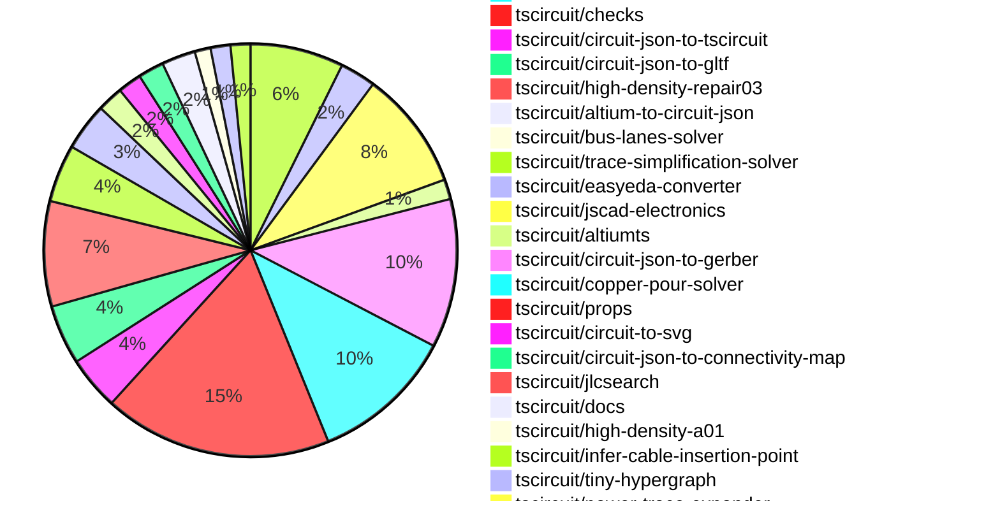

# Contribution Overview 2026-10-27

The current week is shown below. There are 3 major sections:

- [Contributor Overview](#contributor-overview)
- [PRs by Repository](#prs-by-repository)
- [PRs by Contributor](#changes-by-contributor)
- [Scoring & Sponsorship Details](/docs/sponsorship-calculation-explanation.md)

## PRs by Repository

## Contributor Overview

| Contributor | 🐳 Major | 🐙 Minor | 🐌 Tiny | Score | ⭐ |
|-------------|---------|---------|---------|-------|-----|
| [seveibar](#seveibar) | 51 | 27 | 22 | 271 | 👑👑👑 |
| [ShiboSoftwareDev](#ShiboSoftwareDev) | 25 | 23 | 38 | 171 | 👑👑👑 |
| [MustafaMulla29](#MustafaMulla29) | 4 | 12 | 33 | 53 | ⭐⭐⭐ |
| [imrishabh18](#imrishabh18) | 6 | 2 | 18 | 41 | ⭐⭐ |
| [0hmX](#0hmX) | 4 | 6 | 8 | 37 | ⭐⭐ |
| [rushabhcodes](#rushabhcodes) | 3 | 9 | 5 | 36 | ⭐⭐ |
| [AnasSarkiz](#AnasSarkiz) | 1 | 5 | 6 | 28 | ⭐⭐ |
| [Abse2001](#Abse2001) | 1 | 2 | 4 | 27 | ⭐⭐ |
| [techmannih](#techmannih) | 3 | 3 | 6 | 25 | ⭐⭐ |
| [tscircuitbot](#tscircuitbot) | 0 | 0 | 401 | 12.5 | ⭐⭐ |
| [GokulPandi-M](#GokulPandi-M) | 0 | 4 | 4 | 12 | ⭐⭐ |
| [KrishnaX12](#KrishnaX12) | 1 | 3 | 1 | 11 | ⭐⭐ |
| [mohan-bee](#mohan-bee) | 1 | 1 | 0 | 7 | ⭐ |
| [hrithik18k](#hrithik18k) | 0 | 0 | 2 | 2 |  |
| [pthm](#pthm) | 0 | 1 | 0 | 2 |  |
| [raykholo](#raykholo) | 0 | 0 | 1 | 1 |  |

## Staff Pass Ratio (SPR)

| Contributor | Reviewed PRs | Rejections | Approvals | SPR |
|-------------|--------------|------------|-----------|-----|
| [Abse2001](#Abse2001) | 8 | 2 | 6 | 75.0% |
| [ShiboSoftwareDev](#ShiboSoftwareDev) | 7 | 0 | 7 | 100.0% |
| [techmannih](#techmannih) | 7 | 0 | 7 | 100.0% |
| [mohan-bee](#mohan-bee) | 6 | 2 | 5 | 66.7% |
| [MustafaMulla29](#MustafaMulla29) | 6 | 0 | 6 | 100.0% |
| [0hmX](#0hmX) | 4 | 0 | 4 | 100.0% |
| [imrishabh18](#imrishabh18) | 4 | 0 | 5 | 100.0% |
| [rushabhcodes](#rushabhcodes) | 4 | 1 | 4 | 75.0% |
| [AnasSarkiz](#AnasSarkiz) | 1 | 0 | 1 | 100.0% |
| [HarsH-1877](#HarsH-1877) | 1 | 1 | 0 | 0.0% |
| [pthm](#pthm) | 1 | 0 | 1 | 100.0% |

Abse2001 SPR PRs (8)

- [#1088](https://github.com/tscircuit/pcb-viewer/pull/1088) feat: search PCB components and briefly highlight results
- [#940](https://github.com/tscircuit/circuit-json/pull/940) fix: retain schematic component rotation metadata (#4697)
- [#955](https://github.com/tscircuit/circuit-json/pull/955) feat: allow panel fabrication notes without fake footprints (core#5067)
- [#5076](https://github.com/tscircuit/core/pull/5076) fix: use the requested tab span and wider mouse-bite webs (#5066)
- [#5071](https://github.com/tscircuit/core/pull/5071) fix: replace rounded panel slivers with continuous routing slots (#5065)
- [#5074](https://github.com/tscircuit/core/pull/5074) fix: adopt courtyard outline props validation (#4772)
- [#226](https://github.com/tscircuit/circuit-json-to-gerber/pull/226) fix: preserve board and route via tenting in Gerber export (#3903)
- [#5657](https://github.com/tscircuit/cli/pull/5657) fix: include relative local CAD models in GLB and GLTF exports (#5654)

ShiboSoftwareDev SPR PRs (7)

- [#1150](https://github.com/tscircuit/pcb-viewer/pull/1150) Preserve the fitted camera on the first wheel gesture
- [#5018](https://github.com/tscircuit/core/pull/5018) fix: resolve named differential trunks on branched nets
- [#3471](https://github.com/tscircuit/tscircuit-autorouter/pull/3471) Fix DDR pad drills through the existing repair search
- [#3435](https://github.com/tscircuit/tscircuit-autorouter/pull/3435) Allow connected target regions to share a routing exit
- [#128](https://github.com/tscircuit/bus-lanes-solver/pull/128) Retry paired package entries for independent DDR byte buses
- [#125](https://github.com/tscircuit/bus-lanes-solver/pull/125) Retry lane orders after DDR length matching fails
- [#122](https://github.com/tscircuit/bus-lanes-solver/pull/122) Fix DQS tuning clearance and route the real OrangeCrab byte lane

techmannih SPR PRs (7)

- [#3368](https://github.com/tscircuit/tscircuit-autorouter/pull/3368) chore: pin repair03 broad-force performance fix
- [#3178](https://github.com/tscircuit/tscircuit-autorouter/pull/3178) fix: preserve terminals and repair coupled DRC conflicts
- [#3353](https://github.com/tscircuit/tscircuit-autorouter/pull/3353) fix: preserve routing quality while preventing new peer trace shorts
- [#190](https://github.com/tscircuit/high-density-repair03/pull/190) fix: prevent new trace-to-via shorts during repair
- [#187](https://github.com/tscircuit/high-density-repair03/pull/187) perf: reuse broad-force passes and avoid redundant DRC work
- [#183](https://github.com/tscircuit/high-density-repair03/pull/183) fix: prevent new trace-to-trace shorts in repair output
- [#182](https://github.com/tscircuit/high-density-repair03/pull/182) test: reproduce force repair introducing a peer trace short

mohan-bee SPR PRs (6)

- [#290](https://github.com/tscircuit/circuit-json-util/pull/290) move brep copper pours with pcb transforms
- [#956](https://github.com/tscircuit/props/pull/956) add assembly cable waypoints
- [#5021](https://github.com/tscircuit/core/pull/5021) render pcb pin labels for imported library footprints
- [#4868](https://github.com/tscircuit/core/pull/4868) add assembly cable waypoint routing
- [#3442](https://github.com/tscircuit/tscircuit-autorouter/pull/3442) use upstream power trace expansion batching
- [#68](https://github.com/tscircuit/power-trace-expander/pull/68) batch power trace expansion while preserving work budgets

MustafaMulla29 SPR PRs (6)

- [#27](https://github.com/tscircuit/circuit-json-to-pnp-csv/pull/27) fix: export PnP from authored footprint origin
- [#370](https://github.com/tscircuit/circuit-json-schematic-placement-analysis/pull/370) fix: detect ground pins above passive signal branches
- [#366](https://github.com/tscircuit/circuit-json-schematic-placement-analysis/pull/366) Extend chip-pin capacitor placement checks to grounded capacitors
- [#364](https://github.com/tscircuit/circuit-json-schematic-placement-analysis/pull/364) Detect separated RRC timing networks
- [#357](https://github.com/tscircuit/circuit-json-schematic-placement-analysis/pull/357) Detect misaligned connector–test-point connections
- [#355](https://github.com/tscircuit/circuit-json-schematic-placement-analysis/pull/355) Detect reversed inductor–capacitor grouping

0hmX SPR PRs (4)

- [#5945](https://github.com/tscircuit/runframe/pull/5945) Fix preview toolbar overlap and canvas sizing on small screens
- [#5612](https://github.com/tscircuit/cli/pull/5612) fix: stop repeated preview refreshes during rapid edits
- [#96](https://github.com/tscircuit/circuit-json-webgpu/pull/96) Keep covered traces visible under solder mask
- [#91](https://github.com/tscircuit/circuit-json-webgpu/pull/91) fix: accept pcb_stackup metadata without stopping PCB rendering

imrishabh18 SPR PRs (4)

- [#4959](https://github.com/tscircuit/core/pull/4959) refactor: resolve component-specific Footprinter definitions in core
- [#5628](https://github.com/tscircuit/cli/pull/5628) Search all sources by default and add datasheet catalog search
- [#3354](https://github.com/tscircuit/tscircuit-autorouter/pull/3354) Remove runtime checks calls from autorouter execution
- [#3375](https://github.com/tscircuit/tscircuit-autorouter/pull/3375) Optimize native autorouter continuity evaluation

rushabhcodes SPR PRs (4)

- [#283](https://github.com/tscircuit/circuit-json-util/pull/283) fix: support position tolerance when matching route vias
- [#4973](https://github.com/tscircuit/core/pull/4973) fix: preserve SMT pad solder mask settings during Circuit JSON import
- [#4979](https://github.com/tscircuit/core/pull/4979) fix: import native testpoints from saved Circuit JSON
- [#222](https://github.com/tscircuit/circuit-json-to-gerber/pull/222) fix: rotate polygon plated-hole pads and soldermask

AnasSarkiz SPR PRs (1)

- [#107](https://github.com/tscircuit/bus-lanes-solver/pull/107) fix: support board outlines

HarsH-1877 SPR PRs (1)

- [#5053](https://github.com/tscircuit/core/pull/5053) fix(schematicsymbol): preserve oriented symbolName and apply geometric schRotation

pthm SPR PRs (1)

- [#127](https://github.com/tscircuit/circuit-json-to-step/pull/127) fix: export pcb_cutout geometry, including rounded rect corners

> Note: AI evaluates PRs and assigns 1-3 star ratings automatically. 4 and 5 star ratings require manual staff review.

## Review Table

[reviews-received-hover]: ## "Number of reviews received for PRs for this contributor"
[approvals-received-hover]: ## "Number of approvals received for PRs this contributor authored"
[rejections-received-hover]: ## "Number of rejections received for PRs this contributor authored"
[prs-opened-hover]: ## "Number of PRs opened by this contributor"
[issues-created-hover]: ## "Number of issues created by this contributor"

| Contributor | Reviews Received | Approvals Received | Rejections Received | Approvals | Rejections Given | PRs Opened | PRs Merged | Issues Created |
|---|---|---|---|---|---|---|---|---|
| [0hmX](#0hmX) | 12 | 5 | 0 | 6 | 0 | 32 | 18 | 0 |
| [1932819331hy-debug](#1932819331hy-debug) | 0 | 0 | 0 | 0 | 0 | 17 | 0 | 0 |
| [Abse2001](#Abse2001) | 10 | 8 | 2 | 16 | 0 | 42 | 13 | 0 |
| [Aming9303](#Aming9303) | 0 | 0 | 0 | 0 | 0 | 1 | 0 | 0 |
| [AnasSarkiz](#AnasSarkiz) | 7 | 7 | 0 | 8 | 0 | 32 | 12 | 0 |
| [anubhabx](#anubhabx) | 0 | 0 | 0 | 0 | 0 | 1 | 0 | 0 |
| [aswadi](#aswadi) | 0 | 0 | 0 | 0 | 0 | 5 | 0 | 0 |
| [BrandoBlue](#BrandoBlue) | 0 | 0 | 0 | 0 | 0 | 1 | 0 | 0 |
| [CaoTri253](#CaoTri253) | 0 | 0 | 0 | 0 | 0 | 1 | 0 | 0 |
| [cocvn157](#cocvn157) | 0 | 0 | 0 | 0 | 0 | 2 | 0 | 0 |
| [Daeil-Jung](#Daeil-Jung) | 0 | 0 | 0 | 0 | 0 | 3 | 0 | 0 |
| [Fuma2514](#Fuma2514) | 0 | 0 | 0 | 0 | 0 | 1 | 0 | 0 |
| [GokulPandi-M](#GokulPandi-M) | 18 | 13 | 2 | 0 | 0 | 13 | 8 | 0 |
| [HarsH-1877](#HarsH-1877) | 1 | 0 | 1 | 0 | 0 | 7 | 0 | 0 |
| [hrithik18k](#hrithik18k) | 2 | 2 | 0 | 0 | 0 | 5 | 2 | 0 |
| [imrishabh18](#imrishabh18) | 8 | 3 | 0 | 33 | 6 | 37 | 26 | 0 |
| [KrishnaX12](#KrishnaX12) | 7 | 5 | 2 | 0 | 0 | 12 | 5 | 0 |
| [longdungai](#longdungai) | 4 | 0 | 0 | 0 | 0 | 5 | 0 | 0 |
| [maheshbawne987-coder](#maheshbawne987-coder) | 1 | 0 | 0 | 0 | 0 | 1 | 0 | 0 |
| [Marwichmisi](#Marwichmisi) | 1 | 0 | 0 | 0 | 0 | 1 | 0 | 0 |
| [mohan-bee](#mohan-bee) | 9 | 5 | 2 | 1 | 0 | 24 | 7 | 0 |
| [MustafaMulla29](#MustafaMulla29) | 25 | 20 | 0 | 2 | 0 | 55 | 55 | 0 |
| [natertatter](#natertatter) | 0 | 0 | 0 | 0 | 0 | 3 | 0 | 0 |
| [ocakciomursel-pixel](#ocakciomursel-pixel) | 0 | 0 | 0 | 0 | 0 | 1 | 0 | 0 |
| [Ojas2095](#Ojas2095) | 0 | 0 | 0 | 0 | 0 | 2 | 0 | 0 |
| [PatchHarbor27](#PatchHarbor27) | 0 | 0 | 0 | 0 | 0 | 2 | 0 | 0 |
| [pthm](#pthm) | 1 | 1 | 0 | 0 | 0 | 1 | 1 | 0 |
| [raykholo](#raykholo) | 2 | 2 | 0 | 0 | 0 | 1 | 1 | 0 |
| [rushabhcodes](#rushabhcodes) | 52 | 16 | 2 | 4 | 0 | 29 | 18 | 0 |
| [seveibar](#seveibar) | 27 | 1 | 0 | 55 | 4 | 140 | 107 | 0 |
| [ShiboSoftwareDev](#ShiboSoftwareDev) | 40 | 39 | 0 | 14 | 1 | 194 | 89 | 0 |
| [Shokun123](#Shokun123) | 0 | 0 | 0 | 0 | 0 | 3 | 0 | 0 |
| [sreecharan-desu](#sreecharan-desu) | 0 | 0 | 0 | 0 | 0 | 5 | 0 | 0 |
| [techmannih](#techmannih) | 27 | 13 | 0 | 1 | 0 | 44 | 17 | 0 |
| [thanhdo1991](#thanhdo1991) | 0 | 0 | 0 | 0 | 0 | 1 | 0 | 0 |
| [tonnylegacy](#tonnylegacy) | 0 | 0 | 0 | 0 | 0 | 6 | 0 | 0 |
| [tscircuitbot](#tscircuitbot) | 0 | 0 | 0 | 0 | 0 | 516 | 401 | 0 |
| [tungnguyen84](#tungnguyen84) | 0 | 0 | 0 | 0 | 0 | 92 | 0 | 0 |
| [voropaevv](#voropaevv) | 0 | 0 | 0 | 0 | 0 | 2 | 0 | 0 |
| [zainrizvi0611-cmd](#zainrizvi0611-cmd) | 0 | 0 | 0 | 0 | 0 | 12 | 0 | 0 |
| [ZhaZhaBei](#ZhaZhaBei) | 0 | 0 | 0 | 0 | 0 | 3 | 0 | 0 |

## Changes by Repository

### [tscircuit/circuit-json-to-bom-csv](https://github.com/tscircuit/circuit-json-to-bom-csv)

| PR # | Impact | Rating | Contributor | Description |
|------|--------|--------|-------------|-------------|
| [#44](https://github.com/tscircuit/circuit-json-to-bom-csv/pull/44) | 🐳 Major | ⭐⭐⭐ | KrishnaX12 | Fixes the omission of crystal frequency in BOM exports by correctly formatting and including it in the generated BOM value. |
| [#43](https://github.com/tscircuit/circuit-json-to-bom-csv/pull/43) | 🐙 Minor | ⭐⭐ | KrishnaX12 | Fixes the issue where crystals with frequency 32768 export blank BOM Value and Comment, ensuring correct frequency representation in BOM exports. |
| [#45](https://github.com/tscircuit/circuit-json-to-bom-csv/pull/45) | 🐙 Minor | ⭐⭐ | GokulPandi-M | Exports fuse current and voltage ratings in BOM instead of supplier number, enhancing readability of specifications. |

🐌 Tiny Contributions (1)

| PR # | Impact | Contributor | Description |
|------|--------|-------------|-------------|
| [#42](https://github.com/tscircuit/circuit-json-to-bom-csv/pull/42) | 🐌 Tiny | GokulPandi-M | Records the omission of available fuse ratings in the BOM Value for component F1, while retaining the supplier number for identification. |

### [tscircuit/schematic-viewer](https://github.com/tscircuit/schematic-viewer)

| PR # | Impact | Rating | Contributor | Description |
|------|--------|--------|-------------|-------------|
| [#298](https://github.com/tscircuit/schematic-viewer/pull/298) | 🐙 Minor | ⭐⭐ | KrishnaX12 | Fixes duplicate display of fuse ratings in component details by mapping display fields and hiding duplicates. |

🐌 Tiny Contributions (1)

| PR # | Impact | Contributor | Description |
|------|--------|-------------|-------------|
| [#297](https://github.com/tscircuit/schematic-viewer/pull/297) | 🐌 Tiny | KrishnaX12 | Reproduces a bug where duplicate fuse ratings are displayed in component details, ensuring that each rating is shown correctly without suffixes. |

### [tscircuit/core](https://github.com/tscircuit/core)

| PR # | Impact | Rating | Contributor | Description |
|------|--------|--------|-------------|-------------|
| [#5087](https://github.com/tscircuit/core/pull/5087) | 🐳 Major | ⭐⭐⭐ | ShiboSoftwareDev | Fixes routing issues caused by oversized obstacle boxes blocking routes in the OrangeCrab design, allowing for successful routing of 17 paths without altering completed copper. |
| [#5060](https://github.com/tscircuit/core/pull/5060) | 🐳 Major | ⭐⭐⭐ | ShiboSoftwareDev | Fixes SMD pad bounds that were incorrectly set, preventing proper DDR routing on the A13 footprint. |
| [#5059](https://github.com/tscircuit/core/pull/5059) | 🐳 Major | ⭐⭐⭐ | ShiboSoftwareDev | The native A13 footprint has one exposed ground pad and nine thermal vias sharing pin 177. Core incorrectly treats them as disconnected, produces nine false clearance errors, and skips DDR routing. Add the real TSX circuit as an expected-failure repro. It requests D0D3 through RN4RN1: eight copper paths from CPU through the original series resistor arrays to RAM. All 369 SMD pads, nine thermal holes, and 96 DDR paths remain declared. |
| [#5056](https://github.com/tscircuit/core/pull/5056) | 🐳 Major | ⭐⭐⭐ | ShiboSoftwareDev | Bumps tscircuitcapacity-autorouter from 0.0.1018 to 0.0.1029 to include the DDR clock termination routing fix. |
| [#5018](https://github.com/tscircuit/core/pull/5018) | 🐳 Major | ⭐⭐⭐ | ShiboSoftwareDev | Fixes routing issues by ensuring named differential trunks are preserved on branched nets, preventing incorrect terminations and improving routing accuracy. |
| [#5068](https://github.com/tscircuit/core/pull/5068) | 🐳 Major | ⭐⭐⭐ | seveibar | assembly.bolt is defined in props but has no core implementation. It now renders and fastens to actual PCB holes or mechanical reference datums: tsx assembly.bolt nameB1 modelhexsocketbolt_m3_l10mm fastenedTo.CONTROL  .H1  assembly.bolt nameB2 modelhexsocketbolt_m3_l10mm fastenedTo.CONTROL  .H2  .bottom   Model strings such as hexsocketbolt_m3_l10mm use the existing modelprinter definitions and modelcdn URLs directly. Dimensional bolts support socket, hex, pan and countersunk heads through modelprinter definitions. Unsupported dimensional specifications produce a named error. Named hole and platedhole targets use their finalized emitted PCB centers after layout, rotation and translation. A bare hole target seats on the top surface; .top and .bottom select the surface explicitly. CSS selectors and compact named paths work. mountGap, signed mountOffset, an optional explicit mountFace, tilted parent frames, and device scope use the existing mounting solver. The default bolt mating origin is its head seating plane. Mechanical holes and slots use authored reference datums at their physical seating locations. This does not infer hole centers from arbitrary imported meshes. Bolts participate in assembly explosion targets, including serialized stages and moves in a tilted owner frame. The gantry example now uses .ROOT  .rail. All new snapshots use real JSCAD Electronics fasteners with recognizable fixtures. Each image was visually inspected; local pinned meshes omit thread tessellation for repeatable rendering.  Visual coverage  Snapshot   ---  ---   Plainplated holes, translatedrotated hole pattern, topbottom seating, 2 mm gap  PCB fastening(https:github.comtscircuitcoreblob884aad71f91c8e50f3baacdcfbdbfc4c329fb69ctestsassembly__snapshots__assembly-bolt-hole-mounting-annotated.snap.png)   Tilted bracket, slotted hole datums, signed offsets and exploded bolts  Mechanical fastening(https:github.comtscircuitcoreblob884aad71f91c8e50f3baacdcfbdbfc4c329fb69ctestsassembly__snapshots__assembly-bolt-reference-mounting-annotated.snap.png)   Dimensional socket, hex, pan and countersunk heads  Head types(https:github.comtscircuitcoreblob884aad71f91c8e50f3baacdcfbdbfc4c329fb69ctestsassembly__snapshots__assembly-bolt-head-types-annotated.snap.png)  Validation: all 109 assembly tests passed, including four new tests and actual exported GLB bounds. Full TypeScript check, ESMdeclaration build, repository formatting, and diff checks passed. The live modelcdn M3 x 10 GLB was also fetched and exported to verify its real seating origin and shaft length. The canonical-string follow-up removed shorthand expansion, updated the examples and snapshots, and passed all four bolt tests (65 assertions). |
| [#5057](https://github.com/tscircuit/core/pull/5057) | 🐳 Major | ⭐⭐⭐ | seveibar | Generic parts and subassemblies can now use face constraints to position their geometry and children. mountedTo accepts CSS selectors or compact identity paths; mountOffset.xy moves along the target faces tangents and mountGap sets normal clearance. Geometry-less containers and the subassembly alias work too. CSS resolution includes explicit surfaces, generated JSCAD datums, and NEMA faces, with device scope isolation and named errors for missingambiguous targets and cycles. Boards retain PCB anchoring, and motors inherit mounted container frames. The complete rigid frame reaches CAD children and emitted reference surfaces; CAD Euler composition now matches the exported GLB for tilted models. Uses published tscircuitprops0.0.716 from props 967. No absolute cadPosition or cadRotation props are added. |
| [#4990](https://github.com/tscircuit/core/pull/4990) | 🐳 Major | ⭐⭐⭐ | seveibar | Render assembly explosion stages and movements into the circuit database, so ordinary Circuit JSON contains a complete playback program and viewers can move all parts targeted by a stage without keeping the TSX tree. AssemblyExplosionStage and AssemblyExplosionMove follow cores render lifecycle. CadExplosionStageRender allocates database-owned stage IDs after CAD settles; CadExplosionRender resolves membership, order, targets and world-space translation vectors. Separate phases support forward stage references. Initialupdateremoval hooks keep IDs stable, refresh dependent membership and delete owned moves when a stage is removed. getCircuitJson() remains the normal database getter. Invalid references and membership cycles fail during rendering. targetReftargetRefs can name another explosion stage: its members move together, preserving earlier displacement without replaying its instructions. getCircuitJsonAssemblyExplosion() validates the serialized program and supports sequential partial progress and backward scrubbing without mutating assembled geometry. Overlapping targets move once per instruction; derived pose exports omit instructions to prevent double application. Four new annotated snapshot sheets cover 20 views, rendered natively from the original serialized program through circuit-json-to-gltf 274(https:github.comtscircuitcircuit-json-to-gltfpull274): Round trip, sequential partial progress, whole-stage overlap and backward scrubbing(https:github.comtscircuitcoreblobfeatserialize-assembly-explosionstestsassembly__snapshots__assembly-explosion-json-round-trip-annotated.snap.png): six views. Upright, inverted and tilted mounting frames(https:github.comtscircuitcoreblobfeatserialize-assembly-explosionstestsassembly__snapshots__assembly-explosion-json-frame-annotated.snap.png): four views. Retargeting, removal and restoration through render phases(https:github.comtscircuitcoreblobfeatserialize-assembly-explosionstestsassembly__snapshots__assembly-explosion-render-lifecycle-annotated.snap.png): four views. Real RP2040NEMA17 assembly: assembled, all four stages and halfway through bolt removal. The cover and entire bolt stage lift together first, then the bolts, motor and spacers separate. The captions show actual TSX in a bundled monospace font. Pinned model bytes make the snapshots independent of network downloads. !Real RP2040 assembly: every stage(https:raw.githubusercontent.comtscircuitcorefeatserialize-assembly-explosionstestsassembly__snapshots__assembly-explosion-rp2040-stages-annotated.snap.png) Uses published circuit-json0.0.539 from merged circuit-json 937(https:github.comtscircuitcircuit-jsonpull937) and circuit-json-to-gltf0.0.159 from merged exporter 274(https:github.comtscircuitcircuit-json-to-gltfpull274). There are no preview package dependencies. The dependency gate remains enabled and passes. Downstream viewer: 3d-viewer 1082(https:github.comtscircuit3d-viewerpull1082). The explicit serializeAssemblyExplosion(roots, assembledGeometry) adapter shares the resolver for already-rendered trees from older core releases; normal rendering does not call it. The real RP2040 fixture retains its pinned 0.0.2199 PCB renderer and copper-preservation guards because newer PCB rendering trips its ground-pour guard. Its custom assembly TSX, original board attribution, JSON and model hashes are checked in. The snapshot retains 300 routed traces, 303 vias and 117 CAD components; its 201 pre-existing schema rejections are documented and unchanged. Validation with the published exporter: all 94 assembly tests pass, including all four annotated snapshot sheets without updates. Typecheck, dependency checks, class exports, package build and distribution smoke tests pass. Another 29 related tests pass; seven local PCB-flex SVG snapshot failures reproduce with identical pixel differences on unchanged main using exporter 0.0.158. No unrelated baselines were changed. The real-board TSX re-export preserves all 5,109 assembled records exactly. The branch includes main through 7c67bf75a (0.0.2233); all ten CI test groups, typecheck, dependency checks, formatting, class exports, preview build and distribution smoke tests pass at f9fc5c4a3. The root README is unchanged. CADreference-surface translations only; PCBcable-containing targets and rotations remain unsupported. Pose sampling supports stage snapshots and scrubbing, not embedded GLTF animation tracks. No swept-collision claim. |
| [#4988](https://github.com/tscircuit/core/pull/4988) | 🐳 Major | ⭐⭐⭐ | seveibar | Allows trace directly inside panel and subpanel to electrically connect child boards using qualified selectors, for example trace namepanel_link from.B1 .R1 .pin2 to.B2 .R2 .pin1 . |
| [#4984](https://github.com/tscircuit/core/pull/4984) | 🐳 Major | ⭐⭐⭐ | seveibar | Fixes breakout routing by allowing each connection to choose its exit edge based on the shortest path to its destination, improving routing efficiency and reducing manual breakout points. |
| [#4983](https://github.com/tscircuit/core/pull/4983) | 🐳 Major | ⭐⭐⭐ | seveibar | Fixes autorouting failure when placing a via inside a same-net SMT pad, preventing crashes in the autorouter. |
| [#4985](https://github.com/tscircuit/core/pull/4985) | 🐳 Major | ⭐⭐⭐ | seveibar | Reduces the time taken to measure obstacles for test point labels by measuring each layers obstacles once instead of for each test point, resulting in significant performance improvements. |
| [#4982](https://github.com/tscircuit/core/pull/4982) | 🐳 Major | ⭐⭐⭐ | seveibar | Adds silkscreen labels for generated test points in autorouting, ensuring they are properly named and positioned without overlapping other elements. |
| [#4977](https://github.com/tscircuit/core/pull/4977) | 🐳 Major | ⭐⭐⭐ | seveibar | Changes the method of resolving drawing dimensions by using jscad geometry directly instead of relying on circuit-json-to-gltf, reducing bundle size and improving performance. |
| [#4974](https://github.com/tscircuit/core/pull/4974) | 🐳 Major | ⭐⭐⭐ | seveibar | Adds a final autoroutingphase reroute addTestPoints testPointMaxDetour10mm  that generates exposed, electrically connected probe pads. Optional connectionconnections selectors narrow the routed traces; without selectors it targets all routes. Options are direct phase props: testPointLayer, testPointDiameter, testPointClearance, testPointMinProbeSpacing, and testPointMaxDetour. Defaults are bottom layer, 1 mm diameter, 0.2 mm clearance, 2.54 mm probe spacing, and 1 mm maximum detour. The rerouting algorithm is now merged in test-point-rerouter 1. Core consumes its pinned GitHub source package at b0ccfaca75a7e187c55ddb6f2071a1f2084e3167 and bundles both JavaScript and declarations. A distribution smoke check guards against leaking that build-time package to consumers. Uses published tscircuitprops 0.0.714 from the merged props 963. No preview dependencies remain. The actual astrapd-power-supply board is pinned at release 57387f49-bd91-4277-8a82-706b1575c5ed. Its prototype adds three 1 mm top-side pads for SDA, SCL, and OUTPUT_EN while preserving all 219 traces. SDA and OUTPUT_EN use top-accessible branches of the same nets; the 0.2 mm clearance, 2.54 mm probe spacing and 1 mm detour limit are unchanged. The full-board snapshot uses standard PCB colors, shows footprint pads and silkscreen, and labels the new pads in magenta. Copper pours are hidden only in the image. Full routing and placement checks plus explicit 0.2 mm padpad, padtrace and viapad clearance checks report zero added findings. Comparison checks finding identity and geometry, not just counts; the original boards findings remain. Local validation: TypeScript, full packagedeclaration build, distribution smoke tests, and five focused phasedefaultsreal-boardreroutesimplification tests pass (40 assertions). Run bun scriptsprototype-test-point-board.ts directory to export the comparison image, full Circuit JSON, DRC report and probe targets. Prototype scope: one final phase, outer-layer pads, bounded local detours, and rejection of fixed routes or impossible requests. Probe coordinates remain in board space; fixture mechanics and transforms are the following step. The test-point phase runs inside the existing autorouting async effect using a GenericLocalAutorouter adapter. It shares the normal awaited completeerrorprogress handling and stop cleanup, and yields between target searches (individual target searches remain synchronous). |
| [#4959](https://github.com/tscircuit/core/pull/4959) | 🐳 Major | ⭐⭐⭐ | imrishabh18 | Core and Footprinter could both generate polarity artwork for LEDs, producing duplicate symbols. Bare LED package sizes also selected resistor definitions. Resolve each components effective footprint and let Footprinter generate the requested artwork. Use published Footprinter 0.0.450 and its resolvePassiveFootprintDefinition API to select capacitor and diode families while retaining explicit families, dimensions, units, and modifiers. Chip.resolveFootprint() requests _nonpolarized only for diodeLED packages that generate automatic electrical polarity artwork. Ordinary chip footprints such as soic8, qfn32, and dip8 retain their definitions. Explicit polarity modifiers are preserved. Capacitor.getFootprinterString() owns capacitor family selection, polarity options, and terminal mapping. PCB and CAD use the same definition. Diodes and LEDs share diode-specific footprint and port helpers under libutilsfootprints. Component class files retain their class export; a CI regression rejects additional runtime exports in normal component class files. Read parameters directly from Footprinter instead of maintaining a duplicate Zod schema. Convert authored pin options at the terminal-mapping boundary, preserving label conflict checks and distinct numeric 1  2 terminals. Keep NormalComponent generic and authored props immutable. Remove cores duplicate LEDcapacitor fabrication generators while preserving importedcustom artwork. For example, a polarized capacitor using 0805 resolves to cap0805_polarized; an 0805 LED resolves to diode0805; a generic chip using sod123 resolves to sod123_nonpolarized, while soic8 remains soic8. |
| [#4970](https://github.com/tscircuit/core/pull/4970) | 🐙 Minor | ⭐⭐ | KrishnaX12 | Fixes the display of crystal frequency and load capacitance values in the viewer to show user-friendly formats instead of raw numeric values. |
| [#5009](https://github.com/tscircuit/core/pull/5009) | 🐙 Minor | ⭐⭐ | seveibar | Updates the assembly snapshot rendering to utilize released glTF explosion guides, removing a custom fixture and ensuring compatibility with the latest dependencies, while validating all assembly tests pass successfully. |
| [#4981](https://github.com/tscircuit/core/pull/4981) | 🐙 Minor | ⭐⭐ | seveibar | Allows standard connectors to pin specific parts by using manufacturerPartNumber and supplierPartNumbers, preventing unintended changes in part selection over time. |
| [#4975](https://github.com/tscircuit/core/pull/4975) | 🐙 Minor | ⭐⭐ | seveibar | Updates the checks library to report isolated copper pour warnings and adds regression tests for the new functionality. |
| [#4971](https://github.com/tscircuit/core/pull/4971) | 🐙 Minor | ⭐⭐ | seveibar | Fixes false orientation warnings for USB-A rectangular connectors by upgrading the inference package and adding regression tests for correct orientation inference after rotation. |
| [#4969](https://github.com/tscircuit/core/pull/4969) | 🐙 Minor | ⭐⭐ | seveibar | Updates the tscircuitcapacity-autorouter package from version 0.0.999 to 0.0.1012, allowing for up to four vias in the solderjumper circuit and refreshing routing snapshots accordingly. |
| [#4868](https://github.com/tscircuit/core/pull/4868) | 🐙 Minor | ⭐⭐ | mohan-bee | Add functionality for routing assembly cables with waypoints to avoid crossing wires around a phone holder while keeping connectors attached. |
| [#5062](https://github.com/tscircuit/core/pull/5062) | 🐙 Minor | ⭐⭐ | GokulPandi-M | Fixes the issue where schGridCols and schGridGap were ignored in schematic layouts, allowing independent control of schematic column count and spacing. |
| [#5036](https://github.com/tscircuit/core/pull/5036) | 🐙 Minor | ⭐⭐ | GokulPandi-M | Fixes the issue where schematic grid settings schGridCols and schGridGap are ignored, affecting the layout of schematics independently from PCB grid settings. |
| [#4973](https://github.com/tscircuit/core/pull/4973) | 🐙 Minor | ⭐⭐ | rushabhcodes | Fixes the preservation of SMT pad solder mask settings during Circuit JSON import, ensuring that the PCB antenna retains its masked feed pad and that Gerber export remains accurate after import. |
| [#4972](https://github.com/tscircuit/core/pull/4972) | 🐙 Minor | ⭐⭐ | rushabhcodes | Fixes a bug where saving and re-importing a board causes a PCB antennas feed pad to be incorrectly exposed instead of masked. |
| [#4979](https://github.com/tscircuit/core/pull/4979) | 🐙 Minor | ⭐⭐ | rushabhcodes | Support importing saved simple_test_point components through a dedicated testpoint inflator, avoiding duplicate pads without a custom subclass. |

🐌 Tiny Contributions (19)

| PR # | Impact | Contributor | Description |
|------|--------|-------------|-------------|
| [#5035](https://github.com/tscircuit/core/pull/5035) | 🐌 Tiny | tscircuitbot | Updates the tscircuitchecks package from version 0.0.267 to 0.0.268 |
| [#5033](https://github.com/tscircuit/core/pull/5033) | 🐌 Tiny | tscircuitbot | Updates the tscircuitchecks package from version 0.0.266 to 0.0.267 |
| [#5095](https://github.com/tscircuit/core/pull/5095) | 🐌 Tiny | ShiboSoftwareDev | Update capacity-autorouter to 0.0.1033 to include the DDR via-anchor fix from tscircuittscircuit-autorouter3463. |
| [#5086](https://github.com/tscircuit/core/pull/5086) | 🐌 Tiny | ShiboSoftwareDev | Reproduces a false chip-select blockage after both OrangeCrab data bytes route, verifying all paths are connected without moving completed bytes. |
| [#5083](https://github.com/tscircuit/core/pull/5083) | 🐌 Tiny | ShiboSoftwareDev | Bumps tscircuitcapacity-autorouter from 0.0.1029 to 0.0.1032, addressing the DDR no-via-in-pad fix and splitting native A13 coverage into a DRC-clean 18-path thermal-pad control and an eight-path D0D3 limitation case. |
| [#5052](https://github.com/tscircuit/core/pull/5052) | 🐌 Tiny | ShiboSoftwareDev | Bump tscircuitbus-lanes-solver from 0.0.39 to 0.0.40 to include the DDR routing fix from https:github.comtscircuitbus-lanes-solverpull128. |
| [#5047](https://github.com/tscircuit/core/pull/5047) | 🐌 Tiny | ShiboSoftwareDev | Bump tscircuitbus-lanes-solver from 0.0.38 to 0.0.39 to pick up the DDR lane-order retry fix |
| [#5037](https://github.com/tscircuit/core/pull/5037) | 🐌 Tiny | ShiboSoftwareDev | Bumps tscircuitbus-lanes-solver from 0.0.35 to 0.0.38 to include the DDR paired-bend clearance fix from tscircuitbus-lanes-solver122. |
| [#5022](https://github.com/tscircuit/core/pull/5022) | 🐌 Tiny | ShiboSoftwareDev | Reconstructs OrangeCrab r0.2.1 in TSX with its ECP5, DDR3 RAM, termination parts, all 387 pads and 51 DDR nets. Main rejects the named clock trunks before routing: 0 traces. The expected-failure test requires two clock routes, correct endpoints, skew 0.1 mm, and physical clearance. 5018 is stacked on this repro and makes those same assertions pass. The second test preserves the remaining clock-plus-termination failure. Source attribution, commands, and scope are in the fixture README. |
| [#5028](https://github.com/tscircuit/core/pull/5028) | 🐌 Tiny | ShiboSoftwareDev | Updates the development dependency to circuit-json-to-gltf0.0.163, which includes a fix for jscad-electronics0.0.242. |
| [#5017](https://github.com/tscircuit/core/pull/5017) | 🐌 Tiny | ShiboSoftwareDev | Updates the circuit-json-to-gltf dependency to version 0.0.162, which includes a fix for DFN dimensions through updated jscad-electronics and jscad-fiber dependencies. |
| [#5012](https://github.com/tscircuit/core/pull/5012) | 🐌 Tiny | ShiboSoftwareDev | Updates the version of tscircuitchecks to 0.0.266 and circuit-json-to-gltf to 0.0.161 in package.json, ensuring compatibility and functionality for copper-to-cutout DRC. |
| [#4991](https://github.com/tscircuit/core/pull/4991) | 🐌 Tiny | ShiboSoftwareDev | Updates the circuit-json-to-gltf dependency from version 0.0.151 to 0.0.158, correcting JSCAD solid topology and assembled CAD mesh API, while ensuring visual consistency in snapshots and passing all validation checks. |
| [#5005](https://github.com/tscircuit/core/pull/5005) | 🐌 Tiny | seveibar | Updates tscircuitcapacity-autorouter from 0.0.1015 to the latest published version, 0.0.1018. |
| [#4989](https://github.com/tscircuit/core/pull/4989) | 🐌 Tiny | seveibar | Add a CI check that prevents new extra exports in class implementation files under lib. |
| [#5064](https://github.com/tscircuit/core/pull/5064) | 🐌 Tiny | imrishabh18 | Updates the dependency version of circuit-json-to-gltf from 0.0.163 to 0.0.164 to restore blocked-CDN dependency and ensure proper functionality without external network access. |
| [#5048](https://github.com/tscircuit/core/pull/5048) | 🐌 Tiny | imrishabh18 | Replaces the direct development dependency on the tscircuitjscad CDN tarball (0.0.3) with the published npm range 0.0.6, addressing resolution failures during standalone release preparation. |
| [#4978](https://github.com/tscircuit/core/pull/4978) | 🐌 Tiny | rushabhcodes | Reproduces the failure of importing native testpoint  components from Circuit JSON due to the absence of an inflator for simple_test_point, and adds a fixture for testing. |
| [#4995](https://github.com/tscircuit/core/pull/4995) | 🐌 Tiny | techmannih | Update tscircuitcapacity-autorouter from 0.0.1013 to 0.0.1015 to include the via-to-pad reference DRC and bounded repair fixes. |

### [tscircuit/pcb-viewer](https://github.com/tscircuit/pcb-viewer)

| PR # | Impact | Rating | Contributor | Description |
|------|--------|--------|-------------|-------------|
| [#1144](https://github.com/tscircuit/pcb-viewer/pull/1144) | 🐳 Major | ⭐⭐⭐ | ShiboSoftwareDev | Coalesces pending scene updates before compilation to prevent obsolete boards from compiling, while preserving existing generation checks and worker disposal. |
| [#1135](https://github.com/tscircuit/pcb-viewer/pull/1135) | 🐳 Major | ⭐⭐⭐ | ShiboSoftwareDev | Fit the viewport to all physical PCB boards and panels, deriving missing polygon-board dimensions with the existing getBoardBounds() utility. Imported geometry stays in the scene, and standalone footprints retain their existing fit behavior. |
| [#1088](https://github.com/tscircuit/pcb-viewer/pull/1088) | 🐳 Major | ⭐⭐⭐ | Abse2001 | Adds a Search button to the PCB toolbar that allows users to search for placed components by name, highlighting the selected component for three seconds after selection. |
| [#1134](https://github.com/tscircuit/pcb-viewer/pull/1134) | 🐙 Minor | ⭐⭐ | ShiboSoftwareDev | Reproduces TMDS62LEVM fitting its 424 mm imported drawing frame instead of the 136 mm physical board, while retaining unchanged records from the demo and extracting existing bounds calculation without changing its behavior. |
| [#1127](https://github.com/tscircuit/pcb-viewer/pull/1127) | 🐙 Minor | ⭐⭐ | seveibar | Fixes the issue where hovering over a ground pad or trace did not highlight connected copper pours in the WebGPU rendering, ensuring that connected pours across layers are highlighted correctly while unrelated nets remain unselected. |

🐌 Tiny Contributions (13)

| PR # | Impact | Contributor | Description |
|------|--------|-------------|-------------|
| [#1152](https://github.com/tscircuit/pcb-viewer/pull/1152) | 🐌 Tiny | tscircuitbot | Automated package update |
| [#1148](https://github.com/tscircuit/pcb-viewer/pull/1148) | 🐌 Tiny | tscircuitbot | Automated package update |
| [#1139](https://github.com/tscircuit/pcb-viewer/pull/1139) | 🐌 Tiny | tscircuitbot | Automated package update |
| [#1137](https://github.com/tscircuit/pcb-viewer/pull/1137) | 🐌 Tiny | tscircuitbot | Automated package update |
| [#1133](https://github.com/tscircuit/pcb-viewer/pull/1133) | 🐌 Tiny | tscircuitbot | Automated package update |
| [#1131](https://github.com/tscircuit/pcb-viewer/pull/1131) | 🐌 Tiny | tscircuitbot | Automated package update |
| [#1130](https://github.com/tscircuit/pcb-viewer/pull/1130) | 🐌 Tiny | tscircuitbot | Automated package update |
| [#1128](https://github.com/tscircuit/pcb-viewer/pull/1128) | 🐌 Tiny | tscircuitbot | Automated package update |
| [#1149](https://github.com/tscircuit/pcb-viewer/pull/1149) | 🐌 Tiny | ShiboSoftwareDev | Reproduces the first-wheel camera jump with the existing full TMDS62LEVM circuit, documenting the incorrect behavior with a regression test. |
| [#1143](https://github.com/tscircuit/pcb-viewer/pull/1143) | 🐌 Tiny | ShiboSoftwareDev | Reproduces the redundant compilation of queued TMDS62LEVM scenes in a controlled environment for testing purposes. |
| [#1138](https://github.com/tscircuit/pcb-viewer/pull/1138) | 🐌 Tiny | Abse2001 | Fixes the toolbar styling for the search component to use standard styles and ensures component highlights remain visible during navigation without affecting existing functionality. |
| [#1132](https://github.com/tscircuit/pcb-viewer/pull/1132) | 🐌 Tiny | seveibar | Updates the WebGPU dependency to version 0.0.12, fixing rendering issues with blind and buried vias on the AM3352 Wi-Fi board and adding regression tests for drill geometry. |
| [#1129](https://github.com/tscircuit/pcb-viewer/pull/1129) | 🐌 Tiny | 0hmX | Fixes the renderer to support pcb_stackup metadata, preventing the WebGPU worker from stopping prematurely when rendering boards with this metadata. |

### [tscircuit/tscircuit](https://github.com/tscircuit/tscircuit)

| PR # | Impact | Rating | Contributor | Description |
|------|--------|--------|-------------|-------------|
| [#6129](https://github.com/tscircuit/tscircuit/pull/6129) | 🐳 Major | ⭐⭐⭐ | seveibar | Integrate tscircuitcore0.0.2254, circuit-json0.0.541, and props 0.0.716, while declaring tscircuitmanifold-2d0.0.8 as a runtime dependency and TypeScript as a development dependency, to ensure compatibility with the core-version updater and maintain clean-install rules against JSCDN dependencies. |
| [#6069](https://github.com/tscircuit/tscircuit/pull/6069) | 🐙 Minor | ⭐⭐ | Abse2001 | Fixes the blockage of automatic package updates due to missing core dependencies in package.json for the tscircuittest-point-rerouter, allowing CLI, core, and eval updates to proceed. |

🐌 Tiny Contributions (58)

| PR # | Impact | Contributor | Description |
|------|--------|-------------|-------------|
| [#6140](https://github.com/tscircuit/tscircuit/pull/6140) | 🐌 Tiny | tscircuitbot | Automated package update |
| [#6139](https://github.com/tscircuit/tscircuit/pull/6139) | 🐌 Tiny | tscircuitbot | Automated package update |
| [#6138](https://github.com/tscircuit/tscircuit/pull/6138) | 🐌 Tiny | tscircuitbot | Automated package update |
| [#6137](https://github.com/tscircuit/tscircuit/pull/6137) | 🐌 Tiny | tscircuitbot | Automated package update |
| [#6136](https://github.com/tscircuit/tscircuit/pull/6136) | 🐌 Tiny | tscircuitbot | Automated package update |
| [#6135](https://github.com/tscircuit/tscircuit/pull/6135) | 🐌 Tiny | tscircuitbot | Updates the version of tscircuitcore and tscircuiteval in package.json to the latest versions. |
| [#6132](https://github.com/tscircuit/tscircuit/pull/6132) | 🐌 Tiny | tscircuitbot | Automated package update |
| [#6131](https://github.com/tscircuit/tscircuit/pull/6131) | 🐌 Tiny | tscircuitbot | Automated package update |
| [#6130](https://github.com/tscircuit/tscircuit/pull/6130) | 🐌 Tiny | tscircuitbot | Automated package update |
| [#6128](https://github.com/tscircuit/tscircuit/pull/6128) | 🐌 Tiny | tscircuitbot | Automated package update |
| [#6127](https://github.com/tscircuit/tscircuit/pull/6127) | 🐌 Tiny | tscircuitbot | Updates the tscircuitcli package to version 0.1.2429 in the package.json file |
| [#6126](https://github.com/tscircuit/tscircuit/pull/6126) | 🐌 Tiny | tscircuitbot | Automated package update |
| [#6125](https://github.com/tscircuit/tscircuit/pull/6125) | 🐌 Tiny | tscircuitbot | Automated package update |
| [#6124](https://github.com/tscircuit/tscircuit/pull/6124) | 🐌 Tiny | tscircuitbot | Automated package update |
| [#6123](https://github.com/tscircuit/tscircuit/pull/6123) | 🐌 Tiny | tscircuitbot | Updates the tscircuitcli package to version 0.1.2428 |
| [#6122](https://github.com/tscircuit/tscircuit/pull/6122) | 🐌 Tiny | tscircuitbot | Updates the package version from 0.0.3053 to 0.0.3054 in package.json |
| [#6121](https://github.com/tscircuit/tscircuit/pull/6121) | 🐌 Tiny | tscircuitbot | Automated package update |
| [#6120](https://github.com/tscircuit/tscircuit/pull/6120) | 🐌 Tiny | tscircuitbot | Automated package update |
| [#6118](https://github.com/tscircuit/tscircuit/pull/6118) | 🐌 Tiny | tscircuitbot | Automated package update |
| [#6117](https://github.com/tscircuit/tscircuit/pull/6117) | 🐌 Tiny | tscircuitbot | Automated package update |
| [#6116](https://github.com/tscircuit/tscircuit/pull/6116) | 🐌 Tiny | tscircuitbot | Automated package update |
| [#6115](https://github.com/tscircuit/tscircuit/pull/6115) | 🐌 Tiny | tscircuitbot | Automated package update |
| [#6114](https://github.com/tscircuit/tscircuit/pull/6114) | 🐌 Tiny | tscircuitbot | Automated package update |
| [#6111](https://github.com/tscircuit/tscircuit/pull/6111) | 🐌 Tiny | tscircuitbot | Automated package update |
| [#6110](https://github.com/tscircuit/tscircuit/pull/6110) | 🐌 Tiny | tscircuitbot | Automated package update |
| [#6109](https://github.com/tscircuit/tscircuit/pull/6109) | 🐌 Tiny | tscircuitbot | Automated package update |
| [#6108](https://github.com/tscircuit/tscircuit/pull/6108) | 🐌 Tiny | tscircuitbot | Automated package update |
| [#6105](https://github.com/tscircuit/tscircuit/pull/6105) | 🐌 Tiny | tscircuitbot | Updates the tscircuitcore package from version 0.0.2244 to 0.0.2245 |
| [#6104](https://github.com/tscircuit/tscircuit/pull/6104) | 🐌 Tiny | tscircuitbot | Automated package update |
| [#6103](https://github.com/tscircuit/tscircuit/pull/6103) | 🐌 Tiny | tscircuitbot | Automated package update |
| [#6102](https://github.com/tscircuit/tscircuit/pull/6102) | 🐌 Tiny | tscircuitbot | Automated package update |
| [#6101](https://github.com/tscircuit/tscircuit/pull/6101) | 🐌 Tiny | tscircuitbot | Automated package update |
| [#6100](https://github.com/tscircuit/tscircuit/pull/6100) | 🐌 Tiny | tscircuitbot | Automated package update |
| [#6099](https://github.com/tscircuit/tscircuit/pull/6099) | 🐌 Tiny | tscircuitbot | Automated package update |
| [#6098](https://github.com/tscircuit/tscircuit/pull/6098) | 🐌 Tiny | tscircuitbot | Automated package update |
| [#6097](https://github.com/tscircuit/tscircuit/pull/6097) | 🐌 Tiny | tscircuitbot | Automated package update |
| [#6086](https://github.com/tscircuit/tscircuit/pull/6086) | 🐌 Tiny | tscircuitbot | Automated package update |
| [#6085](https://github.com/tscircuit/tscircuit/pull/6085) | 🐌 Tiny | tscircuitbot | Updates the tscircuitcli package to version 0.1.2423 |
| [#6084](https://github.com/tscircuit/tscircuit/pull/6084) | 🐌 Tiny | tscircuitbot | Automated package update |
| [#6083](https://github.com/tscircuit/tscircuit/pull/6083) | 🐌 Tiny | tscircuitbot | Automated package update |
| [#6082](https://github.com/tscircuit/tscircuit/pull/6082) | 🐌 Tiny | tscircuitbot | Updates the package version from 0.0.3039 to 0.0.3040 in package.json |
| [#6081](https://github.com/tscircuit/tscircuit/pull/6081) | 🐌 Tiny | tscircuitbot | Automated package update |
| [#6080](https://github.com/tscircuit/tscircuit/pull/6080) | 🐌 Tiny | tscircuitbot | Automated package update |
| [#6079](https://github.com/tscircuit/tscircuit/pull/6079) | 🐌 Tiny | tscircuitbot | Updates the tscircuitcli package to version 0.1.2421 in package.json |
| [#6078](https://github.com/tscircuit/tscircuit/pull/6078) | 🐌 Tiny | tscircuitbot | Automated package update |
| [#6077](https://github.com/tscircuit/tscircuit/pull/6077) | 🐌 Tiny | tscircuitbot | Automated package update |
| [#6076](https://github.com/tscircuit/tscircuit/pull/6076) | 🐌 Tiny | tscircuitbot | Automated package update |
| [#6075](https://github.com/tscircuit/tscircuit/pull/6075) | 🐌 Tiny | tscircuitbot | Automated package update |
| [#6074](https://github.com/tscircuit/tscircuit/pull/6074) | 🐌 Tiny | tscircuitbot | Automated package update |
| [#6073](https://github.com/tscircuit/tscircuit/pull/6073) | 🐌 Tiny | tscircuitbot | Automated package update |
| [#6072](https://github.com/tscircuit/tscircuit/pull/6072) | 🐌 Tiny | tscircuitbot | Automated package update |
| [#6071](https://github.com/tscircuit/tscircuit/pull/6071) | 🐌 Tiny | tscircuitbot | Automated package update |
| [#6065](https://github.com/tscircuit/tscircuit/pull/6065) | 🐌 Tiny | tscircuitbot | Updates the package version from 0.0.3032 to 0.0.3033 in package.json |
| [#6064](https://github.com/tscircuit/tscircuit/pull/6064) | 🐌 Tiny | tscircuitbot | Updates the tscircuitcli package to version 0.1.2416 |
| [#6063](https://github.com/tscircuit/tscircuit/pull/6063) | 🐌 Tiny | tscircuitbot | Automated package update |
| [#6062](https://github.com/tscircuit/tscircuit/pull/6062) | 🐌 Tiny | tscircuitbot | Automated package update |
| [#6119](https://github.com/tscircuit/tscircuit/pull/6119) | 🐌 Tiny | imrishabh18 | Removes the transitive dependency on the JSCAD CDN by updating the circuit-json-to-gltf package version, ensuring that installations do not rely on the CDN and pass tests without external network access. |
| [#6107](https://github.com/tscircuit/tscircuit/pull/6107) | 🐌 Tiny | imrishabh18 | Updates the circuit-json-to-gltf dependency from version 0.0.163 to 0.0.164, ensuring compatibility with the latest registry-backed JSCAD. |

### [tscircuit/circuit-json](https://github.com/tscircuit/circuit-json)

| PR # | Impact | Rating | Contributor | Description |
|------|--------|--------|-------------|-------------|
| [#944](https://github.com/tscircuit/circuit-json/pull/944) | 🐳 Major | ⭐⭐⭐ | seveibar | Add cad_explosion_collision_error for an explosion move that enters a CAD part or PCB substrate, and cad_explosion_collision_check_warning for unsupportedinvalid geometry or a failed check, allowing consumers to distinguish confirmed collisions from incomplete coverage. |
| [#937](https://github.com/tscircuit/circuit-json/pull/937) | 🐳 Major | ⭐⭐⭐ | seveibar | Represent assembly explosion programs alongside assembled geometry using cad_explosion_stage and cad_explosion_move, allowing for coordinated movements of components and stages in a CAD environment. |
| [#935](https://github.com/tscircuit/circuit-json/pull/935) | 🐳 Major | ⭐⭐⭐ | seveibar | Adds optional pcb_panel_id to pcb_trace and pcb_via so electrical copper connecting boards can belong to the manufacturing panel. Existing board traces remain valid without the field. |
| [#942](https://github.com/tscircuit/circuit-json/pull/942) | 🐙 Minor | ⭐⭐ | seveibar | Makes the pcb_component_id field optional for board and group silkscreen labels, allowing them to exist without being tied to a specific PCB component. |
| [#933](https://github.com/tscircuit/circuit-json/pull/933) | 🐙 Minor | ⭐⭐ | seveibar | Add a dedicated pcb_copper_pour_isolated_warning for copper pour islands with no physical same-net pad or via connection, including validation and integration into the runtime element schema. |

🐌 Tiny Contributions (5)

| PR # | Impact | Contributor | Description |
|------|--------|-------------|-------------|
| [#947](https://github.com/tscircuit/circuit-json/pull/947) | 🐌 Tiny | tscircuitbot | Automated package update |
| [#943](https://github.com/tscircuit/circuit-json/pull/943) | 🐌 Tiny | tscircuitbot | Automated package update |
| [#938](https://github.com/tscircuit/circuit-json/pull/938) | 🐌 Tiny | tscircuitbot | Automated package update |
| [#936](https://github.com/tscircuit/circuit-json/pull/936) | 🐌 Tiny | tscircuitbot | Automated package update |
| [#934](https://github.com/tscircuit/circuit-json/pull/934) | 🐌 Tiny | tscircuitbot | Automated package update |

### [tscircuit/tscircuit.com](https://github.com/tscircuit/tscircuit.com)

| PR # | Impact | Rating | Contributor | Description |
|------|--------|--------|-------------|-------------|
| [#5683](https://github.com/tscircuit/tscircuit.com/pull/5683) | 🐳 Major | ⭐⭐⭐ | imrishabh18 | Recommends downloads for the visitors operating system and links directly to the published installer assets, while removing the Getting Started section. |
| [#5588](https://github.com/tscircuit/tscircuit.com/pull/5588) | 🐳 Major | ⭐⭐⭐ | imrishabh18 | Consume datasheet.generated_tsx directly for the component source and both copy buttons. Remove frontend TSX generation and metadata rewriting. Preserve the complete API source, including whitespace, and hide TSX controls when it is null or blank. |
| [#5590](https://github.com/tscircuit/tscircuit.com/pull/5590) | 🐙 Minor | ⭐⭐ | seveibar | Adds latest-release terminal installation commands to the enterprise page, updates platform download guidance, and links to the standalone guide in tscircuitdocs. Deploy the docs guide before this page. |
| [#5631](https://github.com/tscircuit/tscircuit.com/pull/5631) | 🐙 Minor | ⭐⭐ | rushabhcodes | Hides the warning badge when there are no diagnostics, preventing the display of a zero-count warning icon. |

🐌 Tiny Contributions (71)

| PR # | Impact | Contributor | Description |
|------|--------|-------------|-------------|
| [#5685](https://github.com/tscircuit/tscircuit.com/pull/5685) | 🐌 Tiny | tscircuitbot | Updates the tscircuitrunframe package version from 0.0.3130 to 0.0.3131 |
| [#5682](https://github.com/tscircuit/tscircuit.com/pull/5682) | 🐌 Tiny | tscircuitbot | Updates the tscircuitrunframe package version from 0.0.3129 to 0.0.3130 in package.json |
| [#5681](https://github.com/tscircuit/tscircuit.com/pull/5681) | 🐌 Tiny | tscircuitbot | Updates the tscircuitrunframe package from version 0.0.3127 to 0.0.3129 |
| [#5680](https://github.com/tscircuit/tscircuit.com/pull/5680) | 🐌 Tiny | tscircuitbot | Automated package update |
| [#5678](https://github.com/tscircuit/tscircuit.com/pull/5678) | 🐌 Tiny | tscircuitbot | Updates the tscircuiteval package from version 0.0.1692 to 0.0.1693 |
| [#5677](https://github.com/tscircuit/tscircuit.com/pull/5677) | 🐌 Tiny | tscircuitbot | Automated package update |
| [#5676](https://github.com/tscircuit/tscircuit.com/pull/5676) | 🐌 Tiny | tscircuitbot | Automated package update |
| [#5675](https://github.com/tscircuit/tscircuit.com/pull/5675) | 🐌 Tiny | tscircuitbot | Updates the tscircuitrunframe package version from 0.0.3125 to 0.0.3126 |
| [#5674](https://github.com/tscircuit/tscircuit.com/pull/5674) | 🐌 Tiny | tscircuitbot | Automated package update |
| [#5672](https://github.com/tscircuit/tscircuit.com/pull/5672) | 🐌 Tiny | tscircuitbot | Automated package update |
| [#5671](https://github.com/tscircuit/tscircuit.com/pull/5671) | 🐌 Tiny | tscircuitbot | Automated package update |
| [#5670](https://github.com/tscircuit/tscircuit.com/pull/5670) | 🐌 Tiny | tscircuitbot | Automated package update |
| [#5668](https://github.com/tscircuit/tscircuit.com/pull/5668) | 🐌 Tiny | tscircuitbot | Automated package update |
| [#5667](https://github.com/tscircuit/tscircuit.com/pull/5667) | 🐌 Tiny | tscircuitbot | Automated package update |
| [#5666](https://github.com/tscircuit/tscircuit.com/pull/5666) | 🐌 Tiny | tscircuitbot | Updates the tscircuitrunframe package from version 0.0.3118 to 0.0.3120 and the tscircuitschematic-viewer package from version 2.0.105 to 2.0.106. |
| [#5665](https://github.com/tscircuit/tscircuit.com/pull/5665) | 🐌 Tiny | tscircuitbot | Updates the tscircuiteval package from version 0.0.1687 to 0.0.1688 |
| [#5664](https://github.com/tscircuit/tscircuit.com/pull/5664) | 🐌 Tiny | tscircuitbot | Updates the tscircuiteval package from version 0.0.1681 to 0.0.1687 in the package.json file. |
| [#5663](https://github.com/tscircuit/tscircuit.com/pull/5663) | 🐌 Tiny | tscircuitbot | Updates the tscircuitrunframe package from version 0.0.3117 to 0.0.3118 |
| [#5662](https://github.com/tscircuit/tscircuit.com/pull/5662) | 🐌 Tiny | tscircuitbot | Updates the tscircuitrunframe package from version 0.0.3115 to 0.0.3117 |
| [#5658](https://github.com/tscircuit/tscircuit.com/pull/5658) | 🐌 Tiny | tscircuitbot | Updates the tscircuitrunframe package from version 0.0.3114 to 0.0.3115 |
| [#5656](https://github.com/tscircuit/tscircuit.com/pull/5656) | 🐌 Tiny | tscircuitbot | Updates the tscircuitrunframe package from version 0.0.3112 to 0.0.3114 and the tscircuitschematic-viewer package from version 2.0.104 to 2.0.105. |
| [#5654](https://github.com/tscircuit/tscircuit.com/pull/5654) | 🐌 Tiny | tscircuitbot | Updates the tscircuiteval package version from 0.0.1680 to 0.0.1681 in package.json |
| [#5651](https://github.com/tscircuit/tscircuit.com/pull/5651) | 🐌 Tiny | tscircuitbot | Automated package update |
| [#5650](https://github.com/tscircuit/tscircuit.com/pull/5650) | 🐌 Tiny | tscircuitbot | Updates the tscircuitrunframe package from version 0.0.3109 to 0.0.3111 |
| [#5649](https://github.com/tscircuit/tscircuit.com/pull/5649) | 🐌 Tiny | tscircuitbot | Automated package update |
| [#5648](https://github.com/tscircuit/tscircuit.com/pull/5648) | 🐌 Tiny | tscircuitbot | Automated package update |
| [#5647](https://github.com/tscircuit/tscircuit.com/pull/5647) | 🐌 Tiny | tscircuitbot | Updates the tscircuitrunframe package from version 0.0.3107 to 0.0.3109 |
| [#5646](https://github.com/tscircuit/tscircuit.com/pull/5646) | 🐌 Tiny | tscircuitbot | Updates the tscircuiteval package from version 0.0.1676 to 0.0.1678 |
| [#5642](https://github.com/tscircuit/tscircuit.com/pull/5642) | 🐌 Tiny | tscircuitbot | Automated package update |
| [#5641](https://github.com/tscircuit/tscircuit.com/pull/5641) | 🐌 Tiny | tscircuitbot | Updates the tscircuiteval package from version 0.0.1669 to 0.0.1676 in the package.json file. |
| [#5640](https://github.com/tscircuit/tscircuit.com/pull/5640) | 🐌 Tiny | tscircuitbot | Updates the tscircuitrunframe package from version 0.0.3105 to 0.0.3106 |
| [#5639](https://github.com/tscircuit/tscircuit.com/pull/5639) | 🐌 Tiny | tscircuitbot | Automated package update |
| [#5637](https://github.com/tscircuit/tscircuit.com/pull/5637) | 🐌 Tiny | tscircuitbot | Updates the tscircuitrunframe package from version 0.0.3103 to 0.0.3104 |
| [#5636](https://github.com/tscircuit/tscircuit.com/pull/5636) | 🐌 Tiny | tscircuitbot | Updates the tscircuitrunframe package from version 0.0.3102 to 0.0.3103 |
| [#5635](https://github.com/tscircuit/tscircuit.com/pull/5635) | 🐌 Tiny | tscircuitbot | Updates the tscircuitrunframe package from version 0.0.3101 to 0.0.3102 |
| [#5634](https://github.com/tscircuit/tscircuit.com/pull/5634) | 🐌 Tiny | tscircuitbot | Automated package update |
| [#5628](https://github.com/tscircuit/tscircuit.com/pull/5628) | 🐌 Tiny | tscircuitbot | Automated package update |
| [#5627](https://github.com/tscircuit/tscircuit.com/pull/5627) | 🐌 Tiny | tscircuitbot | Automated package update |
| [#5626](https://github.com/tscircuit/tscircuit.com/pull/5626) | 🐌 Tiny | tscircuitbot | Updates the tscircuitrunframe package version from 0.0.3096 to 0.0.3097 in package.json |
| [#5624](https://github.com/tscircuit/tscircuit.com/pull/5624) | 🐌 Tiny | tscircuitbot | Automated package update |
| [#5622](https://github.com/tscircuit/tscircuit.com/pull/5622) | 🐌 Tiny | tscircuitbot | Automated package update |
| [#5621](https://github.com/tscircuit/tscircuit.com/pull/5621) | 🐌 Tiny | tscircuitbot | Automated package update |
| [#5620](https://github.com/tscircuit/tscircuit.com/pull/5620) | 🐌 Tiny | tscircuitbot | Updates the tscircuitrunframe package version from 0.0.3092 to 0.0.3093 in package.json |
| [#5617](https://github.com/tscircuit/tscircuit.com/pull/5617) | 🐌 Tiny | tscircuitbot | Automated package update |
| [#5616](https://github.com/tscircuit/tscircuit.com/pull/5616) | 🐌 Tiny | tscircuitbot | Automated package update |
| [#5615](https://github.com/tscircuit/tscircuit.com/pull/5615) | 🐌 Tiny | tscircuitbot | Updates the tscircuiteval package from version 0.0.1668 to 0.0.1669 in the package.json file. |
| [#5614](https://github.com/tscircuit/tscircuit.com/pull/5614) | 🐌 Tiny | tscircuitbot | Automated package update |
| [#5612](https://github.com/tscircuit/tscircuit.com/pull/5612) | 🐌 Tiny | tscircuitbot | Automated package update |
| [#5611](https://github.com/tscircuit/tscircuit.com/pull/5611) | 🐌 Tiny | tscircuitbot | Updates the tscircuiteval package from version 0.0.1667 to 0.0.1668 |
| [#5610](https://github.com/tscircuit/tscircuit.com/pull/5610) | 🐌 Tiny | tscircuitbot | Updates the tscircuitrunframe package version from 0.0.3086 to 0.0.3087 |
| [#5609](https://github.com/tscircuit/tscircuit.com/pull/5609) | 🐌 Tiny | tscircuitbot | Automated package update |
| [#5608](https://github.com/tscircuit/tscircuit.com/pull/5608) | 🐌 Tiny | tscircuitbot | Updates the tscircuiteval package version from 0.0.1665 to 0.0.1667 in package.json |
| [#5607](https://github.com/tscircuit/tscircuit.com/pull/5607) | 🐌 Tiny | tscircuitbot | Updates the tscircuitrunframe package version from 0.0.3083 to 0.0.3085 in package.json |
| [#5606](https://github.com/tscircuit/tscircuit.com/pull/5606) | 🐌 Tiny | tscircuitbot | Automated package update |
| [#5604](https://github.com/tscircuit/tscircuit.com/pull/5604) | 🐌 Tiny | tscircuitbot | Automated package update |
| [#5603](https://github.com/tscircuit/tscircuit.com/pull/5603) | 🐌 Tiny | tscircuitbot | Automated package update |
| [#5602](https://github.com/tscircuit/tscircuit.com/pull/5602) | 🐌 Tiny | tscircuitbot | Automated package update |
| [#5601](https://github.com/tscircuit/tscircuit.com/pull/5601) | 🐌 Tiny | tscircuitbot | Updates the tscircuiteval package from version 0.0.1663 to 0.0.1664 |
| [#5600](https://github.com/tscircuit/tscircuit.com/pull/5600) | 🐌 Tiny | tscircuitbot | Automated package update |
| [#5599](https://github.com/tscircuit/tscircuit.com/pull/5599) | 🐌 Tiny | tscircuitbot | Updates the tscircuitrunframe package from version 0.0.3078 to 0.0.3079 |
| [#5598](https://github.com/tscircuit/tscircuit.com/pull/5598) | 🐌 Tiny | tscircuitbot | Automated package update |
| [#5597](https://github.com/tscircuit/tscircuit.com/pull/5597) | 🐌 Tiny | tscircuitbot | Automated package update |
| [#5596](https://github.com/tscircuit/tscircuit.com/pull/5596) | 🐌 Tiny | tscircuitbot | Updates the tscircuitrunframe package to version 0.0.3077 |
| [#5595](https://github.com/tscircuit/tscircuit.com/pull/5595) | 🐌 Tiny | tscircuitbot | Updates the tscircuiteval package from version 0.0.1661 to 0.0.1662 in the package.json file. |
| [#5594](https://github.com/tscircuit/tscircuit.com/pull/5594) | 🐌 Tiny | tscircuitbot | Automated package update |
| [#5593](https://github.com/tscircuit/tscircuit.com/pull/5593) | 🐌 Tiny | tscircuitbot | Updates the tscircuiteval package version from 0.0.1660 to 0.0.1661 in package.json |
| [#5592](https://github.com/tscircuit/tscircuit.com/pull/5592) | 🐌 Tiny | tscircuitbot | Automated package update |
| [#5591](https://github.com/tscircuit/tscircuit.com/pull/5591) | 🐌 Tiny | tscircuitbot | Updates the version of the tscircuiteval package from 0.0.1659 to 0.0.1660 in package.json |
| [#5589](https://github.com/tscircuit/tscircuit.com/pull/5589) | 🐌 Tiny | tscircuitbot | Updates the tscircuitrunframe package to version 0.0.3074 |
| [#5587](https://github.com/tscircuit/tscircuit.com/pull/5587) | 🐌 Tiny | tscircuitbot | Updates the tscircuitrunframe package from version 0.0.3072 to 0.0.3073 |
| [#5629](https://github.com/tscircuit/tscircuit.com/pull/5629) | 🐌 Tiny | rushabhcodes | Adds a tooltip that displays Refresh repositories from GitHub when hovering over the refresh button in the GitHub repository picker. |

### [tscircuit/eval](https://github.com/tscircuit/eval)

| PR # | Impact | Rating | Contributor | Description |
|------|--------|--------|-------------|-------------|
| [#5427](https://github.com/tscircuit/eval/pull/5427) | 🐙 Minor | ⭐⭐ | seveibar | Bumps tscircuitcore to 0.0.2222 and tscircuitprops to 0.0.714 to support autoroutingphase reroute addTestPoints  and ensure proper handling of test points in the circuit evaluation process. |

🐌 Tiny Contributions (71)

| PR # | Impact | Contributor | Description |
|------|--------|-------------|-------------|
| [#5540](https://github.com/tscircuit/eval/pull/5540) | 🐌 Tiny | tscircuitbot | Automated package update |
| [#5539](https://github.com/tscircuit/eval/pull/5539) | 🐌 Tiny | tscircuitbot | Automated package update |
| [#5537](https://github.com/tscircuit/eval/pull/5537) | 🐌 Tiny | tscircuitbot | Automated package update |
| [#5536](https://github.com/tscircuit/eval/pull/5536) | 🐌 Tiny | tscircuitbot | Updates the version of the tscircuitcore package from 0.0.2256 to 0.0.2257 in package.json |
| [#5534](https://github.com/tscircuit/eval/pull/5534) | 🐌 Tiny | tscircuitbot | Automated package update |
| [#5533](https://github.com/tscircuit/eval/pull/5533) | 🐌 Tiny | tscircuitbot | Updates the versions of several dependencies in the package.json file. |
| [#5531](https://github.com/tscircuit/eval/pull/5531) | 🐌 Tiny | tscircuitbot | Automated package update |
| [#5530](https://github.com/tscircuit/eval/pull/5530) | 🐌 Tiny | tscircuitbot | Updates the version of the tscircuitcore package from 0.0.2254 to 0.0.2255 in package.json |
| [#5528](https://github.com/tscircuit/eval/pull/5528) | 🐌 Tiny | tscircuitbot | Automated package update |
| [#5527](https://github.com/tscircuit/eval/pull/5527) | 🐌 Tiny | tscircuitbot | Updates the package dependencies to the latest versions, specifically tscircuitcore to 0.0.2254 and tscircuitmanifold-2d to 0.0.8, while also synchronizing the Bun test matrix version to 1.4.4. |
| [#5526](https://github.com/tscircuit/eval/pull/5526) | 🐌 Tiny | tscircuitbot | Automated package update |
| [#5525](https://github.com/tscircuit/eval/pull/5525) | 🐌 Tiny | tscircuitbot | Automated package update |
| [#5523](https://github.com/tscircuit/eval/pull/5523) | 🐌 Tiny | tscircuitbot | Automated package update |
| [#5522](https://github.com/tscircuit/eval/pull/5522) | 🐌 Tiny | tscircuitbot | Updates the versions of the tscircuitcore and circuit-json-to-gltf packages in package.json |
| [#5519](https://github.com/tscircuit/eval/pull/5519) | 🐌 Tiny | tscircuitbot | Automated package update |
| [#5518](https://github.com/tscircuit/eval/pull/5518) | 🐌 Tiny | tscircuitbot | Updates the version of the tscircuitcore package from 0.0.2250 to 0.0.2251 in package.json |
| [#5516](https://github.com/tscircuit/eval/pull/5516) | 🐌 Tiny | tscircuitbot | Automated package update |
| [#5515](https://github.com/tscircuit/eval/pull/5515) | 🐌 Tiny | tscircuitbot | Automated package update |
| [#5513](https://github.com/tscircuit/eval/pull/5513) | 🐌 Tiny | tscircuitbot | Automated package update |
| [#5511](https://github.com/tscircuit/eval/pull/5511) | 🐌 Tiny | tscircuitbot | Updates various package dependencies to their latest versions in package.json |
| [#5512](https://github.com/tscircuit/eval/pull/5512) | 🐌 Tiny | tscircuitbot | Automated package update |
| [#5509](https://github.com/tscircuit/eval/pull/5509) | 🐌 Tiny | tscircuitbot | Updates the version of the tscircuitcore package from 0.0.2247 to 0.0.2248 in package.json |
| [#5507](https://github.com/tscircuit/eval/pull/5507) | 🐌 Tiny | tscircuitbot | Automated package update |
| [#5506](https://github.com/tscircuit/eval/pull/5506) | 🐌 Tiny | tscircuitbot | Updates package dependencies to their latest versions |
| [#5504](https://github.com/tscircuit/eval/pull/5504) | 🐌 Tiny | tscircuitbot | Automated package update |
| [#5503](https://github.com/tscircuit/eval/pull/5503) | 🐌 Tiny | tscircuitbot | Automated package update |
| [#5501](https://github.com/tscircuit/eval/pull/5501) | 🐌 Tiny | tscircuitbot | Automated package update |
| [#5500](https://github.com/tscircuit/eval/pull/5500) | 🐌 Tiny | tscircuitbot | Updates various package dependencies to their latest versions |
| [#5499](https://github.com/tscircuit/eval/pull/5499) | 🐌 Tiny | tscircuitbot | Automated package update |
| [#5496](https://github.com/tscircuit/eval/pull/5496) | 🐌 Tiny | tscircuitbot | Automated package update |
| [#5495](https://github.com/tscircuit/eval/pull/5495) | 🐌 Tiny | tscircuitbot | Updates various package dependencies to their latest versions in package.json |
| [#5491](https://github.com/tscircuit/eval/pull/5491) | 🐌 Tiny | tscircuitbot | Automated package update |
| [#5490](https://github.com/tscircuit/eval/pull/5490) | 🐌 Tiny | tscircuitbot | Updates the version of several dependencies in the package.json file. |
| [#5488](https://github.com/tscircuit/eval/pull/5488) | 🐌 Tiny | tscircuitbot | Automated package update |
| [#5487](https://github.com/tscircuit/eval/pull/5487) | 🐌 Tiny | tscircuitbot | Updates the version of the tscircuitcore package from 0.0.2240 to 0.0.2241 in package.json |
| [#5485](https://github.com/tscircuit/eval/pull/5485) | 🐌 Tiny | tscircuitbot | Automated package update |
| [#5484](https://github.com/tscircuit/eval/pull/5484) | 🐌 Tiny | tscircuitbot | Automated package update |
| [#5482](https://github.com/tscircuit/eval/pull/5482) | 🐌 Tiny | tscircuitbot | Automated package update |
| [#5481](https://github.com/tscircuit/eval/pull/5481) | 🐌 Tiny | tscircuitbot | Automated package update |
| [#5479](https://github.com/tscircuit/eval/pull/5479) | 🐌 Tiny | tscircuitbot | Automated package update |
| [#5478](https://github.com/tscircuit/eval/pull/5478) | 🐌 Tiny | tscircuitbot | Automated package update |
| [#5475](https://github.com/tscircuit/eval/pull/5475) | 🐌 Tiny | tscircuitbot | Automated package update |
| [#5474](https://github.com/tscircuit/eval/pull/5474) | 🐌 Tiny | tscircuitbot | Automated package update |
| [#5472](https://github.com/tscircuit/eval/pull/5472) | 🐌 Tiny | tscircuitbot | Automated package update |
| [#5471](https://github.com/tscircuit/eval/pull/5471) | 🐌 Tiny | tscircuitbot | Updates the version of tscircuitcore from 0.0.2235 to 0.0.2236 and tscircuitprops from 0.0.714 to 0.0.715 in package.json |
| [#5469](https://github.com/tscircuit/eval/pull/5469) | 🐌 Tiny | tscircuitbot | Automated package update |
| [#5468](https://github.com/tscircuit/eval/pull/5468) | 🐌 Tiny | tscircuitbot | Automated package update |
| [#5465](https://github.com/tscircuit/eval/pull/5465) | 🐌 Tiny | tscircuitbot | Automated package update |
| [#5464](https://github.com/tscircuit/eval/pull/5464) | 🐌 Tiny | tscircuitbot | Automated package update |
| [#5462](https://github.com/tscircuit/eval/pull/5462) | 🐌 Tiny | tscircuitbot | Automated package update |
| [#5461](https://github.com/tscircuit/eval/pull/5461) | 🐌 Tiny | tscircuitbot | Updates package dependencies to their latest versions. |
| [#5459](https://github.com/tscircuit/eval/pull/5459) | 🐌 Tiny | tscircuitbot | Automated package update |
| [#5458](https://github.com/tscircuit/eval/pull/5458) | 🐌 Tiny | tscircuitbot | Updates the versions of several dependencies in the package.json file. |
| [#5456](https://github.com/tscircuit/eval/pull/5456) | 🐌 Tiny | tscircuitbot | Automated package update |
| [#5455](https://github.com/tscircuit/eval/pull/5455) | 🐌 Tiny | tscircuitbot | Updates the versions of several dependencies in the package.json file. |
| [#5451](https://github.com/tscircuit/eval/pull/5451) | 🐌 Tiny | tscircuitbot | Automated package update |
| [#5450](https://github.com/tscircuit/eval/pull/5450) | 🐌 Tiny | tscircuitbot | Automated package update |
| [#5448](https://github.com/tscircuit/eval/pull/5448) | 🐌 Tiny | tscircuitbot | Automated package update |
| [#5447](https://github.com/tscircuit/eval/pull/5447) | 🐌 Tiny | tscircuitbot | Updates the version of the tscircuitcore package from 0.0.2227 to 0.0.2228 in package.json |
| [#5445](https://github.com/tscircuit/eval/pull/5445) | 🐌 Tiny | tscircuitbot | Updates the version of several dependencies in the package.json file. |
| [#5444](https://github.com/tscircuit/eval/pull/5444) | 🐌 Tiny | tscircuitbot | Automated package update |
| [#5443](https://github.com/tscircuit/eval/pull/5443) | 🐌 Tiny | tscircuitbot | Updates the version of the tscircuitcore package from 0.0.2225 to 0.0.2226 in package.json |
| [#5441](https://github.com/tscircuit/eval/pull/5441) | 🐌 Tiny | tscircuitbot | Updates the version of the tscircuitcore package from 0.0.2224 to 0.0.2225 in package.json |
| [#5439](https://github.com/tscircuit/eval/pull/5439) | 🐌 Tiny | tscircuitbot | Automated package update |
| [#5438](https://github.com/tscircuit/eval/pull/5438) | 🐌 Tiny | tscircuitbot | Automated package update |
| [#5436](https://github.com/tscircuit/eval/pull/5436) | 🐌 Tiny | tscircuitbot | Automated package update |
| [#5435](https://github.com/tscircuit/eval/pull/5435) | 🐌 Tiny | tscircuitbot | Updates the version of the tscircuitcore package from 0.0.2222 to 0.0.2223 in package.json |
| [#5433](https://github.com/tscircuit/eval/pull/5433) | 🐌 Tiny | tscircuitbot | Automated package update |
| [#5432](https://github.com/tscircuit/eval/pull/5432) | 🐌 Tiny | tscircuitbot | Automated package update |
| [#5430](https://github.com/tscircuit/eval/pull/5430) | 🐌 Tiny | tscircuitbot | Automated package update |
| [#5497](https://github.com/tscircuit/eval/pull/5497) | 🐌 Tiny | imrishabh18 | Replaces the direct development dependency on the tscircuitjscad CDN tarball (0.0.3) with the published npm range 0.0.6. |

### [tscircuit/runframe](https://github.com/tscircuit/runframe)

| PR # | Impact | Rating | Contributor | Description |
|------|--------|--------|-------------|-------------|
| [#5945](https://github.com/tscircuit/runframe/pull/5945) | 🐳 Major | ⭐⭐⭐ | 0hmX | 0hmxdots On small screens, the absolutely centered file selector overlaps the PCBSchematic3D tabs, and the fixed 600px selector popup extends beyond the viewport. The preview also assumes a single-row toolbar, so wrapped controls can leave PCB and 3D canvases clipped in landscape. Move the selector into normal flex layout, let the toolbar wrap, and bound the popup to the viewport with 8px margins. Long file and folder names truncate while navigation and keyboard focus remain available. Size the preview from the remaining container height while keeping the natural 620px height for unconstrained embeds. Reserve stable space for render phase text, the spinner, and the percentage so progress updates do not shift the circle. This fix is stacked on the reproduction fixtures in 5944. Review that PR first, then this diff. The same selector layout is fixed in the static-build viewer.  Before and after At 390px wide, the live dev-server tabs previously overlapped the selector and extended 75px beyond the viewport. The fixed selector occupies the first row and the view controls occupy the second, with no overlap or horizontal page overflow. At 568320 with active progress, the PCB, schematic, and 3D canvases each fit the available 224px. Unconstrained embeds retain their 620px preview height. In the controlled render fixture at 390px, the circle remains at the same xy coordinates across 9.9, 10.0, 99.9, and 100.0 display values and different phase names. Completion removes the progress row as expected.  Validation Astra designsource review approved; Terra implementation and test review completed. Full bun test: 82 passing tests, 0 failures, 323 assertions across 39 files. Includes the new long-path selector keyboard regression. bun run build: standalone, standalone-preview, ESM, and declaration builds pass. bunx tsc --noEmit, bun run format:check, and git diff --check pass. Codex in-app browser on Mac: 320568, 390844, 7681024, 1024768, 1280720, and 844390; repeated resizing and PCBSchematic3D switching; selector search, nested folders, Escapefocus return, fullscreen, embedded height, and static-gallery navigation.  Rendered HTML snapshots These are genuine, unedited browser screenshots of fixture 63 on the broken and fixed source revisions: the same TSX board, initial long filename, PCB view, 390  844 CSS viewport, and device pixel ratio 1. The menu captures use an empty search with recent files collapsed. These are visual evidence, not DOM serialization or automated pixel-diff tests.  State  Broken  reproduction 5944  Fixed  PR 5945   ---  ---  ---   Selector closed  img srchttps:github.comuser-attachmentsassets4b7afc6a-277a-486b-8c84-a4834b297b72 altBroken phone toolbar: long filename covers view tabs width300  img srchttps:github.comuser-attachmentsassets5a378c9a-a41a-4531-bd25-301b3e413dc1 altFixed phone toolbar: filename and view tabs on separate rows width300   Selector open  img srchttps:github.comuser-attachmentsassets2cdabca6-f7a5-486c-bc26-302a0e923c9b altBroken phone file menu extends beyond the viewport width300  img srchttps:github.comuser-attachmentsassets700f99ca-ec08-492d-a012-fcca235858b7 altFixed phone file menu fits with 8px screen margins width300 |

🐌 Tiny Contributions (114)

| PR # | Impact | Contributor | Description |
|------|--------|-------------|-------------|
| [#6062](https://github.com/tscircuit/runframe/pull/6062) | 🐌 Tiny | tscircuitbot | Automated package update |
| [#6061](https://github.com/tscircuit/runframe/pull/6061) | 🐌 Tiny | tscircuitbot | Updates the tscircuiteval package from version 0.0.1694 to 0.0.1695 |
| [#6060](https://github.com/tscircuit/runframe/pull/6060) | 🐌 Tiny | tscircuitbot | Automated package update |
| [#6059](https://github.com/tscircuit/runframe/pull/6059) | 🐌 Tiny | tscircuitbot | Updates the version of the circuit-json-to-kicad package from 0.0.262 to 0.0.263 in package.json |
| [#6057](https://github.com/tscircuit/runframe/pull/6057) | 🐌 Tiny | tscircuitbot | Automated package update |
| [#6056](https://github.com/tscircuit/runframe/pull/6056) | 🐌 Tiny | tscircuitbot | Automated package update |
| [#6055](https://github.com/tscircuit/runframe/pull/6055) | 🐌 Tiny | tscircuitbot | Automated package update |
| [#6054](https://github.com/tscircuit/runframe/pull/6054) | 🐌 Tiny | tscircuitbot | Updates the tscircuiteval package from version 0.0.1692 to 0.0.1693 |
| [#6053](https://github.com/tscircuit/runframe/pull/6053) | 🐌 Tiny | tscircuitbot | Automated package update |
| [#6052](https://github.com/tscircuit/runframe/pull/6052) | 🐌 Tiny | tscircuitbot | Updates the tscircuiteval package from version 0.0.1691 to 0.0.1692 |
| [#6051](https://github.com/tscircuit/runframe/pull/6051) | 🐌 Tiny | tscircuitbot | Automated package update |
| [#6050](https://github.com/tscircuit/runframe/pull/6050) | 🐌 Tiny | tscircuitbot | Updates the tscircuitpcb-viewer package to version 1.11.442 |
| [#6049](https://github.com/tscircuit/runframe/pull/6049) | 🐌 Tiny | tscircuitbot | Automated package update |
| [#6048](https://github.com/tscircuit/runframe/pull/6048) | 🐌 Tiny | tscircuitbot | Updates the tscircuiteval package from version 0.0.1690 to 0.0.1691 |
| [#6047](https://github.com/tscircuit/runframe/pull/6047) | 🐌 Tiny | tscircuitbot | Automated package update |
| [#6046](https://github.com/tscircuit/runframe/pull/6046) | 🐌 Tiny | tscircuitbot | Updates the tscircuiteval package from version 0.0.1689 to 0.0.1690 |
| [#6045](https://github.com/tscircuit/runframe/pull/6045) | 🐌 Tiny | tscircuitbot | Updates the package version from 0.0.3123 to 0.0.3124 in package.json |
| [#6044](https://github.com/tscircuit/runframe/pull/6044) | 🐌 Tiny | tscircuitbot | Updates the tscircuiteval package from version 0.0.1688 to 0.0.1689 |
| [#6043](https://github.com/tscircuit/runframe/pull/6043) | 🐌 Tiny | tscircuitbot | Automated package update |
| [#6042](https://github.com/tscircuit/runframe/pull/6042) | 🐌 Tiny | tscircuitbot | Updates the tscircuitpcb-viewer package to version 1.11.441 |
| [#6041](https://github.com/tscircuit/runframe/pull/6041) | 🐌 Tiny | tscircuitbot | Automated package update |
| [#6040](https://github.com/tscircuit/runframe/pull/6040) | 🐌 Tiny | tscircuitbot | Updates the version of the circuit-json-to-kicad package from 0.0.261 to 0.0.262 in package.json |
| [#6038](https://github.com/tscircuit/runframe/pull/6038) | 🐌 Tiny | tscircuitbot | Automated package update |
| [#6037](https://github.com/tscircuit/runframe/pull/6037) | 🐌 Tiny | tscircuitbot | Updates the tscircuiteval package from version 0.0.1687 to 0.0.1688 |
| [#6036](https://github.com/tscircuit/runframe/pull/6036) | 🐌 Tiny | tscircuitbot | Automated package update |
| [#6035](https://github.com/tscircuit/runframe/pull/6035) | 🐌 Tiny | tscircuitbot | Updates the tscircuiteval package from version 0.0.1686 to 0.0.1687 |
| [#6034](https://github.com/tscircuit/runframe/pull/6034) | 🐌 Tiny | tscircuitbot | Automated package update |
| [#6033](https://github.com/tscircuit/runframe/pull/6033) | 🐌 Tiny | tscircuitbot | Automated package update |
| [#6031](https://github.com/tscircuit/runframe/pull/6031) | 🐌 Tiny | tscircuitbot | Automated package update |
| [#6030](https://github.com/tscircuit/runframe/pull/6030) | 🐌 Tiny | tscircuitbot | Updates the tscircuiteval package from version 0.0.1685 to 0.0.1686 |
| [#6028](https://github.com/tscircuit/runframe/pull/6028) | 🐌 Tiny | tscircuitbot | Updates the tscircuiteval package from version 0.0.1684 to 0.0.1685 |
| [#6026](https://github.com/tscircuit/runframe/pull/6026) | 🐌 Tiny | tscircuitbot | Automated package update |
| [#6025](https://github.com/tscircuit/runframe/pull/6025) | 🐌 Tiny | tscircuitbot | Updates the tscircuiteval package from version 0.0.1683 to 0.0.1684 |
| [#6023](https://github.com/tscircuit/runframe/pull/6023) | 🐌 Tiny | tscircuitbot | Automated package update |
| [#6022](https://github.com/tscircuit/runframe/pull/6022) | 🐌 Tiny | tscircuitbot | Updates the tscircuiteval package from version 0.0.1681 to 0.0.1683 |
| [#6020](https://github.com/tscircuit/runframe/pull/6020) | 🐌 Tiny | tscircuitbot | Updates the tscircuiteval package from version 0.0.1680 to 0.0.1681 |
| [#6019](https://github.com/tscircuit/runframe/pull/6019) | 🐌 Tiny | tscircuitbot | Automated package update |
| [#6018](https://github.com/tscircuit/runframe/pull/6018) | 🐌 Tiny | tscircuitbot | Updates the tscircuitschematic-viewer package to version 2.0.105 |
| [#6016](https://github.com/tscircuit/runframe/pull/6016) | 🐌 Tiny | tscircuitbot | Automated package update |
| [#6015](https://github.com/tscircuit/runframe/pull/6015) | 🐌 Tiny | tscircuitbot | Updates the tscircuiteval package from version 0.0.1679 to 0.0.1680 |
| [#6014](https://github.com/tscircuit/runframe/pull/6014) | 🐌 Tiny | tscircuitbot | Automated package update |
| [#6013](https://github.com/tscircuit/runframe/pull/6013) | 🐌 Tiny | tscircuitbot | Updates the tscircuiteval package from version 0.0.1678 to 0.0.1679 in the package.json file. |
| [#6011](https://github.com/tscircuit/runframe/pull/6011) | 🐌 Tiny | tscircuitbot | Automated package update |
| [#6010](https://github.com/tscircuit/runframe/pull/6010) | 🐌 Tiny | tscircuitbot | Updates the tscircuiteval package from version 0.0.1677 to 0.0.1678 |
| [#6009](https://github.com/tscircuit/runframe/pull/6009) | 🐌 Tiny | tscircuitbot | Automated package update |
| [#6008](https://github.com/tscircuit/runframe/pull/6008) | 🐌 Tiny | tscircuitbot | Updates the tscircuiteval package from version 0.0.1676 to 0.0.1677 |
| [#6007](https://github.com/tscircuit/runframe/pull/6007) | 🐌 Tiny | tscircuitbot | Automated package update |
| [#6006](https://github.com/tscircuit/runframe/pull/6006) | 🐌 Tiny | tscircuitbot | Automated package update |
| [#6005](https://github.com/tscircuit/runframe/pull/6005) | 🐌 Tiny | tscircuitbot | Automated package update |
| [#6004](https://github.com/tscircuit/runframe/pull/6004) | 🐌 Tiny | tscircuitbot | Updates the tscircuitpcb-viewer package to version 1.11.440 |
| [#6003](https://github.com/tscircuit/runframe/pull/6003) | 🐌 Tiny | tscircuitbot | Automated package update |
| [#6002](https://github.com/tscircuit/runframe/pull/6002) | 🐌 Tiny | tscircuitbot | Updates the tscircuiteval package from version 0.0.1674 to 0.0.1675 in the package.json file. |
| [#6001](https://github.com/tscircuit/runframe/pull/6001) | 🐌 Tiny | tscircuitbot | Automated package update |
| [#6000](https://github.com/tscircuit/runframe/pull/6000) | 🐌 Tiny | tscircuitbot | Updates the tscircuitpcb-viewer package to version 1.11.439 |
| [#5999](https://github.com/tscircuit/runframe/pull/5999) | 🐌 Tiny | tscircuitbot | Automated package update |
| [#5998](https://github.com/tscircuit/runframe/pull/5998) | 🐌 Tiny | tscircuitbot | Updates the circuit-json-to-kicad package version from 0.0.260 to 0.0.261 in package.json |
| [#5996](https://github.com/tscircuit/runframe/pull/5996) | 🐌 Tiny | tscircuitbot | Automated package update |
| [#5995](https://github.com/tscircuit/runframe/pull/5995) | 🐌 Tiny | tscircuitbot | Updates the circuit-json-to-kicad package version from 0.0.259 to 0.0.260 in package.json |
| [#5993](https://github.com/tscircuit/runframe/pull/5993) | 🐌 Tiny | tscircuitbot | Automated package update |
| [#5992](https://github.com/tscircuit/runframe/pull/5992) | 🐌 Tiny | tscircuitbot | Automated package update |
| [#5991](https://github.com/tscircuit/runframe/pull/5991) | 🐌 Tiny | tscircuitbot | Automated package update |
| [#5990](https://github.com/tscircuit/runframe/pull/5990) | 🐌 Tiny | tscircuitbot | Updates the tscircuiteval package from version 0.0.1672 to 0.0.1673 |
| [#5989](https://github.com/tscircuit/runframe/pull/5989) | 🐌 Tiny | tscircuitbot | Automated package update |
| [#5988](https://github.com/tscircuit/runframe/pull/5988) | 🐌 Tiny | tscircuitbot | Automated package update |
| [#5987](https://github.com/tscircuit/runframe/pull/5987) | 🐌 Tiny | tscircuitbot | Updates the tscircuitpcb-viewer package to version 1.11.438 |
| [#5986](https://github.com/tscircuit/runframe/pull/5986) | 🐌 Tiny | tscircuitbot | Automated package update |
| [#5985](https://github.com/tscircuit/runframe/pull/5985) | 🐌 Tiny | tscircuitbot | Automated package update |
| [#5983](https://github.com/tscircuit/runframe/pull/5983) | 🐌 Tiny | tscircuitbot | Automated package update |
| [#5982](https://github.com/tscircuit/runframe/pull/5982) | 🐌 Tiny | tscircuitbot | Updates the tscircuiteval package from version 0.0.1670 to 0.0.1671 |
| [#5981](https://github.com/tscircuit/runframe/pull/5981) | 🐌 Tiny | tscircuitbot | Automated package update |
| [#5980](https://github.com/tscircuit/runframe/pull/5980) | 🐌 Tiny | tscircuitbot | Automated package update |
| [#5979](https://github.com/tscircuit/runframe/pull/5979) | 🐌 Tiny | tscircuitbot | Updates the tscircuit3d-viewer package to version 0.0.636 in package.json |
| [#5978](https://github.com/tscircuit/runframe/pull/5978) | 🐌 Tiny | tscircuitbot | Automated package update |
| [#5977](https://github.com/tscircuit/runframe/pull/5977) | 🐌 Tiny | tscircuitbot | Updates the tscircuiteval package from version 0.0.1669 to 0.0.1670 in the package.json file. |
| [#5975](https://github.com/tscircuit/runframe/pull/5975) | 🐌 Tiny | tscircuitbot | Automated package update |
| [#5974](https://github.com/tscircuit/runframe/pull/5974) | 🐌 Tiny | tscircuitbot | Updates the circuit-json-to-kicad package version from 0.0.258 to 0.0.259 in package.json |
| [#5972](https://github.com/tscircuit/runframe/pull/5972) | 🐌 Tiny | tscircuitbot | Automated package update |
| [#5971](https://github.com/tscircuit/runframe/pull/5971) | 🐌 Tiny | tscircuitbot | Updates the tscircuiteval package from version 0.0.1668 to 0.0.1669 |
| [#5969](https://github.com/tscircuit/runframe/pull/5969) | 🐌 Tiny | tscircuitbot | Automated package update |
| [#5968](https://github.com/tscircuit/runframe/pull/5968) | 🐌 Tiny | tscircuitbot | Automated package update |
| [#5967](https://github.com/tscircuit/runframe/pull/5967) | 🐌 Tiny | tscircuitbot | Updates the circuit-json-to-kicad package version from 0.0.257 to 0.0.258 in package.json |
| [#5965](https://github.com/tscircuit/runframe/pull/5965) | 🐌 Tiny | tscircuitbot | Automated package update |
| [#5964](https://github.com/tscircuit/runframe/pull/5964) | 🐌 Tiny | tscircuitbot | Updates the tscircuiteval package from version 0.0.1667 to 0.0.1668 |
| [#5961](https://github.com/tscircuit/runframe/pull/5961) | 🐌 Tiny | tscircuitbot | Updates the tscircuitpcb-viewer package to version 1.11.436 |
| [#5960](https://github.com/tscircuit/runframe/pull/5960) | 🐌 Tiny | tscircuitbot | Automated package update |
| [#5958](https://github.com/tscircuit/runframe/pull/5958) | 🐌 Tiny | tscircuitbot | Automated package update |
| [#5957](https://github.com/tscircuit/runframe/pull/5957) | 🐌 Tiny | tscircuitbot | Updates the tscircuiteval package from version 0.0.1665 to 0.0.1667 |
| [#5956](https://github.com/tscircuit/runframe/pull/5956) | 🐌 Tiny | tscircuitbot | Updates the tscircuiteval package from version 0.0.1664 to 0.0.1665 |
| [#5955](https://github.com/tscircuit/runframe/pull/5955) | 🐌 Tiny | tscircuitbot | Automated package update |
| [#5953](https://github.com/tscircuit/runframe/pull/5953) | 🐌 Tiny | tscircuitbot | Automated package update |
| [#5952](https://github.com/tscircuit/runframe/pull/5952) | 🐌 Tiny | tscircuitbot | Updates the version of the circuit-json-to-gerber package from 0.0.120 to 0.0.121 in package.json |
| [#5951](https://github.com/tscircuit/runframe/pull/5951) | 🐌 Tiny | tscircuitbot | Automated package update |
| [#5950](https://github.com/tscircuit/runframe/pull/5950) | 🐌 Tiny | tscircuitbot | Updates the circuit-json-to-kicad package version from 0.0.256 to 0.0.257 in package.json |
| [#5948](https://github.com/tscircuit/runframe/pull/5948) | 🐌 Tiny | tscircuitbot | Automated package update |
| [#5947](https://github.com/tscircuit/runframe/pull/5947) | 🐌 Tiny | tscircuitbot | Updates the tscircuiteval package from version 0.0.1663 to 0.0.1664 |
| [#5943](https://github.com/tscircuit/runframe/pull/5943) | 🐌 Tiny | tscircuitbot | Automated package update |
| [#5942](https://github.com/tscircuit/runframe/pull/5942) | 🐌 Tiny | tscircuitbot | Updates the circuit-json-to-kicad package version from 0.0.255 to 0.0.256 in package.json |
| [#5939](https://github.com/tscircuit/runframe/pull/5939) | 🐌 Tiny | tscircuitbot | Updates the circuit-json-to-kicad package version from 0.0.251 to 0.0.255 in package.json |
| [#5937](https://github.com/tscircuit/runframe/pull/5937) | 🐌 Tiny | tscircuitbot | Automated package update |
| [#5936](https://github.com/tscircuit/runframe/pull/5936) | 🐌 Tiny | tscircuitbot | Updates the tscircuiteval package from version 0.0.1662 to 0.0.1663 in the package.json file. |
| [#5935](https://github.com/tscircuit/runframe/pull/5935) | 🐌 Tiny | tscircuitbot | Automated package update |
| [#5934](https://github.com/tscircuit/runframe/pull/5934) | 🐌 Tiny | tscircuitbot | Updates the tscircuiteval package from version 0.0.1661 to 0.0.1662 in the package.json file. |
| [#5933](https://github.com/tscircuit/runframe/pull/5933) | 🐌 Tiny | tscircuitbot | Automated package update |
| [#5932](https://github.com/tscircuit/runframe/pull/5932) | 🐌 Tiny | tscircuitbot | Updates the tscircuiteval package from version 0.0.1660 to 0.0.1661 |
| [#5931](https://github.com/tscircuit/runframe/pull/5931) | 🐌 Tiny | tscircuitbot | Automated package update |
| [#5930](https://github.com/tscircuit/runframe/pull/5930) | 🐌 Tiny | tscircuitbot | Updates the tscircuiteval package from version 0.0.1659 to 0.0.1660 |
| [#5929](https://github.com/tscircuit/runframe/pull/5929) | 🐌 Tiny | tscircuitbot | Automated package update |
| [#5928](https://github.com/tscircuit/runframe/pull/5928) | 🐌 Tiny | tscircuitbot | Updates the tscircuitpcb-viewer package to version 1.11.435 |
| [#5926](https://github.com/tscircuit/runframe/pull/5926) | 🐌 Tiny | tscircuitbot | Automated package update |
| [#5925](https://github.com/tscircuit/runframe/pull/5925) | 🐌 Tiny | tscircuitbot | Updates the circuit-json-to-gerber package from version 0.0.118 to 0.0.120 |
| [#5963](https://github.com/tscircuit/runframe/pull/5963) | 🐌 Tiny | seveibar | The render header truncates activity descriptions and only shows the oldest async effect. Make the existing compact, abbreviated status clickable to open full details: the current phase and every active async effect with its phase and component. Keep the original header width and spinner, with no added chevron or button padding. Expanded details use a compact plain list with wrapping text and scrolling, without individual card outlines. Validation: isolated UI regression test passed (12 simultaneous effects, live removal, empty state, Escape). Chromium checks passed at 1200px and 360px with 20 long descriptions, no horizontal clipping, vertical scrolling, and keyboard opening. TypeScript passed for the initial implementation; subsequent changes are presentation only. |
| [#5959](https://github.com/tscircuit/runframe/pull/5959) | 🐌 Tiny | seveibar | The responsive toolbar change in 5945 added overflow-x: auto to the preview tab strip. CSS then computes the other axis to auto, exposing a vertical scrollbar because the More views button extends the 36px strips scroll height to 38px. Explicitly set overflow-y: hidden on this tab strip, preserving horizontal scrolling for narrow previews. Regenerate the bundled CSS (the only generated change is the new overflow-y utility). Validation: Chromium layout reproduction using the actual component classes and generated stylesheet at 620px and 200px widths confirmed vertical overflow changes from auto to hidden and horizontal scrolling still works at 200px. Four existing UI tests passed: extra-runframe-tabs-ui, extra-runframe-tabs-ui2, host-window-controls, and responsive-file-selector-ui. Biome formatting and git diff --check passed. Downstream: merging triggers the existing npm publish workflow, which dispatches tscircuitrunframe dependency updates to cli and tscircuit.com. Existing static sites that bundle a pinned RunFrame version must be rebuiltredeployed after consuming the fixed release. |
| [#5944](https://github.com/tscircuit/runframe/pull/5944) | 🐌 Tiny | 0hmX | Adds visual reproductions for the dev previews narrow-screen header and moving render-progress indicator, providing visual evidence of layout issues and their fixes. |
| [#5976](https://github.com/tscircuit/runframe/pull/5976) | 🐌 Tiny | GokulPandi-M | Updates the BOM converter dependency from version 0.0.21 to 0.0.26, aligning with the latest release that includes fuse currentvoltage export functionality. |

### [tscircuit/cli](https://github.com/tscircuit/cli)

| PR # | Impact | Rating | Contributor | Description |
|------|--------|--------|-------------|-------------|
| [#5612](https://github.com/tscircuit/cli/pull/5612) | 🐳 Major | ⭐⭐⭐ | 0hmX | Fixes repeated browser preview refreshes caused by rapid filesystem saves triggering multiple uploads, by coalescing saves with a debounce mechanism. |
| [#5633](https://github.com/tscircuit/cli/pull/5633) | 🐳 Major | ⭐⭐⭐ | imrishabh18 | Changes the default behavior of standalone tsci init to skip dependency installation unless explicitly requested, improving usability in offline or restricted environments. |
| [#5628](https://github.com/tscircuit/cli/pull/5628) | 🐳 Major | ⭐⭐⭐ | imrishabh18 | Search all sources by default and add datasheet catalog search functionality, allowing users to query multiple sources concurrently and handle errors gracefully. |
| [#5621](https://github.com/tscircuit/cli/pull/5621) | 🐙 Minor | ⭐⭐ | 0hmX | Allows users to specify a per-process timeout for PCB SPICE simulations using the --solver-timeout-ms flag, enhancing control over simulation runtime. |

🐌 Tiny Contributions (23)

| PR # | Impact | Contributor | Description |
|------|--------|-------------|-------------|
| [#5653](https://github.com/tscircuit/cli/pull/5653) | 🐌 Tiny | tscircuitbot | Automated package update |
| [#5651](https://github.com/tscircuit/cli/pull/5651) | 🐌 Tiny | tscircuitbot | Automated package update |
| [#5650](https://github.com/tscircuit/cli/pull/5650) | 🐌 Tiny | tscircuitbot | Updates the easyeda package version from 0.0.387 to 0.0.388 in package.json |
| [#5640](https://github.com/tscircuit/cli/pull/5640) | 🐌 Tiny | tscircuitbot | Automated package update |
| [#5639](https://github.com/tscircuit/cli/pull/5639) | 🐌 Tiny | tscircuitbot | Automated package update |
| [#5635](https://github.com/tscircuit/cli/pull/5635) | 🐌 Tiny | tscircuitbot | Automated package update |
| [#5632](https://github.com/tscircuit/cli/pull/5632) | 🐌 Tiny | tscircuitbot | Automated package update |
| [#5631](https://github.com/tscircuit/cli/pull/5631) | 🐌 Tiny | tscircuitbot | Automated package update |
| [#5627](https://github.com/tscircuit/cli/pull/5627) | 🐌 Tiny | tscircuitbot | Automated package update |
| [#5623](https://github.com/tscircuit/cli/pull/5623) | 🐌 Tiny | tscircuitbot | Automated package update |
| [#5618](https://github.com/tscircuit/cli/pull/5618) | 🐌 Tiny | tscircuitbot | Automated package update |
| [#5616](https://github.com/tscircuit/cli/pull/5616) | 🐌 Tiny | tscircuitbot | Automated package update |
| [#5615](https://github.com/tscircuit/cli/pull/5615) | 🐌 Tiny | tscircuitbot | Automated package update |
| [#5638](https://github.com/tscircuit/cli/pull/5638) | 🐌 Tiny | ShiboSoftwareDev | Updates the EasyEDA converter to version 0.0.387, preserving Bzier artwork and improving bounded path handling. |
| [#5619](https://github.com/tscircuit/cli/pull/5619) | 🐌 Tiny | Abse2001 | Updates the circuit-json-to-kicad dependency from version 0.0.253 to 0.0.257 to include fixes for footprint-origin and board-wide via-tenting exports. |
| [#5630](https://github.com/tscircuit/cli/pull/5630) | 🐌 Tiny | seveibar | Default local Pipeline9 routing to four workers on Node and Bun 1.4.2, with fallback to one thread on older Bun versions to avoid unsupported worker startup. |
| [#5614](https://github.com/tscircuit/cli/pull/5614) | 🐌 Tiny | seveibar | Fixes dependency conflicts in the CLI development environment by aligning with tscircuit-supplied dependencies and ensuring proper versioning and installation. |
| [#5620](https://github.com/tscircuit/cli/pull/5620) | 🐌 Tiny | 0hmX | Reproduces a bug where the native solver timeout setting is inaccessible, ensuring that invalid timeout values are rejected and valid ones are forwarded correctly. |
| [#5617](https://github.com/tscircuit/cli/pull/5617) | 🐌 Tiny | 0hmX | Updates the PCB SPICE pipeline to fix failures in native routed channels by using the packaged v0.1.0 release, addressing issues with via dimensions and ensuring clean installs succeed. |
| [#5636](https://github.com/tscircuit/cli/pull/5636) | 🐌 Tiny | AnasSarkiz | Updates the CLIs easyeda dependency from version 0.0.383 to 0.0.386 in package.json and bun.lock, ensuring manifest and lockfile consistency without altering other dependencies. |
| [#5634](https://github.com/tscircuit/cli/pull/5634) | 🐌 Tiny | MustafaMulla29 | Updates the schematic placement analysis dependency to version 0.0.83, incorporating recent placement checks and fixes into the schematic placement check functionality. |
| [#5629](https://github.com/tscircuit/cli/pull/5629) | 🐌 Tiny | GokulPandi-M | Updates the BOM converter to include fuse ratings in exports by upgrading the dependency from version 0.0.21 to 0.0.26. |
| [#5626](https://github.com/tscircuit/cli/pull/5626) | 🐌 Tiny | techmannih | Updates the KiCad exporter dependency to version 0.0.259, fixing the board-edge clearance issue in exported files. |

### [tscircuit/svg.tscircuit.com](https://github.com/tscircuit/svg.tscircuit.com)

| PR # | Impact | Rating | Contributor | Description |
|------|--------|--------|-------------|-------------|
| [#2774](https://github.com/tscircuit/svg.tscircuit.com/pull/2774) | 🐙 Minor | ⭐⭐ | seveibar | Adds support for rendering explosion guides in assembly previews and adjusts camera settings to fit full exported geometry, including off-board parts, while preserving authored explosion programs through GLTF conversion. |
| [#2773](https://github.com/tscircuit/svg.tscircuit.com/pull/2773) | 🐙 Minor | ⭐⭐ | seveibar | Add support for rendering assembly explosion stages in 3D images and GLB models, allowing users to visualize Circuit JSON explosion programs through CircuitPreview. |
| [#2766](https://github.com/tscircuit/svg.tscircuit.com/pull/2766) | 🐙 Minor | ⭐⭐ | seveibar | Adds functionality to allow clients to display one schematic sheet at a time instead of a stacked SVG, including a manifest for pagination and rendering specific sheets. |
| [#2765](https://github.com/tscircuit/svg.tscircuit.com/pull/2765) | 🐙 Minor | ⭐⭐ | seveibar | Updates the evaluator and core dependencies to their latest versions, enabling the rendering of test-point pads in autorouting phase. |

🐌 Tiny Contributions (26)

| PR # | Impact | Contributor | Description |
|------|--------|-------------|-------------|
| [#2796](https://github.com/tscircuit/svg.tscircuit.com/pull/2796) | 🐌 Tiny | tscircuitbot | Updates the tscircuit package version from 0.0.3059 to 0.0.3060 in package.json |
| [#2794](https://github.com/tscircuit/svg.tscircuit.com/pull/2794) | 🐌 Tiny | tscircuitbot | Updates the tscircuit package version from 0.0.3058 to 0.0.3059 in package.json |
| [#2793](https://github.com/tscircuit/svg.tscircuit.com/pull/2793) | 🐌 Tiny | tscircuitbot | Automated package update |
| [#2792](https://github.com/tscircuit/svg.tscircuit.com/pull/2792) | 🐌 Tiny | tscircuitbot | Updates the tscircuit package version from 0.0.3057 to 0.0.3058 in package.json |
| [#2791](https://github.com/tscircuit/svg.tscircuit.com/pull/2791) | 🐌 Tiny | tscircuitbot | Updates the tscircuit package version from 0.0.3056 to 0.0.3057 in package.json |
| [#2790](https://github.com/tscircuit/svg.tscircuit.com/pull/2790) | 🐌 Tiny | tscircuitbot | Updates the tscircuit package version from 0.0.3055 to 0.0.3056 in package.json |
| [#2789](https://github.com/tscircuit/svg.tscircuit.com/pull/2789) | 🐌 Tiny | tscircuitbot | Updates the tscircuit package version from 0.0.3054 to 0.0.3055 in package.json |
| [#2788](https://github.com/tscircuit/svg.tscircuit.com/pull/2788) | 🐌 Tiny | tscircuitbot | Updates the tscircuit package version from 0.0.3053 to 0.0.3054 in package.json |
| [#2787](https://github.com/tscircuit/svg.tscircuit.com/pull/2787) | 🐌 Tiny | tscircuitbot | Updates the tscircuit package version from 0.0.3052 to 0.0.3053 in package.json |
| [#2786](https://github.com/tscircuit/svg.tscircuit.com/pull/2786) | 🐌 Tiny | tscircuitbot | Updates the tscircuit package version from 0.0.3051 to 0.0.3052 in package.json |
| [#2785](https://github.com/tscircuit/svg.tscircuit.com/pull/2785) | 🐌 Tiny | tscircuitbot | Updates the tscircuit package version from 0.0.3050 to 0.0.3051 in package.json |
| [#2784](https://github.com/tscircuit/svg.tscircuit.com/pull/2784) | 🐌 Tiny | tscircuitbot | Updates the tscircuit package version from 0.0.3049 to 0.0.3050 in package.json |
| [#2783](https://github.com/tscircuit/svg.tscircuit.com/pull/2783) | 🐌 Tiny | tscircuitbot | Updates the tscircuit package version from 0.0.3048 to 0.0.3049 in package.json |
| [#2782](https://github.com/tscircuit/svg.tscircuit.com/pull/2782) | 🐌 Tiny | tscircuitbot | Updates the tscircuit package version from 0.0.3047 to 0.0.3048 in package.json |
| [#2781](https://github.com/tscircuit/svg.tscircuit.com/pull/2781) | 🐌 Tiny | tscircuitbot | Updates the tscircuit package version from 0.0.3045 to 0.0.3047 in package.json |
| [#2780](https://github.com/tscircuit/svg.tscircuit.com/pull/2780) | 🐌 Tiny | tscircuitbot | Updates the tscircuit package version from 0.0.3044 to 0.0.3045 in package.json |
| [#2779](https://github.com/tscircuit/svg.tscircuit.com/pull/2779) | 🐌 Tiny | tscircuitbot | Updates the tscircuit package version from 0.0.3043 to 0.0.3044 in package.json |
| [#2778](https://github.com/tscircuit/svg.tscircuit.com/pull/2778) | 🐌 Tiny | tscircuitbot | Updates the tscircuit package version from 0.0.3042 to 0.0.3043 in package.json |
| [#2777](https://github.com/tscircuit/svg.tscircuit.com/pull/2777) | 🐌 Tiny | tscircuitbot | Automated package update |
| [#2776](https://github.com/tscircuit/svg.tscircuit.com/pull/2776) | 🐌 Tiny | tscircuitbot | Updates the tscircuit package version from 0.0.3040 to 0.0.3041 in package.json |
| [#2775](https://github.com/tscircuit/svg.tscircuit.com/pull/2775) | 🐌 Tiny | tscircuitbot | Updates the tscircuit package version from 0.0.3039 to 0.0.3040 in package.json |
| [#2772](https://github.com/tscircuit/svg.tscircuit.com/pull/2772) | 🐌 Tiny | tscircuitbot | Updates the tscircuit package version from 0.0.3037 to 0.0.3039 in package.json |
| [#2770](https://github.com/tscircuit/svg.tscircuit.com/pull/2770) | 🐌 Tiny | tscircuitbot | Updates the tscircuit package version from 0.0.3036 to 0.0.3037 in package.json |
| [#2769](https://github.com/tscircuit/svg.tscircuit.com/pull/2769) | 🐌 Tiny | tscircuitbot | Updates the tscircuit package version from 0.0.3035 to 0.0.3036 in package.json |
| [#2768](https://github.com/tscircuit/svg.tscircuit.com/pull/2768) | 🐌 Tiny | tscircuitbot | Updates the tscircuit package version from 0.0.3034 to 0.0.3035 in package.json |
| [#2767](https://github.com/tscircuit/svg.tscircuit.com/pull/2767) | 🐌 Tiny | tscircuitbot | Updates the tscircuit package version from 0.0.3024 to 0.0.3034 in package.json |

### [tscircuit/tscircuit-autorouter](https://github.com/tscircuit/tscircuit-autorouter)

| PR # | Impact | Rating | Contributor | Description |
|------|--------|--------|-------------|-------------|
| [#3463](https://github.com/tscircuit/tscircuit-autorouter/pull/3463) | 🐳 Major | ⭐⭐⭐ | ShiboSoftwareDev | Fixes autorouting failure by preserving exact via anchors during DDR repairs, preventing routing aborts caused by discarded nearly duplicate wire points. |
| [#3462](https://github.com/tscircuit/tscircuit-autorouter/pull/3462) | 🐳 Major | ⭐⭐⭐ | ShiboSoftwareDev | The native 50-net OrangeCrab TSX circuit finishes both data bytes, then aborts on a non-colocated via transition. Nearly duplicate wire points cause the failure; pad geometry, routing rules and data-first order are unchanged. |
| [#3450](https://github.com/tscircuit/tscircuit-autorouter/pull/3450) | 🐳 Major | ⭐⭐⭐ | ShiboSoftwareDev | Fix free-layer connectivity and terminalnet ownership so sample 24 routes completely. Stitching uses all net aliases; free regions clear inherited component flags. Validated: 1,9341,934 connections, zero DRC and connectivity errors, 14m 59s with caching disabled. CI passes. Datasets 18 and 24 preserve completion and DRC outcomes. |
| [#3451](https://github.com/tscircuit/tscircuit-autorouter/pull/3451) | 🐳 Major | ⭐⭐⭐ | ShiboSoftwareDev | Fixes the issue where regional DDR repair could add via holes inside pads despite the setting disallowing it, ensuring invalid proposals are rejected while retaining accepted routes. |
| [#3449](https://github.com/tscircuit/tscircuit-autorouter/pull/3449) | 🐳 Major | ⭐⭐⭐ | ShiboSoftwareDev | A13 DDR regional repair introduces three via holes inside RAM pads despite allowViaInPad: false. Adds the real TSXcore circuit, an expected-failing policy regression, and generated SVGs. All eight paths connect; the separate 18-path control is already clearance-clean. |
| [#3424](https://github.com/tscircuit/tscircuit-autorouter/pull/3424) | 🐳 Major | ⭐⭐⭐ | ShiboSoftwareDev | Fixes long-route budget handling and child-failure issues in pin trace simplification for the autorouter. |
| [#3435](https://github.com/tscircuit/tscircuit-autorouter/pull/3435) | 🐳 Major | ⭐⭐⭐ | ShiboSoftwareDev | Fixes autorouting failure when connected target regions share a border or overlap, allowing for successful routing of clock termination branches. |
| [#3407](https://github.com/tscircuit/tscircuit-autorouter/pull/3407) | 🐳 Major | ⭐⭐⭐ | seveibar | Updates the power-trace-expander to expose powerTraceExpansion with a maximum of one expansion pass, allowing for shorter expansion at the cost of latency on small boards, while providing beforeafter comparisons and DRC records for a motherboard. |
| [#3405](https://github.com/tscircuit/tscircuit-autorouter/pull/3405) | 🐳 Major | ⭐⭐⭐ | seveibar | Eliminates redundant A01 connection-order searches by deduplicating initial orderings, improving efficiency in adaptive portfolio expansion. |
| [#3403](https://github.com/tscircuit/tscircuit-autorouter/pull/3403) | 🐳 Major | ⭐⭐⭐ | seveibar | Fixes the issue where stitching endpoints less than 0.001 mm apart could incorrectly replace a through-obstacle transitions exact start with a nearby point outside the plated hole, leading to incorrect layer changes without a via. |
| [#3397](https://github.com/tscircuit/tscircuit-autorouter/pull/3397) | 🐳 Major | ⭐⭐⭐ | seveibar | Integrates indexed connectivity insertion during routing to optimize net-member array scanning, resulting in faster routing times and improved performance metrics. |
| [#3372](https://github.com/tscircuit/tscircuit-autorouter/pull/3372) | 🐳 Major | ⭐⭐⭐ | seveibar | Reduce repeated collision geometry work and A allocation overhead without changing routing decisions or iteration budgets. The desktop motherboard full-route comparison is 91.30 s  80.22 s (12.1 faster) in four fresh Bun 1.4.2 processes, run in ABBA order on the same desktop. Baseline source was restored from the original pinned revisions in the same installed dependency tree. Routing time excludes DRC, rendering, hashing and serialization.  Run  Baseline  Candidate   ---  ---:  ---:   First  93.28 s  79.76 s   Second  89.33 s  80.68 s   Mean  91.30 s  80.22 s  High-density routing falls from 50.33 s to 46.65 s (7.3); power expansion from 19.80 s to 13.44 s (32.1). All four runs produce byte-identical route JSON and SVG: 761 traces, 10,633,725 outer iterations, and the same 1,307 pre-existing relaxed DRC findings. This performance change does not make the motherboard DRC-clean. Changes: Store native heap priorities separately and reject visited neighbors before allocating full candidate state, preserving tie order. Integrate A01 136(https:github.comtscircuithigh-density-a01pull136): avoid unnecessary occupancy lookups and path-state allocation for dominated arrivals while retaining queue entries and search-budget accounting. Integrate power expander 65(https:github.comtscircuitpower-trace-expanderpull65): exact segment capsules, prepared per-blocker clearance bounds, early-exit boolean geometry, and deferred copying until a local inflation succeeds. The collision query uses the public API proposed in Flatbush 75(https:github.commournerflatbushpull75), pinned to a packaged fork revision with generated declarations and a distinct prerelease version. Dependency PRs should merge before this integration. Validation: All autorouter CI checks pass; this PR and both tscircuit dependency PRs are mergeable. 8 focused native tests  84,794 assertions, 4 A01 tests  363,278 assertions, 98 power-expander tests  139,831 assertions, and 20 Flatbush tests. Final benchmark --dataset 18(https:github.comtscircuittscircuit-autorouteractionsruns41018210083): 1616 complete, 1616 relaxed DRC passes, no timeouts, identical non-timing snapshots. P50 30.2  30.4 s (0.4), P90 101.1  100.4 s (-0.7), P95 106.5  103.9 s (-2.4). Memory P50 0.2, P90 1.3. The dataset-wide median is essentially flat; this is not a claim of 10 improvement on every board. Dataset 18 does not exercise power expansion. Clean-checkout Blacksmith motherboard ABBA comparison(https:github.comtscircuittscircuit-autorouteractionsruns41018777894): 223.67  205.88 s (8.0 faster). Baseline runs: 216.46  230.88 s; candidate runs: 203.22  208.53 s. Power expansion 48.45  33.94 s (30.0); high-density routing 119.67  116.84 s (2.4). All four Linux runs have byte-identical route JSON and SVG, 761 traces, 10,633,724 outer iterations, and 1,307 existing relaxed DRC findings. Cross-platform output hashes differ; equality is asserted within each comparison. The 10 target is met on desktop, but not on the dedicated Linux runner. The captured workload and reproduction runner remain in numbered bugreport110. Supersedes exploratory draft 3370. |
| [#3366](https://github.com/tscircuit/tscircuit-autorouter/pull/3366) | 🐳 Major | ⭐⭐⭐ | seveibar | Optimizes power-grid search by preparing a local index of copper that can block its net and layer, resolving fixed clearance and exemption rules once instead of on every segment check. |
| [#3361](https://github.com/tscircuit/tscircuit-autorouter/pull/3361) | 🐳 Major | ⭐⭐⭐ | seveibar | Rejects edge-invalid vias before querying obstacles in the autorouting process, optimizing the search efficiency without altering clearance values or routing budgets. |
| [#3358](https://github.com/tscircuit/tscircuit-autorouter/pull/3358) | 🐳 Major | ⭐⭐⭐ | seveibar | Optimizes motherboard DRC repair by implementing advancing FIFO iterators for cache eviction, reducing processing time significantly during DRC evaluations. |
| [#3356](https://github.com/tscircuit/tscircuit-autorouter/pull/3356) | 🐳 Major | ⭐⭐⭐ | seveibar | Reduces the number of spatial candidates in power expansion by indexing collision searches by layer, resulting in a significant decrease in irrelevant candidates and improved processing time. |
| [#3345](https://github.com/tscircuit/tscircuit-autorouter/pull/3345) | 🐳 Major | ⭐⭐⭐ | seveibar | Optimizes the motherboard power-phase routing process by indexing nearby boundary candidates, significantly reducing processing time while maintaining output integrity. |
| [#3333](https://github.com/tscircuit/tscircuit-autorouter/pull/3333) | 🐳 Major | ⭐⭐⭐ | seveibar | Fixes autorouting failure when a via-in-pad causes an inter-group overlap error in the TopologyMergingSolver. |
| [#3305](https://github.com/tscircuit/tscircuit-autorouter/pull/3305) | 🐳 Major | ⭐⭐⭐ | seveibar | Consumes the prepared routing implementation from tiny-hypergraph PR 297, pinned to ec80c91ccbf6529bfd9ae5b205c1d24c7f40bef1. Merge the upstream PR first. The graph optimization, stable-initial-assignment subclass, and isolated determinism tests now live upstream; this PR retains pipeline integration, worker registration, and integration tests. No local implementation copy or dependency patches. After extraction, the full TypeScript check, package build, eight runtime integration tests, and built Node package four-worker paritycleanup pass. Upstream CI is green for tests, types, and formatting. After extraction, all 16 dataset18 samples pass locally with four workers: zero relaxed DRC errors, no failurestimeouts, and byte-identical port-point output against the original baseline manifest. All CI test shards, build, types, Vercel build, dependency-patch check, and string-ID check passed at 6477b55. The benchmark figures below measure autorouter 1ebfab8 before extraction, not the new dependency-consuming commit. The algorithm is unchanged. Port-point routing repeatedly recomputes segment geometry and marginal region costs. This change prepares those values and specializes dense full-route expansion while preserving route order, cost addition order, heap ties, rerips, partial routing, completion policy, and iteration budgets. Dataset18 now completes 1616 samples with 1616 relaxed DRC passes at both one and four threads. The earlier snapshot-batch implementation and obsolete results have been removed. Samples 8, 14, and 15 all pass.  Same-machine dataset18 benchmark Completed benchmark --dataset 18 --threads 4, comparing original fb6c0f5 with 1ebfab8. Four fresh-process passes on one 8-vCPU ARM64 Blacksmith runner, Bun 1.4.2. Serial passes run three concurrent samples; four-thread passes run one sample at a time.  Metric  Original 1T  Prepared 1T  Original 4T  Prepared 4T   ---  ---:  ---:  ---:  ---:   Completion  relaxed DRC pass  1616  1616  1616  1616   DRC issues  timeouts  0  0  0  0  0  0  0  0   Summed port-point stage time  137.276 s  85.589 s  153.272 s  88.259 s   Summed full-pipeline time  767.404 s  725.794 s  622.705 s  520.250 s   Full-pipeline P50  34.320 s  32.538 s  25.079 s  22.015 s   Full-pipeline P90  115.193 s  113.105 s  84.147 s  72.025 s   Memory P90  2438.4 MiB  2571.0 MiB  2409.4 MiB  2709.4 MiB  Four-thread port-point time falls 42.4 across all 16 samples. Summed full-pipeline time falls 16.5, P50 falls 12.2, and P90 falls 14.4. All recorded logical port-point routing metrics match across all four passes. Sample006:  Metric  Original 1T  Prepared 1T  Original 4T  Prepared 4T   ---  ---:  ---:  ---:  ---:   Port-point stage  37.905 s  20.417 s  39.879 s  20.665 s   Full pipeline  86.222 s  68.390 s  72.621 s  52.820 s  Sample006s four-thread stage is 1.930 faster than original 4T; its full pipeline is 27.3 faster. There is no serial slowdown: serial port-point time falls 37.7 across the dataset and 46.1 on sample006. The measured trade-off is memory: four-thread P90 peak RSS rises 12.5, about 300 MiB. Full-pipeline sample016 is 0.23 s slower in this single pass; the other 15 samples are faster. There are no completion or DRC regressions. Workflow and raw artifact(https:github.comtscircuittscircuit-autorouteractionsruns40458289229).  SolverRuntime and determinism RegionDistancePreparationSolver runs at most four static geometry chunks through the caller-owned SolverRuntime pool, with standard Bun and Node registrations. Serial execution runs the same jobs inline. Results are assembled in fixed chunk order; worker timing never influences routing. Route searches and commits remain serial. Most improvement comes from cheaper search operations. This is an exact-output optimization with parallel preparation; it does not demonstrate four-way search scaling. No custom worker protocol or dependency patches. Marginal cost tables use an integer crossingvia index and are invalidated when native intersection caches change. Partial searches use native handling. Distance tables are capped at 128 MiB; general incidence and non-dense storage retain native expansion. Worker failures propagate without starting route search.  Pre-extraction repeated local timing and validation Three fresh-process repetitions per mode, rotated order, effort 1, cache disabled, Bun 1.4.4, four-CPU quota. Sample006 stage medians, including setuppreparationworker lifecyclesearchsection completion: original 21.720 s, prepared serial 14.099 s, prepared four workers 14.110 s. Four workers are 1.539 faster than the original; prepared serial is 35.1 faster. Revised serialfour-worker medians are essentially equal. All nine repeated local outputs match the original byte for byte. All 16 local dataset18 port-point outputs match the original byte for byte. All 16 samples complete locally with four workers and zero relaxed DRC errors. Build, full TypeScript check, and all nine CI test shards pass. 11 focused tests cover originalserialonefour-worker equality, nonzero density cost, forced final acceptance, reversed completion order, pool reuse, worker errors, general incidence, and async iteration budgets. Built Node v24.19.0 package passes four-worker full-pipeline parity and cleanup. Abstract single-layer crossings already appear in the original stage output on samples 14 and 15. The harness records those diagnostics and verifies exact output equality; final board correctness is evaluated by full-pipeline relaxed DRC. The seven autorouter formatting issues are fixed in 0fe023b, following the explicit request to format these files. A clean-checkout formatting check and all eight runtime integration tests pass locally. All CI checks are green at 0fe023b: formatting, all nine test shards, types, package build, Vercel build, dependency-patch check, and string-ID check. Reproduction, raw local timings, and per-sample hashes: experimentsdeterministic-portpointDESIGN.txt,RESULTS.txt,runtime-results.json,dataset18-output-parity.json. |
| [#3375](https://github.com/tscircuit/tscircuit-autorouter/pull/3375) | 🐳 Major | ⭐⭐⭐ | imrishabh18 | Optimizes continuity evaluation in the autorouter by caching connectivity through shared pads and reducing unnecessary geometry construction during routing candidate evaluation. |
| [#3178](https://github.com/tscircuit/tscircuit-autorouter/pull/3178) | 🐳 Major | ⭐⭐⭐ | techmannih | Stack: main  repro 3373(https:github.comtscircuittscircuit-autorouterpull3373)  this PR. Merge the repro PR first, then retarget this PR to main. The repro saves SRJ33 scenario37s full input and its three-error snapshot. This PR updates that same snapshot to the repaired zero-error output while retaining the fixed-terminal, preload-copper and clearance assertions. The fixture and input are identical on both branches. Before: repro 3373  After: fix 3178  ---  ---  !Before: 3 relaxed DRC errors(https:raw.githubusercontent.comtscircuittscircuit-autorouter8e167efd2a8279a89b8a6f71f0c1be7c92fcc86ctestsfeatures__snapshots__pipeline9-srj33-sample37-pair-repair.snap.svg)  !After: 0 relaxed DRC errors(https:raw.githubusercontent.comtscircuittscircuit-autorouterc5e3b68a0e75975892cec1788924ef0349c166d4testsfeatures__snapshots__pipeline9-srj33-sample37-pair-repair.snap.svg) Snapshot validation on c5e3b68a0: the old before snapshot fails against the fixed output; the updated snapshot passes a normal repeat. Four focused tests pass with 416 assertions, and full TypeScript checking passes. PNG previews for both revisions were inspected. This stack update changes only the reprofixturetest coverage; solver code is unchanged from c53e1ea62. New-head CI is running. Pipeline9 must preserve each pcb_port_id terminals coordinates, layer and metadata. Preserving the terminal exposed an SRJ24 sample 2 regression: later force and regional-repair stages moved the newly repaired approach, disrupting the remaining routing search. Preserve that validated in-pad approach through clearance refinement; the full same-machine benchmark confirms 37 DRC errors  0 on that sample, restoring the datasets DRC pass rate from 65.4 to 69.2, matching base. The saved-input replay verifies all 706 original endpoints and port IDs unchanged. Changes: - Preserve genuine terminal approaches during forces, projection and regional negotiation. A new approach supersedes its sides generated marker without moving a real port anchor. Independently validated whole-route replacements may replace the approach. - Remove markers copied onto synthetic cropjunction points after the guarded merge. Negotiation and merge validation share the same genuine-anchor lock mask; copper geometry and fragmentsource checks remain intact. - Preserve terminals during escape repair, stop when DRC is clean, clone only the edited route, and skip searches that cannot improve an immutable endcaps clearance. - Repair conflicting trace pairs together within existing regional limits, center repairs on the physical collision, and include via-pad errors. - Propagate Pipeline9s headless debug-history policy to regional routing, preserving explicit captureSearchDebug: true support. No checker, dependency, trace-width or search-budget changes. Merge update (2026-10-30): merged current main 5f65e9a8b into c53e1ea62. The SRJ23 sample21 test keeps both the PRs zero-DRC assertion and mains geometric peer-short check. The new SRJ33 sample3 test now enforces the previously verified pair-repair result: at most 3 DRC issues and 114 vias, instead of mains 7-issue112-via baseline. All 23 focused tests, the build and full TypeScript checking pass locally. All CI checks passed on c53e1ea62. The benchmark table below retains the earlier f405d79aa versus e703f0499 results. Subsequent comparisons on c53e1ea62 versus 5f65e9a8b are available for SRJ33(https:github.comtscircuittscircuit-autorouterpull3178issuecomment-6514044503), SRJ24(https:github.comtscircuittscircuit-autorouterpull3178issuecomment-6514042625), and both(https:github.comtscircuittscircuit-autorouterpull3178issuecomment-6514041736) SRJ18 runs(https:github.comtscircuittscircuit-autorouterpull3178issuecomment-6514044811). They retain the same DRC rates and issue totals; runtime and memory remain mixed. Validation on f405d79aa: - All nine Bun CI shards pass(https:github.comtscircuittscircuit-autorouteractionsruns40891989936). Build, TypeScript, Vercel, format and repository policy checks pass. - 18 focused local tests pass, 1,333 assertions, plus local build and full TypeScript checking. - Full saved SRJ24 sample 2 repair passes unchanged reference DRC with all original terminals retained. SRJ33 sample37 and SRJ23 sample21 repair regressions also pass. - Behavioral regressions cover force displacement, projection, cropped detours, T junctions, metadata preservation and unchanged inputs. Removing the negotiation lock or copied-marker cleanup makes its regression fail. Same-machine Blacksmith comparisons use base e703f0499 and PR f405d79aa, Bun 1.4.2, effort 1, three workers, one thread per sample and a 360-second timeout. Negative deltas mean lower time or memory. SRJ18 was repeated on the unchanged head after its first measured increase.  Datasetrun  DRC pass, base  PR  DRC issues, base  PR  P50 time  P95 time  Memory P50  Memory P80  Memory P90   ---  ---:  ---:  ---:  ---:  ---:  ---:  ---:   SRJ24(https:github.comtscircuittscircuit-autorouterpull3178issuecomment-6499459739)  69.2  69.2  2  2  -0.3  0.0  -1.2  -0.7  -2.0   SRJ33(https:github.comtscircuittscircuit-autorouterpull3178issuecomment-6499461406)  64.9  64.9  118  112  -8.6  -1.5  -0.6  5.4  -0.3   SRJ18 first(https:github.comtscircuittscircuit-autorouterpull3178issuecomment-6499463433)  100  100  0  0  5.1  6.0  -0.5  7.8  3.4   SRJ18 repeat(https:github.comtscircuittscircuit-autorouterpull3178issuecomment-6499793759)  100  100  0  0  0.7  0.8  2.4  3.5  -1.5   dataset01(https:github.comtscircuittscircuit-autorouterpull3178issuecomment-6499464171)  100  100  0  0  -2.7  -0.3  -0.6  -2.8  -2.5  All four datasets are now checked: 164 distinct scenarios, plus the unchanged-head SRJ18 repeat. Raw reports and SVGs were compared per sample, with artifact SHA256 checks. SRJ24 now has the same completion, DRC outcome, issue count and timeout status as base for every sample. The preceding head(https:github.comtscircuittscircuit-autorouterpull3178issuecomment-6494625541) introduced 37 issues on sample2; the final run clears all 37. Sample2 also uses 308 vias versus bases 310, with 1,032 angled segments versus 1,036. Completion remains 1926, with the same six timeouts and one failure. SRJ24 P80P90P95 timing is capped at 360 seconds by those failurestimeouts; its flat tail does not establish unchanged successful-route tail performance. SRJ18 remains 1616 completed and DRC-clean in both final runs; dataset01 remains 8585. Their output SVGs are byte-identical to base. SRJ33 remains 3537 completed with zero timeouts: sample3 improves 7  3 errors and sample37 improves 3  0. Its average vias decrease 69.03  68.91; average angled-trace lint increases 271.54  274.03. A uniform runtime or memory reduction is not established. The higher percentiles above remain reported. Instrumented SRJ18 sample1415 replays show approximately 1.1ms1.0ms of added anchor-handling work, identical iterations, outputpreload hashes and non-time repair counters. Earlier retained-data diagnostics also match. These checks do not establish the exact cause of hosted RSStiming variation. SRJ33 sample17 retains its real fixed-terminal violation: a 0.15mm trace at its original endpoint provides at most 0.071224mm clearance against the 0.1mm rule. Legacy code clears it by moving the terminal 0.518856mm. The terminal remains fixed; sample37s genuine repair offsets this loss in the aggregate pass rate. |
| [#3353](https://github.com/tscircuit/tscircuit-autorouter/pull/3353) | 🐳 Major | ⭐⭐⭐ | techmannih | Fixes routing quality issues by preventing new peer trace shorts during autorouting repairs. |
| [#3148](https://github.com/tscircuit/tscircuit-autorouter/pull/3148) | 🐳 Major | ⭐⭐⭐ | techmannih | The reference DRC evaluator omitted via-to-pad copper clearance, so it could report zero errors for a board rejected by the board checker. This PR checks the declared viapad copper rules, attributes violations to the owning routes, and repairs them without weakening clearance or connectivity validation. Stacked on 3147. The stack is rebased onto current main and its merge conflicts are resolved. Apply the stricter via-specificgeneral pad clearance consistently in reference DRC, Pipeline79 scoring, Pipeline11 validation, simplification, and power expansion. Preserve explicit zero and existing defaults; keep copper and drill rules separate. Preserve physical and reference validation before publishing partial repairs. Via-pad residue must retain its obstacleroute ownership and cannot worsen. Cache only exact-geometry reference results. Repair shared physical vias together while keeping preloaded copper and geometry outside the local repair region fixed. This clears the MIDI keyboard USB regression. Keep initial clearance projection local to reported errors. Global smoothing previously moved distant clean routes into pads and caused a valid repair to be rejected. SRJ33 sample 13 now has zero relaxed DRC errors and the baselines 117 vias. Keep the configured coarse grid for the first regional search, then refine it when the existing region expands. This preserves the Linux OV9281 repair and clears SRJ33 sample 26s remaining narrow crossing within the original search allowance. The captured Linux regression clears all 186 initial errors without entering broad repair or adding vias. Retain the upstream power-expander fix pin. No dependency patches, increased search budgets, skipped tests, or relaxed assertions were added. Changed routing snapshots were visually reviewed. Validation on 6407dbc1: Full Bun CI(https:github.comtscircuittscircuit-autorouteractionsruns40706090447): all nine shards pass. TypeScript, production build including declarations, format, and dependencystring-ID policy checks pass. Captured regressions for SRJ33 samples 13 and 26 fail on the previous behavior and pass with the fixes. Existing Linux OV9281 and coupled-via coverage remains green; 47 related repair tests pass. Reviewed MacLinux routing snapshots preserve the existing clearance and connectivity assertions. Final same-machine comparisons use PR base 0858683 and head 6407dbc1, Bun 1.4.2, three sample workers, 1x effort, and the unchanged 360-second sample timeout. Each pair runs sequentially on one 8-vCPU ARM Blacksmith runner.  Dataset  Completed, base  PR  Relaxed DRC pass, base  PR  DRC issues, base  PR  Time delta, P50  P95  Memory delta, P50  P90   ---  ---:  ---:  ---:  ---:  ---:   SRJ33(https:github.comtscircuittscircuit-autorouteractionsruns40706154147)  3537  3537  2337  2437  117  118  3.6  3.0  -1.6  -9.7   SRJ18(https:github.comtscircuittscircuit-autorouteractionsruns40706155234)  1616  1616  1616  1616  0  0  -2.5  -4.8  1.3  -0.6   dataset01(https:github.comtscircuittscircuit-autorouteractionsruns40706142554)  8585  8585  8585  8585  0  0  -0.9  1.2  -0.2  3.2   SRJ24(https:github.comtscircuittscircuit-autorouteractionsruns40706148660)  1926  1926  1726  1826  32  2  5.8  0.0  -0.3  1.4  SRJ33 now passes 64.9 versus the bases 62.2 and the reported PRs 59.5. Samples 13 and 26 both finish with zero relaxed DRC errors, and no baseline-passing sample regresses. Sample 26 uses 131 vias versus the bases 134; sample 13 retains 117. SRJ24 also gains one DRC-passing board, with total issues falling from 32 to 2. All four datasets preserve completion and have zero outcome regressions. SRJ24 retains the bases six timeouts; the other datasets have none. Performance remains mixed: SRJ33 P50P95 time is 3.63.0, while P90 memory is -9.7; dataset01 P90 memory is 3.2. SRJ24 P50 time is 5.8 and P90 memory is 1.4. These fixes restore DRC outcomes and passing tests without claiming every timing or memory percentile is lower. Related to 3130. Broader unrouted-result and via-only keep-out APIs remain outside this PR. |
| [#3354](https://github.com/tscircuit/tscircuit-autorouter/pull/3354) | 🐙 Minor | ⭐⭐ | imrishabh18 | Replace tscircuitchecks calls in autorouter execution with local DRC evaluators, covering Pipeline 9 joint repair, cleanup, precision-margin measurement, and A13 board validation. Preserve the reference clearance rules, connectivity, error ordering, metadata, and repair locations. Performance changes are separated into the stacked follow-up 3375. This PR establishes the native evaluator implementation and removes runtime calls to checks. Keep the evaluators existing inputSrj name and input data unchanged. Reuse the existing Circuit JSON conversion and connectivity helper from libutils, the existing DRC options from libtypes, shared clearance defaults, and the math librarys Point and Bounds types. The converter implementations are moved unchanged; their old testing import paths re-export the shared implementations. The implementation uses public geometry and connectivity APIs. Continuity no longer calls PcbConnectivityMap._arePcbTracesConnected or populates that classs internal fields. The segment contact predicate retains its bounds guard and tolerance, including very short copper segments. Validation on 30e5c940: Four critical test files cover the no-checks subprocess guard, full-evaluator parity, continuity, and error ordering (84 local assertions). The subprocess guard disables every checks function, exercises routing, cleanup, exact joint repair, and A13 validation, then independently checks successful routing outputs. Exact continuity parity across 92 SRJ18SRJ23 fixtures preserves all 497 reference errors, including when identifiers are replaced with opaque names. All nine CI test shards, build, type checking, formatting, code-policy checks, dependency-patch checks, and deployment passed on head 30e5c940. Local focused tests, type checking, and build also passed. Audit found no dataset-specific branches, dependency patches, error suppression, reduced clearance rules, or changes to benchmark configuration. Historical performance baseline: same-machine SRJ18 comparison(https:github.comtscircuittscircuit-autorouterpull3354issuecomment-6522201945) for removal-only 6989647 against the pre-removal base e703f04 completed and passed DRC on 1616 samples with unchanged via counts, but median routing time was 8.7 slower and P90 was 8.8 slower. This PR does not claim a speed improvement; 3375 addresses the native evaluator overhead. The only added dependency, flatten-jscore, supplies non-circular-hole geometry and nearest-point repair locations. It is already transitive through tscircuitcircuit-json-util and is declared explicitly for direct imports. tscircuitchecks remains for independent tests and as a transitive dependency. |

🐌 Tiny Contributions (29)

| PR # | Impact | Contributor | Description |
|------|--------|-------------|-------------|
| [#3469](https://github.com/tscircuit/tscircuit-autorouter/pull/3469) | 🐌 Tiny | tscircuitbot | Automated package update |
| [#3459](https://github.com/tscircuit/tscircuit-autorouter/pull/3459) | 🐌 Tiny | tscircuitbot | Automated package update |
| [#3457](https://github.com/tscircuit/tscircuit-autorouter/pull/3457) | 🐌 Tiny | tscircuitbot | Automated package update |
| [#3447](https://github.com/tscircuit/tscircuit-autorouter/pull/3447) | 🐌 Tiny | tscircuitbot | Automated package update |
| [#3438](https://github.com/tscircuit/tscircuit-autorouter/pull/3438) | 🐌 Tiny | tscircuitbot | Automated package update |
| [#3437](https://github.com/tscircuit/tscircuit-autorouter/pull/3437) | 🐌 Tiny | tscircuitbot | Automated package update |
| [#3416](https://github.com/tscircuit/tscircuit-autorouter/pull/3416) | 🐌 Tiny | tscircuitbot | Automated package update |
| [#3414](https://github.com/tscircuit/tscircuit-autorouter/pull/3414) | 🐌 Tiny | tscircuitbot | Automated package update |
| [#3413](https://github.com/tscircuit/tscircuit-autorouter/pull/3413) | 🐌 Tiny | tscircuitbot | Automated package update |
| [#3392](https://github.com/tscircuit/tscircuit-autorouter/pull/3392) | 🐌 Tiny | tscircuitbot | Automated package update |
| [#3385](https://github.com/tscircuit/tscircuit-autorouter/pull/3385) | 🐌 Tiny | tscircuitbot | Automated package update |
| [#3382](https://github.com/tscircuit/tscircuit-autorouter/pull/3382) | 🐌 Tiny | tscircuitbot | Automated package update |
| [#3369](https://github.com/tscircuit/tscircuit-autorouter/pull/3369) | 🐌 Tiny | tscircuitbot | Automated package update |
| [#3367](https://github.com/tscircuit/tscircuit-autorouter/pull/3367) | 🐌 Tiny | tscircuitbot | Automated package update |
| [#3365](https://github.com/tscircuit/tscircuit-autorouter/pull/3365) | 🐌 Tiny | tscircuitbot | Automated package update |
| [#3360](https://github.com/tscircuit/tscircuit-autorouter/pull/3360) | 🐌 Tiny | tscircuitbot | Automated package update |
| [#3357](https://github.com/tscircuit/tscircuit-autorouter/pull/3357) | 🐌 Tiny | tscircuitbot | Automated package update |
| [#3355](https://github.com/tscircuit/tscircuit-autorouter/pull/3355) | 🐌 Tiny | tscircuitbot | Automated package update |
| [#3352](https://github.com/tscircuit/tscircuit-autorouter/pull/3352) | 🐌 Tiny | tscircuitbot | Automated package update |
| [#3344](https://github.com/tscircuit/tscircuit-autorouter/pull/3344) | 🐌 Tiny | tscircuitbot | Automated package update |
| [#3336](https://github.com/tscircuit/tscircuit-autorouter/pull/3336) | 🐌 Tiny | tscircuitbot | Automated package update |
| [#3319](https://github.com/tscircuit/tscircuit-autorouter/pull/3319) | 🐌 Tiny | tscircuitbot | Automated package update |
| [#3434](https://github.com/tscircuit/tscircuit-autorouter/pull/3434) | 🐌 Tiny | ShiboSoftwareDev | Reproduces a bug where the OrangeCrabs termination phase fails with no bordering routing edge despite connections to neighboring regions with exits to free space. |
| [#3423](https://github.com/tscircuit/tscircuit-autorouter/pull/3423) | 🐌 Tiny | ShiboSoftwareDev | Updates the SRJ24 dataset reference in package.json to a corrected version, ensuring accurate routing rules are applied for samples 2126. |
| [#3343](https://github.com/tscircuit/tscircuit-autorouter/pull/3343) | 🐌 Tiny | seveibar | Adds a standalone reproduction for the slow motherboard power phase, allowing performance investigation without rebuilding the motherboard or earlier routing phases. |
| [#3335](https://github.com/tscircuit/tscircuit-autorouter/pull/3335) | 🐌 Tiny | seveibar | Changes the default dataset for the benchmark command to srj18 when no dataset is specified, ensuring consistency in benchmarking results. |
| [#3334](https://github.com/tscircuit/tscircuit-autorouter/pull/3334) | 🐌 Tiny | seveibar | Reproduces a bug where a via drilled into a BGA pad causes topology merging to fail in Pipeline 9. |
| [#3373](https://github.com/tscircuit/tscircuit-autorouter/pull/3373) | 🐌 Tiny | techmannih | SRJ33 benchmark scenario 37 (sample056 in the pinned dataset) completes routing with three relaxed DRC errors on current main. This PR captures that existing behavior with the full input, an interactive Pipeline9 fixture, and an SVG snapshot whose error-count overlay comes from the benchmark DRC evaluator. Stack: main  this repro PR  fix 3178(https:github.comtscircuittscircuit-autorouterpull3178). 3178 now targets this branch and updates the same snapshot from three DRC errors to zero. Merge this repro first, then retarget 3178 to main. No solver code, routing limits or DRC rules change here. Validation: snapshot generation and a normal repeat both pass; full TypeScript checking passes; the rendered PNG was inspected. The test deliberately asserts the current three-error baseline so the follow-up fix can tighten it to zero. |
| [#3147](https://github.com/tscircuit/tscircuit-autorouter/pull/3147) | 🐌 Tiny | techmannih | Reproduces a bug where two vias with insufficient copper gaps pass the autorouters reference DRC despite a declared pad-copper rule, providing a comprehensive test for review. |

### [tscircuit/circuit-json-to-step](https://github.com/tscircuit/circuit-json-to-step)

| PR # | Impact | Rating | Contributor | Description |
|------|--------|--------|-------------|-------------|
| [#127](https://github.com/tscircuit/circuit-json-to-step/pull/127) | 🐙 Minor | ⭐⭐ | pthm | Fixes the STEP export to correctly include pcb_cutout geometry, ensuring cutouts pierce the board solid and are accurately represented in mechanical CAD. |

🐌 Tiny Contributions (1)

| PR # | Impact | Contributor | Description |
|------|--------|-------------|-------------|
| [#173](https://github.com/tscircuit/circuit-json-to-step/pull/173) | 🐌 Tiny | tscircuitbot | Automated package update |

### [tscircuit/schematic-trace-solver](https://github.com/tscircuit/schematic-trace-solver)

| PR # | Impact | Rating | Contributor | Description |
|------|--------|--------|-------------|-------------|
| [#1372](https://github.com/tscircuit/schematic-trace-solver/pull/1372) | 🐙 Minor | ⭐⭐ | MustafaMulla29 | Fixes rail label connectors to ensure they do not overlap with nearby traces, preventing routing issues in schematic designs. |

🐌 Tiny Contributions (2)

| PR # | Impact | Contributor | Description |
|------|--------|-------------|-------------|
| [#1378](https://github.com/tscircuit/schematic-trace-solver/pull/1378) | 🐌 Tiny | tscircuitbot | Updates the package version from 0.0.239 to 0.0.240 in package.json for GitHub Packages. |
| [#1371](https://github.com/tscircuit/schematic-trace-solver/pull/1371) | 🐌 Tiny | MustafaMulla29 | Reproduces the Radio sheet from absesmart-ring-flex version 0.0.24, documenting the overlap of pin 49s GND label with pin 45s trace, and adding a comprehensive test without changing production code or dependencies. |

### [tscircuit/circuit-json-to-kicad](https://github.com/tscircuit/circuit-json-to-kicad)

🐌 Tiny Contributions (29)

| PR # | Impact | Contributor | Description |
|------|--------|-------------|-------------|
| [#839](https://github.com/tscircuit/circuit-json-to-kicad/pull/839) | 🐌 Tiny | tscircuitbot | Automated package update |
| [#812](https://github.com/tscircuit/circuit-json-to-kicad/pull/812) | 🐌 Tiny | tscircuitbot | Automated package update |
| [#805](https://github.com/tscircuit/circuit-json-to-kicad/pull/805) | 🐌 Tiny | tscircuitbot | Automated package update |
| [#804](https://github.com/tscircuit/circuit-json-to-kicad/pull/804) | 🐌 Tiny | tscircuitbot | Automated package update |
| [#797](https://github.com/tscircuit/circuit-json-to-kicad/pull/797) | 🐌 Tiny | tscircuitbot | Automated package update |
| [#787](https://github.com/tscircuit/circuit-json-to-kicad/pull/787) | 🐌 Tiny | tscircuitbot | Automated package update |
| [#783](https://github.com/tscircuit/circuit-json-to-kicad/pull/783) | 🐌 Tiny | tscircuitbot | Automated package update |
| [#782](https://github.com/tscircuit/circuit-json-to-kicad/pull/782) | 🐌 Tiny | tscircuitbot | Automated package update |
| [#781](https://github.com/tscircuit/circuit-json-to-kicad/pull/781) | 🐌 Tiny | tscircuitbot | Automated package update |
| [#795](https://github.com/tscircuit/circuit-json-to-kicad/pull/795) | 🐌 Tiny | MustafaMulla29 | Fixes the export of solder paste apertures to ensure that their geometry, including size, position, shape, rotation, and layer, is preserved when converting from Circuit JSON to KiCad format. |
| [#794](https://github.com/tscircuit/circuit-json-to-kicad/pull/794) | 🐌 Tiny | MustafaMulla29 | Reproduces the loss of authored solder-paste aperture geometry during KiCad PCB export, ensuring that linked paste margins, component-owned stencil windows, and standalone apertures are correctly handled in the export process. |
| [#773](https://github.com/tscircuit/circuit-json-to-kicad/pull/773) | 🐌 Tiny | MustafaMulla29 | Preserves the authored trace widths in KiCad projects by creating deterministic net classes for each unique width and rejecting conflicting widths for duplicate exported net names. |
| [#772](https://github.com/tscircuit/circuit-json-to-kicad/pull/772) | 🐌 Tiny | MustafaMulla29 | Reproduces a bug where specified trace widths for nets are omitted from the exported KiCad project settings, demonstrating the issue with a focused test case. |
| [#800](https://github.com/tscircuit/circuit-json-to-kicad/pull/800) | 🐌 Tiny | MustafaMulla29 | Adds a dedicated schematic conversion stage for intentional no-connect source ports and emits official KiCad no-connect elements at transformed schematic-port positions while avoiding markers for connected ports. |
| [#799](https://github.com/tscircuit/circuit-json-to-kicad/pull/799) | 🐌 Tiny | MustafaMulla29 | Adds a test to reproduce the absence of no-connect markers in KiCad schematics for pins marked as no-connect in the source. |
| [#801](https://github.com/tscircuit/circuit-json-to-kicad/pull/801) | 🐌 Tiny | MustafaMulla29 | Maps Circuit JSON source-port attributes to KiCad pin electrical types, preserving metadata for various electrical types and ensuring accurate representation in KiCad. |
| [#798](https://github.com/tscircuit/circuit-json-to-kicad/pull/798) | 🐌 Tiny | MustafaMulla29 | Add a TSX test to reproduce and validate the preservation of electrical types for various schematic pins in KiCad. |
| [#789](https://github.com/tscircuit/circuit-json-to-kicad/pull/789) | 🐌 Tiny | MustafaMulla29 | Preserves standalone schematic line styles in KiCad by mapping stroke width and dashed types correctly during export. |
| [#788](https://github.com/tscircuit/circuit-json-to-kicad/pull/788) | 🐌 Tiny | MustafaMulla29 | Fixes the issue where standalone schematic line styles are lost during KiCad export, demonstrating the preservation of authored styles in Circuit JSON. |
| [#792](https://github.com/tscircuit/circuit-json-to-kicad/pull/792) | 🐌 Tiny | MustafaMulla29 | Fixes the preservation of rotation for fabrication note text in KiCad graphic text exports. |
| [#791](https://github.com/tscircuit/circuit-json-to-kicad/pull/791) | 🐌 Tiny | MustafaMulla29 | Fixes the issue where fabrication note text rotation is lost during KiCad export by ensuring the correct rotation is maintained in the Circuit JSON and reflected in the exported output. |
| [#761](https://github.com/tscircuit/circuit-json-to-kicad/pull/761) | 🐌 Tiny | MustafaMulla29 | Fixes net assignment for internally connected pads in Circuit JSON to ensure they retain the correct net in KiCad. |
| [#760](https://github.com/tscircuit/circuit-json-to-kicad/pull/760) | 🐌 Tiny | MustafaMulla29 | Reproduces a bug where internally connected pads in Circuit JSON are incorrectly assigned nets compared to KiCad, specifically for a USB-C connector fixture. |
| [#779](https://github.com/tscircuit/circuit-json-to-kicad/pull/779) | 🐌 Tiny | MustafaMulla29 | Fixes the preservation of unsupported symbol display values in KiCad exports by utilizing the authored symbol display value in the metadata resolver. |
| [#778](https://github.com/tscircuit/circuit-json-to-kicad/pull/778) | 🐌 Tiny | MustafaMulla29 | Reproduces a bug where the fuse symbol display value is lost during KiCad conversion, confirming the correct display value of 3A  125V. |
| [#774](https://github.com/tscircuit/circuit-json-to-kicad/pull/774) | 🐌 Tiny | MustafaMulla29 | Maps Circuit JSONs min_trace_to_hole_edge_clearance to KiCads min_hole_clearance, ensuring the correct clearance value is exported for the RP2040 BLDC controller. |
| [#771](https://github.com/tscircuit/circuit-json-to-kicad/pull/771) | 🐌 Tiny | MustafaMulla29 | Reproduces a bug where the KiCad hole clearance incorrectly uses the trace-to-pad clearance value instead of the trace-to-hole clearance value. |
| [#785](https://github.com/tscircuit/circuit-json-to-kicad/pull/785) | 🐌 Tiny | techmannih | Preserves an explicit pcb_board.min_board_edge_clearance as board.design_settings.rules.min_copper_edge_clearance, ensuring the correct edge clearance is used in KiCad exports. |
| [#784](https://github.com/tscircuit/circuit-json-to-kicad/pull/784) | 🐌 Tiny | techmannih | Reproduces the issue of lost global copper-edge clearance for the NEMA34 controller due to the exporter dropping the min_board_edge_clearance setting, resulting in unintended DRC errors. |

### [tscircuit/circuit-json-schematic-placement-analysis](https://github.com/tscircuit/circuit-json-schematic-placement-analysis)

| PR # | Impact | Rating | Contributor | Description |
|------|--------|--------|-------------|-------------|
| [#372](https://github.com/tscircuit/circuit-json-schematic-placement-analysis/pull/372) | 🐳 Major | ⭐⭐⭐ | MustafaMulla29 | Fixes the placement of single-signal connectors beside their host pins to avoid trace detours in circuit schematics. |
| [#364](https://github.com/tscircuit/circuit-json-schematic-placement-analysis/pull/364) | 🐳 Major | ⭐⭐⭐ | MustafaMulla29 | Detects and reports missing grouping of R1R2C1 timing networks in circuit schematics, ensuring proper connectivity and layout. |
| [#357](https://github.com/tscircuit/circuit-json-schematic-placement-analysis/pull/357) | 🐳 Major | ⭐⭐⭐ | MustafaMulla29 | Detects and corrects misalignment between connector and test-point connections in schematic layouts, ensuring proper alignment and connectivity. |
| [#355](https://github.com/tscircuit/circuit-json-schematic-placement-analysis/pull/355) | 🐳 Major | ⭐⭐⭐ | MustafaMulla29 | Detects and corrects the placement of capacitors relative to inductors in circuit schematics to ensure proper connectivity and functionality. |
| [#388](https://github.com/tscircuit/circuit-json-schematic-placement-analysis/pull/388) | 🐙 Minor | ⭐⭐ | MustafaMulla29 | Detects excessive separation between two divider resistors and their grounded shunt capacitor in filtered voltage divider networks. |
| [#384](https://github.com/tscircuit/circuit-json-schematic-placement-analysis/pull/384) | 🐙 Minor | ⭐⭐ | MustafaMulla29 | Fixes inaccurate width estimates for lowercase letters in schematic text rendering, resolving false texttrace collisions in specific schematic sheets. |
| [#383](https://github.com/tscircuit/circuit-json-schematic-placement-analysis/pull/383) | 🐙 Minor | ⭐⭐ | MustafaMulla29 | Reproduces false texttrace collisions in the published absesmart-ring-flex0.0.24 DockDebug and OpticalPower sheets. The fixture preserves the original sheet geometry and referenced source records from release 301161d8-2aa3-4535-9455-68bafc0ef595. Adds one test per sheet with a highlighted schematic snapshot above the analysis output. The tests record current behavior: DockDebugs note incorrectly reaches the wire at x0.8, and OpticalPowers first note line incorrectly reaches x-9.5. OpticalPowers second line also has a genuine collision with the returning wire, retained as a positive case for the stacked fix. Adds a separate text-bounds close-up snapshot for each sheet. Purple outlines use the analyzers actual text polygons, including text without a reported collision, and the analysis panel lists each width in schematic units. The original collision snapshots are unchanged. The stacked fix updates these new snapshots to show the corrected bounds. Fix: 384, based on this branch. Merge this repro first. Validation: both repro tests and an existing snapshot-helper regression test pass; typecheck and formatting pass. No production code changes. |
| [#389](https://github.com/tscircuit/circuit-json-schematic-placement-analysis/pull/389) | 🐙 Minor | ⭐⭐ | MustafaMulla29 | Extends DiodeResistorAlignmentSolver to detect diode-resistor pairs through nearby private labeled connections, improving alignment checks for circuit components. |
| [#378](https://github.com/tscircuit/circuit-json-schematic-placement-analysis/pull/378) | 🐙 Minor | ⭐⭐ | MustafaMulla29 | Detects backward inductor diode branches at chip junctions, ensuring proper grouping of inductors, diodes, and chip pins to avoid circuit errors. |
| [#376](https://github.com/tscircuit/circuit-json-schematic-placement-analysis/pull/376) | 🐙 Minor | ⭐⭐ | MustafaMulla29 | Detects and reports resistor dividers that are improperly placed behind connected chip pins, ensuring correct placement for optimal circuit functionality. |
| [#370](https://github.com/tscircuit/circuit-json-schematic-placement-analysis/pull/370) | 🐙 Minor | ⭐⭐ | MustafaMulla29 | Fixes detection of ground pins above passive signal branches by extending the TwoPinComponentRailOrientationSolver to report inverted rails for grounded passives, ensuring correct orientation and placement in schematics. |
| [#366](https://github.com/tscircuit/circuit-json-schematic-placement-analysis/pull/366) | 🐙 Minor | ⭐⭐ | MustafaMulla29 | Extends the chip-pin capacitor placement checks to include grounded capacitors, ensuring proper placement for capacitors connected to ground, specifically addressing the Game Boy amplifiers VREF capacitor. |

🐌 Tiny Contributions (12)

| PR # | Impact | Contributor | Description |
|------|--------|-------------|-------------|
| [#394](https://github.com/tscircuit/circuit-json-schematic-placement-analysis/pull/394) | 🐌 Tiny | tscircuitbot | Automated package update |
| [#387](https://github.com/tscircuit/circuit-json-schematic-placement-analysis/pull/387) | 🐌 Tiny | MustafaMulla29 | Reproduces the three labelled indicator branches from the PA25 motor controller schematic, addressing misaligned terminals and ensuring accurate representation of LED connections. |
| [#386](https://github.com/tscircuit/circuit-json-schematic-placement-analysis/pull/386) | 🐌 Tiny | MustafaMulla29 | Reproduces the scattered battery divider from the pocket audio player schematic, applying orientation fixes to improve layout analysis. |
| [#381](https://github.com/tscircuit/circuit-json-schematic-placement-analysis/pull/381) | 🐌 Tiny | MustafaMulla29 | Fixes publishing failure caused by Bun 1.4.4 registry handling changes that redirected public dependencies to GitHub Packages, resulting in installation errors. |
| [#377](https://github.com/tscircuit/circuit-json-schematic-placement-analysis/pull/377) | 🐌 Tiny | MustafaMulla29 | Reproduces the U10L2D3 junction from gokulfieldkit-usb, retaining published relative positions, rotations, symbols, values and chip pin layout, with validation tests passing and no issues found. |
| [#375](https://github.com/tscircuit/circuit-json-schematic-placement-analysis/pull/375) | 🐌 Tiny | MustafaMulla29 | Reproduces the U1R1R2 divider from the boost converter schematic, ensuring correct component positioning and net connections. |
| [#371](https://github.com/tscircuit/circuit-json-schematic-placement-analysis/pull/371) | 🐌 Tiny | MustafaMulla29 | Reproduces the output connector of the 555 timer IC behind its output pin to address a limitation in the connector analyzer. |
| [#369](https://github.com/tscircuit/circuit-json-schematic-placement-analysis/pull/369) | 🐌 Tiny | MustafaMulla29 | Reproduces upward-facing ground terminals on eight signal-filter capacitors in quad-sensor-conditioner v1.0.1, ensuring accurate placement and connections in the schematic. |
| [#365](https://github.com/tscircuit/circuit-json-schematic-placement-analysis/pull/365) | 🐌 Tiny | MustafaMulla29 | Reproduces the Game Boy audio circuits capacitor placement relative to its chip pin arrangement, ensuring accurate component positioning and orientation without altering the existing analyzer functionality. |
| [#363](https://github.com/tscircuit/circuit-json-schematic-placement-analysis/pull/363) | 🐌 Tiny | MustafaMulla29 | Reproduces the published 555 timing chain and its missed grouping after orientation fixes |
| [#356](https://github.com/tscircuit/circuit-json-schematic-placement-analysis/pull/356) | 🐌 Tiny | MustafaMulla29 | Reproduces the original 2-component extract from ShiboSoftwareDevt113-s3-linux-computer-p9 v0.1.4 in TSX, ensuring correct placement of the microSD connector and test point with validated coordinates and net membership. |
| [#354](https://github.com/tscircuit/circuit-json-schematic-placement-analysis/pull/354) | 🐌 Tiny | MustafaMulla29 | Reproduces the original 3-component extract from wireless mouse PCB in TSX, ensuring correct connections and placements for components. |

### [tscircuit/ti](https://github.com/tscircuit/ti)

| PR # | Impact | Rating | Contributor | Description |
|------|--------|--------|-------------|-------------|
| [#272](https://github.com/tscircuit/ti/pull/272) | 🐙 Minor | ⭐⭐ | AnasSarkiz | Fixes npm installation issues by ensuring exact shared peer versions for tscircuit and circuit-json, preventing import errors and installation conflicts. |

🐌 Tiny Contributions (3)

| PR # | Impact | Contributor | Description |
|------|--------|-------------|-------------|
| [#273](https://github.com/tscircuit/ti/pull/273) | 🐌 Tiny | tscircuitbot | Automated version update after publishing tscircuitti to npm. |
| [#274](https://github.com/tscircuit/ti/pull/274) | 🐌 Tiny | seveibar | Renames the ti watch-sysconfig command to ti sync-sysconfig, requiring updates to existing dev scripts that use the old command. |
| [#271](https://github.com/tscircuit/ti/pull/271) | 🐌 Tiny | AnasSarkiz | Saving pin attributes should update the SysConfig page already open in RunFrame. This adds ti watch-sysconfig file to the installed TI executable. It buildsgenerates the source, encodes a new viewer URL, and updates the matching extraRunFrameTabs entry in tscircuit.config.json. |

### [tscircuit/cad-collision-checking](https://github.com/tscircuit/cad-collision-checking)

| PR # | Impact | Rating | Contributor | Description |
|------|--------|--------|-------------|-------------|
| [#14](https://github.com/tscircuit/cad-collision-checking/pull/14) | 🐳 Major | ⭐⭐⭐ | seveibar | Imported CAD models can render correctly while their triangle boundaries fail solid validation, leaving explosion checks incomplete. This adds prepareCollisionMesh using the existing tscircuitjscad0.0.6 geometry kernel, and keeps visual review on real NEMA17M3 models. Already valid solids retain their geometry. Nonconforming boundaries use the kernels subdivision routine with a 0.001 mm adjustment tolerance limit. Open meshes, inward winding, invalid indices and models requiring coarser adjustment throw. No hull, bounding-box or hole-filling fallback. Export createCollisionSolid for strict validation and caller-owned Manifold construction. Mesh preparation frees its temporary WASM solids and returns serializable geometry without mutating input. Pin the original modelcdn NEMA17 triangles that failed validation, with source metadatahash and reproduction instructions. Tests preserve all four 3 mm  4.5 mm blind bores, bounds within 0.001 mm and volume within 0.002, then exercise real threaded M3 insertion against the blind-hole floor. Use tscircuitmanifold-2d0.0.8 for runtime loading and all publicdebugger types. This preserves the existing package name and removes the full manifold-3d dependency and browser CDN import. Initialization uses the wrappers singleton and embedded WASM. Add standalone Node and real Chromium moduleclassic blob-worker regressions for lazy initialization, shared instance identity and continuous collision detection without runtime downloads or an adjacent WASM file. CI runs the browser tests. Remove eight synthetic snapshots and three synthetic Cosmos pages; preserve their numerical tests. All four remaining visual snapshots use real jscad-electronicsmodelprinter geometry, PoppyGL, explicit check status, colliding names and swept volume in mm. Show actual new swept interference in orange with a callout projected from an intersection vertex. Labeled cutaways affect display only. The fit variant explicitly uses 3.02 mm smooth bores; internal motor threads and manufacturing tolerances are not represented. !Four real threaded M3 bolts fit the motor bores(https:raw.githubusercontent.comtscircuitcad-collision-checking2fce2f5134cb608f90d2d3a2192db542192cda73tests__snapshots__nema17-m3-inserted.snap.png) !Actual interference at the blind-hole floor(https:raw.githubusercontent.comtscircuitcad-collision-checking2fce2f5134cb608f90d2d3a2192db542192cda73tests__snapshots__nema17-m3-blind-hole-floor.snap.png) Validation: 23 tests  2,414 assertions and two Chromium blob-worker tests pass, including all four PNG comparisons; typecheck, formatting and Cosmos production build pass. Zero-clearance stock models retain their small reported mesh interference rather than silently treating it as clearance. Core 5011(https:github.comtscircuitcorepull5011) uses this shared preparation and the exporters existing mesh loader. Its original RP2040 assembly improves from 5 to 112 checked CAD models out of 117, with explicit warnings for the remaining five. The continuous-sweep algorithm is unchanged. CI: tests, typecheck and formatting all pass for 6e86d19. |
| [#11](https://github.com/tscircuit/cad-collision-checking/pull/11) | 🐳 Major | ⭐⭐⭐ | seveibar | This PR optimizes collision detection by cropping obstacles to swept bounds and constructing triangle prisms only where interference is possible, significantly reducing computation time for threaded bolt checks. |
| [#10](https://github.com/tscircuit/cad-collision-checking/pull/10) | 🐳 Major | ⭐⭐⭐ | seveibar | Add regression coverage using actual modelprinterJSCAD-electronics NEMA17 and helical M3 bolt meshes, including tests for various collision scenarios and mesh interactions. |
| [#4](https://github.com/tscircuit/cad-collision-checking/pull/4) | 🐳 Major | ⭐⭐⭐ | seveibar | Replace flattened XYXZYZ SVG snapshots with eight PoppyGL PNG snapshots and a 3D GenericSolverDebugger, enhancing the visualization of collision detection in CAD assemblies. |
| [#1](https://github.com/tscircuit/cad-collision-checking/pull/1) | 🐳 Major | ⭐⭐⭐ | seveibar | Extract the continuous translation collision algorithm used by core 5011 into a mesh-and-movement library with no core or Circuit JSON dependency. CadCollisionCheckingSolver extends solver-utils BaseSolver: each step prepares one solid, constructs a sweep, checks one candidate obstacle, or applies one target translation. It exposes progress, stats, reproducible constructor inputs, output, visualization, and native-resource disposal. Preserve movement-only collision semantics, continuous sweeps through thin obstacles, holesconcavities, grouped targets, duplicate-target deduplication, and accumulated movement. Core retains model conversion, stage-membership expansion, incomplete-geometry warnings, and Circuit JSON diagnostics. Follow the handbook with Bun, TypeScript source exports, no lockfile, plop CIrelease templates, and three React Cosmos GenericSolverDebugger fixtures. Publish the versioned package through GitHub Packagesjscdn. Repository provisioned by tscircuitcreate-repo103. Validation: six tests and five labeled SVG snapshots; TypeScript, formatting and Cosmos site export pass. Browser single-step and solve controls verified against the real WASM kernel. All nine core collision regressions pass against this extracted solver, with existing core snapshots unchanged. |

🐌 Tiny Contributions (8)

| PR # | Impact | Contributor | Description |
|------|--------|-------------|-------------|
| [#17](https://github.com/tscircuit/cad-collision-checking/pull/17) | 🐌 Tiny | tscircuitbot | Automated package update |
| [#15](https://github.com/tscircuit/cad-collision-checking/pull/15) | 🐌 Tiny | tscircuitbot | Automated package update |
| [#7](https://github.com/tscircuit/cad-collision-checking/pull/7) | 🐌 Tiny | tscircuitbot | Automated package update |
| [#5](https://github.com/tscircuit/cad-collision-checking/pull/5) | 🐌 Tiny | tscircuitbot | Automated package update |
| [#3](https://github.com/tscircuit/cad-collision-checking/pull/3) | 🐌 Tiny | tscircuitbot | Automated package update |
| [#8](https://github.com/tscircuit/cad-collision-checking/pull/8) | 🐌 Tiny | seveibar | Updates the debugger dependency to use the released version of solver-utils 0.0.25, removing reliance on preview builds and updating the installation instructions in the README. |
| [#6](https://github.com/tscircuit/cad-collision-checking/pull/6) | 🐌 Tiny | seveibar | Replaces the pinned GitHub commit for graphics-debug-3d with its released 0.0.1 jscdn tarball and updates installation instructions for cad-collision-checking 0.0.2. |
| [#2](https://github.com/tscircuit/cad-collision-checking/pull/2) | 🐌 Tiny | seveibar | Changes the release workflow to install public dependencies before configuring the publishing registry, ensuring proper setup for package publishing. |

### [tscircuit/graphics-debug-3d](https://github.com/tscircuit/graphics-debug-3d)

| PR # | Impact | Rating | Contributor | Description |
|------|--------|--------|-------------|-------------|
| [#1](https://github.com/tscircuit/graphics-debug-3d/pull/1) | 🐳 Major | ⭐⭐⭐ | seveibar | Introduce serializable GraphicsObject3d meshes, world-space movement lines, labels, bounds, and authored cameraPositioncameraTarget fields. PoppyGL renders deterministic PNG snapshots without a browser; the React viewer uses Three.js and OrbitControls for GPU rendering and navigation. Both consume the same scene and camera fixture. The interactive viewer supports orbit, pan, zoom, six axis views, fit, reset to the authored camera, and copying camera JSON back into a visualization result. Geometry updates and resizes preserve manual navigation; changes to authored camera values apply the new fixture. Render-option cameras override scene cameras for snapshots. Browser lightingtext and PoppyGL rasterization can differ. Created through create-repo 104(https:github.comtscircuitcreate-repopull104), following handbook source-package and Cosmos conventions. The source package includes its Three.js types and supports consumer JSX transforms. Picking, editable geometry and scene hierarchies remain outside this initial API. Validation: four tests  21 assertions, three PNG snapshots, camera JSON replay and render-option precedence, invalid geometrycameras, translated mesh bounds and resource disposal, TypeScript, formatting, and Cosmos production build pass. The remote package was installed into cad-collision-checking for browser verification: orbit, keyboard pan, zoom, axis view, fitreset, camera export, and animation through all 14 solver iterations with exactly unchanged navigation coordinates. All CI checks pass. !PoppyGL camera fixture snapshot(https:raw.githubusercontent.comtscircuitgraphics-debug-3df635479tests__snapshots__camera-fixture.snap.png) |

🐌 Tiny Contributions (1)

| PR # | Impact | Contributor | Description |
|------|--------|-------------|-------------|
| [#2](https://github.com/tscircuit/graphics-debug-3d/pull/2) | 🐌 Tiny | tscircuitbot | Automated package update |

### [tscircuit/3d-viewer](https://github.com/tscircuit/3d-viewer)

| PR # | Impact | Rating | Contributor | Description |
|------|--------|--------|-------------|-------------|
| [#1085](https://github.com/tscircuit/3d-viewer/pull/1085) | 🐳 Major | ⭐⭐⭐ | ShiboSoftwareDev | Keeps camera presets centered on the current orbit target after fitting or panning, preventing off-origin boards from leaving the view when selecting camera presets. |

🐌 Tiny Contributions (2)

| PR # | Impact | Contributor | Description |
|------|--------|-------------|-------------|
| [#1084](https://github.com/tscircuit/3d-viewer/pull/1084) | 🐌 Tiny | ShiboSoftwareDev | Fixes camera presets failing to target the BeaglePlay boards coordinates when using the Top Down view, causing the board to disappear. |
| [#1082](https://github.com/tscircuit/3d-viewer/pull/1082) | 🐌 Tiny | seveibar | Add Advanced  Exploded view to CadViewer, with stage scrubbing, dashed movement guides, Reset and Close. Models translate in place in both Manifold and JSCAD while preserving the canvas and camera. Playback reads cad_explosion_stage and cad_explosion_move records from one assembled circuitJson document. TSX children and settled circuit inputs use the same program. A move can target an entire stage: its members move together while retaining earlier displacement. Core produces those records through its CAD render phases, and invalid TSX references surface as render errors. Uses published circuit-json0.0.539 and tscircuitcore0.0.2234 from merged core 4990(https:github.comtscircuitcorepull4990), with a core peer minimum of 0.0.2234. Add tscircuitfootprinter0.0.450 to development dependencies because the released core imports its new passive-footprint resolver. There are no preview package dependencies. The real fixture combines imrishabh18rp2040-motor-controller v1.0.48 with custom TSX for a NEMA17, four hollow spacers, M3x35 bolts and a vented PETG cover. Its four stages first lift the cover and all members of remove-bolts together by 24 mm, then remove the bolts with another 41 mm lift, separate the motor and separate the spacers. The README includes an annotated image with complete TSX snippets and an intermediate bolt-removal pose. The export contains the full four-layer PCB, 300 traces, 303 vias and 117 CAD components. Regenerating the original board and custom assembly TSX with the published exporter produces the same 5,117 records byte for byte. generation.json records the board rendererexporter versions and sourceoutput SHA-256 hashes. PCB rendering stays on the boards original core 0.0.2199 with saved-routing and ground-pour guards enabled. Published cores explicit compatibility adapter exports the program from that settled TSX tree. A new regression renders the same mechanical assembly TSX through cores normal CAD phases and compares every stage, membership and movement with the full-board export; it also checks the sourceoutput hashes. The README shows Circuit.add(TSX)  renderUntilSettled()  getCircuitJson()  CadViewer circuitJson. Two existing core limitations prevent moving the original PCB build wholly to the newest renderer: its ground-pour guard still rejects changed geometry, and importing its standalone JSON through subcircuit circuitJson fails on unsupported simple_fuse. Neither guard is bypassed and no board parts are dropped. Also preserves the JSCAD cad_component.color fix needed for assembly appearance. Validation: All 231 viewer unit tests pass, including JSON-only playback, real-board stage targets, TSX render-error reporting and the new authored-TSXgenerated-JSON parity regression. Typecheck, formatting, packagedeclaration build and Node bundle import pass. All three browser regressions pass, covering both renderers and the real board, whole-stage movement, backward scrubbing, ResetClose and canvas preservation. The real-board regression checks the initial shared lift, partial bolt removal, final positions and ResetClose without replacing the canvas. The real TSX export succeeds using published core 0.0.2234 with the original copper guards enabled and exactly matches the checked-in fixture. Fresh CI is running for this dependencyverification update. Raw board exports still contain 201 records rejected by the schema (versus 200 standalone), involving existing null IDsanchor alignment and numeric display offsets; new explosion records validate. PCBcable movement, rotations and swept-collision validation remain unsupported. See the fixture README for reproduction and caveats. |

### [tscircuit/checks](https://github.com/tscircuit/checks)

| PR # | Impact | Rating | Contributor | Description |
|------|--------|--------|-------------|-------------|
| [#495](https://github.com/tscircuit/checks/pull/495) | 🐳 Major | ⭐⭐⭐ | ShiboSoftwareDev | Detects copper crossing PCB cutouts or violating their edge clearance on any layer, ensuring compliance with clearance requirements. |
| [#497](https://github.com/tscircuit/checks/pull/497) | 🐙 Minor | ⭐⭐ | seveibar | Fixes incorrect reporting of unconnected USB-C contacts due to shared copper land in PCB design. |
| [#498](https://github.com/tscircuit/checks/pull/498) | 🐙 Minor | ⭐⭐ | seveibar | Fixes connectivity issues by ensuring that ports on touching SMT lands share physical connectivity, allowing one VBUS trace to connect both coincident USB-C contacts. |
| [#488](https://github.com/tscircuit/checks/pull/488) | 🐙 Minor | ⭐⭐ | seveibar | Adds a check for net-assigned copper pour islands that lack physical connections to same-net pads or vias, emitting warnings for isolated islands during routing DRC. |
| [#504](https://github.com/tscircuit/checks/pull/504) | 🐙 Minor | ⭐⭐ | GokulPandi-M | Fixes false power-pin warnings for passive components by exempting fully passive components from power-pin checks. |

🐌 Tiny Contributions (2)

| PR # | Impact | Contributor | Description |
|------|--------|-------------|-------------|
| [#494](https://github.com/tscircuit/checks/pull/494) | 🐌 Tiny | ShiboSoftwareDev | Reproduces traces and vias crossing a milled USB slot without a DRC diagnostic on all four copper layers. |
| [#500](https://github.com/tscircuit/checks/pull/500) | 🐌 Tiny | GokulPandi-M | Reproduces a bug where a passive macro keyboard encoder incorrectly triggers a power-pin warning due to misinterpretation of its connections. |

### [tscircuit/circuit-json-to-tscircuit](https://github.com/tscircuit/circuit-json-to-tscircuit)

| PR # | Impact | Rating | Contributor | Description |
|------|--------|--------|-------------|-------------|
| [#225](https://github.com/tscircuit/circuit-json-to-tscircuit/pull/225) | 🐳 Major | ⭐⭐⭐ | ShiboSoftwareDev | SK-AM62s independent VDDA1P8 pins were joined because their display names became shared pin aliases. Filter ambiguous names and hints, and emit declared internal connections through the existing internallyConnectedPins prop. The U51 reproduction keeps each supply connected to its own test point. Its PCB X-Ray snapshot now highlights only the intended network; closed-jumper regressions also preserve embedded, standalone and transitive declarations. |
| [#210](https://github.com/tscircuit/circuit-json-to-tscircuit/pull/210) | 🐳 Major | ⭐⭐⭐ | ShiboSoftwareDev | Preserve polygon-pad placement and imported pad-to-pin connections. Check every primitive sharing a PCB port before retaining original hints, and keep canonical pin names authoritative. Honor internal connections declared on the component or through standalone records, including transitive connections. Roundtrip regressions cover pad order, the SK-AM62 U29 addresspower collision, separate jumpers, and a three-contact jumper. |
| [#228](https://github.com/tscircuit/circuit-json-to-tscircuit/pull/228) | 🐙 Minor | ⭐⭐ | ShiboSoftwareDev | Adds copperPourMode: recompute to emit copper pour margins from explicit board clearance fields. Core computes fresh copper around the new routing. Missing or invalid clearances are rejected; the default geometry-preserving conversion is unchanged. |
| [#227](https://github.com/tscircuit/circuit-json-to-tscircuit/pull/227) | 🐙 Minor | ⭐⭐ | ShiboSoftwareDev | Reproduces a bug where the converters zero margins leave copper too close to a new trace, despite the input boards 0.3 mm clearance. |
| [#224](https://github.com/tscircuit/circuit-json-to-tscircuit/pull/224) | 🐙 Minor | ⭐⭐ | ShiboSoftwareDev | Round-trip U51, TP100, and TP30 from the SK-AM62 reference. The PCB snapshot highlights pin 13s network: the reference keeps the other test point dim, while the generated board incorrectly highlights both. Also exercise embedded and standalone closed-jumper declarations without relying on shared aliases. These regressions fail on main; the fix is stacked above this PR. |
| [#209](https://github.com/tscircuit/circuit-json-to-tscircuit/pull/209) | 🐙 Minor | ⭐⭐ | ShiboSoftwareDev | Adds a PCB snapshot comparing source Circuit JSON with the generated tscircuit render. Legacy polygon-pad center fields cause both rotated top and bottom pads to move during the roundtrip. |
| [#221](https://github.com/tscircuit/circuit-json-to-tscircuit/pull/221) | 🐙 Minor | ⭐⭐ | ShiboSoftwareDev | Avoids redundant application of polygon pad positions in the footprint frame, ensuring imported pads retain their authored positions. |
| [#218](https://github.com/tscircuit/circuit-json-to-tscircuit/pull/218) | 🐙 Minor | ⭐⭐ | ShiboSoftwareDev | Core applies cadModel.positionOffset at the chips footprint origin, correcting the position of asymmetric connectors after a rebuild by removing obsolete bounds calculations. |
| [#217](https://github.com/tscircuit/circuit-json-to-tscircuit/pull/217) | 🐙 Minor | ⭐⭐ | ShiboSoftwareDev | Fixes CAD offset issues for BeaglePlays J13 body and DP83825EVMs J1 Molex USB connector after conversion to TSX, ensuring proper alignment with PCB pads. |
| [#215](https://github.com/tscircuit/circuit-json-to-tscircuit/pull/215) | 🐙 Minor | ⭐⭐ | AnasSarkiz | Fixes invalid pin label generation for imported physical pin strings, ensuring compatibility and correct rendering of components during TSX rendering. |

🐌 Tiny Contributions (2)

| PR # | Impact | Contributor | Description |
|------|--------|-------------|-------------|
| [#220](https://github.com/tscircuit/circuit-json-to-tscircuit/pull/220) | 🐌 Tiny | ShiboSoftwareDev | Isolates R348 and its native polygon pads from TIs TMDS62LEVM Altium design, ensuring accurate rendering of polygon pad positions after conversion. |
| [#214](https://github.com/tscircuit/circuit-json-to-tscircuit/pull/214) | 🐌 Tiny | AnasSarkiz | Reproduces failures in generating valid pin label keys for physical pins imported from OrangeCrab r0.2.1, ensuring correct component creation and rendering without altering production code. |

### [tscircuit/circuit-json-to-gltf](https://github.com/tscircuit/circuit-json-to-gltf)

| PR # | Impact | Rating | Contributor | Description |
|------|--------|--------|-------------|-------------|
| [#264](https://github.com/tscircuit/circuit-json-to-gltf/pull/264) | 🐳 Major | ⭐⭐⭐ | ShiboSoftwareDev | Fixes closed-solid failures during mesh conversion by preserving topology and ensuring valid source solids pass manifold validation. |
| [#273](https://github.com/tscircuit/circuit-json-to-gltf/pull/273) | 🐙 Minor | ⭐⭐ | ShiboSoftwareDev | Load CAD component meshes at their assembled pose for physics and solid checks, returning indexed triangles in right-handed Circuit JSON world coordinates without creating boards or textures. |
| [#276](https://github.com/tscircuit/circuit-json-to-gltf/pull/276) | 🐙 Minor | ⭐⭐ | seveibar | Exports sampled explosion paths into scenesgltf.scene.extras.poppygl.explosionLines, in final glTF world coordinates (Y up, mm). PoppyGL draws these as dashed overlays. The paths do not add nodes, meshes, materials, accessors, or buffer data, and generic glTF viewers may ignore them. |
| [#270](https://github.com/tscircuit/circuit-json-to-gltf/pull/270) | 🐙 Minor | ⭐⭐ | seveibar | Changes the loading mechanism of occt-import-js to prevent bundlers from packaging it, allowing for runtime imports instead. |

🐌 Tiny Contributions (9)

| PR # | Impact | Contributor | Description |
|------|--------|-------------|-------------|
| [#281](https://github.com/tscircuit/circuit-json-to-gltf/pull/281) | 🐌 Tiny | ShiboSoftwareDev | Updates jscad-electronics to version 0.0.242, removing the install hook that references unshipped repository scripts, fixing consumer npm installs while retaining DFN geometry fixes. |
| [#280](https://github.com/tscircuit/circuit-json-to-gltf/pull/280) | 🐌 Tiny | ShiboSoftwareDev | Updates jscad-electronics to version 0.0.241, retaining the DFN dimension fix and removing transitive pkg.pr.new URLs that hinder GLTF adoption. |
| [#278](https://github.com/tscircuit/circuit-json-to-gltf/pull/278) | 🐌 Tiny | ShiboSoftwareDev | Updates jscad-electronics to 0.0.240 so DFN models use their authored dimensions. SK-AM62 D4s body length becomes 0.4 mm instead of 5.3 mm. |
| [#277](https://github.com/tscircuit/circuit-json-to-gltf/pull/277) | 🐌 Tiny | ShiboSoftwareDev | Captures the 5.3 mm DFN body produced for SK-AM62 D4, whose generated Footprinter string specifies a 0.4 mm body length. |
| [#272](https://github.com/tscircuit/circuit-json-to-gltf/pull/272) | 🐌 Tiny | ShiboSoftwareDev | Add a consumer contract for loading actual CAD geometry directly in assembled Circuit JSON world coordinates (Z up, mm), with shared triangle indices and outward winding. |
| [#263](https://github.com/tscircuit/circuit-json-to-gltf/pull/263) | 🐌 Tiny | ShiboSoftwareDev | Reproduces invalid solid topology through mains existing loadJscadPlan loader and glTF mesh serialization, validating closed, positive-volume solids. |
| [#274](https://github.com/tscircuit/circuit-json-to-gltf/pull/274) | 🐌 Tiny | seveibar | Render the new cad_explosion_stage and cad_explosion_move records directly, allowing users to select a stage and fractional progress for assembly playback without mutating the input. |
| [#269](https://github.com/tscircuit/circuit-json-to-gltf/pull/269) | 🐌 Tiny | seveibar | Allows browser bundlers to include circuit-json-to-gltf without special handling for resvgresvg-js by loading it lazily and updating the PNG snapshot matcher to use tscircuitimage-utils. |
| [#283](https://github.com/tscircuit/circuit-json-to-gltf/pull/283) | 🐌 Tiny | imrishabh18 | Updates the jscad-electronics dependency from version 0.0.242 to 0.0.243 to include the latest fixes and improvements from the published release. |

### [tscircuit/high-density-repair03](https://github.com/tscircuit/high-density-repair03)

| PR # | Impact | Rating | Contributor | Description |
|------|--------|--------|-------------|-------------|
| [#195](https://github.com/tscircuit/high-density-repair03/pull/195) | 🐳 Major | ⭐⭐⭐ | ShiboSoftwareDev | Fixes the issue of valid vias turning into non-colocated layer transitions during trace layer moves on OrangeCrab RAM_A6 by ensuring only exact duplicates are removed and existing transitions are reused at matching coordinates. |
| [#185](https://github.com/tscircuit/high-density-repair03/pull/185) | 🐳 Major | ⭐⭐⭐ | seveibar | Reduces the overhead of cache eviction in the DRC engine by retaining an advancing entry iterator, improving performance during cache churn without altering existing cache behavior. |
| [#183](https://github.com/tscircuit/high-density-repair03/pull/183) | 🐙 Minor | ⭐⭐ | techmannih | Repair can reduce reported DRC errors by creating a physical short between previously separate nets. Add a physical trace-contact guard to output publication and safe checkpoints, plus bounded local repair for pipeline-owned deferred contacts. The guard accounts for copper width, layers, connectivity aliases, route fragments, jumper spans, and contacts cleared by preceding stages. Stacked on reproduction 182. Consumer integration: autorouter 3353. Current repair commit: 11a0b354e57c2e23fcbdf11e95bdc1136f50cd9c. Candidate checks reuse stationary copper, detect in-place geometry changes, and preserve terminaljumper boundaries. Redundant via excursions can be simplified only with physical-contact, pad-overlap, and DRC checks. An explicit portfolio-handoff signal lets the consumer retain regional repair when the portfolio finishes normally. Validation: 154 local repair tests, both TypeScript projects, and current CI pass. Full consumer regressions retain SRJ33 sample003 at 7 DRC errors  112 vias and Game Boy at 28 DRC errors  144 vias. Independent exported-copper comparison for Game Boy removes three physical contact pairs and introduces none; pre-existing contacts remain. Still draft: all four latest same-machine datasets preserve per-sample DRC results, completiontimeouts, and via counts against base, but the strict runtime requirement is not met. Across the predetermined three runs, SRJ18 median P50 delta is 3.91 and Dataset01 median P95 delta is 2.81. SRJ33 P95 is 0.61; Game Boys odd-angle count changes from 1397 to 1409. Full run links and measurements are recorded in the consumer PR. |
| [#182](https://github.com/tscircuit/high-density-repair03/pull/182) | 🐙 Minor | ⭐⭐ | techmannih | Reproduces a DRC error scenario where a new physical short is introduced between two signal traces while reducing the overall DRC errors. |

### [tscircuit/altium-to-circuit-json](https://github.com/tscircuit/altium-to-circuit-json)

| PR # | Impact | Rating | Contributor | Description |
|------|--------|--------|-------------|-------------|
| [#209](https://github.com/tscircuit/altium-to-circuit-json/pull/209) | 🐳 Major | ⭐⭐⭐ | ShiboSoftwareDev | Recover PCB designators from owned text, ensuring original designators are preserved when duplicates are assigned suffixes, and handling mixed-case and whitespace variations. |
| [#239](https://github.com/tscircuit/altium-to-circuit-json/pull/239) | 🐙 Minor | ⭐⭐ | ShiboSoftwareDev | Adds copperPourMode: recompute to import authored polygon boundaries, cutouts, nets, layers and global clearances. Only cached fillsregions linked to a polygon are removed; standalone authored copper and default imports are preserved. |
| [#218](https://github.com/tscircuit/altium-to-circuit-json/pull/218) | 🐙 Minor | ⭐⭐ | ShiboSoftwareDev | Excludes Altium keepout regions and fills from physical copper conversion, preventing restriction geometry from becoming a conductive bar between pads. |
| [#221](https://github.com/tscircuit/altium-to-circuit-json/pull/221) | 🐙 Minor | ⭐⭐ | ShiboSoftwareDev | Reads legacy copper stacks for boards that only have modern mechanical layers, ensuring modern copper precedence without altering the source board. |
| [#230](https://github.com/tscircuit/altium-to-circuit-json/pull/230) | 🐙 Minor | ⭐⭐ | ShiboSoftwareDev | Use BeagleBone Blacks native board stack, six power-polygon contours and three same-net vias to reproduce inner-layer copper being omitted when modern records contain only mechanical layers. Six SVGs compare the native polygons with conversion output using the boards stored layer names. The original MID1MID4 ordinal regression is included too. Both tests intentionally fail before the fix. No production changes. |
| [#232](https://github.com/tscircuit/altium-to-circuit-json/pull/232) | 🐙 Minor | ⭐⭐ | ShiboSoftwareDev | Fixes the issue of self-intersecting board contours by recovering a single closed mechanical perimeter with matching bounds, ensuring accurate substrate representation. |
| [#225](https://github.com/tscircuit/altium-to-circuit-json/pull/225) | 🐙 Minor | ⭐⭐ | ShiboSoftwareDev | Adjusts colliding opposing pin labels after font substitution in Altium box symbols, preserving original dimensions and positions while ensuring proper rendering of glyph bounds and connectivity. |
| [#224](https://github.com/tscircuit/altium-to-circuit-json/pull/224) | 🐙 Minor | ⭐⭐ | ShiboSoftwareDev | Reproduces overlapping pin labels in BeagleBone Blacks original P03 and P04 Altium sheets, ensuring correct rendering of pin identities, positions, and connectivity against the reference. |
| [#216](https://github.com/tscircuit/altium-to-circuit-json/pull/216) | 🐙 Minor | ⭐⭐ | ShiboSoftwareDev | Normalizes primitive ComponentBody outlines and hole profiles to counterclockwise winding before JSCAD extrusion, fixing inward-facing walls and caps in Altium CAD bodies. |
| [#215](https://github.com/tscircuit/altium-to-circuit-json/pull/215) | 🐙 Minor | ⭐⭐ | ShiboSoftwareDev | Reproduces the open walls and flickering PCB-plane caps on TMDS62LEVM C146, C147, and bottom-side U95 using their unmodified Altium ComponentBody records. |
| [#219](https://github.com/tscircuit/altium-to-circuit-json/pull/219) | 🐙 Minor | ⭐⭐ | rushabhcodes | Preserves partial arcs on Altiums dedicated Keep-Out layer during conversion, ensuring all arcs and segments are retained in the output. |
| [#220](https://github.com/tscircuit/altium-to-circuit-json/pull/220) | 🐙 Minor | ⭐⭐ | rushabhcodes | Preserves straight keepout segments from Altium PCB files, ensuring they are correctly represented in Circuit JSON without being treated as copper tracks. |

🐌 Tiny Contributions (5)

| PR # | Impact | Contributor | Description |
|------|--------|-------------|-------------|
| [#238](https://github.com/tscircuit/altium-to-circuit-json/pull/238) | 🐌 Tiny | ShiboSoftwareDev | Reproduces a bug where saved Altium copper cannot be used as input to a fresh pour due to an obsolete routing gap. |
| [#237](https://github.com/tscircuit/altium-to-circuit-json/pull/237) | 🐌 Tiny | ShiboSoftwareDev | Replace the Git-pinned parser with published altiumts0.0.95, including the title-block parameter fixes. Remove the obsolete parser build call and trust entry because the npm package ships its compiled files. Refresh the existing PCB comparison snapshots for the parsers Arial sizing and text-placement fixes. Regeneration also picks up previously stale layer-name and duplicate-pad-label attributes. |
| [#229](https://github.com/tscircuit/altium-to-circuit-json/pull/229) | 🐌 Tiny | ShiboSoftwareDev | Reproduces a bug where BeaglePlay pad keepouts incorrectly become conductive copper during the import process, ensuring that keepout regions remain non-conductive in the converted PCB. |
| [#228](https://github.com/tscircuit/altium-to-circuit-json/pull/228) | 🐌 Tiny | ShiboSoftwareDev | Reproduces the issue of BeaglePlay PCB designator loss by comparing the native component with the existing assembly renderer, ensuring the owned designator text is retained and correctly displayed in the output. |
| [#231](https://github.com/tscircuit/altium-to-circuit-json/pull/231) | 🐌 Tiny | ShiboSoftwareDev | Adds an SVG snapshot using the unchanged board contour and Mechanical 1 perimeter extracted from BeaglePlays published Altium file, reproducing the triangular gap seen in the Sitara demo. |

### [tscircuit/bus-lanes-solver](https://github.com/tscircuit/bus-lanes-solver)

| PR # | Impact | Rating | Contributor | Description |
|------|--------|--------|-------------|-------------|
| [#128](https://github.com/tscircuit/bus-lanes-solver/pull/128) | 🐳 Major | ⭐⭐⭐ | ShiboSoftwareDev | Fixes routing failure for OrangeCrabs DDR byte buses by retrying paired entries until successful coupling is achieved, resulting in a complete routing of 22 signals. |
| [#125](https://github.com/tscircuit/bus-lanes-solver/pull/125) | 🐳 Major | ⭐⭐⭐ | ShiboSoftwareDev | Retries lane orders during fresh routing when DDR length matching fails, preserving paired routes and existing refinement behavior. |
| [#122](https://github.com/tscircuit/bus-lanes-solver/pull/122) | 🐳 Major | ⭐⭐⭐ | ShiboSoftwareDev | Fixes routing failure for OrangeCrab DDR byte-zero signals by adding a tangent-based tuning candidate that preserves clearance, allowing all 11 byte-zero signals to route successfully without changing public constraints. |
| [#107](https://github.com/tscircuit/bus-lanes-solver/pull/107) | 🐳 Major | ⭐⭐⭐ | AnasSarkiz | Fixes the rejection of valid PCB outlines and introduces validation for openclosed simple polygons, ensuring continuous copper-capsule clearance in routing. |
| [#110](https://github.com/tscircuit/bus-lanes-solver/pull/110) | 🐙 Minor | ⭐⭐ | AnasSarkiz | The solver rejects any nonempty board outline, including the unchanged outline of the real OrangeCrab r0.2.1 ECP5DDR3L PCB, before starting routing. Add the shared real KiCad-derived capture and the outline repros only. Independently pin the exact 19 removed trace IDs and 22 via IDs; compare every unrelated PCB element against the original and verify both complete capture SHA-256 hashes. Preserve six layers, 163 components, all padhole coordinates, original copper, native routing layers and captured DDR constraints. Document the intentionally castellated J1J2 headers. Reproduce and focused validation: bun test testsrepros  5 tests pass. Stack: 110(https:github.comtscircuitbus-lanes-solverpull110)  107(https:github.comtscircuitbus-lanes-solverpull107)  111(https:github.comtscircuitbus-lanes-solverpull111)  108(https:github.comtscircuitbus-lanes-solverpull108)  112(https:github.comtscircuitbus-lanes-solverpull112)  109(https:github.comtscircuitbus-lanes-solverpull109). This PR targets main. Next: 107.  Before: Completed rectangular positive control  After: Same completed control; production unchanged   ---  ---   !Before: Completed rectangular positive control(https:raw.githubusercontent.comtscircuitbus-lanes-solver5e91c430694fa0b2bc67e5e712e325cf640eec70testsrepros__snapshots__routing-positive-control-pcb.snap.svg)  !After: Same completed control; production unchanged(https:raw.githubusercontent.comtscircuitbus-lanes-solver5e91c430694fa0b2bc67e5e712e325cf640eec70testsrepros__snapshots__routing-positive-control-pcb.snap.svg)  Both panels intentionally show the same fully routed synthetic control. The real OrangeCrab outline failure is described in text and produces no routing image. Solver source is identical to main in this repro. All shown SVGs use the single shared toMatchPcbSnapshot adapter backed by circuit-to-svg and bun-match-svg; no custom SVG drawingexporter is added. Snapshots are written only after solvednonfailed state, complete endpoint connectivity, native copper DRC, applicable bus boundspair skewcouplingspacing, and unchanged inputfixed copper are checked. Each displayed SVG was visually inspected. Failedunrouted diagnostics remain local. Scope and limitations: This is a testfixture-only reproduction; it does not change production solver behavior. The unchanged real OrangeCrab outline can be accepted after 107, but its full DDR lane still has native-approach routing failures. Small completed synthetic controls do not establish complete OrangeCrab routing, timing closure, impedance or hardware validation. Original capture geometry, copper and constraints are preserved. Snapshot dependencies: Keep only the existing renderermatchers required development dependencies: circuit-to-svg0.0.453, bun-match-svg0.0.17, tscircuitalphabet0.0.25, and schematic-symbols0.0.248. The renderers combined entry point imports its declared peers even for PCB SVGs. circuit-json0.0.538 is needed for its getSimulationReturnCurrentGridJsonSchema export; the previous 0.0.514 fails the renderer import. Production exports and tarball isolation are checked with bun run test:package. No unrelated package versions or export paths are changed. Final-head validation: Bun 1.4.0. bun install, bun test --timeout 120000 (532 pass, 0 fail), bun test testsrepros (5 pass, 0 fail), bun run typecheck, bun run format:check, and bun run test:package all pass on head 5e91c430694fa0b2bc67e5e712e325cf640eec70. The full suite also passes in CI using the repositorys existing 120-second default test budget. Bare bun test was run and hits the unchanged H3 tests five-second default timeout; no unrelated timeout or assertion was changed. All final-head CI checks, including fresh AM3352 benchmark (1111), are green. This PR remains draft and unmerged. Benchmark comparison: Final-head Blacksmith workflow and raw paired artifacts(https:github.comtscircuitbus-lanes-solveractionsruns40957759276). Exact base ead4eb9db255118af9713136abb16e4d72e5c36c; head 5e91c430694fa0b2bc67e5e712e325cf640eec70. Independent final-head artifact audit The paired workflow runs the benchmark engine used by .benchmark.sh; the pinned base harness runs fresh base and head workers serially per sample, alternating order. Both use identical input hashes and the same Bunruntime, runner class, GC settings and 3,600-second budgets. No saved trace arrays are replayed.  Sample  completed legacy reference  Connected base  head  Native DRC issues base  head  Fixed power dogbones base  head  Coupling base  head  Worst exterior pair gap base  head (mm)   ---  ---  ---  ---  ---  ---   control(https:github.comtscircuitbus-lanes-solverblobead4eb9db255118af9713136abb16e4d72e5c36cdocsrouted-am3352-surface-constraintscontrol-solved.png)  4747  4747  0  0  161161  161161  33  33  0.137749  0.137749   control-inner1(https:github.comtscircuitbus-lanes-solverblobead4eb9db255118af9713136abb16e4d72e5c36cdocsrouted-am3352-surface-constraintscontrol-inner1-solved.png)  4747  4747  0  0  161161  161161  33  33  0.137747  0.137747   right(https:github.comtscircuitbus-lanes-solverblobead4eb9db255118af9713136abb16e4d72e5c36cdocsrouted-am3352-surface-constraintsright-solved.png)  4747  4747  0  0  161161  161161  33  33  0.137751  0.137751   left(https:github.comtscircuitbus-lanes-solverblobead4eb9db255118af9713136abb16e4d72e5c36cdocsrouted-am3352-surface-constraintsleft-solved.png)  4747  4747  0  0  161161  161161  33  33  0.137753  0.137753   above(https:github.comtscircuitbus-lanes-solverblobead4eb9db255118af9713136abb16e4d72e5c36cdocsrouted-am3352-surface-constraintsabove-solved.png)  4747  4747  0  0  161161  161161  33  33  0.137751  0.137751   inner-layers(https:github.comtscircuitbus-lanes-solverblobead4eb9db255118af9713136abb16e4d72e5c36cdocsrouted-am3352-surface-constraintsinner-layers-solved.png)  4747  4747  0  0  161161  161161  33  33  0.137749  0.137749   inner-layers-right(https:github.comtscircuitbus-lanes-solverblobead4eb9db255118af9713136abb16e4d72e5c36cdocsrouted-am3352-surface-constraintsinner-layers-right-solved.png)  4747  4747  0  0  161161  161161  33  33  0.137749  0.137749   inner-layers-left(https:github.comtscircuitbus-lanes-solverblobead4eb9db255118af9713136abb16e4d72e5c36cdocsrouted-am3352-surface-constraintsinner-layers-left-solved.png)  4747  4747  0  0  161161  161161  33  33  0.137762  0.137762   inner-layers-above(https:github.comtscircuitbus-lanes-solverblobead4eb9db255118af9713136abb16e4d72e5c36cdocsrouted-am3352-surface-constraintsinner-layers-above-solved.png)  4747  4747  0  0  161161  161161  33  33  0.137749  0.137749   inner-layers-complete-ca(https:github.comtscircuitbus-lanes-solverblobead4eb9db255118af9713136abb16e4d72e5c36cdocsrouted-am3352-surface-constraintsinner-layers-complete-ca-solved.png)  4747  4747  0  0  161161  161161  33  33  0.137752  0.137752   outer-layers(https:github.comtscircuitbus-lanes-solverblobead4eb9db255118af9713136abb16e4d72e5c36cdocsrouted-am3352-surface-constraintsouter-layers-solved.png)  4747  4747  0  0  161161  161161  33  33  0.137763  0.137763  All 47 signal joins, all 161 immutable fanouts, native combinedfixed DRC, configured whole-copper buspair constraints, and sharedexterior coupling pass on both revisions in every case. Timeouts: 0  0; failedmissingcrashed cases: 0  0; lost accepted cases: none. The image links above are the unchanged, visually inspected completed legacy reference gallery (solver source cda168704d44104e2ca5f8f4a2d15224312170de), not fresh performance evidence or new final-head route captures. Fresh acceptance and timing come exclusively from this final-head workflow and its raw artifacts. All newly added PR SVG panels use toMatchPcbSnapshot.  Actual solve metric, all 11 cases accepted on both revisions  Base  Head   ---  ---:  ---:   Total duration  3017.561 s  3083.771 s   Average duration  274.324 s  280.343 s   P50 duration  89.190 s  69.797 s   P95 duration  977.917 s  1025.238 s  Validation objects changed in 011 cases; iteration counts changed in 011. Cases with a slower measured head solve: control, control-inner1, right, left, above, inner-layers, inner-layers-above. Every case remains in the comparison below. These are single-run paired measurements; no algorithmic speedup is claimed. Exact reproduction sh  baseead4eb9db255118af9713136abb16e4d72e5c36c  head5e91c430694fa0b2bc67e5e712e325cf640eec70  trusted harnesscontrolleread4eb9db255118af9713136abb16e4d72e5c36c  Bun 1.4.0; blacksmith-4vcpu-ubuntu-2404; BUN_JSC_forceRAMSize2147483648; BUN_JSC_miniVMHeapGrowthFactor1.05 bun basescriptspr-benchmarkrun-pair.ts  --sample sample-from-the-11-case-manifest --timeout-seconds 3600  --main baselibindex.ts --pr headlibindex.ts  --main-sha ead4eb9db255118af9713136abb16e4d72e5c36c  --pr-sha 5e91c430694fa0b2bc67e5e712e325cf640eec70 --controller-sha ead4eb9db255118af9713136abb16e4d72e5c36c  --output resultssample.json  The wrapper .benchmark.sh executes the same scriptsbenchmark.ts engine. For manual reproduction, run .benchmark.sh --worker sample --timeout-seconds 3600 --solver pinned-checkoutlibindex.ts from the pinned base checkout for both revisions. CI uses the paired launcher above so raw process outcomes, missing cases and both revision IDs remain explicit. detailssummaryComplete CI comparison, including every buspair skew and input hashsummary AM3352 benchmark for PR 110  workflow artifacts(https:github.comtscircuitbus-lanes-solveractionsruns40957759276) Main: ead4eb9db255118af9713136abb16e4d72e5c36c  PR: 5e91c430694fa0b2bc67e5e712e325cf640eec70  timeout budget: 3600 s per sample. Controller: ead4eb9db255118af9713136abb16e4d72e5c36c. Lost completions (main accepted, PR not accepted): none. Gained completions: none. Budgeted time to valid completion  all 11 canonical samples Acceptance requires solving strictly before the timeout budget. An accepted sample contributes min(actual solve time, timeout budget). Every failure, timeout, crash, missing artifact, or invalid result contributes the full budget. These are completion-aware budgeted values, not percentiles of actual elapsed durations.  Metric  Main  PR  Change   ---  ---:  ---:  ---:   Completion  1111 (100.0)  1111 (100.0)  0.0 pp   Timeouts  0  0  0   Other failures  0  0  0   P50 time  89.190 s  69.797 s  -21.7   P80 time  298.133 s  310.834 s  4.3   P90 time  880.608 s  811.602 s  -7.8   P95 time  977.917 s  1025.238 s  4.8  Completion changes are percentage points (pp); timing changes are relative percentages, with negative values faster. Other failures include crashes, invalid results, and missing artifacts. Actual solve time on the same 11 samples accepted on both revisions  Metric  Main  PR  Change   ---  ---:  ---:  ---:   P50 time  89.190 s  69.797 s  -21.7   P80 time  298.133 s  310.834 s  4.3   P90 time  880.608 s  811.602 s  -7.8   P95 time  977.917 s  1025.238 s  4.8  Percentiles use linear interpolation at (n  1)  p. A PR change has no percentage when the main value is zero.  Sample  Main status  actual elapsed  PR status  actual elapsed  Completion   ---  ---  ---  ---   control  accepted (4747 signals; DRC passed)  solve 27.463 s  wall 28.946 s  accepted (4747 signals; DRC passed)  solve 33.263 s  wall 34.706 s  both accepted   control-inner1  accepted (4747 signals; DRC passed)  solve 1075.226 s  wall 1077.759 s  accepted (4747 signals; DRC passed)  solve 1238.873 s  wall 1241.140 s  both accepted   right  accepted (4747 signals; DRC passed)  solve 25.538 s  wall 27.870 s  accepted (4747 signals; DRC passed)  solve 30.289 s  wall 32.461 s  both accepted   left  accepted (4747 signals; DRC passed)  solve 30.877 s  wall 33.923 s  accepted (4747 signals; DRC passed)  solve 30.980 s  wall 34.110 s  both accepted   above  accepted (4747 signals; DRC passed)  solve 31.882 s  wall 33.963 s  accepted (4747 signals; DRC passed)  solve 32.482 s  wall 34.449 s  both accepted   inner-layers  accepted (4747 signals; DRC passed)  solve 53.007 s  wall 54.838 s  accepted (4747 signals; DRC passed)  solve 55.692 s  wall 57.601 s  both accepted   inner-layers-right  accepted (4747 signals; DRC passed)  solve 89.190 s  wall 91.221 s  accepted (4747 signals; DRC passed)  solve 69.797 s  wall 71.596 s  both accepted   inner-layers-left  accepted (4747 signals; DRC passed)  solve 213.709 s  wall 217.586 s  accepted (4747 signals; DRC passed)  solve 190.323 s  wall 194.326 s  both accepted   inner-layers-above  accepted (4747 signals; DRC passed)  solve 291.931 s  wall 296.570 s  accepted (4747 signals; DRC passed)  solve 310.834 s  wall 315.743 s  both accepted   inner-layers-complete-ca  accepted (4747 signals; DRC passed)  solve 298.133 s  wall 307.660 s  accepted (4747 signals; DRC passed)  solve 279.635 s  wall 289.064 s  both accepted   outer-layers  accepted (4747 signals; DRC passed)  solve 880.608 s  wall 884.007 s  accepted (4747 signals; DRC passed)  solve 811.602 s  wall 814.008 s  both accepted  Accepted total-copper bus and differential-pair skews (skew  tolerance, mm)  Sample  Main buses  PR buses  Main pairs  PR pairs   ---  ---  ---  ---  ---   control  DDR95;BYTE0: 0.6350  0.6350brDDR95;BYTE1: 0.6350  0.6350  DDR95;BYTE0: 0.6350  0.6350brDDR95;BYTE1: 0.6350  0.6350  pair95;0: 0.0779  0.1270brpair95;1: 0.1269  0.1270brpair95;2: 0.0728  0.1270  pair95;0: 0.0779  0.1270brpair95;1: 0.1269  0.1270brpair95;2: 0.0728  0.1270   control-inner1  DDR95;BYTE0: 0.6350  0.6350brDDR95;BYTE1: 0.6350  0.6350  DDR95;BYTE0: 0.6350  0.6350brDDR95;BYTE1: 0.6350  0.6350  pair95;0: 0.0489  0.1270brpair95;1: 0.0047  0.1270brpair95;2: 0.0302  0.1270  pair95;0: 0.0489  0.1270brpair95;1: 0.0047  0.1270brpair95;2: 0.0302  0.1270   right  DDR95;BYTE0: 0.6350  0.6350brDDR95;BYTE1: 0.6350  0.6350  DDR95;BYTE0: 0.6350  0.6350brDDR95;BYTE1: 0.6350  0.6350  pair95;0: 0.0960  0.1270brpair95;1: 0.1218  0.1270brpair95;2: 0.1026  0.1270  pair95;0: 0.0960  0.1270brpair95;1: 0.1218  0.1270brpair95;2: 0.1026  0.1270   left  DDR95;BYTE0: 0.6350  0.6350brDDR95;BYTE1: 0.5111  0.6350  DDR95;BYTE0: 0.6350  0.6350brDDR95;BYTE1: 0.5111  0.6350  pair95;0: 0.0105  0.1270brpair95;1: 0.1270  0.1270brpair95;2: 0.1054  0.1270  pair95;0: 0.0105  0.1270brpair95;1: 0.1270  0.1270brpair95;2: 0.1054  0.1270   above  DDR95;BYTE0: 0.6350  0.6350brDDR95;BYTE1: 0.6350  0.6350  DDR95;BYTE0: 0.6350  0.6350brDDR95;BYTE1: 0.6350  0.6350  pair95;0: 0.1270  0.1270brpair95;1: 0.1270  0.1270brpair95;2: 0.1270  0.1270  pair95;0: 0.1270  0.1270brpair95;1: 0.1270  0.1270brpair95;2: 0.1270  0.1270   inner-layers  DDR95;BYTE0: 0.6350  0.6350brDDR95;BYTE1: 0.6350  0.6350  DDR95;BYTE0: 0.6350  0.6350brDDR95;BYTE1: 0.6350  0.6350  pair95;0: 0.0779  0.1270brpair95;1: 0.1269  0.1270brpair95;2: 0.1270  0.1270  pair95;0: 0.0779  0.1270brpair95;1: 0.1269  0.1270brpair95;2: 0.1270  0.1270   inner-layers-right  DDR95;BYTE0: 0.6350  0.6350brDDR95;BYTE1: 0.6350  0.6350  DDR95;BYTE0: 0.6350  0.6350brDDR95;BYTE1: 0.6350  0.6350  pair95;0: 0.1270  0.1270brpair95;1: 0.1270  0.1270brpair95;2: 0.1270  0.1270  pair95;0: 0.1270  0.1270brpair95;1: 0.1270  0.1270brpair95;2: 0.1270  0.1270   inner-layers-left  DDR95;BYTE0: 0.6350  0.6350brDDR95;BYTE1: 0.6350  0.6350  DDR95;BYTE0: 0.6350  0.6350brDDR95;BYTE1: 0.6350  0.6350  pair95;0: 0.1270  0.1270brpair95;1: 0.0000  0.1270brpair95;2: 0.1054  0.1270  pair95;0: 0.1270  0.1270brpair95;1: 0.0000  0.1270brpair95;2: 0.1054  0.1270   inner-layers-above  DDR95;BYTE0: 0.6350  0.6350brDDR95;BYTE1: 0.6350  0.6350  DDR95;BYTE0: 0.6350  0.6350brDDR95;BYTE1: 0.6350  0.6350  pair95;0: 0.1269  0.1270brpair95;1: 0.1270  0.1270brpair95;2: 0.0000  0.1270  pair95;0: 0.1269  0.1270brpair95;1: 0.1270  0.1270brpair95;2: 0.0000  0.1270   inner-layers-complete-ca  DDR95;BYTE0: 0.6350  0.6350brDDR95;BYTE1: 0.6350  0.6350brDDR95;ADDR95;CTRL95;CK: 0.6350  0.6350  DDR95;BYTE0: 0.6350  0.6350brDDR95;BYTE1: 0.6350  0.6350brDDR95;ADDR95;CTRL95;CK: 0.6350  0.6350  pair95;0: 0.0754  0.1270brpair95;1: 0.0000  0.1270brpair95;2: 0.0664  0.1270  pair95;0: 0.0754  0.1270brpair95;1: 0.0000  0.1270brpair95;2: 0.0664  0.1270   outer-layers  DDR95;BYTE0: 0.6350  0.6350brDDR95;BYTE1: 0.6350  0.6350  DDR95;BYTE0: 0.6350  0.6350brDDR95;BYTE1: 0.6350  0.6350  pair95;0: 0.0192  0.1270brpair95;1: 0.1270  0.1270brpair95;2: 0.1270  0.1270  pair95;0: 0.0192  0.1270brpair95;1: 0.1270  0.1270brpair95;2: 0.1270  0.1270  detailssummaryFixture input SHA-256 hashessummary  Sample  Main input  PR input   ---  ---  ---   control  b7a4e9d09a22fe0ed131a544548b14eef20fbf4e88b6dc6ffaa11ca44e6bfe59  b7a4e9d09a22fe0ed131a544548b14eef20fbf4e88b6dc6ffaa11ca44e6bfe59   control-inner1  14b5b318540ce7bac367cf22338abd7f9fffd2f7ce6c2a12f903116f50ca9bde  14b5b318540ce7bac367cf22338abd7f9fffd2f7ce6c2a12f903116f50ca9bde   right  78c22c8d818ee2c2abe2eec9c6b6e408161a9d0eaf09afbafc3242e71e8f5778  78c22c8d818ee2c2abe2eec9c6b6e408161a9d0eaf09afbafc3242e71e8f5778   left  6042ca0f0889a983a6ccf8f929a6a46b18cc57134e1b9f3b49c19063b936caa5  6042ca0f0889a983a6ccf8f929a6a46b18cc57134e1b9f3b49c19063b936caa5   above  20fc884f08accd368e4ce049ab3fc180a1926f425787a504dbc4040f651bfa69  20fc884f08accd368e4ce049ab3fc180a1926f425787a504dbc4040f651bfa69   inner-layers  1b91e6c5207e4b7e132aa5ac246e94777f926c7beab8675adf0356634b8280ad  1b91e6c5207e4b7e132aa5ac246e94777f926c7beab8675adf0356634b8280ad   inner-layers-right  2eaf3dedcd84fbfed10262f4d4c99370a0ca00a7a060f87b7a1cdcba9de37a8e  2eaf3dedcd84fbfed10262f4d4c99370a0ca00a7a060f87b7a1cdcba9de37a8e   inner-layers-left  1c3db8ee018bc90df7fbbb0c198c42efcc0ca948a6a213338650cf81a51f7ab2  1c3db8ee018bc90df7fbbb0c198c42efcc0ca948a6a213338650cf81a51f7ab2   inner-layers-above  68a86ef74f8ec9628954e909464c009d98fb2c902a6376e20b3a32d4b5cff555  68a86ef74f8ec9628954e909464c009d98fb2c902a6376e20b3a32d4b5cff555   inner-layers-complete-ca  a6def279fa2d3356a66ee94b1760a76eebb6c6d8e605005ce5903bd2fbca8776  a6def279fa2d3356a66ee94b1760a76eebb6c6d8e605005ce5903bd2fbca8776   outer-layers  de3fd915f3c7d8c9bf4fd3c9b197596ba5e08c1be328f9c5223d7ab78736588f  de3fd915f3c7d8c9bf4fd3c9b197596ba5e08c1be328f9c5223d7ab78736588f  details details |

🐌 Tiny Contributions (3)

| PR # | Impact | Contributor | Description |
|------|--------|-------------|-------------|
| [#127](https://github.com/tscircuit/bus-lanes-solver/pull/127) | 🐌 Tiny | ShiboSoftwareDev | OrangeCrabs two DDR data bytes route independently, but the combined request times out with 022 PCB traces. Adds a real TSXcore repro with both bytes in one phase. The stacked fix replaces this failed baseline with completed output. The existing byte-zero correctness test also gets the same CI time allowance as byte one. Routing code is unchanged; fresh benchmark acceptance is 1111. CI is rerunning the test-only deadline adjustment. |
| [#124](https://github.com/tscircuit/bus-lanes-solver/pull/124) | 🐌 Tiny | ShiboSoftwareDev | Captures the real OrangeCrab byte-one failure through TSXcore. Connectivity succeeds, but length matching stops with No shared tuning corridor before other lane orders are tried. The labeled failed SVG is kept here so the stacked fix can show the beforeafter diff. |
| [#121](https://github.com/tscircuit/bus-lanes-solver/pull/121) | 🐌 Tiny | ShiboSoftwareDev | Captures a real OrangeCrab byte lane from TSX through published core, retaining all 387 pads. Two expected-failure tests reproduce the tuning failure and paired-curve copper-gap error. Production routing is unchanged. |

### [tscircuit/trace-simplification-solver](https://github.com/tscircuit/trace-simplification-solver)

| PR # | Impact | Rating | Contributor | Description |
|------|--------|--------|-------------|-------------|
| [#51](https://github.com/tscircuit/trace-simplification-solver/pull/51) | 🐳 Major | ⭐⭐⭐ | ShiboSoftwareDev | Sizes the path simplifier budget to route length and segment count, and propagates failed children instead of repeatedly stepping them. |

### [tscircuit/easyeda-converter](https://github.com/tscircuit/easyeda-converter)

| PR # | Impact | Rating | Contributor | Description |
|------|--------|--------|-------------|-------------|
| [#630](https://github.com/tscircuit/easyeda-converter/pull/630) | 🐙 Minor | ⭐⭐ | ShiboSoftwareDev | Preserves Bzier artwork, bound curve and arc allocation, and maintains strict physical NPTH validation during import. |
| [#627](https://github.com/tscircuit/easyeda-converter/pull/627) | 🐙 Minor | ⭐⭐ | ShiboSoftwareDev | Fixes the import of EasyEDA NPTH capsules to be recognized as pill holes, ensuring DRC detects crossing traces and preserving geometry and placement. |
| [#626](https://github.com/tscircuit/easyeda-converter/pull/626) | 🐙 Minor | ⭐⭐ | ShiboSoftwareDev | Fixes the conversion of NPTH capsule locators to ensure they are represented as pill-shaped holes instead of polygons in PCB designs. |
| [#619](https://github.com/tscircuit/easyeda-converter/pull/619) | 🐙 Minor | ⭐⭐ | MustafaMulla29 | Detects passive EasyEDA crystal categories and generates native crystal components while keeping active oscillators and other non-crystal categories on fallback. |
| [#624](https://github.com/tscircuit/easyeda-converter/pull/624) | 🐙 Minor | ⭐⭐ | MustafaMulla29 | Updates tscircuit and its dependencies, adapts EasyEDA recentering behavior, and refreshes snapshots affected by runtime changes. |

🐌 Tiny Contributions (5)

| PR # | Impact | Contributor | Description |
|------|--------|-------------|-------------|
| [#629](https://github.com/tscircuit/easyeda-converter/pull/629) | 🐌 Tiny | ShiboSoftwareDev | Reproduces valid decorative Bzier artwork aborting a footprint import and ensures preserved artwork and unchanged pads while recording current failures in CI. |
| [#634](https://github.com/tscircuit/easyeda-converter/pull/634) | 🐌 Tiny | hrithik18k | Fixes mapping of EasyEDA pins to their physical PCB pads instead of SPICE ordering, ensuring correct signal representation on the PCB. |
| [#633](https://github.com/tscircuit/easyeda-converter/pull/633) | 🐌 Tiny | hrithik18k | Fixes the issue where the ground pad loses its identity due to differing SPICE and physical pin numbers, specifically for the CAP1188 component. |
| [#632](https://github.com/tscircuit/easyeda-converter/pull/632) | 🐌 Tiny | AnasSarkiz | Automatically opens a dependency-update PR in tscircuitcli after a successful easyeda npm release. |
| [#618](https://github.com/tscircuit/easyeda-converter/pull/618) | 🐌 Tiny | MustafaMulla29 | Add the official EasyEDA fixture for JLCPCB part C5346074 and document that the converter currently emits a generic chip with an embedded custom symbol. |

### [tscircuit/jscad-electronics](https://github.com/tscircuit/jscad-electronics)

| PR # | Impact | Rating | Contributor | Description |
|------|--------|--------|-------------|-------------|
| [#506](https://github.com/tscircuit/jscad-electronics/pull/506) | 🐙 Minor | ⭐⭐ | ShiboSoftwareDev | Captures the oversized DFN generated for SK-AM62 D4 (DIO_DFN0201_0-4): its Footprinter string specifies a 0.4 mm body length, but the current pipeline produces 5.3 mm. |

🐌 Tiny Contributions (4)

| PR # | Impact | Contributor | Description |
|------|--------|-------------|-------------|
| [#510](https://github.com/tscircuit/jscad-electronics/pull/510) | 🐌 Tiny | ShiboSoftwareDev | Fixes npm installation failures of the published package by removing a redundant postinstall script that invoked a non-existent file, ensuring successful package installation without unnecessary hooks. |
| [#509](https://github.com/tscircuit/jscad-electronics/pull/509) | 🐌 Tiny | ShiboSoftwareDev | Updates the jscad-fiber dependency from version 0.0.91 to 0.0.92 to resolve issues with downstream lockfiles and adopt released DFN fixes in tscircuit. |
| [#507](https://github.com/tscircuit/jscad-electronics/pull/507) | 🐌 Tiny | ShiboSoftwareDev | Preserves authored DFN body dimensions by using Footprinters bodywidth and bodylength, while maintaining fallback options, and updates routing for diode models with physical dimension overrides. |
| [#513](https://github.com/tscircuit/jscad-electronics/pull/513) | 🐌 Tiny | imrishabh18 | Updates the JSCAD and jscad-fiber dependencies to their latest published versions, replacing the old CDN dependency which caused issues during release preparation. |

### [tscircuit/altiumts](https://github.com/tscircuit/altiumts)

| PR # | Impact | Rating | Contributor | Description |
|------|--------|--------|-------------|-------------|
| [#273](https://github.com/tscircuit/altiumts/pull/273) | 🐙 Minor | ⭐⭐ | ShiboSoftwareDev | Resolves parameter names containing spaces and allows self-referencing title-block fields to read the document value, ensuring proper rendering of title, page numbers, revision, and drawing author from existing parameters. |

🐌 Tiny Contributions (1)

| PR # | Impact | Contributor | Description |
|------|--------|-------------|-------------|
| [#272](https://github.com/tscircuit/altiumts/pull/272) | 🐌 Tiny | ShiboSoftwareDev | Adds the original BeaglePlay power-tree SchDoc and an SVG crop of its title block, addressing unresolved parameters such as Schematic Name, Page Number, and RevCode. |

### [tscircuit/circuit-json-to-gerber](https://github.com/tscircuit/circuit-json-to-gerber)

| PR # | Impact | Rating | Contributor | Description |
|------|--------|--------|-------------|-------------|
| [#226](https://github.com/tscircuit/circuit-json-to-gerber/pull/226) | 🐙 Minor | ⭐⭐ | Abse2001 | Fixes Gerber export to preserve board and route via tenting, ensuring correct mask openings and retaining control of the mask for standalone vias. |
| [#222](https://github.com/tscircuit/circuit-json-to-gerber/pull/222) | 🐙 Minor | ⭐⭐ | rushabhcodes | Fixes rotation of polygon plated-hole pad outlines and soldermask margins to ensure correct PCB geometry export. |

🐌 Tiny Contributions (2)

| PR # | Impact | Contributor | Description |
|------|--------|-------------|-------------|
| [#225](https://github.com/tscircuit/circuit-json-to-gerber/pull/225) | 🐌 Tiny | Abse2001 | Reproduces the Gerber portion of tscircuitcore3903 against current main, carrying manufacturing-layer regressions with module-scope fixture helpers and preserving current mains export behavior. |
| [#221](https://github.com/tscircuit/circuit-json-to-gerber/pull/221) | 🐌 Tiny | rushabhcodes | Reproduces a bug where a hole_with_polygon_pad with ccw_rotation: 90 exports its copper pad horizontally instead of vertically, and adds tests to validate the fix. |

### [tscircuit/copper-pour-solver](https://github.com/tscircuit/copper-pour-solver)

🐌 Tiny Contributions (1)

| PR # | Impact | Contributor | Description |
|------|--------|-------------|-------------|
| [#131](https://github.com/tscircuit/copper-pour-solver/pull/131) | 🐌 Tiny | Abse2001 | Updates package.json version from 0.0.67 to 0.0.68 for the next patch release, ensuring that previously merged fixes are included in the npm package. |

### [tscircuit/props](https://github.com/tscircuit/props)

| PR # | Impact | Rating | Contributor | Description |
|------|--------|--------|-------------|-------------|
| [#967](https://github.com/tscircuit/props/pull/967) | 🐳 Major | ⭐⭐⭐ | seveibar | Ordinary parts and subassemblies can use the same face constraints as printed parts and motors: mountedTomountFace choose the reference frames, signed mountOffset.xy move along the target faces in-plane axes, and mountGap sets normal clearance. |
| [#956](https://github.com/tscircuit/props/pull/956) | 🐳 Major | ⭐⭐⭐ | mohan-bee | Adds waypoints functionality to assembly cables, allowing users to specify points for routing cables around obstacles. |
| [#963](https://github.com/tscircuit/props/pull/963) | 🐙 Minor | ⭐⭐ | seveibar | Adds autoroutingphase reroute addTestPoints testPointMaxDetour10mm . The addTestPoints flag selects the test-point autorouter, and its options are direct phase props: testPointLayer, testPointDiameter, testPointClearance, testPointMinProbeSpacing, and testPointMaxDetour. |

### [tscircuit/circuit-to-svg](https://github.com/tscircuit/circuit-to-svg)

| PR # | Impact | Rating | Contributor | Description |
|------|--------|--------|-------------|-------------|
| [#887](https://github.com/tscircuit/circuit-to-svg/pull/887) | 🐳 Major | ⭐⭐⭐ | seveibar | Render pcb_copper_pour_isolated_warning natively when shouldDrawWarnings is enabled. Highlight the referenced copper boundary, preserve BRep holes and arcs, add a location ring, and expose the readable warning message in the SVG title. Respect the selected copper layer and ignore missingmismatched pour references. Visual regression tests use the complete original AM3352 six-layer Circuit JSON (all 323 pours and every original component, pad, via, and route), stored losslessly as gzip and checked against its decompressed SHA-256. Snapshots show 105 detected GND island warnings on inner1, warnings disabled, and another selected layer. Only unrelated pre-existing diagnostic records are hidden for the render; copper geometry is unchanged. Uses circuit-json0.0.537, which provides the merged warning schema from https:github.comtscircuitcircuit-jsonpull933. Uses the published npm package without a preview override. The schema update also requires X-Ray to accept structured board stackup layers alongside primitive layer names. The companion checks PR pins this renderer commit through the repositorys existing Git-install build support. Companion detector and end-to-end full-board snapshots: https:github.comtscircuitcheckspull488 !Full AM3352 inner1 with native GND island warning highlights(https:raw.githubusercontent.comtscircuitcircuit-to-svgfeatcopper-pour-warning-highlightstestspcb__snapshots__am3352-inner1-pour-warnings.snap.svg) Validation: 469 tests pass, 1 existing todo; TypeScript, build, formatting, and visual snapshot reruns pass. Inspected visible, hidden, and other-layer renders. |

### [tscircuit/circuit-json-to-connectivity-map](https://github.com/tscircuit/circuit-json-to-connectivity-map)

| PR # | Impact | Rating | Contributor | Description |
|------|--------|--------|-------------|-------------|
| [#63](https://github.com/tscircuit/circuit-json-to-connectivity-map/pull/63) | 🐳 Major | ⭐⭐⭐ | seveibar | Reduces the time complexity of adding connections by utilizing a reverse membership index, resulting in significantly faster performance for large datasets. |

### [tscircuit/jlcsearch](https://github.com/tscircuit/jlcsearch)

| PR # | Impact | Rating | Contributor | Description |
|------|--------|--------|-------------|-------------|
| [#625](https://github.com/tscircuit/jlcsearch/pull/625) | 🐳 Major | ⭐⭐⭐ | seveibar | Registers exact BOM lookups for hourly refresh in a separate job, ensuring that stocked parts are updated independently of category crawls or catalog imports. |
| [#621](https://github.com/tscircuit/jlcsearch/pull/621) | 🐳 Major | ⭐⭐⭐ | seveibar | Microcontroller search now supports CAN, SPI, IC, UART, and USB Host filters, combined with AND matching. USB Host uses an exact-part manufacturer evidence ledger covering the entire production snapshot: 9,763 listings and 9,745 distinct manufacturer ordering codes, including out-of-stock parts.  USB host decision  Listings   ---  ---:   Confirmed host  2,137   Confirmed no host  7,559   Unresolved  67  Three GPT-6.1 Terra reviewers checked manufacturer documents, with source recovery and cross-checks for package, silicon, ordering, and document-revision differences. Each confirmed decision records its source, document, evidence and matching method; unresolved entries record specific missing or conflicting evidence. The 67 unresolved listings may include additional hosts, so this does not claim every host is proven. Unknowns remain NULL and match neither Yes nor No. The audit preserves package exceptions such as PSoC 6 and SAM variants, and uses current manufacturer evidence where older USB device-only wording was incomplete. Native controllers requiring an external PHY are included; external programmers, USB hubs and Type-C power roles do not establish host support. Migration 0018 adds and backfills the host column using exact order codes, preserves stock and unrelated data, and sets USB support for confirmed hosts. Derived-table rebuilds use the same ledger and preserve reviewed unknowns despite conflicting supplier attributes. The full-catalog read-only export and its hash are recorded in the ledger. Audit methodology, provenance, limitations and regeneration instructions(https:github.comtscircuitjlcsearchblobfeatmcu-interface-filtersdocsmicrocontroller-usb-host-audit.md). Validation: all 450 tests pass; root and worker type checks pass; format check passes. Tests execute the actual migration against all 9,763 catalog rows and cover packagerevision regressions, stock preservation, unknown handling and combined filters. |
| [#620](https://github.com/tscircuit/jlcsearch/pull/620) | 🐳 Major | ⭐⭐⭐ | seveibar | Fixes the issue where the USB microcontroller list does not include current MCU categories, ensuring proper recognition and classification of USB-enabled microcontrollers in the database. |
| [#626](https://github.com/tscircuit/jlcsearch/pull/626) | 🐙 Minor | ⭐⭐ | seveibar | Classifies validated empty exact searches as unknown inventory in the per-part report, preventing failures in inventory refresh for unlisted part numbers. |

### [tscircuit/docs](https://github.com/tscircuit/docs)

| PR # | Impact | Rating | Contributor | Description |
|------|--------|--------|-------------|-------------|
| [#976](https://github.com/tscircuit/docs/pull/976) | 🐳 Major | ⭐⭐⭐ | seveibar | Document assembly.explosion.stage and assembly.explosion.move with a runnable TSX example and image playback. Cover ordered stages, required move offsets, local axes, grouped partstage targets, forward references, accumulated displacement, Circuit JSON export, Advanced  Exploded view in the 3D viewer, and GLTF frame export. Link the references from assembly.device and Advanced Assembly. The real routed RP2040 controllerNEMA17 example includes its cover, bolts, and spacers. Cover and bolts lift together before the later stages remove parts separately. CircuitPreview supports named stage images and intermediate progress, with matching PNG and rotatable GLB poses. Large TSX-generated Circuit JSON uses compressed POST requests. The original board fixture retains its provenance hash, license, and linked TSX reproduction instructions. Movement guides are included automatically through the exporters glTF scene extras and rendered in PNGSVG by PoppyGL. The rendering dependencies in poppygl 55, circuit-json-to-gltf 276, and svg.tscircuit.com 2774 are merged. No showExplosionLines TSX prop is required. The generic rotatable GLB viewer shows the sampled geometry; PoppyGL renders the guide overlays. Continuous collision diagnostics are tracked separately in core 5011 and are not presented as released functionality. Assembly previews suppress the PCB-plane grid, use an elevated orbit, and keep the stage controls and image near the top of long source examples. Tests cover matching imagemodel poses, compressed real-board input, fixture provenance, forwardbackward selection, input resets, cancellation, stale responses, and object-URL cleanup. Validation refreshed: tsci build assembly-explosion.circuit.tsx passes; rendering with published core exports two stages and two moves and reproduces the committed fixture. All 26 docscomponent tests, typechecking, formatting, and the production build pass. The latest commit passes all CI checks and its Vercel deployment is ready. Browser verification confirms the new reference text, both related-page links, small-example stage selection with guide lines, and the real RP2040NEMA17 Remove bolts pose rendered through the production image service. Preview pages: assembly.explosion.stage(https:docs-git-docs-assembly-explosion-playback-tscircuit.vercel.appelementsassembly-explosion-stage) assembly.explosion.move(https:docs-git-docs-assembly-explosion-playback-tscircuit.vercel.appelementsassembly-explosion-move) assembly.device(https:docs-git-docs-assembly-explosion-playback-tscircuit.vercel.appelementsassembly-device) Advanced Assembly(https:docs-git-docs-assembly-explosion-playback-tscircuit.vercel.appguidesadvanced-assembly) |
| [#971](https://github.com/tscircuit/docs/pull/971) | 🐳 Major | ⭐⭐⭐ | seveibar | Multi-sheet schematics now get the same pager as the Drawing tab, with the sheet name shown. |
| [#969](https://github.com/tscircuit/docs/pull/969) | 🐳 Major | ⭐⭐⭐ | seveibar | Adds standalone binary installation and preview instructions, including one-line installers and platform-specific downloads, and links from the CLI and script-tag guides. |
| [#970](https://github.com/tscircuit/docs/pull/970) | 🐙 Minor | ⭐⭐ | seveibar | Documents the addTestPoints reroute phase from tscircuitcore4974: Adds addTestPoints and the testPoint props (with defaults) to the props table. Adds a final Generate Test Points section with a CircuitPreview of two traces receiving top-side probe pads, plus usage, generated pad properties and limitations (must be the last phase, no vias to inner layers, fixed routes rejected, unmirrored bottom coordinates). |

🐌 Tiny Contributions (2)

| PR # | Impact | Contributor | Description |
|------|--------|-------------|-------------|
| [#973](https://github.com/tscircuit/docs/pull/973) | 🐌 Tiny | seveibar | Replaces the outdated 800  600 PNG of the RP2040 homepage preview with a new 1600  1200 render using realistic lighting and 2 supersampling, along with a regeneration script for local rendering. |
| [#948](https://github.com/tscircuit/docs/pull/948) | 🐌 Tiny | raykholo | Adds a Sizing a Symbol section to the symbol  page, detailing how width, height, fit, and viewbox properties affect symbol rendering in schematics. |

### [tscircuit/high-density-a01](https://github.com/tscircuit/high-density-a01)

| PR # | Impact | Rating | Contributor | Description |
|------|--------|--------|-------------|-------------|
| [#136](https://github.com/tscircuit/high-density-a01/pull/136) | 🐳 Major | ⭐⭐⭐ | seveibar | Avoids unnecessary net lookups for empty grid cells and eliminates redundant path-state allocations for dominated arrivals in the A01 autorouting algorithm. |

### [tscircuit/infer-cable-insertion-point](https://github.com/tscircuit/infer-cable-insertion-point)

| PR # | Impact | Rating | Contributor | Description |
|------|--------|--------|-------------|-------------|
| [#9](https://github.com/tscircuit/infer-cable-insertion-point/pull/9) | 🐳 Major | ⭐⭐⭐ | seveibar | Fixes false connector orientation warnings for USB-A connectors due to incorrect handling of rectangular silkscreen bodies in the inference algorithm. |

### [tscircuit/tiny-hypergraph](https://github.com/tscircuit/tiny-hypergraph)

| PR # | Impact | Rating | Contributor | Description |
|------|--------|--------|-------------|-------------|
| [#297](https://github.com/tscircuit/tiny-hypergraph/pull/297) | 🐳 Major | ⭐⭐⭐ | seveibar | Moves the exact-output port-point optimization from tscircuit-autorouter into tiny-hypergraph, adding an opt-in PreparedPortPointRoutingSolver with cached segment distances and route-local available-neighbor lists. |

### [tscircuit/power-trace-expander](https://github.com/tscircuit/power-trace-expander)

| PR # | Impact | Rating | Contributor | Description |
|------|--------|--------|-------------|-------------|
| [#66](https://github.com/tscircuit/power-trace-expander/pull/66) | 🐳 Major | ⭐⭐⭐ | seveibar | Adds maxExpansionPasses option to allow callers to finish a complete widening pass before cleanup, improving autorouter performance without changing default behavior. |
| [#64](https://github.com/tscircuit/power-trace-expander/pull/64) | 🐳 Major | ⭐⭐⭐ | seveibar | Prepares net-specific collision indexes once per grid search to optimize routing performance by reusing unchanged geometry predicates, reducing redundant calculations and improving efficiency. |
| [#63](https://github.com/tscircuit/power-trace-expander/pull/63) | 🐳 Major | ⭐⭐⭐ | seveibar | Scopes boolean collision searches to the queried copper layer, reducing unnecessary spatial candidates and improving query performance. |
| [#62](https://github.com/tscircuit/power-trace-expander/pull/62) | 🐳 Major | ⭐⭐⭐ | seveibar | Rectangular obstacles are now indexed as one bounding box with their exact rotated polygon, independent of size or electrical purpose. This replaces the copper-pour-specific Infinity cell-size shortcut. The broad-phase index filters candidates; the existing exact geometry predicates still decide collision and physical contact. Oval approximation, circular holes, layer rules, alias resolution, object IDs and padviahole clearances are preserved. |

### [tscircuit/simulate-return-current](https://github.com/tscircuit/simulate-return-current)

| PR # | Impact | Rating | Contributor | Description |
|------|--------|--------|-------------|-------------|
| [#21](https://github.com/tscircuit/simulate-return-current/pull/21) | 🐳 Major | ⭐⭐⭐ | seveibar | Stacked on 19 (featmultilayer-surface-impedance, the version simulate.tscircuit.com deploys). |

### [tscircuit/test-point-rerouter](https://github.com/tscircuit/test-point-rerouter)

| PR # | Impact | Rating | Contributor | Description |
|------|--------|--------|-------------|-------------|
| [#1](https://github.com/tscircuit/test-point-rerouter/pull/1) | 🐳 Major | ⭐⭐⭐ | seveibar | Adds a standalone test-point rerouting solver for designated routed traces. It places exposed probe pads on the requested outer layer, checks copper clearance and probe spacing, and uses bounded local detours when a pad cannot fit directly on the trace. |

### [tscircuit/contribution-tracker](https://github.com/tscircuit/contribution-tracker)

| PR # | Impact | Rating | Contributor | Description |
|------|--------|--------|-------------|-------------|
| [#381](https://github.com/tscircuit/contribution-tracker/pull/381) | 🐙 Minor | ⭐⭐ | seveibar | Disables payment CSV generation for November 2026 and later months by setting a flag, while allowing exports for October 2026 and earlier. |

### [tscircuit/solver-utils](https://github.com/tscircuit/solver-utils)

| PR # | Impact | Rating | Contributor | Description |
|------|--------|--------|-------------|-------------|
| [#53](https://github.com/tscircuit/solver-utils/pull/53) | 🐙 Minor | ⭐⭐ | seveibar | Adds an optional read-only workerCount property to SolverRuntimeExecutor to report the configured worker count for shared work queues without modifying runtime properties. |

🐌 Tiny Contributions (1)

| PR # | Impact | Contributor | Description |
|------|--------|-------------|-------------|
| [#54](https://github.com/tscircuit/solver-utils/pull/54) | 🐌 Tiny | seveibar | Add an optional customRenderer to GenericSolverDebugger for 3D visualization without coupling to a specific 3D package, while retaining existing 2D functionality. |

### [tscircuit/poppygl](https://github.com/tscircuit/poppygl)

| PR # | Impact | Rating | Contributor | Description |
|------|--------|--------|-------------|-------------|
| [#55](https://github.com/tscircuit/poppygl/pull/55) | 🐙 Minor | ⭐⭐ | seveibar | Adds support for rendering explosion lines from glTF scene extras without adding physical geometry, allowing for better visualization of assembly paths in 3D models. |

### [tscircuit/circuit-json-webgpu](https://github.com/tscircuit/circuit-json-webgpu)

| PR # | Impact | Rating | Contributor | Description |
|------|--------|--------|-------------|-------------|
| [#89](https://github.com/tscircuit/circuit-json-webgpu/pull/89) | 🐙 Minor | ⭐⭐ | seveibar | Fixes missing drill markers for blind and buried vias in the rendering process, ensuring accurate representation in the AM3352 board. |
| [#91](https://github.com/tscircuit/circuit-json-webgpu/pull/91) | 🐙 Minor | ⭐⭐ | 0hmX | Fixes the issue where PCB rendering stops due to unsupported pcb_stackup metadata by adding it to the allowlist, allowing eight-layer boards to compile without diagnostics. |
| [#93](https://github.com/tscircuit/circuit-json-webgpu/pull/93) | 🐙 Minor | ⭐⭐ | techmannih | Adds support for named colors in PCB annotations and corrects text sizinglayout and font rendering for SVG reference images. |

🐌 Tiny Contributions (3)

| PR # | Impact | Contributor | Description |
|------|--------|-------------|-------------|
| [#98](https://github.com/tscircuit/circuit-json-webgpu/pull/98) | 🐌 Tiny | seveibar | Automatically triggers publishing of a renderer release on pushes to the main branch, while maintaining manual source-ref releases and ensuring the latest tag is used to prevent exhausting the tag retry limit. |
| [#95](https://github.com/tscircuit/circuit-json-webgpu/pull/95) | 🐌 Tiny | 0hmX | Reproduces a bug where the AM3352 DDR_ODT trace is hidden beneath the WebGPU solder mask, providing a comprehensive test for the issue. |
| [#90](https://github.com/tscircuit/circuit-json-webgpu/pull/90) | 🐌 Tiny | 0hmX | Reproduces a bug where the pcb_stackup metadata causes the WebGPU compiler to report unsupported geometry, halting the rendering process in the pcb-viewer. |

### [tscircuit/motorcontrol](https://github.com/tscircuit/motorcontrol)

| PR # | Impact | Rating | Contributor | Description |
|------|--------|--------|-------------|-------------|
| [#40](https://github.com/tscircuit/motorcontrol/pull/40) | 🐙 Minor | ⭐⭐ | seveibar | Adds native firmware 1.0.20 for the NEMA14 RP2040A4988 PCB, including GPIO assignments and telemetry support for motor control. |

### [tscircuit/common](https://github.com/tscircuit/common)

🐌 Tiny Contributions (1)

| PR # | Impact | Contributor | Description |
|------|--------|-------------|-------------|
| [#109](https://github.com/tscircuit/common/pull/109) | 🐌 Tiny | seveibar | Fixes missing bypass capacitors for DVDD pins, updates oscillator network components, and corrects ferrite bead selection for the RP2040 motor-controller circuit. |

### [tscircuit/jscad-to-manifold](https://github.com/tscircuit/jscad-to-manifold)

🐌 Tiny Contributions (1)

| PR # | Impact | Contributor | Description |
|------|--------|-------------|-------------|
| [#1](https://github.com/tscircuit/jscad-to-manifold/pull/1) | 🐌 Tiny | seveibar | Publish a built tscircuitjscad-to-manifold package through GitHub PackagesJSCDN to allow core to depend on a versioned release instead of building from a GitHub commit during installation. |

### [tscircuit/pcb-spice-pipeline](https://github.com/tscircuit/pcb-spice-pipeline)

| PR # | Impact | Rating | Contributor | Description |
|------|--------|--------|-------------|-------------|
| [#18](https://github.com/tscircuit/pcb-spice-pipeline/pull/18) | 🐳 Major | ⭐⭐⭐ | 0hmX | Fixes ground via connections directly inside reference pads to produce vertical barrel connections to the ground pour instead of failing due to missing routed ground leads. |
| [#9](https://github.com/tscircuit/pcb-spice-pipeline/pull/9) | 🐳 Major | ⭐⭐⭐ | 0hmX | Fixes failures in native TSX channel preparation by resolving via dimensions from associated pcb_via records, ensuring distinct channel endpoint nodes, and utilizing Clipper2 for sampled copper handling. |
| [#17](https://github.com/tscircuit/pcb-spice-pipeline/pull/17) | 🐙 Minor | ⭐⭐ | 0hmX | Fixes extraction failure for native DDR-style channels with ground vias centered inside pads by enabling routed ground leads. |
| [#15](https://github.com/tscircuit/pcb-spice-pipeline/pull/15) | 🐙 Minor | ⭐⭐ | 0hmX | Fixes the reporting of native timeouts in FastHenry by distinguishing them from solver failures, providing clearer diagnostic messages. |
| [#12](https://github.com/tscircuit/pcb-spice-pipeline/pull/12) | 🐙 Minor | ⭐⭐ | 0hmX | Rejects incompatible or unassociated native vias by enforcing trace association and rejecting mismatched physical layers, ensuring valid hole diameters for vias in PCB designs. |
| [#11](https://github.com/tscircuit/pcb-spice-pipeline/pull/11) | 🐙 Minor | ⭐⭐ | 0hmX | Reproduces unsafe native via metadata resolution issues by extending visual native TSX via-in-pad reproduction with specific hole dimensions and layer checks, revealing failures in existing tests. |

🐌 Tiny Contributions (4)

| PR # | Impact | Contributor | Description |
|------|--------|-------------|-------------|
| [#14](https://github.com/tscircuit/pcb-spice-pipeline/pull/14) | 🐌 Tiny | 0hmX | Reproduces a bug where the native FastHenry process misdiagnoses a timeout as a command failure, adding a regression test and an opt-in reproduction for the FastHenry extraction process. |
| [#8](https://github.com/tscircuit/pcb-spice-pipeline/pull/8) | 🐌 Tiny | 0hmX | Reproduces failures in native TSX board output during channel preparation related to via dimensions, net bindings, and copper union precision, enabling further debugging and fixes. |
| [#26](https://github.com/tscircuit/pcb-spice-pipeline/pull/26) | 🐌 Tiny | imrishabh18 | Adds automated npm publishing to the repository, allowing the CLI to consume the updated package and removing compatibility casts. |
| [#25](https://github.com/tscircuit/pcb-spice-pipeline/pull/25) | 🐌 Tiny | imrishabh18 | Updates the circuit-json dependency to version 0.0.541 to ensure compatibility with the current CLI, addressing missing records and validation issues at runtime. |

### [tscircuit/tscircuit-standalone](https://github.com/tscircuit/tscircuit-standalone)

| PR # | Impact | Rating | Contributor | Description |
|------|--------|--------|-------------|-------------|
| [#40](https://github.com/tscircuit/tscircuit-standalone/pull/40) | 🐙 Minor | ⭐⭐ | imrishabh18 | Validates all baked datasheets and ensures offline API TSX imports are accurate by comparing embedded inventory with API responses. |

🐌 Tiny Contributions (3)

| PR # | Impact | Contributor | Description |
|------|--------|-------------|-------------|
| [#44](https://github.com/tscircuit/tscircuit-standalone/pull/44) | 🐌 Tiny | imrishabh18 | Refactors the CICD pipeline to separate regression tests from the release artifact builds, optimizing the build process and reducing build times significantly. |
| [#43](https://github.com/tscircuit/tscircuit-standalone/pull/43) | 🐌 Tiny | imrishabh18 | Implements bounded process waits for Windows installer verification, adds diagnostics logging, and ensures timely cleanup and reporting of installer operations. |
| [#42](https://github.com/tscircuit/tscircuit-standalone/pull/42) | 🐌 Tiny | imrishabh18 | Updates the standalone binarys direct tscircuitcli dependency to version 0.1.2427 and embeds dependency versions during compilation to resolve issues with CI smoke checks. |

### [tscircuit/footprinter](https://github.com/tscircuit/footprinter)

🐌 Tiny Contributions (3)

| PR # | Impact | Contributor | Description |
|------|--------|-------------|-------------|
| [#979](https://github.com/tscircuit/footprinter/pull/979) | 🐌 Tiny | imrishabh18 | Adds a typed default-family option and a public string resolver to handle bare passive sizes without duplicating size-token parsing. |
| [#978](https://github.com/tscircuit/footprinter/pull/978) | 🐌 Tiny | imrishabh18 | Fixes diode fabrication symbol generation to honor the nonpolarized flag, preventing the emission of automatic electrical polarity symbols for nonpolarized diodes. |
| [#977](https://github.com/tscircuit/footprinter/pull/977) | 🐌 Tiny | imrishabh18 | Generates fabrication polarity marks for polarized capacitors, ensuring proper indication on PCB layouts. |

### [tscircuit/jscad-fiber](https://github.com/tscircuit/jscad-fiber)

🐌 Tiny Contributions (1)

| PR # | Impact | Contributor | Description |
|------|--------|-------------|-------------|
| [#145](https://github.com/tscircuit/jscad-fiber/pull/145) | 🐌 Tiny | imrishabh18 | Replaces the direct tscircuitjscad CDN tarball dependency (0.0.3) with the published npm range 0.0.6 and refreshes the tracked Bun lockfile. |

### [tscircuit/modelprinter](https://github.com/tscircuit/modelprinter)

🐌 Tiny Contributions (1)

| PR # | Impact | Contributor | Description |
|------|--------|-------------|-------------|
| [#124](https://github.com/tscircuit/modelprinter/pull/124) | 🐌 Tiny | imrishabh18 | Fixes the NEMA23 models wire exit orientation to prevent misalignment with the rear screw axes, ensuring compatibility with rear-mounted controllers. |

### [tscircuit/jscad](https://github.com/tscircuit/jscad)

🐌 Tiny Contributions (1)

| PR # | Impact | Contributor | Description |
|------|--------|-------------|-------------|
| [#6](https://github.com/tscircuit/jscad/pull/6) | 🐌 Tiny | imrishabh18 | Makes tscircuitjscad available on public npm while retaining GitHub Packages publication, configuring trusted publishing and ensuring validation checks pass. |

### [tscircuit/kicad-to-circuit-json](https://github.com/tscircuit/kicad-to-circuit-json)

| PR # | Impact | Rating | Contributor | Description |
|------|--------|--------|-------------|-------------|
| [#282](https://github.com/tscircuit/kicad-to-circuit-json/pull/282) | 🐙 Minor | ⭐⭐ | AnasSarkiz | Fixes the issue where individual KiCad courtyard lines were emitted as zero-area polygon outlines, preventing proper placement DRC and hindering the generation of the OrangeCrab TSX. |
| [#281](https://github.com/tscircuit/kicad-to-circuit-json/pull/281) | 🐙 Minor | ⭐⭐ | AnasSarkiz | Fixes incorrect corner radius calculation for KiCad rounded pads in the SMT conversion process, ensuring accurate representation of pad dimensions. |

🐌 Tiny Contributions (4)

| PR # | Impact | Contributor | Description |
|------|--------|-------------|-------------|
| [#280](https://github.com/tscircuit/kicad-to-circuit-json/pull/280) | 🐌 Tiny | AnasSarkiz | Reproduces the issue of segmented courtyard outlines in OrangeCrab r0.2.1 by adding tests for various courtyard configurations without changing production code. |
| [#278](https://github.com/tscircuit/kicad-to-circuit-json/pull/278) | 🐌 Tiny | AnasSarkiz | Reproduces a bug where the OrangeCrab rounded pad radius is incorrectly imported, adding tests for various pad configurations and validating the expected outcomes. |
| [#290](https://github.com/tscircuit/kicad-to-circuit-json/pull/290) | 🐌 Tiny | rushabhcodes | Update kicadts from 0.0.63 to 0.0.64 to include bus-alias parser support from tscircuitkicadts92 |
| [#287](https://github.com/tscircuit/kicad-to-circuit-json/pull/287) | 🐌 Tiny | rushabhcodes | Updates kicadts to version 0.0.63 to include support for schematic tables and fixes the unregistered table parsing error. |

### [tscircuit/circuit-json-to-pnp-csv](https://github.com/tscircuit/circuit-json-to-pnp-csv)

| PR # | Impact | Rating | Contributor | Description |
|------|--------|--------|-------------|-------------|
| [#27](https://github.com/tscircuit/circuit-json-to-pnp-csv/pull/27) | 🐙 Minor | ⭐⭐ | MustafaMulla29 | Fixes the pick-and-place coordinate to use the authored footprint origin instead of the geometric center, improving alignment for asymmetric footprints. |

🐌 Tiny Contributions (1)

| PR # | Impact | Contributor | Description |
|------|--------|-------------|-------------|
| [#26](https://github.com/tscircuit/circuit-json-to-pnp-csv/pull/26) | 🐌 Tiny | MustafaMulla29 | Reproduces a bug where the PnP export incorrectly uses the bounds center instead of the footprint origin for asymmetric footprints, adding a test fixture and SVG snapshot to illustrate the issue. |

### [tscircuit/kicadts](https://github.com/tscircuit/kicadts)

| PR # | Impact | Rating | Contributor | Description |
|------|--------|--------|-------------|-------------|
| [#92](https://github.com/tscircuit/kicadts/pull/92) | 🐳 Major | ⭐⭐⭐ | rushabhcodes | Adds functionality to parse and serialize bus_alias definitions in schematics, preserving alias names and ordered members, while introducing new BusAlias and BusAliasMembers classes. |
| [#91](https://github.com/tscircuit/kicadts/pull/91) | 🐳 Major | ⭐⭐⭐ | rushabhcodes | SparkFuns IoT RedBoard RP2350 peripheral schematic defines a BUTTONS bus alias containing BOOT, RESET, and USER_BTN. Parsing the alias currently throws Class bus_alias not registered via SxClass.register. Adds the unmodified SparkFun schematic fixture and a test.failing regression. The test extracts the fixtures original alias block to exercise bus-alias parsing independently of the schematics separate bus-entry and hierarchical-label gaps, then checks serialization and round-trip preservation through the existing public parser API. Validation: full bun test (132 passed, 2 skipped; the regression fails as expected), bun run typecheck, and bun run format:check. |
| [#89](https://github.com/tscircuit/kicadts/pull/89) | 🐳 Major | ⭐⭐⭐ | rushabhcodes | Fixes parsing and serialization of schematics containing table data, ensuring that table data is preserved during round-trip operations. |
| [#88](https://github.com/tscircuit/kicadts/pull/88) | 🐙 Minor | ⭐⭐ | rushabhcodes | Parsing SparkFun_Qwiic_Current_Sensor_INA2XX.kicad_sch currently throws Class table not registered via SxClass.register. Adds the original schematic fixture and a test.failing regression using the existing parser API. The test checks that table primitives survive serialization and that the schematic can be parsed again without losing symbols or wires. Validation: full bun test (108 passed, 2 skipped; the parser regression fails as expected), bun run typecheck, and bun run format:check. |

### [tscircuit/standard-jst-programmer](https://github.com/tscircuit/standard-jst-programmer)

| PR # | Impact | Rating | Contributor | Description |
|------|--------|--------|-------------|-------------|
| [#5](https://github.com/tscircuit/standard-jst-programmer/pull/5) | 🐙 Minor | ⭐⭐ | rushabhcodes | Fixes import failure in the online editor by using type-only fanout paths and removing runtime parsing calls. |

## Changes by Contributor

### [KrishnaX12](https://github.com/KrishnaX12)

| PRs # | Impact | Rating | Description |
|------|--------|--------|-------------|
| [#44](https://github.com/tscircuit/circuit-json-to-bom-csv/pull/44) | 🐳 Major | ⭐⭐⭐ | Fixes the omission of crystal frequency in BOM exports by correctly formatting and including it in the generated BOM value. |
| [#298](https://github.com/tscircuit/schematic-viewer/pull/298) | 🐙 Minor | ⭐⭐ | Fixes duplicate display of fuse ratings in component details by mapping display fields and hiding duplicates. |
| [#4970](https://github.com/tscircuit/core/pull/4970) | 🐙 Minor | ⭐⭐ | Fixes the display of crystal frequency and load capacitance values in the viewer to show user-friendly formats instead of raw numeric values. |
| [#43](https://github.com/tscircuit/circuit-json-to-bom-csv/pull/43) | 🐙 Minor | ⭐⭐ | Fixes the issue where crystals with frequency 32768 export blank BOM Value and Comment, ensuring correct frequency representation in BOM exports. |

🐌 Tiny Contributions (1)

| PR # | Impact | Description |
|------|--------|-------------|
| [#297](https://github.com/tscircuit/schematic-viewer/pull/297) | 🐌 Tiny | Reproduces a bug where duplicate fuse ratings are displayed in component details, ensuring that each rating is shown correctly without suffixes. |

### [tscircuitbot](https://github.com/tscircuitbot)

🐌 Tiny Contributions (401)

| PR # | Impact | Description |
|------|--------|-------------|
| [#1152](https://github.com/tscircuit/pcb-viewer/pull/1152) | 🐌 Tiny | Automated package update |
| [#1148](https://github.com/tscircuit/pcb-viewer/pull/1148) | 🐌 Tiny | Automated package update |
| [#1139](https://github.com/tscircuit/pcb-viewer/pull/1139) | 🐌 Tiny | Automated package update |
| [#1137](https://github.com/tscircuit/pcb-viewer/pull/1137) | 🐌 Tiny | Automated package update |
| [#1133](https://github.com/tscircuit/pcb-viewer/pull/1133) | 🐌 Tiny | Automated package update |
| [#1131](https://github.com/tscircuit/pcb-viewer/pull/1131) | 🐌 Tiny | Automated package update |
| [#1130](https://github.com/tscircuit/pcb-viewer/pull/1130) | 🐌 Tiny | Automated package update |
| [#1128](https://github.com/tscircuit/pcb-viewer/pull/1128) | 🐌 Tiny | Automated package update |
| [#6140](https://github.com/tscircuit/tscircuit/pull/6140) | 🐌 Tiny | Automated package update |
| [#6139](https://github.com/tscircuit/tscircuit/pull/6139) | 🐌 Tiny | Automated package update |
| [#6138](https://github.com/tscircuit/tscircuit/pull/6138) | 🐌 Tiny | Automated package update |
| [#6137](https://github.com/tscircuit/tscircuit/pull/6137) | 🐌 Tiny | Automated package update |
| [#6136](https://github.com/tscircuit/tscircuit/pull/6136) | 🐌 Tiny | Automated package update |
| [#6135](https://github.com/tscircuit/tscircuit/pull/6135) | 🐌 Tiny | Updates the version of tscircuitcore and tscircuiteval in package.json to the latest versions. |
| [#6132](https://github.com/tscircuit/tscircuit/pull/6132) | 🐌 Tiny | Automated package update |
| [#6131](https://github.com/tscircuit/tscircuit/pull/6131) | 🐌 Tiny | Automated package update |
| [#6130](https://github.com/tscircuit/tscircuit/pull/6130) | 🐌 Tiny | Automated package update |
| [#6128](https://github.com/tscircuit/tscircuit/pull/6128) | 🐌 Tiny | Automated package update |
| [#6127](https://github.com/tscircuit/tscircuit/pull/6127) | 🐌 Tiny | Updates the tscircuitcli package to version 0.1.2429 in the package.json file |
| [#6126](https://github.com/tscircuit/tscircuit/pull/6126) | 🐌 Tiny | Automated package update |
| [#6125](https://github.com/tscircuit/tscircuit/pull/6125) | 🐌 Tiny | Automated package update |
| [#6124](https://github.com/tscircuit/tscircuit/pull/6124) | 🐌 Tiny | Automated package update |
| [#6123](https://github.com/tscircuit/tscircuit/pull/6123) | 🐌 Tiny | Updates the tscircuitcli package to version 0.1.2428 |
| [#6122](https://github.com/tscircuit/tscircuit/pull/6122) | 🐌 Tiny | Updates the package version from 0.0.3053 to 0.0.3054 in package.json |
| [#6121](https://github.com/tscircuit/tscircuit/pull/6121) | 🐌 Tiny | Automated package update |
| [#6120](https://github.com/tscircuit/tscircuit/pull/6120) | 🐌 Tiny | Automated package update |
| [#6118](https://github.com/tscircuit/tscircuit/pull/6118) | 🐌 Tiny | Automated package update |
| [#6117](https://github.com/tscircuit/tscircuit/pull/6117) | 🐌 Tiny | Automated package update |
| [#6116](https://github.com/tscircuit/tscircuit/pull/6116) | 🐌 Tiny | Automated package update |
| [#6115](https://github.com/tscircuit/tscircuit/pull/6115) | 🐌 Tiny | Automated package update |
| [#6114](https://github.com/tscircuit/tscircuit/pull/6114) | 🐌 Tiny | Automated package update |
| [#6111](https://github.com/tscircuit/tscircuit/pull/6111) | 🐌 Tiny | Automated package update |
| [#6110](https://github.com/tscircuit/tscircuit/pull/6110) | 🐌 Tiny | Automated package update |
| [#6109](https://github.com/tscircuit/tscircuit/pull/6109) | 🐌 Tiny | Automated package update |
| [#6108](https://github.com/tscircuit/tscircuit/pull/6108) | 🐌 Tiny | Automated package update |
| [#6105](https://github.com/tscircuit/tscircuit/pull/6105) | 🐌 Tiny | Updates the tscircuitcore package from version 0.0.2244 to 0.0.2245 |
| [#6104](https://github.com/tscircuit/tscircuit/pull/6104) | 🐌 Tiny | Automated package update |
| [#6103](https://github.com/tscircuit/tscircuit/pull/6103) | 🐌 Tiny | Automated package update |
| [#6102](https://github.com/tscircuit/tscircuit/pull/6102) | 🐌 Tiny | Automated package update |
| [#6101](https://github.com/tscircuit/tscircuit/pull/6101) | 🐌 Tiny | Automated package update |
| [#6100](https://github.com/tscircuit/tscircuit/pull/6100) | 🐌 Tiny | Automated package update |
| [#6099](https://github.com/tscircuit/tscircuit/pull/6099) | 🐌 Tiny | Automated package update |
| [#6098](https://github.com/tscircuit/tscircuit/pull/6098) | 🐌 Tiny | Automated package update |
| [#6097](https://github.com/tscircuit/tscircuit/pull/6097) | 🐌 Tiny | Automated package update |
| [#6086](https://github.com/tscircuit/tscircuit/pull/6086) | 🐌 Tiny | Automated package update |
| [#6085](https://github.com/tscircuit/tscircuit/pull/6085) | 🐌 Tiny | Updates the tscircuitcli package to version 0.1.2423 |
| [#6084](https://github.com/tscircuit/tscircuit/pull/6084) | 🐌 Tiny | Automated package update |
| [#6083](https://github.com/tscircuit/tscircuit/pull/6083) | 🐌 Tiny | Automated package update |
| [#6082](https://github.com/tscircuit/tscircuit/pull/6082) | 🐌 Tiny | Updates the package version from 0.0.3039 to 0.0.3040 in package.json |
| [#6081](https://github.com/tscircuit/tscircuit/pull/6081) | 🐌 Tiny | Automated package update |
| [#6080](https://github.com/tscircuit/tscircuit/pull/6080) | 🐌 Tiny | Automated package update |
| [#6079](https://github.com/tscircuit/tscircuit/pull/6079) | 🐌 Tiny | Updates the tscircuitcli package to version 0.1.2421 in package.json |
| [#6078](https://github.com/tscircuit/tscircuit/pull/6078) | 🐌 Tiny | Automated package update |
| [#6077](https://github.com/tscircuit/tscircuit/pull/6077) | 🐌 Tiny | Automated package update |
| [#6076](https://github.com/tscircuit/tscircuit/pull/6076) | 🐌 Tiny | Automated package update |
| [#6075](https://github.com/tscircuit/tscircuit/pull/6075) | 🐌 Tiny | Automated package update |
| [#6074](https://github.com/tscircuit/tscircuit/pull/6074) | 🐌 Tiny | Automated package update |
| [#6073](https://github.com/tscircuit/tscircuit/pull/6073) | 🐌 Tiny | Automated package update |
| [#6072](https://github.com/tscircuit/tscircuit/pull/6072) | 🐌 Tiny | Automated package update |
| [#6071](https://github.com/tscircuit/tscircuit/pull/6071) | 🐌 Tiny | Automated package update |
| [#6065](https://github.com/tscircuit/tscircuit/pull/6065) | 🐌 Tiny | Updates the package version from 0.0.3032 to 0.0.3033 in package.json |
| [#6064](https://github.com/tscircuit/tscircuit/pull/6064) | 🐌 Tiny | Updates the tscircuitcli package to version 0.1.2416 |
| [#6063](https://github.com/tscircuit/tscircuit/pull/6063) | 🐌 Tiny | Automated package update |
| [#6062](https://github.com/tscircuit/tscircuit/pull/6062) | 🐌 Tiny | Automated package update |
| [#947](https://github.com/tscircuit/circuit-json/pull/947) | 🐌 Tiny | Automated package update |
| [#943](https://github.com/tscircuit/circuit-json/pull/943) | 🐌 Tiny | Automated package update |
| [#938](https://github.com/tscircuit/circuit-json/pull/938) | 🐌 Tiny | Automated package update |
| [#936](https://github.com/tscircuit/circuit-json/pull/936) | 🐌 Tiny | Automated package update |
| [#934](https://github.com/tscircuit/circuit-json/pull/934) | 🐌 Tiny | Automated package update |
| [#5035](https://github.com/tscircuit/core/pull/5035) | 🐌 Tiny | Updates the tscircuitchecks package from version 0.0.267 to 0.0.268 |
| [#5033](https://github.com/tscircuit/core/pull/5033) | 🐌 Tiny | Updates the tscircuitchecks package from version 0.0.266 to 0.0.267 |
| [#5685](https://github.com/tscircuit/tscircuit.com/pull/5685) | 🐌 Tiny | Updates the tscircuitrunframe package version from 0.0.3130 to 0.0.3131 |
| [#5682](https://github.com/tscircuit/tscircuit.com/pull/5682) | 🐌 Tiny | Updates the tscircuitrunframe package version from 0.0.3129 to 0.0.3130 in package.json |
| [#5681](https://github.com/tscircuit/tscircuit.com/pull/5681) | 🐌 Tiny | Updates the tscircuitrunframe package from version 0.0.3127 to 0.0.3129 |
| [#5680](https://github.com/tscircuit/tscircuit.com/pull/5680) | 🐌 Tiny | Automated package update |
| [#5678](https://github.com/tscircuit/tscircuit.com/pull/5678) | 🐌 Tiny | Updates the tscircuiteval package from version 0.0.1692 to 0.0.1693 |
| [#5677](https://github.com/tscircuit/tscircuit.com/pull/5677) | 🐌 Tiny | Automated package update |
| [#5676](https://github.com/tscircuit/tscircuit.com/pull/5676) | 🐌 Tiny | Automated package update |
| [#5675](https://github.com/tscircuit/tscircuit.com/pull/5675) | 🐌 Tiny | Updates the tscircuitrunframe package version from 0.0.3125 to 0.0.3126 |
| [#5674](https://github.com/tscircuit/tscircuit.com/pull/5674) | 🐌 Tiny | Automated package update |
| [#5672](https://github.com/tscircuit/tscircuit.com/pull/5672) | 🐌 Tiny | Automated package update |
| [#5671](https://github.com/tscircuit/tscircuit.com/pull/5671) | 🐌 Tiny | Automated package update |
| [#5670](https://github.com/tscircuit/tscircuit.com/pull/5670) | 🐌 Tiny | Automated package update |
| [#5668](https://github.com/tscircuit/tscircuit.com/pull/5668) | 🐌 Tiny | Automated package update |
| [#5667](https://github.com/tscircuit/tscircuit.com/pull/5667) | 🐌 Tiny | Automated package update |
| [#5666](https://github.com/tscircuit/tscircuit.com/pull/5666) | 🐌 Tiny | Updates the tscircuitrunframe package from version 0.0.3118 to 0.0.3120 and the tscircuitschematic-viewer package from version 2.0.105 to 2.0.106. |
| [#5665](https://github.com/tscircuit/tscircuit.com/pull/5665) | 🐌 Tiny | Updates the tscircuiteval package from version 0.0.1687 to 0.0.1688 |
| [#5664](https://github.com/tscircuit/tscircuit.com/pull/5664) | 🐌 Tiny | Updates the tscircuiteval package from version 0.0.1681 to 0.0.1687 in the package.json file. |
| [#5663](https://github.com/tscircuit/tscircuit.com/pull/5663) | 🐌 Tiny | Updates the tscircuitrunframe package from version 0.0.3117 to 0.0.3118 |
| [#5662](https://github.com/tscircuit/tscircuit.com/pull/5662) | 🐌 Tiny | Updates the tscircuitrunframe package from version 0.0.3115 to 0.0.3117 |
| [#5658](https://github.com/tscircuit/tscircuit.com/pull/5658) | 🐌 Tiny | Updates the tscircuitrunframe package from version 0.0.3114 to 0.0.3115 |
| [#5656](https://github.com/tscircuit/tscircuit.com/pull/5656) | 🐌 Tiny | Updates the tscircuitrunframe package from version 0.0.3112 to 0.0.3114 and the tscircuitschematic-viewer package from version 2.0.104 to 2.0.105. |
| [#5654](https://github.com/tscircuit/tscircuit.com/pull/5654) | 🐌 Tiny | Updates the tscircuiteval package version from 0.0.1680 to 0.0.1681 in package.json |
| [#5651](https://github.com/tscircuit/tscircuit.com/pull/5651) | 🐌 Tiny | Automated package update |
| [#5650](https://github.com/tscircuit/tscircuit.com/pull/5650) | 🐌 Tiny | Updates the tscircuitrunframe package from version 0.0.3109 to 0.0.3111 |
| [#5649](https://github.com/tscircuit/tscircuit.com/pull/5649) | 🐌 Tiny | Automated package update |
| [#5648](https://github.com/tscircuit/tscircuit.com/pull/5648) | 🐌 Tiny | Automated package update |
| [#5647](https://github.com/tscircuit/tscircuit.com/pull/5647) | 🐌 Tiny | Updates the tscircuitrunframe package from version 0.0.3107 to 0.0.3109 |
| [#5646](https://github.com/tscircuit/tscircuit.com/pull/5646) | 🐌 Tiny | Updates the tscircuiteval package from version 0.0.1676 to 0.0.1678 |
| [#5642](https://github.com/tscircuit/tscircuit.com/pull/5642) | 🐌 Tiny | Automated package update |
| [#5641](https://github.com/tscircuit/tscircuit.com/pull/5641) | 🐌 Tiny | Updates the tscircuiteval package from version 0.0.1669 to 0.0.1676 in the package.json file. |
| [#5640](https://github.com/tscircuit/tscircuit.com/pull/5640) | 🐌 Tiny | Updates the tscircuitrunframe package from version 0.0.3105 to 0.0.3106 |
| [#5639](https://github.com/tscircuit/tscircuit.com/pull/5639) | 🐌 Tiny | Automated package update |
| [#5637](https://github.com/tscircuit/tscircuit.com/pull/5637) | 🐌 Tiny | Updates the tscircuitrunframe package from version 0.0.3103 to 0.0.3104 |
| [#5636](https://github.com/tscircuit/tscircuit.com/pull/5636) | 🐌 Tiny | Updates the tscircuitrunframe package from version 0.0.3102 to 0.0.3103 |
| [#5635](https://github.com/tscircuit/tscircuit.com/pull/5635) | 🐌 Tiny | Updates the tscircuitrunframe package from version 0.0.3101 to 0.0.3102 |
| [#5634](https://github.com/tscircuit/tscircuit.com/pull/5634) | 🐌 Tiny | Automated package update |
| [#5628](https://github.com/tscircuit/tscircuit.com/pull/5628) | 🐌 Tiny | Automated package update |
| [#5627](https://github.com/tscircuit/tscircuit.com/pull/5627) | 🐌 Tiny | Automated package update |
| [#5626](https://github.com/tscircuit/tscircuit.com/pull/5626) | 🐌 Tiny | Updates the tscircuitrunframe package version from 0.0.3096 to 0.0.3097 in package.json |
| [#5624](https://github.com/tscircuit/tscircuit.com/pull/5624) | 🐌 Tiny | Automated package update |
| [#5622](https://github.com/tscircuit/tscircuit.com/pull/5622) | 🐌 Tiny | Automated package update |
| [#5621](https://github.com/tscircuit/tscircuit.com/pull/5621) | 🐌 Tiny | Automated package update |
| [#5620](https://github.com/tscircuit/tscircuit.com/pull/5620) | 🐌 Tiny | Updates the tscircuitrunframe package version from 0.0.3092 to 0.0.3093 in package.json |
| [#5617](https://github.com/tscircuit/tscircuit.com/pull/5617) | 🐌 Tiny | Automated package update |
| [#5616](https://github.com/tscircuit/tscircuit.com/pull/5616) | 🐌 Tiny | Automated package update |
| [#5615](https://github.com/tscircuit/tscircuit.com/pull/5615) | 🐌 Tiny | Updates the tscircuiteval package from version 0.0.1668 to 0.0.1669 in the package.json file. |
| [#5614](https://github.com/tscircuit/tscircuit.com/pull/5614) | 🐌 Tiny | Automated package update |
| [#5612](https://github.com/tscircuit/tscircuit.com/pull/5612) | 🐌 Tiny | Automated package update |
| [#5611](https://github.com/tscircuit/tscircuit.com/pull/5611) | 🐌 Tiny | Updates the tscircuiteval package from version 0.0.1667 to 0.0.1668 |
| [#5610](https://github.com/tscircuit/tscircuit.com/pull/5610) | 🐌 Tiny | Updates the tscircuitrunframe package version from 0.0.3086 to 0.0.3087 |
| [#5609](https://github.com/tscircuit/tscircuit.com/pull/5609) | 🐌 Tiny | Automated package update |
| [#5608](https://github.com/tscircuit/tscircuit.com/pull/5608) | 🐌 Tiny | Updates the tscircuiteval package version from 0.0.1665 to 0.0.1667 in package.json |
| [#5607](https://github.com/tscircuit/tscircuit.com/pull/5607) | 🐌 Tiny | Updates the tscircuitrunframe package version from 0.0.3083 to 0.0.3085 in package.json |
| [#5606](https://github.com/tscircuit/tscircuit.com/pull/5606) | 🐌 Tiny | Automated package update |
| [#5604](https://github.com/tscircuit/tscircuit.com/pull/5604) | 🐌 Tiny | Automated package update |
| [#5603](https://github.com/tscircuit/tscircuit.com/pull/5603) | 🐌 Tiny | Automated package update |
| [#5602](https://github.com/tscircuit/tscircuit.com/pull/5602) | 🐌 Tiny | Automated package update |
| [#5601](https://github.com/tscircuit/tscircuit.com/pull/5601) | 🐌 Tiny | Updates the tscircuiteval package from version 0.0.1663 to 0.0.1664 |
| [#5600](https://github.com/tscircuit/tscircuit.com/pull/5600) | 🐌 Tiny | Automated package update |
| [#5599](https://github.com/tscircuit/tscircuit.com/pull/5599) | 🐌 Tiny | Updates the tscircuitrunframe package from version 0.0.3078 to 0.0.3079 |
| [#5598](https://github.com/tscircuit/tscircuit.com/pull/5598) | 🐌 Tiny | Automated package update |
| [#5597](https://github.com/tscircuit/tscircuit.com/pull/5597) | 🐌 Tiny | Automated package update |
| [#5596](https://github.com/tscircuit/tscircuit.com/pull/5596) | 🐌 Tiny | Updates the tscircuitrunframe package to version 0.0.3077 |
| [#5595](https://github.com/tscircuit/tscircuit.com/pull/5595) | 🐌 Tiny | Updates the tscircuiteval package from version 0.0.1661 to 0.0.1662 in the package.json file. |
| [#5594](https://github.com/tscircuit/tscircuit.com/pull/5594) | 🐌 Tiny | Automated package update |
| [#5593](https://github.com/tscircuit/tscircuit.com/pull/5593) | 🐌 Tiny | Updates the tscircuiteval package version from 0.0.1660 to 0.0.1661 in package.json |
| [#5592](https://github.com/tscircuit/tscircuit.com/pull/5592) | 🐌 Tiny | Automated package update |
| [#5591](https://github.com/tscircuit/tscircuit.com/pull/5591) | 🐌 Tiny | Updates the version of the tscircuiteval package from 0.0.1659 to 0.0.1660 in package.json |
| [#5589](https://github.com/tscircuit/tscircuit.com/pull/5589) | 🐌 Tiny | Updates the tscircuitrunframe package to version 0.0.3074 |
| [#5587](https://github.com/tscircuit/tscircuit.com/pull/5587) | 🐌 Tiny | Updates the tscircuitrunframe package from version 0.0.3072 to 0.0.3073 |
| [#5540](https://github.com/tscircuit/eval/pull/5540) | 🐌 Tiny | Automated package update |
| [#5539](https://github.com/tscircuit/eval/pull/5539) | 🐌 Tiny | Automated package update |
| [#5537](https://github.com/tscircuit/eval/pull/5537) | 🐌 Tiny | Automated package update |
| [#5536](https://github.com/tscircuit/eval/pull/5536) | 🐌 Tiny | Updates the version of the tscircuitcore package from 0.0.2256 to 0.0.2257 in package.json |
| [#5534](https://github.com/tscircuit/eval/pull/5534) | 🐌 Tiny | Automated package update |
| [#5533](https://github.com/tscircuit/eval/pull/5533) | 🐌 Tiny | Updates the versions of several dependencies in the package.json file. |
| [#5531](https://github.com/tscircuit/eval/pull/5531) | 🐌 Tiny | Automated package update |
| [#5530](https://github.com/tscircuit/eval/pull/5530) | 🐌 Tiny | Updates the version of the tscircuitcore package from 0.0.2254 to 0.0.2255 in package.json |
| [#5528](https://github.com/tscircuit/eval/pull/5528) | 🐌 Tiny | Automated package update |
| [#5527](https://github.com/tscircuit/eval/pull/5527) | 🐌 Tiny | Updates the package dependencies to the latest versions, specifically tscircuitcore to 0.0.2254 and tscircuitmanifold-2d to 0.0.8, while also synchronizing the Bun test matrix version to 1.4.4. |
| [#5526](https://github.com/tscircuit/eval/pull/5526) | 🐌 Tiny | Automated package update |
| [#5525](https://github.com/tscircuit/eval/pull/5525) | 🐌 Tiny | Automated package update |
| [#5523](https://github.com/tscircuit/eval/pull/5523) | 🐌 Tiny | Automated package update |
| [#5522](https://github.com/tscircuit/eval/pull/5522) | 🐌 Tiny | Updates the versions of the tscircuitcore and circuit-json-to-gltf packages in package.json |
| [#5519](https://github.com/tscircuit/eval/pull/5519) | 🐌 Tiny | Automated package update |
| [#5518](https://github.com/tscircuit/eval/pull/5518) | 🐌 Tiny | Updates the version of the tscircuitcore package from 0.0.2250 to 0.0.2251 in package.json |
| [#5516](https://github.com/tscircuit/eval/pull/5516) | 🐌 Tiny | Automated package update |
| [#5515](https://github.com/tscircuit/eval/pull/5515) | 🐌 Tiny | Automated package update |
| [#5513](https://github.com/tscircuit/eval/pull/5513) | 🐌 Tiny | Automated package update |
| [#5511](https://github.com/tscircuit/eval/pull/5511) | 🐌 Tiny | Updates various package dependencies to their latest versions in package.json |
| [#5512](https://github.com/tscircuit/eval/pull/5512) | 🐌 Tiny | Automated package update |
| [#5509](https://github.com/tscircuit/eval/pull/5509) | 🐌 Tiny | Updates the version of the tscircuitcore package from 0.0.2247 to 0.0.2248 in package.json |
| [#5507](https://github.com/tscircuit/eval/pull/5507) | 🐌 Tiny | Automated package update |
| [#5506](https://github.com/tscircuit/eval/pull/5506) | 🐌 Tiny | Updates package dependencies to their latest versions |
| [#5504](https://github.com/tscircuit/eval/pull/5504) | 🐌 Tiny | Automated package update |
| [#5503](https://github.com/tscircuit/eval/pull/5503) | 🐌 Tiny | Automated package update |
| [#5501](https://github.com/tscircuit/eval/pull/5501) | 🐌 Tiny | Automated package update |
| [#5500](https://github.com/tscircuit/eval/pull/5500) | 🐌 Tiny | Updates various package dependencies to their latest versions |
| [#5499](https://github.com/tscircuit/eval/pull/5499) | 🐌 Tiny | Automated package update |
| [#5496](https://github.com/tscircuit/eval/pull/5496) | 🐌 Tiny | Automated package update |
| [#5495](https://github.com/tscircuit/eval/pull/5495) | 🐌 Tiny | Updates various package dependencies to their latest versions in package.json |
| [#5491](https://github.com/tscircuit/eval/pull/5491) | 🐌 Tiny | Automated package update |
| [#5490](https://github.com/tscircuit/eval/pull/5490) | 🐌 Tiny | Updates the version of several dependencies in the package.json file. |
| [#5488](https://github.com/tscircuit/eval/pull/5488) | 🐌 Tiny | Automated package update |
| [#5487](https://github.com/tscircuit/eval/pull/5487) | 🐌 Tiny | Updates the version of the tscircuitcore package from 0.0.2240 to 0.0.2241 in package.json |
| [#5485](https://github.com/tscircuit/eval/pull/5485) | 🐌 Tiny | Automated package update |
| [#5484](https://github.com/tscircuit/eval/pull/5484) | 🐌 Tiny | Automated package update |
| [#5482](https://github.com/tscircuit/eval/pull/5482) | 🐌 Tiny | Automated package update |
| [#5481](https://github.com/tscircuit/eval/pull/5481) | 🐌 Tiny | Automated package update |
| [#5479](https://github.com/tscircuit/eval/pull/5479) | 🐌 Tiny | Automated package update |
| [#5478](https://github.com/tscircuit/eval/pull/5478) | 🐌 Tiny | Automated package update |
| [#5475](https://github.com/tscircuit/eval/pull/5475) | 🐌 Tiny | Automated package update |
| [#5474](https://github.com/tscircuit/eval/pull/5474) | 🐌 Tiny | Automated package update |
| [#5472](https://github.com/tscircuit/eval/pull/5472) | 🐌 Tiny | Automated package update |
| [#5471](https://github.com/tscircuit/eval/pull/5471) | 🐌 Tiny | Updates the version of tscircuitcore from 0.0.2235 to 0.0.2236 and tscircuitprops from 0.0.714 to 0.0.715 in package.json |
| [#5469](https://github.com/tscircuit/eval/pull/5469) | 🐌 Tiny | Automated package update |
| [#5468](https://github.com/tscircuit/eval/pull/5468) | 🐌 Tiny | Automated package update |
| [#5465](https://github.com/tscircuit/eval/pull/5465) | 🐌 Tiny | Automated package update |
| [#5464](https://github.com/tscircuit/eval/pull/5464) | 🐌 Tiny | Automated package update |
| [#5462](https://github.com/tscircuit/eval/pull/5462) | 🐌 Tiny | Automated package update |
| [#5461](https://github.com/tscircuit/eval/pull/5461) | 🐌 Tiny | Updates package dependencies to their latest versions. |
| [#5459](https://github.com/tscircuit/eval/pull/5459) | 🐌 Tiny | Automated package update |
| [#5458](https://github.com/tscircuit/eval/pull/5458) | 🐌 Tiny | Updates the versions of several dependencies in the package.json file. |
| [#5456](https://github.com/tscircuit/eval/pull/5456) | 🐌 Tiny | Automated package update |
| [#5455](https://github.com/tscircuit/eval/pull/5455) | 🐌 Tiny | Updates the versions of several dependencies in the package.json file. |
| [#5451](https://github.com/tscircuit/eval/pull/5451) | 🐌 Tiny | Automated package update |
| [#5450](https://github.com/tscircuit/eval/pull/5450) | 🐌 Tiny | Automated package update |
| [#5448](https://github.com/tscircuit/eval/pull/5448) | 🐌 Tiny | Automated package update |
| [#5447](https://github.com/tscircuit/eval/pull/5447) | 🐌 Tiny | Updates the version of the tscircuitcore package from 0.0.2227 to 0.0.2228 in package.json |
| [#5445](https://github.com/tscircuit/eval/pull/5445) | 🐌 Tiny | Updates the version of several dependencies in the package.json file. |
| [#5444](https://github.com/tscircuit/eval/pull/5444) | 🐌 Tiny | Automated package update |
| [#5443](https://github.com/tscircuit/eval/pull/5443) | 🐌 Tiny | Updates the version of the tscircuitcore package from 0.0.2225 to 0.0.2226 in package.json |
| [#5441](https://github.com/tscircuit/eval/pull/5441) | 🐌 Tiny | Updates the version of the tscircuitcore package from 0.0.2224 to 0.0.2225 in package.json |
| [#5439](https://github.com/tscircuit/eval/pull/5439) | 🐌 Tiny | Automated package update |
| [#5438](https://github.com/tscircuit/eval/pull/5438) | 🐌 Tiny | Automated package update |
| [#5436](https://github.com/tscircuit/eval/pull/5436) | 🐌 Tiny | Automated package update |
| [#5435](https://github.com/tscircuit/eval/pull/5435) | 🐌 Tiny | Updates the version of the tscircuitcore package from 0.0.2222 to 0.0.2223 in package.json |
| [#5433](https://github.com/tscircuit/eval/pull/5433) | 🐌 Tiny | Automated package update |
| [#5432](https://github.com/tscircuit/eval/pull/5432) | 🐌 Tiny | Automated package update |
| [#5430](https://github.com/tscircuit/eval/pull/5430) | 🐌 Tiny | Automated package update |
| [#6062](https://github.com/tscircuit/runframe/pull/6062) | 🐌 Tiny | Automated package update |
| [#6061](https://github.com/tscircuit/runframe/pull/6061) | 🐌 Tiny | Updates the tscircuiteval package from version 0.0.1694 to 0.0.1695 |
| [#6060](https://github.com/tscircuit/runframe/pull/6060) | 🐌 Tiny | Automated package update |
| [#6059](https://github.com/tscircuit/runframe/pull/6059) | 🐌 Tiny | Updates the version of the circuit-json-to-kicad package from 0.0.262 to 0.0.263 in package.json |
| [#6057](https://github.com/tscircuit/runframe/pull/6057) | 🐌 Tiny | Automated package update |
| [#6056](https://github.com/tscircuit/runframe/pull/6056) | 🐌 Tiny | Automated package update |
| [#6055](https://github.com/tscircuit/runframe/pull/6055) | 🐌 Tiny | Automated package update |
| [#6054](https://github.com/tscircuit/runframe/pull/6054) | 🐌 Tiny | Updates the tscircuiteval package from version 0.0.1692 to 0.0.1693 |
| [#6053](https://github.com/tscircuit/runframe/pull/6053) | 🐌 Tiny | Automated package update |
| [#6052](https://github.com/tscircuit/runframe/pull/6052) | 🐌 Tiny | Updates the tscircuiteval package from version 0.0.1691 to 0.0.1692 |
| [#6051](https://github.com/tscircuit/runframe/pull/6051) | 🐌 Tiny | Automated package update |
| [#6050](https://github.com/tscircuit/runframe/pull/6050) | 🐌 Tiny | Updates the tscircuitpcb-viewer package to version 1.11.442 |
| [#6049](https://github.com/tscircuit/runframe/pull/6049) | 🐌 Tiny | Automated package update |
| [#6048](https://github.com/tscircuit/runframe/pull/6048) | 🐌 Tiny | Updates the tscircuiteval package from version 0.0.1690 to 0.0.1691 |
| [#6047](https://github.com/tscircuit/runframe/pull/6047) | 🐌 Tiny | Automated package update |
| [#6046](https://github.com/tscircuit/runframe/pull/6046) | 🐌 Tiny | Updates the tscircuiteval package from version 0.0.1689 to 0.0.1690 |
| [#6045](https://github.com/tscircuit/runframe/pull/6045) | 🐌 Tiny | Updates the package version from 0.0.3123 to 0.0.3124 in package.json |
| [#6044](https://github.com/tscircuit/runframe/pull/6044) | 🐌 Tiny | Updates the tscircuiteval package from version 0.0.1688 to 0.0.1689 |
| [#6043](https://github.com/tscircuit/runframe/pull/6043) | 🐌 Tiny | Automated package update |
| [#6042](https://github.com/tscircuit/runframe/pull/6042) | 🐌 Tiny | Updates the tscircuitpcb-viewer package to version 1.11.441 |
| [#6041](https://github.com/tscircuit/runframe/pull/6041) | 🐌 Tiny | Automated package update |
| [#6040](https://github.com/tscircuit/runframe/pull/6040) | 🐌 Tiny | Updates the version of the circuit-json-to-kicad package from 0.0.261 to 0.0.262 in package.json |
| [#6038](https://github.com/tscircuit/runframe/pull/6038) | 🐌 Tiny | Automated package update |
| [#6037](https://github.com/tscircuit/runframe/pull/6037) | 🐌 Tiny | Updates the tscircuiteval package from version 0.0.1687 to 0.0.1688 |
| [#6036](https://github.com/tscircuit/runframe/pull/6036) | 🐌 Tiny | Automated package update |
| [#6035](https://github.com/tscircuit/runframe/pull/6035) | 🐌 Tiny | Updates the tscircuiteval package from version 0.0.1686 to 0.0.1687 |
| [#6034](https://github.com/tscircuit/runframe/pull/6034) | 🐌 Tiny | Automated package update |
| [#6033](https://github.com/tscircuit/runframe/pull/6033) | 🐌 Tiny | Automated package update |
| [#6031](https://github.com/tscircuit/runframe/pull/6031) | 🐌 Tiny | Automated package update |
| [#6030](https://github.com/tscircuit/runframe/pull/6030) | 🐌 Tiny | Updates the tscircuiteval package from version 0.0.1685 to 0.0.1686 |
| [#6028](https://github.com/tscircuit/runframe/pull/6028) | 🐌 Tiny | Updates the tscircuiteval package from version 0.0.1684 to 0.0.1685 |
| [#6026](https://github.com/tscircuit/runframe/pull/6026) | 🐌 Tiny | Automated package update |
| [#6025](https://github.com/tscircuit/runframe/pull/6025) | 🐌 Tiny | Updates the tscircuiteval package from version 0.0.1683 to 0.0.1684 |
| [#6023](https://github.com/tscircuit/runframe/pull/6023) | 🐌 Tiny | Automated package update |
| [#6022](https://github.com/tscircuit/runframe/pull/6022) | 🐌 Tiny | Updates the tscircuiteval package from version 0.0.1681 to 0.0.1683 |
| [#6020](https://github.com/tscircuit/runframe/pull/6020) | 🐌 Tiny | Updates the tscircuiteval package from version 0.0.1680 to 0.0.1681 |
| [#6019](https://github.com/tscircuit/runframe/pull/6019) | 🐌 Tiny | Automated package update |
| [#6018](https://github.com/tscircuit/runframe/pull/6018) | 🐌 Tiny | Updates the tscircuitschematic-viewer package to version 2.0.105 |
| [#6016](https://github.com/tscircuit/runframe/pull/6016) | 🐌 Tiny | Automated package update |
| [#6015](https://github.com/tscircuit/runframe/pull/6015) | 🐌 Tiny | Updates the tscircuiteval package from version 0.0.1679 to 0.0.1680 |
| [#6014](https://github.com/tscircuit/runframe/pull/6014) | 🐌 Tiny | Automated package update |
| [#6013](https://github.com/tscircuit/runframe/pull/6013) | 🐌 Tiny | Updates the tscircuiteval package from version 0.0.1678 to 0.0.1679 in the package.json file. |
| [#6011](https://github.com/tscircuit/runframe/pull/6011) | 🐌 Tiny | Automated package update |
| [#6010](https://github.com/tscircuit/runframe/pull/6010) | 🐌 Tiny | Updates the tscircuiteval package from version 0.0.1677 to 0.0.1678 |
| [#6009](https://github.com/tscircuit/runframe/pull/6009) | 🐌 Tiny | Automated package update |
| [#6008](https://github.com/tscircuit/runframe/pull/6008) | 🐌 Tiny | Updates the tscircuiteval package from version 0.0.1676 to 0.0.1677 |
| [#6007](https://github.com/tscircuit/runframe/pull/6007) | 🐌 Tiny | Automated package update |
| [#6006](https://github.com/tscircuit/runframe/pull/6006) | 🐌 Tiny | Automated package update |
| [#6005](https://github.com/tscircuit/runframe/pull/6005) | 🐌 Tiny | Automated package update |
| [#6004](https://github.com/tscircuit/runframe/pull/6004) | 🐌 Tiny | Updates the tscircuitpcb-viewer package to version 1.11.440 |
| [#6003](https://github.com/tscircuit/runframe/pull/6003) | 🐌 Tiny | Automated package update |
| [#6002](https://github.com/tscircuit/runframe/pull/6002) | 🐌 Tiny | Updates the tscircuiteval package from version 0.0.1674 to 0.0.1675 in the package.json file. |
| [#6001](https://github.com/tscircuit/runframe/pull/6001) | 🐌 Tiny | Automated package update |
| [#6000](https://github.com/tscircuit/runframe/pull/6000) | 🐌 Tiny | Updates the tscircuitpcb-viewer package to version 1.11.439 |
| [#5999](https://github.com/tscircuit/runframe/pull/5999) | 🐌 Tiny | Automated package update |
| [#5998](https://github.com/tscircuit/runframe/pull/5998) | 🐌 Tiny | Updates the circuit-json-to-kicad package version from 0.0.260 to 0.0.261 in package.json |
| [#5996](https://github.com/tscircuit/runframe/pull/5996) | 🐌 Tiny | Automated package update |
| [#5995](https://github.com/tscircuit/runframe/pull/5995) | 🐌 Tiny | Updates the circuit-json-to-kicad package version from 0.0.259 to 0.0.260 in package.json |
| [#5993](https://github.com/tscircuit/runframe/pull/5993) | 🐌 Tiny | Automated package update |
| [#5992](https://github.com/tscircuit/runframe/pull/5992) | 🐌 Tiny | Automated package update |
| [#5991](https://github.com/tscircuit/runframe/pull/5991) | 🐌 Tiny | Automated package update |
| [#5990](https://github.com/tscircuit/runframe/pull/5990) | 🐌 Tiny | Updates the tscircuiteval package from version 0.0.1672 to 0.0.1673 |
| [#5989](https://github.com/tscircuit/runframe/pull/5989) | 🐌 Tiny | Automated package update |
| [#5988](https://github.com/tscircuit/runframe/pull/5988) | 🐌 Tiny | Automated package update |
| [#5987](https://github.com/tscircuit/runframe/pull/5987) | 🐌 Tiny | Updates the tscircuitpcb-viewer package to version 1.11.438 |
| [#5986](https://github.com/tscircuit/runframe/pull/5986) | 🐌 Tiny | Automated package update |
| [#5985](https://github.com/tscircuit/runframe/pull/5985) | 🐌 Tiny | Automated package update |
| [#5983](https://github.com/tscircuit/runframe/pull/5983) | 🐌 Tiny | Automated package update |
| [#5982](https://github.com/tscircuit/runframe/pull/5982) | 🐌 Tiny | Updates the tscircuiteval package from version 0.0.1670 to 0.0.1671 |
| [#5981](https://github.com/tscircuit/runframe/pull/5981) | 🐌 Tiny | Automated package update |
| [#5980](https://github.com/tscircuit/runframe/pull/5980) | 🐌 Tiny | Automated package update |
| [#5979](https://github.com/tscircuit/runframe/pull/5979) | 🐌 Tiny | Updates the tscircuit3d-viewer package to version 0.0.636 in package.json |
| [#5978](https://github.com/tscircuit/runframe/pull/5978) | 🐌 Tiny | Automated package update |
| [#5977](https://github.com/tscircuit/runframe/pull/5977) | 🐌 Tiny | Updates the tscircuiteval package from version 0.0.1669 to 0.0.1670 in the package.json file. |
| [#5975](https://github.com/tscircuit/runframe/pull/5975) | 🐌 Tiny | Automated package update |
| [#5974](https://github.com/tscircuit/runframe/pull/5974) | 🐌 Tiny | Updates the circuit-json-to-kicad package version from 0.0.258 to 0.0.259 in package.json |
| [#5972](https://github.com/tscircuit/runframe/pull/5972) | 🐌 Tiny | Automated package update |
| [#5971](https://github.com/tscircuit/runframe/pull/5971) | 🐌 Tiny | Updates the tscircuiteval package from version 0.0.1668 to 0.0.1669 |
| [#5969](https://github.com/tscircuit/runframe/pull/5969) | 🐌 Tiny | Automated package update |
| [#5968](https://github.com/tscircuit/runframe/pull/5968) | 🐌 Tiny | Automated package update |
| [#5967](https://github.com/tscircuit/runframe/pull/5967) | 🐌 Tiny | Updates the circuit-json-to-kicad package version from 0.0.257 to 0.0.258 in package.json |
| [#5965](https://github.com/tscircuit/runframe/pull/5965) | 🐌 Tiny | Automated package update |
| [#5964](https://github.com/tscircuit/runframe/pull/5964) | 🐌 Tiny | Updates the tscircuiteval package from version 0.0.1667 to 0.0.1668 |
| [#5961](https://github.com/tscircuit/runframe/pull/5961) | 🐌 Tiny | Updates the tscircuitpcb-viewer package to version 1.11.436 |
| [#5960](https://github.com/tscircuit/runframe/pull/5960) | 🐌 Tiny | Automated package update |
| [#5958](https://github.com/tscircuit/runframe/pull/5958) | 🐌 Tiny | Automated package update |
| [#5957](https://github.com/tscircuit/runframe/pull/5957) | 🐌 Tiny | Updates the tscircuiteval package from version 0.0.1665 to 0.0.1667 |
| [#5956](https://github.com/tscircuit/runframe/pull/5956) | 🐌 Tiny | Updates the tscircuiteval package from version 0.0.1664 to 0.0.1665 |
| [#5955](https://github.com/tscircuit/runframe/pull/5955) | 🐌 Tiny | Automated package update |
| [#5953](https://github.com/tscircuit/runframe/pull/5953) | 🐌 Tiny | Automated package update |
| [#5952](https://github.com/tscircuit/runframe/pull/5952) | 🐌 Tiny | Updates the version of the circuit-json-to-gerber package from 0.0.120 to 0.0.121 in package.json |
| [#5951](https://github.com/tscircuit/runframe/pull/5951) | 🐌 Tiny | Automated package update |
| [#5950](https://github.com/tscircuit/runframe/pull/5950) | 🐌 Tiny | Updates the circuit-json-to-kicad package version from 0.0.256 to 0.0.257 in package.json |
| [#5948](https://github.com/tscircuit/runframe/pull/5948) | 🐌 Tiny | Automated package update |
| [#5947](https://github.com/tscircuit/runframe/pull/5947) | 🐌 Tiny | Updates the tscircuiteval package from version 0.0.1663 to 0.0.1664 |
| [#5943](https://github.com/tscircuit/runframe/pull/5943) | 🐌 Tiny | Automated package update |
| [#5942](https://github.com/tscircuit/runframe/pull/5942) | 🐌 Tiny | Updates the circuit-json-to-kicad package version from 0.0.255 to 0.0.256 in package.json |
| [#5939](https://github.com/tscircuit/runframe/pull/5939) | 🐌 Tiny | Updates the circuit-json-to-kicad package version from 0.0.251 to 0.0.255 in package.json |
| [#5937](https://github.com/tscircuit/runframe/pull/5937) | 🐌 Tiny | Automated package update |
| [#5936](https://github.com/tscircuit/runframe/pull/5936) | 🐌 Tiny | Updates the tscircuiteval package from version 0.0.1662 to 0.0.1663 in the package.json file. |
| [#5935](https://github.com/tscircuit/runframe/pull/5935) | 🐌 Tiny | Automated package update |
| [#5934](https://github.com/tscircuit/runframe/pull/5934) | 🐌 Tiny | Updates the tscircuiteval package from version 0.0.1661 to 0.0.1662 in the package.json file. |
| [#5933](https://github.com/tscircuit/runframe/pull/5933) | 🐌 Tiny | Automated package update |
| [#5932](https://github.com/tscircuit/runframe/pull/5932) | 🐌 Tiny | Updates the tscircuiteval package from version 0.0.1660 to 0.0.1661 |
| [#5931](https://github.com/tscircuit/runframe/pull/5931) | 🐌 Tiny | Automated package update |
| [#5930](https://github.com/tscircuit/runframe/pull/5930) | 🐌 Tiny | Updates the tscircuiteval package from version 0.0.1659 to 0.0.1660 |
| [#5929](https://github.com/tscircuit/runframe/pull/5929) | 🐌 Tiny | Automated package update |
| [#5928](https://github.com/tscircuit/runframe/pull/5928) | 🐌 Tiny | Updates the tscircuitpcb-viewer package to version 1.11.435 |
| [#5926](https://github.com/tscircuit/runframe/pull/5926) | 🐌 Tiny | Automated package update |
| [#5925](https://github.com/tscircuit/runframe/pull/5925) | 🐌 Tiny | Updates the circuit-json-to-gerber package from version 0.0.118 to 0.0.120 |
| [#5653](https://github.com/tscircuit/cli/pull/5653) | 🐌 Tiny | Automated package update |
| [#5651](https://github.com/tscircuit/cli/pull/5651) | 🐌 Tiny | Automated package update |
| [#5650](https://github.com/tscircuit/cli/pull/5650) | 🐌 Tiny | Updates the easyeda package version from 0.0.387 to 0.0.388 in package.json |
| [#5640](https://github.com/tscircuit/cli/pull/5640) | 🐌 Tiny | Automated package update |
| [#5639](https://github.com/tscircuit/cli/pull/5639) | 🐌 Tiny | Automated package update |
| [#5635](https://github.com/tscircuit/cli/pull/5635) | 🐌 Tiny | Automated package update |
| [#5632](https://github.com/tscircuit/cli/pull/5632) | 🐌 Tiny | Automated package update |
| [#5631](https://github.com/tscircuit/cli/pull/5631) | 🐌 Tiny | Automated package update |
| [#5627](https://github.com/tscircuit/cli/pull/5627) | 🐌 Tiny | Automated package update |
| [#5623](https://github.com/tscircuit/cli/pull/5623) | 🐌 Tiny | Automated package update |
| [#5618](https://github.com/tscircuit/cli/pull/5618) | 🐌 Tiny | Automated package update |
| [#5616](https://github.com/tscircuit/cli/pull/5616) | 🐌 Tiny | Automated package update |
| [#5615](https://github.com/tscircuit/cli/pull/5615) | 🐌 Tiny | Automated package update |
| [#2796](https://github.com/tscircuit/svg.tscircuit.com/pull/2796) | 🐌 Tiny | Updates the tscircuit package version from 0.0.3059 to 0.0.3060 in package.json |
| [#2794](https://github.com/tscircuit/svg.tscircuit.com/pull/2794) | 🐌 Tiny | Updates the tscircuit package version from 0.0.3058 to 0.0.3059 in package.json |
| [#2793](https://github.com/tscircuit/svg.tscircuit.com/pull/2793) | 🐌 Tiny | Automated package update |
| [#2792](https://github.com/tscircuit/svg.tscircuit.com/pull/2792) | 🐌 Tiny | Updates the tscircuit package version from 0.0.3057 to 0.0.3058 in package.json |
| [#2791](https://github.com/tscircuit/svg.tscircuit.com/pull/2791) | 🐌 Tiny | Updates the tscircuit package version from 0.0.3056 to 0.0.3057 in package.json |
| [#2790](https://github.com/tscircuit/svg.tscircuit.com/pull/2790) | 🐌 Tiny | Updates the tscircuit package version from 0.0.3055 to 0.0.3056 in package.json |
| [#2789](https://github.com/tscircuit/svg.tscircuit.com/pull/2789) | 🐌 Tiny | Updates the tscircuit package version from 0.0.3054 to 0.0.3055 in package.json |
| [#2788](https://github.com/tscircuit/svg.tscircuit.com/pull/2788) | 🐌 Tiny | Updates the tscircuit package version from 0.0.3053 to 0.0.3054 in package.json |
| [#2787](https://github.com/tscircuit/svg.tscircuit.com/pull/2787) | 🐌 Tiny | Updates the tscircuit package version from 0.0.3052 to 0.0.3053 in package.json |
| [#2786](https://github.com/tscircuit/svg.tscircuit.com/pull/2786) | 🐌 Tiny | Updates the tscircuit package version from 0.0.3051 to 0.0.3052 in package.json |
| [#2785](https://github.com/tscircuit/svg.tscircuit.com/pull/2785) | 🐌 Tiny | Updates the tscircuit package version from 0.0.3050 to 0.0.3051 in package.json |
| [#2784](https://github.com/tscircuit/svg.tscircuit.com/pull/2784) | 🐌 Tiny | Updates the tscircuit package version from 0.0.3049 to 0.0.3050 in package.json |
| [#2783](https://github.com/tscircuit/svg.tscircuit.com/pull/2783) | 🐌 Tiny | Updates the tscircuit package version from 0.0.3048 to 0.0.3049 in package.json |
| [#2782](https://github.com/tscircuit/svg.tscircuit.com/pull/2782) | 🐌 Tiny | Updates the tscircuit package version from 0.0.3047 to 0.0.3048 in package.json |
| [#2781](https://github.com/tscircuit/svg.tscircuit.com/pull/2781) | 🐌 Tiny | Updates the tscircuit package version from 0.0.3045 to 0.0.3047 in package.json |
| [#2780](https://github.com/tscircuit/svg.tscircuit.com/pull/2780) | 🐌 Tiny | Updates the tscircuit package version from 0.0.3044 to 0.0.3045 in package.json |
| [#2779](https://github.com/tscircuit/svg.tscircuit.com/pull/2779) | 🐌 Tiny | Updates the tscircuit package version from 0.0.3043 to 0.0.3044 in package.json |
| [#2778](https://github.com/tscircuit/svg.tscircuit.com/pull/2778) | 🐌 Tiny | Updates the tscircuit package version from 0.0.3042 to 0.0.3043 in package.json |
| [#2777](https://github.com/tscircuit/svg.tscircuit.com/pull/2777) | 🐌 Tiny | Automated package update |
| [#2776](https://github.com/tscircuit/svg.tscircuit.com/pull/2776) | 🐌 Tiny | Updates the tscircuit package version from 0.0.3040 to 0.0.3041 in package.json |
| [#2775](https://github.com/tscircuit/svg.tscircuit.com/pull/2775) | 🐌 Tiny | Updates the tscircuit package version from 0.0.3039 to 0.0.3040 in package.json |
| [#2772](https://github.com/tscircuit/svg.tscircuit.com/pull/2772) | 🐌 Tiny | Updates the tscircuit package version from 0.0.3037 to 0.0.3039 in package.json |
| [#2770](https://github.com/tscircuit/svg.tscircuit.com/pull/2770) | 🐌 Tiny | Updates the tscircuit package version from 0.0.3036 to 0.0.3037 in package.json |
| [#2769](https://github.com/tscircuit/svg.tscircuit.com/pull/2769) | 🐌 Tiny | Updates the tscircuit package version from 0.0.3035 to 0.0.3036 in package.json |
| [#2768](https://github.com/tscircuit/svg.tscircuit.com/pull/2768) | 🐌 Tiny | Updates the tscircuit package version from 0.0.3034 to 0.0.3035 in package.json |
| [#2767](https://github.com/tscircuit/svg.tscircuit.com/pull/2767) | 🐌 Tiny | Updates the tscircuit package version from 0.0.3024 to 0.0.3034 in package.json |
| [#3469](https://github.com/tscircuit/tscircuit-autorouter/pull/3469) | 🐌 Tiny | Automated package update |
| [#3459](https://github.com/tscircuit/tscircuit-autorouter/pull/3459) | 🐌 Tiny | Automated package update |
| [#3457](https://github.com/tscircuit/tscircuit-autorouter/pull/3457) | 🐌 Tiny | Automated package update |
| [#3447](https://github.com/tscircuit/tscircuit-autorouter/pull/3447) | 🐌 Tiny | Automated package update |
| [#3438](https://github.com/tscircuit/tscircuit-autorouter/pull/3438) | 🐌 Tiny | Automated package update |
| [#3437](https://github.com/tscircuit/tscircuit-autorouter/pull/3437) | 🐌 Tiny | Automated package update |
| [#3416](https://github.com/tscircuit/tscircuit-autorouter/pull/3416) | 🐌 Tiny | Automated package update |
| [#3414](https://github.com/tscircuit/tscircuit-autorouter/pull/3414) | 🐌 Tiny | Automated package update |
| [#3413](https://github.com/tscircuit/tscircuit-autorouter/pull/3413) | 🐌 Tiny | Automated package update |
| [#3392](https://github.com/tscircuit/tscircuit-autorouter/pull/3392) | 🐌 Tiny | Automated package update |
| [#3385](https://github.com/tscircuit/tscircuit-autorouter/pull/3385) | 🐌 Tiny | Automated package update |
| [#3382](https://github.com/tscircuit/tscircuit-autorouter/pull/3382) | 🐌 Tiny | Automated package update |
| [#3369](https://github.com/tscircuit/tscircuit-autorouter/pull/3369) | 🐌 Tiny | Automated package update |
| [#3367](https://github.com/tscircuit/tscircuit-autorouter/pull/3367) | 🐌 Tiny | Automated package update |
| [#3365](https://github.com/tscircuit/tscircuit-autorouter/pull/3365) | 🐌 Tiny | Automated package update |
| [#3360](https://github.com/tscircuit/tscircuit-autorouter/pull/3360) | 🐌 Tiny | Automated package update |
| [#3357](https://github.com/tscircuit/tscircuit-autorouter/pull/3357) | 🐌 Tiny | Automated package update |
| [#3355](https://github.com/tscircuit/tscircuit-autorouter/pull/3355) | 🐌 Tiny | Automated package update |
| [#3352](https://github.com/tscircuit/tscircuit-autorouter/pull/3352) | 🐌 Tiny | Automated package update |
| [#3344](https://github.com/tscircuit/tscircuit-autorouter/pull/3344) | 🐌 Tiny | Automated package update |
| [#3336](https://github.com/tscircuit/tscircuit-autorouter/pull/3336) | 🐌 Tiny | Automated package update |
| [#3319](https://github.com/tscircuit/tscircuit-autorouter/pull/3319) | 🐌 Tiny | Automated package update |
| [#173](https://github.com/tscircuit/circuit-json-to-step/pull/173) | 🐌 Tiny | Automated package update |
| [#1378](https://github.com/tscircuit/schematic-trace-solver/pull/1378) | 🐌 Tiny | Updates the package version from 0.0.239 to 0.0.240 in package.json for GitHub Packages. |
| [#839](https://github.com/tscircuit/circuit-json-to-kicad/pull/839) | 🐌 Tiny | Automated package update |
| [#812](https://github.com/tscircuit/circuit-json-to-kicad/pull/812) | 🐌 Tiny | Automated package update |
| [#805](https://github.com/tscircuit/circuit-json-to-kicad/pull/805) | 🐌 Tiny | Automated package update |
| [#804](https://github.com/tscircuit/circuit-json-to-kicad/pull/804) | 🐌 Tiny | Automated package update |
| [#797](https://github.com/tscircuit/circuit-json-to-kicad/pull/797) | 🐌 Tiny | Automated package update |
| [#787](https://github.com/tscircuit/circuit-json-to-kicad/pull/787) | 🐌 Tiny | Automated package update |
| [#783](https://github.com/tscircuit/circuit-json-to-kicad/pull/783) | 🐌 Tiny | Automated package update |
| [#782](https://github.com/tscircuit/circuit-json-to-kicad/pull/782) | 🐌 Tiny | Automated package update |
| [#781](https://github.com/tscircuit/circuit-json-to-kicad/pull/781) | 🐌 Tiny | Automated package update |
| [#394](https://github.com/tscircuit/circuit-json-schematic-placement-analysis/pull/394) | 🐌 Tiny | Automated package update |
| [#273](https://github.com/tscircuit/ti/pull/273) | 🐌 Tiny | Automated version update after publishing tscircuitti to npm. |
| [#17](https://github.com/tscircuit/cad-collision-checking/pull/17) | 🐌 Tiny | Automated package update |
| [#15](https://github.com/tscircuit/cad-collision-checking/pull/15) | 🐌 Tiny | Automated package update |
| [#7](https://github.com/tscircuit/cad-collision-checking/pull/7) | 🐌 Tiny | Automated package update |
| [#5](https://github.com/tscircuit/cad-collision-checking/pull/5) | 🐌 Tiny | Automated package update |
| [#3](https://github.com/tscircuit/cad-collision-checking/pull/3) | 🐌 Tiny | Automated package update |
| [#2](https://github.com/tscircuit/graphics-debug-3d/pull/2) | 🐌 Tiny | Automated package update |

### [ShiboSoftwareDev](https://github.com/ShiboSoftwareDev)

| PRs # | Impact | Rating | Description |
|------|--------|--------|-------------|
| [#1144](https://github.com/tscircuit/pcb-viewer/pull/1144) | 🐳 Major | ⭐⭐⭐ | Coalesces pending scene updates before compilation to prevent obsolete boards from compiling, while preserving existing generation checks and worker disposal. |
| [#1135](https://github.com/tscircuit/pcb-viewer/pull/1135) | 🐳 Major | ⭐⭐⭐ | Fit the viewport to all physical PCB boards and panels, deriving missing polygon-board dimensions with the existing getBoardBounds() utility. Imported geometry stays in the scene, and standalone footprints retain their existing fit behavior. |
| [#1085](https://github.com/tscircuit/3d-viewer/pull/1085) | 🐳 Major | ⭐⭐⭐ | Keeps camera presets centered on the current orbit target after fitting or panning, preventing off-origin boards from leaving the view when selecting camera presets. |
| [#5087](https://github.com/tscircuit/core/pull/5087) | 🐳 Major | ⭐⭐⭐ | Fixes routing issues caused by oversized obstacle boxes blocking routes in the OrangeCrab design, allowing for successful routing of 17 paths without altering completed copper. |
| [#5060](https://github.com/tscircuit/core/pull/5060) | 🐳 Major | ⭐⭐⭐ | Fixes SMD pad bounds that were incorrectly set, preventing proper DDR routing on the A13 footprint. |
| [#5059](https://github.com/tscircuit/core/pull/5059) | 🐳 Major | ⭐⭐⭐ | The native A13 footprint has one exposed ground pad and nine thermal vias sharing pin 177. Core incorrectly treats them as disconnected, produces nine false clearance errors, and skips DDR routing. Add the real TSX circuit as an expected-failure repro. It requests D0D3 through RN4RN1: eight copper paths from CPU through the original series resistor arrays to RAM. All 369 SMD pads, nine thermal holes, and 96 DDR paths remain declared. |
| [#5056](https://github.com/tscircuit/core/pull/5056) | 🐳 Major | ⭐⭐⭐ | Bumps tscircuitcapacity-autorouter from 0.0.1018 to 0.0.1029 to include the DDR clock termination routing fix. |
| [#5018](https://github.com/tscircuit/core/pull/5018) | 🐳 Major | ⭐⭐⭐ | Fixes routing issues by ensuring named differential trunks are preserved on branched nets, preventing incorrect terminations and improving routing accuracy. |
| [#495](https://github.com/tscircuit/checks/pull/495) | 🐳 Major | ⭐⭐⭐ | Detects copper crossing PCB cutouts or violating their edge clearance on any layer, ensuring compliance with clearance requirements. |
| [#225](https://github.com/tscircuit/circuit-json-to-tscircuit/pull/225) | 🐳 Major | ⭐⭐⭐ | SK-AM62s independent VDDA1P8 pins were joined because their display names became shared pin aliases. Filter ambiguous names and hints, and emit declared internal connections through the existing internallyConnectedPins prop. The U51 reproduction keeps each supply connected to its own test point. Its PCB X-Ray snapshot now highlights only the intended network; closed-jumper regressions also preserve embedded, standalone and transitive declarations. |
| [#210](https://github.com/tscircuit/circuit-json-to-tscircuit/pull/210) | 🐳 Major | ⭐⭐⭐ | Preserve polygon-pad placement and imported pad-to-pin connections. Check every primitive sharing a PCB port before retaining original hints, and keep canonical pin names authoritative. Honor internal connections declared on the component or through standalone records, including transitive connections. Roundtrip regressions cover pad order, the SK-AM62 U29 addresspower collision, separate jumpers, and a three-contact jumper. |
| [#3463](https://github.com/tscircuit/tscircuit-autorouter/pull/3463) | 🐳 Major | ⭐⭐⭐ | Fixes autorouting failure by preserving exact via anchors during DDR repairs, preventing routing aborts caused by discarded nearly duplicate wire points. |
| [#3462](https://github.com/tscircuit/tscircuit-autorouter/pull/3462) | 🐳 Major | ⭐⭐⭐ | The native 50-net OrangeCrab TSX circuit finishes both data bytes, then aborts on a non-colocated via transition. Nearly duplicate wire points cause the failure; pad geometry, routing rules and data-first order are unchanged. |
| [#3450](https://github.com/tscircuit/tscircuit-autorouter/pull/3450) | 🐳 Major | ⭐⭐⭐ | Fix free-layer connectivity and terminalnet ownership so sample 24 routes completely. Stitching uses all net aliases; free regions clear inherited component flags. Validated: 1,9341,934 connections, zero DRC and connectivity errors, 14m 59s with caching disabled. CI passes. Datasets 18 and 24 preserve completion and DRC outcomes. |
| [#3451](https://github.com/tscircuit/tscircuit-autorouter/pull/3451) | 🐳 Major | ⭐⭐⭐ | Fixes the issue where regional DDR repair could add via holes inside pads despite the setting disallowing it, ensuring invalid proposals are rejected while retaining accepted routes. |
| [#3449](https://github.com/tscircuit/tscircuit-autorouter/pull/3449) | 🐳 Major | ⭐⭐⭐ | A13 DDR regional repair introduces three via holes inside RAM pads despite allowViaInPad: false. Adds the real TSXcore circuit, an expected-failing policy regression, and generated SVGs. All eight paths connect; the separate 18-path control is already clearance-clean. |
| [#3424](https://github.com/tscircuit/tscircuit-autorouter/pull/3424) | 🐳 Major | ⭐⭐⭐ | Fixes long-route budget handling and child-failure issues in pin trace simplification for the autorouter. |
| [#3435](https://github.com/tscircuit/tscircuit-autorouter/pull/3435) | 🐳 Major | ⭐⭐⭐ | Fixes autorouting failure when connected target regions share a border or overlap, allowing for successful routing of clock termination branches. |
| [#264](https://github.com/tscircuit/circuit-json-to-gltf/pull/264) | 🐳 Major | ⭐⭐⭐ | Fixes closed-solid failures during mesh conversion by preserving topology and ensuring valid source solids pass manifold validation. |
| [#195](https://github.com/tscircuit/high-density-repair03/pull/195) | 🐳 Major | ⭐⭐⭐ | Fixes the issue of valid vias turning into non-colocated layer transitions during trace layer moves on OrangeCrab RAM_A6 by ensuring only exact duplicates are removed and existing transitions are reused at matching coordinates. |
| [#209](https://github.com/tscircuit/altium-to-circuit-json/pull/209) | 🐳 Major | ⭐⭐⭐ | Recover PCB designators from owned text, ensuring original designators are preserved when duplicates are assigned suffixes, and handling mixed-case and whitespace variations. |
| [#128](https://github.com/tscircuit/bus-lanes-solver/pull/128) | 🐳 Major | ⭐⭐⭐ | Fixes routing failure for OrangeCrabs DDR byte buses by retrying paired entries until successful coupling is achieved, resulting in a complete routing of 22 signals. |
| [#125](https://github.com/tscircuit/bus-lanes-solver/pull/125) | 🐳 Major | ⭐⭐⭐ | Retries lane orders during fresh routing when DDR length matching fails, preserving paired routes and existing refinement behavior. |
| [#122](https://github.com/tscircuit/bus-lanes-solver/pull/122) | 🐳 Major | ⭐⭐⭐ | Fixes routing failure for OrangeCrab DDR byte-zero signals by adding a tangent-based tuning candidate that preserves clearance, allowing all 11 byte-zero signals to route successfully without changing public constraints. |
| [#51](https://github.com/tscircuit/trace-simplification-solver/pull/51) | 🐳 Major | ⭐⭐⭐ | Sizes the path simplifier budget to route length and segment count, and propagates failed children instead of repeatedly stepping them. |
| [#1134](https://github.com/tscircuit/pcb-viewer/pull/1134) | 🐙 Minor | ⭐⭐ | Reproduces TMDS62LEVM fitting its 424 mm imported drawing frame instead of the 136 mm physical board, while retaining unchanged records from the demo and extracting existing bounds calculation without changing its behavior. |
| [#630](https://github.com/tscircuit/easyeda-converter/pull/630) | 🐙 Minor | ⭐⭐ | Preserves Bzier artwork, bound curve and arc allocation, and maintains strict physical NPTH validation during import. |
| [#627](https://github.com/tscircuit/easyeda-converter/pull/627) | 🐙 Minor | ⭐⭐ | Fixes the import of EasyEDA NPTH capsules to be recognized as pill holes, ensuring DRC detects crossing traces and preserving geometry and placement. |
| [#626](https://github.com/tscircuit/easyeda-converter/pull/626) | 🐙 Minor | ⭐⭐ | Fixes the conversion of NPTH capsule locators to ensure they are represented as pill-shaped holes instead of polygons in PCB designs. |
| [#506](https://github.com/tscircuit/jscad-electronics/pull/506) | 🐙 Minor | ⭐⭐ | Captures the oversized DFN generated for SK-AM62 D4 (DIO_DFN0201_0-4): its Footprinter string specifies a 0.4 mm body length, but the current pipeline produces 5.3 mm. |
| [#228](https://github.com/tscircuit/circuit-json-to-tscircuit/pull/228) | 🐙 Minor | ⭐⭐ | Adds copperPourMode: recompute to emit copper pour margins from explicit board clearance fields. Core computes fresh copper around the new routing. Missing or invalid clearances are rejected; the default geometry-preserving conversion is unchanged. |
| [#227](https://github.com/tscircuit/circuit-json-to-tscircuit/pull/227) | 🐙 Minor | ⭐⭐ | Reproduces a bug where the converters zero margins leave copper too close to a new trace, despite the input boards 0.3 mm clearance. |
| [#224](https://github.com/tscircuit/circuit-json-to-tscircuit/pull/224) | 🐙 Minor | ⭐⭐ | Round-trip U51, TP100, and TP30 from the SK-AM62 reference. The PCB snapshot highlights pin 13s network: the reference keeps the other test point dim, while the generated board incorrectly highlights both. Also exercise embedded and standalone closed-jumper declarations without relying on shared aliases. These regressions fail on main; the fix is stacked above this PR. |
| [#209](https://github.com/tscircuit/circuit-json-to-tscircuit/pull/209) | 🐙 Minor | ⭐⭐ | Adds a PCB snapshot comparing source Circuit JSON with the generated tscircuit render. Legacy polygon-pad center fields cause both rotated top and bottom pads to move during the roundtrip. |
| [#221](https://github.com/tscircuit/circuit-json-to-tscircuit/pull/221) | 🐙 Minor | ⭐⭐ | Avoids redundant application of polygon pad positions in the footprint frame, ensuring imported pads retain their authored positions. |
| [#218](https://github.com/tscircuit/circuit-json-to-tscircuit/pull/218) | 🐙 Minor | ⭐⭐ | Core applies cadModel.positionOffset at the chips footprint origin, correcting the position of asymmetric connectors after a rebuild by removing obsolete bounds calculations. |
| [#217](https://github.com/tscircuit/circuit-json-to-tscircuit/pull/217) | 🐙 Minor | ⭐⭐ | Fixes CAD offset issues for BeaglePlays J13 body and DP83825EVMs J1 Molex USB connector after conversion to TSX, ensuring proper alignment with PCB pads. |
| [#273](https://github.com/tscircuit/circuit-json-to-gltf/pull/273) | 🐙 Minor | ⭐⭐ | Load CAD component meshes at their assembled pose for physics and solid checks, returning indexed triangles in right-handed Circuit JSON world coordinates without creating boards or textures. |
| [#273](https://github.com/tscircuit/altiumts/pull/273) | 🐙 Minor | ⭐⭐ | Resolves parameter names containing spaces and allows self-referencing title-block fields to read the document value, ensuring proper rendering of title, page numbers, revision, and drawing author from existing parameters. |
| [#239](https://github.com/tscircuit/altium-to-circuit-json/pull/239) | 🐙 Minor | ⭐⭐ | Adds copperPourMode: recompute to import authored polygon boundaries, cutouts, nets, layers and global clearances. Only cached fillsregions linked to a polygon are removed; standalone authored copper and default imports are preserved. |
| [#218](https://github.com/tscircuit/altium-to-circuit-json/pull/218) | 🐙 Minor | ⭐⭐ | Excludes Altium keepout regions and fills from physical copper conversion, preventing restriction geometry from becoming a conductive bar between pads. |
| [#221](https://github.com/tscircuit/altium-to-circuit-json/pull/221) | 🐙 Minor | ⭐⭐ | Reads legacy copper stacks for boards that only have modern mechanical layers, ensuring modern copper precedence without altering the source board. |
| [#230](https://github.com/tscircuit/altium-to-circuit-json/pull/230) | 🐙 Minor | ⭐⭐ | Use BeagleBone Blacks native board stack, six power-polygon contours and three same-net vias to reproduce inner-layer copper being omitted when modern records contain only mechanical layers. Six SVGs compare the native polygons with conversion output using the boards stored layer names. The original MID1MID4 ordinal regression is included too. Both tests intentionally fail before the fix. No production changes. |
| [#232](https://github.com/tscircuit/altium-to-circuit-json/pull/232) | 🐙 Minor | ⭐⭐ | Fixes the issue of self-intersecting board contours by recovering a single closed mechanical perimeter with matching bounds, ensuring accurate substrate representation. |
| [#225](https://github.com/tscircuit/altium-to-circuit-json/pull/225) | 🐙 Minor | ⭐⭐ | Adjusts colliding opposing pin labels after font substitution in Altium box symbols, preserving original dimensions and positions while ensuring proper rendering of glyph bounds and connectivity. |
| [#224](https://github.com/tscircuit/altium-to-circuit-json/pull/224) | 🐙 Minor | ⭐⭐ | Reproduces overlapping pin labels in BeagleBone Blacks original P03 and P04 Altium sheets, ensuring correct rendering of pin identities, positions, and connectivity against the reference. |
| [#216](https://github.com/tscircuit/altium-to-circuit-json/pull/216) | 🐙 Minor | ⭐⭐ | Normalizes primitive ComponentBody outlines and hole profiles to counterclockwise winding before JSCAD extrusion, fixing inward-facing walls and caps in Altium CAD bodies. |
| [#215](https://github.com/tscircuit/altium-to-circuit-json/pull/215) | 🐙 Minor | ⭐⭐ | Reproduces the open walls and flickering PCB-plane caps on TMDS62LEVM C146, C147, and bottom-side U95 using their unmodified Altium ComponentBody records. |

🐌 Tiny Contributions (38)

| PR # | Impact | Description |
|------|--------|-------------|
| [#1149](https://github.com/tscircuit/pcb-viewer/pull/1149) | 🐌 Tiny | Reproduces the first-wheel camera jump with the existing full TMDS62LEVM circuit, documenting the incorrect behavior with a regression test. |
| [#1143](https://github.com/tscircuit/pcb-viewer/pull/1143) | 🐌 Tiny | Reproduces the redundant compilation of queued TMDS62LEVM scenes in a controlled environment for testing purposes. |
| [#629](https://github.com/tscircuit/easyeda-converter/pull/629) | 🐌 Tiny | Reproduces valid decorative Bzier artwork aborting a footprint import and ensures preserved artwork and unchanged pads while recording current failures in CI. |
| [#1084](https://github.com/tscircuit/3d-viewer/pull/1084) | 🐌 Tiny | Fixes camera presets failing to target the BeaglePlay boards coordinates when using the Top Down view, causing the board to disappear. |
| [#5095](https://github.com/tscircuit/core/pull/5095) | 🐌 Tiny | Update capacity-autorouter to 0.0.1033 to include the DDR via-anchor fix from tscircuittscircuit-autorouter3463. |
| [#5086](https://github.com/tscircuit/core/pull/5086) | 🐌 Tiny | Reproduces a false chip-select blockage after both OrangeCrab data bytes route, verifying all paths are connected without moving completed bytes. |
| [#5083](https://github.com/tscircuit/core/pull/5083) | 🐌 Tiny | Bumps tscircuitcapacity-autorouter from 0.0.1029 to 0.0.1032, addressing the DDR no-via-in-pad fix and splitting native A13 coverage into a DRC-clean 18-path thermal-pad control and an eight-path D0D3 limitation case. |
| [#5052](https://github.com/tscircuit/core/pull/5052) | 🐌 Tiny | Bump tscircuitbus-lanes-solver from 0.0.39 to 0.0.40 to include the DDR routing fix from https:github.comtscircuitbus-lanes-solverpull128. |
| [#5047](https://github.com/tscircuit/core/pull/5047) | 🐌 Tiny | Bump tscircuitbus-lanes-solver from 0.0.38 to 0.0.39 to pick up the DDR lane-order retry fix |
| [#5037](https://github.com/tscircuit/core/pull/5037) | 🐌 Tiny | Bumps tscircuitbus-lanes-solver from 0.0.35 to 0.0.38 to include the DDR paired-bend clearance fix from tscircuitbus-lanes-solver122. |
| [#5022](https://github.com/tscircuit/core/pull/5022) | 🐌 Tiny | Reconstructs OrangeCrab r0.2.1 in TSX with its ECP5, DDR3 RAM, termination parts, all 387 pads and 51 DDR nets. Main rejects the named clock trunks before routing: 0 traces. The expected-failure test requires two clock routes, correct endpoints, skew 0.1 mm, and physical clearance. 5018 is stacked on this repro and makes those same assertions pass. The second test preserves the remaining clock-plus-termination failure. Source attribution, commands, and scope are in the fixture README. |
| [#5028](https://github.com/tscircuit/core/pull/5028) | 🐌 Tiny | Updates the development dependency to circuit-json-to-gltf0.0.163, which includes a fix for jscad-electronics0.0.242. |
| [#5017](https://github.com/tscircuit/core/pull/5017) | 🐌 Tiny | Updates the circuit-json-to-gltf dependency to version 0.0.162, which includes a fix for DFN dimensions through updated jscad-electronics and jscad-fiber dependencies. |
| [#5012](https://github.com/tscircuit/core/pull/5012) | 🐌 Tiny | Updates the version of tscircuitchecks to 0.0.266 and circuit-json-to-gltf to 0.0.161 in package.json, ensuring compatibility and functionality for copper-to-cutout DRC. |
| [#4991](https://github.com/tscircuit/core/pull/4991) | 🐌 Tiny | Updates the circuit-json-to-gltf dependency from version 0.0.151 to 0.0.158, correcting JSCAD solid topology and assembled CAD mesh API, while ensuring visual consistency in snapshots and passing all validation checks. |
| [#510](https://github.com/tscircuit/jscad-electronics/pull/510) | 🐌 Tiny | Fixes npm installation failures of the published package by removing a redundant postinstall script that invoked a non-existent file, ensuring successful package installation without unnecessary hooks. |
| [#509](https://github.com/tscircuit/jscad-electronics/pull/509) | 🐌 Tiny | Updates the jscad-fiber dependency from version 0.0.91 to 0.0.92 to resolve issues with downstream lockfiles and adopt released DFN fixes in tscircuit. |
| [#507](https://github.com/tscircuit/jscad-electronics/pull/507) | 🐌 Tiny | Preserves authored DFN body dimensions by using Footprinters bodywidth and bodylength, while maintaining fallback options, and updates routing for diode models with physical dimension overrides. |
| [#494](https://github.com/tscircuit/checks/pull/494) | 🐌 Tiny | Reproduces traces and vias crossing a milled USB slot without a DRC diagnostic on all four copper layers. |
| [#5638](https://github.com/tscircuit/cli/pull/5638) | 🐌 Tiny | Updates the EasyEDA converter to version 0.0.387, preserving Bzier artwork and improving bounded path handling. |
| [#220](https://github.com/tscircuit/circuit-json-to-tscircuit/pull/220) | 🐌 Tiny | Isolates R348 and its native polygon pads from TIs TMDS62LEVM Altium design, ensuring accurate rendering of polygon pad positions after conversion. |
| [#3434](https://github.com/tscircuit/tscircuit-autorouter/pull/3434) | 🐌 Tiny | Reproduces a bug where the OrangeCrabs termination phase fails with no bordering routing edge despite connections to neighboring regions with exits to free space. |
| [#3423](https://github.com/tscircuit/tscircuit-autorouter/pull/3423) | 🐌 Tiny | Updates the SRJ24 dataset reference in package.json to a corrected version, ensuring accurate routing rules are applied for samples 2126. |
| [#281](https://github.com/tscircuit/circuit-json-to-gltf/pull/281) | 🐌 Tiny | Updates jscad-electronics to version 0.0.242, removing the install hook that references unshipped repository scripts, fixing consumer npm installs while retaining DFN geometry fixes. |
| [#280](https://github.com/tscircuit/circuit-json-to-gltf/pull/280) | 🐌 Tiny | Updates jscad-electronics to version 0.0.241, retaining the DFN dimension fix and removing transitive pkg.pr.new URLs that hinder GLTF adoption. |
| [#278](https://github.com/tscircuit/circuit-json-to-gltf/pull/278) | 🐌 Tiny | Updates jscad-electronics to 0.0.240 so DFN models use their authored dimensions. SK-AM62 D4s body length becomes 0.4 mm instead of 5.3 mm. |
| [#277](https://github.com/tscircuit/circuit-json-to-gltf/pull/277) | 🐌 Tiny | Captures the 5.3 mm DFN body produced for SK-AM62 D4, whose generated Footprinter string specifies a 0.4 mm body length. |
| [#272](https://github.com/tscircuit/circuit-json-to-gltf/pull/272) | 🐌 Tiny | Add a consumer contract for loading actual CAD geometry directly in assembled Circuit JSON world coordinates (Z up, mm), with shared triangle indices and outward winding. |
| [#263](https://github.com/tscircuit/circuit-json-to-gltf/pull/263) | 🐌 Tiny | Reproduces invalid solid topology through mains existing loadJscadPlan loader and glTF mesh serialization, validating closed, positive-volume solids. |
| [#272](https://github.com/tscircuit/altiumts/pull/272) | 🐌 Tiny | Adds the original BeaglePlay power-tree SchDoc and an SVG crop of its title block, addressing unresolved parameters such as Schematic Name, Page Number, and RevCode. |
| [#238](https://github.com/tscircuit/altium-to-circuit-json/pull/238) | 🐌 Tiny | Reproduces a bug where saved Altium copper cannot be used as input to a fresh pour due to an obsolete routing gap. |
| [#237](https://github.com/tscircuit/altium-to-circuit-json/pull/237) | 🐌 Tiny | Replace the Git-pinned parser with published altiumts0.0.95, including the title-block parameter fixes. Remove the obsolete parser build call and trust entry because the npm package ships its compiled files. Refresh the existing PCB comparison snapshots for the parsers Arial sizing and text-placement fixes. Regeneration also picks up previously stale layer-name and duplicate-pad-label attributes. |
| [#229](https://github.com/tscircuit/altium-to-circuit-json/pull/229) | 🐌 Tiny | Reproduces a bug where BeaglePlay pad keepouts incorrectly become conductive copper during the import process, ensuring that keepout regions remain non-conductive in the converted PCB. |
| [#228](https://github.com/tscircuit/altium-to-circuit-json/pull/228) | 🐌 Tiny | Reproduces the issue of BeaglePlay PCB designator loss by comparing the native component with the existing assembly renderer, ensuring the owned designator text is retained and correctly displayed in the output. |
| [#231](https://github.com/tscircuit/altium-to-circuit-json/pull/231) | 🐌 Tiny | Adds an SVG snapshot using the unchanged board contour and Mechanical 1 perimeter extracted from BeaglePlays published Altium file, reproducing the triangular gap seen in the Sitara demo. |
| [#127](https://github.com/tscircuit/bus-lanes-solver/pull/127) | 🐌 Tiny | OrangeCrabs two DDR data bytes route independently, but the combined request times out with 022 PCB traces. Adds a real TSXcore repro with both bytes in one phase. The stacked fix replaces this failed baseline with completed output. The existing byte-zero correctness test also gets the same CI time allowance as byte one. Routing code is unchanged; fresh benchmark acceptance is 1111. CI is rerunning the test-only deadline adjustment. |
| [#124](https://github.com/tscircuit/bus-lanes-solver/pull/124) | 🐌 Tiny | Captures the real OrangeCrab byte-one failure through TSXcore. Connectivity succeeds, but length matching stops with No shared tuning corridor before other lane orders are tried. The labeled failed SVG is kept here so the stacked fix can show the beforeafter diff. |
| [#121](https://github.com/tscircuit/bus-lanes-solver/pull/121) | 🐌 Tiny | Captures a real OrangeCrab byte lane from TSX through published core, retaining all 387 pads. Two expected-failure tests reproduce the tuning failure and paired-curve copper-gap error. Production routing is unchanged. |

### [Abse2001](https://github.com/Abse2001)

| PRs # | Impact | Rating | Description |
|------|--------|--------|-------------|
| [#1088](https://github.com/tscircuit/pcb-viewer/pull/1088) | 🐳 Major | ⭐⭐⭐ | Adds a Search button to the PCB toolbar that allows users to search for placed components by name, highlighting the selected component for three seconds after selection. |
| [#6069](https://github.com/tscircuit/tscircuit/pull/6069) | 🐙 Minor | ⭐⭐ | Fixes the blockage of automatic package updates due to missing core dependencies in package.json for the tscircuittest-point-rerouter, allowing CLI, core, and eval updates to proceed. |
| [#226](https://github.com/tscircuit/circuit-json-to-gerber/pull/226) | 🐙 Minor | ⭐⭐ | Fixes Gerber export to preserve board and route via tenting, ensuring correct mask openings and retaining control of the mask for standalone vias. |

🐌 Tiny Contributions (4)

| PR # | Impact | Description |
|------|--------|-------------|
| [#1138](https://github.com/tscircuit/pcb-viewer/pull/1138) | 🐌 Tiny | Fixes the toolbar styling for the search component to use standard styles and ensures component highlights remain visible during navigation without affecting existing functionality. |
| [#225](https://github.com/tscircuit/circuit-json-to-gerber/pull/225) | 🐌 Tiny | Reproduces the Gerber portion of tscircuitcore3903 against current main, carrying manufacturing-layer regressions with module-scope fixture helpers and preserving current mains export behavior. |
| [#5619](https://github.com/tscircuit/cli/pull/5619) | 🐌 Tiny | Updates the circuit-json-to-kicad dependency from version 0.0.253 to 0.0.257 to include fixes for footprint-origin and board-wide via-tenting exports. |
| [#131](https://github.com/tscircuit/copper-pour-solver/pull/131) | 🐌 Tiny | Updates package.json version from 0.0.67 to 0.0.68 for the next patch release, ensuring that previously merged fixes are included in the npm package. |

### [seveibar](https://github.com/seveibar)

| PRs # | Impact | Rating | Description |
|------|--------|--------|-------------|
| [#6129](https://github.com/tscircuit/tscircuit/pull/6129) | 🐳 Major | ⭐⭐⭐ | Integrate tscircuitcore0.0.2254, circuit-json0.0.541, and props 0.0.716, while declaring tscircuitmanifold-2d0.0.8 as a runtime dependency and TypeScript as a development dependency, to ensure compatibility with the core-version updater and maintain clean-install rules against JSCDN dependencies. |
| [#944](https://github.com/tscircuit/circuit-json/pull/944) | 🐳 Major | ⭐⭐⭐ | Add cad_explosion_collision_error for an explosion move that enters a CAD part or PCB substrate, and cad_explosion_collision_check_warning for unsupportedinvalid geometry or a failed check, allowing consumers to distinguish confirmed collisions from incomplete coverage. |
| [#937](https://github.com/tscircuit/circuit-json/pull/937) | 🐳 Major | ⭐⭐⭐ | Represent assembly explosion programs alongside assembled geometry using cad_explosion_stage and cad_explosion_move, allowing for coordinated movements of components and stages in a CAD environment. |
| [#935](https://github.com/tscircuit/circuit-json/pull/935) | 🐳 Major | ⭐⭐⭐ | Adds optional pcb_panel_id to pcb_trace and pcb_via so electrical copper connecting boards can belong to the manufacturing panel. Existing board traces remain valid without the field. |
| [#967](https://github.com/tscircuit/props/pull/967) | 🐳 Major | ⭐⭐⭐ | Ordinary parts and subassemblies can use the same face constraints as printed parts and motors: mountedTomountFace choose the reference frames, signed mountOffset.xy move along the target faces in-plane axes, and mountGap sets normal clearance. |
| [#5068](https://github.com/tscircuit/core/pull/5068) | 🐳 Major | ⭐⭐⭐ | assembly.bolt is defined in props but has no core implementation. It now renders and fastens to actual PCB holes or mechanical reference datums: tsx assembly.bolt nameB1 modelhexsocketbolt_m3_l10mm fastenedTo.CONTROL  .H1  assembly.bolt nameB2 modelhexsocketbolt_m3_l10mm fastenedTo.CONTROL  .H2  .bottom   Model strings such as hexsocketbolt_m3_l10mm use the existing modelprinter definitions and modelcdn URLs directly. Dimensional bolts support socket, hex, pan and countersunk heads through modelprinter definitions. Unsupported dimensional specifications produce a named error. Named hole and platedhole targets use their finalized emitted PCB centers after layout, rotation and translation. A bare hole target seats on the top surface; .top and .bottom select the surface explicitly. CSS selectors and compact named paths work. mountGap, signed mountOffset, an optional explicit mountFace, tilted parent frames, and device scope use the existing mounting solver. The default bolt mating origin is its head seating plane. Mechanical holes and slots use authored reference datums at their physical seating locations. This does not infer hole centers from arbitrary imported meshes. Bolts participate in assembly explosion targets, including serialized stages and moves in a tilted owner frame. The gantry example now uses .ROOT  .rail. All new snapshots use real JSCAD Electronics fasteners with recognizable fixtures. Each image was visually inspected; local pinned meshes omit thread tessellation for repeatable rendering.  Visual coverage  Snapshot   ---  ---   Plainplated holes, translatedrotated hole pattern, topbottom seating, 2 mm gap  PCB fastening(https:github.comtscircuitcoreblob884aad71f91c8e50f3baacdcfbdbfc4c329fb69ctestsassembly__snapshots__assembly-bolt-hole-mounting-annotated.snap.png)   Tilted bracket, slotted hole datums, signed offsets and exploded bolts  Mechanical fastening(https:github.comtscircuitcoreblob884aad71f91c8e50f3baacdcfbdbfc4c329fb69ctestsassembly__snapshots__assembly-bolt-reference-mounting-annotated.snap.png)   Dimensional socket, hex, pan and countersunk heads  Head types(https:github.comtscircuitcoreblob884aad71f91c8e50f3baacdcfbdbfc4c329fb69ctestsassembly__snapshots__assembly-bolt-head-types-annotated.snap.png)  Validation: all 109 assembly tests passed, including four new tests and actual exported GLB bounds. Full TypeScript check, ESMdeclaration build, repository formatting, and diff checks passed. The live modelcdn M3 x 10 GLB was also fetched and exported to verify its real seating origin and shaft length. The canonical-string follow-up removed shorthand expansion, updated the examples and snapshots, and passed all four bolt tests (65 assertions). |
| [#5057](https://github.com/tscircuit/core/pull/5057) | 🐳 Major | ⭐⭐⭐ | Generic parts and subassemblies can now use face constraints to position their geometry and children. mountedTo accepts CSS selectors or compact identity paths; mountOffset.xy moves along the target faces tangents and mountGap sets normal clearance. Geometry-less containers and the subassembly alias work too. CSS resolution includes explicit surfaces, generated JSCAD datums, and NEMA faces, with device scope isolation and named errors for missingambiguous targets and cycles. Boards retain PCB anchoring, and motors inherit mounted container frames. The complete rigid frame reaches CAD children and emitted reference surfaces; CAD Euler composition now matches the exported GLB for tilted models. Uses published tscircuitprops0.0.716 from props 967. No absolute cadPosition or cadRotation props are added. |
| [#4990](https://github.com/tscircuit/core/pull/4990) | 🐳 Major | ⭐⭐⭐ | Render assembly explosion stages and movements into the circuit database, so ordinary Circuit JSON contains a complete playback program and viewers can move all parts targeted by a stage without keeping the TSX tree. AssemblyExplosionStage and AssemblyExplosionMove follow cores render lifecycle. CadExplosionStageRender allocates database-owned stage IDs after CAD settles; CadExplosionRender resolves membership, order, targets and world-space translation vectors. Separate phases support forward stage references. Initialupdateremoval hooks keep IDs stable, refresh dependent membership and delete owned moves when a stage is removed. getCircuitJson() remains the normal database getter. Invalid references and membership cycles fail during rendering. targetReftargetRefs can name another explosion stage: its members move together, preserving earlier displacement without replaying its instructions. getCircuitJsonAssemblyExplosion() validates the serialized program and supports sequential partial progress and backward scrubbing without mutating assembled geometry. Overlapping targets move once per instruction; derived pose exports omit instructions to prevent double application. Four new annotated snapshot sheets cover 20 views, rendered natively from the original serialized program through circuit-json-to-gltf 274(https:github.comtscircuitcircuit-json-to-gltfpull274): Round trip, sequential partial progress, whole-stage overlap and backward scrubbing(https:github.comtscircuitcoreblobfeatserialize-assembly-explosionstestsassembly__snapshots__assembly-explosion-json-round-trip-annotated.snap.png): six views. Upright, inverted and tilted mounting frames(https:github.comtscircuitcoreblobfeatserialize-assembly-explosionstestsassembly__snapshots__assembly-explosion-json-frame-annotated.snap.png): four views. Retargeting, removal and restoration through render phases(https:github.comtscircuitcoreblobfeatserialize-assembly-explosionstestsassembly__snapshots__assembly-explosion-render-lifecycle-annotated.snap.png): four views. Real RP2040NEMA17 assembly: assembled, all four stages and halfway through bolt removal. The cover and entire bolt stage lift together first, then the bolts, motor and spacers separate. The captions show actual TSX in a bundled monospace font. Pinned model bytes make the snapshots independent of network downloads. !Real RP2040 assembly: every stage(https:raw.githubusercontent.comtscircuitcorefeatserialize-assembly-explosionstestsassembly__snapshots__assembly-explosion-rp2040-stages-annotated.snap.png) Uses published circuit-json0.0.539 from merged circuit-json 937(https:github.comtscircuitcircuit-jsonpull937) and circuit-json-to-gltf0.0.159 from merged exporter 274(https:github.comtscircuitcircuit-json-to-gltfpull274). There are no preview package dependencies. The dependency gate remains enabled and passes. Downstream viewer: 3d-viewer 1082(https:github.comtscircuit3d-viewerpull1082). The explicit serializeAssemblyExplosion(roots, assembledGeometry) adapter shares the resolver for already-rendered trees from older core releases; normal rendering does not call it. The real RP2040 fixture retains its pinned 0.0.2199 PCB renderer and copper-preservation guards because newer PCB rendering trips its ground-pour guard. Its custom assembly TSX, original board attribution, JSON and model hashes are checked in. The snapshot retains 300 routed traces, 303 vias and 117 CAD components; its 201 pre-existing schema rejections are documented and unchanged. Validation with the published exporter: all 94 assembly tests pass, including all four annotated snapshot sheets without updates. Typecheck, dependency checks, class exports, package build and distribution smoke tests pass. Another 29 related tests pass; seven local PCB-flex SVG snapshot failures reproduce with identical pixel differences on unchanged main using exporter 0.0.158. No unrelated baselines were changed. The real-board TSX re-export preserves all 5,109 assembled records exactly. The branch includes main through 7c67bf75a (0.0.2233); all ten CI test groups, typecheck, dependency checks, formatting, class exports, preview build and distribution smoke tests pass at f9fc5c4a3. The root README is unchanged. CADreference-surface translations only; PCBcable-containing targets and rotations remain unsupported. Pose sampling supports stage snapshots and scrubbing, not embedded GLTF animation tracks. No swept-collision claim. |
| [#4988](https://github.com/tscircuit/core/pull/4988) | 🐳 Major | ⭐⭐⭐ | Allows trace directly inside panel and subpanel to electrically connect child boards using qualified selectors, for example trace namepanel_link from.B1 .R1 .pin2 to.B2 .R2 .pin1 . |
| [#4984](https://github.com/tscircuit/core/pull/4984) | 🐳 Major | ⭐⭐⭐ | Fixes breakout routing by allowing each connection to choose its exit edge based on the shortest path to its destination, improving routing efficiency and reducing manual breakout points. |
| [#4983](https://github.com/tscircuit/core/pull/4983) | 🐳 Major | ⭐⭐⭐ | Fixes autorouting failure when placing a via inside a same-net SMT pad, preventing crashes in the autorouter. |
| [#4985](https://github.com/tscircuit/core/pull/4985) | 🐳 Major | ⭐⭐⭐ | Reduces the time taken to measure obstacles for test point labels by measuring each layers obstacles once instead of for each test point, resulting in significant performance improvements. |
| [#4982](https://github.com/tscircuit/core/pull/4982) | 🐳 Major | ⭐⭐⭐ | Adds silkscreen labels for generated test points in autorouting, ensuring they are properly named and positioned without overlapping other elements. |
| [#4977](https://github.com/tscircuit/core/pull/4977) | 🐳 Major | ⭐⭐⭐ | Changes the method of resolving drawing dimensions by using jscad geometry directly instead of relying on circuit-json-to-gltf, reducing bundle size and improving performance. |
| [#4974](https://github.com/tscircuit/core/pull/4974) | 🐳 Major | ⭐⭐⭐ | Adds a final autoroutingphase reroute addTestPoints testPointMaxDetour10mm  that generates exposed, electrically connected probe pads. Optional connectionconnections selectors narrow the routed traces; without selectors it targets all routes. Options are direct phase props: testPointLayer, testPointDiameter, testPointClearance, testPointMinProbeSpacing, and testPointMaxDetour. Defaults are bottom layer, 1 mm diameter, 0.2 mm clearance, 2.54 mm probe spacing, and 1 mm maximum detour. The rerouting algorithm is now merged in test-point-rerouter 1. Core consumes its pinned GitHub source package at b0ccfaca75a7e187c55ddb6f2071a1f2084e3167 and bundles both JavaScript and declarations. A distribution smoke check guards against leaking that build-time package to consumers. Uses published tscircuitprops 0.0.714 from the merged props 963. No preview dependencies remain. The actual astrapd-power-supply board is pinned at release 57387f49-bd91-4277-8a82-706b1575c5ed. Its prototype adds three 1 mm top-side pads for SDA, SCL, and OUTPUT_EN while preserving all 219 traces. SDA and OUTPUT_EN use top-accessible branches of the same nets; the 0.2 mm clearance, 2.54 mm probe spacing and 1 mm detour limit are unchanged. The full-board snapshot uses standard PCB colors, shows footprint pads and silkscreen, and labels the new pads in magenta. Copper pours are hidden only in the image. Full routing and placement checks plus explicit 0.2 mm padpad, padtrace and viapad clearance checks report zero added findings. Comparison checks finding identity and geometry, not just counts; the original boards findings remain. Local validation: TypeScript, full packagedeclaration build, distribution smoke tests, and five focused phasedefaultsreal-boardreroutesimplification tests pass (40 assertions). Run bun scriptsprototype-test-point-board.ts directory to export the comparison image, full Circuit JSON, DRC report and probe targets. Prototype scope: one final phase, outer-layer pads, bounded local detours, and rejection of fixed routes or impossible requests. Probe coordinates remain in board space; fixture mechanics and transforms are the following step. The test-point phase runs inside the existing autorouting async effect using a GenericLocalAutorouter adapter. It shares the normal awaited completeerrorprogress handling and stop cleanup, and yields between target searches (individual target searches remain synchronous). |
| [#887](https://github.com/tscircuit/circuit-to-svg/pull/887) | 🐳 Major | ⭐⭐⭐ | Render pcb_copper_pour_isolated_warning natively when shouldDrawWarnings is enabled. Highlight the referenced copper boundary, preserve BRep holes and arcs, add a location ring, and expose the readable warning message in the SVG title. Respect the selected copper layer and ignore missingmismatched pour references. Visual regression tests use the complete original AM3352 six-layer Circuit JSON (all 323 pours and every original component, pad, via, and route), stored losslessly as gzip and checked against its decompressed SHA-256. Snapshots show 105 detected GND island warnings on inner1, warnings disabled, and another selected layer. Only unrelated pre-existing diagnostic records are hidden for the render; copper geometry is unchanged. Uses circuit-json0.0.537, which provides the merged warning schema from https:github.comtscircuitcircuit-jsonpull933. Uses the published npm package without a preview override. The schema update also requires X-Ray to accept structured board stackup layers alongside primitive layer names. The companion checks PR pins this renderer commit through the repositorys existing Git-install build support. Companion detector and end-to-end full-board snapshots: https:github.comtscircuitcheckspull488 !Full AM3352 inner1 with native GND island warning highlights(https:raw.githubusercontent.comtscircuitcircuit-to-svgfeatcopper-pour-warning-highlightstestspcb__snapshots__am3352-inner1-pour-warnings.snap.svg) Validation: 469 tests pass, 1 existing todo; TypeScript, build, formatting, and visual snapshot reruns pass. Inspected visible, hidden, and other-layer renders. |
| [#63](https://github.com/tscircuit/circuit-json-to-connectivity-map/pull/63) | 🐳 Major | ⭐⭐⭐ | Reduces the time complexity of adding connections by utilizing a reverse membership index, resulting in significantly faster performance for large datasets. |
| [#625](https://github.com/tscircuit/jlcsearch/pull/625) | 🐳 Major | ⭐⭐⭐ | Registers exact BOM lookups for hourly refresh in a separate job, ensuring that stocked parts are updated independently of category crawls or catalog imports. |
| [#621](https://github.com/tscircuit/jlcsearch/pull/621) | 🐳 Major | ⭐⭐⭐ | Microcontroller search now supports CAN, SPI, IC, UART, and USB Host filters, combined with AND matching. USB Host uses an exact-part manufacturer evidence ledger covering the entire production snapshot: 9,763 listings and 9,745 distinct manufacturer ordering codes, including out-of-stock parts.  USB host decision  Listings   ---  ---:   Confirmed host  2,137   Confirmed no host  7,559   Unresolved  67  Three GPT-6.1 Terra reviewers checked manufacturer documents, with source recovery and cross-checks for package, silicon, ordering, and document-revision differences. Each confirmed decision records its source, document, evidence and matching method; unresolved entries record specific missing or conflicting evidence. The 67 unresolved listings may include additional hosts, so this does not claim every host is proven. Unknowns remain NULL and match neither Yes nor No. The audit preserves package exceptions such as PSoC 6 and SAM variants, and uses current manufacturer evidence where older USB device-only wording was incomplete. Native controllers requiring an external PHY are included; external programmers, USB hubs and Type-C power roles do not establish host support. Migration 0018 adds and backfills the host column using exact order codes, preserves stock and unrelated data, and sets USB support for confirmed hosts. Derived-table rebuilds use the same ledger and preserve reviewed unknowns despite conflicting supplier attributes. The full-catalog read-only export and its hash are recorded in the ledger. Audit methodology, provenance, limitations and regeneration instructions(https:github.comtscircuitjlcsearchblobfeatmcu-interface-filtersdocsmicrocontroller-usb-host-audit.md). Validation: all 450 tests pass; root and worker type checks pass; format check passes. Tests execute the actual migration against all 9,763 catalog rows and cover packagerevision regressions, stock preservation, unknown handling and combined filters. |
| [#620](https://github.com/tscircuit/jlcsearch/pull/620) | 🐳 Major | ⭐⭐⭐ | Fixes the issue where the USB microcontroller list does not include current MCU categories, ensuring proper recognition and classification of USB-enabled microcontrollers in the database. |
| [#976](https://github.com/tscircuit/docs/pull/976) | 🐳 Major | ⭐⭐⭐ | Document assembly.explosion.stage and assembly.explosion.move with a runnable TSX example and image playback. Cover ordered stages, required move offsets, local axes, grouped partstage targets, forward references, accumulated displacement, Circuit JSON export, Advanced  Exploded view in the 3D viewer, and GLTF frame export. Link the references from assembly.device and Advanced Assembly. The real routed RP2040 controllerNEMA17 example includes its cover, bolts, and spacers. Cover and bolts lift together before the later stages remove parts separately. CircuitPreview supports named stage images and intermediate progress, with matching PNG and rotatable GLB poses. Large TSX-generated Circuit JSON uses compressed POST requests. The original board fixture retains its provenance hash, license, and linked TSX reproduction instructions. Movement guides are included automatically through the exporters glTF scene extras and rendered in PNGSVG by PoppyGL. The rendering dependencies in poppygl 55, circuit-json-to-gltf 276, and svg.tscircuit.com 2774 are merged. No showExplosionLines TSX prop is required. The generic rotatable GLB viewer shows the sampled geometry; PoppyGL renders the guide overlays. Continuous collision diagnostics are tracked separately in core 5011 and are not presented as released functionality. Assembly previews suppress the PCB-plane grid, use an elevated orbit, and keep the stage controls and image near the top of long source examples. Tests cover matching imagemodel poses, compressed real-board input, fixture provenance, forwardbackward selection, input resets, cancellation, stale responses, and object-URL cleanup. Validation refreshed: tsci build assembly-explosion.circuit.tsx passes; rendering with published core exports two stages and two moves and reproduces the committed fixture. All 26 docscomponent tests, typechecking, formatting, and the production build pass. The latest commit passes all CI checks and its Vercel deployment is ready. Browser verification confirms the new reference text, both related-page links, small-example stage selection with guide lines, and the real RP2040NEMA17 Remove bolts pose rendered through the production image service. Preview pages: assembly.explosion.stage(https:docs-git-docs-assembly-explosion-playback-tscircuit.vercel.appelementsassembly-explosion-stage) assembly.explosion.move(https:docs-git-docs-assembly-explosion-playback-tscircuit.vercel.appelementsassembly-explosion-move) assembly.device(https:docs-git-docs-assembly-explosion-playback-tscircuit.vercel.appelementsassembly-device) Advanced Assembly(https:docs-git-docs-assembly-explosion-playback-tscircuit.vercel.appguidesadvanced-assembly) |
| [#971](https://github.com/tscircuit/docs/pull/971) | 🐳 Major | ⭐⭐⭐ | Multi-sheet schematics now get the same pager as the Drawing tab, with the sheet name shown. |
| [#969](https://github.com/tscircuit/docs/pull/969) | 🐳 Major | ⭐⭐⭐ | Adds standalone binary installation and preview instructions, including one-line installers and platform-specific downloads, and links from the CLI and script-tag guides. |
| [#3407](https://github.com/tscircuit/tscircuit-autorouter/pull/3407) | 🐳 Major | ⭐⭐⭐ | Updates the power-trace-expander to expose powerTraceExpansion with a maximum of one expansion pass, allowing for shorter expansion at the cost of latency on small boards, while providing beforeafter comparisons and DRC records for a motherboard. |
| [#3405](https://github.com/tscircuit/tscircuit-autorouter/pull/3405) | 🐳 Major | ⭐⭐⭐ | Eliminates redundant A01 connection-order searches by deduplicating initial orderings, improving efficiency in adaptive portfolio expansion. |
| [#3403](https://github.com/tscircuit/tscircuit-autorouter/pull/3403) | 🐳 Major | ⭐⭐⭐ | Fixes the issue where stitching endpoints less than 0.001 mm apart could incorrectly replace a through-obstacle transitions exact start with a nearby point outside the plated hole, leading to incorrect layer changes without a via. |
| [#3397](https://github.com/tscircuit/tscircuit-autorouter/pull/3397) | 🐳 Major | ⭐⭐⭐ | Integrates indexed connectivity insertion during routing to optimize net-member array scanning, resulting in faster routing times and improved performance metrics. |
| [#3372](https://github.com/tscircuit/tscircuit-autorouter/pull/3372) | 🐳 Major | ⭐⭐⭐ | Reduce repeated collision geometry work and A allocation overhead without changing routing decisions or iteration budgets. The desktop motherboard full-route comparison is 91.30 s  80.22 s (12.1 faster) in four fresh Bun 1.4.2 processes, run in ABBA order on the same desktop. Baseline source was restored from the original pinned revisions in the same installed dependency tree. Routing time excludes DRC, rendering, hashing and serialization.  Run  Baseline  Candidate   ---  ---:  ---:   First  93.28 s  79.76 s   Second  89.33 s  80.68 s   Mean  91.30 s  80.22 s  High-density routing falls from 50.33 s to 46.65 s (7.3); power expansion from 19.80 s to 13.44 s (32.1). All four runs produce byte-identical route JSON and SVG: 761 traces, 10,633,725 outer iterations, and the same 1,307 pre-existing relaxed DRC findings. This performance change does not make the motherboard DRC-clean. Changes: Store native heap priorities separately and reject visited neighbors before allocating full candidate state, preserving tie order. Integrate A01 136(https:github.comtscircuithigh-density-a01pull136): avoid unnecessary occupancy lookups and path-state allocation for dominated arrivals while retaining queue entries and search-budget accounting. Integrate power expander 65(https:github.comtscircuitpower-trace-expanderpull65): exact segment capsules, prepared per-blocker clearance bounds, early-exit boolean geometry, and deferred copying until a local inflation succeeds. The collision query uses the public API proposed in Flatbush 75(https:github.commournerflatbushpull75), pinned to a packaged fork revision with generated declarations and a distinct prerelease version. Dependency PRs should merge before this integration. Validation: All autorouter CI checks pass; this PR and both tscircuit dependency PRs are mergeable. 8 focused native tests  84,794 assertions, 4 A01 tests  363,278 assertions, 98 power-expander tests  139,831 assertions, and 20 Flatbush tests. Final benchmark --dataset 18(https:github.comtscircuittscircuit-autorouteractionsruns41018210083): 1616 complete, 1616 relaxed DRC passes, no timeouts, identical non-timing snapshots. P50 30.2  30.4 s (0.4), P90 101.1  100.4 s (-0.7), P95 106.5  103.9 s (-2.4). Memory P50 0.2, P90 1.3. The dataset-wide median is essentially flat; this is not a claim of 10 improvement on every board. Dataset 18 does not exercise power expansion. Clean-checkout Blacksmith motherboard ABBA comparison(https:github.comtscircuittscircuit-autorouteractionsruns41018777894): 223.67  205.88 s (8.0 faster). Baseline runs: 216.46  230.88 s; candidate runs: 203.22  208.53 s. Power expansion 48.45  33.94 s (30.0); high-density routing 119.67  116.84 s (2.4). All four Linux runs have byte-identical route JSON and SVG, 761 traces, 10,633,724 outer iterations, and 1,307 existing relaxed DRC findings. Cross-platform output hashes differ; equality is asserted within each comparison. The 10 target is met on desktop, but not on the dedicated Linux runner. The captured workload and reproduction runner remain in numbered bugreport110. Supersedes exploratory draft 3370. |
| [#3366](https://github.com/tscircuit/tscircuit-autorouter/pull/3366) | 🐳 Major | ⭐⭐⭐ | Optimizes power-grid search by preparing a local index of copper that can block its net and layer, resolving fixed clearance and exemption rules once instead of on every segment check. |
| [#3361](https://github.com/tscircuit/tscircuit-autorouter/pull/3361) | 🐳 Major | ⭐⭐⭐ | Rejects edge-invalid vias before querying obstacles in the autorouting process, optimizing the search efficiency without altering clearance values or routing budgets. |
| [#3358](https://github.com/tscircuit/tscircuit-autorouter/pull/3358) | 🐳 Major | ⭐⭐⭐ | Optimizes motherboard DRC repair by implementing advancing FIFO iterators for cache eviction, reducing processing time significantly during DRC evaluations. |
| [#3356](https://github.com/tscircuit/tscircuit-autorouter/pull/3356) | 🐳 Major | ⭐⭐⭐ | Reduces the number of spatial candidates in power expansion by indexing collision searches by layer, resulting in a significant decrease in irrelevant candidates and improved processing time. |
| [#3345](https://github.com/tscircuit/tscircuit-autorouter/pull/3345) | 🐳 Major | ⭐⭐⭐ | Optimizes the motherboard power-phase routing process by indexing nearby boundary candidates, significantly reducing processing time while maintaining output integrity. |
| [#3333](https://github.com/tscircuit/tscircuit-autorouter/pull/3333) | 🐳 Major | ⭐⭐⭐ | Fixes autorouting failure when a via-in-pad causes an inter-group overlap error in the TopologyMergingSolver. |
| [#3305](https://github.com/tscircuit/tscircuit-autorouter/pull/3305) | 🐳 Major | ⭐⭐⭐ | Consumes the prepared routing implementation from tiny-hypergraph PR 297, pinned to ec80c91ccbf6529bfd9ae5b205c1d24c7f40bef1. Merge the upstream PR first. The graph optimization, stable-initial-assignment subclass, and isolated determinism tests now live upstream; this PR retains pipeline integration, worker registration, and integration tests. No local implementation copy or dependency patches. After extraction, the full TypeScript check, package build, eight runtime integration tests, and built Node package four-worker paritycleanup pass. Upstream CI is green for tests, types, and formatting. After extraction, all 16 dataset18 samples pass locally with four workers: zero relaxed DRC errors, no failurestimeouts, and byte-identical port-point output against the original baseline manifest. All CI test shards, build, types, Vercel build, dependency-patch check, and string-ID check passed at 6477b55. The benchmark figures below measure autorouter 1ebfab8 before extraction, not the new dependency-consuming commit. The algorithm is unchanged. Port-point routing repeatedly recomputes segment geometry and marginal region costs. This change prepares those values and specializes dense full-route expansion while preserving route order, cost addition order, heap ties, rerips, partial routing, completion policy, and iteration budgets. Dataset18 now completes 1616 samples with 1616 relaxed DRC passes at both one and four threads. The earlier snapshot-batch implementation and obsolete results have been removed. Samples 8, 14, and 15 all pass.  Same-machine dataset18 benchmark Completed benchmark --dataset 18 --threads 4, comparing original fb6c0f5 with 1ebfab8. Four fresh-process passes on one 8-vCPU ARM64 Blacksmith runner, Bun 1.4.2. Serial passes run three concurrent samples; four-thread passes run one sample at a time.  Metric  Original 1T  Prepared 1T  Original 4T  Prepared 4T   ---  ---:  ---:  ---:  ---:   Completion  relaxed DRC pass  1616  1616  1616  1616   DRC issues  timeouts  0  0  0  0  0  0  0  0   Summed port-point stage time  137.276 s  85.589 s  153.272 s  88.259 s   Summed full-pipeline time  767.404 s  725.794 s  622.705 s  520.250 s   Full-pipeline P50  34.320 s  32.538 s  25.079 s  22.015 s   Full-pipeline P90  115.193 s  113.105 s  84.147 s  72.025 s   Memory P90  2438.4 MiB  2571.0 MiB  2409.4 MiB  2709.4 MiB  Four-thread port-point time falls 42.4 across all 16 samples. Summed full-pipeline time falls 16.5, P50 falls 12.2, and P90 falls 14.4. All recorded logical port-point routing metrics match across all four passes. Sample006:  Metric  Original 1T  Prepared 1T  Original 4T  Prepared 4T   ---  ---:  ---:  ---:  ---:   Port-point stage  37.905 s  20.417 s  39.879 s  20.665 s   Full pipeline  86.222 s  68.390 s  72.621 s  52.820 s  Sample006s four-thread stage is 1.930 faster than original 4T; its full pipeline is 27.3 faster. There is no serial slowdown: serial port-point time falls 37.7 across the dataset and 46.1 on sample006. The measured trade-off is memory: four-thread P90 peak RSS rises 12.5, about 300 MiB. Full-pipeline sample016 is 0.23 s slower in this single pass; the other 15 samples are faster. There are no completion or DRC regressions. Workflow and raw artifact(https:github.comtscircuittscircuit-autorouteractionsruns40458289229).  SolverRuntime and determinism RegionDistancePreparationSolver runs at most four static geometry chunks through the caller-owned SolverRuntime pool, with standard Bun and Node registrations. Serial execution runs the same jobs inline. Results are assembled in fixed chunk order; worker timing never influences routing. Route searches and commits remain serial. Most improvement comes from cheaper search operations. This is an exact-output optimization with parallel preparation; it does not demonstrate four-way search scaling. No custom worker protocol or dependency patches. Marginal cost tables use an integer crossingvia index and are invalidated when native intersection caches change. Partial searches use native handling. Distance tables are capped at 128 MiB; general incidence and non-dense storage retain native expansion. Worker failures propagate without starting route search.  Pre-extraction repeated local timing and validation Three fresh-process repetitions per mode, rotated order, effort 1, cache disabled, Bun 1.4.4, four-CPU quota. Sample006 stage medians, including setuppreparationworker lifecyclesearchsection completion: original 21.720 s, prepared serial 14.099 s, prepared four workers 14.110 s. Four workers are 1.539 faster than the original; prepared serial is 35.1 faster. Revised serialfour-worker medians are essentially equal. All nine repeated local outputs match the original byte for byte. All 16 local dataset18 port-point outputs match the original byte for byte. All 16 samples complete locally with four workers and zero relaxed DRC errors. Build, full TypeScript check, and all nine CI test shards pass. 11 focused tests cover originalserialonefour-worker equality, nonzero density cost, forced final acceptance, reversed completion order, pool reuse, worker errors, general incidence, and async iteration budgets. Built Node v24.19.0 package passes four-worker full-pipeline parity and cleanup. Abstract single-layer crossings already appear in the original stage output on samples 14 and 15. The harness records those diagnostics and verifies exact output equality; final board correctness is evaluated by full-pipeline relaxed DRC. The seven autorouter formatting issues are fixed in 0fe023b, following the explicit request to format these files. A clean-checkout formatting check and all eight runtime integration tests pass locally. All CI checks are green at 0fe023b: formatting, all nine test shards, types, package build, Vercel build, dependency-patch check, and string-ID check. Reproduction, raw local timings, and per-sample hashes: experimentsdeterministic-portpointDESIGN.txt,RESULTS.txt,runtime-results.json,dataset18-output-parity.json. |
| [#136](https://github.com/tscircuit/high-density-a01/pull/136) | 🐳 Major | ⭐⭐⭐ | Avoids unnecessary net lookups for empty grid cells and eliminates redundant path-state allocations for dominated arrivals in the A01 autorouting algorithm. |
| [#9](https://github.com/tscircuit/infer-cable-insertion-point/pull/9) | 🐳 Major | ⭐⭐⭐ | Fixes false connector orientation warnings for USB-A connectors due to incorrect handling of rectangular silkscreen bodies in the inference algorithm. |
| [#297](https://github.com/tscircuit/tiny-hypergraph/pull/297) | 🐳 Major | ⭐⭐⭐ | Moves the exact-output port-point optimization from tscircuit-autorouter into tiny-hypergraph, adding an opt-in PreparedPortPointRoutingSolver with cached segment distances and route-local available-neighbor lists. |
| [#185](https://github.com/tscircuit/high-density-repair03/pull/185) | 🐳 Major | ⭐⭐⭐ | Reduces the overhead of cache eviction in the DRC engine by retaining an advancing entry iterator, improving performance during cache churn without altering existing cache behavior. |
| [#66](https://github.com/tscircuit/power-trace-expander/pull/66) | 🐳 Major | ⭐⭐⭐ | Adds maxExpansionPasses option to allow callers to finish a complete widening pass before cleanup, improving autorouter performance without changing default behavior. |
| [#64](https://github.com/tscircuit/power-trace-expander/pull/64) | 🐳 Major | ⭐⭐⭐ | Prepares net-specific collision indexes once per grid search to optimize routing performance by reusing unchanged geometry predicates, reducing redundant calculations and improving efficiency. |
| [#63](https://github.com/tscircuit/power-trace-expander/pull/63) | 🐳 Major | ⭐⭐⭐ | Scopes boolean collision searches to the queried copper layer, reducing unnecessary spatial candidates and improving query performance. |
| [#62](https://github.com/tscircuit/power-trace-expander/pull/62) | 🐳 Major | ⭐⭐⭐ | Rectangular obstacles are now indexed as one bounding box with their exact rotated polygon, independent of size or electrical purpose. This replaces the copper-pour-specific Infinity cell-size shortcut. The broad-phase index filters candidates; the existing exact geometry predicates still decide collision and physical contact. Oval approximation, circular holes, layer rules, alias resolution, object IDs and padviahole clearances are preserved. |
| [#21](https://github.com/tscircuit/simulate-return-current/pull/21) | 🐳 Major | ⭐⭐⭐ | Stacked on 19 (featmultilayer-surface-impedance, the version simulate.tscircuit.com deploys). |
| [#1](https://github.com/tscircuit/test-point-rerouter/pull/1) | 🐳 Major | ⭐⭐⭐ | Adds a standalone test-point rerouting solver for designated routed traces. It places exposed probe pads on the requested outer layer, checks copper clearance and probe spacing, and uses bounded local detours when a pad cannot fit directly on the trace. |
| [#14](https://github.com/tscircuit/cad-collision-checking/pull/14) | 🐳 Major | ⭐⭐⭐ | Imported CAD models can render correctly while their triangle boundaries fail solid validation, leaving explosion checks incomplete. This adds prepareCollisionMesh using the existing tscircuitjscad0.0.6 geometry kernel, and keeps visual review on real NEMA17M3 models. Already valid solids retain their geometry. Nonconforming boundaries use the kernels subdivision routine with a 0.001 mm adjustment tolerance limit. Open meshes, inward winding, invalid indices and models requiring coarser adjustment throw. No hull, bounding-box or hole-filling fallback. Export createCollisionSolid for strict validation and caller-owned Manifold construction. Mesh preparation frees its temporary WASM solids and returns serializable geometry without mutating input. Pin the original modelcdn NEMA17 triangles that failed validation, with source metadatahash and reproduction instructions. Tests preserve all four 3 mm  4.5 mm blind bores, bounds within 0.001 mm and volume within 0.002, then exercise real threaded M3 insertion against the blind-hole floor. Use tscircuitmanifold-2d0.0.8 for runtime loading and all publicdebugger types. This preserves the existing package name and removes the full manifold-3d dependency and browser CDN import. Initialization uses the wrappers singleton and embedded WASM. Add standalone Node and real Chromium moduleclassic blob-worker regressions for lazy initialization, shared instance identity and continuous collision detection without runtime downloads or an adjacent WASM file. CI runs the browser tests. Remove eight synthetic snapshots and three synthetic Cosmos pages; preserve their numerical tests. All four remaining visual snapshots use real jscad-electronicsmodelprinter geometry, PoppyGL, explicit check status, colliding names and swept volume in mm. Show actual new swept interference in orange with a callout projected from an intersection vertex. Labeled cutaways affect display only. The fit variant explicitly uses 3.02 mm smooth bores; internal motor threads and manufacturing tolerances are not represented. !Four real threaded M3 bolts fit the motor bores(https:raw.githubusercontent.comtscircuitcad-collision-checking2fce2f5134cb608f90d2d3a2192db542192cda73tests__snapshots__nema17-m3-inserted.snap.png) !Actual interference at the blind-hole floor(https:raw.githubusercontent.comtscircuitcad-collision-checking2fce2f5134cb608f90d2d3a2192db542192cda73tests__snapshots__nema17-m3-blind-hole-floor.snap.png) Validation: 23 tests  2,414 assertions and two Chromium blob-worker tests pass, including all four PNG comparisons; typecheck, formatting and Cosmos production build pass. Zero-clearance stock models retain their small reported mesh interference rather than silently treating it as clearance. Core 5011(https:github.comtscircuitcorepull5011) uses this shared preparation and the exporters existing mesh loader. Its original RP2040 assembly improves from 5 to 112 checked CAD models out of 117, with explicit warnings for the remaining five. The continuous-sweep algorithm is unchanged. CI: tests, typecheck and formatting all pass for 6e86d19. |
| [#11](https://github.com/tscircuit/cad-collision-checking/pull/11) | 🐳 Major | ⭐⭐⭐ | This PR optimizes collision detection by cropping obstacles to swept bounds and constructing triangle prisms only where interference is possible, significantly reducing computation time for threaded bolt checks. |
| [#10](https://github.com/tscircuit/cad-collision-checking/pull/10) | 🐳 Major | ⭐⭐⭐ | Add regression coverage using actual modelprinterJSCAD-electronics NEMA17 and helical M3 bolt meshes, including tests for various collision scenarios and mesh interactions. |
| [#4](https://github.com/tscircuit/cad-collision-checking/pull/4) | 🐳 Major | ⭐⭐⭐ | Replace flattened XYXZYZ SVG snapshots with eight PoppyGL PNG snapshots and a 3D GenericSolverDebugger, enhancing the visualization of collision detection in CAD assemblies. |
| [#1](https://github.com/tscircuit/cad-collision-checking/pull/1) | 🐳 Major | ⭐⭐⭐ | Extract the continuous translation collision algorithm used by core 5011 into a mesh-and-movement library with no core or Circuit JSON dependency. CadCollisionCheckingSolver extends solver-utils BaseSolver: each step prepares one solid, constructs a sweep, checks one candidate obstacle, or applies one target translation. It exposes progress, stats, reproducible constructor inputs, output, visualization, and native-resource disposal. Preserve movement-only collision semantics, continuous sweeps through thin obstacles, holesconcavities, grouped targets, duplicate-target deduplication, and accumulated movement. Core retains model conversion, stage-membership expansion, incomplete-geometry warnings, and Circuit JSON diagnostics. Follow the handbook with Bun, TypeScript source exports, no lockfile, plop CIrelease templates, and three React Cosmos GenericSolverDebugger fixtures. Publish the versioned package through GitHub Packagesjscdn. Repository provisioned by tscircuitcreate-repo103. Validation: six tests and five labeled SVG snapshots; TypeScript, formatting and Cosmos site export pass. Browser single-step and solve controls verified against the real WASM kernel. All nine core collision regressions pass against this extracted solver, with existing core snapshots unchanged. |
| [#1](https://github.com/tscircuit/graphics-debug-3d/pull/1) | 🐳 Major | ⭐⭐⭐ | Introduce serializable GraphicsObject3d meshes, world-space movement lines, labels, bounds, and authored cameraPositioncameraTarget fields. PoppyGL renders deterministic PNG snapshots without a browser; the React viewer uses Three.js and OrbitControls for GPU rendering and navigation. Both consume the same scene and camera fixture. The interactive viewer supports orbit, pan, zoom, six axis views, fit, reset to the authored camera, and copying camera JSON back into a visualization result. Geometry updates and resizes preserve manual navigation; changes to authored camera values apply the new fixture. Render-option cameras override scene cameras for snapshots. Browser lightingtext and PoppyGL rasterization can differ. Created through create-repo 104(https:github.comtscircuitcreate-repopull104), following handbook source-package and Cosmos conventions. The source package includes its Three.js types and supports consumer JSX transforms. Picking, editable geometry and scene hierarchies remain outside this initial API. Validation: four tests  21 assertions, three PNG snapshots, camera JSON replay and render-option precedence, invalid geometrycameras, translated mesh bounds and resource disposal, TypeScript, formatting, and Cosmos production build pass. The remote package was installed into cad-collision-checking for browser verification: orbit, keyboard pan, zoom, axis view, fitreset, camera export, and animation through all 14 solver iterations with exactly unchanged navigation coordinates. All CI checks pass. !PoppyGL camera fixture snapshot(https:raw.githubusercontent.comtscircuitgraphics-debug-3df635479tests__snapshots__camera-fixture.snap.png) |
| [#1127](https://github.com/tscircuit/pcb-viewer/pull/1127) | 🐙 Minor | ⭐⭐ | Fixes the issue where hovering over a ground pad or trace did not highlight connected copper pours in the WebGPU rendering, ensuring that connected pours across layers are highlighted correctly while unrelated nets remain unselected. |
| [#942](https://github.com/tscircuit/circuit-json/pull/942) | 🐙 Minor | ⭐⭐ | Makes the pcb_component_id field optional for board and group silkscreen labels, allowing them to exist without being tied to a specific PCB component. |
| [#933](https://github.com/tscircuit/circuit-json/pull/933) | 🐙 Minor | ⭐⭐ | Add a dedicated pcb_copper_pour_isolated_warning for copper pour islands with no physical same-net pad or via connection, including validation and integration into the runtime element schema. |
| [#963](https://github.com/tscircuit/props/pull/963) | 🐙 Minor | ⭐⭐ | Adds autoroutingphase reroute addTestPoints testPointMaxDetour10mm . The addTestPoints flag selects the test-point autorouter, and its options are direct phase props: testPointLayer, testPointDiameter, testPointClearance, testPointMinProbeSpacing, and testPointMaxDetour. |
| [#5009](https://github.com/tscircuit/core/pull/5009) | 🐙 Minor | ⭐⭐ | Updates the assembly snapshot rendering to utilize released glTF explosion guides, removing a custom fixture and ensuring compatibility with the latest dependencies, while validating all assembly tests pass successfully. |
| [#4981](https://github.com/tscircuit/core/pull/4981) | 🐙 Minor | ⭐⭐ | Allows standard connectors to pin specific parts by using manufacturerPartNumber and supplierPartNumbers, preventing unintended changes in part selection over time. |
| [#4975](https://github.com/tscircuit/core/pull/4975) | 🐙 Minor | ⭐⭐ | Updates the checks library to report isolated copper pour warnings and adds regression tests for the new functionality. |
| [#4971](https://github.com/tscircuit/core/pull/4971) | 🐙 Minor | ⭐⭐ | Fixes false orientation warnings for USB-A rectangular connectors by upgrading the inference package and adding regression tests for correct orientation inference after rotation. |
| [#4969](https://github.com/tscircuit/core/pull/4969) | 🐙 Minor | ⭐⭐ | Updates the tscircuitcapacity-autorouter package from version 0.0.999 to 0.0.1012, allowing for up to four vias in the solderjumper circuit and refreshing routing snapshots accordingly. |
| [#381](https://github.com/tscircuit/contribution-tracker/pull/381) | 🐙 Minor | ⭐⭐ | Disables payment CSV generation for November 2026 and later months by setting a flag, while allowing exports for October 2026 and earlier. |
| [#497](https://github.com/tscircuit/checks/pull/497) | 🐙 Minor | ⭐⭐ | Fixes incorrect reporting of unconnected USB-C contacts due to shared copper land in PCB design. |
| [#498](https://github.com/tscircuit/checks/pull/498) | 🐙 Minor | ⭐⭐ | Fixes connectivity issues by ensuring that ports on touching SMT lands share physical connectivity, allowing one VBUS trace to connect both coincident USB-C contacts. |
| [#488](https://github.com/tscircuit/checks/pull/488) | 🐙 Minor | ⭐⭐ | Adds a check for net-assigned copper pour islands that lack physical connections to same-net pads or vias, emitting warnings for isolated islands during routing DRC. |
| [#5590](https://github.com/tscircuit/tscircuit.com/pull/5590) | 🐙 Minor | ⭐⭐ | Adds latest-release terminal installation commands to the enterprise page, updates platform download guidance, and links to the standalone guide in tscircuitdocs. Deploy the docs guide before this page. |
| [#626](https://github.com/tscircuit/jlcsearch/pull/626) | 🐙 Minor | ⭐⭐ | Classifies validated empty exact searches as unknown inventory in the per-part report, preventing failures in inventory refresh for unlisted part numbers. |
| [#5427](https://github.com/tscircuit/eval/pull/5427) | 🐙 Minor | ⭐⭐ | Bumps tscircuitcore to 0.0.2222 and tscircuitprops to 0.0.714 to support autoroutingphase reroute addTestPoints  and ensure proper handling of test points in the circuit evaluation process. |
| [#2774](https://github.com/tscircuit/svg.tscircuit.com/pull/2774) | 🐙 Minor | ⭐⭐ | Adds support for rendering explosion guides in assembly previews and adjusts camera settings to fit full exported geometry, including off-board parts, while preserving authored explosion programs through GLTF conversion. |
| [#2773](https://github.com/tscircuit/svg.tscircuit.com/pull/2773) | 🐙 Minor | ⭐⭐ | Add support for rendering assembly explosion stages in 3D images and GLB models, allowing users to visualize Circuit JSON explosion programs through CircuitPreview. |
| [#2766](https://github.com/tscircuit/svg.tscircuit.com/pull/2766) | 🐙 Minor | ⭐⭐ | Adds functionality to allow clients to display one schematic sheet at a time instead of a stacked SVG, including a manifest for pagination and rendering specific sheets. |
| [#2765](https://github.com/tscircuit/svg.tscircuit.com/pull/2765) | 🐙 Minor | ⭐⭐ | Updates the evaluator and core dependencies to their latest versions, enabling the rendering of test-point pads in autorouting phase. |
| [#970](https://github.com/tscircuit/docs/pull/970) | 🐙 Minor | ⭐⭐ | Documents the addTestPoints reroute phase from tscircuitcore4974: Adds addTestPoints and the testPoint props (with defaults) to the props table. Adds a final Generate Test Points section with a CircuitPreview of two traces receiving top-side probe pads, plus usage, generated pad properties and limitations (must be the last phase, no vias to inner layers, fixed routes rejected, unmirrored bottom coordinates). |
| [#276](https://github.com/tscircuit/circuit-json-to-gltf/pull/276) | 🐙 Minor | ⭐⭐ | Exports sampled explosion paths into scenesgltf.scene.extras.poppygl.explosionLines, in final glTF world coordinates (Y up, mm). PoppyGL draws these as dashed overlays. The paths do not add nodes, meshes, materials, accessors, or buffer data, and generic glTF viewers may ignore them. |
| [#270](https://github.com/tscircuit/circuit-json-to-gltf/pull/270) | 🐙 Minor | ⭐⭐ | Changes the loading mechanism of occt-import-js to prevent bundlers from packaging it, allowing for runtime imports instead. |
| [#53](https://github.com/tscircuit/solver-utils/pull/53) | 🐙 Minor | ⭐⭐ | Adds an optional read-only workerCount property to SolverRuntimeExecutor to report the configured worker count for shared work queues without modifying runtime properties. |
| [#55](https://github.com/tscircuit/poppygl/pull/55) | 🐙 Minor | ⭐⭐ | Adds support for rendering explosion lines from glTF scene extras without adding physical geometry, allowing for better visualization of assembly paths in 3D models. |
| [#89](https://github.com/tscircuit/circuit-json-webgpu/pull/89) | 🐙 Minor | ⭐⭐ | Fixes missing drill markers for blind and buried vias in the rendering process, ensuring accurate representation in the AM3352 board. |
| [#40](https://github.com/tscircuit/motorcontrol/pull/40) | 🐙 Minor | ⭐⭐ | Adds native firmware 1.0.20 for the NEMA14 RP2040A4988 PCB, including GPIO assignments and telemetry support for motor control. |

🐌 Tiny Contributions (22)

| PR # | Impact | Description |
|------|--------|-------------|
| [#1132](https://github.com/tscircuit/pcb-viewer/pull/1132) | 🐌 Tiny | Updates the WebGPU dependency to version 0.0.12, fixing rendering issues with blind and buried vias on the AM3352 Wi-Fi board and adding regression tests for drill geometry. |
| [#1082](https://github.com/tscircuit/3d-viewer/pull/1082) | 🐌 Tiny | Add Advanced  Exploded view to CadViewer, with stage scrubbing, dashed movement guides, Reset and Close. Models translate in place in both Manifold and JSCAD while preserving the canvas and camera. Playback reads cad_explosion_stage and cad_explosion_move records from one assembled circuitJson document. TSX children and settled circuit inputs use the same program. A move can target an entire stage: its members move together while retaining earlier displacement. Core produces those records through its CAD render phases, and invalid TSX references surface as render errors. Uses published circuit-json0.0.539 and tscircuitcore0.0.2234 from merged core 4990(https:github.comtscircuitcorepull4990), with a core peer minimum of 0.0.2234. Add tscircuitfootprinter0.0.450 to development dependencies because the released core imports its new passive-footprint resolver. There are no preview package dependencies. The real fixture combines imrishabh18rp2040-motor-controller v1.0.48 with custom TSX for a NEMA17, four hollow spacers, M3x35 bolts and a vented PETG cover. Its four stages first lift the cover and all members of remove-bolts together by 24 mm, then remove the bolts with another 41 mm lift, separate the motor and separate the spacers. The README includes an annotated image with complete TSX snippets and an intermediate bolt-removal pose. The export contains the full four-layer PCB, 300 traces, 303 vias and 117 CAD components. Regenerating the original board and custom assembly TSX with the published exporter produces the same 5,117 records byte for byte. generation.json records the board rendererexporter versions and sourceoutput SHA-256 hashes. PCB rendering stays on the boards original core 0.0.2199 with saved-routing and ground-pour guards enabled. Published cores explicit compatibility adapter exports the program from that settled TSX tree. A new regression renders the same mechanical assembly TSX through cores normal CAD phases and compares every stage, membership and movement with the full-board export; it also checks the sourceoutput hashes. The README shows Circuit.add(TSX)  renderUntilSettled()  getCircuitJson()  CadViewer circuitJson. Two existing core limitations prevent moving the original PCB build wholly to the newest renderer: its ground-pour guard still rejects changed geometry, and importing its standalone JSON through subcircuit circuitJson fails on unsupported simple_fuse. Neither guard is bypassed and no board parts are dropped. Also preserves the JSCAD cad_component.color fix needed for assembly appearance. Validation: All 231 viewer unit tests pass, including JSON-only playback, real-board stage targets, TSX render-error reporting and the new authored-TSXgenerated-JSON parity regression. Typecheck, formatting, packagedeclaration build and Node bundle import pass. All three browser regressions pass, covering both renderers and the real board, whole-stage movement, backward scrubbing, ResetClose and canvas preservation. The real-board regression checks the initial shared lift, partial bolt removal, final positions and ResetClose without replacing the canvas. The real TSX export succeeds using published core 0.0.2234 with the original copper guards enabled and exactly matches the checked-in fixture. Fresh CI is running for this dependencyverification update. Raw board exports still contain 201 records rejected by the schema (versus 200 standalone), involving existing null IDsanchor alignment and numeric display offsets; new explosion records validate. PCBcable movement, rotations and swept-collision validation remain unsupported. See the fixture README for reproduction and caveats. |
| [#5005](https://github.com/tscircuit/core/pull/5005) | 🐌 Tiny | Updates tscircuitcapacity-autorouter from 0.0.1015 to the latest published version, 0.0.1018. |
| [#4989](https://github.com/tscircuit/core/pull/4989) | 🐌 Tiny | Add a CI check that prevents new extra exports in class implementation files under lib. |
| [#5963](https://github.com/tscircuit/runframe/pull/5963) | 🐌 Tiny | The render header truncates activity descriptions and only shows the oldest async effect. Make the existing compact, abbreviated status clickable to open full details: the current phase and every active async effect with its phase and component. Keep the original header width and spinner, with no added chevron or button padding. Expanded details use a compact plain list with wrapping text and scrolling, without individual card outlines. Validation: isolated UI regression test passed (12 simultaneous effects, live removal, empty state, Escape). Chromium checks passed at 1200px and 360px with 20 long descriptions, no horizontal clipping, vertical scrolling, and keyboard opening. TypeScript passed for the initial implementation; subsequent changes are presentation only. |
| [#5959](https://github.com/tscircuit/runframe/pull/5959) | 🐌 Tiny | The responsive toolbar change in 5945 added overflow-x: auto to the preview tab strip. CSS then computes the other axis to auto, exposing a vertical scrollbar because the More views button extends the 36px strips scroll height to 38px. Explicitly set overflow-y: hidden on this tab strip, preserving horizontal scrolling for narrow previews. Regenerate the bundled CSS (the only generated change is the new overflow-y utility). Validation: Chromium layout reproduction using the actual component classes and generated stylesheet at 620px and 200px widths confirmed vertical overflow changes from auto to hidden and horizontal scrolling still works at 200px. Four existing UI tests passed: extra-runframe-tabs-ui, extra-runframe-tabs-ui2, host-window-controls, and responsive-file-selector-ui. Biome formatting and git diff --check passed. Downstream: merging triggers the existing npm publish workflow, which dispatches tscircuitrunframe dependency updates to cli and tscircuit.com. Existing static sites that bundle a pinned RunFrame version must be rebuiltredeployed after consuming the fixed release. |
| [#5630](https://github.com/tscircuit/cli/pull/5630) | 🐌 Tiny | Default local Pipeline9 routing to four workers on Node and Bun 1.4.2, with fallback to one thread on older Bun versions to avoid unsupported worker startup. |
| [#5614](https://github.com/tscircuit/cli/pull/5614) | 🐌 Tiny | Fixes dependency conflicts in the CLI development environment by aligning with tscircuit-supplied dependencies and ensuring proper versioning and installation. |
| [#973](https://github.com/tscircuit/docs/pull/973) | 🐌 Tiny | Replaces the outdated 800  600 PNG of the RP2040 homepage preview with a new 1600  1200 render using realistic lighting and 2 supersampling, along with a regeneration script for local rendering. |
| [#3343](https://github.com/tscircuit/tscircuit-autorouter/pull/3343) | 🐌 Tiny | Adds a standalone reproduction for the slow motherboard power phase, allowing performance investigation without rebuilding the motherboard or earlier routing phases. |
| [#3335](https://github.com/tscircuit/tscircuit-autorouter/pull/3335) | 🐌 Tiny | Changes the default dataset for the benchmark command to srj18 when no dataset is specified, ensuring consistency in benchmarking results. |
| [#3334](https://github.com/tscircuit/tscircuit-autorouter/pull/3334) | 🐌 Tiny | Reproduces a bug where a via drilled into a BGA pad causes topology merging to fail in Pipeline 9. |
| [#274](https://github.com/tscircuit/circuit-json-to-gltf/pull/274) | 🐌 Tiny | Render the new cad_explosion_stage and cad_explosion_move records directly, allowing users to select a stage and fractional progress for assembly playback without mutating the input. |
| [#269](https://github.com/tscircuit/circuit-json-to-gltf/pull/269) | 🐌 Tiny | Allows browser bundlers to include circuit-json-to-gltf without special handling for resvgresvg-js by loading it lazily and updating the PNG snapshot matcher to use tscircuitimage-utils. |
| [#54](https://github.com/tscircuit/solver-utils/pull/54) | 🐌 Tiny | Add an optional customRenderer to GenericSolverDebugger for 3D visualization without coupling to a specific 3D package, while retaining existing 2D functionality. |
| [#109](https://github.com/tscircuit/common/pull/109) | 🐌 Tiny | Fixes missing bypass capacitors for DVDD pins, updates oscillator network components, and corrects ferrite bead selection for the RP2040 motor-controller circuit. |
| [#274](https://github.com/tscircuit/ti/pull/274) | 🐌 Tiny | Renames the ti watch-sysconfig command to ti sync-sysconfig, requiring updates to existing dev scripts that use the old command. |
| [#98](https://github.com/tscircuit/circuit-json-webgpu/pull/98) | 🐌 Tiny | Automatically triggers publishing of a renderer release on pushes to the main branch, while maintaining manual source-ref releases and ensuring the latest tag is used to prevent exhausting the tag retry limit. |
| [#1](https://github.com/tscircuit/jscad-to-manifold/pull/1) | 🐌 Tiny | Publish a built tscircuitjscad-to-manifold package through GitHub PackagesJSCDN to allow core to depend on a versioned release instead of building from a GitHub commit during installation. |
| [#8](https://github.com/tscircuit/cad-collision-checking/pull/8) | 🐌 Tiny | Updates the debugger dependency to use the released version of solver-utils 0.0.25, removing reliance on preview builds and updating the installation instructions in the README. |
| [#6](https://github.com/tscircuit/cad-collision-checking/pull/6) | 🐌 Tiny | Replaces the pinned GitHub commit for graphics-debug-3d with its released 0.0.1 jscdn tarball and updates installation instructions for cad-collision-checking 0.0.2. |
| [#2](https://github.com/tscircuit/cad-collision-checking/pull/2) | 🐌 Tiny | Changes the release workflow to install public dependencies before configuring the publishing registry, ensuring proper setup for package publishing. |

### [0hmX](https://github.com/0hmX)

| PRs # | Impact | Rating | Description |
|------|--------|--------|-------------|
| [#5945](https://github.com/tscircuit/runframe/pull/5945) | 🐳 Major | ⭐⭐⭐ | 0hmxdots On small screens, the absolutely centered file selector overlaps the PCBSchematic3D tabs, and the fixed 600px selector popup extends beyond the viewport. The preview also assumes a single-row toolbar, so wrapped controls can leave PCB and 3D canvases clipped in landscape. Move the selector into normal flex layout, let the toolbar wrap, and bound the popup to the viewport with 8px margins. Long file and folder names truncate while navigation and keyboard focus remain available. Size the preview from the remaining container height while keeping the natural 620px height for unconstrained embeds. Reserve stable space for render phase text, the spinner, and the percentage so progress updates do not shift the circle. This fix is stacked on the reproduction fixtures in 5944. Review that PR first, then this diff. The same selector layout is fixed in the static-build viewer.  Before and after At 390px wide, the live dev-server tabs previously overlapped the selector and extended 75px beyond the viewport. The fixed selector occupies the first row and the view controls occupy the second, with no overlap or horizontal page overflow. At 568320 with active progress, the PCB, schematic, and 3D canvases each fit the available 224px. Unconstrained embeds retain their 620px preview height. In the controlled render fixture at 390px, the circle remains at the same xy coordinates across 9.9, 10.0, 99.9, and 100.0 display values and different phase names. Completion removes the progress row as expected.  Validation Astra designsource review approved; Terra implementation and test review completed. Full bun test: 82 passing tests, 0 failures, 323 assertions across 39 files. Includes the new long-path selector keyboard regression. bun run build: standalone, standalone-preview, ESM, and declaration builds pass. bunx tsc --noEmit, bun run format:check, and git diff --check pass. Codex in-app browser on Mac: 320568, 390844, 7681024, 1024768, 1280720, and 844390; repeated resizing and PCBSchematic3D switching; selector search, nested folders, Escapefocus return, fullscreen, embedded height, and static-gallery navigation.  Rendered HTML snapshots These are genuine, unedited browser screenshots of fixture 63 on the broken and fixed source revisions: the same TSX board, initial long filename, PCB view, 390  844 CSS viewport, and device pixel ratio 1. The menu captures use an empty search with recent files collapsed. These are visual evidence, not DOM serialization or automated pixel-diff tests.  State  Broken  reproduction 5944  Fixed  PR 5945   ---  ---  ---   Selector closed  img srchttps:github.comuser-attachmentsassets4b7afc6a-277a-486b-8c84-a4834b297b72 altBroken phone toolbar: long filename covers view tabs width300  img srchttps:github.comuser-attachmentsassets5a378c9a-a41a-4531-bd25-301b3e413dc1 altFixed phone toolbar: filename and view tabs on separate rows width300   Selector open  img srchttps:github.comuser-attachmentsassets2cdabca6-f7a5-486c-bc26-302a0e923c9b altBroken phone file menu extends beyond the viewport width300  img srchttps:github.comuser-attachmentsassets700f99ca-ec08-492d-a012-fcca235858b7 altFixed phone file menu fits with 8px screen margins width300 |
| [#5612](https://github.com/tscircuit/cli/pull/5612) | 🐳 Major | ⭐⭐⭐ | Fixes repeated browser preview refreshes caused by rapid filesystem saves triggering multiple uploads, by coalescing saves with a debounce mechanism. |
| [#18](https://github.com/tscircuit/pcb-spice-pipeline/pull/18) | 🐳 Major | ⭐⭐⭐ | Fixes ground via connections directly inside reference pads to produce vertical barrel connections to the ground pour instead of failing due to missing routed ground leads. |
| [#9](https://github.com/tscircuit/pcb-spice-pipeline/pull/9) | 🐳 Major | ⭐⭐⭐ | Fixes failures in native TSX channel preparation by resolving via dimensions from associated pcb_via records, ensuring distinct channel endpoint nodes, and utilizing Clipper2 for sampled copper handling. |
| [#5621](https://github.com/tscircuit/cli/pull/5621) | 🐙 Minor | ⭐⭐ | Allows users to specify a per-process timeout for PCB SPICE simulations using the --solver-timeout-ms flag, enhancing control over simulation runtime. |
| [#91](https://github.com/tscircuit/circuit-json-webgpu/pull/91) | 🐙 Minor | ⭐⭐ | Fixes the issue where PCB rendering stops due to unsupported pcb_stackup metadata by adding it to the allowlist, allowing eight-layer boards to compile without diagnostics. |
| [#17](https://github.com/tscircuit/pcb-spice-pipeline/pull/17) | 🐙 Minor | ⭐⭐ | Fixes extraction failure for native DDR-style channels with ground vias centered inside pads by enabling routed ground leads. |
| [#15](https://github.com/tscircuit/pcb-spice-pipeline/pull/15) | 🐙 Minor | ⭐⭐ | Fixes the reporting of native timeouts in FastHenry by distinguishing them from solver failures, providing clearer diagnostic messages. |
| [#12](https://github.com/tscircuit/pcb-spice-pipeline/pull/12) | 🐙 Minor | ⭐⭐ | Rejects incompatible or unassociated native vias by enforcing trace association and rejecting mismatched physical layers, ensuring valid hole diameters for vias in PCB designs. |
| [#11](https://github.com/tscircuit/pcb-spice-pipeline/pull/11) | 🐙 Minor | ⭐⭐ | Reproduces unsafe native via metadata resolution issues by extending visual native TSX via-in-pad reproduction with specific hole dimensions and layer checks, revealing failures in existing tests. |

🐌 Tiny Contributions (8)

| PR # | Impact | Description |
|------|--------|-------------|
| [#1129](https://github.com/tscircuit/pcb-viewer/pull/1129) | 🐌 Tiny | Fixes the renderer to support pcb_stackup metadata, preventing the WebGPU worker from stopping prematurely when rendering boards with this metadata. |
| [#5944](https://github.com/tscircuit/runframe/pull/5944) | 🐌 Tiny | Adds visual reproductions for the dev previews narrow-screen header and moving render-progress indicator, providing visual evidence of layout issues and their fixes. |
| [#5620](https://github.com/tscircuit/cli/pull/5620) | 🐌 Tiny | Reproduces a bug where the native solver timeout setting is inaccessible, ensuring that invalid timeout values are rejected and valid ones are forwarded correctly. |
| [#5617](https://github.com/tscircuit/cli/pull/5617) | 🐌 Tiny | Updates the PCB SPICE pipeline to fix failures in native routed channels by using the packaged v0.1.0 release, addressing issues with via dimensions and ensuring clean installs succeed. |
| [#95](https://github.com/tscircuit/circuit-json-webgpu/pull/95) | 🐌 Tiny | Reproduces a bug where the AM3352 DDR_ODT trace is hidden beneath the WebGPU solder mask, providing a comprehensive test for the issue. |
| [#90](https://github.com/tscircuit/circuit-json-webgpu/pull/90) | 🐌 Tiny | Reproduces a bug where the pcb_stackup metadata causes the WebGPU compiler to report unsupported geometry, halting the rendering process in the pcb-viewer. |
| [#14](https://github.com/tscircuit/pcb-spice-pipeline/pull/14) | 🐌 Tiny | Reproduces a bug where the native FastHenry process misdiagnoses a timeout as a command failure, adding a regression test and an opt-in reproduction for the FastHenry extraction process. |
| [#8](https://github.com/tscircuit/pcb-spice-pipeline/pull/8) | 🐌 Tiny | Reproduces failures in native TSX board output during channel preparation related to via dimensions, net bindings, and copper union precision, enabling further debugging and fixes. |

### [imrishabh18](https://github.com/imrishabh18)

| PRs # | Impact | Rating | Description |
|------|--------|--------|-------------|
| [#4959](https://github.com/tscircuit/core/pull/4959) | 🐳 Major | ⭐⭐⭐ | Core and Footprinter could both generate polarity artwork for LEDs, producing duplicate symbols. Bare LED package sizes also selected resistor definitions. Resolve each components effective footprint and let Footprinter generate the requested artwork. Use published Footprinter 0.0.450 and its resolvePassiveFootprintDefinition API to select capacitor and diode families while retaining explicit families, dimensions, units, and modifiers. Chip.resolveFootprint() requests _nonpolarized only for diodeLED packages that generate automatic electrical polarity artwork. Ordinary chip footprints such as soic8, qfn32, and dip8 retain their definitions. Explicit polarity modifiers are preserved. Capacitor.getFootprinterString() owns capacitor family selection, polarity options, and terminal mapping. PCB and CAD use the same definition. Diodes and LEDs share diode-specific footprint and port helpers under libutilsfootprints. Component class files retain their class export; a CI regression rejects additional runtime exports in normal component class files. Read parameters directly from Footprinter instead of maintaining a duplicate Zod schema. Convert authored pin options at the terminal-mapping boundary, preserving label conflict checks and distinct numeric 1  2 terminals. Keep NormalComponent generic and authored props immutable. Remove cores duplicate LEDcapacitor fabrication generators while preserving importedcustom artwork. For example, a polarized capacitor using 0805 resolves to cap0805_polarized; an 0805 LED resolves to diode0805; a generic chip using sod123 resolves to sod123_nonpolarized, while soic8 remains soic8. |
| [#5683](https://github.com/tscircuit/tscircuit.com/pull/5683) | 🐳 Major | ⭐⭐⭐ | Recommends downloads for the visitors operating system and links directly to the published installer assets, while removing the Getting Started section. |
| [#5588](https://github.com/tscircuit/tscircuit.com/pull/5588) | 🐳 Major | ⭐⭐⭐ | Consume datasheet.generated_tsx directly for the component source and both copy buttons. Remove frontend TSX generation and metadata rewriting. Preserve the complete API source, including whitespace, and hide TSX controls when it is null or blank. |
| [#5633](https://github.com/tscircuit/cli/pull/5633) | 🐳 Major | ⭐⭐⭐ | Changes the default behavior of standalone tsci init to skip dependency installation unless explicitly requested, improving usability in offline or restricted environments. |
| [#5628](https://github.com/tscircuit/cli/pull/5628) | 🐳 Major | ⭐⭐⭐ | Search all sources by default and add datasheet catalog search functionality, allowing users to query multiple sources concurrently and handle errors gracefully. |
| [#3375](https://github.com/tscircuit/tscircuit-autorouter/pull/3375) | 🐳 Major | ⭐⭐⭐ | Optimizes continuity evaluation in the autorouter by caching connectivity through shared pads and reducing unnecessary geometry construction during routing candidate evaluation. |
| [#3354](https://github.com/tscircuit/tscircuit-autorouter/pull/3354) | 🐙 Minor | ⭐⭐ | Replace tscircuitchecks calls in autorouter execution with local DRC evaluators, covering Pipeline 9 joint repair, cleanup, precision-margin measurement, and A13 board validation. Preserve the reference clearance rules, connectivity, error ordering, metadata, and repair locations. Performance changes are separated into the stacked follow-up 3375. This PR establishes the native evaluator implementation and removes runtime calls to checks. Keep the evaluators existing inputSrj name and input data unchanged. Reuse the existing Circuit JSON conversion and connectivity helper from libutils, the existing DRC options from libtypes, shared clearance defaults, and the math librarys Point and Bounds types. The converter implementations are moved unchanged; their old testing import paths re-export the shared implementations. The implementation uses public geometry and connectivity APIs. Continuity no longer calls PcbConnectivityMap._arePcbTracesConnected or populates that classs internal fields. The segment contact predicate retains its bounds guard and tolerance, including very short copper segments. Validation on 30e5c940: Four critical test files cover the no-checks subprocess guard, full-evaluator parity, continuity, and error ordering (84 local assertions). The subprocess guard disables every checks function, exercises routing, cleanup, exact joint repair, and A13 validation, then independently checks successful routing outputs. Exact continuity parity across 92 SRJ18SRJ23 fixtures preserves all 497 reference errors, including when identifiers are replaced with opaque names. All nine CI test shards, build, type checking, formatting, code-policy checks, dependency-patch checks, and deployment passed on head 30e5c940. Local focused tests, type checking, and build also passed. Audit found no dataset-specific branches, dependency patches, error suppression, reduced clearance rules, or changes to benchmark configuration. Historical performance baseline: same-machine SRJ18 comparison(https:github.comtscircuittscircuit-autorouterpull3354issuecomment-6522201945) for removal-only 6989647 against the pre-removal base e703f04 completed and passed DRC on 1616 samples with unchanged via counts, but median routing time was 8.7 slower and P90 was 8.8 slower. This PR does not claim a speed improvement; 3375 addresses the native evaluator overhead. The only added dependency, flatten-jscore, supplies non-circular-hole geometry and nearest-point repair locations. It is already transitive through tscircuitcircuit-json-util and is declared explicitly for direct imports. tscircuitchecks remains for independent tests and as a transitive dependency. |
| [#40](https://github.com/tscircuit/tscircuit-standalone/pull/40) | 🐙 Minor | ⭐⭐ | Validates all baked datasheets and ensures offline API TSX imports are accurate by comparing embedded inventory with API responses. |

🐌 Tiny Contributions (18)

| PR # | Impact | Description |
|------|--------|-------------|
| [#6119](https://github.com/tscircuit/tscircuit/pull/6119) | 🐌 Tiny | Removes the transitive dependency on the JSCAD CDN by updating the circuit-json-to-gltf package version, ensuring that installations do not rely on the CDN and pass tests without external network access. |
| [#6107](https://github.com/tscircuit/tscircuit/pull/6107) | 🐌 Tiny | Updates the circuit-json-to-gltf dependency from version 0.0.163 to 0.0.164, ensuring compatibility with the latest registry-backed JSCAD. |
| [#979](https://github.com/tscircuit/footprinter/pull/979) | 🐌 Tiny | Adds a typed default-family option and a public string resolver to handle bare passive sizes without duplicating size-token parsing. |
| [#978](https://github.com/tscircuit/footprinter/pull/978) | 🐌 Tiny | Fixes diode fabrication symbol generation to honor the nonpolarized flag, preventing the emission of automatic electrical polarity symbols for nonpolarized diodes. |
| [#977](https://github.com/tscircuit/footprinter/pull/977) | 🐌 Tiny | Generates fabrication polarity marks for polarized capacitors, ensuring proper indication on PCB layouts. |
| [#5064](https://github.com/tscircuit/core/pull/5064) | 🐌 Tiny | Updates the dependency version of circuit-json-to-gltf from 0.0.163 to 0.0.164 to restore blocked-CDN dependency and ensure proper functionality without external network access. |
| [#5048](https://github.com/tscircuit/core/pull/5048) | 🐌 Tiny | Replaces the direct development dependency on the tscircuitjscad CDN tarball (0.0.3) with the published npm range 0.0.6, addressing resolution failures during standalone release preparation. |
| [#513](https://github.com/tscircuit/jscad-electronics/pull/513) | 🐌 Tiny | Updates the JSCAD and jscad-fiber dependencies to their latest published versions, replacing the old CDN dependency which caused issues during release preparation. |
| [#145](https://github.com/tscircuit/jscad-fiber/pull/145) | 🐌 Tiny | Replaces the direct tscircuitjscad CDN tarball dependency (0.0.3) with the published npm range 0.0.6 and refreshes the tracked Bun lockfile. |
| [#5497](https://github.com/tscircuit/eval/pull/5497) | 🐌 Tiny | Replaces the direct development dependency on the tscircuitjscad CDN tarball (0.0.3) with the published npm range 0.0.6. |
| [#283](https://github.com/tscircuit/circuit-json-to-gltf/pull/283) | 🐌 Tiny | Updates the jscad-electronics dependency from version 0.0.242 to 0.0.243 to include the latest fixes and improvements from the published release. |
| [#124](https://github.com/tscircuit/modelprinter/pull/124) | 🐌 Tiny | Fixes the NEMA23 models wire exit orientation to prevent misalignment with the rear screw axes, ensuring compatibility with rear-mounted controllers. |
| [#44](https://github.com/tscircuit/tscircuit-standalone/pull/44) | 🐌 Tiny | Refactors the CICD pipeline to separate regression tests from the release artifact builds, optimizing the build process and reducing build times significantly. |
| [#43](https://github.com/tscircuit/tscircuit-standalone/pull/43) | 🐌 Tiny | Implements bounded process waits for Windows installer verification, adds diagnostics logging, and ensures timely cleanup and reporting of installer operations. |
| [#42](https://github.com/tscircuit/tscircuit-standalone/pull/42) | 🐌 Tiny | Updates the standalone binarys direct tscircuitcli dependency to version 0.1.2427 and embeds dependency versions during compilation to resolve issues with CI smoke checks. |
| [#26](https://github.com/tscircuit/pcb-spice-pipeline/pull/26) | 🐌 Tiny | Adds automated npm publishing to the repository, allowing the CLI to consume the updated package and removing compatibility casts. |
| [#25](https://github.com/tscircuit/pcb-spice-pipeline/pull/25) | 🐌 Tiny | Updates the circuit-json dependency to version 0.0.541 to ensure compatibility with the current CLI, addressing missing records and validation issues at runtime. |
| [#6](https://github.com/tscircuit/jscad/pull/6) | 🐌 Tiny | Makes tscircuitjscad available on public npm while retaining GitHub Packages publication, configuring trusted publishing and ensuring validation checks pass. |

### [mohan-bee](https://github.com/mohan-bee)

| PRs # | Impact | Rating | Description |
|------|--------|--------|-------------|
| [#956](https://github.com/tscircuit/props/pull/956) | 🐳 Major | ⭐⭐⭐ | Adds waypoints functionality to assembly cables, allowing users to specify points for routing cables around obstacles. |
| [#4868](https://github.com/tscircuit/core/pull/4868) | 🐙 Minor | ⭐⭐ | Add functionality for routing assembly cables with waypoints to avoid crossing wires around a phone holder while keeping connectors attached. |

### [hrithik18k](https://github.com/hrithik18k)

🐌 Tiny Contributions (2)

| PR # | Impact | Description |
|------|--------|-------------|
| [#634](https://github.com/tscircuit/easyeda-converter/pull/634) | 🐌 Tiny | Fixes mapping of EasyEDA pins to their physical PCB pads instead of SPICE ordering, ensuring correct signal representation on the PCB. |
| [#633](https://github.com/tscircuit/easyeda-converter/pull/633) | 🐌 Tiny | Fixes the issue where the ground pad loses its identity due to differing SPICE and physical pin numbers, specifically for the CAP1188 component. |

### [AnasSarkiz](https://github.com/AnasSarkiz)

| PRs # | Impact | Rating | Description |
|------|--------|--------|-------------|
| [#107](https://github.com/tscircuit/bus-lanes-solver/pull/107) | 🐳 Major | ⭐⭐⭐ | Fixes the rejection of valid PCB outlines and introduces validation for openclosed simple polygons, ensuring continuous copper-capsule clearance in routing. |
| [#215](https://github.com/tscircuit/circuit-json-to-tscircuit/pull/215) | 🐙 Minor | ⭐⭐ | Fixes invalid pin label generation for imported physical pin strings, ensuring compatibility and correct rendering of components during TSX rendering. |
| [#282](https://github.com/tscircuit/kicad-to-circuit-json/pull/282) | 🐙 Minor | ⭐⭐ | Fixes the issue where individual KiCad courtyard lines were emitted as zero-area polygon outlines, preventing proper placement DRC and hindering the generation of the OrangeCrab TSX. |
| [#281](https://github.com/tscircuit/kicad-to-circuit-json/pull/281) | 🐙 Minor | ⭐⭐ | Fixes incorrect corner radius calculation for KiCad rounded pads in the SMT conversion process, ensuring accurate representation of pad dimensions. |
| [#272](https://github.com/tscircuit/ti/pull/272) | 🐙 Minor | ⭐⭐ | Fixes npm installation issues by ensuring exact shared peer versions for tscircuit and circuit-json, preventing import errors and installation conflicts. |
| [#110](https://github.com/tscircuit/bus-lanes-solver/pull/110) | 🐙 Minor | ⭐⭐ | The solver rejects any nonempty board outline, including the unchanged outline of the real OrangeCrab r0.2.1 ECP5DDR3L PCB, before starting routing. Add the shared real KiCad-derived capture and the outline repros only. Independently pin the exact 19 removed trace IDs and 22 via IDs; compare every unrelated PCB element against the original and verify both complete capture SHA-256 hashes. Preserve six layers, 163 components, all padhole coordinates, original copper, native routing layers and captured DDR constraints. Document the intentionally castellated J1J2 headers. Reproduce and focused validation: bun test testsrepros  5 tests pass. Stack: 110(https:github.comtscircuitbus-lanes-solverpull110)  107(https:github.comtscircuitbus-lanes-solverpull107)  111(https:github.comtscircuitbus-lanes-solverpull111)  108(https:github.comtscircuitbus-lanes-solverpull108)  112(https:github.comtscircuitbus-lanes-solverpull112)  109(https:github.comtscircuitbus-lanes-solverpull109). This PR targets main. Next: 107.  Before: Completed rectangular positive control  After: Same completed control; production unchanged   ---  ---   !Before: Completed rectangular positive control(https:raw.githubusercontent.comtscircuitbus-lanes-solver5e91c430694fa0b2bc67e5e712e325cf640eec70testsrepros__snapshots__routing-positive-control-pcb.snap.svg)  !After: Same completed control; production unchanged(https:raw.githubusercontent.comtscircuitbus-lanes-solver5e91c430694fa0b2bc67e5e712e325cf640eec70testsrepros__snapshots__routing-positive-control-pcb.snap.svg)  Both panels intentionally show the same fully routed synthetic control. The real OrangeCrab outline failure is described in text and produces no routing image. Solver source is identical to main in this repro. All shown SVGs use the single shared toMatchPcbSnapshot adapter backed by circuit-to-svg and bun-match-svg; no custom SVG drawingexporter is added. Snapshots are written only after solvednonfailed state, complete endpoint connectivity, native copper DRC, applicable bus boundspair skewcouplingspacing, and unchanged inputfixed copper are checked. Each displayed SVG was visually inspected. Failedunrouted diagnostics remain local. Scope and limitations: This is a testfixture-only reproduction; it does not change production solver behavior. The unchanged real OrangeCrab outline can be accepted after 107, but its full DDR lane still has native-approach routing failures. Small completed synthetic controls do not establish complete OrangeCrab routing, timing closure, impedance or hardware validation. Original capture geometry, copper and constraints are preserved. Snapshot dependencies: Keep only the existing renderermatchers required development dependencies: circuit-to-svg0.0.453, bun-match-svg0.0.17, tscircuitalphabet0.0.25, and schematic-symbols0.0.248. The renderers combined entry point imports its declared peers even for PCB SVGs. circuit-json0.0.538 is needed for its getSimulationReturnCurrentGridJsonSchema export; the previous 0.0.514 fails the renderer import. Production exports and tarball isolation are checked with bun run test:package. No unrelated package versions or export paths are changed. Final-head validation: Bun 1.4.0. bun install, bun test --timeout 120000 (532 pass, 0 fail), bun test testsrepros (5 pass, 0 fail), bun run typecheck, bun run format:check, and bun run test:package all pass on head 5e91c430694fa0b2bc67e5e712e325cf640eec70. The full suite also passes in CI using the repositorys existing 120-second default test budget. Bare bun test was run and hits the unchanged H3 tests five-second default timeout; no unrelated timeout or assertion was changed. All final-head CI checks, including fresh AM3352 benchmark (1111), are green. This PR remains draft and unmerged. Benchmark comparison: Final-head Blacksmith workflow and raw paired artifacts(https:github.comtscircuitbus-lanes-solveractionsruns40957759276). Exact base ead4eb9db255118af9713136abb16e4d72e5c36c; head 5e91c430694fa0b2bc67e5e712e325cf640eec70. Independent final-head artifact audit The paired workflow runs the benchmark engine used by .benchmark.sh; the pinned base harness runs fresh base and head workers serially per sample, alternating order. Both use identical input hashes and the same Bunruntime, runner class, GC settings and 3,600-second budgets. No saved trace arrays are replayed.  Sample  completed legacy reference  Connected base  head  Native DRC issues base  head  Fixed power dogbones base  head  Coupling base  head  Worst exterior pair gap base  head (mm)   ---  ---  ---  ---  ---  ---   control(https:github.comtscircuitbus-lanes-solverblobead4eb9db255118af9713136abb16e4d72e5c36cdocsrouted-am3352-surface-constraintscontrol-solved.png)  4747  4747  0  0  161161  161161  33  33  0.137749  0.137749   control-inner1(https:github.comtscircuitbus-lanes-solverblobead4eb9db255118af9713136abb16e4d72e5c36cdocsrouted-am3352-surface-constraintscontrol-inner1-solved.png)  4747  4747  0  0  161161  161161  33  33  0.137747  0.137747   right(https:github.comtscircuitbus-lanes-solverblobead4eb9db255118af9713136abb16e4d72e5c36cdocsrouted-am3352-surface-constraintsright-solved.png)  4747  4747  0  0  161161  161161  33  33  0.137751  0.137751   left(https:github.comtscircuitbus-lanes-solverblobead4eb9db255118af9713136abb16e4d72e5c36cdocsrouted-am3352-surface-constraintsleft-solved.png)  4747  4747  0  0  161161  161161  33  33  0.137753  0.137753   above(https:github.comtscircuitbus-lanes-solverblobead4eb9db255118af9713136abb16e4d72e5c36cdocsrouted-am3352-surface-constraintsabove-solved.png)  4747  4747  0  0  161161  161161  33  33  0.137751  0.137751   inner-layers(https:github.comtscircuitbus-lanes-solverblobead4eb9db255118af9713136abb16e4d72e5c36cdocsrouted-am3352-surface-constraintsinner-layers-solved.png)  4747  4747  0  0  161161  161161  33  33  0.137749  0.137749   inner-layers-right(https:github.comtscircuitbus-lanes-solverblobead4eb9db255118af9713136abb16e4d72e5c36cdocsrouted-am3352-surface-constraintsinner-layers-right-solved.png)  4747  4747  0  0  161161  161161  33  33  0.137749  0.137749   inner-layers-left(https:github.comtscircuitbus-lanes-solverblobead4eb9db255118af9713136abb16e4d72e5c36cdocsrouted-am3352-surface-constraintsinner-layers-left-solved.png)  4747  4747  0  0  161161  161161  33  33  0.137762  0.137762   inner-layers-above(https:github.comtscircuitbus-lanes-solverblobead4eb9db255118af9713136abb16e4d72e5c36cdocsrouted-am3352-surface-constraintsinner-layers-above-solved.png)  4747  4747  0  0  161161  161161  33  33  0.137749  0.137749   inner-layers-complete-ca(https:github.comtscircuitbus-lanes-solverblobead4eb9db255118af9713136abb16e4d72e5c36cdocsrouted-am3352-surface-constraintsinner-layers-complete-ca-solved.png)  4747  4747  0  0  161161  161161  33  33  0.137752  0.137752   outer-layers(https:github.comtscircuitbus-lanes-solverblobead4eb9db255118af9713136abb16e4d72e5c36cdocsrouted-am3352-surface-constraintsouter-layers-solved.png)  4747  4747  0  0  161161  161161  33  33  0.137763  0.137763  All 47 signal joins, all 161 immutable fanouts, native combinedfixed DRC, configured whole-copper buspair constraints, and sharedexterior coupling pass on both revisions in every case. Timeouts: 0  0; failedmissingcrashed cases: 0  0; lost accepted cases: none. The image links above are the unchanged, visually inspected completed legacy reference gallery (solver source cda168704d44104e2ca5f8f4a2d15224312170de), not fresh performance evidence or new final-head route captures. Fresh acceptance and timing come exclusively from this final-head workflow and its raw artifacts. All newly added PR SVG panels use toMatchPcbSnapshot.  Actual solve metric, all 11 cases accepted on both revisions  Base  Head   ---  ---:  ---:   Total duration  3017.561 s  3083.771 s   Average duration  274.324 s  280.343 s   P50 duration  89.190 s  69.797 s   P95 duration  977.917 s  1025.238 s  Validation objects changed in 011 cases; iteration counts changed in 011. Cases with a slower measured head solve: control, control-inner1, right, left, above, inner-layers, inner-layers-above. Every case remains in the comparison below. These are single-run paired measurements; no algorithmic speedup is claimed. Exact reproduction sh  baseead4eb9db255118af9713136abb16e4d72e5c36c  head5e91c430694fa0b2bc67e5e712e325cf640eec70  trusted harnesscontrolleread4eb9db255118af9713136abb16e4d72e5c36c  Bun 1.4.0; blacksmith-4vcpu-ubuntu-2404; BUN_JSC_forceRAMSize2147483648; BUN_JSC_miniVMHeapGrowthFactor1.05 bun basescriptspr-benchmarkrun-pair.ts  --sample sample-from-the-11-case-manifest --timeout-seconds 3600  --main baselibindex.ts --pr headlibindex.ts  --main-sha ead4eb9db255118af9713136abb16e4d72e5c36c  --pr-sha 5e91c430694fa0b2bc67e5e712e325cf640eec70 --controller-sha ead4eb9db255118af9713136abb16e4d72e5c36c  --output resultssample.json  The wrapper .benchmark.sh executes the same scriptsbenchmark.ts engine. For manual reproduction, run .benchmark.sh --worker sample --timeout-seconds 3600 --solver pinned-checkoutlibindex.ts from the pinned base checkout for both revisions. CI uses the paired launcher above so raw process outcomes, missing cases and both revision IDs remain explicit. detailssummaryComplete CI comparison, including every buspair skew and input hashsummary AM3352 benchmark for PR 110  workflow artifacts(https:github.comtscircuitbus-lanes-solveractionsruns40957759276) Main: ead4eb9db255118af9713136abb16e4d72e5c36c  PR: 5e91c430694fa0b2bc67e5e712e325cf640eec70  timeout budget: 3600 s per sample. Controller: ead4eb9db255118af9713136abb16e4d72e5c36c. Lost completions (main accepted, PR not accepted): none. Gained completions: none. Budgeted time to valid completion  all 11 canonical samples Acceptance requires solving strictly before the timeout budget. An accepted sample contributes min(actual solve time, timeout budget). Every failure, timeout, crash, missing artifact, or invalid result contributes the full budget. These are completion-aware budgeted values, not percentiles of actual elapsed durations.  Metric  Main  PR  Change   ---  ---:  ---:  ---:   Completion  1111 (100.0)  1111 (100.0)  0.0 pp   Timeouts  0  0  0   Other failures  0  0  0   P50 time  89.190 s  69.797 s  -21.7   P80 time  298.133 s  310.834 s  4.3   P90 time  880.608 s  811.602 s  -7.8   P95 time  977.917 s  1025.238 s  4.8  Completion changes are percentage points (pp); timing changes are relative percentages, with negative values faster. Other failures include crashes, invalid results, and missing artifacts. Actual solve time on the same 11 samples accepted on both revisions  Metric  Main  PR  Change   ---  ---:  ---:  ---:   P50 time  89.190 s  69.797 s  -21.7   P80 time  298.133 s  310.834 s  4.3   P90 time  880.608 s  811.602 s  -7.8   P95 time  977.917 s  1025.238 s  4.8  Percentiles use linear interpolation at (n  1)  p. A PR change has no percentage when the main value is zero.  Sample  Main status  actual elapsed  PR status  actual elapsed  Completion   ---  ---  ---  ---   control  accepted (4747 signals; DRC passed)  solve 27.463 s  wall 28.946 s  accepted (4747 signals; DRC passed)  solve 33.263 s  wall 34.706 s  both accepted   control-inner1  accepted (4747 signals; DRC passed)  solve 1075.226 s  wall 1077.759 s  accepted (4747 signals; DRC passed)  solve 1238.873 s  wall 1241.140 s  both accepted   right  accepted (4747 signals; DRC passed)  solve 25.538 s  wall 27.870 s  accepted (4747 signals; DRC passed)  solve 30.289 s  wall 32.461 s  both accepted   left  accepted (4747 signals; DRC passed)  solve 30.877 s  wall 33.923 s  accepted (4747 signals; DRC passed)  solve 30.980 s  wall 34.110 s  both accepted   above  accepted (4747 signals; DRC passed)  solve 31.882 s  wall 33.963 s  accepted (4747 signals; DRC passed)  solve 32.482 s  wall 34.449 s  both accepted   inner-layers  accepted (4747 signals; DRC passed)  solve 53.007 s  wall 54.838 s  accepted (4747 signals; DRC passed)  solve 55.692 s  wall 57.601 s  both accepted   inner-layers-right  accepted (4747 signals; DRC passed)  solve 89.190 s  wall 91.221 s  accepted (4747 signals; DRC passed)  solve 69.797 s  wall 71.596 s  both accepted   inner-layers-left  accepted (4747 signals; DRC passed)  solve 213.709 s  wall 217.586 s  accepted (4747 signals; DRC passed)  solve 190.323 s  wall 194.326 s  both accepted   inner-layers-above  accepted (4747 signals; DRC passed)  solve 291.931 s  wall 296.570 s  accepted (4747 signals; DRC passed)  solve 310.834 s  wall 315.743 s  both accepted   inner-layers-complete-ca  accepted (4747 signals; DRC passed)  solve 298.133 s  wall 307.660 s  accepted (4747 signals; DRC passed)  solve 279.635 s  wall 289.064 s  both accepted   outer-layers  accepted (4747 signals; DRC passed)  solve 880.608 s  wall 884.007 s  accepted (4747 signals; DRC passed)  solve 811.602 s  wall 814.008 s  both accepted  Accepted total-copper bus and differential-pair skews (skew  tolerance, mm)  Sample  Main buses  PR buses  Main pairs  PR pairs   ---  ---  ---  ---  ---   control  DDR95;BYTE0: 0.6350  0.6350brDDR95;BYTE1: 0.6350  0.6350  DDR95;BYTE0: 0.6350  0.6350brDDR95;BYTE1: 0.6350  0.6350  pair95;0: 0.0779  0.1270brpair95;1: 0.1269  0.1270brpair95;2: 0.0728  0.1270  pair95;0: 0.0779  0.1270brpair95;1: 0.1269  0.1270brpair95;2: 0.0728  0.1270   control-inner1  DDR95;BYTE0: 0.6350  0.6350brDDR95;BYTE1: 0.6350  0.6350  DDR95;BYTE0: 0.6350  0.6350brDDR95;BYTE1: 0.6350  0.6350  pair95;0: 0.0489  0.1270brpair95;1: 0.0047  0.1270brpair95;2: 0.0302  0.1270  pair95;0: 0.0489  0.1270brpair95;1: 0.0047  0.1270brpair95;2: 0.0302  0.1270   right  DDR95;BYTE0: 0.6350  0.6350brDDR95;BYTE1: 0.6350  0.6350  DDR95;BYTE0: 0.6350  0.6350brDDR95;BYTE1: 0.6350  0.6350  pair95;0: 0.0960  0.1270brpair95;1: 0.1218  0.1270brpair95;2: 0.1026  0.1270  pair95;0: 0.0960  0.1270brpair95;1: 0.1218  0.1270brpair95;2: 0.1026  0.1270   left  DDR95;BYTE0: 0.6350  0.6350brDDR95;BYTE1: 0.5111  0.6350  DDR95;BYTE0: 0.6350  0.6350brDDR95;BYTE1: 0.5111  0.6350  pair95;0: 0.0105  0.1270brpair95;1: 0.1270  0.1270brpair95;2: 0.1054  0.1270  pair95;0: 0.0105  0.1270brpair95;1: 0.1270  0.1270brpair95;2: 0.1054  0.1270   above  DDR95;BYTE0: 0.6350  0.6350brDDR95;BYTE1: 0.6350  0.6350  DDR95;BYTE0: 0.6350  0.6350brDDR95;BYTE1: 0.6350  0.6350  pair95;0: 0.1270  0.1270brpair95;1: 0.1270  0.1270brpair95;2: 0.1270  0.1270  pair95;0: 0.1270  0.1270brpair95;1: 0.1270  0.1270brpair95;2: 0.1270  0.1270   inner-layers  DDR95;BYTE0: 0.6350  0.6350brDDR95;BYTE1: 0.6350  0.6350  DDR95;BYTE0: 0.6350  0.6350brDDR95;BYTE1: 0.6350  0.6350  pair95;0: 0.0779  0.1270brpair95;1: 0.1269  0.1270brpair95;2: 0.1270  0.1270  pair95;0: 0.0779  0.1270brpair95;1: 0.1269  0.1270brpair95;2: 0.1270  0.1270   inner-layers-right  DDR95;BYTE0: 0.6350  0.6350brDDR95;BYTE1: 0.6350  0.6350  DDR95;BYTE0: 0.6350  0.6350brDDR95;BYTE1: 0.6350  0.6350  pair95;0: 0.1270  0.1270brpair95;1: 0.1270  0.1270brpair95;2: 0.1270  0.1270  pair95;0: 0.1270  0.1270brpair95;1: 0.1270  0.1270brpair95;2: 0.1270  0.1270   inner-layers-left  DDR95;BYTE0: 0.6350  0.6350brDDR95;BYTE1: 0.6350  0.6350  DDR95;BYTE0: 0.6350  0.6350brDDR95;BYTE1: 0.6350  0.6350  pair95;0: 0.1270  0.1270brpair95;1: 0.0000  0.1270brpair95;2: 0.1054  0.1270  pair95;0: 0.1270  0.1270brpair95;1: 0.0000  0.1270brpair95;2: 0.1054  0.1270   inner-layers-above  DDR95;BYTE0: 0.6350  0.6350brDDR95;BYTE1: 0.6350  0.6350  DDR95;BYTE0: 0.6350  0.6350brDDR95;BYTE1: 0.6350  0.6350  pair95;0: 0.1269  0.1270brpair95;1: 0.1270  0.1270brpair95;2: 0.0000  0.1270  pair95;0: 0.1269  0.1270brpair95;1: 0.1270  0.1270brpair95;2: 0.0000  0.1270   inner-layers-complete-ca  DDR95;BYTE0: 0.6350  0.6350brDDR95;BYTE1: 0.6350  0.6350brDDR95;ADDR95;CTRL95;CK: 0.6350  0.6350  DDR95;BYTE0: 0.6350  0.6350brDDR95;BYTE1: 0.6350  0.6350brDDR95;ADDR95;CTRL95;CK: 0.6350  0.6350  pair95;0: 0.0754  0.1270brpair95;1: 0.0000  0.1270brpair95;2: 0.0664  0.1270  pair95;0: 0.0754  0.1270brpair95;1: 0.0000  0.1270brpair95;2: 0.0664  0.1270   outer-layers  DDR95;BYTE0: 0.6350  0.6350brDDR95;BYTE1: 0.6350  0.6350  DDR95;BYTE0: 0.6350  0.6350brDDR95;BYTE1: 0.6350  0.6350  pair95;0: 0.0192  0.1270brpair95;1: 0.1270  0.1270brpair95;2: 0.1270  0.1270  pair95;0: 0.0192  0.1270brpair95;1: 0.1270  0.1270brpair95;2: 0.1270  0.1270  detailssummaryFixture input SHA-256 hashessummary  Sample  Main input  PR input   ---  ---  ---   control  b7a4e9d09a22fe0ed131a544548b14eef20fbf4e88b6dc6ffaa11ca44e6bfe59  b7a4e9d09a22fe0ed131a544548b14eef20fbf4e88b6dc6ffaa11ca44e6bfe59   control-inner1  14b5b318540ce7bac367cf22338abd7f9fffd2f7ce6c2a12f903116f50ca9bde  14b5b318540ce7bac367cf22338abd7f9fffd2f7ce6c2a12f903116f50ca9bde   right  78c22c8d818ee2c2abe2eec9c6b6e408161a9d0eaf09afbafc3242e71e8f5778  78c22c8d818ee2c2abe2eec9c6b6e408161a9d0eaf09afbafc3242e71e8f5778   left  6042ca0f0889a983a6ccf8f929a6a46b18cc57134e1b9f3b49c19063b936caa5  6042ca0f0889a983a6ccf8f929a6a46b18cc57134e1b9f3b49c19063b936caa5   above  20fc884f08accd368e4ce049ab3fc180a1926f425787a504dbc4040f651bfa69  20fc884f08accd368e4ce049ab3fc180a1926f425787a504dbc4040f651bfa69   inner-layers  1b91e6c5207e4b7e132aa5ac246e94777f926c7beab8675adf0356634b8280ad  1b91e6c5207e4b7e132aa5ac246e94777f926c7beab8675adf0356634b8280ad   inner-layers-right  2eaf3dedcd84fbfed10262f4d4c99370a0ca00a7a060f87b7a1cdcba9de37a8e  2eaf3dedcd84fbfed10262f4d4c99370a0ca00a7a060f87b7a1cdcba9de37a8e   inner-layers-left  1c3db8ee018bc90df7fbbb0c198c42efcc0ca948a6a213338650cf81a51f7ab2  1c3db8ee018bc90df7fbbb0c198c42efcc0ca948a6a213338650cf81a51f7ab2   inner-layers-above  68a86ef74f8ec9628954e909464c009d98fb2c902a6376e20b3a32d4b5cff555  68a86ef74f8ec9628954e909464c009d98fb2c902a6376e20b3a32d4b5cff555   inner-layers-complete-ca  a6def279fa2d3356a66ee94b1760a76eebb6c6d8e605005ce5903bd2fbca8776  a6def279fa2d3356a66ee94b1760a76eebb6c6d8e605005ce5903bd2fbca8776   outer-layers  de3fd915f3c7d8c9bf4fd3c9b197596ba5e08c1be328f9c5223d7ab78736588f  de3fd915f3c7d8c9bf4fd3c9b197596ba5e08c1be328f9c5223d7ab78736588f  details details |

🐌 Tiny Contributions (6)

| PR # | Impact | Description |
|------|--------|-------------|
| [#632](https://github.com/tscircuit/easyeda-converter/pull/632) | 🐌 Tiny | Automatically opens a dependency-update PR in tscircuitcli after a successful easyeda npm release. |
| [#5636](https://github.com/tscircuit/cli/pull/5636) | 🐌 Tiny | Updates the CLIs easyeda dependency from version 0.0.383 to 0.0.386 in package.json and bun.lock, ensuring manifest and lockfile consistency without altering other dependencies. |
| [#214](https://github.com/tscircuit/circuit-json-to-tscircuit/pull/214) | 🐌 Tiny | Reproduces failures in generating valid pin label keys for physical pins imported from OrangeCrab r0.2.1, ensuring correct component creation and rendering without altering production code. |
| [#280](https://github.com/tscircuit/kicad-to-circuit-json/pull/280) | 🐌 Tiny | Reproduces the issue of segmented courtyard outlines in OrangeCrab r0.2.1 by adding tests for various courtyard configurations without changing production code. |
| [#278](https://github.com/tscircuit/kicad-to-circuit-json/pull/278) | 🐌 Tiny | Reproduces a bug where the OrangeCrab rounded pad radius is incorrectly imported, adding tests for various pad configurations and validating the expected outcomes. |
| [#271](https://github.com/tscircuit/ti/pull/271) | 🐌 Tiny | Saving pin attributes should update the SysConfig page already open in RunFrame. This adds ti watch-sysconfig file to the installed TI executable. It buildsgenerates the source, encodes a new viewer URL, and updates the matching extraRunFrameTabs entry in tscircuit.config.json. |

### [MustafaMulla29](https://github.com/MustafaMulla29)

| PRs # | Impact | Rating | Description |
|------|--------|--------|-------------|
| [#372](https://github.com/tscircuit/circuit-json-schematic-placement-analysis/pull/372) | 🐳 Major | ⭐⭐⭐ | Fixes the placement of single-signal connectors beside their host pins to avoid trace detours in circuit schematics. |
| [#364](https://github.com/tscircuit/circuit-json-schematic-placement-analysis/pull/364) | 🐳 Major | ⭐⭐⭐ | Detects and reports missing grouping of R1R2C1 timing networks in circuit schematics, ensuring proper connectivity and layout. |
| [#357](https://github.com/tscircuit/circuit-json-schematic-placement-analysis/pull/357) | 🐳 Major | ⭐⭐⭐ | Detects and corrects misalignment between connector and test-point connections in schematic layouts, ensuring proper alignment and connectivity. |
| [#355](https://github.com/tscircuit/circuit-json-schematic-placement-analysis/pull/355) | 🐳 Major | ⭐⭐⭐ | Detects and corrects the placement of capacitors relative to inductors in circuit schematics to ensure proper connectivity and functionality. |
| [#619](https://github.com/tscircuit/easyeda-converter/pull/619) | 🐙 Minor | ⭐⭐ | Detects passive EasyEDA crystal categories and generates native crystal components while keeping active oscillators and other non-crystal categories on fallback. |
| [#624](https://github.com/tscircuit/easyeda-converter/pull/624) | 🐙 Minor | ⭐⭐ | Updates tscircuit and its dependencies, adapts EasyEDA recentering behavior, and refreshes snapshots affected by runtime changes. |
| [#27](https://github.com/tscircuit/circuit-json-to-pnp-csv/pull/27) | 🐙 Minor | ⭐⭐ | Fixes the pick-and-place coordinate to use the authored footprint origin instead of the geometric center, improving alignment for asymmetric footprints. |
| [#1372](https://github.com/tscircuit/schematic-trace-solver/pull/1372) | 🐙 Minor | ⭐⭐ | Fixes rail label connectors to ensure they do not overlap with nearby traces, preventing routing issues in schematic designs. |
| [#388](https://github.com/tscircuit/circuit-json-schematic-placement-analysis/pull/388) | 🐙 Minor | ⭐⭐ | Detects excessive separation between two divider resistors and their grounded shunt capacitor in filtered voltage divider networks. |
| [#384](https://github.com/tscircuit/circuit-json-schematic-placement-analysis/pull/384) | 🐙 Minor | ⭐⭐ | Fixes inaccurate width estimates for lowercase letters in schematic text rendering, resolving false texttrace collisions in specific schematic sheets. |
| [#383](https://github.com/tscircuit/circuit-json-schematic-placement-analysis/pull/383) | 🐙 Minor | ⭐⭐ | Reproduces false texttrace collisions in the published absesmart-ring-flex0.0.24 DockDebug and OpticalPower sheets. The fixture preserves the original sheet geometry and referenced source records from release 301161d8-2aa3-4535-9455-68bafc0ef595. Adds one test per sheet with a highlighted schematic snapshot above the analysis output. The tests record current behavior: DockDebugs note incorrectly reaches the wire at x0.8, and OpticalPowers first note line incorrectly reaches x-9.5. OpticalPowers second line also has a genuine collision with the returning wire, retained as a positive case for the stacked fix. Adds a separate text-bounds close-up snapshot for each sheet. Purple outlines use the analyzers actual text polygons, including text without a reported collision, and the analysis panel lists each width in schematic units. The original collision snapshots are unchanged. The stacked fix updates these new snapshots to show the corrected bounds. Fix: 384, based on this branch. Merge this repro first. Validation: both repro tests and an existing snapshot-helper regression test pass; typecheck and formatting pass. No production code changes. |
| [#389](https://github.com/tscircuit/circuit-json-schematic-placement-analysis/pull/389) | 🐙 Minor | ⭐⭐ | Extends DiodeResistorAlignmentSolver to detect diode-resistor pairs through nearby private labeled connections, improving alignment checks for circuit components. |
| [#378](https://github.com/tscircuit/circuit-json-schematic-placement-analysis/pull/378) | 🐙 Minor | ⭐⭐ | Detects backward inductor diode branches at chip junctions, ensuring proper grouping of inductors, diodes, and chip pins to avoid circuit errors. |
| [#376](https://github.com/tscircuit/circuit-json-schematic-placement-analysis/pull/376) | 🐙 Minor | ⭐⭐ | Detects and reports resistor dividers that are improperly placed behind connected chip pins, ensuring correct placement for optimal circuit functionality. |
| [#370](https://github.com/tscircuit/circuit-json-schematic-placement-analysis/pull/370) | 🐙 Minor | ⭐⭐ | Fixes detection of ground pins above passive signal branches by extending the TwoPinComponentRailOrientationSolver to report inverted rails for grounded passives, ensuring correct orientation and placement in schematics. |
| [#366](https://github.com/tscircuit/circuit-json-schematic-placement-analysis/pull/366) | 🐙 Minor | ⭐⭐ | Extends the chip-pin capacitor placement checks to include grounded capacitors, ensuring proper placement for capacitors connected to ground, specifically addressing the Game Boy amplifiers VREF capacitor. |

🐌 Tiny Contributions (33)

| PR # | Impact | Description |
|------|--------|-------------|
| [#618](https://github.com/tscircuit/easyeda-converter/pull/618) | 🐌 Tiny | Add the official EasyEDA fixture for JLCPCB part C5346074 and document that the converter currently emits a generic chip with an embedded custom symbol. |
| [#26](https://github.com/tscircuit/circuit-json-to-pnp-csv/pull/26) | 🐌 Tiny | Reproduces a bug where the PnP export incorrectly uses the bounds center instead of the footprint origin for asymmetric footprints, adding a test fixture and SVG snapshot to illustrate the issue. |
| [#5634](https://github.com/tscircuit/cli/pull/5634) | 🐌 Tiny | Updates the schematic placement analysis dependency to version 0.0.83, incorporating recent placement checks and fixes into the schematic placement check functionality. |
| [#1371](https://github.com/tscircuit/schematic-trace-solver/pull/1371) | 🐌 Tiny | Reproduces the Radio sheet from absesmart-ring-flex version 0.0.24, documenting the overlap of pin 49s GND label with pin 45s trace, and adding a comprehensive test without changing production code or dependencies. |
| [#795](https://github.com/tscircuit/circuit-json-to-kicad/pull/795) | 🐌 Tiny | Fixes the export of solder paste apertures to ensure that their geometry, including size, position, shape, rotation, and layer, is preserved when converting from Circuit JSON to KiCad format. |
| [#794](https://github.com/tscircuit/circuit-json-to-kicad/pull/794) | 🐌 Tiny | Reproduces the loss of authored solder-paste aperture geometry during KiCad PCB export, ensuring that linked paste margins, component-owned stencil windows, and standalone apertures are correctly handled in the export process. |
| [#773](https://github.com/tscircuit/circuit-json-to-kicad/pull/773) | 🐌 Tiny | Preserves the authored trace widths in KiCad projects by creating deterministic net classes for each unique width and rejecting conflicting widths for duplicate exported net names. |
| [#772](https://github.com/tscircuit/circuit-json-to-kicad/pull/772) | 🐌 Tiny | Reproduces a bug where specified trace widths for nets are omitted from the exported KiCad project settings, demonstrating the issue with a focused test case. |
| [#800](https://github.com/tscircuit/circuit-json-to-kicad/pull/800) | 🐌 Tiny | Adds a dedicated schematic conversion stage for intentional no-connect source ports and emits official KiCad no-connect elements at transformed schematic-port positions while avoiding markers for connected ports. |
| [#799](https://github.com/tscircuit/circuit-json-to-kicad/pull/799) | 🐌 Tiny | Adds a test to reproduce the absence of no-connect markers in KiCad schematics for pins marked as no-connect in the source. |
| [#801](https://github.com/tscircuit/circuit-json-to-kicad/pull/801) | 🐌 Tiny | Maps Circuit JSON source-port attributes to KiCad pin electrical types, preserving metadata for various electrical types and ensuring accurate representation in KiCad. |
| [#798](https://github.com/tscircuit/circuit-json-to-kicad/pull/798) | 🐌 Tiny | Add a TSX test to reproduce and validate the preservation of electrical types for various schematic pins in KiCad. |
| [#789](https://github.com/tscircuit/circuit-json-to-kicad/pull/789) | 🐌 Tiny | Preserves standalone schematic line styles in KiCad by mapping stroke width and dashed types correctly during export. |
| [#788](https://github.com/tscircuit/circuit-json-to-kicad/pull/788) | 🐌 Tiny | Fixes the issue where standalone schematic line styles are lost during KiCad export, demonstrating the preservation of authored styles in Circuit JSON. |
| [#792](https://github.com/tscircuit/circuit-json-to-kicad/pull/792) | 🐌 Tiny | Fixes the preservation of rotation for fabrication note text in KiCad graphic text exports. |
| [#791](https://github.com/tscircuit/circuit-json-to-kicad/pull/791) | 🐌 Tiny | Fixes the issue where fabrication note text rotation is lost during KiCad export by ensuring the correct rotation is maintained in the Circuit JSON and reflected in the exported output. |
| [#761](https://github.com/tscircuit/circuit-json-to-kicad/pull/761) | 🐌 Tiny | Fixes net assignment for internally connected pads in Circuit JSON to ensure they retain the correct net in KiCad. |
| [#760](https://github.com/tscircuit/circuit-json-to-kicad/pull/760) | 🐌 Tiny | Reproduces a bug where internally connected pads in Circuit JSON are incorrectly assigned nets compared to KiCad, specifically for a USB-C connector fixture. |
| [#779](https://github.com/tscircuit/circuit-json-to-kicad/pull/779) | 🐌 Tiny | Fixes the preservation of unsupported symbol display values in KiCad exports by utilizing the authored symbol display value in the metadata resolver. |
| [#778](https://github.com/tscircuit/circuit-json-to-kicad/pull/778) | 🐌 Tiny | Reproduces a bug where the fuse symbol display value is lost during KiCad conversion, confirming the correct display value of 3A  125V. |
| [#774](https://github.com/tscircuit/circuit-json-to-kicad/pull/774) | 🐌 Tiny | Maps Circuit JSONs min_trace_to_hole_edge_clearance to KiCads min_hole_clearance, ensuring the correct clearance value is exported for the RP2040 BLDC controller. |
| [#771](https://github.com/tscircuit/circuit-json-to-kicad/pull/771) | 🐌 Tiny | Reproduces a bug where the KiCad hole clearance incorrectly uses the trace-to-pad clearance value instead of the trace-to-hole clearance value. |
| [#387](https://github.com/tscircuit/circuit-json-schematic-placement-analysis/pull/387) | 🐌 Tiny | Reproduces the three labelled indicator branches from the PA25 motor controller schematic, addressing misaligned terminals and ensuring accurate representation of LED connections. |
| [#386](https://github.com/tscircuit/circuit-json-schematic-placement-analysis/pull/386) | 🐌 Tiny | Reproduces the scattered battery divider from the pocket audio player schematic, applying orientation fixes to improve layout analysis. |
| [#381](https://github.com/tscircuit/circuit-json-schematic-placement-analysis/pull/381) | 🐌 Tiny | Fixes publishing failure caused by Bun 1.4.4 registry handling changes that redirected public dependencies to GitHub Packages, resulting in installation errors. |
| [#377](https://github.com/tscircuit/circuit-json-schematic-placement-analysis/pull/377) | 🐌 Tiny | Reproduces the U10L2D3 junction from gokulfieldkit-usb, retaining published relative positions, rotations, symbols, values and chip pin layout, with validation tests passing and no issues found. |
| [#375](https://github.com/tscircuit/circuit-json-schematic-placement-analysis/pull/375) | 🐌 Tiny | Reproduces the U1R1R2 divider from the boost converter schematic, ensuring correct component positioning and net connections. |
| [#371](https://github.com/tscircuit/circuit-json-schematic-placement-analysis/pull/371) | 🐌 Tiny | Reproduces the output connector of the 555 timer IC behind its output pin to address a limitation in the connector analyzer. |
| [#369](https://github.com/tscircuit/circuit-json-schematic-placement-analysis/pull/369) | 🐌 Tiny | Reproduces upward-facing ground terminals on eight signal-filter capacitors in quad-sensor-conditioner v1.0.1, ensuring accurate placement and connections in the schematic. |
| [#365](https://github.com/tscircuit/circuit-json-schematic-placement-analysis/pull/365) | 🐌 Tiny | Reproduces the Game Boy audio circuits capacitor placement relative to its chip pin arrangement, ensuring accurate component positioning and orientation without altering the existing analyzer functionality. |
| [#363](https://github.com/tscircuit/circuit-json-schematic-placement-analysis/pull/363) | 🐌 Tiny | Reproduces the published 555 timing chain and its missed grouping after orientation fixes |
| [#356](https://github.com/tscircuit/circuit-json-schematic-placement-analysis/pull/356) | 🐌 Tiny | Reproduces the original 2-component extract from ShiboSoftwareDevt113-s3-linux-computer-p9 v0.1.4 in TSX, ensuring correct placement of the microSD connector and test point with validated coordinates and net membership. |
| [#354](https://github.com/tscircuit/circuit-json-schematic-placement-analysis/pull/354) | 🐌 Tiny | Reproduces the original 3-component extract from wireless mouse PCB in TSX, ensuring correct connections and placements for components. |

### [GokulPandi-M](https://github.com/GokulPandi-M)

| PRs # | Impact | Rating | Description |
|------|--------|--------|-------------|
| [#5062](https://github.com/tscircuit/core/pull/5062) | 🐙 Minor | ⭐⭐ | Fixes the issue where schGridCols and schGridGap were ignored in schematic layouts, allowing independent control of schematic column count and spacing. |
| [#5036](https://github.com/tscircuit/core/pull/5036) | 🐙 Minor | ⭐⭐ | Fixes the issue where schematic grid settings schGridCols and schGridGap are ignored, affecting the layout of schematics independently from PCB grid settings. |
| [#504](https://github.com/tscircuit/checks/pull/504) | 🐙 Minor | ⭐⭐ | Fixes false power-pin warnings for passive components by exempting fully passive components from power-pin checks. |
| [#45](https://github.com/tscircuit/circuit-json-to-bom-csv/pull/45) | 🐙 Minor | ⭐⭐ | Exports fuse current and voltage ratings in BOM instead of supplier number, enhancing readability of specifications. |

🐌 Tiny Contributions (4)

| PR # | Impact | Description |
|------|--------|-------------|
| [#500](https://github.com/tscircuit/checks/pull/500) | 🐌 Tiny | Reproduces a bug where a passive macro keyboard encoder incorrectly triggers a power-pin warning due to misinterpretation of its connections. |
| [#42](https://github.com/tscircuit/circuit-json-to-bom-csv/pull/42) | 🐌 Tiny | Records the omission of available fuse ratings in the BOM Value for component F1, while retaining the supplier number for identification. |
| [#5976](https://github.com/tscircuit/runframe/pull/5976) | 🐌 Tiny | Updates the BOM converter dependency from version 0.0.21 to 0.0.26, aligning with the latest release that includes fuse currentvoltage export functionality. |
| [#5629](https://github.com/tscircuit/cli/pull/5629) | 🐌 Tiny | Updates the BOM converter to include fuse ratings in exports by upgrading the dependency from version 0.0.21 to 0.0.26. |

### [rushabhcodes](https://github.com/rushabhcodes)

| PRs # | Impact | Rating | Description |
|------|--------|--------|-------------|
| [#92](https://github.com/tscircuit/kicadts/pull/92) | 🐳 Major | ⭐⭐⭐ | Adds functionality to parse and serialize bus_alias definitions in schematics, preserving alias names and ordered members, while introducing new BusAlias and BusAliasMembers classes. |
| [#91](https://github.com/tscircuit/kicadts/pull/91) | 🐳 Major | ⭐⭐⭐ | SparkFuns IoT RedBoard RP2350 peripheral schematic defines a BUTTONS bus alias containing BOOT, RESET, and USER_BTN. Parsing the alias currently throws Class bus_alias not registered via SxClass.register. Adds the unmodified SparkFun schematic fixture and a test.failing regression. The test extracts the fixtures original alias block to exercise bus-alias parsing independently of the schematics separate bus-entry and hierarchical-label gaps, then checks serialization and round-trip preservation through the existing public parser API. Validation: full bun test (132 passed, 2 skipped; the regression fails as expected), bun run typecheck, and bun run format:check. |
| [#89](https://github.com/tscircuit/kicadts/pull/89) | 🐳 Major | ⭐⭐⭐ | Fixes parsing and serialization of schematics containing table data, ensuring that table data is preserved during round-trip operations. |
| [#4973](https://github.com/tscircuit/core/pull/4973) | 🐙 Minor | ⭐⭐ | Fixes the preservation of SMT pad solder mask settings during Circuit JSON import, ensuring that the PCB antenna retains its masked feed pad and that Gerber export remains accurate after import. |
| [#4972](https://github.com/tscircuit/core/pull/4972) | 🐙 Minor | ⭐⭐ | Fixes a bug where saving and re-importing a board causes a PCB antennas feed pad to be incorrectly exposed instead of masked. |
| [#4979](https://github.com/tscircuit/core/pull/4979) | 🐙 Minor | ⭐⭐ | Support importing saved simple_test_point components through a dedicated testpoint inflator, avoiding duplicate pads without a custom subclass. |
| [#222](https://github.com/tscircuit/circuit-json-to-gerber/pull/222) | 🐙 Minor | ⭐⭐ | Fixes rotation of polygon plated-hole pad outlines and soldermask margins to ensure correct PCB geometry export. |
| [#5631](https://github.com/tscircuit/tscircuit.com/pull/5631) | 🐙 Minor | ⭐⭐ | Hides the warning badge when there are no diagnostics, preventing the display of a zero-count warning icon. |
| [#88](https://github.com/tscircuit/kicadts/pull/88) | 🐙 Minor | ⭐⭐ | Parsing SparkFun_Qwiic_Current_Sensor_INA2XX.kicad_sch currently throws Class table not registered via SxClass.register. Adds the original schematic fixture and a test.failing regression using the existing parser API. The test checks that table primitives survive serialization and that the schematic can be parsed again without losing symbols or wires. Validation: full bun test (108 passed, 2 skipped; the parser regression fails as expected), bun run typecheck, and bun run format:check. |
| [#219](https://github.com/tscircuit/altium-to-circuit-json/pull/219) | 🐙 Minor | ⭐⭐ | Preserves partial arcs on Altiums dedicated Keep-Out layer during conversion, ensuring all arcs and segments are retained in the output. |
| [#220](https://github.com/tscircuit/altium-to-circuit-json/pull/220) | 🐙 Minor | ⭐⭐ | Preserves straight keepout segments from Altium PCB files, ensuring they are correctly represented in Circuit JSON without being treated as copper tracks. |
| [#5](https://github.com/tscircuit/standard-jst-programmer/pull/5) | 🐙 Minor | ⭐⭐ | Fixes import failure in the online editor by using type-only fanout paths and removing runtime parsing calls. |

🐌 Tiny Contributions (5)

| PR # | Impact | Description |
|------|--------|-------------|
| [#4978](https://github.com/tscircuit/core/pull/4978) | 🐌 Tiny | Reproduces the failure of importing native testpoint  components from Circuit JSON due to the absence of an inflator for simple_test_point, and adds a fixture for testing. |
| [#221](https://github.com/tscircuit/circuit-json-to-gerber/pull/221) | 🐌 Tiny | Reproduces a bug where a hole_with_polygon_pad with ccw_rotation: 90 exports its copper pad horizontally instead of vertically, and adds tests to validate the fix. |
| [#5629](https://github.com/tscircuit/tscircuit.com/pull/5629) | 🐌 Tiny | Adds a tooltip that displays Refresh repositories from GitHub when hovering over the refresh button in the GitHub repository picker. |
| [#290](https://github.com/tscircuit/kicad-to-circuit-json/pull/290) | 🐌 Tiny | Update kicadts from 0.0.63 to 0.0.64 to include bus-alias parser support from tscircuitkicadts92 |
| [#287](https://github.com/tscircuit/kicad-to-circuit-json/pull/287) | 🐌 Tiny | Updates kicadts to version 0.0.63 to include support for schematic tables and fixes the unregistered table parsing error. |

### [techmannih](https://github.com/techmannih)

| PRs # | Impact | Rating | Description |
|------|--------|--------|-------------|
| [#3178](https://github.com/tscircuit/tscircuit-autorouter/pull/3178) | 🐳 Major | ⭐⭐⭐ | Stack: main  repro 3373(https:github.comtscircuittscircuit-autorouterpull3373)  this PR. Merge the repro PR first, then retarget this PR to main. The repro saves SRJ33 scenario37s full input and its three-error snapshot. This PR updates that same snapshot to the repaired zero-error output while retaining the fixed-terminal, preload-copper and clearance assertions. The fixture and input are identical on both branches. Before: repro 3373  After: fix 3178  ---  ---  !Before: 3 relaxed DRC errors(https:raw.githubusercontent.comtscircuittscircuit-autorouter8e167efd2a8279a89b8a6f71f0c1be7c92fcc86ctestsfeatures__snapshots__pipeline9-srj33-sample37-pair-repair.snap.svg)  !After: 0 relaxed DRC errors(https:raw.githubusercontent.comtscircuittscircuit-autorouterc5e3b68a0e75975892cec1788924ef0349c166d4testsfeatures__snapshots__pipeline9-srj33-sample37-pair-repair.snap.svg) Snapshot validation on c5e3b68a0: the old before snapshot fails against the fixed output; the updated snapshot passes a normal repeat. Four focused tests pass with 416 assertions, and full TypeScript checking passes. PNG previews for both revisions were inspected. This stack update changes only the reprofixturetest coverage; solver code is unchanged from c53e1ea62. New-head CI is running. Pipeline9 must preserve each pcb_port_id terminals coordinates, layer and metadata. Preserving the terminal exposed an SRJ24 sample 2 regression: later force and regional-repair stages moved the newly repaired approach, disrupting the remaining routing search. Preserve that validated in-pad approach through clearance refinement; the full same-machine benchmark confirms 37 DRC errors  0 on that sample, restoring the datasets DRC pass rate from 65.4 to 69.2, matching base. The saved-input replay verifies all 706 original endpoints and port IDs unchanged. Changes: - Preserve genuine terminal approaches during forces, projection and regional negotiation. A new approach supersedes its sides generated marker without moving a real port anchor. Independently validated whole-route replacements may replace the approach. - Remove markers copied onto synthetic cropjunction points after the guarded merge. Negotiation and merge validation share the same genuine-anchor lock mask; copper geometry and fragmentsource checks remain intact. - Preserve terminals during escape repair, stop when DRC is clean, clone only the edited route, and skip searches that cannot improve an immutable endcaps clearance. - Repair conflicting trace pairs together within existing regional limits, center repairs on the physical collision, and include via-pad errors. - Propagate Pipeline9s headless debug-history policy to regional routing, preserving explicit captureSearchDebug: true support. No checker, dependency, trace-width or search-budget changes. Merge update (2026-10-30): merged current main 5f65e9a8b into c53e1ea62. The SRJ23 sample21 test keeps both the PRs zero-DRC assertion and mains geometric peer-short check. The new SRJ33 sample3 test now enforces the previously verified pair-repair result: at most 3 DRC issues and 114 vias, instead of mains 7-issue112-via baseline. All 23 focused tests, the build and full TypeScript checking pass locally. All CI checks passed on c53e1ea62. The benchmark table below retains the earlier f405d79aa versus e703f0499 results. Subsequent comparisons on c53e1ea62 versus 5f65e9a8b are available for SRJ33(https:github.comtscircuittscircuit-autorouterpull3178issuecomment-6514044503), SRJ24(https:github.comtscircuittscircuit-autorouterpull3178issuecomment-6514042625), and both(https:github.comtscircuittscircuit-autorouterpull3178issuecomment-6514041736) SRJ18 runs(https:github.comtscircuittscircuit-autorouterpull3178issuecomment-6514044811). They retain the same DRC rates and issue totals; runtime and memory remain mixed. Validation on f405d79aa: - All nine Bun CI shards pass(https:github.comtscircuittscircuit-autorouteractionsruns40891989936). Build, TypeScript, Vercel, format and repository policy checks pass. - 18 focused local tests pass, 1,333 assertions, plus local build and full TypeScript checking. - Full saved SRJ24 sample 2 repair passes unchanged reference DRC with all original terminals retained. SRJ33 sample37 and SRJ23 sample21 repair regressions also pass. - Behavioral regressions cover force displacement, projection, cropped detours, T junctions, metadata preservation and unchanged inputs. Removing the negotiation lock or copied-marker cleanup makes its regression fail. Same-machine Blacksmith comparisons use base e703f0499 and PR f405d79aa, Bun 1.4.2, effort 1, three workers, one thread per sample and a 360-second timeout. Negative deltas mean lower time or memory. SRJ18 was repeated on the unchanged head after its first measured increase.  Datasetrun  DRC pass, base  PR  DRC issues, base  PR  P50 time  P95 time  Memory P50  Memory P80  Memory P90   ---  ---:  ---:  ---:  ---:  ---:  ---:  ---:   SRJ24(https:github.comtscircuittscircuit-autorouterpull3178issuecomment-6499459739)  69.2  69.2  2  2  -0.3  0.0  -1.2  -0.7  -2.0   SRJ33(https:github.comtscircuittscircuit-autorouterpull3178issuecomment-6499461406)  64.9  64.9  118  112  -8.6  -1.5  -0.6  5.4  -0.3   SRJ18 first(https:github.comtscircuittscircuit-autorouterpull3178issuecomment-6499463433)  100  100  0  0  5.1  6.0  -0.5  7.8  3.4   SRJ18 repeat(https:github.comtscircuittscircuit-autorouterpull3178issuecomment-6499793759)  100  100  0  0  0.7  0.8  2.4  3.5  -1.5   dataset01(https:github.comtscircuittscircuit-autorouterpull3178issuecomment-6499464171)  100  100  0  0  -2.7  -0.3  -0.6  -2.8  -2.5  All four datasets are now checked: 164 distinct scenarios, plus the unchanged-head SRJ18 repeat. Raw reports and SVGs were compared per sample, with artifact SHA256 checks. SRJ24 now has the same completion, DRC outcome, issue count and timeout status as base for every sample. The preceding head(https:github.comtscircuittscircuit-autorouterpull3178issuecomment-6494625541) introduced 37 issues on sample2; the final run clears all 37. Sample2 also uses 308 vias versus bases 310, with 1,032 angled segments versus 1,036. Completion remains 1926, with the same six timeouts and one failure. SRJ24 P80P90P95 timing is capped at 360 seconds by those failurestimeouts; its flat tail does not establish unchanged successful-route tail performance. SRJ18 remains 1616 completed and DRC-clean in both final runs; dataset01 remains 8585. Their output SVGs are byte-identical to base. SRJ33 remains 3537 completed with zero timeouts: sample3 improves 7  3 errors and sample37 improves 3  0. Its average vias decrease 69.03  68.91; average angled-trace lint increases 271.54  274.03. A uniform runtime or memory reduction is not established. The higher percentiles above remain reported. Instrumented SRJ18 sample1415 replays show approximately 1.1ms1.0ms of added anchor-handling work, identical iterations, outputpreload hashes and non-time repair counters. Earlier retained-data diagnostics also match. These checks do not establish the exact cause of hosted RSStiming variation. SRJ33 sample17 retains its real fixed-terminal violation: a 0.15mm trace at its original endpoint provides at most 0.071224mm clearance against the 0.1mm rule. Legacy code clears it by moving the terminal 0.518856mm. The terminal remains fixed; sample37s genuine repair offsets this loss in the aggregate pass rate. |
| [#3353](https://github.com/tscircuit/tscircuit-autorouter/pull/3353) | 🐳 Major | ⭐⭐⭐ | Fixes routing quality issues by preventing new peer trace shorts during autorouting repairs. |
| [#3148](https://github.com/tscircuit/tscircuit-autorouter/pull/3148) | 🐳 Major | ⭐⭐⭐ | The reference DRC evaluator omitted via-to-pad copper clearance, so it could report zero errors for a board rejected by the board checker. This PR checks the declared viapad copper rules, attributes violations to the owning routes, and repairs them without weakening clearance or connectivity validation. Stacked on 3147. The stack is rebased onto current main and its merge conflicts are resolved. Apply the stricter via-specificgeneral pad clearance consistently in reference DRC, Pipeline79 scoring, Pipeline11 validation, simplification, and power expansion. Preserve explicit zero and existing defaults; keep copper and drill rules separate. Preserve physical and reference validation before publishing partial repairs. Via-pad residue must retain its obstacleroute ownership and cannot worsen. Cache only exact-geometry reference results. Repair shared physical vias together while keeping preloaded copper and geometry outside the local repair region fixed. This clears the MIDI keyboard USB regression. Keep initial clearance projection local to reported errors. Global smoothing previously moved distant clean routes into pads and caused a valid repair to be rejected. SRJ33 sample 13 now has zero relaxed DRC errors and the baselines 117 vias. Keep the configured coarse grid for the first regional search, then refine it when the existing region expands. This preserves the Linux OV9281 repair and clears SRJ33 sample 26s remaining narrow crossing within the original search allowance. The captured Linux regression clears all 186 initial errors without entering broad repair or adding vias. Retain the upstream power-expander fix pin. No dependency patches, increased search budgets, skipped tests, or relaxed assertions were added. Changed routing snapshots were visually reviewed. Validation on 6407dbc1: Full Bun CI(https:github.comtscircuittscircuit-autorouteractionsruns40706090447): all nine shards pass. TypeScript, production build including declarations, format, and dependencystring-ID policy checks pass. Captured regressions for SRJ33 samples 13 and 26 fail on the previous behavior and pass with the fixes. Existing Linux OV9281 and coupled-via coverage remains green; 47 related repair tests pass. Reviewed MacLinux routing snapshots preserve the existing clearance and connectivity assertions. Final same-machine comparisons use PR base 0858683 and head 6407dbc1, Bun 1.4.2, three sample workers, 1x effort, and the unchanged 360-second sample timeout. Each pair runs sequentially on one 8-vCPU ARM Blacksmith runner.  Dataset  Completed, base  PR  Relaxed DRC pass, base  PR  DRC issues, base  PR  Time delta, P50  P95  Memory delta, P50  P90   ---  ---:  ---:  ---:  ---:  ---:   SRJ33(https:github.comtscircuittscircuit-autorouteractionsruns40706154147)  3537  3537  2337  2437  117  118  3.6  3.0  -1.6  -9.7   SRJ18(https:github.comtscircuittscircuit-autorouteractionsruns40706155234)  1616  1616  1616  1616  0  0  -2.5  -4.8  1.3  -0.6   dataset01(https:github.comtscircuittscircuit-autorouteractionsruns40706142554)  8585  8585  8585  8585  0  0  -0.9  1.2  -0.2  3.2   SRJ24(https:github.comtscircuittscircuit-autorouteractionsruns40706148660)  1926  1926  1726  1826  32  2  5.8  0.0  -0.3  1.4  SRJ33 now passes 64.9 versus the bases 62.2 and the reported PRs 59.5. Samples 13 and 26 both finish with zero relaxed DRC errors, and no baseline-passing sample regresses. Sample 26 uses 131 vias versus the bases 134; sample 13 retains 117. SRJ24 also gains one DRC-passing board, with total issues falling from 32 to 2. All four datasets preserve completion and have zero outcome regressions. SRJ24 retains the bases six timeouts; the other datasets have none. Performance remains mixed: SRJ33 P50P95 time is 3.63.0, while P90 memory is -9.7; dataset01 P90 memory is 3.2. SRJ24 P50 time is 5.8 and P90 memory is 1.4. These fixes restore DRC outcomes and passing tests without claiming every timing or memory percentile is lower. Related to 3130. Broader unrouted-result and via-only keep-out APIs remain outside this PR. |
| [#183](https://github.com/tscircuit/high-density-repair03/pull/183) | 🐙 Minor | ⭐⭐ | Repair can reduce reported DRC errors by creating a physical short between previously separate nets. Add a physical trace-contact guard to output publication and safe checkpoints, plus bounded local repair for pipeline-owned deferred contacts. The guard accounts for copper width, layers, connectivity aliases, route fragments, jumper spans, and contacts cleared by preceding stages. Stacked on reproduction 182. Consumer integration: autorouter 3353. Current repair commit: 11a0b354e57c2e23fcbdf11e95bdc1136f50cd9c. Candidate checks reuse stationary copper, detect in-place geometry changes, and preserve terminaljumper boundaries. Redundant via excursions can be simplified only with physical-contact, pad-overlap, and DRC checks. An explicit portfolio-handoff signal lets the consumer retain regional repair when the portfolio finishes normally. Validation: 154 local repair tests, both TypeScript projects, and current CI pass. Full consumer regressions retain SRJ33 sample003 at 7 DRC errors  112 vias and Game Boy at 28 DRC errors  144 vias. Independent exported-copper comparison for Game Boy removes three physical contact pairs and introduces none; pre-existing contacts remain. Still draft: all four latest same-machine datasets preserve per-sample DRC results, completiontimeouts, and via counts against base, but the strict runtime requirement is not met. Across the predetermined three runs, SRJ18 median P50 delta is 3.91 and Dataset01 median P95 delta is 2.81. SRJ33 P95 is 0.61; Game Boys odd-angle count changes from 1397 to 1409. Full run links and measurements are recorded in the consumer PR. |
| [#182](https://github.com/tscircuit/high-density-repair03/pull/182) | 🐙 Minor | ⭐⭐ | Reproduces a DRC error scenario where a new physical short is introduced between two signal traces while reducing the overall DRC errors. |
| [#93](https://github.com/tscircuit/circuit-json-webgpu/pull/93) | 🐙 Minor | ⭐⭐ | Adds support for named colors in PCB annotations and corrects text sizinglayout and font rendering for SVG reference images. |

🐌 Tiny Contributions (6)

| PR # | Impact | Description |
|------|--------|-------------|
| [#4995](https://github.com/tscircuit/core/pull/4995) | 🐌 Tiny | Update tscircuitcapacity-autorouter from 0.0.1013 to 0.0.1015 to include the via-to-pad reference DRC and bounded repair fixes. |
| [#5626](https://github.com/tscircuit/cli/pull/5626) | 🐌 Tiny | Updates the KiCad exporter dependency to version 0.0.259, fixing the board-edge clearance issue in exported files. |
| [#3373](https://github.com/tscircuit/tscircuit-autorouter/pull/3373) | 🐌 Tiny | SRJ33 benchmark scenario 37 (sample056 in the pinned dataset) completes routing with three relaxed DRC errors on current main. This PR captures that existing behavior with the full input, an interactive Pipeline9 fixture, and an SVG snapshot whose error-count overlay comes from the benchmark DRC evaluator. Stack: main  this repro PR  fix 3178(https:github.comtscircuittscircuit-autorouterpull3178). 3178 now targets this branch and updates the same snapshot from three DRC errors to zero. Merge this repro first, then retarget 3178 to main. No solver code, routing limits or DRC rules change here. Validation: snapshot generation and a normal repeat both pass; full TypeScript checking passes; the rendered PNG was inspected. The test deliberately asserts the current three-error baseline so the follow-up fix can tighten it to zero. |
| [#3147](https://github.com/tscircuit/tscircuit-autorouter/pull/3147) | 🐌 Tiny | Reproduces a bug where two vias with insufficient copper gaps pass the autorouters reference DRC despite a declared pad-copper rule, providing a comprehensive test for review. |
| [#785](https://github.com/tscircuit/circuit-json-to-kicad/pull/785) | 🐌 Tiny | Preserves an explicit pcb_board.min_board_edge_clearance as board.design_settings.rules.min_copper_edge_clearance, ensuring the correct edge clearance is used in KiCad exports. |
| [#784](https://github.com/tscircuit/circuit-json-to-kicad/pull/784) | 🐌 Tiny | Reproduces the issue of lost global copper-edge clearance for the NEMA34 controller due to the exporter dropping the min_board_edge_clearance setting, resulting in unintended DRC errors. |

### [raykholo](https://github.com/raykholo)

🐌 Tiny Contributions (1)

| PR # | Impact | Description |
|------|--------|-------------|
| [#948](https://github.com/tscircuit/docs/pull/948) | 🐌 Tiny | Adds a Sizing a Symbol section to the symbol  page, detailing how width, height, fit, and viewbox properties affect symbol rendering in schematics. |

### [pthm](https://github.com/pthm)

| PRs # | Impact | Rating | Description |
|------|--------|--------|-------------|
| [#127](https://github.com/tscircuit/circuit-json-to-step/pull/127) | 🐙 Minor | ⭐⭐ | Fixes the STEP export to correctly include pcb_cutout geometry, ensuring cutouts pierce the board solid and are accurately represented in mechanical CAD. |

## Repository Owners

| Repository | Codeowners |
|------------|------------|
| [builder](https://github.com/tscircuit/builder/blob/main/.github/CODEOWNERS) | [seveibar](https://github.com/seveibar)
| [pcb-viewer](https://github.com/tscircuit/pcb-viewer/blob/main/.github/CODEOWNERS) | [seveibar](https://github.com/seveibar), [ShiboSoftwareDev](https://github.com/ShiboSoftwareDev), [Abse2001](https://github.com/Abse2001)
| [footprints-old](https://github.com/tscircuit/footprints-old/blob/main/.github/CODEOWNERS) | [seveibar](https://github.com/seveibar)
| [footprinter](https://github.com/tscircuit/footprinter/blob/main/.github/CODEOWNERS) | [seveibar](https://github.com/seveibar), [techmannih](https://github.com/techmannih)
| [3d-viewer](https://github.com/tscircuit/3d-viewer/blob/main/.github/CODEOWNERS) | [ShiboSoftwareDev](https://github.com/ShiboSoftwareDev), [Abse2001](https://github.com/Abse2001)
| [winterspec](https://github.com/tscircuit/winterspec/blob/main/.github/CODEOWNERS) | [seveibar](https://github.com/seveibar), [ShiboSoftwareDev](https://github.com/ShiboSoftwareDev)
| [jscad-electronics](https://github.com/tscircuit/jscad-electronics/blob/main/.github/CODEOWNERS) | [seveibar](https://github.com/seveibar), [techmannih](https://github.com/techmannih), [ShiboSoftwareDev](https://github.com/ShiboSoftwareDev), [anas-sarkez](https://github.com/anas-sarkez)
| [circuit-to-svg](https://github.com/tscircuit/circuit-to-svg/blob/main/.github/CODEOWNERS) | [imrishabh18](https://github.com/imrishabh18)
| [schematic-symbols](https://github.com/tscircuit/schematic-symbols/blob/main/.github/CODEOWNERS) | [seveibar](https://github.com/seveibar), [imrishabh18](https://github.com/imrishabh18), [techmannih](https://github.com/techmannih)
| [circuit-json-to-gerber](https://github.com/tscircuit/circuit-json-to-gerber/blob/main/.github/CODEOWNERS) | [seveibar](https://github.com/seveibar), [ShiboSoftwareDev](https://github.com/ShiboSoftwareDev)
| [tscircuit.com](https://github.com/tscircuit/tscircuit.com/blob/main/.github/CODEOWNERS) | [seveibar](https://github.com/seveibar), [imrishabh18](https://github.com/imrishabh18)
| [issue-roulette](https://github.com/tscircuit/issue-roulette/blob/main/.github/CODEOWNERS) | [Anshgrover23](https://github.com/Anshgrover23)
| [tscircuit-autorouter](https://github.com/tscircuit/tscircuit-autorouter/blob/main/.github/CODEOWNERS) | [ShiboSoftwareDev](https://github.com/ShiboSoftwareDev), [0hmX](https://github.com/0hmX), [seveibar](https://github.com/seveibar)
| [schematic-corpus](https://github.com/tscircuit/schematic-corpus/blob/main/.github/CODEOWNERS) | [Abse2001](https://github.com/Abse2001)
| [copper-pour-solver](https://github.com/tscircuit/copper-pour-solver/blob/main/.github/CODEOWNERS) | [seveibar](https://github.com/seveibar), [ShiboSoftwareDev](https://github.com/ShiboSoftwareDev)
| [common](https://github.com/tscircuit/common/blob/main/.github/CODEOWNERS) | [seveibar](https://github.com/seveibar), [Abse2001](https://github.com/Abse2001)
| [circuit-json-to-kicad](https://github.com/tscircuit/circuit-json-to-kicad/blob/main/.github/CODEOWNERS) | [mustafamulla29](https://github.com/mustafamulla29), [ShiboSoftwareDev](https://github.com/ShiboSoftwareDev)
| [circuit-to-canvas](https://github.com/tscircuit/circuit-to-canvas/blob/main/.github/CODEOWNERS) | [ShiboSoftwareDev](https://github.com/ShiboSoftwareDev), [Abse2001](https://github.com/Abse2001), [techmannih](https://github.com/techmannih)
| [circuit-json-to-lbrn](https://github.com/tscircuit/circuit-json-to-lbrn/blob/main/.github/CODEOWNERS) | [AnasSarkiz](https://github.com/AnasSarkiz)
| [pcbburn.com](https://github.com/tscircuit/pcbburn.com/blob/main/.github/CODEOWNERS) | [AnasSarkiz](https://github.com/AnasSarkiz)
| [high-density-repair03](https://github.com/tscircuit/high-density-repair03/blob/main/.github/CODEOWNERS) | [Abse2001](https://github.com/Abse2001)
| [fabrication-operator-ui](https://github.com/tscircuit/fabrication-operator-ui/blob/main/.github/CODEOWNERS) | [AnasSarkiz](https://github.com/AnasSarkiz)
| [layerweaver](https://github.com/tscircuit/layerweaver/blob/main/.github/CODEOWNERS) | [0hmx](https://github.com/0hmx)

## Repositories by Owner

| User | Repo |
|------|------|
| [seveibar](https://github.com/seveibar) | [builder](https://github.com/tscircuit/builder/blob/main/.github/CODEOWNERS) |
|  | [pcb-viewer](https://github.com/tscircuit/pcb-viewer/blob/main/.github/CODEOWNERS) |
|  | [footprints-old](https://github.com/tscircuit/footprints-old/blob/main/.github/CODEOWNERS) |
|  | [footprinter](https://github.com/tscircuit/footprinter/blob/main/.github/CODEOWNERS) |
|  | [winterspec](https://github.com/tscircuit/winterspec/blob/main/.github/CODEOWNERS) |
|  | [jscad-electronics](https://github.com/tscircuit/jscad-electronics/blob/main/.github/CODEOWNERS) |
|  | [schematic-symbols](https://github.com/tscircuit/schematic-symbols/blob/main/.github/CODEOWNERS) |
|  | [circuit-json-to-gerber](https://github.com/tscircuit/circuit-json-to-gerber/blob/main/.github/CODEOWNERS) |
|  | [tscircuit.com](https://github.com/tscircuit/tscircuit.com/blob/main/.github/CODEOWNERS) |
|  | [tscircuit-autorouter](https://github.com/tscircuit/tscircuit-autorouter/blob/main/.github/CODEOWNERS) |
|  | [copper-pour-solver](https://github.com/tscircuit/copper-pour-solver/blob/main/.github/CODEOWNERS) |
|  | [common](https://github.com/tscircuit/common/blob/main/.github/CODEOWNERS) |
| [ShiboSoftwareDev](https://github.com/ShiboSoftwareDev) | [pcb-viewer](https://github.com/tscircuit/pcb-viewer/blob/main/.github/CODEOWNERS) |
|  | [3d-viewer](https://github.com/tscircuit/3d-viewer/blob/main/.github/CODEOWNERS) |
|  | [winterspec](https://github.com/tscircuit/winterspec/blob/main/.github/CODEOWNERS) |
|  | [jscad-electronics](https://github.com/tscircuit/jscad-electronics/blob/main/.github/CODEOWNERS) |
|  | [circuit-json-to-gerber](https://github.com/tscircuit/circuit-json-to-gerber/blob/main/.github/CODEOWNERS) |
|  | [tscircuit-autorouter](https://github.com/tscircuit/tscircuit-autorouter/blob/main/.github/CODEOWNERS) |
|  | [copper-pour-solver](https://github.com/tscircuit/copper-pour-solver/blob/main/.github/CODEOWNERS) |
|  | [circuit-json-to-kicad](https://github.com/tscircuit/circuit-json-to-kicad/blob/main/.github/CODEOWNERS) |
|  | [circuit-to-canvas](https://github.com/tscircuit/circuit-to-canvas/blob/main/.github/CODEOWNERS) |
| [Abse2001](https://github.com/Abse2001) | [pcb-viewer](https://github.com/tscircuit/pcb-viewer/blob/main/.github/CODEOWNERS) |
|  | [3d-viewer](https://github.com/tscircuit/3d-viewer/blob/main/.github/CODEOWNERS) |
|  | [schematic-corpus](https://github.com/tscircuit/schematic-corpus/blob/main/.github/CODEOWNERS) |
|  | [common](https://github.com/tscircuit/common/blob/main/.github/CODEOWNERS) |
|  | [circuit-to-canvas](https://github.com/tscircuit/circuit-to-canvas/blob/main/.github/CODEOWNERS) |
|  | [high-density-repair03](https://github.com/tscircuit/high-density-repair03/blob/main/.github/CODEOWNERS) |
| [techmannih](https://github.com/techmannih) | [footprinter](https://github.com/tscircuit/footprinter/blob/main/.github/CODEOWNERS) |
|  | [jscad-electronics](https://github.com/tscircuit/jscad-electronics/blob/main/.github/CODEOWNERS) |
|  | [schematic-symbols](https://github.com/tscircuit/schematic-symbols/blob/main/.github/CODEOWNERS) |
|  | [circuit-to-canvas](https://github.com/tscircuit/circuit-to-canvas/blob/main/.github/CODEOWNERS) |
| [anas-sarkez](https://github.com/anas-sarkez) | [jscad-electronics](https://github.com/tscircuit/jscad-electronics/blob/main/.github/CODEOWNERS) |
| [imrishabh18](https://github.com/imrishabh18) | [circuit-to-svg](https://github.com/tscircuit/circuit-to-svg/blob/main/.github/CODEOWNERS) |
|  | [schematic-symbols](https://github.com/tscircuit/schematic-symbols/blob/main/.github/CODEOWNERS) |
|  | [tscircuit.com](https://github.com/tscircuit/tscircuit.com/blob/main/.github/CODEOWNERS) |
| [Anshgrover23](https://github.com/Anshgrover23) | [issue-roulette](https://github.com/tscircuit/issue-roulette/blob/main/.github/CODEOWNERS) |
| [0hmX](https://github.com/0hmX) | [tscircuit-autorouter](https://github.com/tscircuit/tscircuit-autorouter/blob/main/.github/CODEOWNERS) |
| [mustafamulla29](https://github.com/mustafamulla29) | [circuit-json-to-kicad](https://github.com/tscircuit/circuit-json-to-kicad/blob/main/.github/CODEOWNERS) |
| [AnasSarkiz](https://github.com/AnasSarkiz) | [circuit-json-to-lbrn](https://github.com/tscircuit/circuit-json-to-lbrn/blob/main/.github/CODEOWNERS) |
|  | [pcbburn.com](https://github.com/tscircuit/pcbburn.com/blob/main/.github/CODEOWNERS) |
|  | [fabrication-operator-ui](https://github.com/tscircuit/fabrication-operator-ui/blob/main/.github/CODEOWNERS) |
| [0hmx](https://github.com/0hmx) | [layerweaver](https://github.com/tscircuit/layerweaver/blob/main/.github/CODEOWNERS) |

