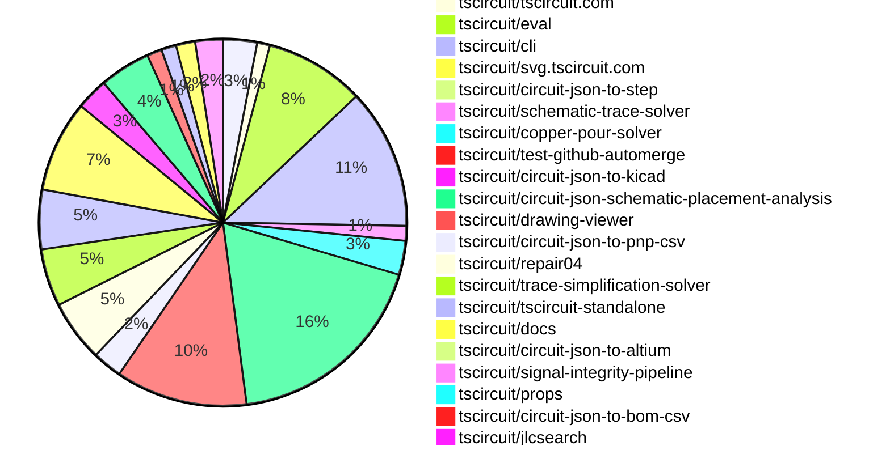

# Contribution Overview 2026-11-03

The current week is shown below. There are 3 major sections:

- [Contributor Overview](#contributor-overview)
- [PRs by Repository](#prs-by-repository)
- [PRs by Contributor](#changes-by-contributor)
- [Scoring & Sponsorship Details](/docs/sponsorship-calculation-explanation.md)

## PRs by Repository

## Contributor Overview

| Contributor | 🐳 Major | 🐙 Minor | 🐌 Tiny | Score | ⭐ |
|-------------|---------|---------|---------|-------|-----|
| [ShiboSoftwareDev](#ShiboSoftwareDev) | 43 | 5 | 35 | 199 | 👑👑👑 |
| [seveibar](#seveibar) | 32 | 12 | 25 | 165 | 👑👑👑 |
| [0hmX](#0hmX) | 6 | 9 | 8 | 51 | ⭐⭐⭐ |
| [imrishabh18](#imrishabh18) | 7 | 3 | 13 | 47 | ⭐⭐ |
| [MustafaMulla29](#MustafaMulla29) | 5 | 6 | 20 | 45 | ⭐⭐ |
| [Abse2001](#Abse2001) | 2 | 7 | 8 | 39 | ⭐⭐ |
| [techmannih](#techmannih) | 5 | 0 | 6 | 26 | ⭐⭐ |
| [AnasSarkiz](#AnasSarkiz) | 5 | 1 | 4 | 26 | ⭐⭐ |
| [rushabhcodes](#rushabhcodes) | 3 | 1 | 6 | 20 | ⭐⭐ |
| [tscircuitbot](#tscircuitbot) | 0 | 0 | 307 | 12 | ⭐⭐ |
| [mohan-bee](#mohan-bee) | 2 | 1 | 2 | 12 | ⭐⭐ |
| [GokulPandi-M](#GokulPandi-M) | 2 | 1 | 0 | 10 | ⭐ |
| [abdalraof-albarbar](#abdalraof-albarbar) | 1 | 1 | 1 | 7 | ⭐ |
| [danielshawellis](#danielshawellis) | 0 | 0 | 1 | 1 |  |

## Staff Pass Ratio (SPR)

| Contributor | Reviewed PRs | Rejections | Approvals | SPR |
|-------------|--------------|------------|-----------|-----|
| [ShiboSoftwareDev](#ShiboSoftwareDev) | 18 | 0 | 18 | 100.0% |
| [Abse2001](#Abse2001) | 7 | 0 | 7 | 100.0% |
| [techmannih](#techmannih) | 5 | 0 | 5 | 100.0% |
| [GokulPandi-M](#GokulPandi-M) | 4 | 1 | 3 | 75.0% |
| [AnasSarkiz](#AnasSarkiz) | 3 | 0 | 3 | 100.0% |
| [imrishabh18](#imrishabh18) | 3 | 0 | 3 | 100.0% |
| [mohan-bee](#mohan-bee) | 3 | 1 | 3 | 66.7% |
| [0hmX](#0hmX) | 2 | 0 | 2 | 100.0% |
| [rushabhcodes](#rushabhcodes) | 2 | 1 | 2 | 50.0% |
| [abdalraof-albarbar](#abdalraof-albarbar) | 1 | 0 | 1 | 100.0% |

ShiboSoftwareDev SPR PRs (18)

- [#308](https://github.com/tscircuit/schematic-viewer/pull/308) Fit schematics to the selected sheet frame
- [#1163](https://github.com/tscircuit/pcb-viewer/pull/1163) Speed up WebGPU copper pours by updating Earcut
- [#1095](https://github.com/tscircuit/3d-viewer/pull/1095) Release the 3D canvas WebGL context on teardown
- [#3555](https://github.com/tscircuit/tscircuit-autorouter/pull/3555) fix: preserve via space beside trapped BGA targets
- [#3564](https://github.com/tscircuit/tscircuit-autorouter/pull/3564) Preserve regional DDR repairs for exact search
- [#3547](https://github.com/tscircuit/tscircuit-autorouter/pull/3547) Repair Pipeline9 DDR routes beside completed copper
- [#3520](https://github.com/tscircuit/tscircuit-autorouter/pull/3520) Preserve fixed native traces throughout Pipeline 9
- [#3480](https://github.com/tscircuit/tscircuit-autorouter/pull/3480) Avoid retaining every temporary topology cell on DDR boards
- [#3471](https://github.com/tscircuit/tscircuit-autorouter/pull/3471) Fix DDR pad drills through the existing repair search
- [#3514](https://github.com/tscircuit/tscircuit-autorouter/pull/3514) Avoid full mesh-edge scans when connecting target regions
- [#308](https://github.com/tscircuit/tiny-hypergraph/pull/308) Preserve fixed native routes during hypergraph rerouting
- [#159](https://github.com/tscircuit/bus-lanes-solver/pull/159) fix: avoid exhaustive surface-site search for untimed A13 buses
- [#147](https://github.com/tscircuit/bus-lanes-solver/pull/147) Route A64’s fourth DDR byte through available pad-edge escape sites
- [#156](https://github.com/tscircuit/bus-lanes-solver/pull/156) Preserve escape gaps beside rotated rectangular pads
- [#136](https://github.com/tscircuit/bus-lanes-solver/pull/136) Fix STMP157 DDR byte routing with valid pad-to-via approaches
- [#104](https://github.com/tscircuit/circuit-json-webgpu/pull/104) Reuse large copper-pour triangulations across PCB presets
- [#102](https://github.com/tscircuit/circuit-json-webgpu/pull/102) Write WebGPU mesh arrays one chunk at a time
- [#101](https://github.com/tscircuit/circuit-json-webgpu/pull/101) perf: build WebGPU meshes in typed array chunks

Abse2001 SPR PRs (7)

- [#955](https://github.com/tscircuit/circuit-json/pull/955) feat: allow panel fabrication notes without fake footprints (core#5067)
- [#974](https://github.com/tscircuit/props/pull/974) fix: require at least three courtyard outline points
- [#5076](https://github.com/tscircuit/core/pull/5076) fix: use the requested tab span and wider mouse-bite webs (#5066)
- [#5071](https://github.com/tscircuit/core/pull/5071) fix: replace rounded panel slivers with continuous routing slots (#5065)
- [#5722](https://github.com/tscircuit/cli/pull/5722) feat: synchronize CLI converter versions from core
- [#5663](https://github.com/tscircuit/cli/pull/5663) fix: update STEP converter and preserve assembly ZIP exports (#5661)
- [#177](https://github.com/tscircuit/circuit-json-to-step/pull/177) fix: export round pill drills without non-finite STEP directions (#176)

techmannih SPR PRs (5)

- [#5182](https://github.com/tscircuit/core/pull/5182) fix: allow ground-plane routing past trace-length preflight
- [#5143](https://github.com/tscircuit/core/pull/5143) Skip redundant autorouting between copper-connected terminals
- [#3496](https://github.com/tscircuit/tscircuit-autorouter/pull/3496) fix: pin repair03 with physical copper contact protection
- [#190](https://github.com/tscircuit/high-density-repair03/pull/190) fix: prevent new trace-to-via shorts during repair
- [#187](https://github.com/tscircuit/high-density-repair03/pull/187) perf: reuse broad-force passes and avoid redundant DRC work

GokulPandi-M SPR PRs (4)

- [#5224](https://github.com/tscircuit/core/pull/5224) Fix false errors when importing split routed traces
- [#5137](https://github.com/tscircuit/core/pull/5137) Reproduce false connectivity errors for split via-to-via traces
- [#5223](https://github.com/tscircuit/core/pull/5223) fix: preserve BGA dogbone fanout when adding a ground pour
- [#5186](https://github.com/tscircuit/core/pull/5186) repro: ground pour prevents BGA dogbone fanout

AnasSarkiz SPR PRs (3)

- [#975](https://github.com/tscircuit/circuit-json/pull/975) Preserve custom KiCad properties in component metadata
- [#987](https://github.com/tscircuit/props/pull/987) Allow custom KiCad metadata property names
- [#5177](https://github.com/tscircuit/core/pull/5177) Fix split physical ports for custom schematic symbols

imrishabh18 SPR PRs (3)

- [#3477](https://github.com/tscircuit/tscircuit-autorouter/pull/3477) perf: reduce Pipeline9 clearance projection cost via repair04
- [#62](https://github.com/tscircuit/repair04/pull/62) perf: prune clearance pairs and simplify via-pad distances
- [#49](https://github.com/tscircuit/tscircuit-standalone/pull/49) refactor: preserve the normal standalone package graph

mohan-bee SPR PRs (3)

- [#290](https://github.com/tscircuit/circuit-json-util/pull/290) move brep copper pours with pcb transforms
- [#3442](https://github.com/tscircuit/tscircuit-autorouter/pull/3442) use upstream power trace expansion batching
- [#68](https://github.com/tscircuit/power-trace-expander/pull/68) batch power trace expansion while preserving work budgets

0hmX SPR PRs (2)

- [#5109](https://github.com/tscircuit/core/pull/5109) fix: warn when fabricatorPreset has no stackup template for the board
- [#5121](https://github.com/tscircuit/core/pull/5121) fix: default board thickness to 1.6mm

rushabhcodes SPR PRs (2)

- [#283](https://github.com/tscircuit/circuit-json-util/pull/283) fix: support position tolerance when matching route vias
- [#3](https://github.com/tscircuit/drawing-viewer/pull/3) Render engineering drawings from Circuit JSON

abdalraof-albarbar SPR PRs (1)

- [#6111](https://github.com/tscircuit/runframe/pull/6111) Fix Pipeline9 solver reconstruction in the Solvers tab

> Note: AI evaluates PRs and assigns 1-3 star ratings automatically. 4 and 5 star ratings require manual staff review.

## Review Table

[reviews-received-hover]: ## "Number of reviews received for PRs for this contributor"
[approvals-received-hover]: ## "Number of approvals received for PRs this contributor authored"
[rejections-received-hover]: ## "Number of rejections received for PRs this contributor authored"
[prs-opened-hover]: ## "Number of PRs opened by this contributor"
[issues-created-hover]: ## "Number of issues created by this contributor"

| Contributor | Reviews Received | Approvals Received | Rejections Received | Approvals | Rejections Given | PRs Opened | PRs Merged | Issues Created |
|---|---|---|---|---|---|---|---|---|
| [0hmX](#0hmX) | 6 | 3 | 0 | 11 | 0 | 40 | 24 | 0 |
| [1932819331hy-debug](#1932819331hy-debug) | 3 | 0 | 0 | 0 | 0 | 23 | 0 | 0 |
| [abdalraof-albarbar](#abdalraof-albarbar) | 3 | 3 | 0 | 0 | 0 | 7 | 3 | 0 |
| [Abse2001](#Abse2001) | 8 | 8 | 0 | 9 | 0 | 45 | 17 | 0 |
| [Albertito-AI](#Albertito-AI) | 0 | 0 | 0 | 0 | 0 | 2 | 0 | 0 |
| [alokudyogi](#alokudyogi) | 0 | 0 | 0 | 0 | 0 | 1 | 0 | 0 |
| [AnasSarkiz](#AnasSarkiz) | 7 | 7 | 0 | 0 | 0 | 16 | 10 | 0 |
| [balckwell](#balckwell) | 0 | 0 | 0 | 0 | 0 | 4 | 0 | 0 |
| [btctony1](#btctony1) | 0 | 0 | 0 | 0 | 0 | 1 | 0 | 0 |
| [cocvn157](#cocvn157) | 0 | 0 | 0 | 0 | 0 | 319 | 0 | 0 |
| [Crodify](#Crodify) | 0 | 0 | 0 | 0 | 0 | 15 | 0 | 0 |
| [CrowAleksito](#CrowAleksito) | 0 | 0 | 0 | 0 | 0 | 1 | 0 | 0 |
| [cyczzhao-lab](#cyczzhao-lab) | 0 | 0 | 0 | 0 | 0 | 13 | 0 | 0 |
| [danielshawellis](#danielshawellis) | 2 | 1 | 0 | 0 | 0 | 2 | 1 | 0 |
| [Devesh36](#Devesh36) | 0 | 0 | 0 | 0 | 0 | 1 | 0 | 0 |
| [DoctorLaplace](#DoctorLaplace) | 0 | 0 | 0 | 0 | 0 | 2 | 0 | 0 |
| [frds3445](#frds3445) | 2 | 0 | 0 | 0 | 0 | 2 | 0 | 0 |
| [GokulPandi-M](#GokulPandi-M) | 6 | 4 | 2 | 0 | 0 | 5 | 3 | 0 |
| [HarsH-1877](#HarsH-1877) | 0 | 0 | 0 | 0 | 0 | 3 | 0 | 0 |
| [imrishabh18](#imrishabh18) | 5 | 5 | 0 | 6 | 1 | 31 | 24 | 0 |
| [jeffrey-graham](#jeffrey-graham) | 0 | 0 | 0 | 0 | 0 | 38 | 0 | 0 |
| [khuxaiphi-stack](#khuxaiphi-stack) | 0 | 0 | 0 | 0 | 0 | 1 | 0 | 0 |
| [KrishnaX12](#KrishnaX12) | 0 | 0 | 0 | 0 | 0 | 3 | 0 | 0 |
| [longdungai](#longdungai) | 3 | 0 | 0 | 0 | 0 | 3 | 0 | 0 |
| [mau16ro](#mau16ro) | 0 | 0 | 0 | 0 | 0 | 1 | 0 | 0 |
| [mohan-bee](#mohan-bee) | 3 | 3 | 0 | 0 | 0 | 7 | 5 | 0 |
| [MustafaMulla29](#MustafaMulla29) | 7 | 4 | 0 | 2 | 0 | 41 | 31 | 0 |
| [nhausmna](#nhausmna) | 0 | 0 | 0 | 0 | 0 | 1 | 0 | 0 |
| [Plugv3](#Plugv3) | 0 | 0 | 0 | 0 | 0 | 5 | 0 | 0 |
| [rafagil11](#rafagil11) | 0 | 0 | 0 | 0 | 0 | 1 | 0 | 0 |
| [ronanchnlps-bit](#ronanchnlps-bit) | 0 | 0 | 0 | 0 | 0 | 3 | 0 | 0 |
| [rushabhcodes](#rushabhcodes) | 22 | 10 | 0 | 0 | 0 | 19 | 10 | 0 |
| [seveibar](#seveibar) | 33 | 1 | 0 | 56 | 1 | 100 | 69 | 0 |
| [ShiboSoftwareDev](#ShiboSoftwareDev) | 34 | 34 | 0 | 5 | 0 | 99 | 83 | 0 |
| [Shokun123](#Shokun123) | 0 | 0 | 0 | 0 | 0 | 5 | 0 | 0 |
| [siddikmallik1999-design](#siddikmallik1999-design) | 0 | 0 | 0 | 0 | 0 | 1 | 0 | 0 |
| [techmannih](#techmannih) | 9 | 6 | 0 | 0 | 0 | 19 | 11 | 0 |
| [tscircuitbot](#tscircuitbot) | 0 | 0 | 0 | 0 | 0 | 428 | 309 | 0 |
| [voropaevv](#voropaevv) | 0 | 0 | 0 | 0 | 0 | 2 | 0 | 0 |
| [zenoutlabs](#zenoutlabs) | 0 | 0 | 0 | 0 | 0 | 2 | 0 | 0 |

## Changes by Repository

### [tscircuit/pcb-viewer](https://github.com/tscircuit/pcb-viewer)

| PR # | Impact | Rating | Contributor | Description |
|------|--------|--------|-------------|-------------|
| [#1163](https://github.com/tscircuit/pcb-viewer/pull/1163) | 🐳 Major | ⭐⭐⭐ | ShiboSoftwareDev | Updates the Earcut library to version 3.2.4 to improve the performance of triangulating copper pours in WebGPU, resulting in faster scene compilation and PCB painting times. |
| [#1153](https://github.com/tscircuit/pcb-viewer/pull/1153) | 🐙 Minor | ⭐⭐ | imrishabh18 | Fixes hover overlay overflow issue when zooming in on PCB pads, ensuring labels and outlines remain within the viewer bounds. |
| [#1191](https://github.com/tscircuit/pcb-viewer/pull/1191) | 🐙 Minor | ⭐⭐ | 0hmX | Fixes the issue of duplicated mm units in anchor offset labels by ensuring that mm is only appended when necessary, improving label clarity in the PCB viewer. |

🐌 Tiny Contributions (13)

| PR # | Impact | Contributor | Description |
|------|--------|-------------|-------------|
| [#1194](https://github.com/tscircuit/pcb-viewer/pull/1194) | 🐌 Tiny | ShiboSoftwareDev | Updates the WebGPU renderer to version 0.0.17, allowing for the reuse of large copper-pour triangulations when switching PCB presets, resulting in improved load times for specific presets. |
| [#1185](https://github.com/tscircuit/pcb-viewer/pull/1185) | 🐌 Tiny | ShiboSoftwareDev | Updates the WebGPU renderer to version 0.0.16, allowing the PCB viewer to write mesh buffers in batches, improving rendering performance. |
| [#1168](https://github.com/tscircuit/pcb-viewer/pull/1168) | 🐌 Tiny | ShiboSoftwareDev | Bump the WebGPU renderer bundled by the PCB viewer to 0.0.15 to pick up typed mesh buffers and lower peak PCB memory use |
| [#1195](https://github.com/tscircuit/pcb-viewer/pull/1195) | 🐌 Tiny | tscircuitbot | Automated package update |
| [#1192](https://github.com/tscircuit/pcb-viewer/pull/1192) | 🐌 Tiny | tscircuitbot | Automated package update |
| [#1186](https://github.com/tscircuit/pcb-viewer/pull/1186) | 🐌 Tiny | tscircuitbot | Automated package update |
| [#1169](https://github.com/tscircuit/pcb-viewer/pull/1169) | 🐌 Tiny | tscircuitbot | Automated package update |
| [#1157](https://github.com/tscircuit/pcb-viewer/pull/1157) | 🐌 Tiny | tscircuitbot | Automated package update |
| [#1182](https://github.com/tscircuit/pcb-viewer/pull/1182) | 🐌 Tiny | tscircuitbot | Automated package update |
| [#1164](https://github.com/tscircuit/pcb-viewer/pull/1164) | 🐌 Tiny | tscircuitbot | Automated package update |
| [#1154](https://github.com/tscircuit/pcb-viewer/pull/1154) | 🐌 Tiny | tscircuitbot | Automated package update |
| [#1156](https://github.com/tscircuit/pcb-viewer/pull/1156) | 🐌 Tiny | techmannih | Fixes unsupported color errors in WebGPU rendering by updating the circuit-json-webgpu package to support named colors and correct PCB note layout. |
| [#1181](https://github.com/tscircuit/pcb-viewer/pull/1181) | 🐌 Tiny | imrishabh18 | Fixes the height mismatch of the component search button in the pcb-viewer when embedded in runframe by setting the SVG display to inline-block to match the surrounding text controls height. |

### [tscircuit/3d-viewer](https://github.com/tscircuit/3d-viewer)

| PR # | Impact | Rating | Contributor | Description |
|------|--------|--------|-------------|-------------|
| [#1121](https://github.com/tscircuit/3d-viewer/pull/1121) | 🐳 Major | ⭐⭐⭐ | ShiboSoftwareDev | Keeps the active GLB on screen while its replacement loads, swapping models on the existing canvas and preserving the camera. |
| [#1095](https://github.com/tscircuit/3d-viewer/pull/1095) | 🐳 Major | ⭐⭐⭐ | ShiboSoftwareDev | Releases the old WebGL context after disposing the renderer, ensuring the old context is lost and the replacement canvas works correctly. |
| [#1094](https://github.com/tscircuit/3d-viewer/pull/1094) | 🐳 Major | ⭐⭐⭐ | ShiboSoftwareDev | Fixes the issue where a detached WebGL canvas retains its context after unmounting, leading to unexpected behavior in rendering. |
| [#1091](https://github.com/tscircuit/3d-viewer/pull/1091) | 🐳 Major | ⭐⭐⭐ | seveibar | Right-clicking an object now offers Isolate name, which hides every other object. Unhide All (renamed from Unhide All Components) restores everything. The PCB board can now be picked, so right-clicking it offers Hide Board  Isolate Board (Panel when a panel is rendered). Before this change the board had no id, so only CAD components could be hidden. Cables (cad_cable) can be picked, hidden and isolated the same way. |
| [#1092](https://github.com/tscircuit/3d-viewer/pull/1092) | 🐳 Major | ⭐⭐⭐ | seveibar | Right-clicking a model and choosing Download GLTF now downloads a GLTF of just that model, named after it (e.g. USBC.gltf). Right-clicking the board or empty space still downloads the whole scene as scene.gltf. |
| [#1093](https://github.com/tscircuit/3d-viewer/pull/1093) | 🐙 Minor | ⭐⭐ | seveibar | Fixes the issue where boards in GLB mode could not be hidden or isolated due to missing identifiers, enabling proper visibility controls for board components. |

### [tscircuit/core](https://github.com/tscircuit/core)

| PR # | Impact | Rating | Contributor | Description |
|------|--------|--------|-------------|-------------|
| [#5240](https://github.com/tscircuit/core/pull/5240) | 🐳 Major | ⭐⭐⭐ | ShiboSoftwareDev | Bumps tscircuitcapacity-autorouter from 0.0.1047 to 0.0.1049 to include the disconnected-graph retry fix |
| [#5122](https://github.com/tscircuit/core/pull/5122) | 🐳 Major | ⭐⭐⭐ | ShiboSoftwareDev | Bumps tscircuitcapacity-autorouter from 0.0.1035 to 0.0.1037, bringing in the DDR mesh-memory fix. |
| [#5182](https://github.com/tscircuit/core/pull/5182) | 🐳 Major | ⭐⭐⭐ | techmannih | Fixes ground-plane routing failure by allowing connections to a declared inner-layer GND pour to pass the trace-length preflight check. |
| [#5143](https://github.com/tscircuit/core/pull/5143) | 🐳 Major | ⭐⭐⭐ | techmannih | Fixes redundant autorouting requests for terminals already connected by a same-net copper pour by incorporating their physical connectivity into the autorouting process. |
| [#5158](https://github.com/tscircuit/core/pull/5158) | 🐳 Major | ⭐⭐⭐ | seveibar | Adds rounded connections for system-block TSX after Dagre layout, with tighter layout spacing and improved self-loop handling. |
| [#5113](https://github.com/tscircuit/core/pull/5113) | 🐳 Major | ⭐⭐⭐ | seveibar | Assembly TSX now emits cad_assembly_bom_item records for materials with or without CAD geometry, using released tscircuitprops0.0.718 from tscircuitprops973. |
| [#5116](https://github.com/tscircuit/core/pull/5116) | 🐳 Major | ⭐⭐⭐ | seveibar | Fixes the positioning of JST plug tips inside board and motor sockets to ensure proper electrical contact, addressing issues with misalignment and contact row offsets. |
| [#5112](https://github.com/tscircuit/core/pull/5112) | 🐳 Major | ⭐⭐⭐ | seveibar | Adds systemblock.page, .group, .component, and .connection to core. TSX now produces resolved system_block_ Circuit JSON: page dimensions, block bounds, nested group membership, connection routes, and label_anchor_center. The render phase also resolves optional PCB componentsubcircuit associations without creating electrical connectivity. Uses dagrejsdagre 2.x for synchronous compound graph layout: one dependency, approximately 44 KB for its minified ESM module, and no DOM requirement. Supports all four page directions, parallel connections, cycles, self-loops, disconnected blocks, and empty groupspages. The existing props APIs kind maps to Circuit JSONs is_signal  is_power booleans. Invalid names, hierarchy, endpoints, and PCB references produce errors using readable names. The TSX fixtures(https:github.comtscircuitcoretreefeatsystem-blockstestsfeaturessystem-blocks) include 12 system SVG snapshots plus a PCB snapshot, rendered with published circuit-to-svg 0.0.455. Examples cover a nested wireless sensor system, four flow directions, motor-control power and feedback, multiple pages, long text, PCB associations, and updates. Usage documentation(https:github.comtscircuitcoreblobfeatsystem-blocksdocssystem-blocks.md). |
| [#5161](https://github.com/tscircuit/core/pull/5161) | 🐳 Major | ⭐⭐⭐ | seveibar | Fixes the issue where saved routing phases expose through vias as obstacles only on specific layers, ensuring proper handling of physical via spans during autorouting. |
| [#5176](https://github.com/tscircuit/core/pull/5176) | 🐳 Major | ⭐⭐⭐ | AnasSarkiz | Fixes the ambiguous source-port reference issue in the ESP32-S3-WROOM-1-N16 import by ensuring all ground pads are correctly mapped to their physical ports. |
| [#5241](https://github.com/tscircuit/core/pull/5241) | 🐳 Major | ⭐⭐⭐ | AnasSarkiz | Preserves KiCad symbol metadata when inserting default schematic boxes, ensuring that metadata is retained for both default and custom symbols. |
| [#5223](https://github.com/tscircuit/core/pull/5223) | 🐳 Major | ⭐⭐⭐ | GokulPandi-M | Fixes autorouting failure when adding an inner-layer ground pour that prevents BGA dogbone fanout from functioning correctly. |
| [#5186](https://github.com/tscircuit/core/pull/5186) | 🐳 Major | ⭐⭐⭐ | GokulPandi-M | Fixes autorouting failure when adding a ground pour that prevents BGA dogbone fanout from routing correctly. |
| [#5251](https://github.com/tscircuit/core/pull/5251) | 🐙 Minor | ⭐⭐ | ShiboSoftwareDev | Fixes HTTP 403 error when posting benchmark results to PR conversation due to insufficient permissions for the reporting job. |
| [#5231](https://github.com/tscircuit/core/pull/5231) | 🐙 Minor | ⭐⭐ | 0hmX | Fixes unsupported-component error when importing Circuit JSON with simple_fuse and corrects schema mismatches in PCBschematic output. |
| [#5109](https://github.com/tscircuit/core/pull/5109) | 🐙 Minor | ⭐⭐ | 0hmX | Adds a warning when a fabricatorPreset is set but no matching stackup template exists for the specified board parameters, improving user feedback on stackup issues. |
| [#5155](https://github.com/tscircuit/core/pull/5155) | 🐙 Minor | ⭐⭐ | 0hmX | Allows simulation declarations to reference pins in nested subcircuits, enabling board-level simulations without requiring all components to be in the same subcircuit. |
| [#5121](https://github.com/tscircuit/core/pull/5121) | 🐙 Minor | ⭐⭐ | 0hmX | Changes the default board thickness from 1.4mm to 1.6mm to align with JLCPCB standards, ensuring proper stackup generation for 2- and 4-layer boards. |
| [#5157](https://github.com/tscircuit/core/pull/5157) | 🐙 Minor | ⭐⭐ | 0hmX | Fixes issue with schPortArrangement by ensuring side pins are stored as pin numbers instead of labels, resolving compatibility with circuit-json requirements. |
| [#5162](https://github.com/tscircuit/core/pull/5162) | 🐙 Minor | ⭐⭐ | seveibar | Fixes the issue where multi-port power paths incorrectly inherit a capacitors local decoupling limit, preventing autorouting on longer paths. |
| [#5177](https://github.com/tscircuit/core/pull/5177) | 🐙 Minor | ⭐⭐ | AnasSarkiz | Fixes the issue where custom schematic symbols prevented the split-pad inference from creating and connecting separate physical source ports for repeated footprint pin hints. |
| [#5076](https://github.com/tscircuit/core/pull/5076) | 🐙 Minor | ⭐⭐ | Abse2001 | Fixes mouse-bite rows to fill the requested tab span and maintain appropriate material clearance between adjacent holes. |
| [#5071](https://github.com/tscircuit/core/pull/5071) | 🐙 Minor | ⭐⭐ | Abse2001 | Fixes routing of rounded panel corners to use continuous polygon slots instead of invalid rounded rectangles, ensuring valid geometry and improved routing for curved boards. |
| [#5069](https://github.com/tscircuit/core/pull/5069) | 🐙 Minor | ⭐⭐ | Abse2001 | Reproduces a bug where a 22 panel of 1418 mm boards with 2 mm rounded corners creates 1,024 invalid sliver rectangles, producing a comb of tiny routing slots. |
| [#5137](https://github.com/tscircuit/core/pull/5137) | 🐙 Minor | ⭐⭐ | GokulPandi-M | Reproduces false connectivity errors when split via-to-via traces are imported, demonstrating the loss of connection identity in the autorouting process. |

🐌 Tiny Contributions (22)

| PR # | Impact | Contributor | Description |
|------|--------|-------------|-------------|
| [#5273](https://github.com/tscircuit/core/pull/5273) | 🐌 Tiny | ShiboSoftwareDev | Bump tscircuitcapacity-autorouter to 0.0.1059 to include the BGA via-space fix from https:github.comtscircuittscircuit-autorouterpull3555. |
| [#5272](https://github.com/tscircuit/core/pull/5272) | 🐌 Tiny | ShiboSoftwareDev | Updates the tscircuitcapacity-autorouter dependency from version 0.0.1054 to 0.0.1058, including improvements related to regional DDR repair as noted in tscircuittscircuit-autorouter3564, and updates the affected PCB snapshots accordingly. |
| [#5252](https://github.com/tscircuit/core/pull/5252) | 🐌 Tiny | ShiboSoftwareDev | Bumps the tscircuitbus-lanes-solver package from version 0.0.47 to 0.0.48 to include the H616 second-byte BGA escape fix. |
| [#5248](https://github.com/tscircuit/core/pull/5248) | 🐌 Tiny | ShiboSoftwareDev | Add a full TSXCore DDR benchmark for H3, A64, STMP157, OrangeCrab, A13, H616, ButterStick, Glider, i.MX6 and iCEPi. |
| [#5246](https://github.com/tscircuit/core/pull/5246) | 🐌 Tiny | ShiboSoftwareDev | Bump tscircuitbus-lanes-solver from 0.0.46 to 0.0.47 to include the A13 routing search optimization |
| [#5153](https://github.com/tscircuit/core/pull/5153) | 🐌 Tiny | ShiboSoftwareDev | Pins tscircuitbus-lanes-solver to 0.0.43 to include the A64 DDR escape-site fix from the related pull request. |
| [#5120](https://github.com/tscircuit/core/pull/5120) | 🐌 Tiny | ShiboSoftwareDev | Bump cores tscircuitbus-lanes-solver pin from 0.0.40 to 0.0.41 to include the STMP157 DDR pad-to-via approach fix |
| [#5243](https://github.com/tscircuit/core/pull/5243) | 🐌 Tiny | ShiboSoftwareDev | Updates the autorouter and bus-lanes-solver dependencies to their latest versions, addressing the A13 rotated-pad fix in the bus-lanes-solver. |
| [#5235](https://github.com/tscircuit/core/pull/5235) | 🐌 Tiny | ShiboSoftwareDev | Bump tscircuitcapacity-autorouter from 0.0.1044 to 0.0.1047 to include the Glider DDR fixed-copper clearance fix |
| [#5189](https://github.com/tscircuit/core/pull/5189) | 🐌 Tiny | ShiboSoftwareDev | Bump tscircuitcapacity-autorouter from 0.0.1043 to 0.0.1044 to pick up the DDR mesh-edge lookup optimization |
| [#5187](https://github.com/tscircuit/core/pull/5187) | 🐌 Tiny | ShiboSoftwareDev | Bumps tscircuitcapacity-autorouter from 0.0.1041 to 0.0.1043 to include the Glider DDR via-contact fix |
| [#5168](https://github.com/tscircuit/core/pull/5168) | 🐌 Tiny | ShiboSoftwareDev | Updates the tscircuitcapacity-autorouter and tscircuitbus-lanes-solver dependencies to their latest versions to incorporate recent routing fixes and refreshes the PCB snapshot for improved alignment of via placement and inner-layer lanes. |
| [#5146](https://github.com/tscircuit/core/pull/5146) | 🐌 Tiny | ShiboSoftwareDev | Pins tscircuitbus-lanes-solver to version 0.0.42 to include the DDR escape-site fix from a previous pull request. |
| [#5110](https://github.com/tscircuit/core/pull/5110) | 🐌 Tiny | ShiboSoftwareDev | Bumps the version of tscircuitcapacity-autorouter to 0.0.1035 to include DDR pad-drill fix and copper-pourplated-hole corrections. |
| [#5129](https://github.com/tscircuit/core/pull/5129) | 🐌 Tiny | ShiboSoftwareDev | Bumps the tscircuitcapacity-autorouter dependency to version 0.0.1038, addressing the circular-pad DDR routing fix and tightening clearance limits for A13. |
| [#5179](https://github.com/tscircuit/core/pull/5179) | 🐌 Tiny | techmannih | Reproduces a bug where a declared GND pour is not considered during trace-length preflight checks, preventing autorouting. |
| [#5142](https://github.com/tscircuit/core/pull/5142) | 🐌 Tiny | techmannih | Reproduces a bug where the autorouter requests redundant routes between terminals that are already connected by a continuous copper pour, including comprehensive tests and snapshots to validate the behavior. |
| [#5106](https://github.com/tscircuit/core/pull/5106) | 🐌 Tiny | 0hmX | Reproduces the issue where the jlcpcb_standard preset with default board thickness of 1.4mm results in no pcb_stackup being emitted, highlighting the lack of user feedback regarding this behavior. |
| [#5253](https://github.com/tscircuit/core/pull/5253) | 🐌 Tiny | seveibar | Bump Cores tscircuitcapacity-autorouter development dependency from 0.0.1051 to 0.0.1054. |
| [#5188](https://github.com/tscircuit/core/pull/5188) | 🐌 Tiny | Abse2001 | Add 12 missing converter packages to devDependencies in package.json for version tracking. |
| [#5073](https://github.com/tscircuit/core/pull/5073) | 🐌 Tiny | Abse2001 | Reproduces a bug where a requested 3 mm tab results in undersized mouse-bite holes, leading to insufficient web clearance. |
| [#5104](https://github.com/tscircuit/core/pull/5104) | 🐌 Tiny | danielshawellis | Fixes the issue where a redundant ground trace is drawn between pads A and B, which are already connected by a copper pour, while only the connection from the pour to pad C should be routed. |

### [tscircuit/tscircuit-autorouter](https://github.com/tscircuit/tscircuit-autorouter)

| PR # | Impact | Rating | Contributor | Description |
|------|--------|--------|-------------|-------------|
| [#3555](https://github.com/tscircuit/tscircuit-autorouter/pull/3555) | 🐳 Major | ⭐⭐⭐ | ShiboSoftwareDev | Fixes autorouting failure by preserving via space beside trapped BGA targets, ensuring connectivity for all signals in the routing process. |
| [#3564](https://github.com/tscircuit/tscircuit-autorouter/pull/3564) | 🐳 Major | ⭐⭐⭐ | ShiboSoftwareDev | Preserve accepted regional work as a private input to Pipeline9s existing exact repair, optimizing the repair process and maintaining data integrity. |
| [#3474](https://github.com/tscircuit/tscircuit-autorouter/pull/3474) | 🐳 Major | ⭐⭐⭐ | ShiboSoftwareDev | Fixes routing issues where copper pours cause overlapping escape vias and plated-hole transitions move outside their pads. |
| [#3547](https://github.com/tscircuit/tscircuit-autorouter/pull/3547) | 🐳 Major | ⭐⭐⭐ | ShiboSoftwareDev | Fixes autorouting failure by repairing DDR routes adjacent to completed copper in Pipeline9, resulting in zero DRC findings and preserving existing copper integrity. |
| [#3519](https://github.com/tscircuit/tscircuit-autorouter/pull/3519) | 🐳 Major | ⭐⭐⭐ | ShiboSoftwareDev | Reproduces the native DDR copper trace policy and mesh expansion for the STM32MP157, ensuring that completed DDR traces are retained as native traces during routing. |
| [#3504](https://github.com/tscircuit/tscircuit-autorouter/pull/3504) | 🐳 Major | ⭐⭐⭐ | ShiboSoftwareDev | Preserves Glider DDR ADDR6s contact when force improvement moves its escape via and enables fixed topology-port anchors in Pipeline 9 and worker requests. |
| [#3503](https://github.com/tscircuit/tscircuit-autorouter/pull/3503) | 🐳 Major | ⭐⭐⭐ | ShiboSoftwareDev | Reduces validation time for DDR topology by using the Flatbush index to check nearby regions instead of all pairs, improving performance significantly. |
| [#3492](https://github.com/tscircuit/tscircuit-autorouter/pull/3492) | 🐳 Major | ⭐⭐⭐ | ShiboSoftwareDev | Fixes autorouting failure for DQS0NP signals due to loss of net ownership in H3 DDR3 circuit routing. |
| [#3520](https://github.com/tscircuit/tscircuit-autorouter/pull/3520) | 🐳 Major | ⭐⭐⭐ | ShiboSoftwareDev | Keeps completed bus and manual routes native, with optional isFixed policy carried through hypergraph assignments and detailed routing, ensuring fixed copper survives reripping, repair, simplification and power cleanup. |
| [#3480](https://github.com/tscircuit/tscircuit-autorouter/pull/3480) | 🐳 Major | ⭐⭐⭐ | ShiboSoftwareDev | Reduces memory usage by preventing the retention of excessive temporary topology cells during DDR board processing, allowing for successful completion of mesh slices without memory exhaustion. |
| [#3479](https://github.com/tscircuit/tscircuit-autorouter/pull/3479) | 🐳 Major | ⭐⭐⭐ | ShiboSoftwareDev | Fixes memory retention issue in STMP157 DDR board routing by limiting retained cells during topology merging. |
| [#3471](https://github.com/tscircuit/tscircuit-autorouter/pull/3471) | 🐳 Major | ⭐⭐⭐ | ShiboSoftwareDev | Fixes the issue where repair skipped connected pads entirely, making forbidden drill overlaps invisible to its search. |
| [#3546](https://github.com/tscircuit/tscircuit-autorouter/pull/3546) | 🐳 Major | ⭐⭐⭐ | ShiboSoftwareDev | Fixes the issue where the completed STM32MP157 mesh retains temporary cells after validating its output, ensuring that the mesh is cleaned up properly before final output. |
| [#3516](https://github.com/tscircuit/tscircuit-autorouter/pull/3516) | 🐳 Major | ⭐⭐⭐ | ShiboSoftwareDev | Fixes copper clearance issues in the Pipeline9 joint repair, resolving DRC errors from 1 to 0 for the Gliders LDQSN. |
| [#3513](https://github.com/tscircuit/tscircuit-autorouter/pull/3513) | 🐳 Major | ⭐⭐⭐ | ShiboSoftwareDev | Replays the real A64 and STM32MP157 remaining-routing inputs through Pipeline9 edge construction, targeting handling that scans the complete edge array to check connectivity between regions. |
| [#3493](https://github.com/tscircuit/tscircuit-autorouter/pull/3493) | 🐳 Major | ⭐⭐⭐ | ShiboSoftwareDev | Restores conductive contacts for disconnected terminal pairs in DDR routing, resolving stalls in H3s DQS0 routing. |
| [#3487](https://github.com/tscircuit/tscircuit-autorouter/pull/3487) | 🐳 Major | ⭐⭐⭐ | ShiboSoftwareDev | Fixes routing errors by treating round BGA pads as squares in DRC evaluation and repulsion, ensuring zero physical DRC findings and maintaining all connected nets. |
| [#3473](https://github.com/tscircuit/tscircuit-autorouter/pull/3473) | 🐳 Major | ⭐⭐⭐ | ShiboSoftwareDev | Fixes the handling of copper pours as component pads and preserves existing plated-hole transitions as new vias, preventing extra escape vias from being created during routing. |
| [#3531](https://github.com/tscircuit/tscircuit-autorouter/pull/3531) | 🐳 Major | ⭐⭐⭐ | ShiboSoftwareDev | Stops retrying disconnected DDR planner graphs after proving no legal path exists, reducing iterations significantly and improving routing efficiency. |
| [#3529](https://github.com/tscircuit/tscircuit-autorouter/pull/3529) | 🐳 Major | ⭐⭐⭐ | ShiboSoftwareDev | Adjusts the boards clearance for fixed native copper from 0.150 mm to 0.089 mm, affecting the routing of 15 accepted route pieces. |
| [#3524](https://github.com/tscircuit/tscircuit-autorouter/pull/3524) | 🐳 Major | ⭐⭐⭐ | ShiboSoftwareDev | Adds a test to reproduce the issue of the H3 DDR planner exhausting iterations on disconnected signals, along with captured board input and SVG output for analysis. |
| [#3514](https://github.com/tscircuit/tscircuit-autorouter/pull/3514) | 🐳 Major | ⭐⭐⭐ | ShiboSoftwareDev | Reduces the time taken to connect target regions by reusing the node-edge map to check only incident edges instead of scanning all mesh edges. |
| [#3548](https://github.com/tscircuit/tscircuit-autorouter/pull/3548) | 🐳 Major | ⭐⭐⭐ | ShiboSoftwareDev | Releases scratch memory after a large topology completes and validates its output, reducing retained JS heap significantly. |
| [#3496](https://github.com/tscircuit/tscircuit-autorouter/pull/3496) | 🐳 Major | ⭐⭐⭐ | techmannih | Fixes pin repair03 to prevent new physical trace-to-via shorts while preserving exact via anchors and existing repair search budgets. |
| [#3541](https://github.com/tscircuit/tscircuit-autorouter/pull/3541) | 🐳 Major | ⭐⭐⭐ | imrishabh18 | Speeds up index updates during route replacement in the trace simplification process. |
| [#3477](https://github.com/tscircuit/tscircuit-autorouter/pull/3477) | 🐳 Major | ⭐⭐⭐ | imrishabh18 | Reduces the clearance projection cost in Pipeline9 by optimizing the underlying calculations in repair04, resulting in significant performance improvements without altering the existing DRC utilities. |
| [#3572](https://github.com/tscircuit/tscircuit-autorouter/pull/3572) | 🐳 Major | ⭐⭐⭐ | seveibar | Fixes RVboys native reroute issue where the entering-layer endpoint of a via is lost during path simplification, causing disconnected transitions and errors in crossing-via reduction. |
| [#3568](https://github.com/tscircuit/tscircuit-autorouter/pull/3568) | 🐳 Major | ⭐⭐⭐ | seveibar | RVboys native reroute exposed two routing-input errors after 3565 fixed the cleanup crash. A ground escape via ending logically at inner1 was reserved only on topinner1 despite through-hole manufacturing, allowing a bottom-layer signal to cross its pad. Reserving its full physical span then exposed a ground-pad escape incorrectly discarded because a two-step search found free space inside a closed pocket. Reserve and place through-hole escape vias against all copper layers. Explicit blindburied-via support retains the limited span. Check numerical bridges and cramped exits against actual point-pair destinations, including generated escape vias. Preserve explicitly selected terminal bridges through the later filter; keep the component planners exits and older pipelines filtering unchanged. Add the exact full native RVboy input, cropped visual regressions, and focused tests for opposite-side pad clearance, blind-via behavior, and closed-pocket connectivity. |
| [#3565](https://github.com/tscircuit/tscircuit-autorouter/pull/3565) | 🐳 Major | ⭐⭐⭐ | seveibar | Fixes native routing crash during trace simplification by preserving plated-hole boundary precision and ensuring proper cleanup of routes. |
| [#3558](https://github.com/tscircuit/tscircuit-autorouter/pull/3558) | 🐳 Major | ⭐⭐⭐ | seveibar | Fixes autorouting failure by restoring necessary terminal escapes across numerical mesh gaps in RVboys LCD pad regions, ensuring traversable port points are generated correctly. |
| [#3557](https://github.com/tscircuit/tscircuit-autorouter/pull/3557) | 🐳 Major | ⭐⭐⭐ | seveibar | RVboys native Pipeline9 search fails because accepted capacity edges at the LCD pads have no port points. This repro preserves the exact saved phase input byte-for-byte: 197 connections, 1,066 obstacles and 28 previous traces. SHA-256: 51be0b31f378d8feb9577d351f8e8aa8164624012e31fb968e2346ad3f0c15d9. The test runs the entire input through native port-point generation, snapshots fixed viewboxes around LCD pins 30 and 43, then reproduces the native No path failure. Only the drawing is cropped. The fixture also exposes the same close-ups and the full interactive pipeline debugger. Red lines are capacity edges with missing ports; green dots are actual top-layer port points. They depict topology, not copper. Fix PR 3558 is stacked on this repro and uses the same snapshots, input and camera. Its image diff shows the restored pad escapes: LCD pin 30 changes from 02 to 22 usable side edges, and pin 43 from 01 to 11. Validation: repro test passes (13 assertions); tsc --noEmit passes with an 8 GB Node heap. Both rendered snapshots inspected. |
| [#3442](https://github.com/tscircuit/tscircuit-autorouter/pull/3442) | 🐳 Major | ⭐⭐⭐ | mohan-bee | Reduces routing time for power trace expansion from 20s to 1.5s by utilizing upstream batching in the powerTraceExpansionSolver. |

🐌 Tiny Contributions (34)

| PR # | Impact | Contributor | Description |
|------|--------|-------------|-------------|
| [#3554](https://github.com/tscircuit/tscircuit-autorouter/pull/3554) | 🐌 Tiny | ShiboSoftwareDev | The real H3 DDR3 circuit routes its two data bytes, then fails to find a path for DQS1. Core buffers the phases, leaving 017 accepted signals. Adds the native TSX board, captured routing inputs and generated SVGs. The same repro runs unchanged on the stacked fix, 3555.  Board  request  Initial result  goal  Latest verified progress   ---  ---  ---   H3: 16 DQ  DQS1  017 accepted; goal 1717  Both DQ phases route, then DQS1 fails path planning |
| [#3532](https://github.com/tscircuit/tscircuit-autorouter/pull/3532) | 🐌 Tiny | ShiboSoftwareDev | Reproduces the native circuit snapshot for OrangeCrabs detailed-routing clearance, addressing clearance issues and ensuring accurate representation of the routing phase. |
| [#3486](https://github.com/tscircuit/tscircuit-autorouter/pull/3486) | 🐌 Tiny | ShiboSoftwareDev | Reproduces the issue of through-via shorts in the OrangeCrab DDR routing, capturing the core input and generating the board SVG while retaining the no-short assertion for a stacked fix. |
| [#3543](https://github.com/tscircuit/tscircuit-autorouter/pull/3543) | 🐌 Tiny | ShiboSoftwareDev | Reproduces the i.MX6 DDR board with completed data-byte copper for a stacked fix. |
| [#3517](https://github.com/tscircuit/tscircuit-autorouter/pull/3517) | 🐌 Tiny | ShiboSoftwareDev | Reproduces Gliders LDQSN through-via touching the completed DATA4 trace on the bottom layer, including a board snapshot with 49 nets and 1 DRC error. |
| [#3502](https://github.com/tscircuit/tscircuit-autorouter/pull/3502) | 🐌 Tiny | ShiboSoftwareDev | Captures the real A64 and STM32MP157 remaining-routing inputs after 32 DQ signals complete through TSXcore. The runner reproduces slow topology validation and reports the completed mesh hash. |
| [#3579](https://github.com/tscircuit/tscircuit-autorouter/pull/3579) | 🐌 Tiny | tscircuitbot | Automated package update |
| [#3578](https://github.com/tscircuit/tscircuit-autorouter/pull/3578) | 🐌 Tiny | tscircuitbot | Automated package update |
| [#3573](https://github.com/tscircuit/tscircuit-autorouter/pull/3573) | 🐌 Tiny | tscircuitbot | Automated package update |
| [#3570](https://github.com/tscircuit/tscircuit-autorouter/pull/3570) | 🐌 Tiny | tscircuitbot | Automated package update |
| [#3567](https://github.com/tscircuit/tscircuit-autorouter/pull/3567) | 🐌 Tiny | tscircuitbot | Automated package update |
| [#3563](https://github.com/tscircuit/tscircuit-autorouter/pull/3563) | 🐌 Tiny | tscircuitbot | Automated package update |
| [#3562](https://github.com/tscircuit/tscircuit-autorouter/pull/3562) | 🐌 Tiny | tscircuitbot | Automated package update |
| [#3556](https://github.com/tscircuit/tscircuit-autorouter/pull/3556) | 🐌 Tiny | tscircuitbot | Automated package update |
| [#3495](https://github.com/tscircuit/tscircuit-autorouter/pull/3495) | 🐌 Tiny | tscircuitbot | Automated package update |
| [#3552](https://github.com/tscircuit/tscircuit-autorouter/pull/3552) | 🐌 Tiny | tscircuitbot | Automated package update |
| [#3526](https://github.com/tscircuit/tscircuit-autorouter/pull/3526) | 🐌 Tiny | tscircuitbot | Automated package update |
| [#3506](https://github.com/tscircuit/tscircuit-autorouter/pull/3506) | 🐌 Tiny | tscircuitbot | Automated package update |
| [#3499](https://github.com/tscircuit/tscircuit-autorouter/pull/3499) | 🐌 Tiny | tscircuitbot | Automated package update |
| [#3491](https://github.com/tscircuit/tscircuit-autorouter/pull/3491) | 🐌 Tiny | tscircuitbot | Automated package update |
| [#3550](https://github.com/tscircuit/tscircuit-autorouter/pull/3550) | 🐌 Tiny | tscircuitbot | Automated package update |
| [#3542](https://github.com/tscircuit/tscircuit-autorouter/pull/3542) | 🐌 Tiny | tscircuitbot | Automated package update |
| [#3530](https://github.com/tscircuit/tscircuit-autorouter/pull/3530) | 🐌 Tiny | tscircuitbot | Automated package update |
| [#3518](https://github.com/tscircuit/tscircuit-autorouter/pull/3518) | 🐌 Tiny | tscircuitbot | Automated package update |
| [#3489](https://github.com/tscircuit/tscircuit-autorouter/pull/3489) | 🐌 Tiny | tscircuitbot | Automated package update |
| [#3484](https://github.com/tscircuit/tscircuit-autorouter/pull/3484) | 🐌 Tiny | tscircuitbot | Automated package update |
| [#3476](https://github.com/tscircuit/tscircuit-autorouter/pull/3476) | 🐌 Tiny | tscircuitbot | Automated package update |
| [#3472](https://github.com/tscircuit/tscircuit-autorouter/pull/3472) | 🐌 Tiny | tscircuitbot | Automated package update |
| [#3510](https://github.com/tscircuit/tscircuit-autorouter/pull/3510) | 🐌 Tiny | tscircuitbot | Automated package update |
| [#3545](https://github.com/tscircuit/tscircuit-autorouter/pull/3545) | 🐌 Tiny | tscircuitbot | Automated package update |
| [#3535](https://github.com/tscircuit/tscircuit-autorouter/pull/3535) | 🐌 Tiny | tscircuitbot | Automated package update |
| [#3482](https://github.com/tscircuit/tscircuit-autorouter/pull/3482) | 🐌 Tiny | tscircuitbot | Automated package update |
| [#3368](https://github.com/tscircuit/tscircuit-autorouter/pull/3368) | 🐌 Tiny | techmannih | Pins the repair03 broad-force performance fix to a specific commit to avoid repeated native DRC evaluations and common broad-force passes, while preserving existing geometries and including regression tests. |
| [#3441](https://github.com/tscircuit/tscircuit-autorouter/pull/3441) | 🐌 Tiny | mohan-bee | Motivation Reproduce slow uncached power-trace expansion on the four-gang WiFi controller(https:tscircuit.commohan-beefour-gang-wifi-switch-layoutblobcontroller.circuit.tsx).  Before The captured JOINT_LV workload takes 2,997,249 power-expansion wrapper steps. Matching the board runners 256 steps per yield produces 12,208 timer yields: two local runs on an Apple M5 took 23.123.7 seconds overall, with 20.321.0 seconds in power expansion. This is the low-voltage phase from published v0.0.9, replayed through native Pipeline9 at 0.0.1029. The five earlier mains traces are preloaded; those phases are not rerun.  After Add the exact solver-ready SRJ, uncropped 48  50 mm board context, a cache-disabled native debugger fixture, and a snapshot test. The test preserves the published adapters physical via policy; the full controller snapshot includes 37 new low-voltage traces, five mains traces, all 71 original obstacles, and 0 measured relaxed DRC errors. Snapshot verification passes with 13 assertions; type checking and the package build pass. This is a reproduction PR, with the batching fix kept separate. !Full controller board including preloaded mains routes(https:raw.githubusercontent.comtscircuittscircuit-autorouterceb0bbe039037d0aaa35ec959f55bc71c06d4607testsbugs__snapshots__controller-power-expansion.snap.svg) |

### [tscircuit/tiny-hypergraph](https://github.com/tscircuit/tiny-hypergraph)

| PR # | Impact | Rating | Contributor | Description |
|------|--------|--------|-------------|-------------|
| [#308](https://github.com/tscircuit/tiny-hypergraph/pull/308) | 🐳 Major | ⭐⭐⭐ | ShiboSoftwareDev | Preserves fixed native routes during hypergraph rerouting by retaining their initial assignments and excluding them from rip sets, while allowing same-net reuse of their occupied ports. |

### [tscircuit/high-density-repair01](https://github.com/tscircuit/high-density-repair01)

| PR # | Impact | Rating | Contributor | Description |
|------|--------|--------|-------------|-------------|
| [#44](https://github.com/tscircuit/high-density-repair01/pull/44) | 🐳 Major | ⭐⭐⭐ | ShiboSoftwareDev | Add opt-in anchors for endpoint vias to prevent copper disconnection in neighboring nodes during force improvement. |
| [#49](https://github.com/tscircuit/high-density-repair01/pull/49) | 🐳 Major | ⭐⭐⭐ | seveibar | Fixes clearance regression in autorouter by preserving coordinates of through-obstacle anchors while maintaining existing grid quantization for ordinary routing anchors. |
| [#48](https://github.com/tscircuit/high-density-repair01/pull/48) | 🐳 Major | ⭐⭐⭐ | seveibar | Fixes routing failure by preserving fixed-point precision at plated-hole boundaries, preventing unintended layer transitions. |
| [#43](https://github.com/tscircuit/high-density-repair01/pull/43) | 🐙 Minor | ⭐⭐ | ShiboSoftwareDev | Fixes Glider DDR escape via placement issue by adjusting its position to separate it from neighboring topology fragments. |

### [tscircuit/high-density-repair03](https://github.com/tscircuit/high-density-repair03)

| PR # | Impact | Rating | Contributor | Description |
|------|--------|--------|-------------|-------------|
| [#199](https://github.com/tscircuit/high-density-repair03/pull/199) | 🐳 Major | ⭐⭐⭐ | ShiboSoftwareDev | Fixes DRC evaluation and repulsion for circular SMT pads by treating them correctly as circles instead of rectangles, leading to a reduction in DRC findings. |
| [#198](https://github.com/tscircuit/high-density-repair03/pull/198) | 🐳 Major | ⭐⭐⭐ | ShiboSoftwareDev | Fixes the issue where existing plated-hole transitions were converted into new vias, ensuring that these transitions are preserved during the repair DRC process. |
| [#196](https://github.com/tscircuit/high-density-repair03/pull/196) | 🐳 Major | ⭐⭐⭐ | ShiboSoftwareDev | Fixes the issue where repair skips connected pads and trades away cleared drills while improving copper clearance when an SRJ disallows vias in pads. |
| [#190](https://github.com/tscircuit/high-density-repair03/pull/190) | 🐳 Major | ⭐⭐⭐ | techmannih | Repair could reduce reported DRC errors while creating a physical trace-to-via short because publication checks omitted via annuli. Check via copper across its physical drill layers, include via-to-via contacts, and invalidate prepared geometry when via diameter changes. Contact identities distinguish wire crossings from annulus contacts; same-net copper remains allowed. Preserve exact via anchors and circular pad geometry. The deferred final owner prioritizes wire crossings, tries local wire displacements and coupled moves of up to two via stacks, and validates each candidate against the whole board. It can restore affected connections while retaining independent repairs, within the existing search budgets. The portfolios early-exit heuristic remains wire-only; publication checks all copper. Reduce work and allocations in this path: prune board edges with conservative coordinate bounds, use numeric spatial-grid columns and allocate contact keys only after overlap. Native contact repair first rejects proven pad overlaps on changed or already-overlapping connections. Geometry is built only for selected owners while preserving global via ownership and numbering. Surviving proposals receive complete DRC and rejected proposals consume the original budget. Retain a bounded prefix of exact primitive geometry from the last full DRC evaluation to avoid serializing unchanged inputs. Compare coordinates, ownership, ports, widths, via dimensions and layers explicitly, including in-place mutations. Geometry shares the existing cache accounting budget with primitive keys. Engine-owned query errors are copied once at the public-result boundary, preserving caller mutation isolation. At 8ec1f3acf1c5f2b228e6f6d8c8972d4ee2045962, official standalone SRJ18(https:github.comtscircuithigh-density-repair03actionsruns42032055563) is 2.84 total time, DRC 1,079  1,078; DRC14(https:github.comtscircuithigh-density-repair03actionsruns42032060529) is -11.83, DRC 5  5. Both compare stacked base 892ddb1 on one Ubuntu runner, two basePR pairs in opposite orders, concurrency 2, Bun 1.4.4 x64. No per-case DRC increases. A separate fixed Blacksmith comparison(https:github.comtscircuittscircuit-autorouteractionsruns42031516576), using Bun 1.4.2 arm64 and copied dependencies, measures SRJ18 1.30  -1.54 and DRC14 -11.49  -12.18 against the same stacked base. Against the previous published repair 6ec16dc, isolated cases 6 and 13 are 10.2113.35 and 7.4810.44 faster with identical output hashes. Case 13 memory is mixed. Full-pipeline measurements, including all slower repeats and identical-main memory controls, are in the consumer PR(https:github.comtscircuittscircuit-autorouterpull3496). All 186 repair tests pass (50,526 assertions) and both TypeScript projects pass. Tests cover 3,606 exhaustive board-distance pairs, 3,200 spatial-order oracle cases, obstacle-filter parity, duplicate-via ownership, mutation isolation, cache eviction and bounded geometry reuse. Consumer integration passes six tests  637 assertions and typecheck. Hosted CI is green; the branch is conflict-free. Stacked on 189; merge 189 first. The six-route output gap becomes 0.05572 mm instead of -0.06523 mm; the real Game Boy replay retains 0.08638 mm clearance instead of publishing -0.00107 mm overlap. |
| [#187](https://github.com/tscircuit/high-density-repair03/pull/187) | 🐳 Major | ⭐⭐⭐ | techmannih | Reduces redundant DRC evaluations by reusing broad-force passes and optimizing candidate evaluations in the autorouting process. |

🐌 Tiny Contributions (2)

| PR # | Impact | Contributor | Description |
|------|--------|-------------|-------------|
| [#189](https://github.com/tscircuit/high-density-repair03/pull/189) | 🐌 Tiny | techmannih | Reproduces a repair scenario that introduces a trace-to-via short in a Game Boy circuit, validating DRC errors and providing visual snapshots of the output. |
| [#186](https://github.com/tscircuit/high-density-repair03/pull/186) | 🐌 Tiny | techmannih | Adds a regression test to reproduce duplicate native DRC evaluations across different force scales without changing production code. |

### [tscircuit/bus-lanes-solver](https://github.com/tscircuit/bus-lanes-solver)

| PR # | Impact | Rating | Contributor | Description |
|------|--------|--------|-------------|-------------|
| [#162](https://github.com/tscircuit/bus-lanes-solver/pull/162) | 🐳 Major | ⭐⭐⭐ | ShiboSoftwareDev | Fixes routing issues for the H616 second DDR byte by utilizing a legal BGA escape that was previously missed, ensuring all signals are accepted and DRC clean. |
| [#159](https://github.com/tscircuit/bus-lanes-solver/pull/159) | 🐳 Major | ⭐⭐⭐ | ShiboSoftwareDev | Avoids exhaustive surface-site search for untimed A13 buses by attempting ordinary lane routing first, retaining surface-site search on the first retry for timing-constrained buses. |
| [#147](https://github.com/tscircuit/bus-lanes-solver/pull/147) | 🐳 Major | ⭐⭐⭐ | ShiboSoftwareDev | Adds drill-clear positions beside round pads and broadens blocked site domains for A64s fourth data byte routing, enabling connection of all data lines with zero physical findings. |
| [#141](https://github.com/tscircuit/bus-lanes-solver/pull/141) | 🐳 Major | ⭐⭐⭐ | ShiboSoftwareDev | Preserves successful allocations while allowing negotiation of generated signal sites when routing fails due to blocked DDR copper. |
| [#136](https://github.com/tscircuit/bus-lanes-solver/pull/136) | 🐳 Major | ⭐⭐⭐ | ShiboSoftwareDev | Fixes routing issues for STMP157 DDR byte connections by implementing valid pad-to-via approaches, ensuring all connections pass DRC checks. |
| [#151](https://github.com/tscircuit/bus-lanes-solver/pull/151) | 🐳 Major | ⭐⭐⭐ | ShiboSoftwareDev | Fixes routing issues by connecting shared DDR RAM and test-point branches to ensure all endpoints are preserved and connected correctly. |
| [#135](https://github.com/tscircuit/bus-lanes-solver/pull/135) | 🐳 Major | ⭐⭐⭐ | seveibar | Stacked on 134. The exact native core MT8395 LPDDR4X board now routes and exports 138138 signals, 18 buses and 12 differential pairs, preserving its original layer, timing, coupling, obstacle and via constraints. The completed Circuit JSON contains 138 PCB traces and 276 physical vias, with zero core circuit errors. No core input fix or normalization is required. !Completed native core board(https:raw.githubusercontent.comtscircuitbus-lanes-solver375ca9df3f8a31f7634fe2bb506c712488ec57a7reprosmt8395-lpddr4xcore-board.snap.png) Annotated routing snapshot(https:github.comtscircuitbus-lanes-solverblob375ca9df3f8a31f7634fe2bb506c712488ec57a7reprosmt8395-lpddr4xboard.snap.svg)  Circuit JSON(https:github.comtscircuitbus-lanes-solverblob375ca9df3f8a31f7634fe2bb506c712488ec57a7reprosmt8395-lpddr4xroutedcore-full.circuit.json.gz)  SRJ copper(https:github.comtscircuitbus-lanes-solverblob375ca9df3f8a31f7634fe2bb506c712488ec57a7reprosmt8395-lpddr4xroutedfull.srj.json.gz)  Coreexport validation report(https:github.comtscircuitbus-lanes-solverblob375ca9df3f8a31f7634fe2bb506c712488ec57a7reprosmt8395-lpddr4xroutedcore-full-report.json) The solver reserves coupled pairs first, routes commandaddress carriers before data escapes become fixed, and preserves and extends clear command paths during matching. Adaptive repair remains scoped to the pinned-bus strategy. Final acceptance checks connectivity, copper DRC, joined self-clearance, whole-signal buspair lengths, coupling and forbidden via-in-pad holes. Native core rendering exposed two additional failures at bf1bd6e that the earlier solver-only validator missed: tuning on EMI0_CK_T and EMI1_DQS0_T touched its own via land. Pinned-bus pair tuning now uses the terminal-via guard and checks the joined result again. Small fixtures preserve both rejected approaches, and regressions agree with cores self-short checker. The full retained copper and overview are replaced by the corrected, accepted result; existing native strategies keep their previous tuning options.  Reproduction and validation Fresh native core render at solver revision 220b7949bbdef8e4d58fec539cd6da12bb6a582e: 138138 accepted, all 18 bus constraints and 12 paircoupling checks pass, no invalid geometry, terminal-via approaches or via-in-pad holes. Core reports no circuit errors. The export audit verifies each physical trace and plated via against accepted solver copper. Core render and checks: 791.35 seconds with the default routing budget; independent validation ran afterward. Bun 1.4.4, Linux x64, 2 GiB JSC heap hint. This is not a controlled performance comparison. Original input SHA-256: be7707c9188ba888fc551fcc341b424eefdb5c65e2ab9e593c3a9829b1fe4221. Accepted SRJ: 34ecb9dc4ba22b9cf6cb8c17fe63b18e56da1e0daff1d81bc7780591edb490a6. Circuit JSON: 4211deedc11e6ecaa408abfab2cdd9b0b6524cde6e6e936a9fde28dc9fa4a097. Targeted fresh pairbyte routing, native-pair behavior, input constraints, via regressions, retained snapshots and board-export tests pass. Export regressions reject missingduplicate traces, changed copper and moved drill holes. Typecheck, formatting, build and isolated NodebrowserTypeScript package consumers pass. The saved full-board images were independently revalidated, rendered and visually inspected. Retained-output tests are separate from the fresh core solve. Artifact commit 375ca9df3f8a31f7634fe2bb506c712488ec57a7 has the same library tree as 220b794. The pinned published core bundles an older solver. The end-to-end harness substitutes only that dependency binding in memory using a guarded Bun loader; it retains cores native adapter, SRJ construction, render lifecycle, circuit checks and export. It does not use algorithmFn or change solver options. The published package alone does not yet contain this fix. See the repro instructions(https:github.comtscircuitbus-lanes-solvertree375ca9df3f8a31f7634fe2bb506c712488ec57a7reprosmt8395-lpddr4x). sh bun install (cd reprosmt8395-lpddr4xsource  bun install --frozen-lockfile --ignore-scripts) BUN_JSC_forceRAMSize2147483648 BUN_JSC_miniVMHeapGrowthFactor1.05  bun reprosmt8395-lpddr4xsourceroute.tsx full bun reprosmt8395-lpddr4xboard-export.ts full  This completes the DDR routing research fixture. Power, reference planes, decoupling, boot circuitry and hardware SI qualification remain outside its scope.  AM3352 benchmark effect Final-revision Blacksmith comparison passed: 1111  1111, with no lost completions, failures or timeouts. Both revisions passed 4747 connectivity, DRC, buspair matching, couplinggeometry quality and fixed-copper preservation on every sample. Input hashes and reported skews agree. Timings are mixed: P50 76.069  58.912 s (22.6), P90 612.712  533.177 s (13.0), P95 716.283  718.257 s (0.3). Observed regressions include outer-layers 612.712  903.337 s (47.4), left 20.810  32.192 s (54.7), and inner-layers 52.291  58.912 s (12.7). No uniform speedup is claimed. The via guard is enabled for pinned native buses; existing native strategies retain their tuning options. The final head and pinned basecontroller revisions are listed in the comparison below. Both used identical fixtures, harness and 3,600-second per-solversample budgets, Bun 1.4.0 on Blacksmith 4-vCPU Linux runners, with dependency installation before timing. For each of the 11 entries in scriptspr-benchmarksamples.json, CI ran bun basescriptspr-benchmarkrun-pair.ts --sample sample --timeout-seconds 3600 --main baselibindex.ts --pr headlibindex.ts --main-sha base --pr-sha head --controller-sha base --output resultssample.json. This launches the same fresh worker entry point as .benchmark.sh; saved routes are not counted as solves. Raw reports and the analysis are retained in the linked workflow artifacts. details summaryComplete final-revision measurements and provenancesummary AM3352 benchmark for PR 135  workflow artifacts(https:github.comtscircuitbus-lanes-solveractionsruns41898205718) Main: 023bc220e55905d5141599ad6a0d7a219c64c699  PR: 375ca9df3f8a31f7634fe2bb506c712488ec57a7  timeout budget: 3600 s per sample. Controller: 023bc220e55905d5141599ad6a0d7a219c64c699. Lost completions (main accepted, PR not accepted): none. Gained completions: none. Budgeted time to valid completion  all 11 canonical samples Acceptance requires solving strictly before the timeout budget. An accepted sample contributes min(actual solve time, timeout budget). Every failure, timeout, crash, missing artifact, or invalid result contributes the full budget. These are completion-aware budgeted values, not percentiles of actual elapsed durations.  Metric  Main  PR  Change   ---  ---:  ---:  ---:   Completion  1111 (100.0)  1111 (100.0)  0.0 pp   Timeouts  0  0  0   Other failures  0  0  0   P50 time  76.069 s  58.912 s  -22.6   P80 time  224.250 s  196.935 s  -12.2   P90 time  612.712 s  533.177 s  -13.0   P95 time  716.283 s  718.257 s  0.3  Completion changes are percentage points (pp); timing changes are relative percentages, with negative values faster. Other failures include crashes, invalid results, and missing artifacts. Actual solve time on the same 11 samples accepted on both revisions  Metric  Main  PR  Change   ---  ---:  ---:  ---:   P50 time  76.069 s  58.912 s  -22.6   P80 time  224.250 s  196.935 s  -12.2   P90 time  612.712 s  533.177 s  -13.0   P95 time  716.283 s  718.257 s  0.3  Percentiles use linear interpolation at (n  1)  p. A PR change has no percentage when the main value is zero.  Sample  Main status  actual elapsed  PR status  actual elapsed  Completion   ---  ---  ---  ---   control  accepted (4747 signals; DRC passed)  solve 36.296 s  wall 37.817 s  accepted (4747 signals; DRC passed)  solve 29.127 s  wall 30.536 s  both accepted   control-inner1  accepted (4747 signals; DRC passed)  solve 819.854 s  wall 821.782 s  accepted (4747 signals; DRC passed)  solve 533.177 s  wall 535.092 s  both accepted   right  accepted (4747 signals; DRC passed)  solve 21.310 s  wall 23.498 s  accepted (4747 signals; DRC passed)  solve 16.418 s  wall 17.710 s  both accepted   left  accepted (4747 signals; DRC passed)  solve 20.810 s  wall 23.102 s  accepted (4747 signals; DRC passed)  solve 32.192 s  wall 34.922 s  both accepted   above  accepted (4747 signals; DRC passed)  solve 33.353 s  wall 35.475 s  accepted (4747 signals; DRC passed)  solve 29.551 s  wall 31.366 s  both accepted   inner-layers  accepted (4747 signals; DRC passed)  solve 52.291 s  wall 54.657 s  accepted (4747 signals; DRC passed)  solve 58.912 s  wall 60.838 s  both accepted   inner-layers-right  accepted (4747 signals; DRC passed)  solve 76.069 s  wall 78.943 s  accepted (4747 signals; DRC passed)  solve 53.427 s  wall 54.822 s  both accepted   inner-layers-left  accepted (4747 signals; DRC passed)  solve 196.458 s  wall 202.745 s  accepted (4747 signals; DRC passed)  solve 196.935 s  wall 201.057 s  both accepted   inner-layers-above  accepted (4747 signals; DRC passed)  solve 156.755 s  wall 159.224 s  accepted (4747 signals; DRC passed)  solve 138.809 s  wall 140.687 s  both accepted   inner-layers-complete-ca  accepted (4747 signals; DRC passed)  solve 224.250 s  wall 233.016 s  accepted (4747 signals; DRC passed)  solve 184.383 s  wall 191.268 s  both accepted   outer-layers  accepted (4747 signals; DRC passed)  solve 612.712 s  wall 615.779 s  accepted (4747 signals; DRC passed)  solve 903.337 s  wall 905.511 s  both accepted  Accepted total-copper bus and differential-pair skews (skew  tolerance, mm)  Sample  Main buses  PR buses  Main pairs  PR pairs   ---  ---  ---  ---  ---   control  DDR95;BYTE0: 0.6350  0.6350brDDR95;BYTE1: 0.6350  0.6350  DDR95;BYTE0: 0.6350  0.6350brDDR95;BYTE1: 0.6350  0.6350  pair95;0: 0.0779  0.1270brpair95;1: 0.1269  0.1270brpair95;2: 0.0728  0.1270  pair95;0: 0.0779  0.1270brpair95;1: 0.1269  0.1270brpair95;2: 0.0728  0.1270   control-inner1  DDR95;BYTE0: 0.6350  0.6350brDDR95;BYTE1: 0.6350  0.6350  DDR95;BYTE0: 0.6350  0.6350brDDR95;BYTE1: 0.6350  0.6350  pair95;0: 0.0489  0.1270brpair95;1: 0.0047  0.1270brpair95;2: 0.0302  0.1270  pair95;0: 0.0489  0.1270brpair95;1: 0.0047  0.1270brpair95;2: 0.0302  0.1270   right  DDR95;BYTE0: 0.6350  0.6350brDDR95;BYTE1: 0.6350  0.6350  DDR95;BYTE0: 0.6350  0.6350brDDR95;BYTE1: 0.6350  0.6350  pair95;0: 0.0960  0.1270brpair95;1: 0.1218  0.1270brpair95;2: 0.1026  0.1270  pair95;0: 0.0960  0.1270brpair95;1: 0.1218  0.1270brpair95;2: 0.1026  0.1270   left  DDR95;BYTE0: 0.6350  0.6350brDDR95;BYTE1: 0.5111  0.6350  DDR95;BYTE0: 0.6350  0.6350brDDR95;BYTE1: 0.5111  0.6350  pair95;0: 0.0105  0.1270brpair95;1: 0.1270  0.1270brpair95;2: 0.1054  0.1270  pair95;0: 0.0105  0.1270brpair95;1: 0.1270  0.1270brpair95;2: 0.1054  0.1270   above  DDR95;BYTE0: 0.6350  0.6350brDDR95;BYTE1: 0.6350  0.6350  DDR95;BYTE0: 0.6350  0.6350brDDR95;BYTE1: 0.6350  0.6350  pair95;0: 0.1270  0.1270brpair95;1: 0.1270  0.1270brpair95;2: 0.1270  0.1270  pair95;0: 0.1270  0.1270brpair95;1: 0.1270  0.1270brpair95;2: 0.1270  0.1270   inner-layers  DDR95;BYTE0: 0.6350  0.6350brDDR95;BYTE1: 0.6350  0.6350  DDR95;BYTE0: 0.6350  0.6350brDDR95;BYTE1: 0.6350  0.6350  pair95;0: 0.0779  0.1270brpair95;1: 0.1269  0.1270brpair95;2: 0.1270  0.1270  pair95;0: 0.0779  0.1270brpair95;1: 0.1269  0.1270brpair95;2: 0.1270  0.1270   inner-layers-right  DDR95;BYTE0: 0.6350  0.6350brDDR95;BYTE1: 0.6350  0.6350  DDR95;BYTE0: 0.6350  0.6350brDDR95;BYTE1: 0.6350  0.6350  pair95;0: 0.1270  0.1270brpair95;1: 0.1270  0.1270brpair95;2: 0.1270  0.1270  pair95;0: 0.1270  0.1270brpair95;1: 0.1270  0.1270brpair95;2: 0.1270  0.1270   inner-layers-left  DDR95;BYTE0: 0.6350  0.6350brDDR95;BYTE1: 0.6350  0.6350  DDR95;BYTE0: 0.6350  0.6350brDDR95;BYTE1: 0.6350  0.6350  pair95;0: 0.1270  0.1270brpair95;1: 0.0000  0.1270brpair95;2: 0.1054  0.1270  pair95;0: 0.1270  0.1270brpair95;1: 0.0000  0.1270brpair95;2: 0.1054  0.1270   inner-layers-above  DDR95;BYTE0: 0.6350  0.6350brDDR95;BYTE1: 0.6350  0.6350  DDR95;BYTE0: 0.6350  0.6350brDDR95;BYTE1: 0.6350  0.6350  pair95;0: 0.1269  0.1270brpair95;1: 0.1270  0.1270brpair95;2: 0.0000  0.1270  pair95;0: 0.1269  0.1270brpair95;1: 0.1270  0.1270brpair95;2: 0.0000  0.1270   inner-layers-complete-ca  DDR95;BYTE0: 0.6350  0.6350brDDR95;BYTE1: 0.6350  0.6350brDDR95;ADDR95;CTRL95;CK: 0.6350  0.6350  DDR95;BYTE0: 0.6350  0.6350brDDR95;BYTE1: 0.6350  0.6350brDDR95;ADDR95;CTRL95;CK: 0.6350  0.6350  pair95;0: 0.0754  0.1270brpair95;1: 0.0000  0.1270brpair95;2: 0.0664  0.1270  pair95;0: 0.0754  0.1270brpair95;1: 0.0000  0.1270brpair95;2: 0.0664  0.1270   outer-layers  DDR95;BYTE0: 0.6350  0.6350brDDR95;BYTE1: 0.6350  0.6350  DDR95;BYTE0: 0.6350  0.6350brDDR95;BYTE1: 0.6350  0.6350  pair95;0: 0.0192  0.1270brpair95;1: 0.1270  0.1270brpair95;2: 0.1270  0.1270  pair95;0: 0.0192  0.1270brpair95;1: 0.1270  0.1270brpair95;2: 0.1270  0.1270  detailssummaryFixture input SHA-256 hashessummary  Sample  Main input  PR input   ---  ---  ---   control  b7a4e9d09a22fe0ed131a544548b14eef20fbf4e88b6dc6ffaa11ca44e6bfe59  b7a4e9d09a22fe0ed131a544548b14eef20fbf4e88b6dc6ffaa11ca44e6bfe59   control-inner1  14b5b318540ce7bac367cf22338abd7f9fffd2f7ce6c2a12f903116f50ca9bde  14b5b318540ce7bac367cf22338abd7f9fffd2f7ce6c2a12f903116f50ca9bde   right  78c22c8d818ee2c2abe2eec9c6b6e408161a9d0eaf09afbafc3242e71e8f5778  78c22c8d818ee2c2abe2eec9c6b6e408161a9d0eaf09afbafc3242e71e8f5778   left  6042ca0f0889a983a6ccf8f929a6a46b18cc57134e1b9f3b49c19063b936caa5  6042ca0f0889a983a6ccf8f929a6a46b18cc57134e1b9f3b49c19063b936caa5   above  20fc884f08accd368e4ce049ab3fc180a1926f425787a504dbc4040f651bfa69  20fc884f08accd368e4ce049ab3fc180a1926f425787a504dbc4040f651bfa69   inner-layers  1b91e6c5207e4b7e132aa5ac246e94777f926c7beab8675adf0356634b8280ad  1b91e6c5207e4b7e132aa5ac246e94777f926c7beab8675adf0356634b8280ad   inner-layers-right  2eaf3dedcd84fbfed10262f4d4c99370a0ca00a7a060f87b7a1cdcba9de37a8e  2eaf3dedcd84fbfed10262f4d4c99370a0ca00a7a060f87b7a1cdcba9de37a8e   inner-layers-left  1c3db8ee018bc90df7fbbb0c198c42efcc0ca948a6a213338650cf81a51f7ab2  1c3db8ee018bc90df7fbbb0c198c42efcc0ca948a6a213338650cf81a51f7ab2   inner-layers-above  68a86ef74f8ec9628954e909464c009d98fb2c902a6376e20b3a32d4b5cff555  68a86ef74f8ec9628954e909464c009d98fb2c902a6376e20b3a32d4b5cff555   inner-layers-complete-ca  a6def279fa2d3356a66ee94b1760a76eebb6c6d8e605005ce5903bd2fbca8776  a6def279fa2d3356a66ee94b1760a76eebb6c6d8e605005ce5903bd2fbca8776   outer-layers  de3fd915f3c7d8c9bf4fd3c9b197596ba5e08c1be328f9c5223d7ab78736588f  de3fd915f3c7d8c9bf4fd3c9b197596ba5e08c1be328f9c5223d7ab78736588f  details details |
| [#156](https://github.com/tscircuit/bus-lanes-solver/pull/156) | 🐙 Minor | ⭐⭐ | ShiboSoftwareDev | Fixes the issue where rotated pads were enclosed in horizontalvertical boxes, blocking legal pin escapes by using an oriented capsule that covers the entire rectangular pad, including its corners. |

🐌 Tiny Contributions (8)

| PR # | Impact | Contributor | Description |
|------|--------|-------------|-------------|
| [#161](https://github.com/tscircuit/bus-lanes-solver/pull/161) | 🐌 Tiny | ShiboSoftwareDev | Reproduces H616 DQ8DQ15 failing with all eight DQ0DQ7 routes fixed, retaining the original routing input and source provenance, with a test that intentionally fails until a stacked fix is included. |
| [#158](https://github.com/tscircuit/bus-lanes-solver/pull/158) | 🐌 Tiny | ShiboSoftwareDev | Captures the wasted surface search steps for A13 CPU data bytes while retaining the original circuit design and validating the PCB SVG without altering the production solver or input changes. |
| [#150](https://github.com/tscircuit/bus-lanes-solver/pull/150) | 🐌 Tiny | ShiboSoftwareDev | ButterSticks first DDR byte joins FPGA U4 and both RAM packages, U11U12. The exact core-generated request has eight signals and 24 endpoints, but routing stops at two terminals required before creating copper. The repro keeps the real board input and snapshots the failed baseline before asserting successful routing. No solver changes. Input provenance and source PCB fingerprint are beside the fixture. !Failed baseline: eight shared DDR signals(https:raw.githubusercontent.comtscircuitbus-lanes-solver86c691174b633d6b3a0af46733e1b80e43b33e07testsrepros__snapshots__butterstick-shared-ddr.snap.svg) Validation: the focused test reproduces the named guard failure. Benchmark effect: production code and benchmark inputs are unchanged; paired AM3352 runs are provided by this PRs benchmark workflow. |
| [#140](https://github.com/tscircuit/bus-lanes-solver/pull/140) | 🐌 Tiny | ShiboSoftwareDev | H3 byte1 and A64 byte2 stall after earlier DDR bytes have routed. This captures the real TSX boards and their unchanged core inputs. The tests are intentionally red. Their SVGs show the supplied copper and label the eight new routes as unaccepted; the stacked fix replaces those same snapshots after connectivity and DRC pass.  H3 baseline  A64 baseline   ---  ---   !H3(https:raw.githubusercontent.comtscircuitbus-lanes-solverafe52fdccd276c39387ad022addf26f7ad21926dtests__snapshots__h3-preloaded-byte.snap.svg)  !A64(https:raw.githubusercontent.comtscircuitbus-lanes-solverafe52fdccd276c39387ad022addf26f7ad21926dtests__snapshots__a64-preloaded-byte.snap.svg)  Production routing and AM3352 benchmark behavior are unchanged. The required fresh comparison finished with 1111 acceptance green. The eleven-case control gallery(https:github.comtscircuitbus-lanes-solverblob4d4c355bdb89e911d28719b13e8a9e0bd3ccf196reprospreloaded-ddram3352-controlsREADME.md) includes inspected, completed snapshots, raw basehead reports and provenance. Both revisions produce identical complete outputs. |
| [#155](https://github.com/tscircuit/bus-lanes-solver/pull/155) | 🐌 Tiny | ShiboSoftwareDev | The real A13 CPU-side DDR data byte fails with 08 signals connected. Its 45 rectangular pads become oversized horizontalvertical boxes in the visibility router, blocking space beside the pins. Includes the original TSX, exact Core input and a native PCB SVG. All 378 pads and the existing routing rules are preserved. The regression intentionally fails until the stacked fix; no candidate copper is shown. !Failed baseline(https:raw.githubusercontent.comtscircuitbus-lanes-solver6d71897f630fe3bc19496956c45c37960825edb7tests__snapshots__a13-cpu-byte0-pcb.snap.svg) Benchmark effect: no production code changes. The required paired Blacksmith benchmark(https:github.comtscircuitbus-lanes-solveractionsruns42240052569) completed with 1111 head cases accepted, including connectivity, DRC, matching, coupling and fixed-copper preservation. Base 4c911ae, head 6d71897f; Bun 1.4.0, identical fixtures and 3,600s per solversample. The intentionally failing A13 regression is fixed in 156. |
| [#137](https://github.com/tscircuit/bus-lanes-solver/pull/137) | 🐌 Tiny | ShiboSoftwareDev | Reproduces the STMP157 fourth DDR data-byte failure using unchanged core capture, generating a failed solver SVG before asserting complete routing. |
| [#146](https://github.com/tscircuit/bus-lanes-solver/pull/146) | 🐌 Tiny | ShiboSoftwareDev | Reproduces a failure in routing the last eight data lines of the A64 TSX circuit after successfully routing the first 24, capturing the cores exact input and adding a failing SVG regression without changing production solver behavior. |
| [#134](https://github.com/tscircuit/bus-lanes-solver/pull/134) | 🐌 Tiny | seveibar | Adds a reproducible MT8395AVZA LPDDR4X routing case using the exact SimpleRouteJson emitted by cores built-in bus_lanes phase. Includes independent full-board (138 signals), byte-zero (11), and DQS-pair (2) captures, all retaining 1,446 pads. The replay loads this checkouts solver without adding global layers or modifying geometry, ownership, matching constraints, or via permissions. The repro includes pinned TSX recapture tooling, input hashes and signal names, baseline measurements, and a visual input snapshot. The snapshot labels dashed connections as unrouted airwires, refuses suppliedpartial copper, and has a narrowly scoped AGENTS exception for this requested diagnostic. Accepted output still requires complete connectivity, DRC, buspair matching, coupling, and an ownership-independent via-in-pad check. |

### [tscircuit/circuit-json-webgpu](https://github.com/tscircuit/circuit-json-webgpu)

| PR # | Impact | Rating | Contributor | Description |
|------|--------|--------|-------------|-------------|
| [#104](https://github.com/tscircuit/circuit-json-webgpu/pull/104) | 🐳 Major | ⭐⭐⭐ | ShiboSoftwareDev | Reuse the triangulation of large copper pours across scene changes, optimizing performance and memory usage during rendering. |
| [#102](https://github.com/tscircuit/circuit-json-webgpu/pull/102) | 🐳 Major | ⭐⭐⭐ | ShiboSoftwareDev | Writes vertices and indices directly into each typed-array chunk, optimizing the process by avoiding separate rest-argument arrays and chunk lookups for each vertex or index. |
| [#101](https://github.com/tscircuit/circuit-json-webgpu/pull/101) | 🐳 Major | ⭐⭐⭐ | ShiboSoftwareDev | Builds WebGPU mesh vertices and indices in fixed-size typed chunks, optimizing memory usage and performance during rendering. |

### [tscircuit/schematic-viewer](https://github.com/tscircuit/schematic-viewer)

| PR # | Impact | Rating | Contributor | Description |
|------|--------|--------|-------------|-------------|
| [#308](https://github.com/tscircuit/schematic-viewer/pull/308) | 🐙 Minor | ⭐⭐ | ShiboSoftwareDev | Adjusts the schematic viewer to fit the TMDS62LEVM sheet frame correctly and allows panning beyond the SVG viewport while clipping to the container. |

🐌 Tiny Contributions (1)

| PR # | Impact | Contributor | Description |
|------|--------|-------------|-------------|
| [#304](https://github.com/tscircuit/schematic-viewer/pull/304) | 🐌 Tiny | abdalraof-albarbar | Hides internal Circuit JSON IDs from the user-facing schematic component details popup, ensuring only meaningful fields are displayed. |

### [tscircuit/tscircuit](https://github.com/tscircuit/tscircuit)

| PR # | Impact | Rating | Contributor | Description |
|------|--------|--------|-------------|-------------|
| [#6238](https://github.com/tscircuit/tscircuit/pull/6238) | 🐙 Minor | ⭐⭐ | ShiboSoftwareDev | Fixes package updater failure due to missing core DDR benchmark dependency in the dependency sync process. |
| [#6143](https://github.com/tscircuit/tscircuit/pull/6143) | 🐙 Minor | ⭐⭐ | seveibar | Adds support for system block diagrams and integrates the Dagre library as a runtime dependency, enabling enhanced layout capabilities for system blocks in the tscircuit package. |

🐌 Tiny Contributions (96)

| PR # | Impact | Contributor | Description |
|------|--------|-------------|-------------|
| [#6214](https://github.com/tscircuit/tscircuit/pull/6214) | 🐌 Tiny | ShiboSoftwareDev | Excludes 11 CLI-only converters from core dependency synchronization to resolve package-update workflow failures caused by missing dependencies. |
| [#6203](https://github.com/tscircuit/tscircuit/pull/6203) | 🐌 Tiny | ShiboSoftwareDev | Fixes package update workflow failure by excluding the circuit-json-to-bom-csv converter from dependency sync as it is only used in assembly tests and a build smoke test. |
| [#6246](https://github.com/tscircuit/tscircuit/pull/6246) | 🐌 Tiny | tscircuitbot | Automated package update |
| [#6245](https://github.com/tscircuit/tscircuit/pull/6245) | 🐌 Tiny | tscircuitbot | Automated package update |
| [#6244](https://github.com/tscircuit/tscircuit/pull/6244) | 🐌 Tiny | tscircuitbot | Automated package update |
| [#6243](https://github.com/tscircuit/tscircuit/pull/6243) | 🐌 Tiny | tscircuitbot | Automated package update |
| [#6242](https://github.com/tscircuit/tscircuit/pull/6242) | 🐌 Tiny | tscircuitbot | Automated package update |
| [#6241](https://github.com/tscircuit/tscircuit/pull/6241) | 🐌 Tiny | tscircuitbot | Automated package update |
| [#6240](https://github.com/tscircuit/tscircuit/pull/6240) | 🐌 Tiny | tscircuitbot | Automated package update |
| [#6237](https://github.com/tscircuit/tscircuit/pull/6237) | 🐌 Tiny | tscircuitbot | Automated package update |
| [#6235](https://github.com/tscircuit/tscircuit/pull/6235) | 🐌 Tiny | tscircuitbot | Automated package update |
| [#6234](https://github.com/tscircuit/tscircuit/pull/6234) | 🐌 Tiny | tscircuitbot | Updates the package version from 0.0.3106 to 0.0.3107 in package.json |
| [#6232](https://github.com/tscircuit/tscircuit/pull/6232) | 🐌 Tiny | tscircuitbot | Automated package update |
| [#6231](https://github.com/tscircuit/tscircuit/pull/6231) | 🐌 Tiny | tscircuitbot | Automated package update |
| [#6230](https://github.com/tscircuit/tscircuit/pull/6230) | 🐌 Tiny | tscircuitbot | Automated package update |
| [#6229](https://github.com/tscircuit/tscircuit/pull/6229) | 🐌 Tiny | tscircuitbot | Automated package update |
| [#6224](https://github.com/tscircuit/tscircuit/pull/6224) | 🐌 Tiny | tscircuitbot | Automated package update |
| [#6222](https://github.com/tscircuit/tscircuit/pull/6222) | 🐌 Tiny | tscircuitbot | Automated package update |
| [#6221](https://github.com/tscircuit/tscircuit/pull/6221) | 🐌 Tiny | tscircuitbot | Automated package update |
| [#6219](https://github.com/tscircuit/tscircuit/pull/6219) | 🐌 Tiny | tscircuitbot | Automated package update |
| [#6210](https://github.com/tscircuit/tscircuit/pull/6210) | 🐌 Tiny | tscircuitbot | Automated package update |
| [#6209](https://github.com/tscircuit/tscircuit/pull/6209) | 🐌 Tiny | tscircuitbot | Automated package update |
| [#6208](https://github.com/tscircuit/tscircuit/pull/6208) | 🐌 Tiny | tscircuitbot | Automated package update |
| [#6206](https://github.com/tscircuit/tscircuit/pull/6206) | 🐌 Tiny | tscircuitbot | Automated package update |
| [#6205](https://github.com/tscircuit/tscircuit/pull/6205) | 🐌 Tiny | tscircuitbot | Automated package update |
| [#6202](https://github.com/tscircuit/tscircuit/pull/6202) | 🐌 Tiny | tscircuitbot | Updates the package version from 0.0.3092 to 0.0.3093 in package.json |
| [#6201](https://github.com/tscircuit/tscircuit/pull/6201) | 🐌 Tiny | tscircuitbot | Automated package update |
| [#6199](https://github.com/tscircuit/tscircuit/pull/6199) | 🐌 Tiny | tscircuitbot | Automated package update |
| [#6197](https://github.com/tscircuit/tscircuit/pull/6197) | 🐌 Tiny | tscircuitbot | Automated package update |
| [#6196](https://github.com/tscircuit/tscircuit/pull/6196) | 🐌 Tiny | tscircuitbot | Automated package update |
| [#6194](https://github.com/tscircuit/tscircuit/pull/6194) | 🐌 Tiny | tscircuitbot | Automated package update |
| [#6193](https://github.com/tscircuit/tscircuit/pull/6193) | 🐌 Tiny | tscircuitbot | Updates the tscircuitcli package version from 0.1.2436 to 0.1.2437 |
| [#6191](https://github.com/tscircuit/tscircuit/pull/6191) | 🐌 Tiny | tscircuitbot | Automated package update |
| [#6189](https://github.com/tscircuit/tscircuit/pull/6189) | 🐌 Tiny | tscircuitbot | Automated package update |
| [#6188](https://github.com/tscircuit/tscircuit/pull/6188) | 🐌 Tiny | tscircuitbot | Automated package update |
| [#6187](https://github.com/tscircuit/tscircuit/pull/6187) | 🐌 Tiny | tscircuitbot | Automated package update to version 0.0.3086 |
| [#6186](https://github.com/tscircuit/tscircuit/pull/6186) | 🐌 Tiny | tscircuitbot | Updates the tscircuitcli package version from 0.1.2435 to 0.1.2436 in package.json |
| [#6185](https://github.com/tscircuit/tscircuit/pull/6185) | 🐌 Tiny | tscircuitbot | Automated package update |
| [#6181](https://github.com/tscircuit/tscircuit/pull/6181) | 🐌 Tiny | tscircuitbot | Automated package update |
| [#6180](https://github.com/tscircuit/tscircuit/pull/6180) | 🐌 Tiny | tscircuitbot | Automated package update |
| [#6179](https://github.com/tscircuit/tscircuit/pull/6179) | 🐌 Tiny | tscircuitbot | Automated package update |
| [#6178](https://github.com/tscircuit/tscircuit/pull/6178) | 🐌 Tiny | tscircuitbot | Updates the tscircuitcore package from version 0.0.2267 to 0.0.2268 |
| [#6177](https://github.com/tscircuit/tscircuit/pull/6177) | 🐌 Tiny | tscircuitbot | Automated package update |
| [#6176](https://github.com/tscircuit/tscircuit/pull/6176) | 🐌 Tiny | tscircuitbot | Updates the tscircuitcli package to version 0.1.2434 |
| [#6175](https://github.com/tscircuit/tscircuit/pull/6175) | 🐌 Tiny | tscircuitbot | Automated package update |
| [#6173](https://github.com/tscircuit/tscircuit/pull/6173) | 🐌 Tiny | tscircuitbot | Automated package update |
| [#6172](https://github.com/tscircuit/tscircuit/pull/6172) | 🐌 Tiny | tscircuitbot | Updates the tscircuitcli package to version 0.1.2433 |
| [#6169](https://github.com/tscircuit/tscircuit/pull/6169) | 🐌 Tiny | tscircuitbot | Automated package update |
| [#6168](https://github.com/tscircuit/tscircuit/pull/6168) | 🐌 Tiny | tscircuitbot | Automated package update |
| [#6167](https://github.com/tscircuit/tscircuit/pull/6167) | 🐌 Tiny | tscircuitbot | Automated package update |
| [#6166](https://github.com/tscircuit/tscircuit/pull/6166) | 🐌 Tiny | tscircuitbot | Automated package update |
| [#6163](https://github.com/tscircuit/tscircuit/pull/6163) | 🐌 Tiny | tscircuitbot | Automated package update |
| [#6160](https://github.com/tscircuit/tscircuit/pull/6160) | 🐌 Tiny | tscircuitbot | Automated package update |
| [#6159](https://github.com/tscircuit/tscircuit/pull/6159) | 🐌 Tiny | tscircuitbot | Updates the tscircuitcli package to version 0.1.2432 |
| [#6158](https://github.com/tscircuit/tscircuit/pull/6158) | 🐌 Tiny | tscircuitbot | Automated package update |
| [#6157](https://github.com/tscircuit/tscircuit/pull/6157) | 🐌 Tiny | tscircuitbot | Automated package update |
| [#6155](https://github.com/tscircuit/tscircuit/pull/6155) | 🐌 Tiny | tscircuitbot | Updates the tscircuitcli package to version 0.1.2431 in package.json |
| [#6154](https://github.com/tscircuit/tscircuit/pull/6154) | 🐌 Tiny | tscircuitbot | Updates the package version from 0.0.3069 to 0.0.3070 in package.json |
| [#6149](https://github.com/tscircuit/tscircuit/pull/6149) | 🐌 Tiny | tscircuitbot | Updates the tscircuitcli package to version 0.1.2430 in the package.json file |
| [#6148](https://github.com/tscircuit/tscircuit/pull/6148) | 🐌 Tiny | tscircuitbot | Automated package update |
| [#6146](https://github.com/tscircuit/tscircuit/pull/6146) | 🐌 Tiny | tscircuitbot | Automated package update |
| [#6145](https://github.com/tscircuit/tscircuit/pull/6145) | 🐌 Tiny | tscircuitbot | Updates the versions of the tscircuitrunframe and tscircuiteval packages in the project dependencies. |
| [#6144](https://github.com/tscircuit/tscircuit/pull/6144) | 🐌 Tiny | tscircuitbot | Automated package update |
| [#6142](https://github.com/tscircuit/tscircuit/pull/6142) | 🐌 Tiny | tscircuitbot | Automated package update |
| [#6236](https://github.com/tscircuit/tscircuit/pull/6236) | 🐌 Tiny | tscircuitbot | Automated package update |
| [#6228](https://github.com/tscircuit/tscircuit/pull/6228) | 🐌 Tiny | tscircuitbot | Automated package update |
| [#6226](https://github.com/tscircuit/tscircuit/pull/6226) | 🐌 Tiny | tscircuitbot | Automated package update |
| [#6225](https://github.com/tscircuit/tscircuit/pull/6225) | 🐌 Tiny | tscircuitbot | Automated package update |
| [#6211](https://github.com/tscircuit/tscircuit/pull/6211) | 🐌 Tiny | tscircuitbot | Automated package update |
| [#6207](https://github.com/tscircuit/tscircuit/pull/6207) | 🐌 Tiny | tscircuitbot | Automated package update |
| [#6200](https://github.com/tscircuit/tscircuit/pull/6200) | 🐌 Tiny | tscircuitbot | Automated package update |
| [#6198](https://github.com/tscircuit/tscircuit/pull/6198) | 🐌 Tiny | tscircuitbot | Automated package update |
| [#6184](https://github.com/tscircuit/tscircuit/pull/6184) | 🐌 Tiny | tscircuitbot | Automated package update |
| [#6183](https://github.com/tscircuit/tscircuit/pull/6183) | 🐌 Tiny | tscircuitbot | Automated package update |
| [#6171](https://github.com/tscircuit/tscircuit/pull/6171) | 🐌 Tiny | tscircuitbot | Automated package update |
| [#6165](https://github.com/tscircuit/tscircuit/pull/6165) | 🐌 Tiny | tscircuitbot | Automated package update |
| [#6162](https://github.com/tscircuit/tscircuit/pull/6162) | 🐌 Tiny | tscircuitbot | Automated package update |
| [#6156](https://github.com/tscircuit/tscircuit/pull/6156) | 🐌 Tiny | tscircuitbot | Automated package update |
| [#6150](https://github.com/tscircuit/tscircuit/pull/6150) | 🐌 Tiny | tscircuitbot | Automated package update |
| [#6233](https://github.com/tscircuit/tscircuit/pull/6233) | 🐌 Tiny | tscircuitbot | Automated package update |
| [#6227](https://github.com/tscircuit/tscircuit/pull/6227) | 🐌 Tiny | tscircuitbot | Updates the tscircuitcli package version from 0.1.2442 to 0.1.2443 |
| [#6220](https://github.com/tscircuit/tscircuit/pull/6220) | 🐌 Tiny | tscircuitbot | Automated package update |
| [#6216](https://github.com/tscircuit/tscircuit/pull/6216) | 🐌 Tiny | tscircuitbot | Automated package update |
| [#6215](https://github.com/tscircuit/tscircuit/pull/6215) | 🐌 Tiny | tscircuitbot | Automated package update |
| [#6195](https://github.com/tscircuit/tscircuit/pull/6195) | 🐌 Tiny | tscircuitbot | Automated package update |
| [#6192](https://github.com/tscircuit/tscircuit/pull/6192) | 🐌 Tiny | tscircuitbot | Automated package update |
| [#6182](https://github.com/tscircuit/tscircuit/pull/6182) | 🐌 Tiny | tscircuitbot | Updates the tscircuitcli package to version 0.1.2435 in package.json |
| [#6174](https://github.com/tscircuit/tscircuit/pull/6174) | 🐌 Tiny | tscircuitbot | Automated package update |
| [#6170](https://github.com/tscircuit/tscircuit/pull/6170) | 🐌 Tiny | tscircuitbot | Automated package update |
| [#6152](https://github.com/tscircuit/tscircuit/pull/6152) | 🐌 Tiny | tscircuitbot | Automated package update |
| [#6153](https://github.com/tscircuit/tscircuit/pull/6153) | 🐌 Tiny | tscircuitbot | Automated package update |
| [#6151](https://github.com/tscircuit/tscircuit/pull/6151) | 🐌 Tiny | tscircuitbot | Updates the version of tscircuitcore from 0.0.2261 to 0.0.2263 and tscircuitmodelprinter from 0.0.18 to 0.0.37 in package.json |
| [#6147](https://github.com/tscircuit/tscircuit/pull/6147) | 🐌 Tiny | tscircuitbot | Automated package update |
| [#6223](https://github.com/tscircuit/tscircuit/pull/6223) | 🐌 Tiny | seveibar | Updates the circuit-json-to-gltf package to version 0.0.165 to resolve an import failure related to the footprinter dependency. |
| [#6161](https://github.com/tscircuit/tscircuit/pull/6161) | 🐌 Tiny | MustafaMulla29 | Updates tscircuiteval from 0.0.1700 to 0.0.1701 to bring in parts-engine 0.0.41  EasyEDA 0.0.389 update. |
| [#6164](https://github.com/tscircuit/tscircuit/pull/6164) | 🐌 Tiny | MustafaMulla29 | Regenerates bun.lock to match the manifest and resolves the direct eval dependency to 0.0.1701, while retaining 0.0.1700 for the existing nested tscircuit dependency. |

### [tscircuit/runframe](https://github.com/tscircuit/runframe)

| PR # | Impact | Rating | Contributor | Description |
|------|--------|--------|-------------|-------------|
| [#6111](https://github.com/tscircuit/runframe/pull/6111) | 🐳 Major | ⭐⭐⭐ | abdalraof-albarbar | Fixes autorouting failure when selecting AutoroutingPipelineSolver9_PreloadedTraceGraph due to undefined properties in solver parameters. |
| [#6079](https://github.com/tscircuit/runframe/pull/6079) | 🐳 Major | ⭐⭐⭐ | seveibar | Add System to RunFrames More views dropdown and render System pages with tscircuitsystem-block-viewer. This displays the resolved geometry emitted by system block TSX. |
| [#6089](https://github.com/tscircuit/runframe/pull/6089) | 🐳 Major | ⭐⭐⭐ | rushabhcodes | Adds Drawing to More views, using a direct DrawingViewer import like the existing viewer integrations. Runframe forwards Circuit JSON and provides tab selectionavailability, shared panel sizing, the empty preview state, and an error boundary that resets when the circuit changes. |
| [#6109](https://github.com/tscircuit/runframe/pull/6109) | 🐙 Minor | ⭐⭐ | abdalraof-albarbar | Fixes stale solver debugger when switching between different solvers in the Solvers tab, ensuring the correct debugger state is displayed for the selected solver. |
| [#6085](https://github.com/tscircuit/runframe/pull/6085) | 🐙 Minor | ⭐⭐ | seveibar | Enables navigation from System block components to their corresponding schematic symbols, highlighting the selected symbol in the schematic view. |
| [#6134](https://github.com/tscircuit/runframe/pull/6134) | 🐙 Minor | ⭐⭐ | Abse2001 | Updates the compatible dependency set for the 3D viewer to resolve issues with core and props exports, enabling successful viewer updates. |

🐌 Tiny Contributions (56)

| PR # | Impact | Contributor | Description |
|------|--------|-------------|-------------|
| [#6138](https://github.com/tscircuit/runframe/pull/6138) | 🐌 Tiny | ShiboSoftwareDev | Updates the core dependency to remove a transitive JS CDN dependency that causes installation failures for consumers using newer core versions. |
| [#6098](https://github.com/tscircuit/runframe/pull/6098) | 🐌 Tiny | ShiboSoftwareDev | Moves tscircuitsystem-block-viewer back to devDependencies to resolve npm-install audit failures caused by its previous placement in runtime dependencies. |
| [#6144](https://github.com/tscircuit/runframe/pull/6144) | 🐌 Tiny | tscircuitbot | Updates the tscircuiteval package from version 0.0.1708 to 0.0.1709 |
| [#6143](https://github.com/tscircuit/runframe/pull/6143) | 🐌 Tiny | tscircuitbot | Automated package update |
| [#6142](https://github.com/tscircuit/runframe/pull/6142) | 🐌 Tiny | tscircuitbot | Updates the tscircuiteval package from version 0.0.1707 to 0.0.1708 |
| [#6141](https://github.com/tscircuit/runframe/pull/6141) | 🐌 Tiny | tscircuitbot | Automated package update |
| [#6140](https://github.com/tscircuit/runframe/pull/6140) | 🐌 Tiny | tscircuitbot | Updates the tscircuiteval package from version 0.0.1706 to 0.0.1707 |
| [#6139](https://github.com/tscircuit/runframe/pull/6139) | 🐌 Tiny | tscircuitbot | Automated package update |
| [#6135](https://github.com/tscircuit/runframe/pull/6135) | 🐌 Tiny | tscircuitbot | Automated package update |
| [#6130](https://github.com/tscircuit/runframe/pull/6130) | 🐌 Tiny | tscircuitbot | Automated package update |
| [#6129](https://github.com/tscircuit/runframe/pull/6129) | 🐌 Tiny | tscircuitbot | Updates the tscircuiteval package from version 0.0.1704 to 0.0.1706 in the package.json file. |
| [#6128](https://github.com/tscircuit/runframe/pull/6128) | 🐌 Tiny | tscircuitbot | Updates the tscircuitpcb-viewer package to version 1.11.450 |
| [#6127](https://github.com/tscircuit/runframe/pull/6127) | 🐌 Tiny | tscircuitbot | Automated package update |
| [#6126](https://github.com/tscircuit/runframe/pull/6126) | 🐌 Tiny | tscircuitbot | Updates the tscircuitschematic-viewer package from version 2.0.107 to 2.0.108 |
| [#6077](https://github.com/tscircuit/runframe/pull/6077) | 🐌 Tiny | tscircuitbot | Updates the tscircuiteval package from version 0.0.1697 to 0.0.1698 |
| [#6120](https://github.com/tscircuit/runframe/pull/6120) | 🐌 Tiny | tscircuitbot | Automated package update |
| [#6112](https://github.com/tscircuit/runframe/pull/6112) | 🐌 Tiny | tscircuitbot | Automated package update |
| [#6108](https://github.com/tscircuit/runframe/pull/6108) | 🐌 Tiny | tscircuitbot | Automated package update |
| [#6101](https://github.com/tscircuit/runframe/pull/6101) | 🐌 Tiny | tscircuitbot | Automated package update |
| [#6096](https://github.com/tscircuit/runframe/pull/6096) | 🐌 Tiny | tscircuitbot | Automated package update |
| [#6081](https://github.com/tscircuit/runframe/pull/6081) | 🐌 Tiny | tscircuitbot | Automated package update |
| [#6078](https://github.com/tscircuit/runframe/pull/6078) | 🐌 Tiny | tscircuitbot | Automated package update |
| [#6075](https://github.com/tscircuit/runframe/pull/6075) | 🐌 Tiny | tscircuitbot | Updates the tscircuiteval package from version 0.0.1696 to 0.0.1697 |
| [#6067](https://github.com/tscircuit/runframe/pull/6067) | 🐌 Tiny | tscircuitbot | Updates the circuit-json-to-kicad package version from 0.0.263 to 0.0.265 in package.json |
| [#6124](https://github.com/tscircuit/runframe/pull/6124) | 🐌 Tiny | tscircuitbot | Automated package update |
| [#6122](https://github.com/tscircuit/runframe/pull/6122) | 🐌 Tiny | tscircuitbot | Automated package update |
| [#6119](https://github.com/tscircuit/runframe/pull/6119) | 🐌 Tiny | tscircuitbot | Updates the tscircuiteval package from version 0.0.1701 to 0.0.1702 |
| [#6117](https://github.com/tscircuit/runframe/pull/6117) | 🐌 Tiny | tscircuitbot | Automated package update |
| [#6116](https://github.com/tscircuit/runframe/pull/6116) | 🐌 Tiny | tscircuitbot | Updates the tscircuiteval package from version 0.0.1700 to 0.0.1701 |
| [#6115](https://github.com/tscircuit/runframe/pull/6115) | 🐌 Tiny | tscircuitbot | Automated package update |
| [#6114](https://github.com/tscircuit/runframe/pull/6114) | 🐌 Tiny | tscircuitbot | Updates the tscircuitpcb-viewer package to version 1.11.449 in the package.json file. |
| [#6110](https://github.com/tscircuit/runframe/pull/6110) | 🐌 Tiny | tscircuitbot | Automated package update |
| [#6103](https://github.com/tscircuit/runframe/pull/6103) | 🐌 Tiny | tscircuitbot | Automated package update |
| [#6100](https://github.com/tscircuit/runframe/pull/6100) | 🐌 Tiny | tscircuitbot | Updates the tscircuitpcb-viewer package to version 1.11.447 |
| [#6095](https://github.com/tscircuit/runframe/pull/6095) | 🐌 Tiny | tscircuitbot | Updates the tscircuitpcb-viewer package to version 1.11.446 |
| [#6092](https://github.com/tscircuit/runframe/pull/6092) | 🐌 Tiny | tscircuitbot | Updates the tscircuitpcb-viewer package to version 1.11.445 |
| [#6090](https://github.com/tscircuit/runframe/pull/6090) | 🐌 Tiny | tscircuitbot | Automated package update |
| [#6088](https://github.com/tscircuit/runframe/pull/6088) | 🐌 Tiny | tscircuitbot | Automated package update |
| [#6087](https://github.com/tscircuit/runframe/pull/6087) | 🐌 Tiny | tscircuitbot | Updates the circuit-json-to-kicad package version from 0.0.265 to 0.0.267 in package.json |
| [#6083](https://github.com/tscircuit/runframe/pull/6083) | 🐌 Tiny | tscircuitbot | Automated package update |
| [#6082](https://github.com/tscircuit/runframe/pull/6082) | 🐌 Tiny | tscircuitbot | Updates the tscircuiteval package from version 0.0.1699 to 0.0.1700 |
| [#6080](https://github.com/tscircuit/runframe/pull/6080) | 🐌 Tiny | tscircuitbot | Updates the tscircuiteval package from version 0.0.1698 to 0.0.1699 |
| [#6065](https://github.com/tscircuit/runframe/pull/6065) | 🐌 Tiny | tscircuitbot | Automated package update |
| [#6064](https://github.com/tscircuit/runframe/pull/6064) | 🐌 Tiny | tscircuitbot | Updates the tscircuitpcb-viewer package to version 1.11.443 |
| [#6113](https://github.com/tscircuit/runframe/pull/6113) | 🐌 Tiny | tscircuitbot | Automated package update |
| [#6102](https://github.com/tscircuit/runframe/pull/6102) | 🐌 Tiny | tscircuitbot | Updates the tscircuitpcb-viewer package to version 1.11.448 |
| [#6099](https://github.com/tscircuit/runframe/pull/6099) | 🐌 Tiny | tscircuitbot | Automated package update |
| [#6073](https://github.com/tscircuit/runframe/pull/6073) | 🐌 Tiny | tscircuitbot | Automated package update |
| [#6068](https://github.com/tscircuit/runframe/pull/6068) | 🐌 Tiny | tscircuitbot | Automated package update |
| [#6123](https://github.com/tscircuit/runframe/pull/6123) | 🐌 Tiny | tscircuitbot | Updates the tscircuiteval package from version 0.0.1703 to 0.0.1704 |
| [#6121](https://github.com/tscircuit/runframe/pull/6121) | 🐌 Tiny | tscircuitbot | Updates the tscircuiteval package from version 0.0.1702 to 0.0.1703 |
| [#6107](https://github.com/tscircuit/runframe/pull/6107) | 🐌 Tiny | tscircuitbot | Updates the tscircuitschematic-viewer package from version 2.0.106 to 2.0.107 |
| [#6076](https://github.com/tscircuit/runframe/pull/6076) | 🐌 Tiny | tscircuitbot | Automated package update |
| [#6072](https://github.com/tscircuit/runframe/pull/6072) | 🐌 Tiny | tscircuitbot | Updates the tscircuiteval package from version 0.0.1695 to 0.0.1696 |
| [#6071](https://github.com/tscircuit/runframe/pull/6071) | 🐌 Tiny | imrishabh18 | Updates the tscircuitpcb-viewer dependency to version 1.11.444 to include a fix for hover label and outline clipping issues. |
| [#6094](https://github.com/tscircuit/runframe/pull/6094) | 🐌 Tiny | seveibar | Upgrades the System viewer to the published jscdn 0.0.5 release and declares it as a runtime dependency, ensuring curved routes work in standalone previews. |

### [tscircuit/circuit-json](https://github.com/tscircuit/circuit-json)

| PR # | Impact | Rating | Contributor | Description |
|------|--------|--------|-------------|-------------|
| [#962](https://github.com/tscircuit/circuit-json/pull/962) | 🐳 Major | ⭐⭐⭐ | seveibar | Adds optional cubic Bzier control points to system-block route endpoints for storing resolved curved routes in Circuit JSON. |
| [#958](https://github.com/tscircuit/circuit-json/pull/958) | 🐳 Major | ⭐⭐⭐ | seveibar | Add cad_assembly_bom_item as a first-class Circuit JSON element for physical assembly bills of materials, allowing for quantities, purchasing information, and nesting of materials without PCB footprints or CAD geometry. |
| [#959](https://github.com/tscircuit/circuit-json/pull/959) | 🐳 Major | ⭐⭐⭐ | seveibar | Add resolved Circuit JSON representation for system block properties, enabling drawing of block bounds, routes, and labels without layout algorithms. |
| [#979](https://github.com/tscircuit/circuit-json/pull/979) | 🐳 Major | ⭐⭐⭐ | AnasSarkiz | Adds optional metadata to schematic components to retain KiCad fields for components without a schematic symbol. |
| [#975](https://github.com/tscircuit/circuit-json/pull/975) | 🐳 Major | ⭐⭐⭐ | AnasSarkiz | Preserves custom KiCad property names in footprint and symbol metadata during Circuit JSON parsing, ensuring validation and TypeScript autocomplete are maintained. |
| [#955](https://github.com/tscircuit/circuit-json/pull/955) | 🐳 Major | ⭐⭐⭐ | Abse2001 | Allows panel-level fabrication paths and labels to carry pcb_panel_id without requiring an invented pcb_component_id, aligning with standalone silkscreen ownership conventions. |
| [#954](https://github.com/tscircuit/circuit-json/pull/954) | 🐳 Major | ⭐⭐⭐ | Abse2001 | Adds schema validation for panel-level fabrication annotations to ensure they do not require an invented component reference, aligning with existing ownership conventions. |

🐌 Tiny Contributions (7)

| PR # | Impact | Contributor | Description |
|------|--------|-------------|-------------|
| [#980](https://github.com/tscircuit/circuit-json/pull/980) | 🐌 Tiny | tscircuitbot | Automated package update |
| [#978](https://github.com/tscircuit/circuit-json/pull/978) | 🐌 Tiny | tscircuitbot | Automated package update |
| [#976](https://github.com/tscircuit/circuit-json/pull/976) | 🐌 Tiny | tscircuitbot | Automated package update |
| [#964](https://github.com/tscircuit/circuit-json/pull/964) | 🐌 Tiny | tscircuitbot | Automated package update |
| [#961](https://github.com/tscircuit/circuit-json/pull/961) | 🐌 Tiny | tscircuitbot | Automated package update |
| [#960](https://github.com/tscircuit/circuit-json/pull/960) | 🐌 Tiny | tscircuitbot | Automated package update |
| [#981](https://github.com/tscircuit/circuit-json/pull/981) | 🐌 Tiny | seveibar | Add optional color (RGB or RRGGBB) and line_style (solid, dashed, dotted) fields to system block connections for better visual distinction without altering electrical classification. |

### [tscircuit/tscircuit.com](https://github.com/tscircuit/tscircuit.com)

| PR # | Impact | Rating | Contributor | Description |
|------|--------|--------|-------------|-------------|
| [#5708](https://github.com/tscircuit/tscircuit.com/pull/5708) | 🐳 Major | ⭐⭐⭐ | seveibar | Upgrades the System viewer to support curved routes and enables navigation from components to their schematic representation, displaying associated reference designators and manufacturer part numbers. |
| [#5699](https://github.com/tscircuit/tscircuit.com/pull/5699) | 🐳 Major | ⭐⭐⭐ | seveibar | Adds a System view for packages with a system_block_page in Circuit JSON, and modifies the Download button to be more compact while preserving accessibility features. |

🐌 Tiny Contributions (27)

| PR # | Impact | Contributor | Description |
|------|--------|-------------|-------------|
| [#5742](https://github.com/tscircuit/tscircuit.com/pull/5742) | 🐌 Tiny | tscircuitbot | Updates the tscircuiteval package from version 0.0.1703 to 0.0.1709 in the package.json file. |
| [#5741](https://github.com/tscircuit/tscircuit.com/pull/5741) | 🐌 Tiny | tscircuitbot | Updates the tscircuitrunframe package from version 0.0.3163 to 0.0.3164 |
| [#5739](https://github.com/tscircuit/tscircuit.com/pull/5739) | 🐌 Tiny | tscircuitbot | Fixes unresolved drawing-viewer import, missing systemBlockComponentProps, and missing resolvePassiveFootprintDefinition build errors by updating runframe and its dependencies. |
| [#5726](https://github.com/tscircuit/tscircuit.com/pull/5726) | 🐌 Tiny | tscircuitbot | Automated package update |
| [#5687](https://github.com/tscircuit/tscircuit.com/pull/5687) | 🐌 Tiny | tscircuitbot | Updates the tscircuitrunframe package from version 0.0.3132 to 0.0.3133 and the tscircuitpcb-viewer package from version 1.11.442 to 1.11.443 in package.json |
| [#5719](https://github.com/tscircuit/tscircuit.com/pull/5719) | 🐌 Tiny | tscircuitbot | Updates the tscircuitrunframe package from version 0.0.3150 to 0.0.3151 |
| [#5710](https://github.com/tscircuit/tscircuit.com/pull/5710) | 🐌 Tiny | tscircuitbot | Updates the tscircuitrunframe package version from 0.0.3143 to 0.0.3144 |
| [#5707](https://github.com/tscircuit/tscircuit.com/pull/5707) | 🐌 Tiny | tscircuitbot | Updates the tscircuitrunframe package from version 0.0.3142 to 0.0.3143 |
| [#5698](https://github.com/tscircuit/tscircuit.com/pull/5698) | 🐌 Tiny | tscircuitbot | Updates the tscircuitrunframe package version from 0.0.3138 to 0.0.3139 in package.json |
| [#5691](https://github.com/tscircuit/tscircuit.com/pull/5691) | 🐌 Tiny | tscircuitbot | Updates the tscircuitrunframe package from version 0.0.3133 to 0.0.3134 |
| [#5686](https://github.com/tscircuit/tscircuit.com/pull/5686) | 🐌 Tiny | tscircuitbot | Updates the tscircuitrunframe package version from 0.0.3131 to 0.0.3132 in package.json |
| [#5718](https://github.com/tscircuit/tscircuit.com/pull/5718) | 🐌 Tiny | tscircuitbot | Updates the tscircuitrunframe package from version 0.0.3149 to 0.0.3150 and the tscircuitschematic-viewer package from version 2.0.106 to 2.0.107. |
| [#5715](https://github.com/tscircuit/tscircuit.com/pull/5715) | 🐌 Tiny | tscircuitbot | Updates the tscircuitrunframe package version from 0.0.3146 to 0.0.3148 and the tscircuitpcb-viewer package version from 1.11.446 to 1.11.447 in package.json |
| [#5692](https://github.com/tscircuit/tscircuit.com/pull/5692) | 🐌 Tiny | tscircuitbot | Updates the tscircuiteval package from version 0.0.1696 to 0.0.1697 and downgrades the tscircuitpcb-viewer package from version 1.11.444 to 1.11.443. |
| [#5720](https://github.com/tscircuit/tscircuit.com/pull/5720) | 🐌 Tiny | tscircuitbot | Updates the tscircuitrunframe package from version 0.0.3151 to 0.0.3152 |
| [#5717](https://github.com/tscircuit/tscircuit.com/pull/5717) | 🐌 Tiny | tscircuitbot | Automated package update |
| [#5711](https://github.com/tscircuit/tscircuit.com/pull/5711) | 🐌 Tiny | tscircuitbot | Automated package update |
| [#5694](https://github.com/tscircuit/tscircuit.com/pull/5694) | 🐌 Tiny | tscircuitbot | Automated package update |
| [#5693](https://github.com/tscircuit/tscircuit.com/pull/5693) | 🐌 Tiny | tscircuitbot | Automated package update |
| [#5688](https://github.com/tscircuit/tscircuit.com/pull/5688) | 🐌 Tiny | tscircuitbot | Automated package update |
| [#5704](https://github.com/tscircuit/tscircuit.com/pull/5704) | 🐌 Tiny | tscircuitbot | Updates the tscircuitrunframe package version from 0.0.3139 to 0.0.3142 in package.json |
| [#5689](https://github.com/tscircuit/tscircuit.com/pull/5689) | 🐌 Tiny | imrishabh18 | Updates the PCB viewer dependency to version 1.11.444 to fix overflowing hover labels and outlines in the PCB page rendering. |
| [#5703](https://github.com/tscircuit/tscircuit.com/pull/5703) | 🐌 Tiny | seveibar | Aligns application headers with landing page typography using Geist font and modifies dropdown behavior to open immediately without animations or delays. |
| [#5702](https://github.com/tscircuit/tscircuit.com/pull/5702) | 🐌 Tiny | seveibar | Add professional-support and verified-chips pages with details on services and email links for inquiries, along with navigation updates and SEO enhancements. |
| [#5701](https://github.com/tscircuit/tscircuit.com/pull/5701) | 🐌 Tiny | seveibar | Changes the order of views on package pages to Files  System  3D  PCB  Schematic when a package contains a System diagram. |
| [#5706](https://github.com/tscircuit/tscircuit.com/pull/5706) | 🐌 Tiny | seveibar | Make two copy edits on the Verified Chips page: Replace Pin metadata for successful first revisions with Better Validation for AI-generated Circuit Boards. Replace help your semiconductor company decrease time to market with accelerate time to market. |
| [#5716](https://github.com/tscircuit/tscircuit.com/pull/5716) | 🐌 Tiny | Abse2001 | Updates the PCB viewer dependency from version 1.11.447 to 1.11.449 and removes a CSS override for the search button as per user request. |

### [tscircuit/eval](https://github.com/tscircuit/eval)

🐌 Tiny Contributions (27)

| PR # | Impact | Contributor | Description |
|------|--------|-------------|-------------|
| [#5626](https://github.com/tscircuit/eval/pull/5626) | 🐌 Tiny | tscircuitbot | Automated package update |
| [#5625](https://github.com/tscircuit/eval/pull/5625) | 🐌 Tiny | tscircuitbot | Updates package dependencies to their latest versions as part of routine maintenance. |
| [#5623](https://github.com/tscircuit/eval/pull/5623) | 🐌 Tiny | tscircuitbot | Automated package update |
| [#5622](https://github.com/tscircuit/eval/pull/5622) | 🐌 Tiny | tscircuitbot | Updates the versions of several dependencies in the package.json file. |
| [#5620](https://github.com/tscircuit/eval/pull/5620) | 🐌 Tiny | tscircuitbot | Automated package update |
| [#5619](https://github.com/tscircuit/eval/pull/5619) | 🐌 Tiny | tscircuitbot | Updates package dependencies to their latest versions as part of routine maintenance. |
| [#5617](https://github.com/tscircuit/eval/pull/5617) | 🐌 Tiny | tscircuitbot | Automated package update |
| [#5616](https://github.com/tscircuit/eval/pull/5616) | 🐌 Tiny | tscircuitbot | Updates package dependencies to their latest versions as part of routine maintenance. |
| [#5614](https://github.com/tscircuit/eval/pull/5614) | 🐌 Tiny | tscircuitbot | Automated package update |
| [#5613](https://github.com/tscircuit/eval/pull/5613) | 🐌 Tiny | tscircuitbot | Automated package update |
| [#5612](https://github.com/tscircuit/eval/pull/5612) | 🐌 Tiny | tscircuitbot | Updates various package dependencies to their latest versions |
| [#5610](https://github.com/tscircuit/eval/pull/5610) | 🐌 Tiny | tscircuitbot | Automated package update |
| [#5609](https://github.com/tscircuit/eval/pull/5609) | 🐌 Tiny | tscircuitbot | Automated package update |
| [#5607](https://github.com/tscircuit/eval/pull/5607) | 🐌 Tiny | tscircuitbot | Automated package update |
| [#5606](https://github.com/tscircuit/eval/pull/5606) | 🐌 Tiny | tscircuitbot | Updates package dependencies to their latest versions as part of routine maintenance. |
| [#5604](https://github.com/tscircuit/eval/pull/5604) | 🐌 Tiny | tscircuitbot | Automated package update |
| [#5603](https://github.com/tscircuit/eval/pull/5603) | 🐌 Tiny | tscircuitbot | Automated package update |
| [#5559](https://github.com/tscircuit/eval/pull/5559) | 🐌 Tiny | tscircuitbot | Automated package update |
| [#5557](https://github.com/tscircuit/eval/pull/5557) | 🐌 Tiny | tscircuitbot | Automated package update |
| [#5556](https://github.com/tscircuit/eval/pull/5556) | 🐌 Tiny | tscircuitbot | Automated package update |
| [#5554](https://github.com/tscircuit/eval/pull/5554) | 🐌 Tiny | tscircuitbot | Automated package update |
| [#5553](https://github.com/tscircuit/eval/pull/5553) | 🐌 Tiny | tscircuitbot | Updates package dependencies in package.json to their latest versions. |
| [#5549](https://github.com/tscircuit/eval/pull/5549) | 🐌 Tiny | tscircuitbot | Automated package update |
| [#5548](https://github.com/tscircuit/eval/pull/5548) | 🐌 Tiny | tscircuitbot | Automated package update |
| [#5547](https://github.com/tscircuit/eval/pull/5547) | 🐌 Tiny | tscircuitbot | Automated package update |
| [#5546](https://github.com/tscircuit/eval/pull/5546) | 🐌 Tiny | tscircuitbot | Automated package update |
| [#5558](https://github.com/tscircuit/eval/pull/5558) | 🐌 Tiny | MustafaMulla29 | Updates tscircuitparts-engine from 0.0.39 to 0.0.41, fixing the issue of duplicate board cutouts for component mounting holes. |

### [tscircuit/cli](https://github.com/tscircuit/cli)

| PR # | Impact | Rating | Contributor | Description |
|------|--------|--------|-------------|-------------|
| [#5723](https://github.com/tscircuit/cli/pull/5723) | 🐙 Minor | ⭐⭐ | imrishabh18 | Routes search calls for JLCPCB, TI, DigiKey, Mouser, and KiCad through the configured catalog proxy instead of using raw fetch calls, ensuring proper proxy usage for all search providers. |
| [#5699](https://github.com/tscircuit/cli/pull/5699) | 🐙 Minor | ⭐⭐ | imrishabh18 | Changes the standalone dev and static-site builds to use the installed tscircuitbrowser export instead of the raw RunFrame bundle, ensuring proper worker integration and maintaining existing behaviors for project and UI overrides. |
| [#5698](https://github.com/tscircuit/cli/pull/5698) | 🐙 Minor | ⭐⭐ | seveibar | Adds support for exporting system diagrams and generating assembly SVGs, including new command options for system and assembly SVG exports, and updates to dependencies for enhanced functionality. |
| [#5671](https://github.com/tscircuit/cli/pull/5671) | 🐙 Minor | ⭐⭐ | seveibar | Adds support for an explicit Bun-compatible executable selection in the CLI, allowing users to specify a runtime without altering the PATH or requiring an alias. |
| [#5663](https://github.com/tscircuit/cli/pull/5663) | 🐙 Minor | ⭐⭐ | Abse2001 | Fixes NaN direction issues for pill pads with round drills in STEP exports by updating the circuit-json-to-step converter to version 0.0.63 and preserving assembly ZIP export behavior. |

🐌 Tiny Contributions (23)

| PR # | Impact | Contributor | Description |
|------|--------|-------------|-------------|
| [#5724](https://github.com/tscircuit/cli/pull/5724) | 🐌 Tiny | tscircuitbot | Automated package update |
| [#5700](https://github.com/tscircuit/cli/pull/5700) | 🐌 Tiny | tscircuitbot | Automated package update |
| [#5716](https://github.com/tscircuit/cli/pull/5716) | 🐌 Tiny | tscircuitbot | Updates the circuit-json-to-kicad package version from 0.0.267 to 0.0.269 in package.json |
| [#5720](https://github.com/tscircuit/cli/pull/5720) | 🐌 Tiny | tscircuitbot | Automated package update |
| [#5717](https://github.com/tscircuit/cli/pull/5717) | 🐌 Tiny | tscircuitbot | Automated package update |
| [#5711](https://github.com/tscircuit/cli/pull/5711) | 🐌 Tiny | tscircuitbot | Automated package update |
| [#5704](https://github.com/tscircuit/cli/pull/5704) | 🐌 Tiny | tscircuitbot | Automated package update |
| [#5689](https://github.com/tscircuit/cli/pull/5689) | 🐌 Tiny | tscircuitbot | Automated package update |
| [#5672](https://github.com/tscircuit/cli/pull/5672) | 🐌 Tiny | tscircuitbot | Automated package update |
| [#5710](https://github.com/tscircuit/cli/pull/5710) | 🐌 Tiny | tscircuitbot | Automated package update |
| [#5702](https://github.com/tscircuit/cli/pull/5702) | 🐌 Tiny | tscircuitbot | Automated package update |
| [#5697](https://github.com/tscircuit/cli/pull/5697) | 🐌 Tiny | tscircuitbot | Automated package update |
| [#5695](https://github.com/tscircuit/cli/pull/5695) | 🐌 Tiny | tscircuitbot | Automated package update |
| [#5691](https://github.com/tscircuit/cli/pull/5691) | 🐌 Tiny | tscircuitbot | Automated package update |
| [#5673](https://github.com/tscircuit/cli/pull/5673) | 🐌 Tiny | tscircuitbot | Automated package update |
| [#5713](https://github.com/tscircuit/cli/pull/5713) | 🐌 Tiny | tscircuitbot | Updates the easyeda package version from 0.0.388 to 0.0.389 in package.json |
| [#5678](https://github.com/tscircuit/cli/pull/5678) | 🐌 Tiny | tscircuitbot | Automated package update |
| [#5692](https://github.com/tscircuit/cli/pull/5692) | 🐌 Tiny | imrishabh18 | Updates the KiCad converter to version 0.0.267 to include panel fixes that were missing in the previous version 0.0.259. |
| [#5690](https://github.com/tscircuit/cli/pull/5690) | 🐌 Tiny | 0hmX | Updates the bundled PCB SPICE pipeline from version 0.1.3 to 0.1.6, ensuring compatibility with recent changes and improvements in the pipeline. |
| [#5719](https://github.com/tscircuit/cli/pull/5719) | 🐌 Tiny | 0hmX | Updates the bundled tscircuitpcb-spice-pipeline dependency from version 0.1.6 to 0.1.8, incorporating changes that allow for optional hand-written profiles in the straightened-stages mode. |
| [#5688](https://github.com/tscircuit/cli/pull/5688) | 🐌 Tiny | 0hmX | Removes the detection and serialization of ImportedBoard from the generateCircuitJson function, simplifying the code and eliminating unnecessary imports. |
| [#5701](https://github.com/tscircuit/cli/pull/5701) | 🐌 Tiny | seveibar | Add SVG snapshots to ensure visual regressions in system diagrams, assembly SVGs, and assembly drawing pages fail the CLI tests. |
| [#5696](https://github.com/tscircuit/cli/pull/5696) | 🐌 Tiny | seveibar | Isolates the CLI compiler from project TypeScript 7 to prevent crashes during startup by bundling compatible TypeScript dependencies and adding CI checks for compatibility. |

### [tscircuit/svg.tscircuit.com](https://github.com/tscircuit/svg.tscircuit.com)

| PR # | Impact | Rating | Contributor | Description |
|------|--------|--------|-------------|-------------|
| [#2800](https://github.com/tscircuit/svg.tscircuit.com/pull/2800) | 🐳 Major | ⭐⭐⭐ | seveibar | Add support for rendering system block diagrams in SVG and PNG formats, including manifest generation and page selection. |

🐌 Tiny Contributions (42)

| PR # | Impact | Contributor | Description |
|------|--------|-------------|-------------|
| [#2847](https://github.com/tscircuit/svg.tscircuit.com/pull/2847) | 🐌 Tiny | tscircuitbot | Updates the tscircuit package version from 0.0.3112 to 0.0.3113 in package.json |
| [#2846](https://github.com/tscircuit/svg.tscircuit.com/pull/2846) | 🐌 Tiny | tscircuitbot | Updates the tscircuit package version from 0.0.3111 to 0.0.3112 in package.json |
| [#2844](https://github.com/tscircuit/svg.tscircuit.com/pull/2844) | 🐌 Tiny | tscircuitbot | Updates the tscircuit package version from 0.0.3110 to 0.0.3111 in package.json |
| [#2843](https://github.com/tscircuit/svg.tscircuit.com/pull/2843) | 🐌 Tiny | tscircuitbot | Updates the tscircuit package version from 0.0.3107 to 0.0.3110 in package.json |
| [#2842](https://github.com/tscircuit/svg.tscircuit.com/pull/2842) | 🐌 Tiny | tscircuitbot | Updates the tscircuit package version from 0.0.3106 to 0.0.3107 in package.json |
| [#2836](https://github.com/tscircuit/svg.tscircuit.com/pull/2836) | 🐌 Tiny | tscircuitbot | Updates the tscircuit package version from 0.0.3100 to 0.0.3101 in package.json |
| [#2835](https://github.com/tscircuit/svg.tscircuit.com/pull/2835) | 🐌 Tiny | tscircuitbot | Updates the tscircuit package version from 0.0.3099 to 0.0.3100 in package.json |
| [#2834](https://github.com/tscircuit/svg.tscircuit.com/pull/2834) | 🐌 Tiny | tscircuitbot | Updates the tscircuit package version from 0.0.3097 to 0.0.3099 in package.json |
| [#2833](https://github.com/tscircuit/svg.tscircuit.com/pull/2833) | 🐌 Tiny | tscircuitbot | Updates the tscircuit package version from 0.0.3096 to 0.0.3097 in package.json |
| [#2831](https://github.com/tscircuit/svg.tscircuit.com/pull/2831) | 🐌 Tiny | tscircuitbot | Updates the tscircuit package version from 0.0.3095 to 0.0.3096 in package.json |
| [#2829](https://github.com/tscircuit/svg.tscircuit.com/pull/2829) | 🐌 Tiny | tscircuitbot | Updates the tscircuit package version from 0.0.3093 to 0.0.3094 in package.json |
| [#2828](https://github.com/tscircuit/svg.tscircuit.com/pull/2828) | 🐌 Tiny | tscircuitbot | Updates the tscircuit package version from 0.0.3092 to 0.0.3093 in package.json |
| [#2825](https://github.com/tscircuit/svg.tscircuit.com/pull/2825) | 🐌 Tiny | tscircuitbot | Updates the tscircuit package version from 0.0.3090 to 0.0.3091 in package.json |
| [#2824](https://github.com/tscircuit/svg.tscircuit.com/pull/2824) | 🐌 Tiny | tscircuitbot | Updates the tscircuit package version from 0.0.3089 to 0.0.3090 in package.json |
| [#2823](https://github.com/tscircuit/svg.tscircuit.com/pull/2823) | 🐌 Tiny | tscircuitbot | Updates the tscircuit package version from 0.0.3088 to 0.0.3089 |
| [#2819](https://github.com/tscircuit/svg.tscircuit.com/pull/2819) | 🐌 Tiny | tscircuitbot | Updates the tscircuit package version from 0.0.3084 to 0.0.3085 in package.json |
| [#2818](https://github.com/tscircuit/svg.tscircuit.com/pull/2818) | 🐌 Tiny | tscircuitbot | Updates the tscircuit package version from 0.0.3083 to 0.0.3084 in package.json |
| [#2817](https://github.com/tscircuit/svg.tscircuit.com/pull/2817) | 🐌 Tiny | tscircuitbot | Updates the tscircuit package version from 0.0.3082 to 0.0.3083 in package.json |
| [#2813](https://github.com/tscircuit/svg.tscircuit.com/pull/2813) | 🐌 Tiny | tscircuitbot | Updates the tscircuit package version from 0.0.3078 to 0.0.3079 in package.json |
| [#2812](https://github.com/tscircuit/svg.tscircuit.com/pull/2812) | 🐌 Tiny | tscircuitbot | Updates the tscircuit package version from 0.0.3076 to 0.0.3078 in package.json |
| [#2808](https://github.com/tscircuit/svg.tscircuit.com/pull/2808) | 🐌 Tiny | tscircuitbot | Updates the tscircuit package version from 0.0.3073 to 0.0.3074 in package.json |
| [#2807](https://github.com/tscircuit/svg.tscircuit.com/pull/2807) | 🐌 Tiny | tscircuitbot | Automated package update |
| [#2806](https://github.com/tscircuit/svg.tscircuit.com/pull/2806) | 🐌 Tiny | tscircuitbot | Updates the tscircuit package version from 0.0.3069 to 0.0.3072 in package.json |
| [#2801](https://github.com/tscircuit/svg.tscircuit.com/pull/2801) | 🐌 Tiny | tscircuitbot | Updates the tscircuit package version from 0.0.3066 to 0.0.3067 in package.json |
| [#2798](https://github.com/tscircuit/svg.tscircuit.com/pull/2798) | 🐌 Tiny | tscircuitbot | Updates the tscircuit package version from 0.0.3060 to 0.0.3065 in package.json |
| [#2840](https://github.com/tscircuit/svg.tscircuit.com/pull/2840) | 🐌 Tiny | tscircuitbot | Updates the tscircuit package version from 0.0.3104 to 0.0.3105 in package.json |
| [#2837](https://github.com/tscircuit/svg.tscircuit.com/pull/2837) | 🐌 Tiny | tscircuitbot | Updates the tscircuit package version from 0.0.3101 to 0.0.3102 in package.json |
| [#2826](https://github.com/tscircuit/svg.tscircuit.com/pull/2826) | 🐌 Tiny | tscircuitbot | Updates the tscircuit package version from 0.0.3091 to 0.0.3092 in package.json |
| [#2816](https://github.com/tscircuit/svg.tscircuit.com/pull/2816) | 🐌 Tiny | tscircuitbot | Updates the tscircuit package version from 0.0.3081 to 0.0.3082 in package.json |
| [#2814](https://github.com/tscircuit/svg.tscircuit.com/pull/2814) | 🐌 Tiny | tscircuitbot | Updates the tscircuit package version from 0.0.3079 to 0.0.3080 in package.json |
| [#2841](https://github.com/tscircuit/svg.tscircuit.com/pull/2841) | 🐌 Tiny | tscircuitbot | Updates the tscircuit package version from 0.0.3105 to 0.0.3106 in package.json |
| [#2839](https://github.com/tscircuit/svg.tscircuit.com/pull/2839) | 🐌 Tiny | tscircuitbot | Updates the tscircuit package version from 0.0.3103 to 0.0.3104 in package.json |
| [#2838](https://github.com/tscircuit/svg.tscircuit.com/pull/2838) | 🐌 Tiny | tscircuitbot | Updates the tscircuit package version from 0.0.3102 to 0.0.3103 in package.json |
| [#2832](https://github.com/tscircuit/svg.tscircuit.com/pull/2832) | 🐌 Tiny | tscircuitbot | Updates the tscircuit package version from 0.0.3096 to 0.0.3097 in package.json |
| [#2830](https://github.com/tscircuit/svg.tscircuit.com/pull/2830) | 🐌 Tiny | tscircuitbot | Updates the tscircuit package version from 0.0.3094 to 0.0.3095 in package.json |
| [#2822](https://github.com/tscircuit/svg.tscircuit.com/pull/2822) | 🐌 Tiny | tscircuitbot | Updates the tscircuit package version from 0.0.3087 to 0.0.3088 in package.json |
| [#2821](https://github.com/tscircuit/svg.tscircuit.com/pull/2821) | 🐌 Tiny | tscircuitbot | Updates the tscircuit package version from 0.0.3086 to 0.0.3087 in package.json |
| [#2820](https://github.com/tscircuit/svg.tscircuit.com/pull/2820) | 🐌 Tiny | tscircuitbot | Updates the tscircuit package version from 0.0.3085 to 0.0.3086 in package.json |
| [#2815](https://github.com/tscircuit/svg.tscircuit.com/pull/2815) | 🐌 Tiny | tscircuitbot | Updates the tscircuit package version from 0.0.3080 to 0.0.3081 in package.json |
| [#2810](https://github.com/tscircuit/svg.tscircuit.com/pull/2810) | 🐌 Tiny | tscircuitbot | Updates the tscircuit package version from 0.0.3074 to 0.0.3076 in package.json |
| [#2804](https://github.com/tscircuit/svg.tscircuit.com/pull/2804) | 🐌 Tiny | tscircuitbot | Updates the tscircuit package version from 0.0.3067 to 0.0.3069 in package.json |
| [#2799](https://github.com/tscircuit/svg.tscircuit.com/pull/2799) | 🐌 Tiny | tscircuitbot | Updates the tscircuit package version from 0.0.3065 to 0.0.3066 in package.json |

### [tscircuit/circuit-json-to-step](https://github.com/tscircuit/circuit-json-to-step)

| PR # | Impact | Rating | Contributor | Description |
|------|--------|--------|-------------|-------------|
| [#177](https://github.com/tscircuit/circuit-json-to-step/pull/177) | 🐙 Minor | ⭐⭐ | Abse2001 | Fixes export of round pill drills from oval pads to ensure valid STEP directions, resolving NaN issues and enabling downstream CLI functionality. |

🐌 Tiny Contributions (2)

| PR # | Impact | Contributor | Description |
|------|--------|-------------|-------------|
| [#181](https://github.com/tscircuit/circuit-json-to-step/pull/181) | 🐌 Tiny | tscircuitbot | Automated package update |
| [#179](https://github.com/tscircuit/circuit-json-to-step/pull/179) | 🐌 Tiny | Abse2001 | Reproduces the failure of round pill drills during STEP export, providing a test case and validation for the issue. |

### [tscircuit/schematic-trace-solver](https://github.com/tscircuit/schematic-trace-solver)

| PR # | Impact | Rating | Contributor | Description |
|------|--------|--------|-------------|-------------|
| [#1406](https://github.com/tscircuit/schematic-trace-solver/pull/1406) | 🐳 Major | ⭐⭐⭐ | MustafaMulla29 | Fixes placement of shared rail corners and ensures proper positioning of power labels to avoid overlaps and collisions in the schematic layout. |
| [#1382](https://github.com/tscircuit/schematic-trace-solver/pull/1382) | 🐳 Major | ⭐⭐⭐ | MustafaMulla29 | Fixes the VREF rail crossing the three VCC_CHG supply wires in 1385 by ensuring that the two-pin alignment preference checks for crossings and allows the existing placement search to use a local branch, preserving clear aligned placements and maintaining valid fallback options. |

🐌 Tiny Contributions (3)

| PR # | Impact | Contributor | Description |
|------|--------|-------------|-------------|
| [#1385](https://github.com/tscircuit/schematic-trace-solver/pull/1385) | 🐌 Tiny | tscircuitbot | Adds a snapshot-only regression test and debugger page for the attached JSON solver input. |
| [#1404](https://github.com/tscircuit/schematic-trace-solver/pull/1404) | 🐌 Tiny | tscircuitbot | Bumps the version number in package.json from 0.0.240 to 0.0.243 to reflect the latest release published to GitHub Packages for jscdn. |
| [#1403](https://github.com/tscircuit/schematic-trace-solver/pull/1403) | 🐌 Tiny | MustafaMulla29 | Adds a snapshot reproduction of the complete SOC sheet from seveibarrvboy-advance, preserving the current routing behavior. |

### [tscircuit/copper-pour-solver](https://github.com/tscircuit/copper-pour-solver)

🐌 Tiny Contributions (3)

| PR # | Impact | Contributor | Description |
|------|--------|-------------|-------------|
| [#140](https://github.com/tscircuit/copper-pour-solver/pull/140) | 🐌 Tiny | tscircuitbot | Automated package update |
| [#139](https://github.com/tscircuit/copper-pour-solver/pull/139) | 🐌 Tiny | Abse2001 | Changes the release verification process to retry checking npm for a published version up to 12 times with delays, ensuring the package is available before proceeding. |
| [#138](https://github.com/tscircuit/copper-pour-solver/pull/138) | 🐌 Tiny | Abse2001 | Fixes the issue where prepared releases are not published to npm, ensuring that the correct version is available after a successful workflow run. |

### [tscircuit/test-github-automerge](https://github.com/tscircuit/test-github-automerge)

🐌 Tiny Contributions (2)

| PR # | Impact | Contributor | Description |
|------|--------|-------------|-------------|
| [#111](https://github.com/tscircuit/test-github-automerge/pull/111) | 🐌 Tiny | tscircuitbot | Updates the tscircuitcircuit-json-util package from version 0.0.129 to 0.0.130 in the project dependencies. |
| [#109](https://github.com/tscircuit/test-github-automerge/pull/109) | 🐌 Tiny | tscircuitbot | Updates the tscircuitcircuit-json-util package from version 0.0.128 to 0.0.129 in the development dependencies. |

### [tscircuit/circuit-json-to-kicad](https://github.com/tscircuit/circuit-json-to-kicad)

🐌 Tiny Contributions (15)

| PR # | Impact | Contributor | Description |
|------|--------|-------------|-------------|
| [#866](https://github.com/tscircuit/circuit-json-to-kicad/pull/866) | 🐌 Tiny | tscircuitbot | Automated package update |
| [#850](https://github.com/tscircuit/circuit-json-to-kicad/pull/850) | 🐌 Tiny | tscircuitbot | Automated package update |
| [#848](https://github.com/tscircuit/circuit-json-to-kicad/pull/848) | 🐌 Tiny | tscircuitbot | Automated package update |
| [#843](https://github.com/tscircuit/circuit-json-to-kicad/pull/843) | 🐌 Tiny | tscircuitbot | Automated package update |
| [#849](https://github.com/tscircuit/circuit-json-to-kicad/pull/849) | 🐌 Tiny | imrishabh18 | Adds the CLI to the list of upstream repositories to ensure it is updated alongside converter releases, preventing stale dependencies. |
| [#832](https://github.com/tscircuit/circuit-json-to-kicad/pull/832) | 🐌 Tiny | MustafaMulla29 | Fixes the issue where panel exports only retain the first boards outline, ensuring that the complete panel geometry, including boundaries and routing slots, is preserved during export. |
| [#837](https://github.com/tscircuit/circuit-json-to-kicad/pull/837) | 🐌 Tiny | MustafaMulla29 | Fixes repeated board-local net names by exporting them with the owning PCB board ID, ensuring KiCad keeps their electrical connections separate. |
| [#836](https://github.com/tscircuit/circuit-json-to-kicad/pull/836) | 🐌 Tiny | MustafaMulla29 | Reproduces a bug where nine independently routed RC boards have the same electrical net name in KiCad, leading to incorrect connections between boards that should be independent. |
| [#833](https://github.com/tscircuit/circuit-json-to-kicad/pull/833) | 🐌 Tiny | MustafaMulla29 | Fixes polygon clipping issues by rounding coordinates to KiCads 1 nm precision, preventing crashes during cutout operations. |
| [#831](https://github.com/tscircuit/circuit-json-to-kicad/pull/831) | 🐌 Tiny | MustafaMulla29 | Reproduces polygon clipping failures in tab-routed panels with rectangular and rounded boards, asserting exceptions and absence of Edge.Cuts without modifying production code. |
| [#830](https://github.com/tscircuit/circuit-json-to-kicad/pull/830) | 🐌 Tiny | MustafaMulla29 | Reproduces the issue of missing Edge.Cuts in KiCad exports for a 3x3 resistorcapacitor panel, while adding snapshots and an optional viewport to maintain visibility of all boards despite the missing outline. |
| [#873](https://github.com/tscircuit/circuit-json-to-kicad/pull/873) | 🐌 Tiny | AnasSarkiz | Preserves KiCad symbol metadata in schematic and library exports by ensuring that the exporter reads component metadata for generated symbols and applies it to their library definitions, retaining distinct metadata across exports. |
| [#865](https://github.com/tscircuit/circuit-json-to-kicad/pull/865) | 🐌 Tiny | AnasSarkiz | Exports custom KiCad property names for PCB, schematic-instance, and footprint metadata, preserving explicit custom entries during extraction and allowing metadata to override generated fields without duplication. |
| [#846](https://github.com/tscircuit/circuit-json-to-kicad/pull/846) | 🐌 Tiny | rushabhcodes | Fixes the issue of duplicate KiCad vias being exported due to floating-point roundoff errors by ensuring that each physical via is exported only once, while maintaining electrical connectivity and geometry integrity. |
| [#845](https://github.com/tscircuit/circuit-json-to-kicad/pull/845) | 🐌 Tiny | rushabhcodes | Reproduces a bug where a route via and its physical pcb_via are emitted as separate KiCad vias due to floating-point coordinate differences. |

### [tscircuit/circuit-json-schematic-placement-analysis](https://github.com/tscircuit/circuit-json-schematic-placement-analysis)

| PR # | Impact | Rating | Contributor | Description |
|------|--------|--------|-------------|-------------|
| [#443](https://github.com/tscircuit/circuit-json-schematic-placement-analysis/pull/443) | 🐳 Major | ⭐⭐⭐ | MustafaMulla29 | Detects a scattered RCR junction where two resistor paths meet a grounded capacitor, ensuring they are grouped correctly for analysis. |
| [#442](https://github.com/tscircuit/circuit-json-schematic-placement-analysis/pull/442) | 🐳 Major | ⭐⭐⭐ | MustafaMulla29 | Detects crossed component branches whose order is reversed relative to their connected host pins, ensuring correct routing and preserving electrical connections. |
| [#406](https://github.com/tscircuit/circuit-json-schematic-placement-analysis/pull/406) | 🐳 Major | ⭐⭐⭐ | MustafaMulla29 | Adds ChipDiodeCapacitorNetworkNotGrouped with ChipDiodeCapacitorNetworkGroupingSolver to recognize and group diodes and capacitors sharing a junction with a chip, ensuring proper placement and visibility while preserving electrical connections. |
| [#397](https://github.com/tscircuit/circuit-json-schematic-placement-analysis/pull/397) | 🐙 Minor | ⭐⭐ | MustafaMulla29 | Adds ChipPinTestPointAlignmentSolver and ChipPinTestPointNotAligned for a private, local chip-to-test-point connection that takes a long detour instead of meeting the connected pin directly. |
| [#413](https://github.com/tscircuit/circuit-json-schematic-placement-analysis/pull/413) | 🐙 Minor | ⭐⭐ | MustafaMulla29 | Extends ChipPinResistorPlacementSolver  ResistorSeparatedFromChipPin to private power and signal branches, allowing for improved resistor placement beside connected pins. |
| [#411](https://github.com/tscircuit/circuit-json-schematic-placement-analysis/pull/411) | 🐙 Minor | ⭐⭐ | MustafaMulla29 | Adds ChipLedResistorGroupingSolver  LedResistorBranchSeparatedFromChipPin for a private wired chipLEDresistorrail branch stranded beyond the chips opposite edge, ensuring proper connectivity and layout for components. |
| [#428](https://github.com/tscircuit/circuit-json-schematic-placement-analysis/pull/428) | 🐙 Minor | ⭐⭐ | MustafaMulla29 | Detects when a resistor is placed behind its connectors connected pin, causing a wire detour around the connector body, and advises proper alignment. |
| [#404](https://github.com/tscircuit/circuit-json-schematic-placement-analysis/pull/404) | 🐙 Minor | ⭐⭐ | MustafaMulla29 | Reports FuseMosfetNotAligned when a typed fuse has a private connection to a MOSFETs opposing-terminal pair, the pins are separated beyond the compact-layout tolerance, and the connection is misaligned. |
| [#398](https://github.com/tscircuit/circuit-json-schematic-placement-analysis/pull/398) | 🐙 Minor | ⭐⭐ | MustafaMulla29 | Adds CapacitorConnectorAlignmentSolver and CapacitorConnectorNotAligned for a signal capacitor whose entire body sits behind its connected connector pin, ensuring proper alignment and visibility of connections. |

🐌 Tiny Contributions (15)

| PR # | Impact | Contributor | Description |
|------|--------|-------------|-------------|
| [#409](https://github.com/tscircuit/circuit-json-schematic-placement-analysis/pull/409) | 🐌 Tiny | tscircuitbot | Automated package update |
| [#446](https://github.com/tscircuit/circuit-json-schematic-placement-analysis/pull/446) | 🐌 Tiny | tscircuitbot | Automated package update |
| [#424](https://github.com/tscircuit/circuit-json-schematic-placement-analysis/pull/424) | 🐌 Tiny | tscircuitbot | Automated package update |
| [#423](https://github.com/tscircuit/circuit-json-schematic-placement-analysis/pull/423) | 🐌 Tiny | tscircuitbot | Automated package update |
| [#402](https://github.com/tscircuit/circuit-json-schematic-placement-analysis/pull/402) | 🐌 Tiny | tscircuitbot | Automated package update |
| [#431](https://github.com/tscircuit/circuit-json-schematic-placement-analysis/pull/431) | 🐌 Tiny | tscircuitbot | Automated package update |
| [#426](https://github.com/tscircuit/circuit-json-schematic-placement-analysis/pull/426) | 🐌 Tiny | MustafaMulla29 | On seveibarnema17-stepper-motor-driver-tmc2209-usb-pd v0.2.0(https:tscircuit.comseveibarnema17-stepper-motor-driver-tmc2209-usb-pd?version0.2.0schematic), R_CC2 is behind J_USB even though its connected pin faces right. The visible wire travels below and around the connector. The current ResistorConnectorAlignmentSolver skips the branch because the resistors other terminal is grounded. This repro includes the complete original published sheet and a three-component TSX extract. The test compares original centers, dimensions, symbols, every pin position, side and label against the published capture. It asserts zero ResistorConnectorNotAligned findings before the fix; the two existing box-widthpadding findings remain visible. !Grounded resistor behind its connector(https:raw.githubusercontent.comtscircuitcircuit-json-schematic-placement-analysisrefsheadsreproconnector-ground-resistortestscases__snapshots__connector-ground-resistor-repro-extract.snap.svg) Complete original sheet snapshot(https:github.comtscircuitcircuit-json-schematic-placement-analysisblobreproconnector-ground-resistortestscases__snapshots__connector-ground-resistor-repro-published-sheet.snap.svg) Reference: Microchip MCP2221A USB-C Breakout Board user guide, A.2, page 24(https:ww1.microchip.comdownloadsaemDocumentsdocumentsAPIDProductDocumentsUserGuidesMCP2221A-USB-C-Breakout-Board-User-Guide-DS50003654.pdfpage24) shows the two grounded 5.1 k CC resistors beside their connector pins. The references pins face opposite directions; this boards two CC pins face right, so the correction keeps that native arrangement. Fix stacked above: 428. Merge this repro first. Validation: the provenancerepro test passes. No production analyzer changes in this PR. |
| [#441](https://github.com/tscircuit/circuit-json-schematic-placement-analysis/pull/441) | 🐌 Tiny | MustafaMulla29 | R32, R35 and C22 share one three-way junction in the BOOSTXL-AUDIO microphone amplifier, but their placement splits that junction across separate blocks. Current analysis reports C22s inverted rails and misses the grouping problem. Source: abseboostxl-audio v1.0.9(https:tscircuit.comabseboostxl-audio?version1.0.9schematic). This repro retains the complete published Circuit JSON, an unchanged sheet snapshot, and a TSX extract checked against the original positions, symbols, values, pin geometry and connections. Connections outside the extract are recorded in provenance.json. !Original RCR junction repro(https:raw.githubusercontent.comtscircuitcircuit-json-schematic-placement-analysisreprorcr-junction-groupingtestscases__snapshots__rcr-junction-repro-extract.snap.svg) Complete original sheet snapshot(https:raw.githubusercontent.comtscircuitcircuit-json-schematic-placement-analysisreprorcr-junction-groupingtestscases__snapshots__rcr-junction-repro-published-sheet.snap.svg) Reference: TI BOOSTXL-AUDIO Users Guide, Figure 12, page 16, Microphone Amplifier(https:www.ti.comlitpdfslau670page16) draws these same R32R35C22 parts around a compact junction, with C22 returning to ground below. Validation: the repro test and type checking pass. This PR only records the missed case; the solver PR 443(https:github.comtscircuitcircuit-json-schematic-placement-analysispull443) is stacked above it. |
| [#440](https://github.com/tscircuit/circuit-json-schematic-placement-analysis/pull/440) | 🐌 Tiny | MustafaMulla29 | RS_M1 and RS_M2 are placed in the opposite order from their connected U_DRV12 pins, creating crossed sense wires. Current analysis reports zero issues for this three-component extract. Source: ShiboSoftwareDevusb-pd-quad-dc-motor-controller v1.0.0(https:tscircuit.comShiboSoftwareDevusb-pd-quad-dc-motor-controller?version1.0.0schematic). This repro retains the complete published Circuit JSON, an unchanged sheet snapshot, and a TSX extract checked against the original positions, symbols, values, pin geometry and connections. Connections outside the extract are recorded in provenance.json. !Original branch-order repro(https:raw.githubusercontent.comtscircuitcircuit-json-schematic-placement-analysisreprocomponent-branch-ordertestscases__snapshots__branch-order-repro-extract.snap.svg) Complete original sheet snapshot(https:raw.githubusercontent.comtscircuitcircuit-json-schematic-placement-analysisreprocomponent-branch-ordertestscases__snapshots__branch-order-repro-published-sheet.snap.svg) Reference: TI DRV8847 datasheet, Figure 8-1, page 51(https:www.ti.comlitdssymlinkdrv8847.pdfpage51) shows sense resistor branches following ISEN12ISEN34 pin order without crossing. The reference supports branch ordering; it does not require changing the native symbols or chip pin arrangement. Validation: the repro test and type checking pass. This PR only records the missed case; the solver PR 442(https:github.comtscircuitcircuit-json-schematic-placement-analysispull442) is stacked above it. |
| [#403](https://github.com/tscircuit/circuit-json-schematic-placement-analysis/pull/403) | 🐌 Tiny | MustafaMulla29 | Reproduces the five-component input-protection block from huntiepradio v0.0.1, focusing on schematic placement and electrical connections. |
| [#412](https://github.com/tscircuit/circuit-json-schematic-placement-analysis/pull/412) | 🐌 Tiny | MustafaMulla29 | Reproduces the misplaced CH224K VBUS resistor branch to correct the placement of the resistor R2 in relation to the chip CH224K, ensuring proper connectivity and compliance with the schematic rules. |
| [#410](https://github.com/tscircuit/circuit-json-schematic-placement-analysis/pull/410) | 🐌 Tiny | MustafaMulla29 | Reproduces the separated CH552 LED and resistor branch to address chip-label collision and improve schematic clarity. |
| [#405](https://github.com/tscircuit/circuit-json-schematic-placement-analysis/pull/405) | 🐌 Tiny | MustafaMulla29 | Reproduces the charger chip diode-capacitor separation for U2D2C7C5, preserving their positions and connections as per the published schematic. |
| [#396](https://github.com/tscircuit/circuit-json-schematic-placement-analysis/pull/396) | 🐌 Tiny | MustafaMulla29 | Reproduces the placement of capacitor C21 behind the right-facing connected pin of header JP1, ensuring proper connectivity and alignment as per the referenced schematic. |
| [#395](https://github.com/tscircuit/circuit-json-schematic-placement-analysis/pull/395) | 🐌 Tiny | MustafaMulla29 | Reproduces TP9 and TP10 above U1 even though they connect to RXD0TXD0 at its lower-left edge. Current main emits no placement finding for either long connection. |

### [tscircuit/drawing-viewer](https://github.com/tscircuit/drawing-viewer)

| PR # | Impact | Rating | Contributor | Description |
|------|--------|--------|-------------|-------------|
| [#4](https://github.com/tscircuit/drawing-viewer/pull/4) | 🐳 Major | ⭐⭐⭐ | rushabhcodes | Adds a Drawing dropdown for circuits with multiple drawing_page records, allowing users to select and view individual drawings instead of stacking all SVGs in one viewport. |
| [#3](https://github.com/tscircuit/drawing-viewer/pull/3) | 🐳 Major | ⭐⭐⭐ | rushabhcodes | Replaces the Hello world placeholder with DrawingViewer, rendering selected part geometry, dimensions, and title blocks from Circuit JSON. Scoped part views filter PCB geometry by component, board, group, or subcircuit ownership so other boards drill holes and cutouts cannot affect the selected board. Descendant selection follows both parent_source_group_id and parent_subcircuit_id, including mixed ancestry and child records preceding their parents. Adds wheel zoom toward the cursor, drag panning, touch gestures, and compact zoom in, zoom out, and Fit controls. Reuses use-mouse-matrix-transform and transformation-matrix, following the schematic viewer and PCB viewer. The complete drawing fits when loaded or resized. The engineering-drawing Cosmos example adapts the carrier inspection sheet from the docs into one A4 sheet with plan and isometric views, board dimensions, mounting hole spacing, and revision metadata. Its carrier-board-inspection.tsx JSX fixture is compiled with tscircuitcore supplied by the tscircuit dev dependency. Validation: 5 tests, type checking, formatting, and Cosmos production export pass. The two-board regression compares each selected board against an unfiltered single-board reference, covering drill holes, plated holes, and cutouts. Additional regressions compare nested-hole renders with an unfiltered reference for subcircuit-only and mixed ancestry in reverse document order. Browser checks cover zoom buttons, zooming toward the cursor, dragging, Fit, keyboard activation, mobile pinch zoom, and resizing, with no browser errors. GitHub Actions tests, formatting, and type checking pass. The Vercel preview currently reports a deployment failure; inspecting its logs requires Vercel credentials, which are unavailable in this environment. |

🐌 Tiny Contributions (5)

| PR # | Impact | Contributor | Description |
|------|--------|-------------|-------------|
| [#7](https://github.com/tscircuit/drawing-viewer/pull/7) | 🐌 Tiny | tscircuitbot | Automated package update |
| [#2](https://github.com/tscircuit/drawing-viewer/pull/2) | 🐌 Tiny | tscircuitbot | Automated package update |
| [#1](https://github.com/tscircuit/drawing-viewer/pull/1) | 🐌 Tiny | rushabhcodes | Bootstraps tscircuitdrawing-viewer following the handbook guidelines, with schematic-viewer as the reference for the React component layout, containerStyle convention, and CosmosVite setup. |
| [#6](https://github.com/tscircuit/drawing-viewer/pull/6) | 🐌 Tiny | rushabhcodes | Fixes the dependency registry configuration in the release workflow to prevent 404 errors during package installation from GitHub Packages. |
| [#5](https://github.com/tscircuit/drawing-viewer/pull/5) | 🐌 Tiny | rushabhcodes | Adds a vercel.json configuration to use Bun for Vercel deployments, replacing npm to resolve dependency issues with React versions. |

### [tscircuit/circuit-json-to-pnp-csv](https://github.com/tscircuit/circuit-json-to-pnp-csv)

| PR # | Impact | Rating | Contributor | Description |
|------|--------|--------|-------------|-------------|
| [#35](https://github.com/tscircuit/circuit-json-to-pnp-csv/pull/35) | 🐳 Major | ⭐⭐⭐ | imrishabh18 | The Fabrication Files download for RP2040 motor controller v1.0.51(https:tscircuit.comimrishabh18rp2040-motor-controller3d) stops at J_USB. The board-local pin numbering starts at 13 and the saved component has no numeric pin-1 location. The async supplier resolver in 34 also rejected both USB-C connectors with the real C165948 footprint. Their physical contact names agree, while board-local numbers and secondary aliases such as VBUS1 or shell labels differ between imports. This PR stacks on 34. The first commit reproduces both failures from the published placements and the supplier CAD. The fix adds a fallback that requires a unique primary name for every SMT contact and a single rotation that aligns the complete pad pattern, including the plated shell slots. Both connectors export at 180 using their original footprint origins. A moved shell slot still rejects the export. 60 converter tests pass. Type checking, the package build and formatting of changed files pass. Rechecked the full published circuit with real supplier lookups. Both connectors now resolve. The remaining error is C_MOTOR_BULK: Component not found for C5981428, which lacks supplier CAD. The converter preserves strict verification for that unresolved placement. The live download uses the synchronous API today. Website integration 5714(https:github.comtscircuittscircuit.compull5714) switches it to the async resolver. |

🐌 Tiny Contributions (2)

| PR # | Impact | Contributor | Description |
|------|--------|-------------|-------------|
| [#30](https://github.com/tscircuit/circuit-json-to-pnp-csv/pull/30) | 🐌 Tiny | imrishabh18 | Reproduces a bug where the supplier rotation for the DRV8452 component is incorrectly handled, leading to unverified placements being accepted instead of rejected. |
| [#31](https://github.com/tscircuit/circuit-json-to-pnp-csv/pull/31) | 🐌 Tiny | imrishabh18 | Rejects missing or incompatible orientation metadata by default for supplier-specific conversions, ensuring correct PCB placement angles for components. |

### [tscircuit/repair04](https://github.com/tscircuit/repair04)

| PR # | Impact | Rating | Contributor | Description |
|------|--------|--------|-------------|-------------|
| [#62](https://github.com/tscircuit/repair04/pull/62) | 🐳 Major | ⭐⭐⭐ | imrishabh18 | Reduces computational overhead by pruning clearance pairs and simplifying distance calculations for point-shaped vias while maintaining exact geometry and projection order. |

### [tscircuit/trace-simplification-solver](https://github.com/tscircuit/trace-simplification-solver)

| PR # | Impact | Rating | Contributor | Description |
|------|--------|--------|-------------|-------------|
| [#57](https://github.com/tscircuit/trace-simplification-solver/pull/57) | 🐳 Major | ⭐⭐⭐ | imrishabh18 | Limits route removal to only those spatial buckets that are occupied by the route, significantly improving performance during copper removal operations. |
| [#59](https://github.com/tscircuit/trace-simplification-solver/pull/59) | 🐙 Minor | ⭐⭐ | seveibar | Fixes the omission of entering-layer endpoints of through vias in RVboys path simplifier when blocked path sampling advances, ensuring all vias are retained across layer transitions. |

### [tscircuit/tscircuit-standalone](https://github.com/tscircuit/tscircuit-standalone)

| PR # | Impact | Rating | Contributor | Description |
|------|--------|--------|-------------|-------------|
| [#51](https://github.com/tscircuit/tscircuit-standalone/pull/51) | 🐳 Major | ⭐⭐⭐ | imrishabh18 | Enables users to select writable installation destinations without requiring administrator privileges, enhancing installation flexibility across Windows, macOS, and Linux. |
| [#49](https://github.com/tscircuit/tscircuit-standalone/pull/49) | 🐳 Major | ⭐⭐⭐ | imrishabh18 | Run the published CLI from an archived, ordinary Bun installation. Remove source rewrites, module registrations, worker-path mappings, and native-to-WASM substitutions. Prepare the offline cache from the CLIs generated project and use the public importer catalog for browser modules. Browser WASMCDN adapters still need upstream fixes. Uses released CLI 0.1.2438 and the merged Altium fix. |
| [#46](https://github.com/tscircuit/tscircuit-standalone/pull/46) | 🐙 Minor | ⭐⭐ | seveibar | Standalone uses its embedded Bun 1.4.4 runtime and a prepared native package cache for offline tsci init and tsci install, ensuring no external connections are made during these operations. |

🐌 Tiny Contributions (4)

| PR # | Impact | Contributor | Description |
|------|--------|-------------|-------------|
| [#53](https://github.com/tscircuit/tscircuit-standalone/pull/53) | 🐌 Tiny | imrishabh18 | Upgrades tscircuitcli from 0.1.2438 to 0.1.2444 and sets the default search source to the bundled datasheet catalog, ensuring search requests are handled locally without external networking. |
| [#50](https://github.com/tscircuit/tscircuit-standalone/pull/50) | 🐌 Tiny | imrishabh18 | Fixes the failure of notarized macOS ARM binaries to load bundled native modules due to ad-hoc signing without a Team ID, by adding necessary entitlements and improving CI dependency installation and synchronization processes. |
| [#48](https://github.com/tscircuit/tscircuit-standalone/pull/48) | 🐌 Tiny | imrishabh18 | Adds the system block viewer as a dependency in the standalone browser to resolve missing-module errors during runtime. |
| [#47](https://github.com/tscircuit/tscircuit-standalone/pull/47) | 🐌 Tiny | imrishabh18 | Fixes dependency resolution issues for standalone release builds by declaring the schematic trace solver and native GLTF converter directly, aligning runtime dependencies with the selected npm releases requirements, and ensuring proper compilation and regression coverage checks. |

### [tscircuit/docs](https://github.com/tscircuit/docs)

| PR # | Impact | Rating | Contributor | Description |
|------|--------|--------|-------------|-------------|
| [#979](https://github.com/tscircuit/docs/pull/979) | 🐳 Major | ⭐⭐⭐ | seveibar | The assembly docs still say generic parts have no mounting props, and the PCB screw guide manually copies hole coordinates. There are no element references for assembly.bolt or assembly.referencesurface. Add those references and update the existing part, subassembly, printed-part, motor and assembly guides for the merged API. The examples cover CSS face selectors, target-local signed offsets, normal clearance, geometry-less groups, inherited frames, and topbottom fastening to plain and plated PCB holes. Fasteners use canonical modelprinter strings such as hexsocketbolt_m3_l10mm; mechanical holes use authored datums rather than mesh inference. Three complete shared sources power the CircuitPreview code, editor links, generated Circuit JSON and four inspected 3D views. The bearing housing has explicit pocket and hole geometry, and the bolt model comes from JSCAD Electronics. No GLB assets are added. The generator fails on unavailable model URLs instead of silently publishing placeholder geometry. Validation: all three examples built with the published tscircuit0.0.3064 CLI, and their emitted geometry matches the documented seating planes and group offsets. All 26 docs tests, TypeScript, formatting, and relative-link checks passed. The production site build and all GitHub checks passed. All eight preview routes and all four rendered PNG assets return HTTP 200.  Updated page  Verified deployment preview   ---  ---   Bolts  Open page(https:docs-git-codex-assembly-mounting-docs-tscircuit.vercel.appelementsassembly-bolt)   Reference surfaces  Open page(https:docs-git-codex-assembly-mounting-docs-tscircuit.vercel.appelementsassembly-referencesurface)   Parts  Open page(https:docs-git-codex-assembly-mounting-docs-tscircuit.vercel.appelementsassembly-part)   Subassemblies  Open page(https:docs-git-codex-assembly-mounting-docs-tscircuit.vercel.appelementsassembly-subassembly)   Printed parts  Open page(https:docs-git-codex-assembly-mounting-docs-tscircuit.vercel.appelementsassembly-printedpart)   Motors  Open page(https:docs-git-codex-assembly-mounting-docs-tscircuit.vercel.appelementsassembly-motor)   Mounting 3D models  Open page(https:docs-git-codex-assembly-mounting-docs-tscircuit.vercel.appguidestscircuit-essentialsmounting-3d-models)   Advanced Assembly  Open page(https:docs-git-codex-assembly-mounting-docs-tscircuit.vercel.appguidesadvanced-assembly) |
| [#980](https://github.com/tscircuit/docs/pull/980) | 🐳 Major | ⭐⭐⭐ | seveibar | Add a dedicated reference page for each of systemblock.page, systemblock.group, systemblock.component, and systemblock.connection, plus a guide with the complete wireless sensor node example and SVG export steps. |
| [#997](https://github.com/tscircuit/docs/pull/997) | 🐳 Major | ⭐⭐⭐ | seveibar | Fixes the issue where clicking the RP2040 board on the homepage results in a loading error, by adding a functional 3D model that loads correctly upon interaction. |
| [#981](https://github.com/tscircuit/docs/pull/981) | 🐙 Minor | ⭐⭐ | seveibar | The motor and advanced assembly images show plugs perched on socket lips. Regenerate the three JST motorcontroller previews and their Circuit JSON with the paired cable-seating fix, and explain that PHSH plugs follow header rotation, PCB layer and motor orientation automatically. The examples keep their existing public props. All three images use the actual motor, header and cable models and were visually inspected; no GLB assets are added. Validation: all 26 docs tests, TypeScript, formatting and the production site build passed. All three preview pages and images return HTTP 200, and the deployed PNGs are byte-for-byte identical to the inspected local renders. Paired runtime fix: https:github.comtscircuitcorepull5116 Shared dimensions: https:github.comtscircuitmodelprinterpull125 Plugsocket models: https:github.comtscircuitjscad-electronicspull515 Modelprinter 0.0.37 is released. Draft pending the paired renderer and core releases.  Updated preview  Verified deployment page   ---  ---   Cable  Open page(https:docs-git-codex-cable-seating-previews-tscircuit.vercel.appelementsassembly-cable)   Motor  Open page(https:docs-git-codex-cable-seating-previews-tscircuit.vercel.appelementsassembly-motor)   Advanced Assembly  Open page(https:docs-git-codex-cable-seating-previews-tscircuit.vercel.appguidesadvanced-assembly) |

🐌 Tiny Contributions (5)

| PR # | Impact | Contributor | Description |
|------|--------|-------------|-------------|
| [#995](https://github.com/tscircuit/docs/pull/995) | 🐌 Tiny | imrishabh18 | Adds a direct relationship in the dependency diagram between circuit-json-to-kicad and CLI. |
| [#996](https://github.com/tscircuit/docs/pull/996) | 🐌 Tiny | seveibar | Add documentation pages for nine simulation elements and alphabetize the Built-in Elements sidebar. |
| [#999](https://github.com/tscircuit/docs/pull/999) | 🐌 Tiny | seveibar | Limits the height of System block diagrams to 800px in CircuitPreview, ensuring responsive design and proper scaling across various layouts. |
| [#1000](https://github.com/tscircuit/docs/pull/1000) | 🐌 Tiny | seveibar | Add brief purchaseUrls and supplierPartNumbers rows to the existing part, subassembly and device prop tables. Six added lines total. |
| [#998](https://github.com/tscircuit/docs/pull/998) | 🐌 Tiny | rushabhcodes | Removes package version notes from the assembly drawing dimension page and similar notes across 10 element and guide pages to describe current usage without release-specific requirements. |

### [tscircuit/circuit-json-to-altium](https://github.com/tscircuit/circuit-json-to-altium)

🐌 Tiny Contributions (1)

| PR # | Impact | Contributor | Description |
|------|--------|-------------|-------------|
| [#192](https://github.com/tscircuit/circuit-json-to-altium/pull/192) | 🐌 Tiny | imrishabh18 | Updates the dependency from a Git checkout to the published altiumts package version 0.0.95, ensuring proper installation and functionality without lifecycle trust exceptions. |

### [tscircuit/signal-integrity-pipeline](https://github.com/tscircuit/signal-integrity-pipeline)

| PR # | Impact | Rating | Contributor | Description |
|------|--------|--------|-------------|-------------|
| [#56](https://github.com/tscircuit/signal-integrity-pipeline/pull/56) | 🐳 Major | ⭐⭐⭐ | 0hmX | Splits the flat src into 11 modules grouped by what each one owns. Output is byte-identical to main. Design and rationale: docsARCHITECTURE.md(..blobrestructuredomain-modulesdocsARCHITECTURE.md). |
| [#55](https://github.com/tscircuit/signal-integrity-pipeline/pull/55) | 🐳 Major | ⭐⭐⭐ | 0hmX | This PR changes the handling of wire-stage returns in the signal integrity pipeline, allowing for derived returns from the PCB stackup when no profile is provided, specifically enabling correct modeling of striplines between ground planes. |
| [#35](https://github.com/tscircuit/signal-integrity-pipeline/pull/35) | 🐳 Major | ⭐⭐⭐ | 0hmX | Fixes simulation failure when channels cross sibling subcircuits by scoping them to their nearest common subcircuit. |
| [#39](https://github.com/tscircuit/signal-integrity-pipeline/pull/39) | 🐳 Major | ⭐⭐⭐ | 0hmX | Fixes channel net binding issues by grouping net records joined by net-only traces, allowing for proper cutting of redundant connections in subcircuits. |
| [#29](https://github.com/tscircuit/signal-integrity-pipeline/pull/29) | 🐳 Major | ⭐⭐⭐ | 0hmX | Fixes ill-conditioned collocation system in FasterCap by pre-shaping routed copper panels, improving solver performance and accuracy. |
| [#36](https://github.com/tscircuit/signal-integrity-pipeline/pull/36) | 🐳 Major | ⭐⭐⭐ | 0hmX | Fixes schema validation errors for saved core pcb_group and pcb_silkscreen_text records by handling null values and formatting numeric display offsets correctly. |
| [#40](https://github.com/tscircuit/signal-integrity-pipeline/pull/40) | 🐙 Minor | ⭐⭐ | 0hmX | Fixes TypeError during FasterCap deck construction by ensuring boundary grading handles existing ring edge pieces correctly after T-junction repair. |
| [#38](https://github.com/tscircuit/signal-integrity-pipeline/pull/38) | 🐙 Minor | ⭐⭐ | 0hmX | Allows board-level vias in pads of nested subcircuit parts to be recognized as direct contacts for routed-copper extraction, resolving issues with ground connections. |
| [#37](https://github.com/tscircuit/signal-integrity-pipeline/pull/37) | 🐙 Minor | ⭐⭐ | 0hmX | Fixes ground net ambiguity by treating same-named per-subcircuit ground net records as a single ground, resolving extraction errors in routed copper geometry. |

🐌 Tiny Contributions (4)

| PR # | Impact | Contributor | Description |
|------|--------|-------------|-------------|
| [#59](https://github.com/tscircuit/signal-integrity-pipeline/pull/59) | 🐌 Tiny | 0hmX | Fixes the release asset name to match the new package name after renaming from tscircuit-pcb-spice-pipeline to tscircuitsignal-integrity-pipeline |
| [#41](https://github.com/tscircuit/signal-integrity-pipeline/pull/41) | 🐌 Tiny | 0hmX | Removes public export of ImportedBoard and serializeSimulation, marking ImportedBoard as internal and documenting its unsupported status in tsci projects. |
| [#43](https://github.com/tscircuit/signal-integrity-pipeline/pull/43) | 🐌 Tiny | 0hmX | Changes the release process to create GitHub release assets instead of publishing to npm, addressing the issue of missing npm packages for the project. |
| [#31](https://github.com/tscircuit/signal-integrity-pipeline/pull/31) | 🐌 Tiny | 0hmX | Changes circuit-json from a runtime dependency to a peer dependency, ensuring hosts supply it while maintaining a dev dependency for build and tests. |

### [tscircuit/props](https://github.com/tscircuit/props)

| PR # | Impact | Rating | Contributor | Description |
|------|--------|--------|-------------|-------------|
| [#973](https://github.com/tscircuit/props/pull/973) | 🐳 Major | ⭐⭐⭐ | seveibar | Adds purchasing URLs and supplier part numbers to assembly elements, enabling metadata emission for materials in BOM records. |
| [#987](https://github.com/tscircuit/props/pull/987) | 🐳 Major | ⭐⭐⭐ | AnasSarkiz | Allows arbitrary property names in KiCad metadata while maintaining validation against existing schemas, enhancing flexibility in metadata handling. |
| [#974](https://github.com/tscircuit/props/pull/974) | 🐙 Minor | ⭐⭐ | Abse2001 | Rejects courtyard outlines with fewer than three points at props validation, ensuring a complete polygon is supplied instead of two-point segments. |

🐌 Tiny Contributions (2)

| PR # | Impact | Contributor | Description |
|------|--------|-------------|-------------|
| [#992](https://github.com/tscircuit/props/pull/992) | 🐌 Tiny | seveibar | Allows system diagram authors to distinguish related interfaces using optional connection-level color and lineStyle props. |
| [#972](https://github.com/tscircuit/props/pull/972) | 🐌 Tiny | seveibar | Add a props API for high-level system diagrams: named functional blocks with purpose descriptions, nested subsystem groups, and labeled powerdata relationships. |

### [tscircuit/circuit-json-to-bom-csv](https://github.com/tscircuit/circuit-json-to-bom-csv)

| PR # | Impact | Rating | Contributor | Description |
|------|--------|--------|-------------|-------------|
| [#47](https://github.com/tscircuit/circuit-json-to-bom-csv/pull/47) | 🐳 Major | ⭐⭐⭐ | seveibar | Adds convertCircuitJsonToAssemblyBom for explicit assembly materials and existing PCB parts using released circuit-json0.0.543, preserving purchase URLs, supplier part numbers, and parent-item nesting while ensuring validation and error reporting for BOM entries. |

### [tscircuit/jlcsearch](https://github.com/tscircuit/jlcsearch)

| PR # | Impact | Rating | Contributor | Description |
|------|--------|--------|-------------|-------------|
| [#628](https://github.com/tscircuit/jlcsearch/pull/628) | 🐳 Major | ⭐⭐⭐ | seveibar | Fixes missing manufacturer and category for RK3576 in the catalog, resolves search indexing issues, and ensures stock consistency for the component. |
| [#629](https://github.com/tscircuit/jlcsearch/pull/629) | 🐳 Major | ⭐⭐⭐ | seveibar | Adds CPU speed and core count fields to the Linux-capable processor list, including migration scripts to populate existing data and validation tests. |

🐌 Tiny Contributions (1)

| PR # | Impact | Contributor | Description |
|------|--------|-------------|-------------|
| [#630](https://github.com/tscircuit/jlcsearch/pull/630) | 🐌 Tiny | seveibar | Adds On-chip SRAM and In-package DRAM beside CPU specifications on linux_capable_processorslist, with nullable byte counts in the JSON API. Capacities display in readable units such as 128MB, 1.5GB, and 4GB. Verified external-DRAM designs display External; unverified capacities stay blank. |

### [tscircuit/motorcontrol](https://github.com/tscircuit/motorcontrol)

| PR # | Impact | Rating | Contributor | Description |
|------|--------|--------|-------------|-------------|
| [#42](https://github.com/tscircuit/motorcontrol/pull/42) | 🐳 Major | ⭐⭐⭐ | seveibar | Add an Assets page to Motorcontrol with compact rows that expand to show an interactive 3D preview. The page includes STL downloads and links to the motor controls and firmware. Existing control pages link back to Assets. The six backface-spacer-4mm models cover NEMA 8, 11, 14, 17, 23, and 34. They use a 1 mm base, four 3 mm sleeves, 45 corner cuts, and dimensions from the linked motor drawings. The NEMA 8 model uses a 15.4 mm pitch. The assets directory includes the parametric OpenSCAD model and dimensions. Validated all six meshes as watertight solids with five openings, checked the preview and row switching in the browser, and ran the existing Python, dashboard, and native host tests. |
| [#43](https://github.com/tscircuit/motorcontrol/pull/43) | 🐳 Major | ⭐⭐⭐ | seveibar | Releasing a stepper jog currently drops coil current as soon as braking finishes. The gantry and single-motor pages now have a Hold position when idle checkbox. With it enabled, an axis retains its final coil phase after a jog or saved-position GOTO. Each gantry axis can hold independently. The native stepper firmware reports holding separately from movement and keeps the existing stop and protection paths active. The browser continues heartbeats while holding and releases on Stop, focus loss, or disabling the checkbox. The checkbox is off by default and requires compatible firmware. Validated with native host tests, browser controller tests, and Pico SDK builds for DRV8825, DRV8847, DRV8452, and A4988. Physical holding torque and temperature have not been measured. |

### [tscircuit/system-block-viewer](https://github.com/tscircuit/system-block-viewer)

| PR # | Impact | Rating | Contributor | Description |
|------|--------|--------|-------------|-------------|
| [#3](https://github.com/tscircuit/system-block-viewer/pull/3) | 🐳 Major | ⭐⭐⭐ | seveibar | Click or tap a system block or group to inspect its associated components, showing refdes and MPN (or Not specified). Optional onComponentClick makes the rows actionable and supplies sourcePCB IDs, refdes, and MPN for host navigation. |

🐌 Tiny Contributions (3)

| PR # | Impact | Contributor | Description |
|------|--------|-------------|-------------|
| [#1](https://github.com/tscircuit/system-block-viewer/pull/1) | 🐌 Tiny | seveibar | Add a standalone React viewer for resolved system block diagrams in Circuit JSON, featuring schematic-viewer gestures such as drag to pan and wheel zoom at the pointer. |
| [#4](https://github.com/tscircuit/system-block-viewer/pull/4) | 🐌 Tiny | seveibar | Makes circuit-to-svg and circuit-json peer dependencies with  ranges, allowing hosts to supply their renderer version and render rounded system routes. |
| [#2](https://github.com/tscircuit/system-block-viewer/pull/2) | 🐌 Tiny | seveibar | Links the production Cosmos site and ignores the local Vercel environment file generated during project linking, while verifying that the connected Vercel project automatically builds pull request previews. |

### [tscircuit/circuit-to-svg](https://github.com/tscircuit/circuit-to-svg)

| PR # | Impact | Rating | Contributor | Description |
|------|--------|--------|-------------|-------------|
| [#900](https://github.com/tscircuit/circuit-to-svg/pull/900) | 🐙 Minor | ⭐⭐ | seveibar | System block connections with cubic_bezier_control_points now render as SVG cubic paths, allowing smooth circular corners and rounded return routes. Mixed routes preserve straight segments; existing point-only routes retain their polyline output. Arrowheads follow the endpoint tangent, including coincident controls and closed loops, and tiny handles do not shrink arrows on long curves. |
| [#895](https://github.com/tscircuit/circuit-to-svg/pull/895) | 🐙 Minor | ⭐⭐ | seveibar | Adds convertCircuitJsonToSystemSvg function for rendering system block diagrams with various features and validations. |

### [tscircuit/tscircuit.com-landing](https://github.com/tscircuit/tscircuit.com-landing)

| PR # | Impact | Rating | Contributor | Description |
|------|--------|--------|-------------|-------------|
| [#76](https://github.com/tscircuit/tscircuit.com-landing/pull/76) | 🐙 Minor | ⭐⭐ | seveibar | Moves Datasheets into the Product dropdown and introduces a Solutions dropdown with links to Professional Support and Verified Chips Program. |

🐌 Tiny Contributions (2)

| PR # | Impact | Contributor | Description |
|------|--------|-------------|-------------|
| [#75](https://github.com/tscircuit/tscircuit.com-landing/pull/75) | 🐌 Tiny | seveibar | Fixes the navigation bar jitter caused by the animated GitHub star count by using CSS to set a fixed width for the star count display. |
| [#74](https://github.com/tscircuit/tscircuit.com-landing/pull/74) | 🐌 Tiny | seveibar | Replaces the homepage heros Star on GitHub button with See example, linking to a specific example page and changing the icon to an arrow. |

### [tscircuit/jscad-electronics](https://github.com/tscircuit/jscad-electronics)

🐌 Tiny Contributions (1)

| PR # | Impact | Contributor | Description |
|------|--------|-------------|-------------|
| [#515](https://github.com/tscircuit/jscad-electronics/pull/515) | 🐌 Tiny | seveibar | Adjusts JST cable plug geometry to ensure proper fit and engagement with motor and PCB sockets, addressing dimensional discrepancies. |

### [tscircuit/circuit-json-to-gltf](https://github.com/tscircuit/circuit-json-to-gltf)

🐌 Tiny Contributions (1)

| PR # | Impact | Contributor | Description |
|------|--------|-------------|-------------|
| [#295](https://github.com/tscircuit/circuit-json-to-gltf/pull/295) | 🐌 Tiny | seveibar | Declares footprinter as a peer dependency to ensure the exporter uses the consumers copy, resolving import issues with hoisted versions. |

### [tscircuit/modelprinter](https://github.com/tscircuit/modelprinter)

🐌 Tiny Contributions (1)

| PR # | Impact | Contributor | Description |
|------|--------|-------------|-------------|
| [#125](https://github.com/tscircuit/modelprinter/pull/125) | 🐌 Tiny | seveibar | Defines the seated insertion depth, narrow plug nose, and SH contact-row offset in the shared PHSH dimensional profile for better compatibility between core and jscad-electronics. |

### [tscircuit/parts-engine](https://github.com/tscircuit/parts-engine)

🐌 Tiny Contributions (1)

| PR # | Impact | Contributor | Description |
|------|--------|-------------|-------------|
| [#75](https://github.com/tscircuit/parts-engine/pull/75) | 🐌 Tiny | MustafaMulla29 | Updates easyeda from 0.0.350 to 0.0.389, bringing in the mounting-hole duplicate-cutout fix into the converter used by JlcPcbPartsEngine. |

### [tscircuit/easyeda-converter](https://github.com/tscircuit/easyeda-converter)

🐌 Tiny Contributions (2)

| PR # | Impact | Contributor | Description |
|------|--------|-------------|-------------|
| [#645](https://github.com/tscircuit/easyeda-converter/pull/645) | 🐌 Tiny | AnasSarkiz | Reproduces the missing resistance for the JLCPCB C6460576 resistor package by capturing the current behavior and providing a passing reproduction test and schematic SVG. |
| [#646](https://github.com/tscircuit/easyeda-converter/pull/646) | 🐌 Tiny | AnasSarkiz | Preserves resistance for dimensional SMD resistor imports by correctly identifying and processing dimensional package names, ensuring accurate representation in generated outputs. |

### [tscircuit/kicad-mod-cache](https://github.com/tscircuit/kicad-mod-cache)

🐌 Tiny Contributions (1)

| PR # | Impact | Contributor | Description |
|------|--------|-------------|-------------|
| [#31](https://github.com/tscircuit/kicad-mod-cache/pull/31) | 🐌 Tiny | Abse2001 | Fixes courtyard contour generation in KiCad importer by updating dependencies to versions that resolve existing bugs. |

### [tscircuit/contribution-tracker](https://github.com/tscircuit/contribution-tracker)

🐌 Tiny Contributions (1)

| PR # | Impact | Contributor | Description |
|------|--------|-------------|-------------|
| [#386](https://github.com/tscircuit/contribution-tracker/pull/386) | 🐌 Tiny | Abse2001 | Adds a manually triggered Test Open Collective API action using the OPENCOLLECTIVE_TOKEN Actions secret to verify API authentication without creating expenses or payments. |

### [tscircuit/power-trace-expander](https://github.com/tscircuit/power-trace-expander)

| PR # | Impact | Rating | Contributor | Description |
|------|--------|--------|-------------|-------------|
| [#68](https://github.com/tscircuit/power-trace-expander/pull/68) | 🐳 Major | ⭐⭐⭐ | mohan-bee | Reduces the routing time of the powerTraceExpansionSolver from around 20 seconds to 1.5 seconds by batching operations and adjusting iteration budgets. |

### [tscircuit/circuit-json-util](https://github.com/tscircuit/circuit-json-util)

| PR # | Impact | Rating | Contributor | Description |
|------|--------|--------|-------------|-------------|
| [#290](https://github.com/tscircuit/circuit-json-util/pull/290) | 🐙 Minor | ⭐⭐ | mohan-bee | Fixes alignment of copper pours with pads and tracks during PCB transformations to prevent supply shorts. |
| [#283](https://github.com/tscircuit/circuit-json-util/pull/283) | 🐙 Minor | ⭐⭐ | rushabhcodes | Adds position tolerance to route via matching, allowing for minor floating-point discrepancies in coordinates. |

🐌 Tiny Contributions (1)

| PR # | Impact | Contributor | Description |
|------|--------|-------------|-------------|
| [#289](https://github.com/tscircuit/circuit-json-util/pull/289) | 🐌 Tiny | mohan-bee | moving a routed pcb must preserve its electrical connections. this repro shows transformPCBElements leaving three copper pours behind during a 10 mm move of the full controller, causing ground copper to cover a verified 3.3 v trace contact. it includes the full board, original tsx source references, a small executable tsx reproduction, and snapshots, with expected-failure assertions and no production-code fix. related to 202. |

## Changes by Contributor

### [ShiboSoftwareDev](https://github.com/ShiboSoftwareDev)

| PRs # | Impact | Rating | Description |
|------|--------|--------|-------------|
| [#1163](https://github.com/tscircuit/pcb-viewer/pull/1163) | 🐳 Major | ⭐⭐⭐ | Updates the Earcut library to version 3.2.4 to improve the performance of triangulating copper pours in WebGPU, resulting in faster scene compilation and PCB painting times. |
| [#1121](https://github.com/tscircuit/3d-viewer/pull/1121) | 🐳 Major | ⭐⭐⭐ | Keeps the active GLB on screen while its replacement loads, swapping models on the existing canvas and preserving the camera. |
| [#1095](https://github.com/tscircuit/3d-viewer/pull/1095) | 🐳 Major | ⭐⭐⭐ | Releases the old WebGL context after disposing the renderer, ensuring the old context is lost and the replacement canvas works correctly. |
| [#1094](https://github.com/tscircuit/3d-viewer/pull/1094) | 🐳 Major | ⭐⭐⭐ | Fixes the issue where a detached WebGL canvas retains its context after unmounting, leading to unexpected behavior in rendering. |
| [#5240](https://github.com/tscircuit/core/pull/5240) | 🐳 Major | ⭐⭐⭐ | Bumps tscircuitcapacity-autorouter from 0.0.1047 to 0.0.1049 to include the disconnected-graph retry fix |
| [#5122](https://github.com/tscircuit/core/pull/5122) | 🐳 Major | ⭐⭐⭐ | Bumps tscircuitcapacity-autorouter from 0.0.1035 to 0.0.1037, bringing in the DDR mesh-memory fix. |
| [#3555](https://github.com/tscircuit/tscircuit-autorouter/pull/3555) | 🐳 Major | ⭐⭐⭐ | Fixes autorouting failure by preserving via space beside trapped BGA targets, ensuring connectivity for all signals in the routing process. |
| [#3564](https://github.com/tscircuit/tscircuit-autorouter/pull/3564) | 🐳 Major | ⭐⭐⭐ | Preserve accepted regional work as a private input to Pipeline9s existing exact repair, optimizing the repair process and maintaining data integrity. |
| [#3474](https://github.com/tscircuit/tscircuit-autorouter/pull/3474) | 🐳 Major | ⭐⭐⭐ | Fixes routing issues where copper pours cause overlapping escape vias and plated-hole transitions move outside their pads. |
| [#3547](https://github.com/tscircuit/tscircuit-autorouter/pull/3547) | 🐳 Major | ⭐⭐⭐ | Fixes autorouting failure by repairing DDR routes adjacent to completed copper in Pipeline9, resulting in zero DRC findings and preserving existing copper integrity. |
| [#3519](https://github.com/tscircuit/tscircuit-autorouter/pull/3519) | 🐳 Major | ⭐⭐⭐ | Reproduces the native DDR copper trace policy and mesh expansion for the STM32MP157, ensuring that completed DDR traces are retained as native traces during routing. |
| [#3504](https://github.com/tscircuit/tscircuit-autorouter/pull/3504) | 🐳 Major | ⭐⭐⭐ | Preserves Glider DDR ADDR6s contact when force improvement moves its escape via and enables fixed topology-port anchors in Pipeline 9 and worker requests. |
| [#3503](https://github.com/tscircuit/tscircuit-autorouter/pull/3503) | 🐳 Major | ⭐⭐⭐ | Reduces validation time for DDR topology by using the Flatbush index to check nearby regions instead of all pairs, improving performance significantly. |
| [#3492](https://github.com/tscircuit/tscircuit-autorouter/pull/3492) | 🐳 Major | ⭐⭐⭐ | Fixes autorouting failure for DQS0NP signals due to loss of net ownership in H3 DDR3 circuit routing. |
| [#3520](https://github.com/tscircuit/tscircuit-autorouter/pull/3520) | 🐳 Major | ⭐⭐⭐ | Keeps completed bus and manual routes native, with optional isFixed policy carried through hypergraph assignments and detailed routing, ensuring fixed copper survives reripping, repair, simplification and power cleanup. |
| [#3480](https://github.com/tscircuit/tscircuit-autorouter/pull/3480) | 🐳 Major | ⭐⭐⭐ | Reduces memory usage by preventing the retention of excessive temporary topology cells during DDR board processing, allowing for successful completion of mesh slices without memory exhaustion. |
| [#3479](https://github.com/tscircuit/tscircuit-autorouter/pull/3479) | 🐳 Major | ⭐⭐⭐ | Fixes memory retention issue in STMP157 DDR board routing by limiting retained cells during topology merging. |
| [#3471](https://github.com/tscircuit/tscircuit-autorouter/pull/3471) | 🐳 Major | ⭐⭐⭐ | Fixes the issue where repair skipped connected pads entirely, making forbidden drill overlaps invisible to its search. |
| [#3546](https://github.com/tscircuit/tscircuit-autorouter/pull/3546) | 🐳 Major | ⭐⭐⭐ | Fixes the issue where the completed STM32MP157 mesh retains temporary cells after validating its output, ensuring that the mesh is cleaned up properly before final output. |
| [#3516](https://github.com/tscircuit/tscircuit-autorouter/pull/3516) | 🐳 Major | ⭐⭐⭐ | Fixes copper clearance issues in the Pipeline9 joint repair, resolving DRC errors from 1 to 0 for the Gliders LDQSN. |
| [#3513](https://github.com/tscircuit/tscircuit-autorouter/pull/3513) | 🐳 Major | ⭐⭐⭐ | Replays the real A64 and STM32MP157 remaining-routing inputs through Pipeline9 edge construction, targeting handling that scans the complete edge array to check connectivity between regions. |
| [#3493](https://github.com/tscircuit/tscircuit-autorouter/pull/3493) | 🐳 Major | ⭐⭐⭐ | Restores conductive contacts for disconnected terminal pairs in DDR routing, resolving stalls in H3s DQS0 routing. |
| [#3487](https://github.com/tscircuit/tscircuit-autorouter/pull/3487) | 🐳 Major | ⭐⭐⭐ | Fixes routing errors by treating round BGA pads as squares in DRC evaluation and repulsion, ensuring zero physical DRC findings and maintaining all connected nets. |
| [#3473](https://github.com/tscircuit/tscircuit-autorouter/pull/3473) | 🐳 Major | ⭐⭐⭐ | Fixes the handling of copper pours as component pads and preserves existing plated-hole transitions as new vias, preventing extra escape vias from being created during routing. |
| [#3531](https://github.com/tscircuit/tscircuit-autorouter/pull/3531) | 🐳 Major | ⭐⭐⭐ | Stops retrying disconnected DDR planner graphs after proving no legal path exists, reducing iterations significantly and improving routing efficiency. |
| [#3529](https://github.com/tscircuit/tscircuit-autorouter/pull/3529) | 🐳 Major | ⭐⭐⭐ | Adjusts the boards clearance for fixed native copper from 0.150 mm to 0.089 mm, affecting the routing of 15 accepted route pieces. |
| [#3524](https://github.com/tscircuit/tscircuit-autorouter/pull/3524) | 🐳 Major | ⭐⭐⭐ | Adds a test to reproduce the issue of the H3 DDR planner exhausting iterations on disconnected signals, along with captured board input and SVG output for analysis. |
| [#3514](https://github.com/tscircuit/tscircuit-autorouter/pull/3514) | 🐳 Major | ⭐⭐⭐ | Reduces the time taken to connect target regions by reusing the node-edge map to check only incident edges instead of scanning all mesh edges. |
| [#3548](https://github.com/tscircuit/tscircuit-autorouter/pull/3548) | 🐳 Major | ⭐⭐⭐ | Releases scratch memory after a large topology completes and validates its output, reducing retained JS heap significantly. |
| [#308](https://github.com/tscircuit/tiny-hypergraph/pull/308) | 🐳 Major | ⭐⭐⭐ | Preserves fixed native routes during hypergraph rerouting by retaining their initial assignments and excluding them from rip sets, while allowing same-net reuse of their occupied ports. |
| [#44](https://github.com/tscircuit/high-density-repair01/pull/44) | 🐳 Major | ⭐⭐⭐ | Add opt-in anchors for endpoint vias to prevent copper disconnection in neighboring nodes during force improvement. |
| [#199](https://github.com/tscircuit/high-density-repair03/pull/199) | 🐳 Major | ⭐⭐⭐ | Fixes DRC evaluation and repulsion for circular SMT pads by treating them correctly as circles instead of rectangles, leading to a reduction in DRC findings. |
| [#198](https://github.com/tscircuit/high-density-repair03/pull/198) | 🐳 Major | ⭐⭐⭐ | Fixes the issue where existing plated-hole transitions were converted into new vias, ensuring that these transitions are preserved during the repair DRC process. |
| [#196](https://github.com/tscircuit/high-density-repair03/pull/196) | 🐳 Major | ⭐⭐⭐ | Fixes the issue where repair skips connected pads and trades away cleared drills while improving copper clearance when an SRJ disallows vias in pads. |
| [#162](https://github.com/tscircuit/bus-lanes-solver/pull/162) | 🐳 Major | ⭐⭐⭐ | Fixes routing issues for the H616 second DDR byte by utilizing a legal BGA escape that was previously missed, ensuring all signals are accepted and DRC clean. |
| [#159](https://github.com/tscircuit/bus-lanes-solver/pull/159) | 🐳 Major | ⭐⭐⭐ | Avoids exhaustive surface-site search for untimed A13 buses by attempting ordinary lane routing first, retaining surface-site search on the first retry for timing-constrained buses. |
| [#147](https://github.com/tscircuit/bus-lanes-solver/pull/147) | 🐳 Major | ⭐⭐⭐ | Adds drill-clear positions beside round pads and broadens blocked site domains for A64s fourth data byte routing, enabling connection of all data lines with zero physical findings. |
| [#141](https://github.com/tscircuit/bus-lanes-solver/pull/141) | 🐳 Major | ⭐⭐⭐ | Preserves successful allocations while allowing negotiation of generated signal sites when routing fails due to blocked DDR copper. |
| [#136](https://github.com/tscircuit/bus-lanes-solver/pull/136) | 🐳 Major | ⭐⭐⭐ | Fixes routing issues for STMP157 DDR byte connections by implementing valid pad-to-via approaches, ensuring all connections pass DRC checks. |
| [#151](https://github.com/tscircuit/bus-lanes-solver/pull/151) | 🐳 Major | ⭐⭐⭐ | Fixes routing issues by connecting shared DDR RAM and test-point branches to ensure all endpoints are preserved and connected correctly. |
| [#104](https://github.com/tscircuit/circuit-json-webgpu/pull/104) | 🐳 Major | ⭐⭐⭐ | Reuse the triangulation of large copper pours across scene changes, optimizing performance and memory usage during rendering. |
| [#102](https://github.com/tscircuit/circuit-json-webgpu/pull/102) | 🐳 Major | ⭐⭐⭐ | Writes vertices and indices directly into each typed-array chunk, optimizing the process by avoiding separate rest-argument arrays and chunk lookups for each vertex or index. |
| [#101](https://github.com/tscircuit/circuit-json-webgpu/pull/101) | 🐳 Major | ⭐⭐⭐ | Builds WebGPU mesh vertices and indices in fixed-size typed chunks, optimizing memory usage and performance during rendering. |
| [#308](https://github.com/tscircuit/schematic-viewer/pull/308) | 🐙 Minor | ⭐⭐ | Adjusts the schematic viewer to fit the TMDS62LEVM sheet frame correctly and allows panning beyond the SVG viewport while clipping to the container. |
| [#6238](https://github.com/tscircuit/tscircuit/pull/6238) | 🐙 Minor | ⭐⭐ | Fixes package updater failure due to missing core DDR benchmark dependency in the dependency sync process. |
| [#5251](https://github.com/tscircuit/core/pull/5251) | 🐙 Minor | ⭐⭐ | Fixes HTTP 403 error when posting benchmark results to PR conversation due to insufficient permissions for the reporting job. |
| [#43](https://github.com/tscircuit/high-density-repair01/pull/43) | 🐙 Minor | ⭐⭐ | Fixes Glider DDR escape via placement issue by adjusting its position to separate it from neighboring topology fragments. |
| [#156](https://github.com/tscircuit/bus-lanes-solver/pull/156) | 🐙 Minor | ⭐⭐ | Fixes the issue where rotated pads were enclosed in horizontalvertical boxes, blocking legal pin escapes by using an oriented capsule that covers the entire rectangular pad, including its corners. |

🐌 Tiny Contributions (35)

| PR # | Impact | Description |
|------|--------|-------------|
| [#1194](https://github.com/tscircuit/pcb-viewer/pull/1194) | 🐌 Tiny | Updates the WebGPU renderer to version 0.0.17, allowing for the reuse of large copper-pour triangulations when switching PCB presets, resulting in improved load times for specific presets. |
| [#1185](https://github.com/tscircuit/pcb-viewer/pull/1185) | 🐌 Tiny | Updates the WebGPU renderer to version 0.0.16, allowing the PCB viewer to write mesh buffers in batches, improving rendering performance. |
| [#1168](https://github.com/tscircuit/pcb-viewer/pull/1168) | 🐌 Tiny | Bump the WebGPU renderer bundled by the PCB viewer to 0.0.15 to pick up typed mesh buffers and lower peak PCB memory use |
| [#6214](https://github.com/tscircuit/tscircuit/pull/6214) | 🐌 Tiny | Excludes 11 CLI-only converters from core dependency synchronization to resolve package-update workflow failures caused by missing dependencies. |
| [#6203](https://github.com/tscircuit/tscircuit/pull/6203) | 🐌 Tiny | Fixes package update workflow failure by excluding the circuit-json-to-bom-csv converter from dependency sync as it is only used in assembly tests and a build smoke test. |
| [#5273](https://github.com/tscircuit/core/pull/5273) | 🐌 Tiny | Bump tscircuitcapacity-autorouter to 0.0.1059 to include the BGA via-space fix from https:github.comtscircuittscircuit-autorouterpull3555. |
| [#5272](https://github.com/tscircuit/core/pull/5272) | 🐌 Tiny | Updates the tscircuitcapacity-autorouter dependency from version 0.0.1054 to 0.0.1058, including improvements related to regional DDR repair as noted in tscircuittscircuit-autorouter3564, and updates the affected PCB snapshots accordingly. |
| [#5252](https://github.com/tscircuit/core/pull/5252) | 🐌 Tiny | Bumps the tscircuitbus-lanes-solver package from version 0.0.47 to 0.0.48 to include the H616 second-byte BGA escape fix. |
| [#5248](https://github.com/tscircuit/core/pull/5248) | 🐌 Tiny | Add a full TSXCore DDR benchmark for H3, A64, STMP157, OrangeCrab, A13, H616, ButterStick, Glider, i.MX6 and iCEPi. |
| [#5246](https://github.com/tscircuit/core/pull/5246) | 🐌 Tiny | Bump tscircuitbus-lanes-solver from 0.0.46 to 0.0.47 to include the A13 routing search optimization |
| [#5153](https://github.com/tscircuit/core/pull/5153) | 🐌 Tiny | Pins tscircuitbus-lanes-solver to 0.0.43 to include the A64 DDR escape-site fix from the related pull request. |
| [#5120](https://github.com/tscircuit/core/pull/5120) | 🐌 Tiny | Bump cores tscircuitbus-lanes-solver pin from 0.0.40 to 0.0.41 to include the STMP157 DDR pad-to-via approach fix |
| [#5243](https://github.com/tscircuit/core/pull/5243) | 🐌 Tiny | Updates the autorouter and bus-lanes-solver dependencies to their latest versions, addressing the A13 rotated-pad fix in the bus-lanes-solver. |
| [#5235](https://github.com/tscircuit/core/pull/5235) | 🐌 Tiny | Bump tscircuitcapacity-autorouter from 0.0.1044 to 0.0.1047 to include the Glider DDR fixed-copper clearance fix |
| [#5189](https://github.com/tscircuit/core/pull/5189) | 🐌 Tiny | Bump tscircuitcapacity-autorouter from 0.0.1043 to 0.0.1044 to pick up the DDR mesh-edge lookup optimization |
| [#5187](https://github.com/tscircuit/core/pull/5187) | 🐌 Tiny | Bumps tscircuitcapacity-autorouter from 0.0.1041 to 0.0.1043 to include the Glider DDR via-contact fix |
| [#5168](https://github.com/tscircuit/core/pull/5168) | 🐌 Tiny | Updates the tscircuitcapacity-autorouter and tscircuitbus-lanes-solver dependencies to their latest versions to incorporate recent routing fixes and refreshes the PCB snapshot for improved alignment of via placement and inner-layer lanes. |
| [#5146](https://github.com/tscircuit/core/pull/5146) | 🐌 Tiny | Pins tscircuitbus-lanes-solver to version 0.0.42 to include the DDR escape-site fix from a previous pull request. |
| [#5110](https://github.com/tscircuit/core/pull/5110) | 🐌 Tiny | Bumps the version of tscircuitcapacity-autorouter to 0.0.1035 to include DDR pad-drill fix and copper-pourplated-hole corrections. |
| [#5129](https://github.com/tscircuit/core/pull/5129) | 🐌 Tiny | Bumps the tscircuitcapacity-autorouter dependency to version 0.0.1038, addressing the circular-pad DDR routing fix and tightening clearance limits for A13. |
| [#6138](https://github.com/tscircuit/runframe/pull/6138) | 🐌 Tiny | Updates the core dependency to remove a transitive JS CDN dependency that causes installation failures for consumers using newer core versions. |
| [#6098](https://github.com/tscircuit/runframe/pull/6098) | 🐌 Tiny | Moves tscircuitsystem-block-viewer back to devDependencies to resolve npm-install audit failures caused by its previous placement in runtime dependencies. |
| [#3554](https://github.com/tscircuit/tscircuit-autorouter/pull/3554) | 🐌 Tiny | The real H3 DDR3 circuit routes its two data bytes, then fails to find a path for DQS1. Core buffers the phases, leaving 017 accepted signals. Adds the native TSX board, captured routing inputs and generated SVGs. The same repro runs unchanged on the stacked fix, 3555.  Board  request  Initial result  goal  Latest verified progress   ---  ---  ---   H3: 16 DQ  DQS1  017 accepted; goal 1717  Both DQ phases route, then DQS1 fails path planning |
| [#3532](https://github.com/tscircuit/tscircuit-autorouter/pull/3532) | 🐌 Tiny | Reproduces the native circuit snapshot for OrangeCrabs detailed-routing clearance, addressing clearance issues and ensuring accurate representation of the routing phase. |
| [#3486](https://github.com/tscircuit/tscircuit-autorouter/pull/3486) | 🐌 Tiny | Reproduces the issue of through-via shorts in the OrangeCrab DDR routing, capturing the core input and generating the board SVG while retaining the no-short assertion for a stacked fix. |
| [#3543](https://github.com/tscircuit/tscircuit-autorouter/pull/3543) | 🐌 Tiny | Reproduces the i.MX6 DDR board with completed data-byte copper for a stacked fix. |
| [#3517](https://github.com/tscircuit/tscircuit-autorouter/pull/3517) | 🐌 Tiny | Reproduces Gliders LDQSN through-via touching the completed DATA4 trace on the bottom layer, including a board snapshot with 49 nets and 1 DRC error. |
| [#3502](https://github.com/tscircuit/tscircuit-autorouter/pull/3502) | 🐌 Tiny | Captures the real A64 and STM32MP157 remaining-routing inputs after 32 DQ signals complete through TSXcore. The runner reproduces slow topology validation and reports the completed mesh hash. |
| [#161](https://github.com/tscircuit/bus-lanes-solver/pull/161) | 🐌 Tiny | Reproduces H616 DQ8DQ15 failing with all eight DQ0DQ7 routes fixed, retaining the original routing input and source provenance, with a test that intentionally fails until a stacked fix is included. |
| [#158](https://github.com/tscircuit/bus-lanes-solver/pull/158) | 🐌 Tiny | Captures the wasted surface search steps for A13 CPU data bytes while retaining the original circuit design and validating the PCB SVG without altering the production solver or input changes. |
| [#150](https://github.com/tscircuit/bus-lanes-solver/pull/150) | 🐌 Tiny | ButterSticks first DDR byte joins FPGA U4 and both RAM packages, U11U12. The exact core-generated request has eight signals and 24 endpoints, but routing stops at two terminals required before creating copper. The repro keeps the real board input and snapshots the failed baseline before asserting successful routing. No solver changes. Input provenance and source PCB fingerprint are beside the fixture. !Failed baseline: eight shared DDR signals(https:raw.githubusercontent.comtscircuitbus-lanes-solver86c691174b633d6b3a0af46733e1b80e43b33e07testsrepros__snapshots__butterstick-shared-ddr.snap.svg) Validation: the focused test reproduces the named guard failure. Benchmark effect: production code and benchmark inputs are unchanged; paired AM3352 runs are provided by this PRs benchmark workflow. |
| [#140](https://github.com/tscircuit/bus-lanes-solver/pull/140) | 🐌 Tiny | H3 byte1 and A64 byte2 stall after earlier DDR bytes have routed. This captures the real TSX boards and their unchanged core inputs. The tests are intentionally red. Their SVGs show the supplied copper and label the eight new routes as unaccepted; the stacked fix replaces those same snapshots after connectivity and DRC pass.  H3 baseline  A64 baseline   ---  ---   !H3(https:raw.githubusercontent.comtscircuitbus-lanes-solverafe52fdccd276c39387ad022addf26f7ad21926dtests__snapshots__h3-preloaded-byte.snap.svg)  !A64(https:raw.githubusercontent.comtscircuitbus-lanes-solverafe52fdccd276c39387ad022addf26f7ad21926dtests__snapshots__a64-preloaded-byte.snap.svg)  Production routing and AM3352 benchmark behavior are unchanged. The required fresh comparison finished with 1111 acceptance green. The eleven-case control gallery(https:github.comtscircuitbus-lanes-solverblob4d4c355bdb89e911d28719b13e8a9e0bd3ccf196reprospreloaded-ddram3352-controlsREADME.md) includes inspected, completed snapshots, raw basehead reports and provenance. Both revisions produce identical complete outputs. |
| [#155](https://github.com/tscircuit/bus-lanes-solver/pull/155) | 🐌 Tiny | The real A13 CPU-side DDR data byte fails with 08 signals connected. Its 45 rectangular pads become oversized horizontalvertical boxes in the visibility router, blocking space beside the pins. Includes the original TSX, exact Core input and a native PCB SVG. All 378 pads and the existing routing rules are preserved. The regression intentionally fails until the stacked fix; no candidate copper is shown. !Failed baseline(https:raw.githubusercontent.comtscircuitbus-lanes-solver6d71897f630fe3bc19496956c45c37960825edb7tests__snapshots__a13-cpu-byte0-pcb.snap.svg) Benchmark effect: no production code changes. The required paired Blacksmith benchmark(https:github.comtscircuitbus-lanes-solveractionsruns42240052569) completed with 1111 head cases accepted, including connectivity, DRC, matching, coupling and fixed-copper preservation. Base 4c911ae, head 6d71897f; Bun 1.4.0, identical fixtures and 3,600s per solversample. The intentionally failing A13 regression is fixed in 156. |
| [#137](https://github.com/tscircuit/bus-lanes-solver/pull/137) | 🐌 Tiny | Reproduces the STMP157 fourth DDR data-byte failure using unchanged core capture, generating a failed solver SVG before asserting complete routing. |
| [#146](https://github.com/tscircuit/bus-lanes-solver/pull/146) | 🐌 Tiny | Reproduces a failure in routing the last eight data lines of the A64 TSX circuit after successfully routing the first 24, capturing the cores exact input and adding a failing SVG regression without changing production solver behavior. |

### [abdalraof-albarbar](https://github.com/abdalraof-albarbar)

| PRs # | Impact | Rating | Description |
|------|--------|--------|-------------|
| [#6111](https://github.com/tscircuit/runframe/pull/6111) | 🐳 Major | ⭐⭐⭐ | Fixes autorouting failure when selecting AutoroutingPipelineSolver9_PreloadedTraceGraph due to undefined properties in solver parameters. |
| [#6109](https://github.com/tscircuit/runframe/pull/6109) | 🐙 Minor | ⭐⭐ | Fixes stale solver debugger when switching between different solvers in the Solvers tab, ensuring the correct debugger state is displayed for the selected solver. |

🐌 Tiny Contributions (1)

| PR # | Impact | Description |
|------|--------|-------------|
| [#304](https://github.com/tscircuit/schematic-viewer/pull/304) | 🐌 Tiny | Hides internal Circuit JSON IDs from the user-facing schematic component details popup, ensuring only meaningful fields are displayed. |

### [tscircuitbot](https://github.com/tscircuitbot)

🐌 Tiny Contributions (307)

| PR # | Impact | Description |
|------|--------|-------------|
| [#1195](https://github.com/tscircuit/pcb-viewer/pull/1195) | 🐌 Tiny | Automated package update |
| [#1192](https://github.com/tscircuit/pcb-viewer/pull/1192) | 🐌 Tiny | Automated package update |
| [#1186](https://github.com/tscircuit/pcb-viewer/pull/1186) | 🐌 Tiny | Automated package update |
| [#1169](https://github.com/tscircuit/pcb-viewer/pull/1169) | 🐌 Tiny | Automated package update |
| [#1157](https://github.com/tscircuit/pcb-viewer/pull/1157) | 🐌 Tiny | Automated package update |
| [#1182](https://github.com/tscircuit/pcb-viewer/pull/1182) | 🐌 Tiny | Automated package update |
| [#1164](https://github.com/tscircuit/pcb-viewer/pull/1164) | 🐌 Tiny | Automated package update |
| [#1154](https://github.com/tscircuit/pcb-viewer/pull/1154) | 🐌 Tiny | Automated package update |
| [#6246](https://github.com/tscircuit/tscircuit/pull/6246) | 🐌 Tiny | Automated package update |
| [#6245](https://github.com/tscircuit/tscircuit/pull/6245) | 🐌 Tiny | Automated package update |
| [#6244](https://github.com/tscircuit/tscircuit/pull/6244) | 🐌 Tiny | Automated package update |
| [#6243](https://github.com/tscircuit/tscircuit/pull/6243) | 🐌 Tiny | Automated package update |
| [#6242](https://github.com/tscircuit/tscircuit/pull/6242) | 🐌 Tiny | Automated package update |
| [#6241](https://github.com/tscircuit/tscircuit/pull/6241) | 🐌 Tiny | Automated package update |
| [#6240](https://github.com/tscircuit/tscircuit/pull/6240) | 🐌 Tiny | Automated package update |
| [#6237](https://github.com/tscircuit/tscircuit/pull/6237) | 🐌 Tiny | Automated package update |
| [#6235](https://github.com/tscircuit/tscircuit/pull/6235) | 🐌 Tiny | Automated package update |
| [#6234](https://github.com/tscircuit/tscircuit/pull/6234) | 🐌 Tiny | Updates the package version from 0.0.3106 to 0.0.3107 in package.json |
| [#6232](https://github.com/tscircuit/tscircuit/pull/6232) | 🐌 Tiny | Automated package update |
| [#6231](https://github.com/tscircuit/tscircuit/pull/6231) | 🐌 Tiny | Automated package update |
| [#6230](https://github.com/tscircuit/tscircuit/pull/6230) | 🐌 Tiny | Automated package update |
| [#6229](https://github.com/tscircuit/tscircuit/pull/6229) | 🐌 Tiny | Automated package update |
| [#6224](https://github.com/tscircuit/tscircuit/pull/6224) | 🐌 Tiny | Automated package update |
| [#6222](https://github.com/tscircuit/tscircuit/pull/6222) | 🐌 Tiny | Automated package update |
| [#6221](https://github.com/tscircuit/tscircuit/pull/6221) | 🐌 Tiny | Automated package update |
| [#6219](https://github.com/tscircuit/tscircuit/pull/6219) | 🐌 Tiny | Automated package update |
| [#6210](https://github.com/tscircuit/tscircuit/pull/6210) | 🐌 Tiny | Automated package update |
| [#6209](https://github.com/tscircuit/tscircuit/pull/6209) | 🐌 Tiny | Automated package update |
| [#6208](https://github.com/tscircuit/tscircuit/pull/6208) | 🐌 Tiny | Automated package update |
| [#6206](https://github.com/tscircuit/tscircuit/pull/6206) | 🐌 Tiny | Automated package update |
| [#6205](https://github.com/tscircuit/tscircuit/pull/6205) | 🐌 Tiny | Automated package update |
| [#6202](https://github.com/tscircuit/tscircuit/pull/6202) | 🐌 Tiny | Updates the package version from 0.0.3092 to 0.0.3093 in package.json |
| [#6201](https://github.com/tscircuit/tscircuit/pull/6201) | 🐌 Tiny | Automated package update |
| [#6199](https://github.com/tscircuit/tscircuit/pull/6199) | 🐌 Tiny | Automated package update |
| [#6197](https://github.com/tscircuit/tscircuit/pull/6197) | 🐌 Tiny | Automated package update |
| [#6196](https://github.com/tscircuit/tscircuit/pull/6196) | 🐌 Tiny | Automated package update |
| [#6194](https://github.com/tscircuit/tscircuit/pull/6194) | 🐌 Tiny | Automated package update |
| [#6193](https://github.com/tscircuit/tscircuit/pull/6193) | 🐌 Tiny | Updates the tscircuitcli package version from 0.1.2436 to 0.1.2437 |
| [#6191](https://github.com/tscircuit/tscircuit/pull/6191) | 🐌 Tiny | Automated package update |
| [#6189](https://github.com/tscircuit/tscircuit/pull/6189) | 🐌 Tiny | Automated package update |
| [#6188](https://github.com/tscircuit/tscircuit/pull/6188) | 🐌 Tiny | Automated package update |
| [#6187](https://github.com/tscircuit/tscircuit/pull/6187) | 🐌 Tiny | Automated package update to version 0.0.3086 |
| [#6186](https://github.com/tscircuit/tscircuit/pull/6186) | 🐌 Tiny | Updates the tscircuitcli package version from 0.1.2435 to 0.1.2436 in package.json |
| [#6185](https://github.com/tscircuit/tscircuit/pull/6185) | 🐌 Tiny | Automated package update |
| [#6181](https://github.com/tscircuit/tscircuit/pull/6181) | 🐌 Tiny | Automated package update |
| [#6180](https://github.com/tscircuit/tscircuit/pull/6180) | 🐌 Tiny | Automated package update |
| [#6179](https://github.com/tscircuit/tscircuit/pull/6179) | 🐌 Tiny | Automated package update |
| [#6178](https://github.com/tscircuit/tscircuit/pull/6178) | 🐌 Tiny | Updates the tscircuitcore package from version 0.0.2267 to 0.0.2268 |
| [#6177](https://github.com/tscircuit/tscircuit/pull/6177) | 🐌 Tiny | Automated package update |
| [#6176](https://github.com/tscircuit/tscircuit/pull/6176) | 🐌 Tiny | Updates the tscircuitcli package to version 0.1.2434 |
| [#6175](https://github.com/tscircuit/tscircuit/pull/6175) | 🐌 Tiny | Automated package update |
| [#6173](https://github.com/tscircuit/tscircuit/pull/6173) | 🐌 Tiny | Automated package update |
| [#6172](https://github.com/tscircuit/tscircuit/pull/6172) | 🐌 Tiny | Updates the tscircuitcli package to version 0.1.2433 |
| [#6169](https://github.com/tscircuit/tscircuit/pull/6169) | 🐌 Tiny | Automated package update |
| [#6168](https://github.com/tscircuit/tscircuit/pull/6168) | 🐌 Tiny | Automated package update |
| [#6167](https://github.com/tscircuit/tscircuit/pull/6167) | 🐌 Tiny | Automated package update |
| [#6166](https://github.com/tscircuit/tscircuit/pull/6166) | 🐌 Tiny | Automated package update |
| [#6163](https://github.com/tscircuit/tscircuit/pull/6163) | 🐌 Tiny | Automated package update |
| [#6160](https://github.com/tscircuit/tscircuit/pull/6160) | 🐌 Tiny | Automated package update |
| [#6159](https://github.com/tscircuit/tscircuit/pull/6159) | 🐌 Tiny | Updates the tscircuitcli package to version 0.1.2432 |
| [#6158](https://github.com/tscircuit/tscircuit/pull/6158) | 🐌 Tiny | Automated package update |
| [#6157](https://github.com/tscircuit/tscircuit/pull/6157) | 🐌 Tiny | Automated package update |
| [#6155](https://github.com/tscircuit/tscircuit/pull/6155) | 🐌 Tiny | Updates the tscircuitcli package to version 0.1.2431 in package.json |
| [#6154](https://github.com/tscircuit/tscircuit/pull/6154) | 🐌 Tiny | Updates the package version from 0.0.3069 to 0.0.3070 in package.json |
| [#6149](https://github.com/tscircuit/tscircuit/pull/6149) | 🐌 Tiny | Updates the tscircuitcli package to version 0.1.2430 in the package.json file |
| [#6148](https://github.com/tscircuit/tscircuit/pull/6148) | 🐌 Tiny | Automated package update |
| [#6146](https://github.com/tscircuit/tscircuit/pull/6146) | 🐌 Tiny | Automated package update |
| [#6145](https://github.com/tscircuit/tscircuit/pull/6145) | 🐌 Tiny | Updates the versions of the tscircuitrunframe and tscircuiteval packages in the project dependencies. |
| [#6144](https://github.com/tscircuit/tscircuit/pull/6144) | 🐌 Tiny | Automated package update |
| [#6142](https://github.com/tscircuit/tscircuit/pull/6142) | 🐌 Tiny | Automated package update |
| [#6236](https://github.com/tscircuit/tscircuit/pull/6236) | 🐌 Tiny | Automated package update |
| [#6228](https://github.com/tscircuit/tscircuit/pull/6228) | 🐌 Tiny | Automated package update |
| [#6226](https://github.com/tscircuit/tscircuit/pull/6226) | 🐌 Tiny | Automated package update |
| [#6225](https://github.com/tscircuit/tscircuit/pull/6225) | 🐌 Tiny | Automated package update |
| [#6211](https://github.com/tscircuit/tscircuit/pull/6211) | 🐌 Tiny | Automated package update |
| [#6207](https://github.com/tscircuit/tscircuit/pull/6207) | 🐌 Tiny | Automated package update |
| [#6200](https://github.com/tscircuit/tscircuit/pull/6200) | 🐌 Tiny | Automated package update |
| [#6198](https://github.com/tscircuit/tscircuit/pull/6198) | 🐌 Tiny | Automated package update |
| [#6184](https://github.com/tscircuit/tscircuit/pull/6184) | 🐌 Tiny | Automated package update |
| [#6183](https://github.com/tscircuit/tscircuit/pull/6183) | 🐌 Tiny | Automated package update |
| [#6171](https://github.com/tscircuit/tscircuit/pull/6171) | 🐌 Tiny | Automated package update |
| [#6165](https://github.com/tscircuit/tscircuit/pull/6165) | 🐌 Tiny | Automated package update |
| [#6162](https://github.com/tscircuit/tscircuit/pull/6162) | 🐌 Tiny | Automated package update |
| [#6156](https://github.com/tscircuit/tscircuit/pull/6156) | 🐌 Tiny | Automated package update |
| [#6150](https://github.com/tscircuit/tscircuit/pull/6150) | 🐌 Tiny | Automated package update |
| [#6233](https://github.com/tscircuit/tscircuit/pull/6233) | 🐌 Tiny | Automated package update |
| [#6227](https://github.com/tscircuit/tscircuit/pull/6227) | 🐌 Tiny | Updates the tscircuitcli package version from 0.1.2442 to 0.1.2443 |
| [#6220](https://github.com/tscircuit/tscircuit/pull/6220) | 🐌 Tiny | Automated package update |
| [#6216](https://github.com/tscircuit/tscircuit/pull/6216) | 🐌 Tiny | Automated package update |
| [#6215](https://github.com/tscircuit/tscircuit/pull/6215) | 🐌 Tiny | Automated package update |
| [#6195](https://github.com/tscircuit/tscircuit/pull/6195) | 🐌 Tiny | Automated package update |
| [#6192](https://github.com/tscircuit/tscircuit/pull/6192) | 🐌 Tiny | Automated package update |
| [#6182](https://github.com/tscircuit/tscircuit/pull/6182) | 🐌 Tiny | Updates the tscircuitcli package to version 0.1.2435 in package.json |
| [#6174](https://github.com/tscircuit/tscircuit/pull/6174) | 🐌 Tiny | Automated package update |
| [#6170](https://github.com/tscircuit/tscircuit/pull/6170) | 🐌 Tiny | Automated package update |
| [#6152](https://github.com/tscircuit/tscircuit/pull/6152) | 🐌 Tiny | Automated package update |
| [#6153](https://github.com/tscircuit/tscircuit/pull/6153) | 🐌 Tiny | Automated package update |
| [#6151](https://github.com/tscircuit/tscircuit/pull/6151) | 🐌 Tiny | Updates the version of tscircuitcore from 0.0.2261 to 0.0.2263 and tscircuitmodelprinter from 0.0.18 to 0.0.37 in package.json |
| [#6147](https://github.com/tscircuit/tscircuit/pull/6147) | 🐌 Tiny | Automated package update |
| [#980](https://github.com/tscircuit/circuit-json/pull/980) | 🐌 Tiny | Automated package update |
| [#978](https://github.com/tscircuit/circuit-json/pull/978) | 🐌 Tiny | Automated package update |
| [#976](https://github.com/tscircuit/circuit-json/pull/976) | 🐌 Tiny | Automated package update |
| [#964](https://github.com/tscircuit/circuit-json/pull/964) | 🐌 Tiny | Automated package update |
| [#961](https://github.com/tscircuit/circuit-json/pull/961) | 🐌 Tiny | Automated package update |
| [#960](https://github.com/tscircuit/circuit-json/pull/960) | 🐌 Tiny | Automated package update |
| [#5742](https://github.com/tscircuit/tscircuit.com/pull/5742) | 🐌 Tiny | Updates the tscircuiteval package from version 0.0.1703 to 0.0.1709 in the package.json file. |
| [#5741](https://github.com/tscircuit/tscircuit.com/pull/5741) | 🐌 Tiny | Updates the tscircuitrunframe package from version 0.0.3163 to 0.0.3164 |
| [#5739](https://github.com/tscircuit/tscircuit.com/pull/5739) | 🐌 Tiny | Fixes unresolved drawing-viewer import, missing systemBlockComponentProps, and missing resolvePassiveFootprintDefinition build errors by updating runframe and its dependencies. |
| [#5726](https://github.com/tscircuit/tscircuit.com/pull/5726) | 🐌 Tiny | Automated package update |
| [#5687](https://github.com/tscircuit/tscircuit.com/pull/5687) | 🐌 Tiny | Updates the tscircuitrunframe package from version 0.0.3132 to 0.0.3133 and the tscircuitpcb-viewer package from version 1.11.442 to 1.11.443 in package.json |
| [#5719](https://github.com/tscircuit/tscircuit.com/pull/5719) | 🐌 Tiny | Updates the tscircuitrunframe package from version 0.0.3150 to 0.0.3151 |
| [#5710](https://github.com/tscircuit/tscircuit.com/pull/5710) | 🐌 Tiny | Updates the tscircuitrunframe package version from 0.0.3143 to 0.0.3144 |
| [#5707](https://github.com/tscircuit/tscircuit.com/pull/5707) | 🐌 Tiny | Updates the tscircuitrunframe package from version 0.0.3142 to 0.0.3143 |
| [#5698](https://github.com/tscircuit/tscircuit.com/pull/5698) | 🐌 Tiny | Updates the tscircuitrunframe package version from 0.0.3138 to 0.0.3139 in package.json |
| [#5691](https://github.com/tscircuit/tscircuit.com/pull/5691) | 🐌 Tiny | Updates the tscircuitrunframe package from version 0.0.3133 to 0.0.3134 |
| [#5686](https://github.com/tscircuit/tscircuit.com/pull/5686) | 🐌 Tiny | Updates the tscircuitrunframe package version from 0.0.3131 to 0.0.3132 in package.json |
| [#5718](https://github.com/tscircuit/tscircuit.com/pull/5718) | 🐌 Tiny | Updates the tscircuitrunframe package from version 0.0.3149 to 0.0.3150 and the tscircuitschematic-viewer package from version 2.0.106 to 2.0.107. |
| [#5715](https://github.com/tscircuit/tscircuit.com/pull/5715) | 🐌 Tiny | Updates the tscircuitrunframe package version from 0.0.3146 to 0.0.3148 and the tscircuitpcb-viewer package version from 1.11.446 to 1.11.447 in package.json |
| [#5692](https://github.com/tscircuit/tscircuit.com/pull/5692) | 🐌 Tiny | Updates the tscircuiteval package from version 0.0.1696 to 0.0.1697 and downgrades the tscircuitpcb-viewer package from version 1.11.444 to 1.11.443. |
| [#5720](https://github.com/tscircuit/tscircuit.com/pull/5720) | 🐌 Tiny | Updates the tscircuitrunframe package from version 0.0.3151 to 0.0.3152 |
| [#5717](https://github.com/tscircuit/tscircuit.com/pull/5717) | 🐌 Tiny | Automated package update |
| [#5711](https://github.com/tscircuit/tscircuit.com/pull/5711) | 🐌 Tiny | Automated package update |
| [#5694](https://github.com/tscircuit/tscircuit.com/pull/5694) | 🐌 Tiny | Automated package update |
| [#5693](https://github.com/tscircuit/tscircuit.com/pull/5693) | 🐌 Tiny | Automated package update |
| [#5688](https://github.com/tscircuit/tscircuit.com/pull/5688) | 🐌 Tiny | Automated package update |
| [#5704](https://github.com/tscircuit/tscircuit.com/pull/5704) | 🐌 Tiny | Updates the tscircuitrunframe package version from 0.0.3139 to 0.0.3142 in package.json |
| [#5626](https://github.com/tscircuit/eval/pull/5626) | 🐌 Tiny | Automated package update |
| [#5625](https://github.com/tscircuit/eval/pull/5625) | 🐌 Tiny | Updates package dependencies to their latest versions as part of routine maintenance. |
| [#5623](https://github.com/tscircuit/eval/pull/5623) | 🐌 Tiny | Automated package update |
| [#5622](https://github.com/tscircuit/eval/pull/5622) | 🐌 Tiny | Updates the versions of several dependencies in the package.json file. |
| [#5620](https://github.com/tscircuit/eval/pull/5620) | 🐌 Tiny | Automated package update |
| [#5619](https://github.com/tscircuit/eval/pull/5619) | 🐌 Tiny | Updates package dependencies to their latest versions as part of routine maintenance. |
| [#5617](https://github.com/tscircuit/eval/pull/5617) | 🐌 Tiny | Automated package update |
| [#5616](https://github.com/tscircuit/eval/pull/5616) | 🐌 Tiny | Updates package dependencies to their latest versions as part of routine maintenance. |
| [#5614](https://github.com/tscircuit/eval/pull/5614) | 🐌 Tiny | Automated package update |
| [#5613](https://github.com/tscircuit/eval/pull/5613) | 🐌 Tiny | Automated package update |
| [#5612](https://github.com/tscircuit/eval/pull/5612) | 🐌 Tiny | Updates various package dependencies to their latest versions |
| [#5610](https://github.com/tscircuit/eval/pull/5610) | 🐌 Tiny | Automated package update |
| [#5609](https://github.com/tscircuit/eval/pull/5609) | 🐌 Tiny | Automated package update |
| [#5607](https://github.com/tscircuit/eval/pull/5607) | 🐌 Tiny | Automated package update |
| [#5606](https://github.com/tscircuit/eval/pull/5606) | 🐌 Tiny | Updates package dependencies to their latest versions as part of routine maintenance. |
| [#5604](https://github.com/tscircuit/eval/pull/5604) | 🐌 Tiny | Automated package update |
| [#5603](https://github.com/tscircuit/eval/pull/5603) | 🐌 Tiny | Automated package update |
| [#5559](https://github.com/tscircuit/eval/pull/5559) | 🐌 Tiny | Automated package update |
| [#5557](https://github.com/tscircuit/eval/pull/5557) | 🐌 Tiny | Automated package update |
| [#5556](https://github.com/tscircuit/eval/pull/5556) | 🐌 Tiny | Automated package update |
| [#5554](https://github.com/tscircuit/eval/pull/5554) | 🐌 Tiny | Automated package update |
| [#5553](https://github.com/tscircuit/eval/pull/5553) | 🐌 Tiny | Updates package dependencies in package.json to their latest versions. |
| [#5549](https://github.com/tscircuit/eval/pull/5549) | 🐌 Tiny | Automated package update |
| [#5548](https://github.com/tscircuit/eval/pull/5548) | 🐌 Tiny | Automated package update |
| [#5547](https://github.com/tscircuit/eval/pull/5547) | 🐌 Tiny | Automated package update |
| [#5546](https://github.com/tscircuit/eval/pull/5546) | 🐌 Tiny | Automated package update |
| [#6144](https://github.com/tscircuit/runframe/pull/6144) | 🐌 Tiny | Updates the tscircuiteval package from version 0.0.1708 to 0.0.1709 |
| [#6143](https://github.com/tscircuit/runframe/pull/6143) | 🐌 Tiny | Automated package update |
| [#6142](https://github.com/tscircuit/runframe/pull/6142) | 🐌 Tiny | Updates the tscircuiteval package from version 0.0.1707 to 0.0.1708 |
| [#6141](https://github.com/tscircuit/runframe/pull/6141) | 🐌 Tiny | Automated package update |
| [#6140](https://github.com/tscircuit/runframe/pull/6140) | 🐌 Tiny | Updates the tscircuiteval package from version 0.0.1706 to 0.0.1707 |
| [#6139](https://github.com/tscircuit/runframe/pull/6139) | 🐌 Tiny | Automated package update |
| [#6135](https://github.com/tscircuit/runframe/pull/6135) | 🐌 Tiny | Automated package update |
| [#6130](https://github.com/tscircuit/runframe/pull/6130) | 🐌 Tiny | Automated package update |
| [#6129](https://github.com/tscircuit/runframe/pull/6129) | 🐌 Tiny | Updates the tscircuiteval package from version 0.0.1704 to 0.0.1706 in the package.json file. |
| [#6128](https://github.com/tscircuit/runframe/pull/6128) | 🐌 Tiny | Updates the tscircuitpcb-viewer package to version 1.11.450 |
| [#6127](https://github.com/tscircuit/runframe/pull/6127) | 🐌 Tiny | Automated package update |
| [#6126](https://github.com/tscircuit/runframe/pull/6126) | 🐌 Tiny | Updates the tscircuitschematic-viewer package from version 2.0.107 to 2.0.108 |
| [#6077](https://github.com/tscircuit/runframe/pull/6077) | 🐌 Tiny | Updates the tscircuiteval package from version 0.0.1697 to 0.0.1698 |
| [#6120](https://github.com/tscircuit/runframe/pull/6120) | 🐌 Tiny | Automated package update |
| [#6112](https://github.com/tscircuit/runframe/pull/6112) | 🐌 Tiny | Automated package update |
| [#6108](https://github.com/tscircuit/runframe/pull/6108) | 🐌 Tiny | Automated package update |
| [#6101](https://github.com/tscircuit/runframe/pull/6101) | 🐌 Tiny | Automated package update |
| [#6096](https://github.com/tscircuit/runframe/pull/6096) | 🐌 Tiny | Automated package update |
| [#6081](https://github.com/tscircuit/runframe/pull/6081) | 🐌 Tiny | Automated package update |
| [#6078](https://github.com/tscircuit/runframe/pull/6078) | 🐌 Tiny | Automated package update |
| [#6075](https://github.com/tscircuit/runframe/pull/6075) | 🐌 Tiny | Updates the tscircuiteval package from version 0.0.1696 to 0.0.1697 |
| [#6067](https://github.com/tscircuit/runframe/pull/6067) | 🐌 Tiny | Updates the circuit-json-to-kicad package version from 0.0.263 to 0.0.265 in package.json |
| [#6124](https://github.com/tscircuit/runframe/pull/6124) | 🐌 Tiny | Automated package update |
| [#6122](https://github.com/tscircuit/runframe/pull/6122) | 🐌 Tiny | Automated package update |
| [#6119](https://github.com/tscircuit/runframe/pull/6119) | 🐌 Tiny | Updates the tscircuiteval package from version 0.0.1701 to 0.0.1702 |
| [#6117](https://github.com/tscircuit/runframe/pull/6117) | 🐌 Tiny | Automated package update |
| [#6116](https://github.com/tscircuit/runframe/pull/6116) | 🐌 Tiny | Updates the tscircuiteval package from version 0.0.1700 to 0.0.1701 |
| [#6115](https://github.com/tscircuit/runframe/pull/6115) | 🐌 Tiny | Automated package update |
| [#6114](https://github.com/tscircuit/runframe/pull/6114) | 🐌 Tiny | Updates the tscircuitpcb-viewer package to version 1.11.449 in the package.json file. |
| [#6110](https://github.com/tscircuit/runframe/pull/6110) | 🐌 Tiny | Automated package update |
| [#6103](https://github.com/tscircuit/runframe/pull/6103) | 🐌 Tiny | Automated package update |
| [#6100](https://github.com/tscircuit/runframe/pull/6100) | 🐌 Tiny | Updates the tscircuitpcb-viewer package to version 1.11.447 |
| [#6095](https://github.com/tscircuit/runframe/pull/6095) | 🐌 Tiny | Updates the tscircuitpcb-viewer package to version 1.11.446 |
| [#6092](https://github.com/tscircuit/runframe/pull/6092) | 🐌 Tiny | Updates the tscircuitpcb-viewer package to version 1.11.445 |
| [#6090](https://github.com/tscircuit/runframe/pull/6090) | 🐌 Tiny | Automated package update |
| [#6088](https://github.com/tscircuit/runframe/pull/6088) | 🐌 Tiny | Automated package update |
| [#6087](https://github.com/tscircuit/runframe/pull/6087) | 🐌 Tiny | Updates the circuit-json-to-kicad package version from 0.0.265 to 0.0.267 in package.json |
| [#6083](https://github.com/tscircuit/runframe/pull/6083) | 🐌 Tiny | Automated package update |
| [#6082](https://github.com/tscircuit/runframe/pull/6082) | 🐌 Tiny | Updates the tscircuiteval package from version 0.0.1699 to 0.0.1700 |
| [#6080](https://github.com/tscircuit/runframe/pull/6080) | 🐌 Tiny | Updates the tscircuiteval package from version 0.0.1698 to 0.0.1699 |
| [#6065](https://github.com/tscircuit/runframe/pull/6065) | 🐌 Tiny | Automated package update |
| [#6064](https://github.com/tscircuit/runframe/pull/6064) | 🐌 Tiny | Updates the tscircuitpcb-viewer package to version 1.11.443 |
| [#6113](https://github.com/tscircuit/runframe/pull/6113) | 🐌 Tiny | Automated package update |
| [#6102](https://github.com/tscircuit/runframe/pull/6102) | 🐌 Tiny | Updates the tscircuitpcb-viewer package to version 1.11.448 |
| [#6099](https://github.com/tscircuit/runframe/pull/6099) | 🐌 Tiny | Automated package update |
| [#6073](https://github.com/tscircuit/runframe/pull/6073) | 🐌 Tiny | Automated package update |
| [#6068](https://github.com/tscircuit/runframe/pull/6068) | 🐌 Tiny | Automated package update |
| [#6123](https://github.com/tscircuit/runframe/pull/6123) | 🐌 Tiny | Updates the tscircuiteval package from version 0.0.1703 to 0.0.1704 |
| [#6121](https://github.com/tscircuit/runframe/pull/6121) | 🐌 Tiny | Updates the tscircuiteval package from version 0.0.1702 to 0.0.1703 |
| [#6107](https://github.com/tscircuit/runframe/pull/6107) | 🐌 Tiny | Updates the tscircuitschematic-viewer package from version 2.0.106 to 2.0.107 |
| [#6076](https://github.com/tscircuit/runframe/pull/6076) | 🐌 Tiny | Automated package update |
| [#6072](https://github.com/tscircuit/runframe/pull/6072) | 🐌 Tiny | Updates the tscircuiteval package from version 0.0.1695 to 0.0.1696 |
| [#5724](https://github.com/tscircuit/cli/pull/5724) | 🐌 Tiny | Automated package update |
| [#5700](https://github.com/tscircuit/cli/pull/5700) | 🐌 Tiny | Automated package update |
| [#5716](https://github.com/tscircuit/cli/pull/5716) | 🐌 Tiny | Updates the circuit-json-to-kicad package version from 0.0.267 to 0.0.269 in package.json |
| [#5720](https://github.com/tscircuit/cli/pull/5720) | 🐌 Tiny | Automated package update |
| [#5717](https://github.com/tscircuit/cli/pull/5717) | 🐌 Tiny | Automated package update |
| [#5711](https://github.com/tscircuit/cli/pull/5711) | 🐌 Tiny | Automated package update |
| [#5704](https://github.com/tscircuit/cli/pull/5704) | 🐌 Tiny | Automated package update |
| [#5689](https://github.com/tscircuit/cli/pull/5689) | 🐌 Tiny | Automated package update |
| [#5672](https://github.com/tscircuit/cli/pull/5672) | 🐌 Tiny | Automated package update |
| [#5710](https://github.com/tscircuit/cli/pull/5710) | 🐌 Tiny | Automated package update |
| [#5702](https://github.com/tscircuit/cli/pull/5702) | 🐌 Tiny | Automated package update |
| [#5697](https://github.com/tscircuit/cli/pull/5697) | 🐌 Tiny | Automated package update |
| [#5695](https://github.com/tscircuit/cli/pull/5695) | 🐌 Tiny | Automated package update |
| [#5691](https://github.com/tscircuit/cli/pull/5691) | 🐌 Tiny | Automated package update |
| [#5673](https://github.com/tscircuit/cli/pull/5673) | 🐌 Tiny | Automated package update |
| [#5713](https://github.com/tscircuit/cli/pull/5713) | 🐌 Tiny | Updates the easyeda package version from 0.0.388 to 0.0.389 in package.json |
| [#5678](https://github.com/tscircuit/cli/pull/5678) | 🐌 Tiny | Automated package update |
| [#2847](https://github.com/tscircuit/svg.tscircuit.com/pull/2847) | 🐌 Tiny | Updates the tscircuit package version from 0.0.3112 to 0.0.3113 in package.json |
| [#2846](https://github.com/tscircuit/svg.tscircuit.com/pull/2846) | 🐌 Tiny | Updates the tscircuit package version from 0.0.3111 to 0.0.3112 in package.json |
| [#2844](https://github.com/tscircuit/svg.tscircuit.com/pull/2844) | 🐌 Tiny | Updates the tscircuit package version from 0.0.3110 to 0.0.3111 in package.json |
| [#2843](https://github.com/tscircuit/svg.tscircuit.com/pull/2843) | 🐌 Tiny | Updates the tscircuit package version from 0.0.3107 to 0.0.3110 in package.json |
| [#2842](https://github.com/tscircuit/svg.tscircuit.com/pull/2842) | 🐌 Tiny | Updates the tscircuit package version from 0.0.3106 to 0.0.3107 in package.json |
| [#2836](https://github.com/tscircuit/svg.tscircuit.com/pull/2836) | 🐌 Tiny | Updates the tscircuit package version from 0.0.3100 to 0.0.3101 in package.json |
| [#2835](https://github.com/tscircuit/svg.tscircuit.com/pull/2835) | 🐌 Tiny | Updates the tscircuit package version from 0.0.3099 to 0.0.3100 in package.json |
| [#2834](https://github.com/tscircuit/svg.tscircuit.com/pull/2834) | 🐌 Tiny | Updates the tscircuit package version from 0.0.3097 to 0.0.3099 in package.json |
| [#2833](https://github.com/tscircuit/svg.tscircuit.com/pull/2833) | 🐌 Tiny | Updates the tscircuit package version from 0.0.3096 to 0.0.3097 in package.json |
| [#2831](https://github.com/tscircuit/svg.tscircuit.com/pull/2831) | 🐌 Tiny | Updates the tscircuit package version from 0.0.3095 to 0.0.3096 in package.json |
| [#2829](https://github.com/tscircuit/svg.tscircuit.com/pull/2829) | 🐌 Tiny | Updates the tscircuit package version from 0.0.3093 to 0.0.3094 in package.json |
| [#2828](https://github.com/tscircuit/svg.tscircuit.com/pull/2828) | 🐌 Tiny | Updates the tscircuit package version from 0.0.3092 to 0.0.3093 in package.json |
| [#2825](https://github.com/tscircuit/svg.tscircuit.com/pull/2825) | 🐌 Tiny | Updates the tscircuit package version from 0.0.3090 to 0.0.3091 in package.json |
| [#2824](https://github.com/tscircuit/svg.tscircuit.com/pull/2824) | 🐌 Tiny | Updates the tscircuit package version from 0.0.3089 to 0.0.3090 in package.json |
| [#2823](https://github.com/tscircuit/svg.tscircuit.com/pull/2823) | 🐌 Tiny | Updates the tscircuit package version from 0.0.3088 to 0.0.3089 |
| [#2819](https://github.com/tscircuit/svg.tscircuit.com/pull/2819) | 🐌 Tiny | Updates the tscircuit package version from 0.0.3084 to 0.0.3085 in package.json |
| [#2818](https://github.com/tscircuit/svg.tscircuit.com/pull/2818) | 🐌 Tiny | Updates the tscircuit package version from 0.0.3083 to 0.0.3084 in package.json |
| [#2817](https://github.com/tscircuit/svg.tscircuit.com/pull/2817) | 🐌 Tiny | Updates the tscircuit package version from 0.0.3082 to 0.0.3083 in package.json |
| [#2813](https://github.com/tscircuit/svg.tscircuit.com/pull/2813) | 🐌 Tiny | Updates the tscircuit package version from 0.0.3078 to 0.0.3079 in package.json |
| [#2812](https://github.com/tscircuit/svg.tscircuit.com/pull/2812) | 🐌 Tiny | Updates the tscircuit package version from 0.0.3076 to 0.0.3078 in package.json |
| [#2808](https://github.com/tscircuit/svg.tscircuit.com/pull/2808) | 🐌 Tiny | Updates the tscircuit package version from 0.0.3073 to 0.0.3074 in package.json |
| [#2807](https://github.com/tscircuit/svg.tscircuit.com/pull/2807) | 🐌 Tiny | Automated package update |
| [#2806](https://github.com/tscircuit/svg.tscircuit.com/pull/2806) | 🐌 Tiny | Updates the tscircuit package version from 0.0.3069 to 0.0.3072 in package.json |
| [#2801](https://github.com/tscircuit/svg.tscircuit.com/pull/2801) | 🐌 Tiny | Updates the tscircuit package version from 0.0.3066 to 0.0.3067 in package.json |
| [#2798](https://github.com/tscircuit/svg.tscircuit.com/pull/2798) | 🐌 Tiny | Updates the tscircuit package version from 0.0.3060 to 0.0.3065 in package.json |
| [#2840](https://github.com/tscircuit/svg.tscircuit.com/pull/2840) | 🐌 Tiny | Updates the tscircuit package version from 0.0.3104 to 0.0.3105 in package.json |
| [#2837](https://github.com/tscircuit/svg.tscircuit.com/pull/2837) | 🐌 Tiny | Updates the tscircuit package version from 0.0.3101 to 0.0.3102 in package.json |
| [#2826](https://github.com/tscircuit/svg.tscircuit.com/pull/2826) | 🐌 Tiny | Updates the tscircuit package version from 0.0.3091 to 0.0.3092 in package.json |
| [#2816](https://github.com/tscircuit/svg.tscircuit.com/pull/2816) | 🐌 Tiny | Updates the tscircuit package version from 0.0.3081 to 0.0.3082 in package.json |
| [#2814](https://github.com/tscircuit/svg.tscircuit.com/pull/2814) | 🐌 Tiny | Updates the tscircuit package version from 0.0.3079 to 0.0.3080 in package.json |
| [#2841](https://github.com/tscircuit/svg.tscircuit.com/pull/2841) | 🐌 Tiny | Updates the tscircuit package version from 0.0.3105 to 0.0.3106 in package.json |
| [#2839](https://github.com/tscircuit/svg.tscircuit.com/pull/2839) | 🐌 Tiny | Updates the tscircuit package version from 0.0.3103 to 0.0.3104 in package.json |
| [#2838](https://github.com/tscircuit/svg.tscircuit.com/pull/2838) | 🐌 Tiny | Updates the tscircuit package version from 0.0.3102 to 0.0.3103 in package.json |
| [#2832](https://github.com/tscircuit/svg.tscircuit.com/pull/2832) | 🐌 Tiny | Updates the tscircuit package version from 0.0.3096 to 0.0.3097 in package.json |
| [#2830](https://github.com/tscircuit/svg.tscircuit.com/pull/2830) | 🐌 Tiny | Updates the tscircuit package version from 0.0.3094 to 0.0.3095 in package.json |
| [#2822](https://github.com/tscircuit/svg.tscircuit.com/pull/2822) | 🐌 Tiny | Updates the tscircuit package version from 0.0.3087 to 0.0.3088 in package.json |
| [#2821](https://github.com/tscircuit/svg.tscircuit.com/pull/2821) | 🐌 Tiny | Updates the tscircuit package version from 0.0.3086 to 0.0.3087 in package.json |
| [#2820](https://github.com/tscircuit/svg.tscircuit.com/pull/2820) | 🐌 Tiny | Updates the tscircuit package version from 0.0.3085 to 0.0.3086 in package.json |
| [#2815](https://github.com/tscircuit/svg.tscircuit.com/pull/2815) | 🐌 Tiny | Updates the tscircuit package version from 0.0.3080 to 0.0.3081 in package.json |
| [#2810](https://github.com/tscircuit/svg.tscircuit.com/pull/2810) | 🐌 Tiny | Updates the tscircuit package version from 0.0.3074 to 0.0.3076 in package.json |
| [#2804](https://github.com/tscircuit/svg.tscircuit.com/pull/2804) | 🐌 Tiny | Updates the tscircuit package version from 0.0.3067 to 0.0.3069 in package.json |
| [#2799](https://github.com/tscircuit/svg.tscircuit.com/pull/2799) | 🐌 Tiny | Updates the tscircuit package version from 0.0.3065 to 0.0.3066 in package.json |
| [#3579](https://github.com/tscircuit/tscircuit-autorouter/pull/3579) | 🐌 Tiny | Automated package update |
| [#3578](https://github.com/tscircuit/tscircuit-autorouter/pull/3578) | 🐌 Tiny | Automated package update |
| [#3573](https://github.com/tscircuit/tscircuit-autorouter/pull/3573) | 🐌 Tiny | Automated package update |
| [#3570](https://github.com/tscircuit/tscircuit-autorouter/pull/3570) | 🐌 Tiny | Automated package update |
| [#3567](https://github.com/tscircuit/tscircuit-autorouter/pull/3567) | 🐌 Tiny | Automated package update |
| [#3563](https://github.com/tscircuit/tscircuit-autorouter/pull/3563) | 🐌 Tiny | Automated package update |
| [#3562](https://github.com/tscircuit/tscircuit-autorouter/pull/3562) | 🐌 Tiny | Automated package update |
| [#3556](https://github.com/tscircuit/tscircuit-autorouter/pull/3556) | 🐌 Tiny | Automated package update |
| [#3495](https://github.com/tscircuit/tscircuit-autorouter/pull/3495) | 🐌 Tiny | Automated package update |
| [#3552](https://github.com/tscircuit/tscircuit-autorouter/pull/3552) | 🐌 Tiny | Automated package update |
| [#3526](https://github.com/tscircuit/tscircuit-autorouter/pull/3526) | 🐌 Tiny | Automated package update |
| [#3506](https://github.com/tscircuit/tscircuit-autorouter/pull/3506) | 🐌 Tiny | Automated package update |
| [#3499](https://github.com/tscircuit/tscircuit-autorouter/pull/3499) | 🐌 Tiny | Automated package update |
| [#3491](https://github.com/tscircuit/tscircuit-autorouter/pull/3491) | 🐌 Tiny | Automated package update |
| [#3550](https://github.com/tscircuit/tscircuit-autorouter/pull/3550) | 🐌 Tiny | Automated package update |
| [#3542](https://github.com/tscircuit/tscircuit-autorouter/pull/3542) | 🐌 Tiny | Automated package update |
| [#3530](https://github.com/tscircuit/tscircuit-autorouter/pull/3530) | 🐌 Tiny | Automated package update |
| [#3518](https://github.com/tscircuit/tscircuit-autorouter/pull/3518) | 🐌 Tiny | Automated package update |
| [#3489](https://github.com/tscircuit/tscircuit-autorouter/pull/3489) | 🐌 Tiny | Automated package update |
| [#3484](https://github.com/tscircuit/tscircuit-autorouter/pull/3484) | 🐌 Tiny | Automated package update |
| [#3476](https://github.com/tscircuit/tscircuit-autorouter/pull/3476) | 🐌 Tiny | Automated package update |
| [#3472](https://github.com/tscircuit/tscircuit-autorouter/pull/3472) | 🐌 Tiny | Automated package update |
| [#3510](https://github.com/tscircuit/tscircuit-autorouter/pull/3510) | 🐌 Tiny | Automated package update |
| [#3545](https://github.com/tscircuit/tscircuit-autorouter/pull/3545) | 🐌 Tiny | Automated package update |
| [#3535](https://github.com/tscircuit/tscircuit-autorouter/pull/3535) | 🐌 Tiny | Automated package update |
| [#3482](https://github.com/tscircuit/tscircuit-autorouter/pull/3482) | 🐌 Tiny | Automated package update |
| [#181](https://github.com/tscircuit/circuit-json-to-step/pull/181) | 🐌 Tiny | Automated package update |
| [#1385](https://github.com/tscircuit/schematic-trace-solver/pull/1385) | 🐌 Tiny | Adds a snapshot-only regression test and debugger page for the attached JSON solver input. |
| [#1404](https://github.com/tscircuit/schematic-trace-solver/pull/1404) | 🐌 Tiny | Bumps the version number in package.json from 0.0.240 to 0.0.243 to reflect the latest release published to GitHub Packages for jscdn. |
| [#140](https://github.com/tscircuit/copper-pour-solver/pull/140) | 🐌 Tiny | Automated package update |
| [#111](https://github.com/tscircuit/test-github-automerge/pull/111) | 🐌 Tiny | Updates the tscircuitcircuit-json-util package from version 0.0.129 to 0.0.130 in the project dependencies. |
| [#109](https://github.com/tscircuit/test-github-automerge/pull/109) | 🐌 Tiny | Updates the tscircuitcircuit-json-util package from version 0.0.128 to 0.0.129 in the development dependencies. |
| [#866](https://github.com/tscircuit/circuit-json-to-kicad/pull/866) | 🐌 Tiny | Automated package update |
| [#850](https://github.com/tscircuit/circuit-json-to-kicad/pull/850) | 🐌 Tiny | Automated package update |
| [#848](https://github.com/tscircuit/circuit-json-to-kicad/pull/848) | 🐌 Tiny | Automated package update |
| [#843](https://github.com/tscircuit/circuit-json-to-kicad/pull/843) | 🐌 Tiny | Automated package update |
| [#409](https://github.com/tscircuit/circuit-json-schematic-placement-analysis/pull/409) | 🐌 Tiny | Automated package update |
| [#446](https://github.com/tscircuit/circuit-json-schematic-placement-analysis/pull/446) | 🐌 Tiny | Automated package update |
| [#424](https://github.com/tscircuit/circuit-json-schematic-placement-analysis/pull/424) | 🐌 Tiny | Automated package update |
| [#423](https://github.com/tscircuit/circuit-json-schematic-placement-analysis/pull/423) | 🐌 Tiny | Automated package update |
| [#402](https://github.com/tscircuit/circuit-json-schematic-placement-analysis/pull/402) | 🐌 Tiny | Automated package update |
| [#431](https://github.com/tscircuit/circuit-json-schematic-placement-analysis/pull/431) | 🐌 Tiny | Automated package update |
| [#7](https://github.com/tscircuit/drawing-viewer/pull/7) | 🐌 Tiny | Automated package update |
| [#2](https://github.com/tscircuit/drawing-viewer/pull/2) | 🐌 Tiny | Automated package update |

### [techmannih](https://github.com/techmannih)

| PRs # | Impact | Rating | Description |
|------|--------|--------|-------------|
| [#5182](https://github.com/tscircuit/core/pull/5182) | 🐳 Major | ⭐⭐⭐ | Fixes ground-plane routing failure by allowing connections to a declared inner-layer GND pour to pass the trace-length preflight check. |
| [#5143](https://github.com/tscircuit/core/pull/5143) | 🐳 Major | ⭐⭐⭐ | Fixes redundant autorouting requests for terminals already connected by a same-net copper pour by incorporating their physical connectivity into the autorouting process. |
| [#3496](https://github.com/tscircuit/tscircuit-autorouter/pull/3496) | 🐳 Major | ⭐⭐⭐ | Fixes pin repair03 to prevent new physical trace-to-via shorts while preserving exact via anchors and existing repair search budgets. |
| [#190](https://github.com/tscircuit/high-density-repair03/pull/190) | 🐳 Major | ⭐⭐⭐ | Repair could reduce reported DRC errors while creating a physical trace-to-via short because publication checks omitted via annuli. Check via copper across its physical drill layers, include via-to-via contacts, and invalidate prepared geometry when via diameter changes. Contact identities distinguish wire crossings from annulus contacts; same-net copper remains allowed. Preserve exact via anchors and circular pad geometry. The deferred final owner prioritizes wire crossings, tries local wire displacements and coupled moves of up to two via stacks, and validates each candidate against the whole board. It can restore affected connections while retaining independent repairs, within the existing search budgets. The portfolios early-exit heuristic remains wire-only; publication checks all copper. Reduce work and allocations in this path: prune board edges with conservative coordinate bounds, use numeric spatial-grid columns and allocate contact keys only after overlap. Native contact repair first rejects proven pad overlaps on changed or already-overlapping connections. Geometry is built only for selected owners while preserving global via ownership and numbering. Surviving proposals receive complete DRC and rejected proposals consume the original budget. Retain a bounded prefix of exact primitive geometry from the last full DRC evaluation to avoid serializing unchanged inputs. Compare coordinates, ownership, ports, widths, via dimensions and layers explicitly, including in-place mutations. Geometry shares the existing cache accounting budget with primitive keys. Engine-owned query errors are copied once at the public-result boundary, preserving caller mutation isolation. At 8ec1f3acf1c5f2b228e6f6d8c8972d4ee2045962, official standalone SRJ18(https:github.comtscircuithigh-density-repair03actionsruns42032055563) is 2.84 total time, DRC 1,079  1,078; DRC14(https:github.comtscircuithigh-density-repair03actionsruns42032060529) is -11.83, DRC 5  5. Both compare stacked base 892ddb1 on one Ubuntu runner, two basePR pairs in opposite orders, concurrency 2, Bun 1.4.4 x64. No per-case DRC increases. A separate fixed Blacksmith comparison(https:github.comtscircuittscircuit-autorouteractionsruns42031516576), using Bun 1.4.2 arm64 and copied dependencies, measures SRJ18 1.30  -1.54 and DRC14 -11.49  -12.18 against the same stacked base. Against the previous published repair 6ec16dc, isolated cases 6 and 13 are 10.2113.35 and 7.4810.44 faster with identical output hashes. Case 13 memory is mixed. Full-pipeline measurements, including all slower repeats and identical-main memory controls, are in the consumer PR(https:github.comtscircuittscircuit-autorouterpull3496). All 186 repair tests pass (50,526 assertions) and both TypeScript projects pass. Tests cover 3,606 exhaustive board-distance pairs, 3,200 spatial-order oracle cases, obstacle-filter parity, duplicate-via ownership, mutation isolation, cache eviction and bounded geometry reuse. Consumer integration passes six tests  637 assertions and typecheck. Hosted CI is green; the branch is conflict-free. Stacked on 189; merge 189 first. The six-route output gap becomes 0.05572 mm instead of -0.06523 mm; the real Game Boy replay retains 0.08638 mm clearance instead of publishing -0.00107 mm overlap. |
| [#187](https://github.com/tscircuit/high-density-repair03/pull/187) | 🐳 Major | ⭐⭐⭐ | Reduces redundant DRC evaluations by reusing broad-force passes and optimizing candidate evaluations in the autorouting process. |

🐌 Tiny Contributions (6)

| PR # | Impact | Description |
|------|--------|-------------|
| [#1156](https://github.com/tscircuit/pcb-viewer/pull/1156) | 🐌 Tiny | Fixes unsupported color errors in WebGPU rendering by updating the circuit-json-webgpu package to support named colors and correct PCB note layout. |
| [#5179](https://github.com/tscircuit/core/pull/5179) | 🐌 Tiny | Reproduces a bug where a declared GND pour is not considered during trace-length preflight checks, preventing autorouting. |
| [#5142](https://github.com/tscircuit/core/pull/5142) | 🐌 Tiny | Reproduces a bug where the autorouter requests redundant routes between terminals that are already connected by a continuous copper pour, including comprehensive tests and snapshots to validate the behavior. |
| [#3368](https://github.com/tscircuit/tscircuit-autorouter/pull/3368) | 🐌 Tiny | Pins the repair03 broad-force performance fix to a specific commit to avoid repeated native DRC evaluations and common broad-force passes, while preserving existing geometries and including regression tests. |
| [#189](https://github.com/tscircuit/high-density-repair03/pull/189) | 🐌 Tiny | Reproduces a repair scenario that introduces a trace-to-via short in a Game Boy circuit, validating DRC errors and providing visual snapshots of the output. |
| [#186](https://github.com/tscircuit/high-density-repair03/pull/186) | 🐌 Tiny | Adds a regression test to reproduce duplicate native DRC evaluations across different force scales without changing production code. |

### [imrishabh18](https://github.com/imrishabh18)

| PRs # | Impact | Rating | Description |
|------|--------|--------|-------------|
| [#35](https://github.com/tscircuit/circuit-json-to-pnp-csv/pull/35) | 🐳 Major | ⭐⭐⭐ | The Fabrication Files download for RP2040 motor controller v1.0.51(https:tscircuit.comimrishabh18rp2040-motor-controller3d) stops at J_USB. The board-local pin numbering starts at 13 and the saved component has no numeric pin-1 location. The async supplier resolver in 34 also rejected both USB-C connectors with the real C165948 footprint. Their physical contact names agree, while board-local numbers and secondary aliases such as VBUS1 or shell labels differ between imports. This PR stacks on 34. The first commit reproduces both failures from the published placements and the supplier CAD. The fix adds a fallback that requires a unique primary name for every SMT contact and a single rotation that aligns the complete pad pattern, including the plated shell slots. Both connectors export at 180 using their original footprint origins. A moved shell slot still rejects the export. 60 converter tests pass. Type checking, the package build and formatting of changed files pass. Rechecked the full published circuit with real supplier lookups. Both connectors now resolve. The remaining error is C_MOTOR_BULK: Component not found for C5981428, which lacks supplier CAD. The converter preserves strict verification for that unresolved placement. The live download uses the synchronous API today. Website integration 5714(https:github.comtscircuittscircuit.compull5714) switches it to the async resolver. |
| [#3541](https://github.com/tscircuit/tscircuit-autorouter/pull/3541) | 🐳 Major | ⭐⭐⭐ | Speeds up index updates during route replacement in the trace simplification process. |
| [#3477](https://github.com/tscircuit/tscircuit-autorouter/pull/3477) | 🐳 Major | ⭐⭐⭐ | Reduces the clearance projection cost in Pipeline9 by optimizing the underlying calculations in repair04, resulting in significant performance improvements without altering the existing DRC utilities. |
| [#62](https://github.com/tscircuit/repair04/pull/62) | 🐳 Major | ⭐⭐⭐ | Reduces computational overhead by pruning clearance pairs and simplifying distance calculations for point-shaped vias while maintaining exact geometry and projection order. |
| [#57](https://github.com/tscircuit/trace-simplification-solver/pull/57) | 🐳 Major | ⭐⭐⭐ | Limits route removal to only those spatial buckets that are occupied by the route, significantly improving performance during copper removal operations. |
| [#51](https://github.com/tscircuit/tscircuit-standalone/pull/51) | 🐳 Major | ⭐⭐⭐ | Enables users to select writable installation destinations without requiring administrator privileges, enhancing installation flexibility across Windows, macOS, and Linux. |
| [#49](https://github.com/tscircuit/tscircuit-standalone/pull/49) | 🐳 Major | ⭐⭐⭐ | Run the published CLI from an archived, ordinary Bun installation. Remove source rewrites, module registrations, worker-path mappings, and native-to-WASM substitutions. Prepare the offline cache from the CLIs generated project and use the public importer catalog for browser modules. Browser WASMCDN adapters still need upstream fixes. Uses released CLI 0.1.2438 and the merged Altium fix. |
| [#1153](https://github.com/tscircuit/pcb-viewer/pull/1153) | 🐙 Minor | ⭐⭐ | Fixes hover overlay overflow issue when zooming in on PCB pads, ensuring labels and outlines remain within the viewer bounds. |
| [#5723](https://github.com/tscircuit/cli/pull/5723) | 🐙 Minor | ⭐⭐ | Routes search calls for JLCPCB, TI, DigiKey, Mouser, and KiCad through the configured catalog proxy instead of using raw fetch calls, ensuring proper proxy usage for all search providers. |
| [#5699](https://github.com/tscircuit/cli/pull/5699) | 🐙 Minor | ⭐⭐ | Changes the standalone dev and static-site builds to use the installed tscircuitbrowser export instead of the raw RunFrame bundle, ensuring proper worker integration and maintaining existing behaviors for project and UI overrides. |

🐌 Tiny Contributions (13)

| PR # | Impact | Description |
|------|--------|-------------|
| [#1181](https://github.com/tscircuit/pcb-viewer/pull/1181) | 🐌 Tiny | Fixes the height mismatch of the component search button in the pcb-viewer when embedded in runframe by setting the SVG display to inline-block to match the surrounding text controls height. |
| [#30](https://github.com/tscircuit/circuit-json-to-pnp-csv/pull/30) | 🐌 Tiny | Reproduces a bug where the supplier rotation for the DRV8452 component is incorrectly handled, leading to unverified placements being accepted instead of rejected. |
| [#31](https://github.com/tscircuit/circuit-json-to-pnp-csv/pull/31) | 🐌 Tiny | Rejects missing or incompatible orientation metadata by default for supplier-specific conversions, ensuring correct PCB placement angles for components. |
| [#5689](https://github.com/tscircuit/tscircuit.com/pull/5689) | 🐌 Tiny | Updates the PCB viewer dependency to version 1.11.444 to fix overflowing hover labels and outlines in the PCB page rendering. |
| [#6071](https://github.com/tscircuit/runframe/pull/6071) | 🐌 Tiny | Updates the tscircuitpcb-viewer dependency to version 1.11.444 to include a fix for hover label and outline clipping issues. |
| [#5692](https://github.com/tscircuit/cli/pull/5692) | 🐌 Tiny | Updates the KiCad converter to version 0.0.267 to include panel fixes that were missing in the previous version 0.0.259. |
| [#995](https://github.com/tscircuit/docs/pull/995) | 🐌 Tiny | Adds a direct relationship in the dependency diagram between circuit-json-to-kicad and CLI. |
| [#849](https://github.com/tscircuit/circuit-json-to-kicad/pull/849) | 🐌 Tiny | Adds the CLI to the list of upstream repositories to ensure it is updated alongside converter releases, preventing stale dependencies. |
| [#192](https://github.com/tscircuit/circuit-json-to-altium/pull/192) | 🐌 Tiny | Updates the dependency from a Git checkout to the published altiumts package version 0.0.95, ensuring proper installation and functionality without lifecycle trust exceptions. |
| [#53](https://github.com/tscircuit/tscircuit-standalone/pull/53) | 🐌 Tiny | Upgrades tscircuitcli from 0.1.2438 to 0.1.2444 and sets the default search source to the bundled datasheet catalog, ensuring search requests are handled locally without external networking. |
| [#50](https://github.com/tscircuit/tscircuit-standalone/pull/50) | 🐌 Tiny | Fixes the failure of notarized macOS ARM binaries to load bundled native modules due to ad-hoc signing without a Team ID, by adding necessary entitlements and improving CI dependency installation and synchronization processes. |
| [#48](https://github.com/tscircuit/tscircuit-standalone/pull/48) | 🐌 Tiny | Adds the system block viewer as a dependency in the standalone browser to resolve missing-module errors during runtime. |
| [#47](https://github.com/tscircuit/tscircuit-standalone/pull/47) | 🐌 Tiny | Fixes dependency resolution issues for standalone release builds by declaring the schematic trace solver and native GLTF converter directly, aligning runtime dependencies with the selected npm releases requirements, and ensuring proper compilation and regression coverage checks. |

### [0hmX](https://github.com/0hmX)

| PRs # | Impact | Rating | Description |
|------|--------|--------|-------------|
| [#56](https://github.com/tscircuit/signal-integrity-pipeline/pull/56) | 🐳 Major | ⭐⭐⭐ | Splits the flat src into 11 modules grouped by what each one owns. Output is byte-identical to main. Design and rationale: docsARCHITECTURE.md(..blobrestructuredomain-modulesdocsARCHITECTURE.md). |
| [#55](https://github.com/tscircuit/signal-integrity-pipeline/pull/55) | 🐳 Major | ⭐⭐⭐ | This PR changes the handling of wire-stage returns in the signal integrity pipeline, allowing for derived returns from the PCB stackup when no profile is provided, specifically enabling correct modeling of striplines between ground planes. |
| [#35](https://github.com/tscircuit/signal-integrity-pipeline/pull/35) | 🐳 Major | ⭐⭐⭐ | Fixes simulation failure when channels cross sibling subcircuits by scoping them to their nearest common subcircuit. |
| [#39](https://github.com/tscircuit/signal-integrity-pipeline/pull/39) | 🐳 Major | ⭐⭐⭐ | Fixes channel net binding issues by grouping net records joined by net-only traces, allowing for proper cutting of redundant connections in subcircuits. |
| [#29](https://github.com/tscircuit/signal-integrity-pipeline/pull/29) | 🐳 Major | ⭐⭐⭐ | Fixes ill-conditioned collocation system in FasterCap by pre-shaping routed copper panels, improving solver performance and accuracy. |
| [#36](https://github.com/tscircuit/signal-integrity-pipeline/pull/36) | 🐳 Major | ⭐⭐⭐ | Fixes schema validation errors for saved core pcb_group and pcb_silkscreen_text records by handling null values and formatting numeric display offsets correctly. |
| [#1191](https://github.com/tscircuit/pcb-viewer/pull/1191) | 🐙 Minor | ⭐⭐ | Fixes the issue of duplicated mm units in anchor offset labels by ensuring that mm is only appended when necessary, improving label clarity in the PCB viewer. |
| [#5231](https://github.com/tscircuit/core/pull/5231) | 🐙 Minor | ⭐⭐ | Fixes unsupported-component error when importing Circuit JSON with simple_fuse and corrects schema mismatches in PCBschematic output. |
| [#5109](https://github.com/tscircuit/core/pull/5109) | 🐙 Minor | ⭐⭐ | Adds a warning when a fabricatorPreset is set but no matching stackup template exists for the specified board parameters, improving user feedback on stackup issues. |
| [#5155](https://github.com/tscircuit/core/pull/5155) | 🐙 Minor | ⭐⭐ | Allows simulation declarations to reference pins in nested subcircuits, enabling board-level simulations without requiring all components to be in the same subcircuit. |
| [#5121](https://github.com/tscircuit/core/pull/5121) | 🐙 Minor | ⭐⭐ | Changes the default board thickness from 1.4mm to 1.6mm to align with JLCPCB standards, ensuring proper stackup generation for 2- and 4-layer boards. |
| [#5157](https://github.com/tscircuit/core/pull/5157) | 🐙 Minor | ⭐⭐ | Fixes issue with schPortArrangement by ensuring side pins are stored as pin numbers instead of labels, resolving compatibility with circuit-json requirements. |
| [#40](https://github.com/tscircuit/signal-integrity-pipeline/pull/40) | 🐙 Minor | ⭐⭐ | Fixes TypeError during FasterCap deck construction by ensuring boundary grading handles existing ring edge pieces correctly after T-junction repair. |
| [#38](https://github.com/tscircuit/signal-integrity-pipeline/pull/38) | 🐙 Minor | ⭐⭐ | Allows board-level vias in pads of nested subcircuit parts to be recognized as direct contacts for routed-copper extraction, resolving issues with ground connections. |
| [#37](https://github.com/tscircuit/signal-integrity-pipeline/pull/37) | 🐙 Minor | ⭐⭐ | Fixes ground net ambiguity by treating same-named per-subcircuit ground net records as a single ground, resolving extraction errors in routed copper geometry. |

🐌 Tiny Contributions (8)

| PR # | Impact | Description |
|------|--------|-------------|
| [#5106](https://github.com/tscircuit/core/pull/5106) | 🐌 Tiny | Reproduces the issue where the jlcpcb_standard preset with default board thickness of 1.4mm results in no pcb_stackup being emitted, highlighting the lack of user feedback regarding this behavior. |
| [#5690](https://github.com/tscircuit/cli/pull/5690) | 🐌 Tiny | Updates the bundled PCB SPICE pipeline from version 0.1.3 to 0.1.6, ensuring compatibility with recent changes and improvements in the pipeline. |
| [#5719](https://github.com/tscircuit/cli/pull/5719) | 🐌 Tiny | Updates the bundled tscircuitpcb-spice-pipeline dependency from version 0.1.6 to 0.1.8, incorporating changes that allow for optional hand-written profiles in the straightened-stages mode. |
| [#5688](https://github.com/tscircuit/cli/pull/5688) | 🐌 Tiny | Removes the detection and serialization of ImportedBoard from the generateCircuitJson function, simplifying the code and eliminating unnecessary imports. |
| [#59](https://github.com/tscircuit/signal-integrity-pipeline/pull/59) | 🐌 Tiny | Fixes the release asset name to match the new package name after renaming from tscircuit-pcb-spice-pipeline to tscircuitsignal-integrity-pipeline |
| [#41](https://github.com/tscircuit/signal-integrity-pipeline/pull/41) | 🐌 Tiny | Removes public export of ImportedBoard and serializeSimulation, marking ImportedBoard as internal and documenting its unsupported status in tsci projects. |
| [#43](https://github.com/tscircuit/signal-integrity-pipeline/pull/43) | 🐌 Tiny | Changes the release process to create GitHub release assets instead of publishing to npm, addressing the issue of missing npm packages for the project. |
| [#31](https://github.com/tscircuit/signal-integrity-pipeline/pull/31) | 🐌 Tiny | Changes circuit-json from a runtime dependency to a peer dependency, ensuring hosts supply it while maintaining a dev dependency for build and tests. |

### [seveibar](https://github.com/seveibar)

| PRs # | Impact | Rating | Description |
|------|--------|--------|-------------|
| [#962](https://github.com/tscircuit/circuit-json/pull/962) | 🐳 Major | ⭐⭐⭐ | Adds optional cubic Bzier control points to system-block route endpoints for storing resolved curved routes in Circuit JSON. |
| [#958](https://github.com/tscircuit/circuit-json/pull/958) | 🐳 Major | ⭐⭐⭐ | Add cad_assembly_bom_item as a first-class Circuit JSON element for physical assembly bills of materials, allowing for quantities, purchasing information, and nesting of materials without PCB footprints or CAD geometry. |
| [#959](https://github.com/tscircuit/circuit-json/pull/959) | 🐳 Major | ⭐⭐⭐ | Add resolved Circuit JSON representation for system block properties, enabling drawing of block bounds, routes, and labels without layout algorithms. |
| [#973](https://github.com/tscircuit/props/pull/973) | 🐳 Major | ⭐⭐⭐ | Adds purchasing URLs and supplier part numbers to assembly elements, enabling metadata emission for materials in BOM records. |
| [#1091](https://github.com/tscircuit/3d-viewer/pull/1091) | 🐳 Major | ⭐⭐⭐ | Right-clicking an object now offers Isolate name, which hides every other object. Unhide All (renamed from Unhide All Components) restores everything. The PCB board can now be picked, so right-clicking it offers Hide Board  Isolate Board (Panel when a panel is rendered). Before this change the board had no id, so only CAD components could be hidden. Cables (cad_cable) can be picked, hidden and isolated the same way. |
| [#1092](https://github.com/tscircuit/3d-viewer/pull/1092) | 🐳 Major | ⭐⭐⭐ | Right-clicking a model and choosing Download GLTF now downloads a GLTF of just that model, named after it (e.g. USBC.gltf). Right-clicking the board or empty space still downloads the whole scene as scene.gltf. |
| [#5158](https://github.com/tscircuit/core/pull/5158) | 🐳 Major | ⭐⭐⭐ | Adds rounded connections for system-block TSX after Dagre layout, with tighter layout spacing and improved self-loop handling. |
| [#5113](https://github.com/tscircuit/core/pull/5113) | 🐳 Major | ⭐⭐⭐ | Assembly TSX now emits cad_assembly_bom_item records for materials with or without CAD geometry, using released tscircuitprops0.0.718 from tscircuitprops973. |
| [#5116](https://github.com/tscircuit/core/pull/5116) | 🐳 Major | ⭐⭐⭐ | Fixes the positioning of JST plug tips inside board and motor sockets to ensure proper electrical contact, addressing issues with misalignment and contact row offsets. |
| [#5112](https://github.com/tscircuit/core/pull/5112) | 🐳 Major | ⭐⭐⭐ | Adds systemblock.page, .group, .component, and .connection to core. TSX now produces resolved system_block_ Circuit JSON: page dimensions, block bounds, nested group membership, connection routes, and label_anchor_center. The render phase also resolves optional PCB componentsubcircuit associations without creating electrical connectivity. Uses dagrejsdagre 2.x for synchronous compound graph layout: one dependency, approximately 44 KB for its minified ESM module, and no DOM requirement. Supports all four page directions, parallel connections, cycles, self-loops, disconnected blocks, and empty groupspages. The existing props APIs kind maps to Circuit JSONs is_signal  is_power booleans. Invalid names, hierarchy, endpoints, and PCB references produce errors using readable names. The TSX fixtures(https:github.comtscircuitcoretreefeatsystem-blockstestsfeaturessystem-blocks) include 12 system SVG snapshots plus a PCB snapshot, rendered with published circuit-to-svg 0.0.455. Examples cover a nested wireless sensor system, four flow directions, motor-control power and feedback, multiple pages, long text, PCB associations, and updates. Usage documentation(https:github.comtscircuitcoreblobfeatsystem-blocksdocssystem-blocks.md). |
| [#5161](https://github.com/tscircuit/core/pull/5161) | 🐳 Major | ⭐⭐⭐ | Fixes the issue where saved routing phases expose through vias as obstacles only on specific layers, ensuring proper handling of physical via spans during autorouting. |
| [#47](https://github.com/tscircuit/circuit-json-to-bom-csv/pull/47) | 🐳 Major | ⭐⭐⭐ | Adds convertCircuitJsonToAssemblyBom for explicit assembly materials and existing PCB parts using released circuit-json0.0.543, preserving purchase URLs, supplier part numbers, and parent-item nesting while ensuring validation and error reporting for BOM entries. |
| [#5708](https://github.com/tscircuit/tscircuit.com/pull/5708) | 🐳 Major | ⭐⭐⭐ | Upgrades the System viewer to support curved routes and enables navigation from components to their schematic representation, displaying associated reference designators and manufacturer part numbers. |
| [#5699](https://github.com/tscircuit/tscircuit.com/pull/5699) | 🐳 Major | ⭐⭐⭐ | Adds a System view for packages with a system_block_page in Circuit JSON, and modifies the Download button to be more compact while preserving accessibility features. |
| [#628](https://github.com/tscircuit/jlcsearch/pull/628) | 🐳 Major | ⭐⭐⭐ | Fixes missing manufacturer and category for RK3576 in the catalog, resolves search indexing issues, and ensures stock consistency for the component. |
| [#629](https://github.com/tscircuit/jlcsearch/pull/629) | 🐳 Major | ⭐⭐⭐ | Adds CPU speed and core count fields to the Linux-capable processor list, including migration scripts to populate existing data and validation tests. |
| [#6079](https://github.com/tscircuit/runframe/pull/6079) | 🐳 Major | ⭐⭐⭐ | Add System to RunFrames More views dropdown and render System pages with tscircuitsystem-block-viewer. This displays the resolved geometry emitted by system block TSX. |
| [#2800](https://github.com/tscircuit/svg.tscircuit.com/pull/2800) | 🐳 Major | ⭐⭐⭐ | Add support for rendering system block diagrams in SVG and PNG formats, including manifest generation and page selection. |
| [#979](https://github.com/tscircuit/docs/pull/979) | 🐳 Major | ⭐⭐⭐ | The assembly docs still say generic parts have no mounting props, and the PCB screw guide manually copies hole coordinates. There are no element references for assembly.bolt or assembly.referencesurface. Add those references and update the existing part, subassembly, printed-part, motor and assembly guides for the merged API. The examples cover CSS face selectors, target-local signed offsets, normal clearance, geometry-less groups, inherited frames, and topbottom fastening to plain and plated PCB holes. Fasteners use canonical modelprinter strings such as hexsocketbolt_m3_l10mm; mechanical holes use authored datums rather than mesh inference. Three complete shared sources power the CircuitPreview code, editor links, generated Circuit JSON and four inspected 3D views. The bearing housing has explicit pocket and hole geometry, and the bolt model comes from JSCAD Electronics. No GLB assets are added. The generator fails on unavailable model URLs instead of silently publishing placeholder geometry. Validation: all three examples built with the published tscircuit0.0.3064 CLI, and their emitted geometry matches the documented seating planes and group offsets. All 26 docs tests, TypeScript, formatting, and relative-link checks passed. The production site build and all GitHub checks passed. All eight preview routes and all four rendered PNG assets return HTTP 200.  Updated page  Verified deployment preview   ---  ---   Bolts  Open page(https:docs-git-codex-assembly-mounting-docs-tscircuit.vercel.appelementsassembly-bolt)   Reference surfaces  Open page(https:docs-git-codex-assembly-mounting-docs-tscircuit.vercel.appelementsassembly-referencesurface)   Parts  Open page(https:docs-git-codex-assembly-mounting-docs-tscircuit.vercel.appelementsassembly-part)   Subassemblies  Open page(https:docs-git-codex-assembly-mounting-docs-tscircuit.vercel.appelementsassembly-subassembly)   Printed parts  Open page(https:docs-git-codex-assembly-mounting-docs-tscircuit.vercel.appelementsassembly-printedpart)   Motors  Open page(https:docs-git-codex-assembly-mounting-docs-tscircuit.vercel.appelementsassembly-motor)   Mounting 3D models  Open page(https:docs-git-codex-assembly-mounting-docs-tscircuit.vercel.appguidestscircuit-essentialsmounting-3d-models)   Advanced Assembly  Open page(https:docs-git-codex-assembly-mounting-docs-tscircuit.vercel.appguidesadvanced-assembly) |
| [#980](https://github.com/tscircuit/docs/pull/980) | 🐳 Major | ⭐⭐⭐ | Add a dedicated reference page for each of systemblock.page, systemblock.group, systemblock.component, and systemblock.connection, plus a guide with the complete wireless sensor node example and SVG export steps. |
| [#997](https://github.com/tscircuit/docs/pull/997) | 🐳 Major | ⭐⭐⭐ | Fixes the issue where clicking the RP2040 board on the homepage results in a loading error, by adding a functional 3D model that loads correctly upon interaction. |
| [#3572](https://github.com/tscircuit/tscircuit-autorouter/pull/3572) | 🐳 Major | ⭐⭐⭐ | Fixes RVboys native reroute issue where the entering-layer endpoint of a via is lost during path simplification, causing disconnected transitions and errors in crossing-via reduction. |
| [#3568](https://github.com/tscircuit/tscircuit-autorouter/pull/3568) | 🐳 Major | ⭐⭐⭐ | RVboys native reroute exposed two routing-input errors after 3565 fixed the cleanup crash. A ground escape via ending logically at inner1 was reserved only on topinner1 despite through-hole manufacturing, allowing a bottom-layer signal to cross its pad. Reserving its full physical span then exposed a ground-pad escape incorrectly discarded because a two-step search found free space inside a closed pocket. Reserve and place through-hole escape vias against all copper layers. Explicit blindburied-via support retains the limited span. Check numerical bridges and cramped exits against actual point-pair destinations, including generated escape vias. Preserve explicitly selected terminal bridges through the later filter; keep the component planners exits and older pipelines filtering unchanged. Add the exact full native RVboy input, cropped visual regressions, and focused tests for opposite-side pad clearance, blind-via behavior, and closed-pocket connectivity. |
| [#3565](https://github.com/tscircuit/tscircuit-autorouter/pull/3565) | 🐳 Major | ⭐⭐⭐ | Fixes native routing crash during trace simplification by preserving plated-hole boundary precision and ensuring proper cleanup of routes. |
| [#3558](https://github.com/tscircuit/tscircuit-autorouter/pull/3558) | 🐳 Major | ⭐⭐⭐ | Fixes autorouting failure by restoring necessary terminal escapes across numerical mesh gaps in RVboys LCD pad regions, ensuring traversable port points are generated correctly. |
| [#3557](https://github.com/tscircuit/tscircuit-autorouter/pull/3557) | 🐳 Major | ⭐⭐⭐ | RVboys native Pipeline9 search fails because accepted capacity edges at the LCD pads have no port points. This repro preserves the exact saved phase input byte-for-byte: 197 connections, 1,066 obstacles and 28 previous traces. SHA-256: 51be0b31f378d8feb9577d351f8e8aa8164624012e31fb968e2346ad3f0c15d9. The test runs the entire input through native port-point generation, snapshots fixed viewboxes around LCD pins 30 and 43, then reproduces the native No path failure. Only the drawing is cropped. The fixture also exposes the same close-ups and the full interactive pipeline debugger. Red lines are capacity edges with missing ports; green dots are actual top-layer port points. They depict topology, not copper. Fix PR 3558 is stacked on this repro and uses the same snapshots, input and camera. Its image diff shows the restored pad escapes: LCD pin 30 changes from 02 to 22 usable side edges, and pin 43 from 01 to 11. Validation: repro test passes (13 assertions); tsc --noEmit passes with an 8 GB Node heap. Both rendered snapshots inspected. |
| [#49](https://github.com/tscircuit/high-density-repair01/pull/49) | 🐳 Major | ⭐⭐⭐ | Fixes clearance regression in autorouter by preserving coordinates of through-obstacle anchors while maintaining existing grid quantization for ordinary routing anchors. |
| [#48](https://github.com/tscircuit/high-density-repair01/pull/48) | 🐳 Major | ⭐⭐⭐ | Fixes routing failure by preserving fixed-point precision at plated-hole boundaries, preventing unintended layer transitions. |
| [#135](https://github.com/tscircuit/bus-lanes-solver/pull/135) | 🐳 Major | ⭐⭐⭐ | Stacked on 134. The exact native core MT8395 LPDDR4X board now routes and exports 138138 signals, 18 buses and 12 differential pairs, preserving its original layer, timing, coupling, obstacle and via constraints. The completed Circuit JSON contains 138 PCB traces and 276 physical vias, with zero core circuit errors. No core input fix or normalization is required. !Completed native core board(https:raw.githubusercontent.comtscircuitbus-lanes-solver375ca9df3f8a31f7634fe2bb506c712488ec57a7reprosmt8395-lpddr4xcore-board.snap.png) Annotated routing snapshot(https:github.comtscircuitbus-lanes-solverblob375ca9df3f8a31f7634fe2bb506c712488ec57a7reprosmt8395-lpddr4xboard.snap.svg)  Circuit JSON(https:github.comtscircuitbus-lanes-solverblob375ca9df3f8a31f7634fe2bb506c712488ec57a7reprosmt8395-lpddr4xroutedcore-full.circuit.json.gz)  SRJ copper(https:github.comtscircuitbus-lanes-solverblob375ca9df3f8a31f7634fe2bb506c712488ec57a7reprosmt8395-lpddr4xroutedfull.srj.json.gz)  Coreexport validation report(https:github.comtscircuitbus-lanes-solverblob375ca9df3f8a31f7634fe2bb506c712488ec57a7reprosmt8395-lpddr4xroutedcore-full-report.json) The solver reserves coupled pairs first, routes commandaddress carriers before data escapes become fixed, and preserves and extends clear command paths during matching. Adaptive repair remains scoped to the pinned-bus strategy. Final acceptance checks connectivity, copper DRC, joined self-clearance, whole-signal buspair lengths, coupling and forbidden via-in-pad holes. Native core rendering exposed two additional failures at bf1bd6e that the earlier solver-only validator missed: tuning on EMI0_CK_T and EMI1_DQS0_T touched its own via land. Pinned-bus pair tuning now uses the terminal-via guard and checks the joined result again. Small fixtures preserve both rejected approaches, and regressions agree with cores self-short checker. The full retained copper and overview are replaced by the corrected, accepted result; existing native strategies keep their previous tuning options.  Reproduction and validation Fresh native core render at solver revision 220b7949bbdef8e4d58fec539cd6da12bb6a582e: 138138 accepted, all 18 bus constraints and 12 paircoupling checks pass, no invalid geometry, terminal-via approaches or via-in-pad holes. Core reports no circuit errors. The export audit verifies each physical trace and plated via against accepted solver copper. Core render and checks: 791.35 seconds with the default routing budget; independent validation ran afterward. Bun 1.4.4, Linux x64, 2 GiB JSC heap hint. This is not a controlled performance comparison. Original input SHA-256: be7707c9188ba888fc551fcc341b424eefdb5c65e2ab9e593c3a9829b1fe4221. Accepted SRJ: 34ecb9dc4ba22b9cf6cb8c17fe63b18e56da1e0daff1d81bc7780591edb490a6. Circuit JSON: 4211deedc11e6ecaa408abfab2cdd9b0b6524cde6e6e936a9fde28dc9fa4a097. Targeted fresh pairbyte routing, native-pair behavior, input constraints, via regressions, retained snapshots and board-export tests pass. Export regressions reject missingduplicate traces, changed copper and moved drill holes. Typecheck, formatting, build and isolated NodebrowserTypeScript package consumers pass. The saved full-board images were independently revalidated, rendered and visually inspected. Retained-output tests are separate from the fresh core solve. Artifact commit 375ca9df3f8a31f7634fe2bb506c712488ec57a7 has the same library tree as 220b794. The pinned published core bundles an older solver. The end-to-end harness substitutes only that dependency binding in memory using a guarded Bun loader; it retains cores native adapter, SRJ construction, render lifecycle, circuit checks and export. It does not use algorithmFn or change solver options. The published package alone does not yet contain this fix. See the repro instructions(https:github.comtscircuitbus-lanes-solvertree375ca9df3f8a31f7634fe2bb506c712488ec57a7reprosmt8395-lpddr4x). sh bun install (cd reprosmt8395-lpddr4xsource  bun install --frozen-lockfile --ignore-scripts) BUN_JSC_forceRAMSize2147483648 BUN_JSC_miniVMHeapGrowthFactor1.05  bun reprosmt8395-lpddr4xsourceroute.tsx full bun reprosmt8395-lpddr4xboard-export.ts full  This completes the DDR routing research fixture. Power, reference planes, decoupling, boot circuitry and hardware SI qualification remain outside its scope.  AM3352 benchmark effect Final-revision Blacksmith comparison passed: 1111  1111, with no lost completions, failures or timeouts. Both revisions passed 4747 connectivity, DRC, buspair matching, couplinggeometry quality and fixed-copper preservation on every sample. Input hashes and reported skews agree. Timings are mixed: P50 76.069  58.912 s (22.6), P90 612.712  533.177 s (13.0), P95 716.283  718.257 s (0.3). Observed regressions include outer-layers 612.712  903.337 s (47.4), left 20.810  32.192 s (54.7), and inner-layers 52.291  58.912 s (12.7). No uniform speedup is claimed. The via guard is enabled for pinned native buses; existing native strategies retain their tuning options. The final head and pinned basecontroller revisions are listed in the comparison below. Both used identical fixtures, harness and 3,600-second per-solversample budgets, Bun 1.4.0 on Blacksmith 4-vCPU Linux runners, with dependency installation before timing. For each of the 11 entries in scriptspr-benchmarksamples.json, CI ran bun basescriptspr-benchmarkrun-pair.ts --sample sample --timeout-seconds 3600 --main baselibindex.ts --pr headlibindex.ts --main-sha base --pr-sha head --controller-sha base --output resultssample.json. This launches the same fresh worker entry point as .benchmark.sh; saved routes are not counted as solves. Raw reports and the analysis are retained in the linked workflow artifacts. details summaryComplete final-revision measurements and provenancesummary AM3352 benchmark for PR 135  workflow artifacts(https:github.comtscircuitbus-lanes-solveractionsruns41898205718) Main: 023bc220e55905d5141599ad6a0d7a219c64c699  PR: 375ca9df3f8a31f7634fe2bb506c712488ec57a7  timeout budget: 3600 s per sample. Controller: 023bc220e55905d5141599ad6a0d7a219c64c699. Lost completions (main accepted, PR not accepted): none. Gained completions: none. Budgeted time to valid completion  all 11 canonical samples Acceptance requires solving strictly before the timeout budget. An accepted sample contributes min(actual solve time, timeout budget). Every failure, timeout, crash, missing artifact, or invalid result contributes the full budget. These are completion-aware budgeted values, not percentiles of actual elapsed durations.  Metric  Main  PR  Change   ---  ---:  ---:  ---:   Completion  1111 (100.0)  1111 (100.0)  0.0 pp   Timeouts  0  0  0   Other failures  0  0  0   P50 time  76.069 s  58.912 s  -22.6   P80 time  224.250 s  196.935 s  -12.2   P90 time  612.712 s  533.177 s  -13.0   P95 time  716.283 s  718.257 s  0.3  Completion changes are percentage points (pp); timing changes are relative percentages, with negative values faster. Other failures include crashes, invalid results, and missing artifacts. Actual solve time on the same 11 samples accepted on both revisions  Metric  Main  PR  Change   ---  ---:  ---:  ---:   P50 time  76.069 s  58.912 s  -22.6   P80 time  224.250 s  196.935 s  -12.2   P90 time  612.712 s  533.177 s  -13.0   P95 time  716.283 s  718.257 s  0.3  Percentiles use linear interpolation at (n  1)  p. A PR change has no percentage when the main value is zero.  Sample  Main status  actual elapsed  PR status  actual elapsed  Completion   ---  ---  ---  ---   control  accepted (4747 signals; DRC passed)  solve 36.296 s  wall 37.817 s  accepted (4747 signals; DRC passed)  solve 29.127 s  wall 30.536 s  both accepted   control-inner1  accepted (4747 signals; DRC passed)  solve 819.854 s  wall 821.782 s  accepted (4747 signals; DRC passed)  solve 533.177 s  wall 535.092 s  both accepted   right  accepted (4747 signals; DRC passed)  solve 21.310 s  wall 23.498 s  accepted (4747 signals; DRC passed)  solve 16.418 s  wall 17.710 s  both accepted   left  accepted (4747 signals; DRC passed)  solve 20.810 s  wall 23.102 s  accepted (4747 signals; DRC passed)  solve 32.192 s  wall 34.922 s  both accepted   above  accepted (4747 signals; DRC passed)  solve 33.353 s  wall 35.475 s  accepted (4747 signals; DRC passed)  solve 29.551 s  wall 31.366 s  both accepted   inner-layers  accepted (4747 signals; DRC passed)  solve 52.291 s  wall 54.657 s  accepted (4747 signals; DRC passed)  solve 58.912 s  wall 60.838 s  both accepted   inner-layers-right  accepted (4747 signals; DRC passed)  solve 76.069 s  wall 78.943 s  accepted (4747 signals; DRC passed)  solve 53.427 s  wall 54.822 s  both accepted   inner-layers-left  accepted (4747 signals; DRC passed)  solve 196.458 s  wall 202.745 s  accepted (4747 signals; DRC passed)  solve 196.935 s  wall 201.057 s  both accepted   inner-layers-above  accepted (4747 signals; DRC passed)  solve 156.755 s  wall 159.224 s  accepted (4747 signals; DRC passed)  solve 138.809 s  wall 140.687 s  both accepted   inner-layers-complete-ca  accepted (4747 signals; DRC passed)  solve 224.250 s  wall 233.016 s  accepted (4747 signals; DRC passed)  solve 184.383 s  wall 191.268 s  both accepted   outer-layers  accepted (4747 signals; DRC passed)  solve 612.712 s  wall 615.779 s  accepted (4747 signals; DRC passed)  solve 903.337 s  wall 905.511 s  both accepted  Accepted total-copper bus and differential-pair skews (skew  tolerance, mm)  Sample  Main buses  PR buses  Main pairs  PR pairs   ---  ---  ---  ---  ---   control  DDR95;BYTE0: 0.6350  0.6350brDDR95;BYTE1: 0.6350  0.6350  DDR95;BYTE0: 0.6350  0.6350brDDR95;BYTE1: 0.6350  0.6350  pair95;0: 0.0779  0.1270brpair95;1: 0.1269  0.1270brpair95;2: 0.0728  0.1270  pair95;0: 0.0779  0.1270brpair95;1: 0.1269  0.1270brpair95;2: 0.0728  0.1270   control-inner1  DDR95;BYTE0: 0.6350  0.6350brDDR95;BYTE1: 0.6350  0.6350  DDR95;BYTE0: 0.6350  0.6350brDDR95;BYTE1: 0.6350  0.6350  pair95;0: 0.0489  0.1270brpair95;1: 0.0047  0.1270brpair95;2: 0.0302  0.1270  pair95;0: 0.0489  0.1270brpair95;1: 0.0047  0.1270brpair95;2: 0.0302  0.1270   right  DDR95;BYTE0: 0.6350  0.6350brDDR95;BYTE1: 0.6350  0.6350  DDR95;BYTE0: 0.6350  0.6350brDDR95;BYTE1: 0.6350  0.6350  pair95;0: 0.0960  0.1270brpair95;1: 0.1218  0.1270brpair95;2: 0.1026  0.1270  pair95;0: 0.0960  0.1270brpair95;1: 0.1218  0.1270brpair95;2: 0.1026  0.1270   left  DDR95;BYTE0: 0.6350  0.6350brDDR95;BYTE1: 0.5111  0.6350  DDR95;BYTE0: 0.6350  0.6350brDDR95;BYTE1: 0.5111  0.6350  pair95;0: 0.0105  0.1270brpair95;1: 0.1270  0.1270brpair95;2: 0.1054  0.1270  pair95;0: 0.0105  0.1270brpair95;1: 0.1270  0.1270brpair95;2: 0.1054  0.1270   above  DDR95;BYTE0: 0.6350  0.6350brDDR95;BYTE1: 0.6350  0.6350  DDR95;BYTE0: 0.6350  0.6350brDDR95;BYTE1: 0.6350  0.6350  pair95;0: 0.1270  0.1270brpair95;1: 0.1270  0.1270brpair95;2: 0.1270  0.1270  pair95;0: 0.1270  0.1270brpair95;1: 0.1270  0.1270brpair95;2: 0.1270  0.1270   inner-layers  DDR95;BYTE0: 0.6350  0.6350brDDR95;BYTE1: 0.6350  0.6350  DDR95;BYTE0: 0.6350  0.6350brDDR95;BYTE1: 0.6350  0.6350  pair95;0: 0.0779  0.1270brpair95;1: 0.1269  0.1270brpair95;2: 0.1270  0.1270  pair95;0: 0.0779  0.1270brpair95;1: 0.1269  0.1270brpair95;2: 0.1270  0.1270   inner-layers-right  DDR95;BYTE0: 0.6350  0.6350brDDR95;BYTE1: 0.6350  0.6350  DDR95;BYTE0: 0.6350  0.6350brDDR95;BYTE1: 0.6350  0.6350  pair95;0: 0.1270  0.1270brpair95;1: 0.1270  0.1270brpair95;2: 0.1270  0.1270  pair95;0: 0.1270  0.1270brpair95;1: 0.1270  0.1270brpair95;2: 0.1270  0.1270   inner-layers-left  DDR95;BYTE0: 0.6350  0.6350brDDR95;BYTE1: 0.6350  0.6350  DDR95;BYTE0: 0.6350  0.6350brDDR95;BYTE1: 0.6350  0.6350  pair95;0: 0.1270  0.1270brpair95;1: 0.0000  0.1270brpair95;2: 0.1054  0.1270  pair95;0: 0.1270  0.1270brpair95;1: 0.0000  0.1270brpair95;2: 0.1054  0.1270   inner-layers-above  DDR95;BYTE0: 0.6350  0.6350brDDR95;BYTE1: 0.6350  0.6350  DDR95;BYTE0: 0.6350  0.6350brDDR95;BYTE1: 0.6350  0.6350  pair95;0: 0.1269  0.1270brpair95;1: 0.1270  0.1270brpair95;2: 0.0000  0.1270  pair95;0: 0.1269  0.1270brpair95;1: 0.1270  0.1270brpair95;2: 0.0000  0.1270   inner-layers-complete-ca  DDR95;BYTE0: 0.6350  0.6350brDDR95;BYTE1: 0.6350  0.6350brDDR95;ADDR95;CTRL95;CK: 0.6350  0.6350  DDR95;BYTE0: 0.6350  0.6350brDDR95;BYTE1: 0.6350  0.6350brDDR95;ADDR95;CTRL95;CK: 0.6350  0.6350  pair95;0: 0.0754  0.1270brpair95;1: 0.0000  0.1270brpair95;2: 0.0664  0.1270  pair95;0: 0.0754  0.1270brpair95;1: 0.0000  0.1270brpair95;2: 0.0664  0.1270   outer-layers  DDR95;BYTE0: 0.6350  0.6350brDDR95;BYTE1: 0.6350  0.6350  DDR95;BYTE0: 0.6350  0.6350brDDR95;BYTE1: 0.6350  0.6350  pair95;0: 0.0192  0.1270brpair95;1: 0.1270  0.1270brpair95;2: 0.1270  0.1270  pair95;0: 0.0192  0.1270brpair95;1: 0.1270  0.1270brpair95;2: 0.1270  0.1270  detailssummaryFixture input SHA-256 hashessummary  Sample  Main input  PR input   ---  ---  ---   control  b7a4e9d09a22fe0ed131a544548b14eef20fbf4e88b6dc6ffaa11ca44e6bfe59  b7a4e9d09a22fe0ed131a544548b14eef20fbf4e88b6dc6ffaa11ca44e6bfe59   control-inner1  14b5b318540ce7bac367cf22338abd7f9fffd2f7ce6c2a12f903116f50ca9bde  14b5b318540ce7bac367cf22338abd7f9fffd2f7ce6c2a12f903116f50ca9bde   right  78c22c8d818ee2c2abe2eec9c6b6e408161a9d0eaf09afbafc3242e71e8f5778  78c22c8d818ee2c2abe2eec9c6b6e408161a9d0eaf09afbafc3242e71e8f5778   left  6042ca0f0889a983a6ccf8f929a6a46b18cc57134e1b9f3b49c19063b936caa5  6042ca0f0889a983a6ccf8f929a6a46b18cc57134e1b9f3b49c19063b936caa5   above  20fc884f08accd368e4ce049ab3fc180a1926f425787a504dbc4040f651bfa69  20fc884f08accd368e4ce049ab3fc180a1926f425787a504dbc4040f651bfa69   inner-layers  1b91e6c5207e4b7e132aa5ac246e94777f926c7beab8675adf0356634b8280ad  1b91e6c5207e4b7e132aa5ac246e94777f926c7beab8675adf0356634b8280ad   inner-layers-right  2eaf3dedcd84fbfed10262f4d4c99370a0ca00a7a060f87b7a1cdcba9de37a8e  2eaf3dedcd84fbfed10262f4d4c99370a0ca00a7a060f87b7a1cdcba9de37a8e   inner-layers-left  1c3db8ee018bc90df7fbbb0c198c42efcc0ca948a6a213338650cf81a51f7ab2  1c3db8ee018bc90df7fbbb0c198c42efcc0ca948a6a213338650cf81a51f7ab2   inner-layers-above  68a86ef74f8ec9628954e909464c009d98fb2c902a6376e20b3a32d4b5cff555  68a86ef74f8ec9628954e909464c009d98fb2c902a6376e20b3a32d4b5cff555   inner-layers-complete-ca  a6def279fa2d3356a66ee94b1760a76eebb6c6d8e605005ce5903bd2fbca8776  a6def279fa2d3356a66ee94b1760a76eebb6c6d8e605005ce5903bd2fbca8776   outer-layers  de3fd915f3c7d8c9bf4fd3c9b197596ba5e08c1be328f9c5223d7ab78736588f  de3fd915f3c7d8c9bf4fd3c9b197596ba5e08c1be328f9c5223d7ab78736588f  details details |
| [#42](https://github.com/tscircuit/motorcontrol/pull/42) | 🐳 Major | ⭐⭐⭐ | Add an Assets page to Motorcontrol with compact rows that expand to show an interactive 3D preview. The page includes STL downloads and links to the motor controls and firmware. Existing control pages link back to Assets. The six backface-spacer-4mm models cover NEMA 8, 11, 14, 17, 23, and 34. They use a 1 mm base, four 3 mm sleeves, 45 corner cuts, and dimensions from the linked motor drawings. The NEMA 8 model uses a 15.4 mm pitch. The assets directory includes the parametric OpenSCAD model and dimensions. Validated all six meshes as watertight solids with five openings, checked the preview and row switching in the browser, and ran the existing Python, dashboard, and native host tests. |
| [#43](https://github.com/tscircuit/motorcontrol/pull/43) | 🐳 Major | ⭐⭐⭐ | Releasing a stepper jog currently drops coil current as soon as braking finishes. The gantry and single-motor pages now have a Hold position when idle checkbox. With it enabled, an axis retains its final coil phase after a jog or saved-position GOTO. Each gantry axis can hold independently. The native stepper firmware reports holding separately from movement and keeps the existing stop and protection paths active. The browser continues heartbeats while holding and releases on Stop, focus loss, or disabling the checkbox. The checkbox is off by default and requires compatible firmware. Validated with native host tests, browser controller tests, and Pico SDK builds for DRV8825, DRV8847, DRV8452, and A4988. Physical holding torque and temperature have not been measured. |
| [#3](https://github.com/tscircuit/system-block-viewer/pull/3) | 🐳 Major | ⭐⭐⭐ | Click or tap a system block or group to inspect its associated components, showing refdes and MPN (or Not specified). Optional onComponentClick makes the rows actionable and supplies sourcePCB IDs, refdes, and MPN for host navigation. |
| [#6143](https://github.com/tscircuit/tscircuit/pull/6143) | 🐙 Minor | ⭐⭐ | Adds support for system block diagrams and integrates the Dagre library as a runtime dependency, enabling enhanced layout capabilities for system blocks in the tscircuit package. |
| [#1093](https://github.com/tscircuit/3d-viewer/pull/1093) | 🐙 Minor | ⭐⭐ | Fixes the issue where boards in GLB mode could not be hidden or isolated due to missing identifiers, enabling proper visibility controls for board components. |
| [#5162](https://github.com/tscircuit/core/pull/5162) | 🐙 Minor | ⭐⭐ | Fixes the issue where multi-port power paths incorrectly inherit a capacitors local decoupling limit, preventing autorouting on longer paths. |
| [#900](https://github.com/tscircuit/circuit-to-svg/pull/900) | 🐙 Minor | ⭐⭐ | System block connections with cubic_bezier_control_points now render as SVG cubic paths, allowing smooth circular corners and rounded return routes. Mixed routes preserve straight segments; existing point-only routes retain their polyline output. Arrowheads follow the endpoint tangent, including coincident controls and closed loops, and tiny handles do not shrink arrows on long curves. |
| [#895](https://github.com/tscircuit/circuit-to-svg/pull/895) | 🐙 Minor | ⭐⭐ | Adds convertCircuitJsonToSystemSvg function for rendering system block diagrams with various features and validations. |
| [#6085](https://github.com/tscircuit/runframe/pull/6085) | 🐙 Minor | ⭐⭐ | Enables navigation from System block components to their corresponding schematic symbols, highlighting the selected symbol in the schematic view. |
| [#5698](https://github.com/tscircuit/cli/pull/5698) | 🐙 Minor | ⭐⭐ | Adds support for exporting system diagrams and generating assembly SVGs, including new command options for system and assembly SVG exports, and updates to dependencies for enhanced functionality. |
| [#5671](https://github.com/tscircuit/cli/pull/5671) | 🐙 Minor | ⭐⭐ | Adds support for an explicit Bun-compatible executable selection in the CLI, allowing users to specify a runtime without altering the PATH or requiring an alias. |
| [#981](https://github.com/tscircuit/docs/pull/981) | 🐙 Minor | ⭐⭐ | The motor and advanced assembly images show plugs perched on socket lips. Regenerate the three JST motorcontroller previews and their Circuit JSON with the paired cable-seating fix, and explain that PHSH plugs follow header rotation, PCB layer and motor orientation automatically. The examples keep their existing public props. All three images use the actual motor, header and cable models and were visually inspected; no GLB assets are added. Validation: all 26 docs tests, TypeScript, formatting and the production site build passed. All three preview pages and images return HTTP 200, and the deployed PNGs are byte-for-byte identical to the inspected local renders. Paired runtime fix: https:github.comtscircuitcorepull5116 Shared dimensions: https:github.comtscircuitmodelprinterpull125 Plugsocket models: https:github.comtscircuitjscad-electronicspull515 Modelprinter 0.0.37 is released. Draft pending the paired renderer and core releases.  Updated preview  Verified deployment page   ---  ---   Cable  Open page(https:docs-git-codex-cable-seating-previews-tscircuit.vercel.appelementsassembly-cable)   Motor  Open page(https:docs-git-codex-cable-seating-previews-tscircuit.vercel.appelementsassembly-motor)   Advanced Assembly  Open page(https:docs-git-codex-cable-seating-previews-tscircuit.vercel.appguidesadvanced-assembly) |
| [#76](https://github.com/tscircuit/tscircuit.com-landing/pull/76) | 🐙 Minor | ⭐⭐ | Moves Datasheets into the Product dropdown and introduces a Solutions dropdown with links to Professional Support and Verified Chips Program. |
| [#59](https://github.com/tscircuit/trace-simplification-solver/pull/59) | 🐙 Minor | ⭐⭐ | Fixes the omission of entering-layer endpoints of through vias in RVboys path simplifier when blocked path sampling advances, ensuring all vias are retained across layer transitions. |
| [#46](https://github.com/tscircuit/tscircuit-standalone/pull/46) | 🐙 Minor | ⭐⭐ | Standalone uses its embedded Bun 1.4.4 runtime and a prepared native package cache for offline tsci init and tsci install, ensuring no external connections are made during these operations. |

🐌 Tiny Contributions (25)

| PR # | Impact | Description |
|------|--------|-------------|
| [#6223](https://github.com/tscircuit/tscircuit/pull/6223) | 🐌 Tiny | Updates the circuit-json-to-gltf package to version 0.0.165 to resolve an import failure related to the footprinter dependency. |
| [#981](https://github.com/tscircuit/circuit-json/pull/981) | 🐌 Tiny | Add optional color (RGB or RRGGBB) and line_style (solid, dashed, dotted) fields to system block connections for better visual distinction without altering electrical classification. |
| [#992](https://github.com/tscircuit/props/pull/992) | 🐌 Tiny | Allows system diagram authors to distinguish related interfaces using optional connection-level color and lineStyle props. |
| [#972](https://github.com/tscircuit/props/pull/972) | 🐌 Tiny | Add a props API for high-level system diagrams: named functional blocks with purpose descriptions, nested subsystem groups, and labeled powerdata relationships. |
| [#5253](https://github.com/tscircuit/core/pull/5253) | 🐌 Tiny | Bump Cores tscircuitcapacity-autorouter development dependency from 0.0.1051 to 0.0.1054. |
| [#515](https://github.com/tscircuit/jscad-electronics/pull/515) | 🐌 Tiny | Adjusts JST cable plug geometry to ensure proper fit and engagement with motor and PCB sockets, addressing dimensional discrepancies. |
| [#5703](https://github.com/tscircuit/tscircuit.com/pull/5703) | 🐌 Tiny | Aligns application headers with landing page typography using Geist font and modifies dropdown behavior to open immediately without animations or delays. |
| [#5702](https://github.com/tscircuit/tscircuit.com/pull/5702) | 🐌 Tiny | Add professional-support and verified-chips pages with details on services and email links for inquiries, along with navigation updates and SEO enhancements. |
| [#5701](https://github.com/tscircuit/tscircuit.com/pull/5701) | 🐌 Tiny | Changes the order of views on package pages to Files  System  3D  PCB  Schematic when a package contains a System diagram. |
| [#5706](https://github.com/tscircuit/tscircuit.com/pull/5706) | 🐌 Tiny | Make two copy edits on the Verified Chips page: Replace Pin metadata for successful first revisions with Better Validation for AI-generated Circuit Boards. Replace help your semiconductor company decrease time to market with accelerate time to market. |
| [#630](https://github.com/tscircuit/jlcsearch/pull/630) | 🐌 Tiny | Adds On-chip SRAM and In-package DRAM beside CPU specifications on linux_capable_processorslist, with nullable byte counts in the JSON API. Capacities display in readable units such as 128MB, 1.5GB, and 4GB. Verified external-DRAM designs display External; unverified capacities stay blank. |
| [#6094](https://github.com/tscircuit/runframe/pull/6094) | 🐌 Tiny | Upgrades the System viewer to the published jscdn 0.0.5 release and declares it as a runtime dependency, ensuring curved routes work in standalone previews. |
| [#5701](https://github.com/tscircuit/cli/pull/5701) | 🐌 Tiny | Add SVG snapshots to ensure visual regressions in system diagrams, assembly SVGs, and assembly drawing pages fail the CLI tests. |
| [#5696](https://github.com/tscircuit/cli/pull/5696) | 🐌 Tiny | Isolates the CLI compiler from project TypeScript 7 to prevent crashes during startup by bundling compatible TypeScript dependencies and adding CI checks for compatibility. |
| [#996](https://github.com/tscircuit/docs/pull/996) | 🐌 Tiny | Add documentation pages for nine simulation elements and alphabetize the Built-in Elements sidebar. |
| [#999](https://github.com/tscircuit/docs/pull/999) | 🐌 Tiny | Limits the height of System block diagrams to 800px in CircuitPreview, ensuring responsive design and proper scaling across various layouts. |
| [#1000](https://github.com/tscircuit/docs/pull/1000) | 🐌 Tiny | Add brief purchaseUrls and supplierPartNumbers rows to the existing part, subassembly and device prop tables. Six added lines total. |
| [#295](https://github.com/tscircuit/circuit-json-to-gltf/pull/295) | 🐌 Tiny | Declares footprinter as a peer dependency to ensure the exporter uses the consumers copy, resolving import issues with hoisted versions. |
| [#75](https://github.com/tscircuit/tscircuit.com-landing/pull/75) | 🐌 Tiny | Fixes the navigation bar jitter caused by the animated GitHub star count by using CSS to set a fixed width for the star count display. |
| [#74](https://github.com/tscircuit/tscircuit.com-landing/pull/74) | 🐌 Tiny | Replaces the homepage heros Star on GitHub button with See example, linking to a specific example page and changing the icon to an arrow. |
| [#125](https://github.com/tscircuit/modelprinter/pull/125) | 🐌 Tiny | Defines the seated insertion depth, narrow plug nose, and SH contact-row offset in the shared PHSH dimensional profile for better compatibility between core and jscad-electronics. |
| [#134](https://github.com/tscircuit/bus-lanes-solver/pull/134) | 🐌 Tiny | Adds a reproducible MT8395AVZA LPDDR4X routing case using the exact SimpleRouteJson emitted by cores built-in bus_lanes phase. Includes independent full-board (138 signals), byte-zero (11), and DQS-pair (2) captures, all retaining 1,446 pads. The replay loads this checkouts solver without adding global layers or modifying geometry, ownership, matching constraints, or via permissions. The repro includes pinned TSX recapture tooling, input hashes and signal names, baseline measurements, and a visual input snapshot. The snapshot labels dashed connections as unrouted airwires, refuses suppliedpartial copper, and has a narrowly scoped AGENTS exception for this requested diagnostic. Accepted output still requires complete connectivity, DRC, buspair matching, coupling, and an ownership-independent via-in-pad check. |
| [#1](https://github.com/tscircuit/system-block-viewer/pull/1) | 🐌 Tiny | Add a standalone React viewer for resolved system block diagrams in Circuit JSON, featuring schematic-viewer gestures such as drag to pan and wheel zoom at the pointer. |
| [#4](https://github.com/tscircuit/system-block-viewer/pull/4) | 🐌 Tiny | Makes circuit-to-svg and circuit-json peer dependencies with  ranges, allowing hosts to supply their renderer version and render rounded system routes. |
| [#2](https://github.com/tscircuit/system-block-viewer/pull/2) | 🐌 Tiny | Links the production Cosmos site and ignores the local Vercel environment file generated during project linking, while verifying that the connected Vercel project automatically builds pull request previews. |

### [MustafaMulla29](https://github.com/MustafaMulla29)

| PRs # | Impact | Rating | Description |
|------|--------|--------|-------------|
| [#1406](https://github.com/tscircuit/schematic-trace-solver/pull/1406) | 🐳 Major | ⭐⭐⭐ | Fixes placement of shared rail corners and ensures proper positioning of power labels to avoid overlaps and collisions in the schematic layout. |
| [#1382](https://github.com/tscircuit/schematic-trace-solver/pull/1382) | 🐳 Major | ⭐⭐⭐ | Fixes the VREF rail crossing the three VCC_CHG supply wires in 1385 by ensuring that the two-pin alignment preference checks for crossings and allows the existing placement search to use a local branch, preserving clear aligned placements and maintaining valid fallback options. |
| [#443](https://github.com/tscircuit/circuit-json-schematic-placement-analysis/pull/443) | 🐳 Major | ⭐⭐⭐ | Detects a scattered RCR junction where two resistor paths meet a grounded capacitor, ensuring they are grouped correctly for analysis. |
| [#442](https://github.com/tscircuit/circuit-json-schematic-placement-analysis/pull/442) | 🐳 Major | ⭐⭐⭐ | Detects crossed component branches whose order is reversed relative to their connected host pins, ensuring correct routing and preserving electrical connections. |
| [#406](https://github.com/tscircuit/circuit-json-schematic-placement-analysis/pull/406) | 🐳 Major | ⭐⭐⭐ | Adds ChipDiodeCapacitorNetworkNotGrouped with ChipDiodeCapacitorNetworkGroupingSolver to recognize and group diodes and capacitors sharing a junction with a chip, ensuring proper placement and visibility while preserving electrical connections. |
| [#397](https://github.com/tscircuit/circuit-json-schematic-placement-analysis/pull/397) | 🐙 Minor | ⭐⭐ | Adds ChipPinTestPointAlignmentSolver and ChipPinTestPointNotAligned for a private, local chip-to-test-point connection that takes a long detour instead of meeting the connected pin directly. |
| [#413](https://github.com/tscircuit/circuit-json-schematic-placement-analysis/pull/413) | 🐙 Minor | ⭐⭐ | Extends ChipPinResistorPlacementSolver  ResistorSeparatedFromChipPin to private power and signal branches, allowing for improved resistor placement beside connected pins. |
| [#411](https://github.com/tscircuit/circuit-json-schematic-placement-analysis/pull/411) | 🐙 Minor | ⭐⭐ | Adds ChipLedResistorGroupingSolver  LedResistorBranchSeparatedFromChipPin for a private wired chipLEDresistorrail branch stranded beyond the chips opposite edge, ensuring proper connectivity and layout for components. |
| [#428](https://github.com/tscircuit/circuit-json-schematic-placement-analysis/pull/428) | 🐙 Minor | ⭐⭐ | Detects when a resistor is placed behind its connectors connected pin, causing a wire detour around the connector body, and advises proper alignment. |
| [#404](https://github.com/tscircuit/circuit-json-schematic-placement-analysis/pull/404) | 🐙 Minor | ⭐⭐ | Reports FuseMosfetNotAligned when a typed fuse has a private connection to a MOSFETs opposing-terminal pair, the pins are separated beyond the compact-layout tolerance, and the connection is misaligned. |
| [#398](https://github.com/tscircuit/circuit-json-schematic-placement-analysis/pull/398) | 🐙 Minor | ⭐⭐ | Adds CapacitorConnectorAlignmentSolver and CapacitorConnectorNotAligned for a signal capacitor whose entire body sits behind its connected connector pin, ensuring proper alignment and visibility of connections. |

🐌 Tiny Contributions (20)

| PR # | Impact | Description |
|------|--------|-------------|
| [#6161](https://github.com/tscircuit/tscircuit/pull/6161) | 🐌 Tiny | Updates tscircuiteval from 0.0.1700 to 0.0.1701 to bring in parts-engine 0.0.41  EasyEDA 0.0.389 update. |
| [#6164](https://github.com/tscircuit/tscircuit/pull/6164) | 🐌 Tiny | Regenerates bun.lock to match the manifest and resolves the direct eval dependency to 0.0.1701, while retaining 0.0.1700 for the existing nested tscircuit dependency. |
| [#5558](https://github.com/tscircuit/eval/pull/5558) | 🐌 Tiny | Updates tscircuitparts-engine from 0.0.39 to 0.0.41, fixing the issue of duplicate board cutouts for component mounting holes. |
| [#75](https://github.com/tscircuit/parts-engine/pull/75) | 🐌 Tiny | Updates easyeda from 0.0.350 to 0.0.389, bringing in the mounting-hole duplicate-cutout fix into the converter used by JlcPcbPartsEngine. |
| [#1403](https://github.com/tscircuit/schematic-trace-solver/pull/1403) | 🐌 Tiny | Adds a snapshot reproduction of the complete SOC sheet from seveibarrvboy-advance, preserving the current routing behavior. |
| [#832](https://github.com/tscircuit/circuit-json-to-kicad/pull/832) | 🐌 Tiny | Fixes the issue where panel exports only retain the first boards outline, ensuring that the complete panel geometry, including boundaries and routing slots, is preserved during export. |
| [#837](https://github.com/tscircuit/circuit-json-to-kicad/pull/837) | 🐌 Tiny | Fixes repeated board-local net names by exporting them with the owning PCB board ID, ensuring KiCad keeps their electrical connections separate. |
| [#836](https://github.com/tscircuit/circuit-json-to-kicad/pull/836) | 🐌 Tiny | Reproduces a bug where nine independently routed RC boards have the same electrical net name in KiCad, leading to incorrect connections between boards that should be independent. |
| [#833](https://github.com/tscircuit/circuit-json-to-kicad/pull/833) | 🐌 Tiny | Fixes polygon clipping issues by rounding coordinates to KiCads 1 nm precision, preventing crashes during cutout operations. |
| [#831](https://github.com/tscircuit/circuit-json-to-kicad/pull/831) | 🐌 Tiny | Reproduces polygon clipping failures in tab-routed panels with rectangular and rounded boards, asserting exceptions and absence of Edge.Cuts without modifying production code. |
| [#830](https://github.com/tscircuit/circuit-json-to-kicad/pull/830) | 🐌 Tiny | Reproduces the issue of missing Edge.Cuts in KiCad exports for a 3x3 resistorcapacitor panel, while adding snapshots and an optional viewport to maintain visibility of all boards despite the missing outline. |
| [#426](https://github.com/tscircuit/circuit-json-schematic-placement-analysis/pull/426) | 🐌 Tiny | On seveibarnema17-stepper-motor-driver-tmc2209-usb-pd v0.2.0(https:tscircuit.comseveibarnema17-stepper-motor-driver-tmc2209-usb-pd?version0.2.0schematic), R_CC2 is behind J_USB even though its connected pin faces right. The visible wire travels below and around the connector. The current ResistorConnectorAlignmentSolver skips the branch because the resistors other terminal is grounded. This repro includes the complete original published sheet and a three-component TSX extract. The test compares original centers, dimensions, symbols, every pin position, side and label against the published capture. It asserts zero ResistorConnectorNotAligned findings before the fix; the two existing box-widthpadding findings remain visible. !Grounded resistor behind its connector(https:raw.githubusercontent.comtscircuitcircuit-json-schematic-placement-analysisrefsheadsreproconnector-ground-resistortestscases__snapshots__connector-ground-resistor-repro-extract.snap.svg) Complete original sheet snapshot(https:github.comtscircuitcircuit-json-schematic-placement-analysisblobreproconnector-ground-resistortestscases__snapshots__connector-ground-resistor-repro-published-sheet.snap.svg) Reference: Microchip MCP2221A USB-C Breakout Board user guide, A.2, page 24(https:ww1.microchip.comdownloadsaemDocumentsdocumentsAPIDProductDocumentsUserGuidesMCP2221A-USB-C-Breakout-Board-User-Guide-DS50003654.pdfpage24) shows the two grounded 5.1 k CC resistors beside their connector pins. The references pins face opposite directions; this boards two CC pins face right, so the correction keeps that native arrangement. Fix stacked above: 428. Merge this repro first. Validation: the provenancerepro test passes. No production analyzer changes in this PR. |
| [#441](https://github.com/tscircuit/circuit-json-schematic-placement-analysis/pull/441) | 🐌 Tiny | R32, R35 and C22 share one three-way junction in the BOOSTXL-AUDIO microphone amplifier, but their placement splits that junction across separate blocks. Current analysis reports C22s inverted rails and misses the grouping problem. Source: abseboostxl-audio v1.0.9(https:tscircuit.comabseboostxl-audio?version1.0.9schematic). This repro retains the complete published Circuit JSON, an unchanged sheet snapshot, and a TSX extract checked against the original positions, symbols, values, pin geometry and connections. Connections outside the extract are recorded in provenance.json. !Original RCR junction repro(https:raw.githubusercontent.comtscircuitcircuit-json-schematic-placement-analysisreprorcr-junction-groupingtestscases__snapshots__rcr-junction-repro-extract.snap.svg) Complete original sheet snapshot(https:raw.githubusercontent.comtscircuitcircuit-json-schematic-placement-analysisreprorcr-junction-groupingtestscases__snapshots__rcr-junction-repro-published-sheet.snap.svg) Reference: TI BOOSTXL-AUDIO Users Guide, Figure 12, page 16, Microphone Amplifier(https:www.ti.comlitpdfslau670page16) draws these same R32R35C22 parts around a compact junction, with C22 returning to ground below. Validation: the repro test and type checking pass. This PR only records the missed case; the solver PR 443(https:github.comtscircuitcircuit-json-schematic-placement-analysispull443) is stacked above it. |
| [#440](https://github.com/tscircuit/circuit-json-schematic-placement-analysis/pull/440) | 🐌 Tiny | RS_M1 and RS_M2 are placed in the opposite order from their connected U_DRV12 pins, creating crossed sense wires. Current analysis reports zero issues for this three-component extract. Source: ShiboSoftwareDevusb-pd-quad-dc-motor-controller v1.0.0(https:tscircuit.comShiboSoftwareDevusb-pd-quad-dc-motor-controller?version1.0.0schematic). This repro retains the complete published Circuit JSON, an unchanged sheet snapshot, and a TSX extract checked against the original positions, symbols, values, pin geometry and connections. Connections outside the extract are recorded in provenance.json. !Original branch-order repro(https:raw.githubusercontent.comtscircuitcircuit-json-schematic-placement-analysisreprocomponent-branch-ordertestscases__snapshots__branch-order-repro-extract.snap.svg) Complete original sheet snapshot(https:raw.githubusercontent.comtscircuitcircuit-json-schematic-placement-analysisreprocomponent-branch-ordertestscases__snapshots__branch-order-repro-published-sheet.snap.svg) Reference: TI DRV8847 datasheet, Figure 8-1, page 51(https:www.ti.comlitdssymlinkdrv8847.pdfpage51) shows sense resistor branches following ISEN12ISEN34 pin order without crossing. The reference supports branch ordering; it does not require changing the native symbols or chip pin arrangement. Validation: the repro test and type checking pass. This PR only records the missed case; the solver PR 442(https:github.comtscircuitcircuit-json-schematic-placement-analysispull442) is stacked above it. |
| [#403](https://github.com/tscircuit/circuit-json-schematic-placement-analysis/pull/403) | 🐌 Tiny | Reproduces the five-component input-protection block from huntiepradio v0.0.1, focusing on schematic placement and electrical connections. |
| [#412](https://github.com/tscircuit/circuit-json-schematic-placement-analysis/pull/412) | 🐌 Tiny | Reproduces the misplaced CH224K VBUS resistor branch to correct the placement of the resistor R2 in relation to the chip CH224K, ensuring proper connectivity and compliance with the schematic rules. |
| [#410](https://github.com/tscircuit/circuit-json-schematic-placement-analysis/pull/410) | 🐌 Tiny | Reproduces the separated CH552 LED and resistor branch to address chip-label collision and improve schematic clarity. |
| [#405](https://github.com/tscircuit/circuit-json-schematic-placement-analysis/pull/405) | 🐌 Tiny | Reproduces the charger chip diode-capacitor separation for U2D2C7C5, preserving their positions and connections as per the published schematic. |
| [#396](https://github.com/tscircuit/circuit-json-schematic-placement-analysis/pull/396) | 🐌 Tiny | Reproduces the placement of capacitor C21 behind the right-facing connected pin of header JP1, ensuring proper connectivity and alignment as per the referenced schematic. |
| [#395](https://github.com/tscircuit/circuit-json-schematic-placement-analysis/pull/395) | 🐌 Tiny | Reproduces TP9 and TP10 above U1 even though they connect to RXD0TXD0 at its lower-left edge. Current main emits no placement finding for either long connection. |

### [AnasSarkiz](https://github.com/AnasSarkiz)

| PRs # | Impact | Rating | Description |
|------|--------|--------|-------------|
| [#979](https://github.com/tscircuit/circuit-json/pull/979) | 🐳 Major | ⭐⭐⭐ | Adds optional metadata to schematic components to retain KiCad fields for components without a schematic symbol. |
| [#975](https://github.com/tscircuit/circuit-json/pull/975) | 🐳 Major | ⭐⭐⭐ | Preserves custom KiCad property names in footprint and symbol metadata during Circuit JSON parsing, ensuring validation and TypeScript autocomplete are maintained. |
| [#987](https://github.com/tscircuit/props/pull/987) | 🐳 Major | ⭐⭐⭐ | Allows arbitrary property names in KiCad metadata while maintaining validation against existing schemas, enhancing flexibility in metadata handling. |
| [#5176](https://github.com/tscircuit/core/pull/5176) | 🐳 Major | ⭐⭐⭐ | Fixes the ambiguous source-port reference issue in the ESP32-S3-WROOM-1-N16 import by ensuring all ground pads are correctly mapped to their physical ports. |
| [#5241](https://github.com/tscircuit/core/pull/5241) | 🐳 Major | ⭐⭐⭐ | Preserves KiCad symbol metadata when inserting default schematic boxes, ensuring that metadata is retained for both default and custom symbols. |
| [#5177](https://github.com/tscircuit/core/pull/5177) | 🐙 Minor | ⭐⭐ | Fixes the issue where custom schematic symbols prevented the split-pad inference from creating and connecting separate physical source ports for repeated footprint pin hints. |

🐌 Tiny Contributions (4)

| PR # | Impact | Description |
|------|--------|-------------|
| [#645](https://github.com/tscircuit/easyeda-converter/pull/645) | 🐌 Tiny | Reproduces the missing resistance for the JLCPCB C6460576 resistor package by capturing the current behavior and providing a passing reproduction test and schematic SVG. |
| [#646](https://github.com/tscircuit/easyeda-converter/pull/646) | 🐌 Tiny | Preserves resistance for dimensional SMD resistor imports by correctly identifying and processing dimensional package names, ensuring accurate representation in generated outputs. |
| [#873](https://github.com/tscircuit/circuit-json-to-kicad/pull/873) | 🐌 Tiny | Preserves KiCad symbol metadata in schematic and library exports by ensuring that the exporter reads component metadata for generated symbols and applies it to their library definitions, retaining distinct metadata across exports. |
| [#865](https://github.com/tscircuit/circuit-json-to-kicad/pull/865) | 🐌 Tiny | Exports custom KiCad property names for PCB, schematic-instance, and footprint metadata, preserving explicit custom entries during extraction and allowing metadata to override generated fields without duplication. |

### [Abse2001](https://github.com/Abse2001)

| PRs # | Impact | Rating | Description |
|------|--------|--------|-------------|
| [#955](https://github.com/tscircuit/circuit-json/pull/955) | 🐳 Major | ⭐⭐⭐ | Allows panel-level fabrication paths and labels to carry pcb_panel_id without requiring an invented pcb_component_id, aligning with standalone silkscreen ownership conventions. |
| [#954](https://github.com/tscircuit/circuit-json/pull/954) | 🐳 Major | ⭐⭐⭐ | Adds schema validation for panel-level fabrication annotations to ensure they do not require an invented component reference, aligning with existing ownership conventions. |
| [#974](https://github.com/tscircuit/props/pull/974) | 🐙 Minor | ⭐⭐ | Rejects courtyard outlines with fewer than three points at props validation, ensuring a complete polygon is supplied instead of two-point segments. |
| [#5076](https://github.com/tscircuit/core/pull/5076) | 🐙 Minor | ⭐⭐ | Fixes mouse-bite rows to fill the requested tab span and maintain appropriate material clearance between adjacent holes. |
| [#5071](https://github.com/tscircuit/core/pull/5071) | 🐙 Minor | ⭐⭐ | Fixes routing of rounded panel corners to use continuous polygon slots instead of invalid rounded rectangles, ensuring valid geometry and improved routing for curved boards. |
| [#5069](https://github.com/tscircuit/core/pull/5069) | 🐙 Minor | ⭐⭐ | Reproduces a bug where a 22 panel of 1418 mm boards with 2 mm rounded corners creates 1,024 invalid sliver rectangles, producing a comb of tiny routing slots. |
| [#6134](https://github.com/tscircuit/runframe/pull/6134) | 🐙 Minor | ⭐⭐ | Updates the compatible dependency set for the 3D viewer to resolve issues with core and props exports, enabling successful viewer updates. |
| [#5663](https://github.com/tscircuit/cli/pull/5663) | 🐙 Minor | ⭐⭐ | Fixes NaN direction issues for pill pads with round drills in STEP exports by updating the circuit-json-to-step converter to version 0.0.63 and preserving assembly ZIP export behavior. |
| [#177](https://github.com/tscircuit/circuit-json-to-step/pull/177) | 🐙 Minor | ⭐⭐ | Fixes export of round pill drills from oval pads to ensure valid STEP directions, resolving NaN issues and enabling downstream CLI functionality. |

🐌 Tiny Contributions (8)

| PR # | Impact | Description |
|------|--------|-------------|
| [#31](https://github.com/tscircuit/kicad-mod-cache/pull/31) | 🐌 Tiny | Fixes courtyard contour generation in KiCad importer by updating dependencies to versions that resolve existing bugs. |
| [#5188](https://github.com/tscircuit/core/pull/5188) | 🐌 Tiny | Add 12 missing converter packages to devDependencies in package.json for version tracking. |
| [#5073](https://github.com/tscircuit/core/pull/5073) | 🐌 Tiny | Reproduces a bug where a requested 3 mm tab results in undersized mouse-bite holes, leading to insufficient web clearance. |
| [#386](https://github.com/tscircuit/contribution-tracker/pull/386) | 🐌 Tiny | Adds a manually triggered Test Open Collective API action using the OPENCOLLECTIVE_TOKEN Actions secret to verify API authentication without creating expenses or payments. |
| [#5716](https://github.com/tscircuit/tscircuit.com/pull/5716) | 🐌 Tiny | Updates the PCB viewer dependency from version 1.11.447 to 1.11.449 and removes a CSS override for the search button as per user request. |
| [#179](https://github.com/tscircuit/circuit-json-to-step/pull/179) | 🐌 Tiny | Reproduces the failure of round pill drills during STEP export, providing a test case and validation for the issue. |
| [#139](https://github.com/tscircuit/copper-pour-solver/pull/139) | 🐌 Tiny | Changes the release verification process to retry checking npm for a published version up to 12 times with delays, ensuring the package is available before proceeding. |
| [#138](https://github.com/tscircuit/copper-pour-solver/pull/138) | 🐌 Tiny | Fixes the issue where prepared releases are not published to npm, ensuring that the correct version is available after a successful workflow run. |

### [mohan-bee](https://github.com/mohan-bee)

| PRs # | Impact | Rating | Description |
|------|--------|--------|-------------|
| [#3442](https://github.com/tscircuit/tscircuit-autorouter/pull/3442) | 🐳 Major | ⭐⭐⭐ | Reduces routing time for power trace expansion from 20s to 1.5s by utilizing upstream batching in the powerTraceExpansionSolver. |
| [#68](https://github.com/tscircuit/power-trace-expander/pull/68) | 🐳 Major | ⭐⭐⭐ | Reduces the routing time of the powerTraceExpansionSolver from around 20 seconds to 1.5 seconds by batching operations and adjusting iteration budgets. |
| [#290](https://github.com/tscircuit/circuit-json-util/pull/290) | 🐙 Minor | ⭐⭐ | Fixes alignment of copper pours with pads and tracks during PCB transformations to prevent supply shorts. |

🐌 Tiny Contributions (2)

| PR # | Impact | Description |
|------|--------|-------------|
| [#289](https://github.com/tscircuit/circuit-json-util/pull/289) | 🐌 Tiny | moving a routed pcb must preserve its electrical connections. this repro shows transformPCBElements leaving three copper pours behind during a 10 mm move of the full controller, causing ground copper to cover a verified 3.3 v trace contact. it includes the full board, original tsx source references, a small executable tsx reproduction, and snapshots, with expected-failure assertions and no production-code fix. related to 202. |
| [#3441](https://github.com/tscircuit/tscircuit-autorouter/pull/3441) | 🐌 Tiny | Motivation Reproduce slow uncached power-trace expansion on the four-gang WiFi controller(https:tscircuit.commohan-beefour-gang-wifi-switch-layoutblobcontroller.circuit.tsx).  Before The captured JOINT_LV workload takes 2,997,249 power-expansion wrapper steps. Matching the board runners 256 steps per yield produces 12,208 timer yields: two local runs on an Apple M5 took 23.123.7 seconds overall, with 20.321.0 seconds in power expansion. This is the low-voltage phase from published v0.0.9, replayed through native Pipeline9 at 0.0.1029. The five earlier mains traces are preloaded; those phases are not rerun.  After Add the exact solver-ready SRJ, uncropped 48  50 mm board context, a cache-disabled native debugger fixture, and a snapshot test. The test preserves the published adapters physical via policy; the full controller snapshot includes 37 new low-voltage traces, five mains traces, all 71 original obstacles, and 0 measured relaxed DRC errors. Snapshot verification passes with 13 assertions; type checking and the package build pass. This is a reproduction PR, with the batching fix kept separate. !Full controller board including preloaded mains routes(https:raw.githubusercontent.comtscircuittscircuit-autorouterceb0bbe039037d0aaa35ec959f55bc71c06d4607testsbugs__snapshots__controller-power-expansion.snap.svg) |

### [rushabhcodes](https://github.com/rushabhcodes)

| PRs # | Impact | Rating | Description |
|------|--------|--------|-------------|
| [#6089](https://github.com/tscircuit/runframe/pull/6089) | 🐳 Major | ⭐⭐⭐ | Adds Drawing to More views, using a direct DrawingViewer import like the existing viewer integrations. Runframe forwards Circuit JSON and provides tab selectionavailability, shared panel sizing, the empty preview state, and an error boundary that resets when the circuit changes. |
| [#4](https://github.com/tscircuit/drawing-viewer/pull/4) | 🐳 Major | ⭐⭐⭐ | Adds a Drawing dropdown for circuits with multiple drawing_page records, allowing users to select and view individual drawings instead of stacking all SVGs in one viewport. |
| [#3](https://github.com/tscircuit/drawing-viewer/pull/3) | 🐳 Major | ⭐⭐⭐ | Replaces the Hello world placeholder with DrawingViewer, rendering selected part geometry, dimensions, and title blocks from Circuit JSON. Scoped part views filter PCB geometry by component, board, group, or subcircuit ownership so other boards drill holes and cutouts cannot affect the selected board. Descendant selection follows both parent_source_group_id and parent_subcircuit_id, including mixed ancestry and child records preceding their parents. Adds wheel zoom toward the cursor, drag panning, touch gestures, and compact zoom in, zoom out, and Fit controls. Reuses use-mouse-matrix-transform and transformation-matrix, following the schematic viewer and PCB viewer. The complete drawing fits when loaded or resized. The engineering-drawing Cosmos example adapts the carrier inspection sheet from the docs into one A4 sheet with plan and isometric views, board dimensions, mounting hole spacing, and revision metadata. Its carrier-board-inspection.tsx JSX fixture is compiled with tscircuitcore supplied by the tscircuit dev dependency. Validation: 5 tests, type checking, formatting, and Cosmos production export pass. The two-board regression compares each selected board against an unfiltered single-board reference, covering drill holes, plated holes, and cutouts. Additional regressions compare nested-hole renders with an unfiltered reference for subcircuit-only and mixed ancestry in reverse document order. Browser checks cover zoom buttons, zooming toward the cursor, dragging, Fit, keyboard activation, mobile pinch zoom, and resizing, with no browser errors. GitHub Actions tests, formatting, and type checking pass. The Vercel preview currently reports a deployment failure; inspecting its logs requires Vercel credentials, which are unavailable in this environment. |
| [#283](https://github.com/tscircuit/circuit-json-util/pull/283) | 🐙 Minor | ⭐⭐ | Adds position tolerance to route via matching, allowing for minor floating-point discrepancies in coordinates. |

🐌 Tiny Contributions (6)

| PR # | Impact | Description |
|------|--------|-------------|
| [#998](https://github.com/tscircuit/docs/pull/998) | 🐌 Tiny | Removes package version notes from the assembly drawing dimension page and similar notes across 10 element and guide pages to describe current usage without release-specific requirements. |
| [#846](https://github.com/tscircuit/circuit-json-to-kicad/pull/846) | 🐌 Tiny | Fixes the issue of duplicate KiCad vias being exported due to floating-point roundoff errors by ensuring that each physical via is exported only once, while maintaining electrical connectivity and geometry integrity. |
| [#845](https://github.com/tscircuit/circuit-json-to-kicad/pull/845) | 🐌 Tiny | Reproduces a bug where a route via and its physical pcb_via are emitted as separate KiCad vias due to floating-point coordinate differences. |
| [#1](https://github.com/tscircuit/drawing-viewer/pull/1) | 🐌 Tiny | Bootstraps tscircuitdrawing-viewer following the handbook guidelines, with schematic-viewer as the reference for the React component layout, containerStyle convention, and CosmosVite setup. |
| [#6](https://github.com/tscircuit/drawing-viewer/pull/6) | 🐌 Tiny | Fixes the dependency registry configuration in the release workflow to prevent 404 errors during package installation from GitHub Packages. |
| [#5](https://github.com/tscircuit/drawing-viewer/pull/5) | 🐌 Tiny | Adds a vercel.json configuration to use Bun for Vercel deployments, replacing npm to resolve dependency issues with React versions. |

### [GokulPandi-M](https://github.com/GokulPandi-M)

| PRs # | Impact | Rating | Description |
|------|--------|--------|-------------|
| [#5223](https://github.com/tscircuit/core/pull/5223) | 🐳 Major | ⭐⭐⭐ | Fixes autorouting failure when adding an inner-layer ground pour that prevents BGA dogbone fanout from functioning correctly. |
| [#5186](https://github.com/tscircuit/core/pull/5186) | 🐳 Major | ⭐⭐⭐ | Fixes autorouting failure when adding a ground pour that prevents BGA dogbone fanout from routing correctly. |
| [#5137](https://github.com/tscircuit/core/pull/5137) | 🐙 Minor | ⭐⭐ | Reproduces false connectivity errors when split via-to-via traces are imported, demonstrating the loss of connection identity in the autorouting process. |

### [danielshawellis](https://github.com/danielshawellis)

🐌 Tiny Contributions (1)

| PR # | Impact | Description |
|------|--------|-------------|
| [#5104](https://github.com/tscircuit/core/pull/5104) | 🐌 Tiny | Fixes the issue where a redundant ground trace is drawn between pads A and B, which are already connected by a copper pour, while only the connection from the pour to pad C should be routed. |

## Repository Owners

| Repository | Codeowners |
|------------|------------|
| [builder](https://github.com/tscircuit/builder/blob/main/.github/CODEOWNERS) | [seveibar](https://github.com/seveibar)
| [pcb-viewer](https://github.com/tscircuit/pcb-viewer/blob/main/.github/CODEOWNERS) | [seveibar](https://github.com/seveibar), [ShiboSoftwareDev](https://github.com/ShiboSoftwareDev), [Abse2001](https://github.com/Abse2001)
| [footprints-old](https://github.com/tscircuit/footprints-old/blob/main/.github/CODEOWNERS) | [seveibar](https://github.com/seveibar)
| [footprinter](https://github.com/tscircuit/footprinter/blob/main/.github/CODEOWNERS) | [seveibar](https://github.com/seveibar), [techmannih](https://github.com/techmannih)
| [3d-viewer](https://github.com/tscircuit/3d-viewer/blob/main/.github/CODEOWNERS) | [ShiboSoftwareDev](https://github.com/ShiboSoftwareDev), [Abse2001](https://github.com/Abse2001)
| [winterspec](https://github.com/tscircuit/winterspec/blob/main/.github/CODEOWNERS) | [seveibar](https://github.com/seveibar), [ShiboSoftwareDev](https://github.com/ShiboSoftwareDev)
| [jscad-electronics](https://github.com/tscircuit/jscad-electronics/blob/main/.github/CODEOWNERS) | [seveibar](https://github.com/seveibar), [techmannih](https://github.com/techmannih), [ShiboSoftwareDev](https://github.com/ShiboSoftwareDev), [anas-sarkez](https://github.com/anas-sarkez)
| [circuit-to-svg](https://github.com/tscircuit/circuit-to-svg/blob/main/.github/CODEOWNERS) | [imrishabh18](https://github.com/imrishabh18)
| [schematic-symbols](https://github.com/tscircuit/schematic-symbols/blob/main/.github/CODEOWNERS) | [seveibar](https://github.com/seveibar), [imrishabh18](https://github.com/imrishabh18), [techmannih](https://github.com/techmannih)
| [circuit-json-to-gerber](https://github.com/tscircuit/circuit-json-to-gerber/blob/main/.github/CODEOWNERS) | [seveibar](https://github.com/seveibar), [ShiboSoftwareDev](https://github.com/ShiboSoftwareDev)
| [tscircuit.com](https://github.com/tscircuit/tscircuit.com/blob/main/.github/CODEOWNERS) | [seveibar](https://github.com/seveibar), [imrishabh18](https://github.com/imrishabh18)
| [issue-roulette](https://github.com/tscircuit/issue-roulette/blob/main/.github/CODEOWNERS) | [Anshgrover23](https://github.com/Anshgrover23)
| [tscircuit-autorouter](https://github.com/tscircuit/tscircuit-autorouter/blob/main/.github/CODEOWNERS) | [ShiboSoftwareDev](https://github.com/ShiboSoftwareDev), [0hmX](https://github.com/0hmX), [seveibar](https://github.com/seveibar)
| [schematic-corpus](https://github.com/tscircuit/schematic-corpus/blob/main/.github/CODEOWNERS) | [Abse2001](https://github.com/Abse2001)
| [copper-pour-solver](https://github.com/tscircuit/copper-pour-solver/blob/main/.github/CODEOWNERS) | [seveibar](https://github.com/seveibar), [ShiboSoftwareDev](https://github.com/ShiboSoftwareDev)
| [common](https://github.com/tscircuit/common/blob/main/.github/CODEOWNERS) | [seveibar](https://github.com/seveibar), [Abse2001](https://github.com/Abse2001)
| [circuit-json-to-kicad](https://github.com/tscircuit/circuit-json-to-kicad/blob/main/.github/CODEOWNERS) | [mustafamulla29](https://github.com/mustafamulla29), [ShiboSoftwareDev](https://github.com/ShiboSoftwareDev)
| [circuit-to-canvas](https://github.com/tscircuit/circuit-to-canvas/blob/main/.github/CODEOWNERS) | [ShiboSoftwareDev](https://github.com/ShiboSoftwareDev), [Abse2001](https://github.com/Abse2001), [techmannih](https://github.com/techmannih)
| [circuit-json-to-lbrn](https://github.com/tscircuit/circuit-json-to-lbrn/blob/main/.github/CODEOWNERS) | [AnasSarkiz](https://github.com/AnasSarkiz)
| [pcbburn.com](https://github.com/tscircuit/pcbburn.com/blob/main/.github/CODEOWNERS) | [AnasSarkiz](https://github.com/AnasSarkiz)
| [high-density-repair03](https://github.com/tscircuit/high-density-repair03/blob/main/.github/CODEOWNERS) | [Abse2001](https://github.com/Abse2001)
| [fabrication-operator-ui](https://github.com/tscircuit/fabrication-operator-ui/blob/main/.github/CODEOWNERS) | [AnasSarkiz](https://github.com/AnasSarkiz)
| [layerweaver](https://github.com/tscircuit/layerweaver/blob/main/.github/CODEOWNERS) | [0hmx](https://github.com/0hmx)

## Repositories by Owner

| User | Repo |
|------|------|
| [seveibar](https://github.com/seveibar) | [builder](https://github.com/tscircuit/builder/blob/main/.github/CODEOWNERS) |
|  | [pcb-viewer](https://github.com/tscircuit/pcb-viewer/blob/main/.github/CODEOWNERS) |
|  | [footprints-old](https://github.com/tscircuit/footprints-old/blob/main/.github/CODEOWNERS) |
|  | [footprinter](https://github.com/tscircuit/footprinter/blob/main/.github/CODEOWNERS) |
|  | [winterspec](https://github.com/tscircuit/winterspec/blob/main/.github/CODEOWNERS) |
|  | [jscad-electronics](https://github.com/tscircuit/jscad-electronics/blob/main/.github/CODEOWNERS) |
|  | [schematic-symbols](https://github.com/tscircuit/schematic-symbols/blob/main/.github/CODEOWNERS) |
|  | [circuit-json-to-gerber](https://github.com/tscircuit/circuit-json-to-gerber/blob/main/.github/CODEOWNERS) |
|  | [tscircuit.com](https://github.com/tscircuit/tscircuit.com/blob/main/.github/CODEOWNERS) |
|  | [tscircuit-autorouter](https://github.com/tscircuit/tscircuit-autorouter/blob/main/.github/CODEOWNERS) |
|  | [copper-pour-solver](https://github.com/tscircuit/copper-pour-solver/blob/main/.github/CODEOWNERS) |
|  | [common](https://github.com/tscircuit/common/blob/main/.github/CODEOWNERS) |
| [ShiboSoftwareDev](https://github.com/ShiboSoftwareDev) | [pcb-viewer](https://github.com/tscircuit/pcb-viewer/blob/main/.github/CODEOWNERS) |
|  | [3d-viewer](https://github.com/tscircuit/3d-viewer/blob/main/.github/CODEOWNERS) |
|  | [winterspec](https://github.com/tscircuit/winterspec/blob/main/.github/CODEOWNERS) |
|  | [jscad-electronics](https://github.com/tscircuit/jscad-electronics/blob/main/.github/CODEOWNERS) |
|  | [circuit-json-to-gerber](https://github.com/tscircuit/circuit-json-to-gerber/blob/main/.github/CODEOWNERS) |
|  | [tscircuit-autorouter](https://github.com/tscircuit/tscircuit-autorouter/blob/main/.github/CODEOWNERS) |
|  | [copper-pour-solver](https://github.com/tscircuit/copper-pour-solver/blob/main/.github/CODEOWNERS) |
|  | [circuit-json-to-kicad](https://github.com/tscircuit/circuit-json-to-kicad/blob/main/.github/CODEOWNERS) |
|  | [circuit-to-canvas](https://github.com/tscircuit/circuit-to-canvas/blob/main/.github/CODEOWNERS) |
| [Abse2001](https://github.com/Abse2001) | [pcb-viewer](https://github.com/tscircuit/pcb-viewer/blob/main/.github/CODEOWNERS) |
|  | [3d-viewer](https://github.com/tscircuit/3d-viewer/blob/main/.github/CODEOWNERS) |
|  | [schematic-corpus](https://github.com/tscircuit/schematic-corpus/blob/main/.github/CODEOWNERS) |
|  | [common](https://github.com/tscircuit/common/blob/main/.github/CODEOWNERS) |
|  | [circuit-to-canvas](https://github.com/tscircuit/circuit-to-canvas/blob/main/.github/CODEOWNERS) |
|  | [high-density-repair03](https://github.com/tscircuit/high-density-repair03/blob/main/.github/CODEOWNERS) |
| [techmannih](https://github.com/techmannih) | [footprinter](https://github.com/tscircuit/footprinter/blob/main/.github/CODEOWNERS) |
|  | [jscad-electronics](https://github.com/tscircuit/jscad-electronics/blob/main/.github/CODEOWNERS) |
|  | [schematic-symbols](https://github.com/tscircuit/schematic-symbols/blob/main/.github/CODEOWNERS) |
|  | [circuit-to-canvas](https://github.com/tscircuit/circuit-to-canvas/blob/main/.github/CODEOWNERS) |
| [anas-sarkez](https://github.com/anas-sarkez) | [jscad-electronics](https://github.com/tscircuit/jscad-electronics/blob/main/.github/CODEOWNERS) |
| [imrishabh18](https://github.com/imrishabh18) | [circuit-to-svg](https://github.com/tscircuit/circuit-to-svg/blob/main/.github/CODEOWNERS) |
|  | [schematic-symbols](https://github.com/tscircuit/schematic-symbols/blob/main/.github/CODEOWNERS) |
|  | [tscircuit.com](https://github.com/tscircuit/tscircuit.com/blob/main/.github/CODEOWNERS) |
| [Anshgrover23](https://github.com/Anshgrover23) | [issue-roulette](https://github.com/tscircuit/issue-roulette/blob/main/.github/CODEOWNERS) |
| [0hmX](https://github.com/0hmX) | [tscircuit-autorouter](https://github.com/tscircuit/tscircuit-autorouter/blob/main/.github/CODEOWNERS) |
| [mustafamulla29](https://github.com/mustafamulla29) | [circuit-json-to-kicad](https://github.com/tscircuit/circuit-json-to-kicad/blob/main/.github/CODEOWNERS) |
| [AnasSarkiz](https://github.com/AnasSarkiz) | [circuit-json-to-lbrn](https://github.com/tscircuit/circuit-json-to-lbrn/blob/main/.github/CODEOWNERS) |
|  | [pcbburn.com](https://github.com/tscircuit/pcbburn.com/blob/main/.github/CODEOWNERS) |
|  | [fabrication-operator-ui](https://github.com/tscircuit/fabrication-operator-ui/blob/main/.github/CODEOWNERS) |
| [0hmx](https://github.com/0hmx) | [layerweaver](https://github.com/tscircuit/layerweaver/blob/main/.github/CODEOWNERS) |

