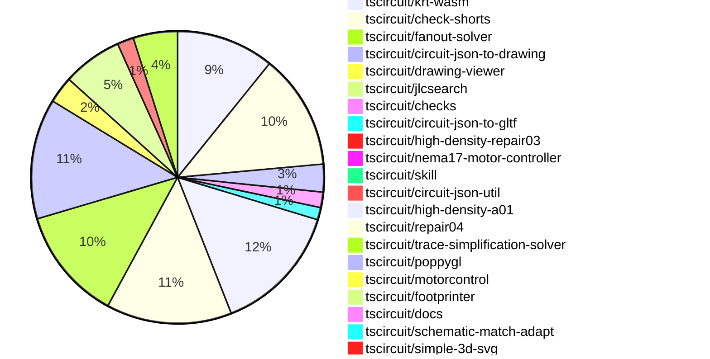

# Contribution Overview 2026-11-17

The current week is shown below. There are 3 major sections:

- [Contributor Overview](#contributor-overview)
- [PRs by Repository](#prs-by-repository)
- [PRs by Contributor](#changes-by-contributor)
- [Scoring & Sponsorship Details](/docs/sponsorship-calculation-explanation.md)

## PRs by Repository

## Contributor Overview

| Contributor | 🐳 Major | 🐙 Minor | 🐌 Tiny | Score | ⭐ |
|-------------|---------|---------|---------|-------|-----|
| [ShiboSoftwareDev](#ShiboSoftwareDev) | 110 | 30 | 68 | 513.5 | 👑👑👑 |
| [seveibar](#seveibar) | 27 | 26 | 40 | 173 | 👑👑👑 |
| [0hmX](#0hmX) | 17 | 16 | 25 | 113 | 👑 |
| [imrishabh18](#imrishabh18) | 3 | 13 | 12 | 51 | ⭐⭐⭐ |
| [rushabhcodes](#rushabhcodes) | 4 | 7 | 22 | 43 | ⭐⭐ |
| [MustafaMulla29](#MustafaMulla29) | 2 | 8 | 16 | 37 | ⭐⭐ |
| [Abse2001](#Abse2001) | 3 | 5 | 0 | 23 | ⭐⭐ |
| [mohan-bee](#mohan-bee) | 4 | 2 | 2 | 22 | ⭐⭐ |
| [AnasSarkiz](#AnasSarkiz) | 4 | 0 | 3 | 20 | ⭐⭐ |
| [tscircuitbot](#tscircuitbot) | 0 | 0 | 599 | 12 | ⭐⭐ |
| [Devesh36](#Devesh36) | 0 | 2 | 1 | 5 | ⭐ |
| [GokulPandi-M](#GokulPandi-M) | 1 | 0 | 1 | 5 | ⭐ |
| [VB-Blue](#VB-Blue) | 1 | 0 | 0 | 4 | ⭐ |
| [aswadi](#aswadi) | 0 | 1 | 0 | 2 |  |
| [KrishnaX12](#KrishnaX12) | 0 | 1 | 0 | 2 |  |
| [AJ0070](#AJ0070) | 0 | 1 | 0 | 2 |  |

## Staff Pass Ratio (SPR)

| Contributor | Reviewed PRs | Rejections | Approvals | SPR |
|-------------|--------------|------------|-----------|-----|
| [0hmX](#0hmX) | 16 | 2 | 16 | 87.5% |
| [rushabhcodes](#rushabhcodes) | 11 | 4 | 7 | 63.6% |
| [ShiboSoftwareDev](#ShiboSoftwareDev) | 6 | 0 | 7 | 100.0% |
| [Abse2001](#Abse2001) | 3 | 0 | 3 | 100.0% |
| [MustafaMulla29](#MustafaMulla29) | 3 | 0 | 3 | 100.0% |
| [GokulPandi-M](#GokulPandi-M) | 1 | 1 | 0 | 0.0% |
| [hrithik18k](#hrithik18k) | 1 | 1 | 0 | 0.0% |
| [VB-Blue](#VB-Blue) | 1 | 0 | 1 | 100.0% |

0hmX SPR PRs (16)

- [#5804](https://github.com/tscircuit/core/pull/5804) feat: emit aggressor controls in channel simulation records
- [#5628](https://github.com/tscircuit/core/pull/5628) refactor!: remove the analog IBIS simulation API
- [#5632](https://github.com/tscircuit/core/pull/5632) feat: add <simulation.eyediagram>
- [#5650](https://github.com/tscircuit/core/pull/5650) feat: pick default pseudo-random binary sequence (PRBS) seeds across a board
- [#5647](https://github.com/tscircuit/core/pull/5647) feat: copy JLCPCB hole plating thickness into preset stackups
- [#5629](https://github.com/tscircuit/core/pull/5629) feat: add <simulation.ibismodel>
- [#5423](https://github.com/tscircuit/core/pull/5423) feat: add <simulation.pcbtransientchannelsimulation>
- [#5649](https://github.com/tscircuit/core/pull/5649) feat: add <simulation.pcbdriverreceiverchannel>
- [#962](https://github.com/tscircuit/circuit-to-svg/pull/962) Add optional differential pair phase skew overlays
- [#4162](https://github.com/tscircuit/tscircuit-autorouter/pull/4162) Use the widest merged connection width as each trace's power expansion target
- [#11](https://github.com/tscircuit/jlcpcb-manufacturing-specs/pull/11) feat: add hole plating copper thickness to JLCPCB stackups
- [#114](https://github.com/tscircuit/circuit-json-webgpu/pull/114) feat: draw retained coloured strokes within WebGPU PCB layers
- [#6](https://github.com/tscircuit/ibis-to-spice/pull/6) feat: expose [Ramp] dV/dt and R_load on IbisBuffer
- [#141](https://github.com/tscircuit/signal-integrity-pipeline/pull/141) feat: estimate IBIS output edge duration for channel endpoints
- [#117](https://github.com/tscircuit/signal-integrity-pipeline/pull/117) feat: add isQuiet to board and the default capture duration to pipeline/timing
- [#118](https://github.com/tscircuit/signal-integrity-pipeline/pull/118) feat: inspect IBIS pin capabilities and references for channel endpoints

rushabhcodes SPR PRs (11)

- [#998](https://github.com/tscircuit/circuit-json/pull/998) Preserve arc geometry in PCB board outlines and cutouts
- [#1028](https://github.com/tscircuit/circuit-json/pull/1028) fix: preserve namespaced KiCad metadata on existing records
- [#1025](https://github.com/tscircuit/circuit-json/pull/1025) Revert "Preserve arc geometry in PCB board outlines and cutouts (#998)"
- [#1039](https://github.com/tscircuit/props/pull/1039) Support relative solder paste margins
- [#1036](https://github.com/tscircuit/props/pull/1036) Preserve rectangular solder paste rotation
- [#1032](https://github.com/tscircuit/props/pull/1032) feat: add native net class authoring props
- [#5825](https://github.com/tscircuit/core/pull/5825) Compose silkscreen text rotation with parent placement
- [#5962](https://github.com/tscircuit/tscircuit.com/pull/5962) Add the Drawing tab to package previews
- [#298](https://github.com/tscircuit/circuit-json-to-gltf/pull/298) Resolve selected CAD model URLs at load time
- [#58](https://github.com/tscircuit/poppygl/pull/58) Skip shading for constant unlit opaque surfaces
- [#330](https://github.com/tscircuit/kicad-to-circuit-json/pull/330) Preserve KiCad footprint text angles and keep-upright behavior

ShiboSoftwareDev SPR PRs (6)

- [#5748](https://github.com/tscircuit/core/pull/5748) Keep fixed copper as traces between autorouting phases
- [#4091](https://github.com/tscircuit/tscircuit-autorouter/pull/4091) Reproduce whole-trace neckdowns on Glider and OrangeCrab DDR
- [#3985](https://github.com/tscircuit/tscircuit-autorouter/pull/3985) Keep preloaded copper as paths throughout Pipeline9
- [#341](https://github.com/tscircuit/fanout-solver/pull/341) Skip duplicate first-route plane searches
- [#298](https://github.com/tscircuit/fanout-solver/pull/298) Honor crossed pour antipads in final fanout validation
- [#236](https://github.com/tscircuit/bus-lanes-solver/pull/236) Preserve endpoint IDs and layer limits on completed bus traces

Abse2001 SPR PRs (3)

- [#5502](https://github.com/tscircuit/core/pull/5502) Keep small-board mouse bites drillable (#5066)
- [#5876](https://github.com/tscircuit/cli/pull/5876) Resolve relative model paths in tsci export glb and gltf (#5654)
- [#13](https://github.com/tscircuit/jlcpcb-manufacturing-specs/pull/13) Add JLCPCB panelization rules

MustafaMulla29 SPR PRs (3)

- [#580](https://github.com/tscircuit/checks/pull/580) Report schematic box width and pin-padding warnings
- [#1451](https://github.com/tscircuit/schematic-trace-solver/pull/1451) Place shared ground labels at the lower end of their rail
- [#484](https://github.com/tscircuit/circuit-json-schematic-placement-analysis/pull/484) fix: let 0 ohm links away from ground lie in line

GokulPandi-M SPR PRs (1)

- [#334](https://github.com/tscircuit/tiny-hypergraph/pull/334) Support per-route layer constraints during path search

hrithik18k SPR PRs (1)

- [#5738](https://github.com/tscircuit/core/pull/5738) test(repro): nested group keepout stays behind after packing

VB-Blue SPR PRs (1)

- [#651](https://github.com/tscircuit/jlcsearch/pull/651) fix: include LED Indication - Discrete subcategory in led derived table

> Note: AI evaluates PRs and assigns 1-3 star ratings automatically. 4 and 5 star ratings require manual staff review.

## Review Table

[reviews-received-hover]: ## "Number of reviews received for PRs for this contributor"
[approvals-received-hover]: ## "Number of approvals received for PRs this contributor authored"
[rejections-received-hover]: ## "Number of rejections received for PRs this contributor authored"
[prs-opened-hover]: ## "Number of PRs opened by this contributor"
[issues-created-hover]: ## "Number of issues created by this contributor"

| Contributor | Reviews Received | Approvals Received | Rejections Received | Approvals | Rejections Given | PRs Opened | PRs Merged | Issues Created |
|---|---|---|---|---|---|---|---|---|
| [2848823170](#2848823170) | 0 | 0 | 0 | 0 | 0 | 8 | 0 | 0 |
| [0hmX](#0hmX) | 65 | 19 | 1 | 24 | 2 | 130 | 58 | 0 |
| [0xNexuz](#0xNexuz) | 0 | 0 | 0 | 0 | 0 | 1 | 0 | 0 |
| [aaka3h](#aaka3h) | 0 | 0 | 0 | 0 | 0 | 1 | 0 | 0 |
| [abdalraof-albarbar](#abdalraof-albarbar) | 0 | 0 | 0 | 0 | 0 | 4 | 0 | 0 |
| [Abse2001](#Abse2001) | 3 | 3 | 0 | 23 | 0 | 26 | 8 | 0 |
| [AJ0070](#AJ0070) | 1 | 1 | 0 | 0 | 0 | 33 | 1 | 0 |
| [Aming9303](#Aming9303) | 0 | 0 | 0 | 0 | 0 | 2 | 0 | 0 |
| [anaaracena](#anaaracena) | 0 | 0 | 0 | 0 | 0 | 1 | 0 | 0 |
| [AnasSarkiz](#AnasSarkiz) | 8 | 6 | 0 | 2 | 0 | 16 | 7 | 0 |
| [Andresdev14](#Andresdev14) | 0 | 0 | 0 | 0 | 0 | 1 | 0 | 0 |
| [aryansanganti](#aryansanganti) | 1 | 0 | 0 | 0 | 0 | 1 | 0 | 0 |
| [ashtygn](#ashtygn) | 0 | 0 | 0 | 0 | 0 | 14 | 0 | 0 |
| [aswadi](#aswadi) | 1 | 1 | 0 | 0 | 0 | 7 | 1 | 0 |
| [aurasocialbusinesspro-debug](#aurasocialbusinesspro-debug) | 0 | 0 | 0 | 0 | 0 | 10 | 0 | 0 |
| [bhatipoglu](#bhatipoglu) | 0 | 0 | 0 | 0 | 0 | 2 | 0 | 0 |
| [CrazyEther](#CrazyEther) | 0 | 0 | 0 | 0 | 0 | 1 | 0 | 0 |
| [dat-hoangnguyentuandat](#dat-hoangnguyentuandat) | 0 | 0 | 0 | 0 | 0 | 1 | 0 | 0 |
| [devbox-zero-ops](#devbox-zero-ops) | 0 | 0 | 0 | 0 | 0 | 11 | 0 | 0 |
| [Devesh36](#Devesh36) | 5 | 4 | 1 | 0 | 0 | 10 | 3 | 0 |
| [draarivpatel-ui](#draarivpatel-ui) | 16 | 0 | 0 | 0 | 0 | 16 | 0 | 0 |
| [GamerDubz](#GamerDubz) | 0 | 0 | 0 | 0 | 0 | 1 | 0 | 0 |
| [GokulPandi-M](#GokulPandi-M) | 16 | 3 | 3 | 0 | 0 | 11 | 2 | 0 |
| [Hajjy22](#Hajjy22) | 0 | 0 | 0 | 0 | 0 | 9 | 0 | 0 |
| [hrithik18k](#hrithik18k) | 1 | 0 | 1 | 0 | 0 | 3 | 0 | 0 |
| [imrishabh18](#imrishabh18) | 10 | 0 | 0 | 19 | 5 | 41 | 28 | 0 |
| [Kefia-02](#Kefia-02) | 0 | 0 | 0 | 0 | 0 | 1 | 0 | 0 |
| [KrishnaX12](#KrishnaX12) | 3 | 2 | 0 | 0 | 0 | 1 | 1 | 0 |
| [kunalgoesbyken](#kunalgoesbyken) | 0 | 0 | 0 | 0 | 0 | 3 | 0 | 0 |
| [LBCron](#LBCron) | 0 | 0 | 0 | 0 | 0 | 31 | 0 | 0 |
| [menwo535-jpg](#menwo535-jpg) | 0 | 0 | 0 | 0 | 0 | 2 | 0 | 0 |
| [mikihirokami-maker](#mikihirokami-maker) | 0 | 0 | 0 | 0 | 0 | 2 | 0 | 0 |
| [mohan-bee](#mohan-bee) | 7 | 3 | 0 | 0 | 0 | 35 | 8 | 0 |
| [MustafaMulla29](#MustafaMulla29) | 17 | 12 | 0 | 2 | 0 | 40 | 26 | 0 |
| [NavaneethKSD](#NavaneethKSD) | 0 | 0 | 0 | 0 | 0 | 1 | 0 | 0 |
| [nitina-ariveguru](#nitina-ariveguru) | 0 | 0 | 0 | 0 | 0 | 0 | 0 | 0 |
| [parthchilwerwar](#parthchilwerwar) | 1 | 0 | 0 | 0 | 0 | 1 | 0 | 0 |
| [pecopeko](#pecopeko) | 0 | 0 | 0 | 0 | 0 | 9 | 0 | 0 |
| [pethapixels-create](#pethapixels-create) | 4 | 0 | 0 | 0 | 0 | 16 | 0 | 0 |
| [rushabhcodes](#rushabhcodes) | 52 | 21 | 6 | 1 | 0 | 75 | 34 | 0 |
| [Semihzx](#Semihzx) | 0 | 0 | 0 | 0 | 0 | 1 | 0 | 0 |
| [seveibar](#seveibar) | 33 | 0 | 0 | 41 | 7 | 155 | 94 | 0 |
| [ShiboSoftwareDev](#ShiboSoftwareDev) | 70 | 49 | 2 | 13 | 0 | 353 | 210 | 0 |
| [singhaditya21](#singhaditya21) | 0 | 0 | 0 | 0 | 0 | 6 | 0 | 0 |
| [sxpnet64](#sxpnet64) | 0 | 0 | 0 | 0 | 0 | 1 | 0 | 0 |
| [thisisanubhav](#thisisanubhav) | 0 | 0 | 0 | 0 | 0 | 2 | 0 | 0 |
| [tranhoangtu-it](#tranhoangtu-it) | 9 | 0 | 0 | 0 | 0 | 15 | 0 | 0 |
| [tscircuitbot](#tscircuitbot) | 0 | 0 | 0 | 0 | 0 | 748 | 599 | 0 |
| [tunguyen1993](#tunguyen1993) | 0 | 0 | 0 | 0 | 0 | 2 | 0 | 0 |
| [U-ITACHII](#U-ITACHII) | 0 | 0 | 0 | 0 | 0 | 8 | 0 | 0 |
| [VB-Blue](#VB-Blue) | 1 | 1 | 0 | 0 | 0 | 16 | 1 | 0 |
| [zk16k123-svg](#zk16k123-svg) | 0 | 0 | 0 | 0 | 0 | 8 | 0 | 0 |

## Changes by Repository

### [tscircuit/core](https://github.com/tscircuit/core)

| PR # | Impact | Rating | Contributor | Description |
|------|--------|--------|-------------|-------------|
| [#5629](https://github.com/tscircuit/core/pull/5629) | 🐳 Major | ⭐⭐⭐ | 0hmX | Render simulation.ibismodel into a Circuit JSON IBIS model record with component, pin, and reference-port bindings, validating ambiguous, duplicate, or undeclared vendor pin bindings. |
| [#5649](https://github.com/tscircuit/core/pull/5649) | 🐳 Major | ⭐⭐⭐ | 0hmX | Adds simulation.pcbdriverreceiverchannel, resolves driver and receiver pins to IBIS models, validates PCB connectivity and routing, and writes channel records with an explicit seed when supplied. |
| [#5792](https://github.com/tscircuit/core/pull/5792) | 🐳 Major | ⭐⭐⭐ | seveibar | Lets a wire harness (cable manufacturing) sheet be defined in TSX. Core now emits the records added in tscircuitcircuit-json1023 from the props added in tscircuitprops1030; tscircuitcircuit-json-to-drawing14 renders them. |
| [#5816](https://github.com/tscircuit/core/pull/5816) | 🐳 Major | ⭐⭐⭐ | seveibar | Fixes autorouting failure due to unrotated plated holes in packed USB-C connectors, allowing successful routing of the board. |
| [#5814](https://github.com/tscircuit/core/pull/5814) | 🐳 Major | ⭐⭐⭐ | seveibar | Adds maxLength and maxViaCount properties to Simple Route JSON connections to enforce routing constraints for traces, preserving the distinction between terminal-to-terminal and terminal-to-net connections. |
| [#5645](https://github.com/tscircuit/core/pull/5645) | 🐳 Major | ⭐⭐⭐ | seveibar | Fixes saved-phase failures by ensuring complete phases validate copper connectivity for export and replay, allowing shared anchor pads and junctions while rejecting cross-net connections. |
| [#5732](https://github.com/tscircuit/core/pull/5732) | 🐳 Major | ⭐⭐⭐ | mohan-bee | Fixes the issue where the auto_local preset ignored the allowViaInPad setting, allowing vias to be added in pads where they were explicitly prohibited by the board designer. |
| [#5731](https://github.com/tscircuit/core/pull/5731) | 🐳 Major | ⭐⭐⭐ | mohan-bee | Reproduces the lost via-in-pad override in Cores auto_local preset, ensuring that the autorouter respects the prohibition of vias in pads during routing. |
| [#5790](https://github.com/tscircuit/core/pull/5790) | 🐳 Major | ⭐⭐⭐ | ShiboSoftwareDev | Updates the bus lanes solver from version 0.0.64 to 0.0.65, incorporating multiple fixes and optimizations, including improved visibility searches and debug pad outlines. |
| [#5794](https://github.com/tscircuit/core/pull/5794) | 🐳 Major | ⭐⭐⭐ | ShiboSoftwareDev | Updates the autorouter version from 0.0.1149 to 0.0.1152 and the fanout solver version from 0.0.101 to 0.0.102, incorporating several bug fixes and performance improvements. |
| [#5782](https://github.com/tscircuit/core/pull/5782) | 🐳 Major | ⭐⭐⭐ | ShiboSoftwareDev | Fixes duplicate port entries during breakout point creation by indexing ports before the selector-index phase and clearing the cache with each inserted point. |
| [#5748](https://github.com/tscircuit/core/pull/5748) | 🐳 Major | ⭐⭐⭐ | ShiboSoftwareDev | Preserves completed DDR routes as fixed traces to maintain their paths and net ownership during subsequent autorouting phases. |
| [#5779](https://github.com/tscircuit/core/pull/5779) | 🐳 Major | ⭐⭐⭐ | ShiboSoftwareDev | Pins the private winding dependency to the latest main commit, which includes merged winding and repro changes, affecting dependency management. |
| [#5766](https://github.com/tscircuit/core/pull/5766) | 🐳 Major | ⭐⭐⭐ | ShiboSoftwareDev | Updates the tscircuitcapacity-autorouter package from version 0.0.1140 to 0.0.1142, incorporating the merged DDR stack and enhancing routing capabilities while maintaining existing functionalities. |
| [#5763](https://github.com/tscircuit/core/pull/5763) | 🐳 Major | ⭐⭐⭐ | ShiboSoftwareDev | Bumps tscircuitcapacity-autorouter from 0.0.1139 to 0.0.1140 to include the physical regional-routing terminal-overlap guard, rejecting impossible fixed endpoints before invalid via candidates or wasted search. |
| [#5765](https://github.com/tscircuit/core/pull/5765) | 🐳 Major | ⭐⭐⭐ | ShiboSoftwareDev | Reuse the existing selectAll result when resolving typed ports, so the ambiguity check shares the same traversal. |
| [#5707](https://github.com/tscircuit/core/pull/5707) | 🐳 Major | ⭐⭐⭐ | ShiboSoftwareDev | Bumps the tscircuitcapacity-autorouter package from version 0.0.1129 to 0.0.1132, improving regional force handling to preserve valid routes during optimization, specifically addressing via clearance issues in the H616 region. |
| [#5681](https://github.com/tscircuit/core/pull/5681) | 🐳 Major | ⭐⭐⭐ | ShiboSoftwareDev | Updates the autorouter to version 0.0.1126, enhancing BGA routing by enforcing stricter clearance and via requirements. |
| [#5659](https://github.com/tscircuit/core/pull/5659) | 🐳 Major | ⭐⭐⭐ | ShiboSoftwareDev | Fixes recursive rendering issue in routing callbacks that prevents proper copper pours from being generated during autorouting. |
| [#5637](https://github.com/tscircuit/core/pull/5637) | 🐳 Major | ⭐⭐⭐ | ShiboSoftwareDev | Publish completed trace-only routing phases while later phases continue, allowing for better visibility of routing progress on complex boards. |
| [#5673](https://github.com/tscircuit/core/pull/5673) | 🐳 Major | ⭐⭐⭐ | ShiboSoftwareDev | Updates the capacity autorouter and bus lanes solver dependencies, allowing for improved routing capabilities and fixes for cramped-port searches. |
| [#5657](https://github.com/tscircuit/core/pull/5657) | 🐳 Major | ⭐⭐⭐ | ShiboSoftwareDev | Reproduces a ground pour generated before its routed signal via when an autorouting:start listener reads getCircuitJson(). |
| [#5804](https://github.com/tscircuit/core/pull/5804) | 🐙 Minor | ⭐⭐ | 0hmX | Serialize aggressorPattern and aggressorDisabled as aggressor_pattern and aggressor_disabled on PCB transient channel simulation records, ensuring omitted fields are not included and preserving explicitly declared values. |
| [#5628](https://github.com/tscircuit/core/pull/5628) | 🐙 Minor | ⭐⭐ | 0hmX | Summary Bump circuit-json to 0.0.552 and tscircuitprops to 0.0.735 in the development dependencies and overrides. Remove the analog IBIS stimulus and eye declarations, IBIS pin states, and the external pcb_spice special case. Keep native analog transient analysis available through registered SPICE engines. Keep cached IBIS model restoration and narrow the copper-pour fixture to the PCB elements it renders. |
| [#5632](https://github.com/tscircuit/core/pull/5632) | 🐙 Minor | ⭐⭐ | 0hmX | Render simulation.eyediagram against transient channel records, with channel selection and timing windows expressed in milliseconds. |
| [#5650](https://github.com/tscircuit/core/pull/5650) | 🐙 Minor | ⭐⭐ | 0hmX | Allows channels using pseudo-random binary sequence (PRBS) patterns to automatically select distinct seeds based on signal names and sequence lengths, preventing identical bit transmission across channels. |
| [#5647](https://github.com/tscircuit/core/pull/5647) | 🐙 Minor | ⭐⭐ | 0hmX | Copies plated_hole_copper_thickness from the JLCPCB stackup data into pcb_stackup for boards using a JLCPCB fabricatorPreset, enabling accurate modeling of vias in PCB transient channel simulations. |
| [#5423](https://github.com/tscircuit/core/pull/5423) | 🐙 Minor | ⭐⭐ | 0hmX | Add simulation.pcbtransientchannelsimulation as a direct child of a PCB board, emitting run records with settings and covering tests for board-only rules. |
| [#5839](https://github.com/tscircuit/core/pull/5839) | 🐙 Minor | ⭐⭐ | imrishabh18 | Updates circuit-to-svg to version 0.0.463 and circuit-json-util to 0.0.135, aligning dependencies and ensuring compatibility with the latest runtime and CLI updates, while also validating authored waypoint paths and refreshing PCB snapshots. |
| [#5685](https://github.com/tscircuit/core/pull/5685) | 🐙 Minor | ⭐⭐ | imrishabh18 | Captures and normalizes schematic and source warnings and errors for the NEMA 17 example, ensuring stability across test orders. |
| [#5702](https://github.com/tscircuit/core/pull/5702) | 🐙 Minor | ⭐⭐ | imrishabh18 | Recomputes NEMA 17 diagnostics by rerunning pin specification and schematic checks using the installed Checks package, while retaining source-render annotations. |
| [#5848](https://github.com/tscircuit/core/pull/5848) | 🐙 Minor | ⭐⭐ | seveibar | Fixes the issue where hand-placed components inside schematic sheets were not preserved during layout, ensuring correct rendering and placement of components in nested groups. |
| [#5847](https://github.com/tscircuit/core/pull/5847) | 🐙 Minor | ⭐⭐ | seveibar | Reproduces the issue of manual schematic placement loss on the full USB-C Wi-Fi sounder board by adding a test that captures the current output and retains the original designs footprints and connections. |
| [#5788](https://github.com/tscircuit/core/pull/5788) | 🐙 Minor | ⭐⭐ | seveibar | Adds support for explicit autorouter selection using tscircuit and tscircuit_beta, updating the props dependency and ensuring regression tests pass for the new configurations. |
| [#5724](https://github.com/tscircuit/core/pull/5724) | 🐙 Minor | ⭐⭐ | rushabhcodes | Adds native support for pill solder-paste apertures in imported footprints, preserving stencil geometry and preventing duplicates during import. |
| [#5692](https://github.com/tscircuit/core/pull/5692) | 🐙 Minor | ⭐⭐ | rushabhcodes | Fixes the issue where a TLV75533PDBVR regulator footprint loses the requested 90 rotation on its stencil apertures, causing misalignment with copper lands. |
| [#5781](https://github.com/tscircuit/core/pull/5781) | 🐙 Minor | ⭐⭐ | ShiboSoftwareDev | Adds tests to verify that the automatic breakout-point creation correctly handles trace ports on the real iCEPi board without repeated scans. |
| [#5764](https://github.com/tscircuit/core/pull/5764) | 🐙 Minor | ⭐⭐ | ShiboSoftwareDev | A cold typed port lookup traverses the component tree twice: once to find the port and again to check ambiguity. Adds a regular PCB snapshot recording the traversal count, plus the original full IcePi circuit and its PCB snapshot. IcePi still fails fanout (1432); this repro concerns selector cost before routing. Fix stacked in 5765. Validation: both repro tests, typecheck and all ten CI test shards pass. |
| [#5777](https://github.com/tscircuit/core/pull/5777) | 🐙 Minor | ⭐⭐ | ShiboSoftwareDev | Adds a test to validate the performance of the iCEPi boards connectivity map generation, measuring the number of Set.has calls required for the process. |
| [#5756](https://github.com/tscircuit/core/pull/5756) | 🐙 Minor | ⭐⭐ | ShiboSoftwareDev | Bumps the tscircuitfanout-solver dependency from version 0.0.93 to 0.0.94, enhancing same-layer routing capabilities and ensuring compatibility with existing tests and structures. |
| [#5706](https://github.com/tscircuit/core/pull/5706) | 🐙 Minor | ⭐⭐ | ShiboSoftwareDev | Updates the ngspice engine and SPICE exporter to use newer versions of dependencies, ensuring compatibility and improved functionality in simulation tests. |
| [#5636](https://github.com/tscircuit/core/pull/5636) | 🐙 Minor | ⭐⭐ | ShiboSoftwareDev | Reproduces buffered output of completed routing work while the next autorouting phase is pending, ensuring that traces from the first phase remain accessible until the second phase is completed. |
| [#5829](https://github.com/tscircuit/core/pull/5829) | 🐙 Minor | ⭐⭐ | Devesh36 | Fixes redundant copper trace between internally connected pins of the USBLC6 ESD protector in PCB design. |
| [#5328](https://github.com/tscircuit/core/pull/5328) | 🐙 Minor | ⭐⭐ | aswadi | Fixes the emission of parsed numeric inductance in the source_component for inductors, ensuring SI unit strings are correctly converted to numeric henries. |
| [#5510](https://github.com/tscircuit/core/pull/5510) | 🐙 Minor | ⭐⭐ | KrishnaX12 | Fixes the issue of redundant schematic wires being added to already connected pins during endpoint repair in the Cores schematic system. |
| [#5492](https://github.com/tscircuit/core/pull/5492) | 🐙 Minor | ⭐⭐ | Abse2001 | Reproduces the issue of insufficient drill size for mouse bites on small boards, ensuring they remain drillable. |
| [#5502](https://github.com/tscircuit/core/pull/5502) | 🐙 Minor | ⭐⭐ | Abse2001 | Adjusts mouse-bite drill sizes for small boards to ensure they remain drillable according to JLCPCBs specifications, while addressing clearance issues with traces. |

🐌 Tiny Contributions (48)

| PR # | Impact | Contributor | Description |
|------|--------|-------------|-------------|
| [#5857](https://github.com/tscircuit/core/pull/5857) | 🐌 Tiny | tscircuitbot | Updates the tscircuitchecks package version from 0.0.282 to 0.0.283 in package.json |
| [#5769](https://github.com/tscircuit/core/pull/5769) | 🐌 Tiny | tscircuitbot | Updates the tscircuitkrt-wasm package from version 0.1.1 to 0.1.10 in package.json |
| [#5699](https://github.com/tscircuit/core/pull/5699) | 🐌 Tiny | tscircuitbot | Updates the version of the tscircuitchecks package from 0.0.280 to 0.0.281 in package.json |
| [#5694](https://github.com/tscircuit/core/pull/5694) | 🐌 Tiny | tscircuitbot | Updates the version of the tscircuitfanout-solver package from 0.0.84 to 0.0.85 in package.json |
| [#5688](https://github.com/tscircuit/core/pull/5688) | 🐌 Tiny | tscircuitbot | Updates the version of the tscircuitchecks package from 0.0.279 to 0.0.280 in package.json |
| [#5841](https://github.com/tscircuit/core/pull/5841) | 🐌 Tiny | imrishabh18 | Update Cores circuit-json-to-gltf development dependency from 0.0.164 to 0.0.169, which includes a model-origin fix and visual regression tests. |
| [#5701](https://github.com/tscircuit/core/pull/5701) | 🐌 Tiny | imrishabh18 | Updates the tscircuitchecks dependency to version 0.0.282, ensuring that Core honors explicit false power and ground pin requirements. |
| [#5810](https://github.com/tscircuit/core/pull/5810) | 🐌 Tiny | seveibar | Fixes default schematic box sizing for pin headers and two-pin connectors to comply with schematic placement checks. |
| [#5768](https://github.com/tscircuit/core/pull/5768) | 🐌 Tiny | seveibar | Emit a Circuit JSON warning when a board, group, breakout, or routing phase explicitly supplies autorouter.traceClearance. The message directs authors to set minTraceToPadEdgeClearance on the board or routing phase. Keep serializing the legacy field for FreeRouting compatibility. Remove the SEPIC reproduction from 5686, its two annotated snapshots, and its private board fixture. The focused warning test covers zero, a unit string, and a second render. The existing subcircuit test still verifies legacy serialization. Companion TypeScript deprecation: https:github.comtscircuitpropspull1054. Supersedes the implementation direction in 5767. Typecheck and changed tests pass. Two neighboring legacy-router PCB snapshots differ locally by 0.27 and 0.48. Both differences reproduce on untouched main. |
| [#5643](https://github.com/tscircuit/core/pull/5643) | 🐌 Tiny | seveibar | Adds four small TSX reproductions for the saved-phase bug in 5614, providing tests for various routing scenarios that previously resulted in errors during autorouting. |
| [#5641](https://github.com/tscircuit/core/pull/5641) | 🐌 Tiny | seveibar | Adds guidance on testing patterns in AGENTS.md, specifying that tests should be simple, shallow TSX without complex logic or large imports unless they represent an entire real circuit. |
| [#5723](https://github.com/tscircuit/core/pull/5723) | 🐌 Tiny | rushabhcodes | Reproduces the issue of missing support for oval and rotated paste-only apertures in the USB1046 footprint, ensuring six bottom apertures without top duplicates. |
| [#5826](https://github.com/tscircuit/core/pull/5826) | 🐌 Tiny | rushabhcodes | Updates the kicad-to-circuit-json dependency to version 0.0.154, correcting fabrication-text and keep-upright angles in existing Arduino importreroute SVGs without altering the original KiCad board or workflows. |
| [#5691](https://github.com/tscircuit/core/pull/5691) | 🐌 Tiny | rushabhcodes | Reproduces a bug where rotated paste-only apertures cannot be expressed, exposing a rotation bug in the Core. |
| [#5862](https://github.com/tscircuit/core/pull/5862) | 🐌 Tiny | ShiboSoftwareDev | Pins the tscircuitcore-ddr-benchmark dependency to a specific commit to ensure consistent benchmark results and validation of routing performance. |
| [#5865](https://github.com/tscircuit/core/pull/5865) | 🐌 Tiny | ShiboSoftwareDev | Pins the tscircuitngspice-spice-engine dependency to version 0.0.26, updating the cores real-simulation tests and adapter version for downstream dependency synchronization. |
| [#5850](https://github.com/tscircuit/core/pull/5850) | 🐌 Tiny | ShiboSoftwareDev | Pins the tscircuitcore-ddr-benchmark dependency to a specific commit, ensuring consistent benchmark results with audited DDR skew constraints and updated report tables. |
| [#5813](https://github.com/tscircuit/core/pull/5813) | 🐌 Tiny | ShiboSoftwareDev | Updates the autorouter version from 0.0.1154 to 0.0.1156 and the fanout solver version from 0.0.103 to 0.0.104, incorporating various improvements and fixes related to STM32MP157 BGA-channel routing and fanout solver recovery of same-net plane drops. |
| [#5800](https://github.com/tscircuit/core/pull/5800) | 🐌 Tiny | ShiboSoftwareDev | Bumps tscircuitcapacity-autorouter from 0.0.1153 to 0.0.1154 to include updates that prevent greedy crossings of immutable copper while preserving movable-route crossings for downstream unraveling. |
| [#5795](https://github.com/tscircuit/core/pull/5795) | 🐌 Tiny | ShiboSoftwareDev | Updates the tscircuitfanout-solver dependency from version 0.0.102 to 0.0.103, incorporating improvements from tscircuitfanout-solver369, which allows interior plane pads to utilize the existing centered-escape pass after original candidates while maintaining clearance checks. |
| [#5796](https://github.com/tscircuit/core/pull/5796) | 🐌 Tiny | ShiboSoftwareDev | Bumps the tscircuitcapacity-autorouter dependency from 0.0.1152 to 0.0.1153 to include fixes for terminal-adjacent via landings and improve regional subcircuit routing capabilities. |
| [#5793](https://github.com/tscircuit/core/pull/5793) | 🐌 Tiny | ShiboSoftwareDev | Updates the tscircuitcapacity-autorouter dependency from version 0.0.1148 to 0.0.1149, incorporating performance improvements and bug fixes from the upstream repository. |
| [#5789](https://github.com/tscircuit/core/pull/5789) | 🐌 Tiny | ShiboSoftwareDev | Updates the tscircuitfanout-solver dependency from version 0.0.100 to 0.0.101, incorporating improvements that avoid exact distance calculations for distant pads and vias while maintaining checks for nearby geometry. |
| [#5787](https://github.com/tscircuit/core/pull/5787) | 🐌 Tiny | ShiboSoftwareDev | Updates the bus lanes solver to version 0.0.64 and the capacity autorouter to version 0.0.1148, ensuring compatibility and performance improvements without introducing new features. |
| [#5785](https://github.com/tscircuit/core/pull/5785) | 🐌 Tiny | ShiboSoftwareDev | Updates the tscircuitcapacity-autorouter and tscircuitfanout-solver dependencies to their latest versions, ensuring compatibility and performance improvements in routing and fanout calculations. |
| [#5786](https://github.com/tscircuit/core/pull/5786) | 🐌 Tiny | ShiboSoftwareDev | Bumps tscircuitfanout-solver from 0.0.99 to 0.0.100 to include the emptysingle-via collection fast path, avoiding temporary filtered arrays while preserving existing multi-via behavior. |
| [#5783](https://github.com/tscircuit/core/pull/5783) | 🐌 Tiny | ShiboSoftwareDev | Updates the tscircuitfanout-solver dependency from version 0.0.97 to 0.0.98 to include cached static boundary-rejection reuse, optimizing candidate rebuilding by retaining search decisions and blocker counts. |
| [#5776](https://github.com/tscircuit/core/pull/5776) | 🐌 Tiny | ShiboSoftwareDev | Updates the autorouter, fanout solver, and bus lanes solver to their latest versions, ensuring compatibility and maintaining existing functionality. |
| [#5762](https://github.com/tscircuit/core/pull/5762) | 🐌 Tiny | ShiboSoftwareDev | Bumps tscircuitfanout-solver from 0.0.94 to 0.0.95 to include checked-failure route-prefix reuse, optimizing cache by reusing unchanged copper prefixes while preserving repair priorities. |
| [#5778](https://github.com/tscircuit/core/pull/5778) | 🐌 Tiny | ShiboSoftwareDev | Selects the already published indexed connectivity map and updates the dependency to version 0.0.36, ensuring alignment with the public package update while maintaining performance improvements in rendering times. |
| [#5775](https://github.com/tscircuit/core/pull/5775) | 🐌 Tiny | ShiboSoftwareDev | Updates the tscircuitcapacity-autorouter and tscircuitfanout-solver dependencies to their latest versions, ensuring compatibility and performance improvements without altering existing functionality. |
| [#5713](https://github.com/tscircuit/core/pull/5713) | 🐌 Tiny | ShiboSoftwareDev | Core turns completed DDR routes into obstacle tiles before the next routing phase, reproducing the handoff for A64 and OrangeCrab boards with detailed fixtures and SVG representations. |
| [#5744](https://github.com/tscircuit/core/pull/5744) | 🐌 Tiny | ShiboSoftwareDev | Updates the tscircuitfanout-solver package from version 0.0.92 to 0.0.93, improving the handling of plane-via candidates and ensuring successful copper escapes in the ButterStick region. |
| [#5741](https://github.com/tscircuit/core/pull/5741) | 🐌 Tiny | ShiboSoftwareDev | Updates the tscircuitfanout-solver dependency from version 0.0.91 to 0.0.92, adjusting trace widths and terminal-plane copper validation, and refining boundary-heading inference with retries for unconstrained escapes. |
| [#5719](https://github.com/tscircuit/core/pull/5719) | 🐌 Tiny | ShiboSoftwareDev | Bumps the version of tscircuitfanout-solver from 0.0.90 to 0.0.91 to include improvements in conservative segment bounds and clearance decisions for obstacles. |
| [#5712](https://github.com/tscircuit/core/pull/5712) | 🐌 Tiny | ShiboSoftwareDev | Updates the autorouter and fanout solver to their latest versions, improving routing capabilities and optimization. |
| [#5721](https://github.com/tscircuit/core/pull/5721) | 🐌 Tiny | ShiboSoftwareDev | Updates the capacity-autorouter dependency from version 0.0.1133 to 0.0.1135, which includes improvements to routing capabilities and fixes related to native regulator feedback. |
| [#5720](https://github.com/tscircuit/core/pull/5720) | 🐌 Tiny | ShiboSoftwareDev | Updates Cores canonical simulation dependency versions to published spicets 0.0.6, circuit-json-to-spice 0.0.50 and ngspice-spice-engine 0.0.25, ensuring compatibility with downstream dependencies and incorporating parser fixes and corrections. |
| [#5716](https://github.com/tscircuit/core/pull/5716) | 🐌 Tiny | ShiboSoftwareDev | Bumps tscircuitfanout-solver from 0.0.89 to 0.0.90 to optimize warm plane searches by skipping geometry construction when static clearance rejects all endpoint variants and the base plan, while maintaining cache misses, endpoint ordering, and live copper checks. |
| [#5705](https://github.com/tscircuit/core/pull/5705) | 🐌 Tiny | ShiboSoftwareDev | Bumps tscircuitfanout-solver from 0.0.87 to 0.0.88 to include support for antipads through crossed copper pours while preserving clearance rejection on terminal layers, pads, and through-holes. |
| [#5698](https://github.com/tscircuit/core/pull/5698) | 🐌 Tiny | ShiboSoftwareDev | Bumps the tscircuitfanout-solver dependency from version 0.0.86 to 0.0.87, improving clearance-scan performance by skipping distant obstacles before scanning their aliases. |
| [#5696](https://github.com/tscircuit/core/pull/5696) | 🐌 Tiny | ShiboSoftwareDev | Bumps the tscircuitcapacity-autorouter package version from 0.0.1128 to 0.0.1129, ensuring improved handling of fixed-via clearance violations during autorouting processes. |
| [#5690](https://github.com/tscircuit/core/pull/5690) | 🐌 Tiny | ShiboSoftwareDev | Updates the autorouter and fanout solver dependencies to their latest versions, ensuring compatibility and improved functionality in routing and clearance checks. |
| [#5683](https://github.com/tscircuit/core/pull/5683) | 🐌 Tiny | ShiboSoftwareDev | Updates the tscircuitcapacity-autorouter package from version 0.0.1126 to 0.0.1127, which includes improvements to the repair03 process and the native trace-pair DRC evaluator during via cleanup. |
| [#5679](https://github.com/tscircuit/core/pull/5679) | 🐌 Tiny | ShiboSoftwareDev | Updates the tscircuitcapacity-autorouter dependency from version 0.0.1124 to 0.0.1125, which includes improvements to pad-alias resolution during clearance search and a grid correction for component-pad-only A13. |
| [#5642](https://github.com/tscircuit/core/pull/5642) | 🐌 Tiny | ShiboSoftwareDev | Bumps the tscircuitcapacity-autorouter dependency from version 0.0.1120 to 0.0.1121, incorporating improvements and fixes from upstream, including enhanced clearance-grid channel builds and reduced physical findings in routing tests. |
| [#5638](https://github.com/tscircuit/core/pull/5638) | 🐌 Tiny | ShiboSoftwareDev | Bumps the tscircuitcapacity-autorouter dependency from version 0.0.1119 to 0.0.1120, improving routing preferences and connection stitching. |
| [#5686](https://github.com/tscircuit/core/pull/5686) | 🐌 Tiny | GokulPandi-M | Motivation Increasing autorouter.traceClearance should change the clearance requested from the router. On this SEPIC board, requesting either 0.25 mm or 0.50 mm produces identical routing input with minTraceToPadEdgeClearance: 0.1. The larger requested spacing is silently lost before routing, so changing this setting does not enforce the intended clearance. This reproduction renders the full board TSX, retains its manual traces, and captures the input passed to the native local autorouter. The passing characterization test records the current bug; each snapshot labels the requested clearance and the received input field. Those labels describe routing settings, not measured copper gaps.  Requested: 0.25 mm  Requested: 0.50 mm   ---  ---   !Board requesting 0.25 mm; router receives 0.1 mm(https:raw.githubusercontent.comGokulPandi-Mcore5c476f43e2f901dc405c4708c5549ecfa778dd05testsrepros__snapshots__repro-autorouter-clearance-board-0.25mm-pcb.snap.svg)  !Board requesting 0.50 mm; router receives 0.1 mm(https:raw.githubusercontent.comGokulPandi-Mcore5c476f43e2f901dc405c4708c5549ecfa778dd05testsrepros__snapshots__repro-autorouter-clearance-board-0.50mm-pcb.snap.svg)   Validation Reproduction and snapshot verification pass: 1 test, 7 assertions. Type check and production build pass. Source fixture retains the boards components, placements and eight manual traces; no production code changes. |

### [tscircuit/tscircuit-autorouter](https://github.com/tscircuit/tscircuit-autorouter)

| PR # | Impact | Rating | Contributor | Description |
|------|--------|--------|-------------|-------------|
| [#4162](https://github.com/tscircuit/tscircuit-autorouter/pull/4162) | 🐳 Major | ⭐⭐⭐ | 0hmX | Fixes power trace width expansion when connections share a pad, ensuring the widest trace width is used for merged nets. |
| [#4163](https://github.com/tscircuit/tscircuit-autorouter/pull/4163) | 🐳 Major | ⭐⭐⭐ | imrishabh18 | Move high-density trace conversion into libutils and update the Pipeline 7 and Pipeline 9 callers and tests to use the shared module. This refactor targets main directly. The branch-width work remains in 4008. |
| [#3964](https://github.com/tscircuit/tscircuit-autorouter/pull/3964) | 🐳 Major | ⭐⭐⭐ | imrishabh18 | Fixes phantom via repair on the RP2040 motor controller by ensuring existing plated-hole transitions are not treated as new vias. |
| [#4130](https://github.com/tscircuit/tscircuit-autorouter/pull/4130) | 🐳 Major | ⭐⭐⭐ | seveibar | Reproduce high-density routing cannot complete the GND connection on the Four-port USB hub source(https:github.comtscircuitbasic-usbc-devicesblob4a134c7046b91a66ba77106b4bca589d7c00aaa8hub.circuit.tsx). This capture retains the board placement, connections and design rules and replaces the board-level router with the default local Pipeline 9. The input has 55 connections and 356 obstacles. The board uses tscircuit 0.0.3271 and the bundled autorouter 0.0.1147. Its routing result includes this finding:  Pipeline9 primary high-density routing failed: B01 failed: No path found for source_net_0_mst76; regional fallback failed: Failed to solve 1 nodes, cmn_29. err0: GrowShrinkHighDensityIntraNodeSolver failed after resizing to 8x. Last error: All solvers failed in hyper solver. Example failures: Candidate solution rejected by validator, Candidate solution rejected by validator, CachedIntraNodeRouteSolver ran out of iterations (MAX_ITERATIONS8000), CachedIntraNodeRouteSolver ran out of iterations (MAX_ITERATIONS8000), CachedIntraNodeRouteSolver ran out of iterations (MAX_ITERATIONS8000). (capacity-autorouter0.0.1147) The routing failure leaves the board without global routes. From the repository root after installing dependencies, run: sh bun fixturesbug-reportsbugreport111-0535adreproduce.ts  The command exits nonzero while the reported defect reproduces. The adjacent Cosmos fixture opens the same input in the pipeline debugger. Public autorouting bug report(https:api.tscircuit.comautoroutingbug_reportsview?autorouting_bug_report_id0535adf0-8deb-4d71-82db-27c320495fb7) |
| [#4124](https://github.com/tscircuit/tscircuit-autorouter/pull/4124) | 🐳 Major | ⭐⭐⭐ | seveibar | Reduces copper DRC violations from 7 to 6 by ensuring trace simplification respects the boards 0.20 mm trace-to-hole edge clearance. |
| [#4075](https://github.com/tscircuit/tscircuit-autorouter/pull/4075) | 🐳 Major | ⭐⭐⭐ | seveibar | Reduces copper DRC violations on the gamepad SRJ from 9 to 7 by reserving via footprints during routing to prevent accidental contacts. |
| [#4036](https://github.com/tscircuit/tscircuit-autorouter/pull/4036) | 🐳 Major | ⭐⭐⭐ | seveibar | Fixes autorouting failure when routing connections near fine-pitch pads by preserving pad escapes with a refined grid selection process. |
| [#3969](https://github.com/tscircuit/tscircuit-autorouter/pull/3969) | 🐳 Major | ⭐⭐⭐ | seveibar | Fixes autorouting failure by utilizing the connectivity map for calculating the via lower bound in the polyline solver, resolving VREF fanout rejection issues. |
| [#4000](https://github.com/tscircuit/tscircuit-autorouter/pull/4000) | 🐳 Major | ⭐⭐⭐ | mohan-bee | Pins the length-matching solver to a specific commit to fix routing issues with differential pairs. |
| [#4109](https://github.com/tscircuit/tscircuit-autorouter/pull/4109) | 🐳 Major | ⭐⭐⭐ | ShiboSoftwareDev | Fixes autorouting failure in STM32MP157 DDR board by reproducing the incomplete routing and updating the visual regression tests. |
| [#4110](https://github.com/tscircuit/tscircuit-autorouter/pull/4110) | 🐳 Major | ⭐⭐⭐ | ShiboSoftwareDev | Completes the routing of all 72 DDR nets for the STM32MP157 by implementing a new BGA escape routing solver that effectively utilizes narrow pad channels, ensuring all connections are electrically complete and meet clearance requirements. |
| [#4111](https://github.com/tscircuit/tscircuit-autorouter/pull/4111) | 🐳 Major | ⭐⭐⭐ | ShiboSoftwareDev | Replays the greedy finishing pass used by Pipeline9 on an anonymous captured circuit fragment: 18 regions, 19 ports, and immutable preloaded copper. The current dependency reports success with one impossible same-layer crossing. |
| [#4059](https://github.com/tscircuit/tscircuit-autorouter/pull/4059) | 🐳 Major | ⭐⭐⭐ | ShiboSoftwareDev | Shares the clearance check for through-via positions across destination layers, reducing the number of checks significantly and improving routing performance. |
| [#4112](https://github.com/tscircuit/tscircuit-autorouter/pull/4112) | 🐳 Major | ⭐⭐⭐ | ShiboSoftwareDev | Fixes greedy autorouting failures by preventing crossings of immutable copper while allowing movable-route crossings for downstream unraveling. |
| [#4096](https://github.com/tscircuit/tscircuit-autorouter/pull/4096) | 🐳 Major | ⭐⭐⭐ | ShiboSoftwareDev | Updates the A01 dependency to preserve terminal-adjacent via landings in Pipeline9, ensuring all routes are accepted without explicit vias at layer-change endpoints. |
| [#4084](https://github.com/tscircuit/tscircuit-autorouter/pull/4084) | 🐳 Major | ⭐⭐⭐ | ShiboSoftwareDev | Fixes autorouting failure when regional trace cuts overlap unrelated fixed terminals in immutable-preload mode. |
| [#4083](https://github.com/tscircuit/tscircuit-autorouter/pull/4083) | 🐳 Major | ⭐⭐⭐ | ShiboSoftwareDev | Fixes autorouting failure when regional trace cuts overlap an unrelated fixed terminal, causing repair to fail. |
| [#4079](https://github.com/tscircuit/tscircuit-autorouter/pull/4079) | 🐳 Major | ⭐⭐⭐ | ShiboSoftwareDev | Reduces memory allocations during net comparisons in native copper validation by directly comparing IDs instead of creating temporary arrays. |
| [#4077](https://github.com/tscircuit/tscircuit-autorouter/pull/4077) | 🐳 Major | ⭐⭐⭐ | ShiboSoftwareDev | Updates the B01 dependency to improve routing efficiency and validation for high-density designs, specifically addressing through-vias near fixed endpoints. |
| [#4071](https://github.com/tscircuit/tscircuit-autorouter/pull/4071) | 🐳 Major | ⭐⭐⭐ | ShiboSoftwareDev | Optimizes the detailed routing process by caching occupant lists for repeated via checks, resulting in significant runtime improvements across various boards. |
| [#4068](https://github.com/tscircuit/tscircuit-autorouter/pull/4068) | 🐳 Major | ⭐⭐⭐ | ShiboSoftwareDev | Avoids retaining regional routing diagnostics by default, aligning with ordinary Pipeline 9 routing behavior to keep diagnostics off unless explicitly requested. |
| [#4057](https://github.com/tscircuit/tscircuit-autorouter/pull/4057) | 🐳 Major | ⭐⭐⭐ | ShiboSoftwareDev | Implements B01s bounded fixed-wire rasterization to optimize the routing process by reducing unnecessary cell checks for long wires, improving CPU time and maintaining routing accuracy. |
| [#4046](https://github.com/tscircuit/tscircuit-autorouter/pull/4046) | 🐳 Major | ⭐⭐⭐ | ShiboSoftwareDev | Stacked on the iCEPi visual repro 4038. The crossing-capacity fix in 4039 builds on this cleanup. The preloaded trace graph solver now coordinates three operations. It converts saved copper into layer-specific segments, assigns each segment to mesh boundaries, and adds crossing ports in clear intervals. Each operation lives in a module named for what it does. The solver shrinks from 490 to 144 lines. Pipeline 9 keeps the routing sequence, per-stage state, and public output methods in its entrypoint. The entrypoint shows where path search runs between the topology, high-density routing, trace refinement, and post-processing stages. Saved-trace updates and debug drawing have their own modules. A regression checks that each instance owns all 25 stage objects so the networked pipeline can replace its high-density stage independently. The entrypoint shrinks from 1,803 to 583 lines. The unfixed iCEPi repro still assigns both conflicting crossings and connects 16 of 50 nets. Both existing SVG snapshots pass. I also compared all 25 stage names and constructors, rendered graphics, previews, and final copper on a saved-trace fixture. The results matched in both layer and net colors. I reran all ten DDR TSX boards through tscircuit with this cleanup. Every native routing-phase input matched the release. All 460 emitted trace records, all 751 via records, and all physical and connectivity findings matched. The package build, TypeScript check, and all nine CI test shards passed. Cleanup CI(https:github.comtscircuittscircuit-autorouteractionsruns44870381311) Visual repro 4038(https:github.comtscircuittscircuit-autorouterpull4038)  Crossing-capacity fix 4039(https:github.comtscircuittscircuit-autorouterpull4039)  tscircuit code handbook(https:github.comtscircuithandbookblobmainguidescode.md) |
| [#4051](https://github.com/tscircuit/tscircuit-autorouter/pull/4051) | 🐳 Major | ⭐⭐⭐ | ShiboSoftwareDev | Fixes autorouting issue where unrelated copper is treated as connected due to matching net names in the connectivity map. |
| [#4039](https://github.com/tscircuit/tscircuit-autorouter/pull/4039) | 🐳 Major | ⭐⭐⭐ | ShiboSoftwareDev | Fixes autorouting failure by replanning DDR crossings that cannot fit beside fixed copper, allowing for improved connectivity on the iCEPi DDR board. |
| [#4038](https://github.com/tscircuit/tscircuit-autorouter/pull/4038) | 🐳 Major | ⭐⭐⭐ | ShiboSoftwareDev | Reproduces a bug where overlapping DDR gap crossings in the iCEPi board cause routing failures due to insufficient spacing between traces. |
| [#4030](https://github.com/tscircuit/tscircuit-autorouter/pull/4030) | 🐳 Major | ⭐⭐⭐ | ShiboSoftwareDev | Bounds clamping moves escape points on new routes that the force solver has already marked fixed, preserving the wire and its via together beside native fixed copper. |
| [#4025](https://github.com/tscircuit/tscircuit-autorouter/pull/4025) | 🐳 Major | ⭐⭐⭐ | ShiboSoftwareDev | Reproduces DDR routing failures beside fixed bus copper for ButterStick and i.MX6 boards, ensuring accurate routing and continuity checks in high-density scenarios. |
| [#4028](https://github.com/tscircuit/tscircuit-autorouter/pull/4028) | 🐳 Major | ⭐⭐⭐ | ShiboSoftwareDev | Fixes autorouting failure by rejecting overlapping terminals in native regional routing, preventing impossible fixed endpoints before malformed via candidates. |
| [#4026](https://github.com/tscircuit/tscircuit-autorouter/pull/4026) | 🐳 Major | ⭐⭐⭐ | ShiboSoftwareDev | Fixes autorouting failure by preventing through-via assignments that overlap fixed DDR copper, ensuring proper routing on A64 and ButterStick boards. |
| [#3985](https://github.com/tscircuit/tscircuit-autorouter/pull/3985) | 🐳 Major | ⭐⭐⭐ | ShiboSoftwareDev | Core replaces saved DDR routes with obstacle tiles, hiding their paths and net ownership. Keep them as native paths through graph planning and the existing detailed-routing and repair stages. Pass saved paths into force cleanup so it preserves their copper while moving new routes. |
| [#3982](https://github.com/tscircuit/tscircuit-autorouter/pull/3982) | 🐳 Major | ⭐⭐⭐ | ShiboSoftwareDev | Fixes autorouting failure when via seeding mistakes a shared PCB pad for a foreign crossing, allowing the native C18R37R38 fanout to utilize its via limit effectively. |
| [#3981](https://github.com/tscircuit/tscircuit-autorouter/pull/3981) | 🐳 Major | ⭐⭐⭐ | ShiboSoftwareDev | Fixes via limit exhaustion in the regulator feedback fanout when branches meet at a shared pad within the same electrical net. |
| [#3967](https://github.com/tscircuit/tscircuit-autorouter/pull/3967) | 🐳 Major | ⭐⭐⭐ | ShiboSoftwareDev | Reproduces the native C2C3R1R2 VREF fanout rejection due to insufficient vias for routing. |
| [#3960](https://github.com/tscircuit/tscircuit-autorouter/pull/3960) | 🐳 Major | ⭐⭐⭐ | ShiboSoftwareDev | Preserves legal routes when a nodes optimization violates via clearance, preventing signal vias from moving too close to DDR pads. |
| [#3956](https://github.com/tscircuit/tscircuit-autorouter/pull/3956) | 🐳 Major | ⭐⭐⭐ | ShiboSoftwareDev | Captures a legal H616 regional route that force improvement moves too close to a DDR pad, creating four clearance errors. The regional solve then fails despite having a valid route available. |
| [#3893](https://github.com/tscircuit/tscircuit-autorouter/pull/3893) | 🐳 Major | ⭐⭐⭐ | ShiboSoftwareDev | Reproduces the iCEPi CPUX terminal-layer failure using 24 captured route fragments and 32 nearby pads. The passing test records 12 terminals and 3 via sites. Once stitching succeeds, it runs native simplification; 3894 naturally updates the same SVG to 22 terminals and 1 via site. Remaining DRC findings stay visible. The whole plane repro captures 8,935 fragments and fails after 537559 connections. SVG rendering lives in fixture helpers; each test checks routing behavior. Focused snapshot(https:raw.githubusercontent.comtscircuittscircuit-autorouter93193735a959e0721fc7df083aaa7ab09eebf4d0testsrepro__snapshots__icepi-planar-stitch.snap.svg)  Whole plane snapshot(https:raw.githubusercontent.comtscircuittscircuit-autorouter93193735a959e0721fc7df083aaa7ab09eebf4d0testsrepro__snapshots__icepi-plane-stitch.snap.svg). |
| [#3939](https://github.com/tscircuit/tscircuit-autorouter/pull/3939) | 🐳 Major | ⭐⭐⭐ | ShiboSoftwareDev | Validates all direct shortcuts and inset candidates against existing point and segment collision checks to prevent routing through neighboring pads, improving routing accuracy and reducing copper shorts. |
| [#3937](https://github.com/tscircuit/tscircuit-autorouter/pull/3937) | 🐳 Major | ⭐⭐⭐ | ShiboSoftwareDev | Fixes native trace clearance issue caused by via cleanup that leaves a trace gap violating clearance rules. |
| [#3931](https://github.com/tscircuit/tscircuit-autorouter/pull/3931) | 🐳 Major | ⭐⭐⭐ | ShiboSoftwareDev | Fixes the autorouting process to reuse existing vias when escaping BGA pads, improving routing efficiency and maintaining connectivity without introducing new vias. |
| [#3929](https://github.com/tscircuit/tscircuit-autorouter/pull/3929) | 🐳 Major | ⭐⭐⭐ | ShiboSoftwareDev | Fixes the issue where the BGA escape routing adds an additional via beside an existing via-in-pad instead of utilizing the existing via, leading to unnecessary complexity in the routing. |
| [#3919](https://github.com/tscircuit/tscircuit-autorouter/pull/3919) | 🐳 Major | ⭐⭐⭐ | ShiboSoftwareDev | Captures a native 4  3 mm cut of ButterSticks plane-escape search and measures repeated adjacency scans while freezing all ordered candidates and their parent chains. |
| [#3903](https://github.com/tscircuit/tscircuit-autorouter/pull/3903) | 🐳 Major | ⭐⭐⭐ | ShiboSoftwareDev | Fixes DDR routing issues on the i.MX6 PCB by implementing pad-safe via repairs, eliminating DRC errors and preventing regression. |
| [#3889](https://github.com/tscircuit/tscircuit-autorouter/pull/3889) | 🐳 Major | ⭐⭐⭐ | ShiboSoftwareDev | Reproduces the routing of the native A13 board after all data phases, capturing remaining connections and DRC findings without altering pads, placement, or layers. |
| [#3952](https://github.com/tscircuit/tscircuit-autorouter/pull/3952) | 🐳 Major | ⭐⭐⭐ | ShiboSoftwareDev | Prevents worsening existing clearance violations against fixed DDR vias during force improvement, allowing the i.MX6 to repair its remaining DRC error. |
| [#3932](https://github.com/tscircuit/tscircuit-autorouter/pull/3932) | 🐳 Major | ⭐⭐⭐ | ShiboSoftwareDev | Reduces clearance search time by 89.9 by avoiding repeated pad-alias lookups, preserving paths and empty-alias behavior. |
| [#3920](https://github.com/tscircuit/tscircuit-autorouter/pull/3920) | 🐳 Major | ⭐⭐⭐ | ShiboSoftwareDev | Avoid rescanning a capacity region when an earlier expansion already has an equal or lower cost. Cheaper later approaches still expand. Stacked on 3919. |
| [#3912](https://github.com/tscircuit/tscircuit-autorouter/pull/3912) | 🐳 Major | ⭐⭐⭐ | ShiboSoftwareDev | Fixes copper handoff validation by checking exact repairs against cached reference DRC, ensuring circuit-error priority is preserved and final fixed-copper validation is accurate. |
| [#3900](https://github.com/tscircuit/tscircuit-autorouter/pull/3900) | 🐳 Major | ⭐⭐⭐ | ShiboSoftwareDev | Fixes the issue of fixed vias adding rows and columns to the BGA pad-channel grid by generating extra channels from component pads. |
| [#3894](https://github.com/tscircuit/tscircuit-autorouter/pull/3894) | 🐳 Major | ⭐⭐⭐ | ShiboSoftwareDev | Fixes CPUX stitching bypassing an existing via and missing the bottom-layer terminal. |
| [#3938](https://github.com/tscircuit/tscircuit-autorouter/pull/3938) | 🐳 Major | ⭐⭐⭐ | ShiboSoftwareDev | Preserves a safe layer detour when via removal introduces a new native trace-pair violation, ensuring that the indexed DRC count remains unchanged while reducing native DRC errors from 10 to 9. |
| [#4002](https://github.com/tscircuit/tscircuit-autorouter/pull/4002) | 🐳 Major | ⭐⭐⭐ | GokulPandi-M | Fixes autorouting failure by ensuring that Pipeline 9 respects layer restrictions for bus connections, preventing routing on forbidden layers. |
| [#3971](https://github.com/tscircuit/tscircuit-autorouter/pull/3971) | 🐳 Major | ⭐⭐⭐ | AnasSarkiz | Fixes the autorouters behavior to reject candidates that introduce new copper contacts, preventing potential design rule violations during the routing process. |
| [#3970](https://github.com/tscircuit/tscircuit-autorouter/pull/3970) | 🐳 Major | ⭐⭐⭐ | AnasSarkiz | Fixes a bug where the joint DRC repairs refine step incorrectly moves a trace onto pads of other nets, leading to unintended overlaps. |
| [#4074](https://github.com/tscircuit/tscircuit-autorouter/pull/4074) | 🐙 Minor | ⭐⭐ | seveibar | 9 copper DRC violations, including a ground escape via touching the left-stick X trace. The fixture is the original four-layer boards Simple Route JSON captured at the autorouter boundary. The test runs the checkouts Pipeline 9 with caching disabled, using the boards clearances. It needs no gamepad-specific tscircuit installation. The purple rings mark every reported location. !Routed Bluetooth gamepad with nine copper DRC locations(https:github.comtscircuittscircuit-autorouterblobf2991dbb73073b8add7ef696f28acd285e0730bftestsrepro__snapshots__bluetooth-gamepad-drc.snap.svg?rawtrue) Run bun test --timeout 120000 testsreprobluetooth-gamepad-drc.test.ts. The full board renderer also reported a crystal trace over its 10 mm limit, bringing its total to 10. That source-level limit is absent from the captured input. The SRJ test measures copper violations and leaves poured-plane connectivity to the full-board audit. The stacked fix is 4075. |
| [#4078](https://github.com/tscircuit/tscircuit-autorouter/pull/4078) | 🐙 Minor | ⭐⭐ | ShiboSoftwareDev | Captures 8,192 actual A03 segment-validation requests from the unchanged ButterStick DDR TSX board, preserving every decision: 6,186 accepted and 2,006 rejected. |
| [#3949](https://github.com/tscircuit/tscircuit-autorouter/pull/3949) | 🐙 Minor | ⭐⭐ | ShiboSoftwareDev | Captures i.MX6 DDR routing beside completed data-byte copper, retaining 53404 connected nets and addressing one physical clearance error. |

🐌 Tiny Contributions (55)

| PR # | Impact | Contributor | Description |
|------|--------|-------------|-------------|
| [#4170](https://github.com/tscircuit/tscircuit-autorouter/pull/4170) | 🐌 Tiny | tscircuitbot | Automated package update |
| [#4164](https://github.com/tscircuit/tscircuit-autorouter/pull/4164) | 🐌 Tiny | tscircuitbot | Automated package update |
| [#4156](https://github.com/tscircuit/tscircuit-autorouter/pull/4156) | 🐌 Tiny | tscircuitbot | Automated package update |
| [#4143](https://github.com/tscircuit/tscircuit-autorouter/pull/4143) | 🐌 Tiny | tscircuitbot | Automated package update |
| [#4125](https://github.com/tscircuit/tscircuit-autorouter/pull/4125) | 🐌 Tiny | tscircuitbot | Automated package update |
| [#4123](https://github.com/tscircuit/tscircuit-autorouter/pull/4123) | 🐌 Tiny | tscircuitbot | Automated package update |
| [#4120](https://github.com/tscircuit/tscircuit-autorouter/pull/4120) | 🐌 Tiny | tscircuitbot | Automated package update |
| [#4142](https://github.com/tscircuit/tscircuit-autorouter/pull/4142) | 🐌 Tiny | tscircuitbot | Automated package update |
| [#4117](https://github.com/tscircuit/tscircuit-autorouter/pull/4117) | 🐌 Tiny | tscircuitbot | Automated package update |
| [#4108](https://github.com/tscircuit/tscircuit-autorouter/pull/4108) | 🐌 Tiny | tscircuitbot | Automated package update |
| [#4087](https://github.com/tscircuit/tscircuit-autorouter/pull/4087) | 🐌 Tiny | tscircuitbot | Automated package update |
| [#4086](https://github.com/tscircuit/tscircuit-autorouter/pull/4086) | 🐌 Tiny | tscircuitbot | Automated package update |
| [#4081](https://github.com/tscircuit/tscircuit-autorouter/pull/4081) | 🐌 Tiny | tscircuitbot | Automated package update |
| [#4076](https://github.com/tscircuit/tscircuit-autorouter/pull/4076) | 🐌 Tiny | tscircuitbot | Automated package update |
| [#4070](https://github.com/tscircuit/tscircuit-autorouter/pull/4070) | 🐌 Tiny | tscircuitbot | Automated package update |
| [#4066](https://github.com/tscircuit/tscircuit-autorouter/pull/4066) | 🐌 Tiny | tscircuitbot | Automated package update |
| [#4045](https://github.com/tscircuit/tscircuit-autorouter/pull/4045) | 🐌 Tiny | tscircuitbot | Automated package update |
| [#4055](https://github.com/tscircuit/tscircuit-autorouter/pull/4055) | 🐌 Tiny | tscircuitbot | Automated package update |
| [#4054](https://github.com/tscircuit/tscircuit-autorouter/pull/4054) | 🐌 Tiny | tscircuitbot | Automated package update |
| [#4037](https://github.com/tscircuit/tscircuit-autorouter/pull/4037) | 🐌 Tiny | tscircuitbot | Automated package update |
| [#4035](https://github.com/tscircuit/tscircuit-autorouter/pull/4035) | 🐌 Tiny | tscircuitbot | Automated package update |
| [#4033](https://github.com/tscircuit/tscircuit-autorouter/pull/4033) | 🐌 Tiny | tscircuitbot | Automated package update |
| [#4024](https://github.com/tscircuit/tscircuit-autorouter/pull/4024) | 🐌 Tiny | tscircuitbot | Automated package update |
| [#4020](https://github.com/tscircuit/tscircuit-autorouter/pull/4020) | 🐌 Tiny | tscircuitbot | Automated package update |
| [#4017](https://github.com/tscircuit/tscircuit-autorouter/pull/4017) | 🐌 Tiny | tscircuitbot | Automated package update |
| [#4005](https://github.com/tscircuit/tscircuit-autorouter/pull/4005) | 🐌 Tiny | tscircuitbot | Automated package update |
| [#3991](https://github.com/tscircuit/tscircuit-autorouter/pull/3991) | 🐌 Tiny | tscircuitbot | Automated package update |
| [#3986](https://github.com/tscircuit/tscircuit-autorouter/pull/3986) | 🐌 Tiny | tscircuitbot | Automated package update |
| [#3975](https://github.com/tscircuit/tscircuit-autorouter/pull/3975) | 🐌 Tiny | tscircuitbot | Automated package update |
| [#3965](https://github.com/tscircuit/tscircuit-autorouter/pull/3965) | 🐌 Tiny | tscircuitbot | Automated package update |
| [#3961](https://github.com/tscircuit/tscircuit-autorouter/pull/3961) | 🐌 Tiny | tscircuitbot | Automated package update |
| [#3957](https://github.com/tscircuit/tscircuit-autorouter/pull/3957) | 🐌 Tiny | tscircuitbot | Automated package update |
| [#3954](https://github.com/tscircuit/tscircuit-autorouter/pull/3954) | 🐌 Tiny | tscircuitbot | Automated package update |
| [#3947](https://github.com/tscircuit/tscircuit-autorouter/pull/3947) | 🐌 Tiny | tscircuitbot | Automated package update |
| [#3942](https://github.com/tscircuit/tscircuit-autorouter/pull/3942) | 🐌 Tiny | tscircuitbot | Automated package update |
| [#3941](https://github.com/tscircuit/tscircuit-autorouter/pull/3941) | 🐌 Tiny | tscircuitbot | Automated package update |
| [#3936](https://github.com/tscircuit/tscircuit-autorouter/pull/3936) | 🐌 Tiny | tscircuitbot | Automated package update |
| [#3925](https://github.com/tscircuit/tscircuit-autorouter/pull/3925) | 🐌 Tiny | tscircuitbot | Automated package update |
| [#3916](https://github.com/tscircuit/tscircuit-autorouter/pull/3916) | 🐌 Tiny | tscircuitbot | Automated package update |
| [#3913](https://github.com/tscircuit/tscircuit-autorouter/pull/3913) | 🐌 Tiny | tscircuitbot | Automated package update |
| [#3908](https://github.com/tscircuit/tscircuit-autorouter/pull/3908) | 🐌 Tiny | tscircuitbot | Automated package update |
| [#3905](https://github.com/tscircuit/tscircuit-autorouter/pull/3905) | 🐌 Tiny | tscircuitbot | Automated package update |
| [#3948](https://github.com/tscircuit/tscircuit-autorouter/pull/3948) | 🐌 Tiny | imrishabh18 | The BeaglePlay DDR4 fixture needs pad-to-port metadata so DRC can recognize its 102 terminals. Add that metadata and run the existing input through Pipeline 9 in the BeaglePlay test. The test checks all 51 routes, all 102 connected ports, zero DRC error messages under the boards 0.081 mm clearance, and the platforms routed SVG snapshot. Linux and macOS each have a recorded snapshot. Remove the provenance Markdown and routedunrouted PNGs. Keep the original hardware license and interactive fixture. CI assigns this test the existing full-board routing timeout. The annotated input routes cleanly with the existing solver. Validation runs use effort 1 with caching disabled. |
| [#3958](https://github.com/tscircuit/tscircuit-autorouter/pull/3958) | 🐌 Tiny | imrishabh18 | Adds the captured input, debugger fixture, and default Pipeline 9 snapshot test for the RP2040 motor controller(https:tscircuit.comimrishabh18rp2040-motor-controllerpcb) with saved routes removed. The generated snapshot reports 2 relaxed DRC errors. Validated with the focused snapshot test and TypeScript check. |
| [#4141](https://github.com/tscircuit/tscircuit-autorouter/pull/4141) | 🐌 Tiny | seveibar | Add a Preview This PR section above the benchmark HOWTO in tscircuitbots opening comment. It explains who can run preview, which PRs qualify, and where to find the Vercel link. |
| [#3995](https://github.com/tscircuit/tscircuit-autorouter/pull/3995) | 🐌 Tiny | mohan-bee | Run Pipeline 9 once on the full 82  59 mm, six-layer RK3506G2 test layout. The fixture relocates and resizes two DSI_D0 terminal pads as a staggered breakout and keeps the other 340 obstacles. With the previous solver pin, DSI_D0 has 2.989 mm of length skew against a 0.250 mm limit. The normal solve exports all four nets, and the snapshot records the measured skew and copper. Baseline SVG(https:github.comtscircuittscircuit-autorouterblob15fc92f19d004f151f07ae8f49d9da6c7549b5abtestsbugs__snapshots__pipeline9-differential-pair-partial-output.snap.svg) The stack uses this one fixture and test on both branches. The solver pin and the resulting SVG change in 4000. |
| [#4095](https://github.com/tscircuit/tscircuit-autorouter/pull/4095) | 🐌 Tiny | ShiboSoftwareDev | Reproduces a failure in the Pipeline9 autorouting process due to missing via landings in a captured circuit region. |
| [#4067](https://github.com/tscircuit/tscircuit-autorouter/pull/4067) | 🐌 Tiny | ShiboSoftwareDev | Reproduces the retained search diagnostics for an unsuccessful ButterStick candidate, capturing 1,688,757 explored nodes during the routing process. |
| [#4058](https://github.com/tscircuit/tscircuit-autorouter/pull/4058) | 🐌 Tiny | ShiboSoftwareDev | Reproduces the repeated via-clearance checks on the ButterStick board, capturing a completed regional search and validating connectivity without changing existing assertions. |
| [#4027](https://github.com/tscircuit/tscircuit-autorouter/pull/4027) | 🐌 Tiny | ShiboSoftwareDev | Reproduces A01s missing-via exception from the original OrangeCrab-local TSX on tscircuit 0.0.3257  core 0.0.2436  autorouter 0.0.1139. |
| [#4021](https://github.com/tscircuit/tscircuit-autorouter/pull/4021) | 🐌 Tiny | ShiboSoftwareDev | Updates native-trace dependencies to their merged main revisions, including a distance-rounding fix that preserves portable scoring and restores previous Game Boy and Muse route geometry. |
| [#4029](https://github.com/tscircuit/tscircuit-autorouter/pull/4029) | 🐌 Tiny | ShiboSoftwareDev | Reproduces the routing of H616 DDR signals alongside fixed data paths, documenting physical findings without altering production code. |
| [#3911](https://github.com/tscircuit/tscircuit-autorouter/pull/3911) | 🐌 Tiny | ShiboSoftwareDev | Refreshes the existing SEPIC repro with a fixed 6  4 mm view of the native copper, surrounding pads, and measured same-layer clearance, capturing the failing route before the fix. |
| [#3917](https://github.com/tscircuit/tscircuit-autorouter/pull/3917) | 🐌 Tiny | ShiboSoftwareDev | Adds a fixed-camera native PCB view of the A13 trace contacting a neighboring RAM pad BALL_C3, while keeping the existing full-board clearance snapshot unchanged. |
| [#3902](https://github.com/tscircuit/tscircuit-autorouter/pull/3902) | 🐌 Tiny | ShiboSoftwareDev | Reproduces the remaining bank-address via clock-enable trace clearance error on the native i.MX6 PCB, with all 53 DDR nets connected. |

### [tscircuit/ibis-to-spice](https://github.com/tscircuit/ibis-to-spice)

| PR # | Impact | Rating | Contributor | Description |
|------|--------|--------|-------------|-------------|
| [#8](https://github.com/tscircuit/ibis-to-spice/pull/8) | 🐳 Major | ⭐⭐⭐ | 0hmX | Share scalar reference-voltage resolution between rail checks and SPICE conversion, accept all four explicit references without Voltage Range in separate-reference conversion, and reject missing typical waveform samples when parsing the selected model. |
| [#7](https://github.com/tscircuit/ibis-to-spice/pull/7) | 🐳 Major | ⭐⭐⭐ | 0hmX | Exports the resolveIbisReferences function to unify rail mapping and diagnostics in the signal-integrity pipeline, ensuring consistent output across multiple runs. |
| [#6](https://github.com/tscircuit/ibis-to-spice/pull/6) | 🐳 Major | ⭐⭐⭐ | 0hmX | Expose the typical, minimum and maximum rising and falling Ramp ratios on IbisBuffer.ramp, along with the optional R_load in ohms. |

### [tscircuit/signal-integrity-pipeline](https://github.com/tscircuit/signal-integrity-pipeline)

| PR # | Impact | Rating | Contributor | Description |
|------|--------|--------|-------------|-------------|
| [#99](https://github.com/tscircuit/signal-integrity-pipeline/pull/99) | 🐳 Major | ⭐⭐⭐ | 0hmX | Prepare each PCB transient channel simulation written by core. Validate its driverreceiver channels, scope the copper and IBIS models, and lower the settings, stimuli and probes used by routed admission in 100. Stacked on 120.  New concepts Channel simulation preparation. prepareChannelSimulationById prepares the drivers, receivers, timing and stimuli for one simulation. Model, supply and control helpers return updated Circuit JSON. Declared and nominal supplies. A declared voltage source stays with the retained nets it supplies. The IBIS reference voltages bias unpowered rails. Pseudo-random binary sequence (PRBS). The seed determines the starting phase. Preparation generates only the bits needed for the recording, up to the pattern limit. Adjacent routed segments may share a physical endpoint. Constant drivers hold their level from t0 regardless of the stimulus offset.  Aggressor states Use aggressorPattern to set a quiet level or switching pattern, or set aggressorDisabled for high impedance. Every retained output-capable pin outside the declared driver roles needs an explicit state, including bidirectional receivers. Admission names the pins in the error if their state is missing. This PR pins the core preview from tscircuitcore5804 so TSX emits the aggressor fields. Switch the preview pin to the release when it ships. |
| [#158](https://github.com/tscircuit/signal-integrity-pipeline/pull/158) | 🐳 Major | ⭐⭐⭐ | 0hmX | Refactors the filtering of Circuit JSON records using the cju utility, ensuring local bookkeeping and maintaining existing checks for cardinality and duplicate identifiers. |
| [#120](https://github.com/tscircuit/signal-integrity-pipeline/pull/120) | 🐳 Major | ⭐⭐⭐ | 0hmX | Adds CopperScope for routed channel extraction. Stacked on 158. Routed admission in 99 supplies the distance in millimetres and defaults to 32 mm. Scope rejects non-finite or negative distances with simulation_scope. |
| [#141](https://github.com/tscircuit/signal-integrity-pipeline/pull/141) | 🐳 Major | ⭐⭐⭐ | 0hmX | Adds edgeDurationSeconds to estimate the 1090 edge duration for channel endpoints, enabling accurate transient timestep sizing across fixtures. |
| [#118](https://github.com/tscircuit/signal-integrity-pipeline/pull/118) | 🐳 Major | ⭐⭐⭐ | 0hmX | Resolves the buffer, pin capabilities and reference rails for selected channel endpoints. Stacked on 117. The inspection exports have no production callers in this layer. 99 uses them to prepare channels. Inspection resolves the selected pins rail overrides and vendor pin mappings through resolveIbisReferences and checks clamp voltages at the typical corner. It gets the typical voltages from resolveIbisReferenceVoltages, the same function the converter uses. It checks every selected pin binding for duplicates before skipping power, ground and unconnected pins. IBIS rail ports (7)(https:github.comtscircuitibis-to-spicepull7)  Shared reference voltages (8)(https:github.comtscircuitibis-to-spicepull8) |
| [#98](https://github.com/tscircuit/signal-integrity-pipeline/pull/98) | 🐳 Major | ⭐⭐⭐ | 0hmX | Removes the 3D extraction pipeline, DDR report and viewer, old observation folding, and their examples and tests. Retains the independently usable board, simulation, and adapter utilities. |
| [#116](https://github.com/tscircuit/signal-integrity-pipeline/pull/116) | 🐳 Major | ⭐⭐⭐ | 0hmX | Adds circuit-json-to-connectivity-map 0.0.35 as a direct dependency and uses it for source-net membership, introducing helpers for source connection groups and passive bridges for signal analysis. |
| [#127](https://github.com/tscircuit/signal-integrity-pipeline/pull/127) | 🐳 Major | ⭐⭐⭐ | 0hmX | Remove the local Circuit JSON schema overrides, the obsolete AM3352 fixture and its attribution, and the two tests for legacy forms. Keep the malformed-record checks.  Input checked against circuit-json 0.0.552  Failures   ---  ---:   Private DDR3 board  0   Fresh core 0.0.2409 render of examplesroutedtwo-trace-board.tsx  0   testsfixturesstraight.circuit.json  0   Old AM3352 core export  234  Old exports that use the removed forms now fail with a circuit_schema error identifying the record. Re-export those boards with current core. This follows ShiboSoftwareDevs review comment(https:github.comtscircuitsignal-integrity-pipelinepull125discussion_r4618728046) and is stacked on 125.  Generated with Claude Code(https:claude.comclaude-code) |
| [#119](https://github.com/tscircuit/signal-integrity-pipeline/pull/119) | 🐙 Minor | ⭐⭐ | 0hmX | Check that selected routed copper connects each driver to its receivers and follows a linear path. The check raises channel_fanout for a branch, channel_net for disconnected copper, and channel_driver_terminal_missing or channel_receiver_terminal_missing for missing PCB terminals in strict mode. |
| [#117](https://github.com/tscircuit/signal-integrity-pipeline/pull/117) | 🐙 Minor | ⭐⭐ | 0hmX | Adds isQuiet functionality to determine if a channel is quiet and sets a default capture duration for timing in the pipeline. |

🐌 Tiny Contributions (17)

| PR # | Impact | Contributor | Description |
|------|--------|-------------|-------------|
| [#156](https://github.com/tscircuit/signal-integrity-pipeline/pull/156) | 🐌 Tiny | 0hmX | Renames the seed argument to memberId in the sourceNetMembers function to clarify its purpose as the identifier for the source port or net. |
| [#155](https://github.com/tscircuit/signal-integrity-pipeline/pull/155) | 🐌 Tiny | 0hmX | Add three rules to AGENTS.md regarding naming conventions, value transformation, and function length. |
| [#143](https://github.com/tscircuit/signal-integrity-pipeline/pull/143) | 🐌 Tiny | 0hmX | Adds tests for IBIS pin inspection and edge duration using real vendor files, ensuring proper verification of vendor models and their integration into the testing framework. |
| [#151](https://github.com/tscircuit/signal-integrity-pipeline/pull/151) | 🐌 Tiny | 0hmX | This PR changes the CI configuration to utilize tscircuitplop workflow templates for formatting, typechecking, tests, and package verification, while retaining the existing CI triggers and toolchain. |
| [#147](https://github.com/tscircuit/signal-integrity-pipeline/pull/147) | 🐌 Tiny | 0hmX | Adds flatten-jscore and tscircuitcircuit-json-util as direct runtime dependencies, pinning their versions to 1.6.14 and 0.0.123 respectively. |
| [#145](https://github.com/tscircuit/signal-integrity-pipeline/pull/145) | 🐌 Tiny | 0hmX | Pins tscircuitibis-to-spice to version 5feb4d0, ensuring consistent behavior across converter cases by locking the dependency to a specific commit that includes ramp parsing, reference ports, and shared reference voltages. |
| [#144](https://github.com/tscircuit/signal-integrity-pipeline/pull/144) | 🐌 Tiny | 0hmX | Removes unnecessary metadata fields from the vendor model lock file, streamlining the data structure. |
| [#140](https://github.com/tscircuit/signal-integrity-pipeline/pull/140) | 🐌 Tiny | 0hmX | Pins tscircuitibis-to-spice to the merged reference export commit acf8701, ensuring consistent behavior with edge-duration estimation and rail lookup functionality. |
| [#139](https://github.com/tscircuit/signal-integrity-pipeline/pull/139) | 🐌 Tiny | 0hmX | Adds a rule to AGENTS.md stating that pushed PR history should not be rewritten, emphasizing the importance of maintaining commit history for review purposes. |
| [#125](https://github.com/tscircuit/signal-integrity-pipeline/pull/125) | 🐌 Tiny | 0hmX | Makes pnpm lint enforce a 120-character limit for TypeScript, TSX, and MJS files, with an exception for URL-only lines. It also enforces one type member or multiline object property per line and keeps the existing one-statement rule. This repository has no formatter. Review feedback called out long lines and multiple declarations on one line, so this PR fixes the existing violations and makes ESLint catch new ones. Stacked on 98. |
| [#115](https://github.com/tscircuit/signal-integrity-pipeline/pull/115) | 🐌 Tiny | 0hmX | Updates dependencies to the latest versions, including tscircuitcore, tscircuitprops, and circuit-json, while adjusting peer dependencies and removing unused packages. |
| [#137](https://github.com/tscircuit/signal-integrity-pipeline/pull/137) | 🐌 Tiny | 0hmX | Allows multiple behaviour files under testsmodulesource while maintaining source mapping in ESLint, producing lint errors for unmatched paths. |
| [#135](https://github.com/tscircuit/signal-integrity-pipeline/pull/135) | 🐌 Tiny | 0hmX | Migrates the test suite to Bun, updates CI workflows, and renames SVG snapshot files while ensuring byte-identical outputs. |
| [#129](https://github.com/tscircuit/signal-integrity-pipeline/pull/129) | 🐌 Tiny | 0hmX | Replaces the pnpm lockfile and workspace configuration with a frozen Bun 1.3.14 install, updating CI and release jobs to use Bun instead of pnpm. |
| [#124](https://github.com/tscircuit/signal-integrity-pipeline/pull/124) | 🐌 Tiny | 0hmX | Records the code, test, and PR conventions used across the routed pipeline. |
| [#131](https://github.com/tscircuit/signal-integrity-pipeline/pull/131) | 🐌 Tiny | 0hmX | Formats the base repository with Biome 2.0.0 and checks formatting in CI. This is the third tooling layer, stacked on 129 above the contributor guide in 124.  New concepts Biome configuration. Uses the tscircuit template with repository-specific exclusions for generated output, models, and snapshots. Lint ownership. Biome handles layout and import order. ESLint retains JSDoc, typed signatures, enum restrictions, file length, and test-to-source rules. Feature layers above this PR are Biome-formatted and run their tests with bun:test. |
| [#133](https://github.com/tscircuit/signal-integrity-pipeline/pull/133) | 🐌 Tiny | 0hmX | Stacked on main, directly below 117. Use named inputs for internal pipeline and tooling calls. Move stateful helpers to module scope and name return shapes and limits so callers can read their intent at the call site. The public transmittedBits helper now takes a named input object.  New concepts Named inputs make the roles of multiple arguments explicit at a call site. The circuit-node lookup factory captures the same per-circuit maps and returns the node lookup used by declarations and deck assembly. Compiled buffers are typed as groups in experiment order, with each groups buffers in model order.  Generated with Claude Code(https:claude.comclaude-code) |

### [tscircuit/circuit-json-to-differential-pair-phase-skew](https://github.com/tscircuit/circuit-json-to-differential-pair-phase-skew)

| PR # | Impact | Rating | Contributor | Description |
|------|--------|--------|-------------|-------------|
| [#2](https://github.com/tscircuit/circuit-json-to-differential-pair-phase-skew/pull/2) | 🐳 Major | ⭐⭐⭐ | 0hmX | Adds getDifferentialPairPhaseSkew( circuitJson ), a pure function that computes KiCad-style phase skew for every routed differential pair, so pcb-viewer can draw it on demand instead of reading it from Circuit JSON. It ports the calculation from tscircuitcore 5749 (closed) and the via length through the stackup from core 5752 (closed), with the shared contracts snake_case output: source_bus_id, positive_trace  negative_trace (pcb_trace_id, max_phase_skew, min_phase_skew, segments with optional phase_skew), max_abs_phase_skew, end_to_end_length_delta (always present) and max_length_skew (copied from differentialpair maxLengthSkew, an unsigned limit). Reads Circuit JSON through tscircuitcircuit-json-util (cju) and finds each pairs board with its createBoardOwnerMap. Reads the boards thickness and num_layers through circuit-jsons pcb_board schema, so a record that omits them gets the schemas defaults. Walks copper with the copper renderers layer rules: wire points on one layer, a wire point and a via on one of the vias layers, a through pad across its pad. A via joins its two layers whichever way it is stored, also at the start of a route. Two vias in a row, as core routes pcbPath vias, join on the layer they share. Measures routing inside the start and end pads, and on either side of a via inside its pad where the vias outer diameter is known, straight from the pad centre to where the route leaves the pad, or to a via inside the pad, as KiCads tuning path does, so a jog hidden in a pad, its drill or a vias pad adds no phase skew. Pads are measured by their outer copper outline as renderers draw it (drill included, oval plated pads as ellipses), built from each pad shapes fields without throwing; each leg is checked for where it first crosses the outline (points on an edge count as inside), so a leg through the notch of a concave pad leaves the pad there however the route is split. Routing whose straight replacement would cross a concave pads notch is kept as drawn. Cuts teardrop tapers into constant-width wire points every 0.01 mm of width change before clipping, so matching and drawing use the local width, also where a taper crosses a pad edge. A via counts its height through the boards stackup; without one, it is estimated by spacing copper layers evenly through the board thickness by num_layers. That is close to KiCads default stackup but not equal (KiCad takes off copper and solder mask first: 1.58 mm rather than 1.6 mm top to bottom on a 1.6 mm 4-layer board). Ramps are sampled every 0.05 mm, joining neighbours with the same rounded phase skew (10 nm), so sub-micron ramps keep their gradient. A pair is left out, without throwing or hiding other pairs, when a side is routed as several pcb_traces or is unrouted, the same trace is on both sides, a trace has no planar copper (a via in pad joining two pads at one point), a traces copper jumps layers without a via or changes to a copper layer its board doesnt have, or its boards dimensions fail the pcb_board schema or still give no finite length. Deleted with the core render phase: the stored element and its colours, the runtime error for a failed pair, the split-pair warning, and the teardropasync-routing ordering (a pure function measures whatever Circuit JSON it is given). Functions return new values instead of mutating their arguments (walk joining, interval insertion, phase skew range), per AGENTS.md. Tests: the TSX USB reproduction (core 5747), the KiCad-ported behaviour tests from core 5749 and pcb-viewer fix6calc, and regression tests for the cases above, all rendered through tscircuitcore, with SVG snapshots of the overlay in KiCads colours. Packages: adds tscircuitcircuit-json-util as a dependency; tscircuitcore, tscircuit, tscircuitchecks, react and bun-match-svg as test-only dev dependencies. Install preview (no build step; ships lib.ts): bash bun add https:pkg.pr.newtscircuitcircuit-json-to-differential-pair-phase-skew0836b0e  mermaid flowchart LR Asource_bus with differential_pair -- Bone pcb_trace per side B -- Tcut tapers into constant-width pieces T -- Cclip routing inside start and end pads and via pads C -- Dwalk copper by renderer layer rules, vias by stackup height, tapers by local width D --no planar copper or a layer jump Xpair left out D -- Eorient walks from output ports E -- Ffind parallel, close coupled runs F -- Gspans: unknown, measured, interpolated G -- Hsegments every 0.05 mm with phase_skew, equal neighbours joined  Stacked on: 1 (scaffold).  New concepts Phase skew: at a point along a pair, how much farther this trace has run than its partner (mm). It is signed per trace, as KiCad shows it: positive_trace holds P minus N and negative_trace holds N minus P, so the two traces show opposite colours at the same place. end_to_end_length_delta is always P minus N. Coupled run: a stretch where both traces run parallel (cosine  0.9999) on one layer within (gap  mean width)  1.2. Phase skew is known inside runs, interpolated between them, and unknown before the first and after the last. Pad clipping: KiCads OptimiseTraceInPad and OptimiseTraceInVia. From the end of a route inside its pad, the measured path runs straight to the first point where the route leaves the pads outer outline, or to a via inside the pad; the wire points in between are dropped. Routing that already runs straight is left as it is. Behaviour differs from core in one place: a via counts its height through the boards stackup (or an estimate from evenly spaced layers through its thickness without one), as core 5752 proposed. Core main still counts 1.6 mm per via in pcb_trace.trace_length, so on boards that arent 1.6 mm thick end_to_end_length_delta can differ from cores bus length skew check. |
| [#8](https://github.com/tscircuit/circuit-json-to-differential-pair-phase-skew/pull/8) | 🐙 Minor | ⭐⭐ | 0hmX | Each stroke now carries the pcb_trace_id of the trace it covers. |
| [#5](https://github.com/tscircuit/circuit-json-to-differential-pair-phase-skew/pull/5) | 🐙 Minor | ⭐⭐ | 0hmX | Export getDifferentialPairPhaseSkewStrokes so renderers can draw the same opaque RGB overlay from Circuit JSON. |

🐌 Tiny Contributions (4)

| PR # | Impact | Contributor | Description |
|------|--------|-------------|-------------|
| [#7](https://github.com/tscircuit/circuit-json-to-differential-pair-phase-skew/pull/7) | 🐌 Tiny | 0hmX | Ship lib directly in GitHub release and PR preview tarballs, following the handbooks source package layout. Enable strict indexed access and override checks for lib in CI. Based on main. |
| [#6](https://github.com/tscircuit/circuit-json-to-differential-pair-phase-skew/pull/6) | 🐌 Tiny | 0hmX | Changes the release process from npm to GitHub Releases due to permission issues with npm, allowing users to install the package directly from GitHub Releases instead. |
| [#4](https://github.com/tscircuit/circuit-json-to-differential-pair-phase-skew/pull/4) | 🐌 Tiny | 0hmX | This PR enables the package to be published to npm on every push to the main branch, transitioning from a development preview to a stable release. |
| [#1](https://github.com/tscircuit/circuit-json-to-differential-pair-phase-skew/pull/1) | 🐌 Tiny | 0hmX | Sets up the package so the differential pair phase skew calculation can land in the next PR. |

### [tscircuit/tscircuit-pullrequest-deterministic-checks](https://github.com/tscircuit/tscircuit-pullrequest-deterministic-checks)

| PR # | Impact | Rating | Contributor | Description |
|------|--------|--------|-------------|-------------|
| [#3](https://github.com/tscircuit/tscircuit-pullrequest-deterministic-checks/pull/3) | 🐳 Major | ⭐⭐⭐ | 0hmX | Stacked on 2. Fixes the bugs an independent review of 2 confirmed. Most were inherited from the original tool, not introduced by the port. Two commits, so the reproductions can be checked on their own: 1. Add reproductions: 11 tests marked test.failing. On the unfixed code, each one fails for exactly the reported bug. 2. Fix: the fixes; the reproductions become regular tests.  Finding  Fix  ------  A bare --pr 1 could return another repos cached PR  Cache bare numbers per directory   A push between reads could cache the newer diff under the older head SHA  Always diff the exact base...head commits   A truncated GitHub tree silently skipped files  Fail with an error that suggests checking a local clone    counter read as a header; non-ASCII paths dropped; diff.noprefix broke local diffs  Hunks end by their  counts, git-quoted paths are decoded, local diffs force ab prefixes   --checks deps matched nothing  Filter findings, not checks, by ID prefix   Deleting the only test workflow was a pre-existing warning  A finding on a directory belongs to a change inside it   Code-analysis results shared between test and non-test files; a parameter added on its own line wasnt checked  Cache by path  content; any added line in a signature counts   binscripts entries treated as dependencies; expect(existsSync(x)) treated as a CI skip  Only real dependency sections count; only conditional skips are flagged   A corrupt cache entry aborted every run  Corrupt entries are a miss; writes are atomic; cache version bumped to v2   bun run check was missing after the port  Restored   Re-review follow-up (third commit) A second independent review confirmed all 11 reproductions fail on the unfixed code for the stated bug, and found variants the first fixes missed. Each one now has a test that fails on the previous commit: The cache version is also applied under a custom PULLREQUEST_DETERMINISTIC_CHECKS_CACHE_DIR, and an entry with no payload counts as a miss. Bare PR numbers are also scoped by GH_REPO and GH_HOST. An invalid package.json or biome.json is reported as a finding instead of aborting the run. A URL dependency is caught even when another section declares the same name. The CI-skip rule now also catches guards written with  and ?, and no longer flags guards that throw or assert. Editing another workflow no longer promotes an existing missing-test-workflow gap to an error, while renaming the test workflow out of the directory now does. Pure renames, mode-only changes with  b in the name, emoji paths and CRLF headers keep their paths. Editing only an arrow functions body no longer flags its signature. Two reproduction fixtures were corrected to exercise the reported bug. Checked on real PRs: diffs from the compare API match GitHubs file lists for merged PRs, an open PR and a merged PR from a fork. Known limitations, not fixed: if ( guards split across several lines, and the PR-source tests share one fake gh and process.cwd(), so they assume Buns default serial test run. GitHub-backed tests use a fake gh on PATH, so the suite never touches the network. runCommand now resolves executables against the current PATH so the fake is picked up. Verification: bun test: 31 pass. bunx tsc --noEmit, bun run format:check and bunx biome lint . are clean. Self-check (bun run check --base originbootstrap): 0 errors, 2 warnings, down from 3; the bin false positive is gone. Replaying every review comment from the past week at the commit it was left on, with a fresh cache: still 2127 caught. handbooktwo-parameter-rule findings went from 38 to 41 (multi-line signatures); depsunneeded-bumps from 34 to 27 (no more scriptsbin false positives). |
| [#2](https://github.com/tscircuit/tscircuit-pullrequest-deterministic-checks/pull/2) | 🐳 Major | ⭐⭐⭐ | 0hmX | Stacked on 1.  What changed Port the Bun CLI, audit command, TypeScript API, checks, and disk cache under lib with a package binary and bundled plop config. Keep check rules, IDs, levels, messages, review quotes, cache key formats, environment variables, flags, and exit behavior. The port changes the source hash used to invalidate cached findings. Document CLI and API usage, caching, review history, and the agent skill. Port the six original test cases and add four parser and disk-cache cases using a temporary cache. Keep the plop workflows unmodified. While this PR targets bootstrap, only bun test runs in CI; typecheck and format were run locally and run in CI once it targets main. |

🐌 Tiny Contributions (2)

| PR # | Impact | Contributor | Description |
|------|--------|-------------|-------------|
| [#4](https://github.com/tscircuit/tscircuit-pullrequest-deterministic-checks/pull/4) | 🐌 Tiny | 0hmX | Adds a rule that a PR may change at most one line of any existing package.json, ensuring dependency changes are submitted as separate PRs to reduce noise. |
| [#1](https://github.com/tscircuit/tscircuit-pullrequest-deterministic-checks/pull/1) | 🐌 Tiny | 0hmX | Sets up the repository with GitHub workflows for format checking, testing, and type checking using Bun and Biome, ensuring deterministic checks for pull requests. |

### [tscircuit/circuit-json](https://github.com/tscircuit/circuit-json)

| PR # | Impact | Rating | Contributor | Description |
|------|--------|--------|-------------|-------------|
| [#1041](https://github.com/tscircuit/circuit-json/pull/1041) | 🐳 Major | ⭐⭐⭐ | seveibar | Adds optional schematic_length_unit to 18 schematic record types for specifying geometry length units, supporting mm, in, and a legacy unit. |
| [#1017](https://github.com/tscircuit/circuit-json/pull/1017) | 🐳 Major | ⭐⭐⭐ | seveibar | Proposes how laser-engraved text on an assembly part appears in Circuit JSON, as the counterpart of manufacturing.laserengraving.text  from tscircuitprops1025. It is two records, split the way Circuit JSON already splits source and output: - source_laser_engraving_text: the manufacturing step. What is engraved and how, with no geometry. - cad_laser_engraving_text: the 3D output. Where that text sits on the part, as a resolved world-space frame. |
| [#1023](https://github.com/tscircuit/circuit-json/pull/1023) | 🐳 Major | ⭐⭐⭐ | seveibar | Adds new elements for wire harness drawings, including cable wires, harness views, drawing tables, and balloons, enhancing the representation of cable manufacturing in the system. |
| [#1019](https://github.com/tscircuit/circuit-json/pull/1019) | 🐳 Major | ⭐⭐⭐ | seveibar | Proposes the Circuit JSON contract for per-net PCB trace clearance by storing the authoring value on source_net.min_trace_clearance as an optional finite, nonnegative number in millimeters. |
| [#998](https://github.com/tscircuit/circuit-json/pull/998) | 🐳 Major | ⭐⭐⭐ | rushabhcodes | Preserves arc geometry in PCB board outlines and cutouts by reusing the existing BRep point_with_bulge schema, preventing loss of circular arc data during KiCad export. |
| [#1042](https://github.com/tscircuit/circuit-json/pull/1042) | 🐙 Minor | ⭐⭐ | 0hmX | Add optional aggressor_pattern and aggressor_disabled fields to PCB transient channel simulation records, allowing for more precise control over aggressor behavior in simulations. |
| [#1034](https://github.com/tscircuit/circuit-json/pull/1034) | 🐙 Minor | ⭐⭐ | seveibar | Adds an optional corner_radius to cad_sticker so stickers with rounded corners can be described. |
| [#1018](https://github.com/tscircuit/circuit-json/pull/1018) | 🐙 Minor | ⭐⭐ | seveibar | Adds support for cad_sticker and source_sticker elements in Circuit JSON, allowing for the representation of stickers applied to components in circuit assemblies. |

🐌 Tiny Contributions (7)

| PR # | Impact | Contributor | Description |
|------|--------|-------------|-------------|
| [#1043](https://github.com/tscircuit/circuit-json/pull/1043) | 🐌 Tiny | tscircuitbot | Automated package update |
| [#1031](https://github.com/tscircuit/circuit-json/pull/1031) | 🐌 Tiny | tscircuitbot | Automated package update |
| [#1030](https://github.com/tscircuit/circuit-json/pull/1030) | 🐌 Tiny | tscircuitbot | Automated package update |
| [#1035](https://github.com/tscircuit/circuit-json/pull/1035) | 🐌 Tiny | tscircuitbot | Automated package update |
| [#1026](https://github.com/tscircuit/circuit-json/pull/1026) | 🐌 Tiny | tscircuitbot | Automated package update |
| [#1024](https://github.com/tscircuit/circuit-json/pull/1024) | 🐌 Tiny | tscircuitbot | Automated package update |
| [#1020](https://github.com/tscircuit/circuit-json/pull/1020) | 🐌 Tiny | tscircuitbot | Automated package update |

### [tscircuit/props](https://github.com/tscircuit/props)

| PR # | Impact | Rating | Contributor | Description |
|------|--------|--------|-------------|-------------|
| [#1030](https://github.com/tscircuit/props/pull/1030) | 🐳 Major | ⭐⭐⭐ | seveibar | Add support for wire harness drawings including cable specifications, wiring tables, and BOM tables in TSX format. |
| [#1027](https://github.com/tscircuit/props/pull/1027) | 🐳 Major | ⭐⭐⭐ | seveibar | Proposes the optional minTraceClearance?: Distance prop on net. |
| [#1025](https://github.com/tscircuit/props/pull/1025) | 🐳 Major | ⭐⭐⭐ | seveibar | Proposes a manufacturing namespace with two elements for laser-engraved marks on a part surface. They are children of assembly.printedpart or assembly.part. Elements are named for the process, so a mark says how it is made and not only how it looks. |
| [#1058](https://github.com/tscircuit/props/pull/1058) | 🐙 Minor | ⭐⭐ | 0hmX | Add optional aggressorPattern and aggressorDisabled props to simulation.pcbtransientchannelsimulation for enhanced control over simulation aggressors. |
| [#1056](https://github.com/tscircuit/props/pull/1056) | 🐙 Minor | ⭐⭐ | seveibar | Defines defaultSchematicLengthUnit for boards and subcircuits, allowing for unit specification in mm, in, or a legacy unit, with boards defaulting to the legacy unit. |
| [#1055](https://github.com/tscircuit/props/pull/1055) | 🐙 Minor | ⭐⭐ | seveibar | Adds tscircuit to the public autorouter preset types and schemas, enabling TSX authors to discover it through autocomplete. |
| [#1044](https://github.com/tscircuit/props/pull/1044) | 🐙 Minor | ⭐⭐ | seveibar | Adds cornerRadius to assembly.sticker  for stickers with rounded corners, allowing for customizable rounded corners up to half the width or height of the sticker. |
| [#1026](https://github.com/tscircuit/props/pull/1026) | 🐙 Minor | ⭐⭐ | seveibar | Adds assemblyProps.sticker for an assembly.sticker  element, allowing users to apply adhesive stickers to parts in their assemblies. |
| [#1036](https://github.com/tscircuit/props/pull/1036) | 🐙 Minor | ⭐⭐ | rushabhcodes | Retains the existing pcbRotation placement prop in the rectangular solder-paste interface and schema to address the rotation input gap reported by Jan Mrzek. |
| [#1035](https://github.com/tscircuit/props/pull/1035) | 🐙 Minor | ⭐⭐ | rushabhcodes | Fixes the issue where rotated paste-only apertures lose their requested rotation during props validation. |

🐌 Tiny Contributions (2)

| PR # | Impact | Contributor | Description |
|------|--------|-------------|-------------|
| [#1054](https://github.com/tscircuit/props/pull/1054) | 🐌 Tiny | seveibar | Deprecates the legacy autorouter option traceClearance in TypeScript and the generated props overview, directing users to use minTraceToPadEdgeClearance instead. |
| [#1051](https://github.com/tscircuit/props/pull/1051) | 🐌 Tiny | rushabhcodes | Adds support for pill-shaped solder paste props to the existing API, allowing for the representation of oval and rotated paste-only apertures in PCB designs. |

### [tscircuit/circuit-to-svg](https://github.com/tscircuit/circuit-to-svg)

| PR # | Impact | Rating | Contributor | Description |
|------|--------|--------|-------------|-------------|
| [#965](https://github.com/tscircuit/circuit-to-svg/pull/965) | 🐙 Minor | ⭐⭐ | 0hmX | Circuit-to-svgs published declarations should define the phase skew palette locally because the library is an internal bundled dependency. Removing declaration resolution for the library lets it ship plain TypeScript source while circuit-to-svg continues to bundle its JavaScript. |
| [#962](https://github.com/tscircuit/circuit-to-svg/pull/962) | 🐙 Minor | ⭐⭐ | 0hmX | Add showDifferentialPairPhaseSkew to convertCircuitJsonToPcbSvg, off by default. It draws an opaque, round-capped stroke over the pairs copper and under its drills. White marks traces in step, blue marks traces ahead, red marks traces behind, and gray marks regions with unknown skew. The overlay follows the selected copper layer and accepts phaseSkewColors overrides. |
| [#955](https://github.com/tscircuit/circuit-to-svg/pull/955) | 🐙 Minor | ⭐⭐ | imrishabh18 | Fixes PCB bounds calculation by excluding system diagram geometry from SVG bounds, ensuring accurate rendering of PCB outlines. |
| [#954](https://github.com/tscircuit/circuit-to-svg/pull/954) | 🐙 Minor | ⭐⭐ | imrishabh18 | Adds a visual snapshot of a PCB exported from Circuit JSON that captures the current output from the unmodified renderer, addressing the issue of PCB shrinking inside a large white bounds rectangle. |

🐌 Tiny Contributions (2)

| PR # | Impact | Contributor | Description |
|------|--------|-------------|-------------|
| [#966](https://github.com/tscircuit/circuit-to-svg/pull/966) | 🐌 Tiny | 0hmX | Updates the phase skew library dependency to version 0.0.5 and refreshes the Bun lockfile, ensuring compatibility and stability of the build. |
| [#961](https://github.com/tscircuit/circuit-to-svg/pull/961) | 🐌 Tiny | seveibar | Reads the schematic_length_unit of each geometry record before schematic bounds and SVG rendering, ensuring that mm, inch, and legacy schematic records are rendered at the same physical scale. |

### [tscircuit/circuit-to-canvas](https://github.com/tscircuit/circuit-to-canvas)

| PR # | Impact | Rating | Contributor | Description |
|------|--------|--------|-------------|-------------|
| [#327](https://github.com/tscircuit/circuit-to-canvas/pull/327) | 🐙 Minor | ⭐⭐ | 0hmX | Add showDifferentialPairPhaseSkew to drawElements to redraw differential pair traces as opaque, round-capped strokes, indicating phase skew with color coding. |

### [tscircuit/jlcpcb-manufacturing-specs](https://github.com/tscircuit/jlcpcb-manufacturing-specs)

| PR # | Impact | Rating | Contributor | Description |
|------|--------|--------|-------------|-------------|
| [#13](https://github.com/tscircuit/jlcpcb-manufacturing-specs/pull/13) | 🐳 Major | ⭐⭐⭐ | Abse2001 | Adds JLCPCBs published panelization rules for PCB manufacturing, including specifications for mouse-bite drills, breakaway tabs, and board spacing. |
| [#11](https://github.com/tscircuit/jlcpcb-manufacturing-specs/pull/11) | 🐙 Minor | ⭐⭐ | 0hmX | Adds plated_hole_copper_thickness to every JLCPCB stackup, setting it to JLCPCBs published average hole plating thickness of 0.018 mm for all stackups. |

### [tscircuit/pcb-viewer](https://github.com/tscircuit/pcb-viewer)

🐌 Tiny Contributions (1)

| PR # | Impact | Contributor | Description |
|------|--------|-------------|-------------|
| [#1223](https://github.com/tscircuit/pcb-viewer/pull/1223) | 🐌 Tiny | 0hmX | Adds support for rendering differential-pair local skew in the WebGPU rendering engine, allowing for accurate visual representation of skew in PCB designs. |

### [tscircuit/tscircuit](https://github.com/tscircuit/tscircuit)

🐌 Tiny Contributions (126)

| PR # | Impact | Contributor | Description |
|------|--------|-------------|-------------|
| [#6630](https://github.com/tscircuit/tscircuit/pull/6630) | 🐌 Tiny | tscircuitbot | Automated package update |
| [#6629](https://github.com/tscircuit/tscircuit/pull/6629) | 🐌 Tiny | tscircuitbot | Updates the versions of tscircuitcore, tscircuiteval, tscircuitcli, and tscircuitngspice-spice-engine to their latest releases without introducing new functionality. |
| [#6628](https://github.com/tscircuit/tscircuit/pull/6628) | 🐌 Tiny | tscircuitbot | Automated package update |
| [#6627](https://github.com/tscircuit/tscircuit/pull/6627) | 🐌 Tiny | tscircuitbot | Updates the version of tscircuitcli and tscircuitcore in package.json |
| [#6624](https://github.com/tscircuit/tscircuit/pull/6624) | 🐌 Tiny | tscircuitbot | Automated package update |
| [#6623](https://github.com/tscircuit/tscircuit/pull/6623) | 🐌 Tiny | tscircuitbot | Automated package update |
| [#6619](https://github.com/tscircuit/tscircuit/pull/6619) | 🐌 Tiny | tscircuitbot | Updates the tscircuitcli package version from 0.1.2485 to 0.1.2486 in package.json |
| [#6622](https://github.com/tscircuit/tscircuit/pull/6622) | 🐌 Tiny | tscircuitbot | Automated package update |
| [#6618](https://github.com/tscircuit/tscircuit/pull/6618) | 🐌 Tiny | tscircuitbot | Automated package update |
| [#6616](https://github.com/tscircuit/tscircuit/pull/6616) | 🐌 Tiny | tscircuitbot | Automated package update |
| [#6615](https://github.com/tscircuit/tscircuit/pull/6615) | 🐌 Tiny | tscircuitbot | Automated package update |
| [#6612](https://github.com/tscircuit/tscircuit/pull/6612) | 🐌 Tiny | tscircuitbot | Automated package update |
| [#6606](https://github.com/tscircuit/tscircuit/pull/6606) | 🐌 Tiny | tscircuitbot | Automated package update |
| [#6607](https://github.com/tscircuit/tscircuit/pull/6607) | 🐌 Tiny | tscircuitbot | Automated package update |
| [#6620](https://github.com/tscircuit/tscircuit/pull/6620) | 🐌 Tiny | tscircuitbot | Automated package update |
| [#6617](https://github.com/tscircuit/tscircuit/pull/6617) | 🐌 Tiny | tscircuitbot | Automated package update |
| [#6614](https://github.com/tscircuit/tscircuit/pull/6614) | 🐌 Tiny | tscircuitbot | Automated package update |
| [#6610](https://github.com/tscircuit/tscircuit/pull/6610) | 🐌 Tiny | tscircuitbot | Automated package update |
| [#6608](https://github.com/tscircuit/tscircuit/pull/6608) | 🐌 Tiny | tscircuitbot | Automated package update |
| [#6605](https://github.com/tscircuit/tscircuit/pull/6605) | 🐌 Tiny | tscircuitbot | Automated package update |
| [#6611](https://github.com/tscircuit/tscircuit/pull/6611) | 🐌 Tiny | tscircuitbot | Automated package update |
| [#6609](https://github.com/tscircuit/tscircuit/pull/6609) | 🐌 Tiny | tscircuitbot | Updates the tscircuitcli package to version 0.1.2483 |
| [#6604](https://github.com/tscircuit/tscircuit/pull/6604) | 🐌 Tiny | tscircuitbot | Automated package update |
| [#6603](https://github.com/tscircuit/tscircuit/pull/6603) | 🐌 Tiny | tscircuitbot | Automated package update |
| [#6602](https://github.com/tscircuit/tscircuit/pull/6602) | 🐌 Tiny | tscircuitbot | Automated package update |
| [#6601](https://github.com/tscircuit/tscircuit/pull/6601) | 🐌 Tiny | tscircuitbot | Automated package update |
| [#6600](https://github.com/tscircuit/tscircuit/pull/6600) | 🐌 Tiny | tscircuitbot | Automated package update |
| [#6599](https://github.com/tscircuit/tscircuit/pull/6599) | 🐌 Tiny | tscircuitbot | Automated package update |
| [#6598](https://github.com/tscircuit/tscircuit/pull/6598) | 🐌 Tiny | tscircuitbot | Automated package update |
| [#6596](https://github.com/tscircuit/tscircuit/pull/6596) | 🐌 Tiny | tscircuitbot | Automated package update |
| [#6595](https://github.com/tscircuit/tscircuit/pull/6595) | 🐌 Tiny | tscircuitbot | Automated package update |
| [#6594](https://github.com/tscircuit/tscircuit/pull/6594) | 🐌 Tiny | tscircuitbot | Automated package update |
| [#6593](https://github.com/tscircuit/tscircuit/pull/6593) | 🐌 Tiny | tscircuitbot | Automated package update |
| [#6592](https://github.com/tscircuit/tscircuit/pull/6592) | 🐌 Tiny | tscircuitbot | Automated package update |
| [#6591](https://github.com/tscircuit/tscircuit/pull/6591) | 🐌 Tiny | tscircuitbot | Automated package update |
| [#6590](https://github.com/tscircuit/tscircuit/pull/6590) | 🐌 Tiny | tscircuitbot | Automated package update |
| [#6589](https://github.com/tscircuit/tscircuit/pull/6589) | 🐌 Tiny | tscircuitbot | Automated package update |
| [#6588](https://github.com/tscircuit/tscircuit/pull/6588) | 🐌 Tiny | tscircuitbot | Automated package update |
| [#6587](https://github.com/tscircuit/tscircuit/pull/6587) | 🐌 Tiny | tscircuitbot | Automated package update |
| [#6597](https://github.com/tscircuit/tscircuit/pull/6597) | 🐌 Tiny | tscircuitbot | Automated package update |
| [#6582](https://github.com/tscircuit/tscircuit/pull/6582) | 🐌 Tiny | tscircuitbot | Automated package update |
| [#6563](https://github.com/tscircuit/tscircuit/pull/6563) | 🐌 Tiny | tscircuitbot | Automated package version bump from 0.0.3260 to 0.0.3261 |
| [#6560](https://github.com/tscircuit/tscircuit/pull/6560) | 🐌 Tiny | tscircuitbot | Automated package update |
| [#6586](https://github.com/tscircuit/tscircuit/pull/6586) | 🐌 Tiny | tscircuitbot | Automated package update |
| [#6585](https://github.com/tscircuit/tscircuit/pull/6585) | 🐌 Tiny | tscircuitbot | Automated package update |
| [#6575](https://github.com/tscircuit/tscircuit/pull/6575) | 🐌 Tiny | tscircuitbot | Automated package update |
| [#6574](https://github.com/tscircuit/tscircuit/pull/6574) | 🐌 Tiny | tscircuitbot | Automated package update |
| [#6572](https://github.com/tscircuit/tscircuit/pull/6572) | 🐌 Tiny | tscircuitbot | Automated package update |
| [#6570](https://github.com/tscircuit/tscircuit/pull/6570) | 🐌 Tiny | tscircuitbot | Automated package update |
| [#6568](https://github.com/tscircuit/tscircuit/pull/6568) | 🐌 Tiny | tscircuitbot | Automated package update |
| [#6567](https://github.com/tscircuit/tscircuit/pull/6567) | 🐌 Tiny | tscircuitbot | Updates the tscircuitcli package to version 0.1.2481 in the package.json file. |
| [#6564](https://github.com/tscircuit/tscircuit/pull/6564) | 🐌 Tiny | tscircuitbot | Updates the version of the tscircuiteval and tscircuitrunframe packages in package.json |
| [#6562](https://github.com/tscircuit/tscircuit/pull/6562) | 🐌 Tiny | tscircuitbot | Automated package update |
| [#6561](https://github.com/tscircuit/tscircuit/pull/6561) | 🐌 Tiny | tscircuitbot | Automated package update |
| [#6559](https://github.com/tscircuit/tscircuit/pull/6559) | 🐌 Tiny | tscircuitbot | Automated package update |
| [#6558](https://github.com/tscircuit/tscircuit/pull/6558) | 🐌 Tiny | tscircuitbot | Automated package update |
| [#6584](https://github.com/tscircuit/tscircuit/pull/6584) | 🐌 Tiny | tscircuitbot | Automated package update |
| [#6581](https://github.com/tscircuit/tscircuit/pull/6581) | 🐌 Tiny | tscircuitbot | Automated package update |
| [#6573](https://github.com/tscircuit/tscircuit/pull/6573) | 🐌 Tiny | tscircuitbot | Automated package update |
| [#6557](https://github.com/tscircuit/tscircuit/pull/6557) | 🐌 Tiny | tscircuitbot | Automated package update |
| [#6583](https://github.com/tscircuit/tscircuit/pull/6583) | 🐌 Tiny | tscircuitbot | Automated package update |
| [#6576](https://github.com/tscircuit/tscircuit/pull/6576) | 🐌 Tiny | tscircuitbot | Automated package update |
| [#6571](https://github.com/tscircuit/tscircuit/pull/6571) | 🐌 Tiny | tscircuitbot | Automated package update |
| [#6565](https://github.com/tscircuit/tscircuit/pull/6565) | 🐌 Tiny | tscircuitbot | Automated package update |
| [#6556](https://github.com/tscircuit/tscircuit/pull/6556) | 🐌 Tiny | tscircuitbot | Automated package update |
| [#6554](https://github.com/tscircuit/tscircuit/pull/6554) | 🐌 Tiny | tscircuitbot | Automated package update |
| [#6549](https://github.com/tscircuit/tscircuit/pull/6549) | 🐌 Tiny | tscircuitbot | Updates the tscircuitcli package to version 0.1.2479 |
| [#6547](https://github.com/tscircuit/tscircuit/pull/6547) | 🐌 Tiny | tscircuitbot | Updates the version of the tscircuiteval and tscircuitrunframe packages in package.json |
| [#6544](https://github.com/tscircuit/tscircuit/pull/6544) | 🐌 Tiny | tscircuitbot | Automated package update |
| [#6543](https://github.com/tscircuit/tscircuit/pull/6543) | 🐌 Tiny | tscircuitbot | Updates the tscircuitcli package version from 0.1.2476 to 0.1.2477 |
| [#6537](https://github.com/tscircuit/tscircuit/pull/6537) | 🐌 Tiny | tscircuitbot | Updates the versions of several dependencies in the package.json file. |
| [#6553](https://github.com/tscircuit/tscircuit/pull/6553) | 🐌 Tiny | tscircuitbot | Updates the tscircuitcli package version from 0.1.2479 to 0.1.2480 |
| [#6552](https://github.com/tscircuit/tscircuit/pull/6552) | 🐌 Tiny | tscircuitbot | Automated package update |
| [#6551](https://github.com/tscircuit/tscircuit/pull/6551) | 🐌 Tiny | tscircuitbot | Automated package update |
| [#6550](https://github.com/tscircuit/tscircuit/pull/6550) | 🐌 Tiny | tscircuitbot | Automated package update |
| [#6548](https://github.com/tscircuit/tscircuit/pull/6548) | 🐌 Tiny | tscircuitbot | Automated package update |
| [#6546](https://github.com/tscircuit/tscircuit/pull/6546) | 🐌 Tiny | tscircuitbot | Automated package update |
| [#6542](https://github.com/tscircuit/tscircuit/pull/6542) | 🐌 Tiny | tscircuitbot | Automated package update |
| [#6541](https://github.com/tscircuit/tscircuit/pull/6541) | 🐌 Tiny | tscircuitbot | Automated package update |
| [#6540](https://github.com/tscircuit/tscircuit/pull/6540) | 🐌 Tiny | tscircuitbot | Automated package update |
| [#6539](https://github.com/tscircuit/tscircuit/pull/6539) | 🐌 Tiny | tscircuitbot | Automated package update |
| [#6538](https://github.com/tscircuit/tscircuit/pull/6538) | 🐌 Tiny | tscircuitbot | Automated package update |
| [#6545](https://github.com/tscircuit/tscircuit/pull/6545) | 🐌 Tiny | tscircuitbot | Automated package update |
| [#6531](https://github.com/tscircuit/tscircuit/pull/6531) | 🐌 Tiny | tscircuitbot | Automated package update |
| [#6526](https://github.com/tscircuit/tscircuit/pull/6526) | 🐌 Tiny | tscircuitbot | Automated package update |
| [#6524](https://github.com/tscircuit/tscircuit/pull/6524) | 🐌 Tiny | tscircuitbot | Automated package update |
| [#6535](https://github.com/tscircuit/tscircuit/pull/6535) | 🐌 Tiny | tscircuitbot | Updates the version of the tscircuiteval package from 0.0.1821 to 0.0.1822 in package.json |
| [#6534](https://github.com/tscircuit/tscircuit/pull/6534) | 🐌 Tiny | tscircuitbot | Automated package update |
| [#6533](https://github.com/tscircuit/tscircuit/pull/6533) | 🐌 Tiny | tscircuitbot | Automated package update |
| [#6530](https://github.com/tscircuit/tscircuit/pull/6530) | 🐌 Tiny | tscircuitbot | Automated package update |
| [#6529](https://github.com/tscircuit/tscircuit/pull/6529) | 🐌 Tiny | tscircuitbot | Automated package update |
| [#6528](https://github.com/tscircuit/tscircuit/pull/6528) | 🐌 Tiny | tscircuitbot | Automated package update |
| [#6527](https://github.com/tscircuit/tscircuit/pull/6527) | 🐌 Tiny | tscircuitbot | Automated package update |
| [#6525](https://github.com/tscircuit/tscircuit/pull/6525) | 🐌 Tiny | tscircuitbot | Automated package update |
| [#6523](https://github.com/tscircuit/tscircuit/pull/6523) | 🐌 Tiny | tscircuitbot | Automated package update |
| [#6522](https://github.com/tscircuit/tscircuit/pull/6522) | 🐌 Tiny | tscircuitbot | Automated package update |
| [#6521](https://github.com/tscircuit/tscircuit/pull/6521) | 🐌 Tiny | tscircuitbot | Automated package update |
| [#6520](https://github.com/tscircuit/tscircuit/pull/6520) | 🐌 Tiny | tscircuitbot | Updates the version of tscircuitcore and other related packages in package.json |
| [#6519](https://github.com/tscircuit/tscircuit/pull/6519) | 🐌 Tiny | tscircuitbot | Automated package update |
| [#6518](https://github.com/tscircuit/tscircuit/pull/6518) | 🐌 Tiny | tscircuitbot | Automated package update |
| [#6517](https://github.com/tscircuit/tscircuit/pull/6517) | 🐌 Tiny | tscircuitbot | Automated package update |
| [#6516](https://github.com/tscircuit/tscircuit/pull/6516) | 🐌 Tiny | tscircuitbot | Automated package update |
| [#6515](https://github.com/tscircuit/tscircuit/pull/6515) | 🐌 Tiny | tscircuitbot | Automated package update |
| [#6514](https://github.com/tscircuit/tscircuit/pull/6514) | 🐌 Tiny | tscircuitbot | Automated package update |
| [#6513](https://github.com/tscircuit/tscircuit/pull/6513) | 🐌 Tiny | tscircuitbot | Automated package update |
| [#6512](https://github.com/tscircuit/tscircuit/pull/6512) | 🐌 Tiny | tscircuitbot | Automated package update |
| [#6496](https://github.com/tscircuit/tscircuit/pull/6496) | 🐌 Tiny | tscircuitbot | Update tscircuitcore from 0.0.2405 to 0.0.2406 and tscircuitcapacity-autorouter from 0.0.1120 to 0.0.1121, along with other package updates and lockfile refresh. |
| [#6510](https://github.com/tscircuit/tscircuit/pull/6510) | 🐌 Tiny | tscircuitbot | Automated package update |
| [#6509](https://github.com/tscircuit/tscircuit/pull/6509) | 🐌 Tiny | tscircuitbot | Automated package update |
| [#6508](https://github.com/tscircuit/tscircuit/pull/6508) | 🐌 Tiny | tscircuitbot | Automated package update |
| [#6502](https://github.com/tscircuit/tscircuit/pull/6502) | 🐌 Tiny | tscircuitbot | Automated package update |
| [#6494](https://github.com/tscircuit/tscircuit/pull/6494) | 🐌 Tiny | tscircuitbot | Update tscircuitcore from 0.0.2404 to 0.0.2405 and tscircuitcapacity-autorouter from 0.0.1119 to 0.0.1120, ensuring the new autorouter preserves accessible routed via bridges during layer stitching. |
| [#6511](https://github.com/tscircuit/tscircuit/pull/6511) | 🐌 Tiny | tscircuitbot | Automated package update |
| [#6506](https://github.com/tscircuit/tscircuit/pull/6506) | 🐌 Tiny | tscircuitbot | Automated package update |
| [#6505](https://github.com/tscircuit/tscircuit/pull/6505) | 🐌 Tiny | tscircuitbot | Automated package update |
| [#6499](https://github.com/tscircuit/tscircuit/pull/6499) | 🐌 Tiny | tscircuitbot | Automated package update |
| [#6498](https://github.com/tscircuit/tscircuit/pull/6498) | 🐌 Tiny | tscircuitbot | Automated package update |
| [#6497](https://github.com/tscircuit/tscircuit/pull/6497) | 🐌 Tiny | tscircuitbot | Automated package update |
| [#6504](https://github.com/tscircuit/tscircuit/pull/6504) | 🐌 Tiny | tscircuitbot | Automated package update |
| [#6507](https://github.com/tscircuit/tscircuit/pull/6507) | 🐌 Tiny | tscircuitbot | Automated package update |
| [#6503](https://github.com/tscircuit/tscircuit/pull/6503) | 🐌 Tiny | tscircuitbot | Automated package update |
| [#6495](https://github.com/tscircuit/tscircuit/pull/6495) | 🐌 Tiny | tscircuitbot | Automated package update |
| [#6621](https://github.com/tscircuit/tscircuit/pull/6621) | 🐌 Tiny | imrishabh18 | Updates the circuit-to-svg package from version 0.0.460 to 0.0.463, along with updates to circuit-json-util and circuit-json, to ensure compatibility with the new renderers requirements. |
| [#6613](https://github.com/tscircuit/tscircuit/pull/6613) | 🐌 Tiny | seveibar | Updates the CLI minimum version to 0.1.2485 and modifies the lockfile to reflect this change after an automatic dependency update picked up an earlier version. |
| [#6569](https://github.com/tscircuit/tscircuit/pull/6569) | 🐌 Tiny | seveibar | Updates the core, eval, and KRT dependencies to their latest versions, ensuring compatibility with the published eval worker that uses the embedded Rust core version 0.24.1. |
| [#6566](https://github.com/tscircuit/tscircuit/pull/6566) | 🐌 Tiny | seveibar | Checks the embedded KRT WASM against the binary supplied by the installed tscircuitkrt-wasm before copying the eval worker, ensuring alignment of versions and preventing runtime errors. |

### [tscircuit/tscircuit.com](https://github.com/tscircuit/tscircuit.com)

| PR # | Impact | Rating | Contributor | Description |
|------|--------|--------|-------------|-------------|
| [#6099](https://github.com/tscircuit/tscircuit.com/pull/6099) | 🐳 Major | ⭐⭐⭐ | seveibar | Introduces a new circuit board design featuring a USB-C Wi-Fi sounder based on the ESP32-C6-WROOM-1-N8, including a complete schematic and PCB layout. |
| [#6058](https://github.com/tscircuit/tscircuit.com/pull/6058) | 🐳 Major | ⭐⭐⭐ | seveibar | Shows releases that were built locally and pushed with tsci push --include-dist differently from cloud builds, and mirrors the registry change in the fake API. |
| [#5985](https://github.com/tscircuit/tscircuit.com/pull/5985) | 🐳 Major | ⭐⭐⭐ | seveibar | Updates the circuit-to-svg and circuit-json libraries to support custom wire colors and line patterns, ensuring that the runtime parser preserves these style fields during rendering. |
| [#6009](https://github.com/tscircuit/tscircuit.com/pull/6009) | 🐳 Major | ⭐⭐⭐ | rushabhcodes | Reduces model download time by reusing the rendered Drawing view when switching tabs, preventing unnecessary model downloads and improving performance. |
| [#5962](https://github.com/tscircuit/tscircuit.com/pull/5962) | 🐳 Major | ⭐⭐⭐ | rushabhcodes | Adds a Drawing tab to the package page for inspecting engineering drawings alongside PCB, schematic, and 3D views. |

🐌 Tiny Contributions (117)

| PR # | Impact | Contributor | Description |
|------|--------|-------------|-------------|
| [#6108](https://github.com/tscircuit/tscircuit.com/pull/6108) | 🐌 Tiny | tscircuitbot | Updates the tscircuitrunframe package version from 0.0.3332 to 0.0.3333 in package.json |
| [#6107](https://github.com/tscircuit/tscircuit.com/pull/6107) | 🐌 Tiny | tscircuitbot | Updates the tscircuiteval package version from 0.0.1850 to 0.0.1851 in package.json |
| [#6106](https://github.com/tscircuit/tscircuit.com/pull/6106) | 🐌 Tiny | tscircuitbot | Updates the tscircuitrunframe package from version 0.0.3331 to 0.0.3332 |
| [#6105](https://github.com/tscircuit/tscircuit.com/pull/6105) | 🐌 Tiny | tscircuitbot | Updates the tscircuitrunframe package version from 0.0.3330 to 0.0.3331 |
| [#6104](https://github.com/tscircuit/tscircuit.com/pull/6104) | 🐌 Tiny | tscircuitbot | Automated package update |
| [#6103](https://github.com/tscircuit/tscircuit.com/pull/6103) | 🐌 Tiny | tscircuitbot | Updates the tscircuitrunframe package version from 0.0.3329 to 0.0.3330 in package.json |
| [#6102](https://github.com/tscircuit/tscircuit.com/pull/6102) | 🐌 Tiny | tscircuitbot | Updates the tscircuitrunframe package from version 0.0.3328 to 0.0.3329 |
| [#6101](https://github.com/tscircuit/tscircuit.com/pull/6101) | 🐌 Tiny | tscircuitbot | Updates the tscircuiteval package from version 0.0.1849 to 0.0.1850 |
| [#6098](https://github.com/tscircuit/tscircuit.com/pull/6098) | 🐌 Tiny | tscircuitbot | Updates the tscircuitrunframe package from version 0.0.3327 to 0.0.3328 |
| [#6097](https://github.com/tscircuit/tscircuit.com/pull/6097) | 🐌 Tiny | tscircuitbot | Updates the tscircuitrunframe package from version 0.0.3326 to 0.0.3327 |
| [#6095](https://github.com/tscircuit/tscircuit.com/pull/6095) | 🐌 Tiny | tscircuitbot | Updates the tscircuiteval package from version 0.0.1848 to 0.0.1849 |
| [#6094](https://github.com/tscircuit/tscircuit.com/pull/6094) | 🐌 Tiny | tscircuitbot | Updates the tscircuitrunframe package from version 0.0.3325 to 0.0.3326 |
| [#6093](https://github.com/tscircuit/tscircuit.com/pull/6093) | 🐌 Tiny | tscircuitbot | Updates the tscircuiteval package from version 0.0.1847 to 0.0.1848 |
| [#6089](https://github.com/tscircuit/tscircuit.com/pull/6089) | 🐌 Tiny | tscircuitbot | Updates the tscircuiteval package from version 0.0.1845 to 0.0.1846 in the package.json file. |
| [#6088](https://github.com/tscircuit/tscircuit.com/pull/6088) | 🐌 Tiny | tscircuitbot | Updates the tscircuitrunframe package from version 0.0.3322 to 0.0.3323 |
| [#6084](https://github.com/tscircuit/tscircuit.com/pull/6084) | 🐌 Tiny | tscircuitbot | Updates the tscircuitrunframe package from version 0.0.3320 to 0.0.3321 |
| [#6077](https://github.com/tscircuit/tscircuit.com/pull/6077) | 🐌 Tiny | tscircuitbot | Updates the tscircuiteval package from version 0.0.1839 to 0.0.1840 |
| [#6073](https://github.com/tscircuit/tscircuit.com/pull/6073) | 🐌 Tiny | tscircuitbot | Updates the tscircuiteval package from version 0.0.1837 to 0.0.1838 |
| [#6070](https://github.com/tscircuit/tscircuit.com/pull/6070) | 🐌 Tiny | tscircuitbot | Updates the tscircuitrunframe package from version 0.0.3313 to 0.0.3314 |
| [#6069](https://github.com/tscircuit/tscircuit.com/pull/6069) | 🐌 Tiny | tscircuitbot | Updates the tscircuiteval package from version 0.0.1835 to 0.0.1836 |
| [#6092](https://github.com/tscircuit/tscircuit.com/pull/6092) | 🐌 Tiny | tscircuitbot | Updates the tscircuitrunframe package from version 0.0.3324 to 0.0.3325 |
| [#6091](https://github.com/tscircuit/tscircuit.com/pull/6091) | 🐌 Tiny | tscircuitbot | Updates the tscircuiteval package from version 0.0.1846 to 0.0.1847 |
| [#6090](https://github.com/tscircuit/tscircuit.com/pull/6090) | 🐌 Tiny | tscircuitbot | Updates the tscircuitrunframe package from version 0.0.3323 to 0.0.3324 |
| [#6087](https://github.com/tscircuit/tscircuit.com/pull/6087) | 🐌 Tiny | tscircuitbot | Updates the tscircuiteval package from version 0.0.1844 to 0.0.1845 |
| [#6086](https://github.com/tscircuit/tscircuit.com/pull/6086) | 🐌 Tiny | tscircuitbot | Updates the tscircuitrunframe package from version 0.0.3321 to 0.0.3322 |
| [#6085](https://github.com/tscircuit/tscircuit.com/pull/6085) | 🐌 Tiny | tscircuitbot | Updates the tscircuiteval package version from 0.0.1843 to 0.0.1844 in package.json |
| [#6083](https://github.com/tscircuit/tscircuit.com/pull/6083) | 🐌 Tiny | tscircuitbot | Updates the tscircuiteval package from version 0.0.1842 to 0.0.1843 |
| [#6082](https://github.com/tscircuit/tscircuit.com/pull/6082) | 🐌 Tiny | tscircuitbot | Updates the tscircuitrunframe package version from 0.0.3319 to 0.0.3320 |
| [#6081](https://github.com/tscircuit/tscircuit.com/pull/6081) | 🐌 Tiny | tscircuitbot | Updates the tscircuiteval package version from 0.0.1840 to 0.0.1842 |
| [#6080](https://github.com/tscircuit/tscircuit.com/pull/6080) | 🐌 Tiny | tscircuitbot | Updates the tscircuitrunframe package from version 0.0.3318 to 0.0.3319 |
| [#6078](https://github.com/tscircuit/tscircuit.com/pull/6078) | 🐌 Tiny | tscircuitbot | Updates the tscircuitrunframe package from version 0.0.3317 to 0.0.3318 |
| [#6076](https://github.com/tscircuit/tscircuit.com/pull/6076) | 🐌 Tiny | tscircuitbot | Updates the tscircuitrunframe package from version 0.0.3316 to 0.0.3317 |
| [#6074](https://github.com/tscircuit/tscircuit.com/pull/6074) | 🐌 Tiny | tscircuitbot | Updates the tscircuitrunframe package from version 0.0.3315 to 0.0.3316 |
| [#6072](https://github.com/tscircuit/tscircuit.com/pull/6072) | 🐌 Tiny | tscircuitbot | Updates the tscircuitrunframe package from version 0.0.3314 to 0.0.3315 |
| [#6071](https://github.com/tscircuit/tscircuit.com/pull/6071) | 🐌 Tiny | tscircuitbot | Updates the tscircuiteval package from version 0.0.1836 to 0.0.1837 |
| [#6075](https://github.com/tscircuit/tscircuit.com/pull/6075) | 🐌 Tiny | tscircuitbot | Updates the tscircuiteval package from version 0.0.1838 to 0.0.1839 |
| [#6065](https://github.com/tscircuit/tscircuit.com/pull/6065) | 🐌 Tiny | tscircuitbot | Updates the tscircuiteval package from version 0.0.1833 to 0.0.1834 |
| [#6062](https://github.com/tscircuit/tscircuit.com/pull/6062) | 🐌 Tiny | tscircuitbot | Updates the tscircuitrunframe package version from 0.0.3309 to 0.0.3310 |
| [#6061](https://github.com/tscircuit/tscircuit.com/pull/6061) | 🐌 Tiny | tscircuitbot | Updates the tscircuiteval package from version 0.0.1831 to 0.0.1832 |
| [#6060](https://github.com/tscircuit/tscircuit.com/pull/6060) | 🐌 Tiny | tscircuitbot | Updates the tscircuitrunframe package from version 0.0.3308 to 0.0.3309 |
| [#6057](https://github.com/tscircuit/tscircuit.com/pull/6057) | 🐌 Tiny | tscircuitbot | Updates the tscircuitrunframe package from version 0.0.3307 to 0.0.3308 |
| [#6056](https://github.com/tscircuit/tscircuit.com/pull/6056) | 🐌 Tiny | tscircuitbot | Updates the tscircuiteval package from version 0.0.1829 to 0.0.1830 |
| [#6049](https://github.com/tscircuit/tscircuit.com/pull/6049) | 🐌 Tiny | tscircuitbot | Updates the tscircuitrunframe package version from 0.0.3303 to 0.0.3304 in package.json |
| [#6048](https://github.com/tscircuit/tscircuit.com/pull/6048) | 🐌 Tiny | tscircuitbot | Updates the tscircuiteval package from version 0.0.1825 to 0.0.1826 |
| [#6047](https://github.com/tscircuit/tscircuit.com/pull/6047) | 🐌 Tiny | tscircuitbot | Updates the tscircuitrunframe package from version 0.0.3302 to 0.0.3303 |
| [#6068](https://github.com/tscircuit/tscircuit.com/pull/6068) | 🐌 Tiny | tscircuitbot | Automated package update |
| [#6067](https://github.com/tscircuit/tscircuit.com/pull/6067) | 🐌 Tiny | tscircuitbot | Updates the tscircuiteval package version from 0.0.1834 to 0.0.1835 in package.json |
| [#6066](https://github.com/tscircuit/tscircuit.com/pull/6066) | 🐌 Tiny | tscircuitbot | Updates the tscircuitrunframe package from version 0.0.3311 to 0.0.3312 |
| [#6064](https://github.com/tscircuit/tscircuit.com/pull/6064) | 🐌 Tiny | tscircuitbot | Updates the tscircuitrunframe package from version 0.0.3310 to 0.0.3311 |
| [#6063](https://github.com/tscircuit/tscircuit.com/pull/6063) | 🐌 Tiny | tscircuitbot | Updates the tscircuiteval package from version 0.0.1832 to 0.0.1833 |
| [#6059](https://github.com/tscircuit/tscircuit.com/pull/6059) | 🐌 Tiny | tscircuitbot | Automated package update |
| [#6055](https://github.com/tscircuit/tscircuit.com/pull/6055) | 🐌 Tiny | tscircuitbot | Updates the tscircuitrunframe package to version 0.0.3307 |
| [#6054](https://github.com/tscircuit/tscircuit.com/pull/6054) | 🐌 Tiny | tscircuitbot | Updates the tscircuiteval package version from 0.0.1828 to 0.0.1829 in package.json |
| [#6053](https://github.com/tscircuit/tscircuit.com/pull/6053) | 🐌 Tiny | tscircuitbot | Updates the tscircuitrunframe package from version 0.0.3305 to 0.0.3306 |
| [#6052](https://github.com/tscircuit/tscircuit.com/pull/6052) | 🐌 Tiny | tscircuitbot | Updates the tscircuiteval package from version 0.0.1827 to 0.0.1828 |
| [#6051](https://github.com/tscircuit/tscircuit.com/pull/6051) | 🐌 Tiny | tscircuitbot | Updates the tscircuitrunframe package from version 0.0.3304 to 0.0.3305 |
| [#6050](https://github.com/tscircuit/tscircuit.com/pull/6050) | 🐌 Tiny | tscircuitbot | Updates the tscircuiteval package from version 0.0.1826 to 0.0.1827 in the package.json file. |
| [#6046](https://github.com/tscircuit/tscircuit.com/pull/6046) | 🐌 Tiny | tscircuitbot | Updates the tscircuiteval package from version 0.0.1824 to 0.0.1825 |
| [#6045](https://github.com/tscircuit/tscircuit.com/pull/6045) | 🐌 Tiny | tscircuitbot | Updates the tscircuitrunframe package version from 0.0.3301 to 0.0.3302 in package.json |
| [#6044](https://github.com/tscircuit/tscircuit.com/pull/6044) | 🐌 Tiny | tscircuitbot | Updates the tscircuiteval package from version 0.0.1823 to 0.0.1824 in the package.json file. |
| [#6043](https://github.com/tscircuit/tscircuit.com/pull/6043) | 🐌 Tiny | tscircuitbot | Updates the tscircuitrunframe package from version 0.0.3300 to 0.0.3301 |
| [#6042](https://github.com/tscircuit/tscircuit.com/pull/6042) | 🐌 Tiny | tscircuitbot | Updates the tscircuiteval package from version 0.0.1822 to 0.0.1823 |
| [#6041](https://github.com/tscircuit/tscircuit.com/pull/6041) | 🐌 Tiny | tscircuitbot | Updates the tscircuitrunframe package version from 0.0.3299 to 0.0.3300 in package.json |
| [#6040](https://github.com/tscircuit/tscircuit.com/pull/6040) | 🐌 Tiny | tscircuitbot | Updates the tscircuiteval package from version 0.0.1821 to 0.0.1822 in the package.json file. |
| [#6039](https://github.com/tscircuit/tscircuit.com/pull/6039) | 🐌 Tiny | tscircuitbot | Updates the tscircuitrunframe package from version 0.0.3298 to 0.0.3299 |
| [#6038](https://github.com/tscircuit/tscircuit.com/pull/6038) | 🐌 Tiny | tscircuitbot | Updates the tscircuiteval package from version 0.0.1820 to 0.0.1821 in the package.json file. |
| [#6037](https://github.com/tscircuit/tscircuit.com/pull/6037) | 🐌 Tiny | tscircuitbot | Updates the tscircuitrunframe package to version 0.0.3298 |
| [#6035](https://github.com/tscircuit/tscircuit.com/pull/6035) | 🐌 Tiny | tscircuitbot | Updates the tscircuitrunframe package from version 0.0.3296 to 0.0.3297 |
| [#6034](https://github.com/tscircuit/tscircuit.com/pull/6034) | 🐌 Tiny | tscircuitbot | Updates the tscircuiteval package from version 0.0.1818 to 0.0.1819 |
| [#6033](https://github.com/tscircuit/tscircuit.com/pull/6033) | 🐌 Tiny | tscircuitbot | Updates the tscircuitrunframe package from version 0.0.3295 to 0.0.3296 |
| [#6032](https://github.com/tscircuit/tscircuit.com/pull/6032) | 🐌 Tiny | tscircuitbot | Updates the tscircuiteval package from version 0.0.1817 to 0.0.1818 in the package.json file. |
| [#6031](https://github.com/tscircuit/tscircuit.com/pull/6031) | 🐌 Tiny | tscircuitbot | Updates the tscircuitrunframe package from version 0.0.3294 to 0.0.3295 |
| [#6030](https://github.com/tscircuit/tscircuit.com/pull/6030) | 🐌 Tiny | tscircuitbot | Updates the tscircuiteval package from version 0.0.1816 to 0.0.1817 |
| [#6029](https://github.com/tscircuit/tscircuit.com/pull/6029) | 🐌 Tiny | tscircuitbot | Updates the tscircuitrunframe package from version 0.0.3293 to 0.0.3294 |
| [#6028](https://github.com/tscircuit/tscircuit.com/pull/6028) | 🐌 Tiny | tscircuitbot | Updates the tscircuiteval package from version 0.0.1815 to 0.0.1816 |
| [#6027](https://github.com/tscircuit/tscircuit.com/pull/6027) | 🐌 Tiny | tscircuitbot | Updates the tscircuitrunframe package from version 0.0.3292 to 0.0.3293 |
| [#6026](https://github.com/tscircuit/tscircuit.com/pull/6026) | 🐌 Tiny | tscircuitbot | Updates the tscircuiteval package from version 0.0.1814 to 0.0.1815 in the package.json file. |
| [#6025](https://github.com/tscircuit/tscircuit.com/pull/6025) | 🐌 Tiny | tscircuitbot | Updates the tscircuitrunframe package from version 0.0.3291 to 0.0.3292 |
| [#6024](https://github.com/tscircuit/tscircuit.com/pull/6024) | 🐌 Tiny | tscircuitbot | Automated package update |
| [#6023](https://github.com/tscircuit/tscircuit.com/pull/6023) | 🐌 Tiny | tscircuitbot | Updates the tscircuitrunframe package version from 0.0.3290 to 0.0.3291 |
| [#6022](https://github.com/tscircuit/tscircuit.com/pull/6022) | 🐌 Tiny | tscircuitbot | Updates the tscircuiteval package from version 0.0.1812 to 0.0.1813 |
| [#6021](https://github.com/tscircuit/tscircuit.com/pull/6021) | 🐌 Tiny | tscircuitbot | Automated package update |
| [#6020](https://github.com/tscircuit/tscircuit.com/pull/6020) | 🐌 Tiny | tscircuitbot | Updates the tscircuiteval package from version 0.0.1811 to 0.0.1812 in the package.json file. |
| [#6019](https://github.com/tscircuit/tscircuit.com/pull/6019) | 🐌 Tiny | tscircuitbot | Updates the tscircuitrunframe package version from 0.0.3288 to 0.0.3289 in package.json |
| [#6018](https://github.com/tscircuit/tscircuit.com/pull/6018) | 🐌 Tiny | tscircuitbot | Updates the tscircuitrunframe package version from 0.0.3287 to 0.0.3288 in package.json |
| [#6017](https://github.com/tscircuit/tscircuit.com/pull/6017) | 🐌 Tiny | tscircuitbot | Updates the tscircuiteval package from version 0.0.1810 to 0.0.1811 |
| [#6036](https://github.com/tscircuit/tscircuit.com/pull/6036) | 🐌 Tiny | tscircuitbot | Automated package update |
| [#6014](https://github.com/tscircuit/tscircuit.com/pull/6014) | 🐌 Tiny | tscircuitbot | Updates the tscircuitrunframe package version from 0.0.3285 to 0.0.3286 in package.json |
| [#6011](https://github.com/tscircuit/tscircuit.com/pull/6011) | 🐌 Tiny | tscircuitbot | Updates the tscircuiteval package from version 0.0.1806 to 0.0.1808 in the package.json file. |
| [#6007](https://github.com/tscircuit/tscircuit.com/pull/6007) | 🐌 Tiny | tscircuitbot | Updates the tscircuitrunframe package from version 0.0.3283 to 0.0.3284 |
| [#6005](https://github.com/tscircuit/tscircuit.com/pull/6005) | 🐌 Tiny | tscircuitbot | Updates the tscircuitrunframe package from version 0.0.3282 to 0.0.3283 |
| [#6004](https://github.com/tscircuit/tscircuit.com/pull/6004) | 🐌 Tiny | tscircuitbot | Updates the tscircuiteval package from version 0.0.1805 to 0.0.1806 |
| [#6002](https://github.com/tscircuit/tscircuit.com/pull/6002) | 🐌 Tiny | tscircuitbot | Updates the tscircuiteval package from version 0.0.1804 to 0.0.1805 |
| [#5998](https://github.com/tscircuit/tscircuit.com/pull/5998) | 🐌 Tiny | tscircuitbot | Updates the tscircuitrunframe package version from 0.0.3278 to 0.0.3279 |
| [#5997](https://github.com/tscircuit/tscircuit.com/pull/5997) | 🐌 Tiny | tscircuitbot | Updates the tscircuiteval package from version 0.0.1802 to 0.0.1803 in the package.json file. |
| [#5995](https://github.com/tscircuit/tscircuit.com/pull/5995) | 🐌 Tiny | tscircuitbot | Updates the tscircuiteval package from version 0.0.1801 to 0.0.1802 in the package.json file. |
| [#5990](https://github.com/tscircuit/tscircuit.com/pull/5990) | 🐌 Tiny | tscircuitbot | Updates the tscircuitrunframe package version from 0.0.3274 to 0.0.3275 |
| [#5987](https://github.com/tscircuit/tscircuit.com/pull/5987) | 🐌 Tiny | tscircuitbot | Updates the tscircuitrunframe package from version 0.0.3273 to 0.0.3274 |
| [#5986](https://github.com/tscircuit/tscircuit.com/pull/5986) | 🐌 Tiny | tscircuitbot | Updates the tscircuiteval package from version 0.0.1797 to 0.0.1798 in the package.json file. |
| [#6016](https://github.com/tscircuit/tscircuit.com/pull/6016) | 🐌 Tiny | tscircuitbot | Updates the tscircuitrunframe package version from 0.0.3286 to 0.0.3287 in package.json |
| [#6015](https://github.com/tscircuit/tscircuit.com/pull/6015) | 🐌 Tiny | tscircuitbot | Automated package update |
| [#6013](https://github.com/tscircuit/tscircuit.com/pull/6013) | 🐌 Tiny | tscircuitbot | Updates the tscircuiteval package from version 0.0.1808 to 0.0.1809 in the package.json file. |
| [#6012](https://github.com/tscircuit/tscircuit.com/pull/6012) | 🐌 Tiny | tscircuitbot | Updates the tscircuitrunframe package from version 0.0.3284 to 0.0.3285 |
| [#6003](https://github.com/tscircuit/tscircuit.com/pull/6003) | 🐌 Tiny | tscircuitbot | Updates the tscircuitrunframe package from version 0.0.3281 to 0.0.3282 |
| [#6000](https://github.com/tscircuit/tscircuit.com/pull/6000) | 🐌 Tiny | tscircuitbot | Updates the tscircuiteval package from version 0.0.1803 to 0.0.1804 |
| [#5999](https://github.com/tscircuit/tscircuit.com/pull/5999) | 🐌 Tiny | tscircuitbot | Updates the tscircuitrunframe package version from 0.0.3279 to 0.0.3280 |
| [#5996](https://github.com/tscircuit/tscircuit.com/pull/5996) | 🐌 Tiny | tscircuitbot | Updates the tscircuitrunframe package from version 0.0.3277 to 0.0.3278 |
| [#5994](https://github.com/tscircuit/tscircuit.com/pull/5994) | 🐌 Tiny | tscircuitbot | Updates the tscircuitrunframe package from version 0.0.3276 to 0.0.3277 |
| [#5993](https://github.com/tscircuit/tscircuit.com/pull/5993) | 🐌 Tiny | tscircuitbot | Updates the tscircuiteval package from version 0.0.1800 to 0.0.1801 in package.json |
| [#5992](https://github.com/tscircuit/tscircuit.com/pull/5992) | 🐌 Tiny | tscircuitbot | Automated package update |
| [#5989](https://github.com/tscircuit/tscircuit.com/pull/5989) | 🐌 Tiny | tscircuitbot | Updates the tscircuiteval package from version 0.0.1798 to 0.0.1799 |
| [#6001](https://github.com/tscircuit/tscircuit.com/pull/6001) | 🐌 Tiny | tscircuitbot | Updates the tscircuitrunframe package from version 0.0.3280 to 0.0.3281 |
| [#5991](https://github.com/tscircuit/tscircuit.com/pull/5991) | 🐌 Tiny | tscircuitbot | Updates the tscircuiteval package from version 0.0.1799 to 0.0.1800 |
| [#6096](https://github.com/tscircuit/tscircuit.com/pull/6096) | 🐌 Tiny | seveibar | Updates the drawing-viewer to version 0.0.8, centering dimension labels on their lines in package drawing previews and SVG downloads. |
| [#5988](https://github.com/tscircuit/tscircuit.com/pull/5988) | 🐌 Tiny | seveibar | Apply a shared Roboto ExtraBold (800) wordmark style with normal letter spacing to both application headers and the footer, following the logo specification. Load the 800 font face through the existing Google Fonts request and update the header typography assertions. |
| [#5961](https://github.com/tscircuit/tscircuit.com/pull/5961) | 🐌 Tiny | rushabhcodes | Reproduces the issue where the Drawing tab is missing in the package preview for the Classic F1 v6.0.12 package, ensuring that the Drawing viewport opens correctly during testing. |
| [#6008](https://github.com/tscircuit/tscircuit.com/pull/6008) | 🐌 Tiny | rushabhcodes | Reproduces a bug where returning to the Drawing tab unmounts the existing DrawingViewer and causes unnecessary model downloads, impacting performance. |

### [tscircuit/eval](https://github.com/tscircuit/eval)

🐌 Tiny Contributions (110)

| PR # | Impact | Contributor | Description |
|------|--------|-------------|-------------|
| [#6112](https://github.com/tscircuit/eval/pull/6112) | 🐌 Tiny | tscircuitbot | Automated package update |
| [#6091](https://github.com/tscircuit/eval/pull/6091) | 🐌 Tiny | tscircuitbot | Automated package update |
| [#6090](https://github.com/tscircuit/eval/pull/6090) | 🐌 Tiny | tscircuitbot | Updates the version of the tscircuitcore package from 0.0.2461 to 0.0.2462 in package.json |
| [#6088](https://github.com/tscircuit/eval/pull/6088) | 🐌 Tiny | tscircuitbot | Automated package update |
| [#6087](https://github.com/tscircuit/eval/pull/6087) | 🐌 Tiny | tscircuitbot | Updates various package dependencies to their latest versions. |
| [#6085](https://github.com/tscircuit/eval/pull/6085) | 🐌 Tiny | tscircuitbot | Automated package update |
| [#6084](https://github.com/tscircuit/eval/pull/6084) | 🐌 Tiny | tscircuitbot | Automated package update |
| [#6082](https://github.com/tscircuit/eval/pull/6082) | 🐌 Tiny | tscircuitbot | Automated package update |
| [#6078](https://github.com/tscircuit/eval/pull/6078) | 🐌 Tiny | tscircuitbot | Updates the version of tscircuitcore from 0.0.2457 to 0.0.2458 and tscircuitfanout-solver from 0.0.102 to 0.0.103 in package.json |
| [#6075](https://github.com/tscircuit/eval/pull/6075) | 🐌 Tiny | tscircuitbot | Updates various package dependencies to their latest versions |
| [#6066](https://github.com/tscircuit/eval/pull/6066) | 🐌 Tiny | tscircuitbot | Automated package update |
| [#6063](https://github.com/tscircuit/eval/pull/6063) | 🐌 Tiny | tscircuitbot | Updates the version of tscircuitcore from 0.0.2452 to 0.0.2453 and tscircuitprops from 0.0.741 to 0.0.744 in package.json |
| [#6060](https://github.com/tscircuit/eval/pull/6060) | 🐌 Tiny | tscircuitbot | Automated package update |
| [#6057](https://github.com/tscircuit/eval/pull/6057) | 🐌 Tiny | tscircuitbot | Updates package dependencies to their latest versions without introducing new functionality. |
| [#6048](https://github.com/tscircuit/eval/pull/6048) | 🐌 Tiny | tscircuitbot | Updates the version of tscircuitcore from 0.0.2447 to 0.0.2448 and tscircuitfanout-solver from 0.0.97 to 0.0.98 in package.json |
| [#6081](https://github.com/tscircuit/eval/pull/6081) | 🐌 Tiny | tscircuitbot | Updates package dependencies to their latest versions as part of routine maintenance. |
| [#6079](https://github.com/tscircuit/eval/pull/6079) | 🐌 Tiny | tscircuitbot | Automated package update |
| [#6076](https://github.com/tscircuit/eval/pull/6076) | 🐌 Tiny | tscircuitbot | Automated package update |
| [#6073](https://github.com/tscircuit/eval/pull/6073) | 🐌 Tiny | tscircuitbot | Automated package update |
| [#6072](https://github.com/tscircuit/eval/pull/6072) | 🐌 Tiny | tscircuitbot | Updates package dependencies to their latest versions as part of routine maintenance. |
| [#6070](https://github.com/tscircuit/eval/pull/6070) | 🐌 Tiny | tscircuitbot | Automated package update |
| [#6069](https://github.com/tscircuit/eval/pull/6069) | 🐌 Tiny | tscircuitbot | Updates package dependencies to their latest versions as part of routine maintenance. |
| [#6067](https://github.com/tscircuit/eval/pull/6067) | 🐌 Tiny | tscircuitbot | Automated package update |
| [#6064](https://github.com/tscircuit/eval/pull/6064) | 🐌 Tiny | tscircuitbot | Automated package update |
| [#6062](https://github.com/tscircuit/eval/pull/6062) | 🐌 Tiny | tscircuitbot | Automated package update |
| [#6055](https://github.com/tscircuit/eval/pull/6055) | 🐌 Tiny | tscircuitbot | Automated package update |
| [#6054](https://github.com/tscircuit/eval/pull/6054) | 🐌 Tiny | tscircuitbot | Automated package update |
| [#6052](https://github.com/tscircuit/eval/pull/6052) | 🐌 Tiny | tscircuitbot | Automated package update |
| [#6051](https://github.com/tscircuit/eval/pull/6051) | 🐌 Tiny | tscircuitbot | Automated package update |
| [#6049](https://github.com/tscircuit/eval/pull/6049) | 🐌 Tiny | tscircuitbot | Automated package update |
| [#6058](https://github.com/tscircuit/eval/pull/6058) | 🐌 Tiny | tscircuitbot | Automated package update |
| [#6021](https://github.com/tscircuit/eval/pull/6021) | 🐌 Tiny | tscircuitbot | Updates the version of tscircuitcore from 0.0.2436 to 0.0.2437 and tscircuitfanout-solver from 0.0.94 to 0.0.95 in package.json |
| [#6042](https://github.com/tscircuit/eval/pull/6042) | 🐌 Tiny | tscircuitbot | Updates package dependencies to their latest versions as part of routine maintenance. |
| [#6039](https://github.com/tscircuit/eval/pull/6039) | 🐌 Tiny | tscircuitbot | Automated package update |
| [#6031](https://github.com/tscircuit/eval/pull/6031) | 🐌 Tiny | tscircuitbot | Updates the version of the tscircuitcore package from 0.0.2440 to 0.0.2441 in package.json |
| [#6024](https://github.com/tscircuit/eval/pull/6024) | 🐌 Tiny | tscircuitbot | Updates the versions of several dependencies in the package.json file. |
| [#6022](https://github.com/tscircuit/eval/pull/6022) | 🐌 Tiny | tscircuitbot | Automated package update |
| [#6012](https://github.com/tscircuit/eval/pull/6012) | 🐌 Tiny | tscircuitbot | Updates the versions of several dependencies in the package.json file. |
| [#6046](https://github.com/tscircuit/eval/pull/6046) | 🐌 Tiny | tscircuitbot | Automated package update |
| [#6045](https://github.com/tscircuit/eval/pull/6045) | 🐌 Tiny | tscircuitbot | Updates package dependencies to their latest versions as part of routine maintenance. |
| [#6043](https://github.com/tscircuit/eval/pull/6043) | 🐌 Tiny | tscircuitbot | Automated package update |
| [#6040](https://github.com/tscircuit/eval/pull/6040) | 🐌 Tiny | tscircuitbot | Automated package update |
| [#6037](https://github.com/tscircuit/eval/pull/6037) | 🐌 Tiny | tscircuitbot | Automated package update |
| [#6036](https://github.com/tscircuit/eval/pull/6036) | 🐌 Tiny | tscircuitbot | Automated package update |
| [#6034](https://github.com/tscircuit/eval/pull/6034) | 🐌 Tiny | tscircuitbot | Automated package update |
| [#6029](https://github.com/tscircuit/eval/pull/6029) | 🐌 Tiny | tscircuitbot | Automated package update |
| [#6028](https://github.com/tscircuit/eval/pull/6028) | 🐌 Tiny | tscircuitbot | Automated package update |
| [#6025](https://github.com/tscircuit/eval/pull/6025) | 🐌 Tiny | tscircuitbot | Automated package update |
| [#6016](https://github.com/tscircuit/eval/pull/6016) | 🐌 Tiny | tscircuitbot | Automated package update |
| [#6015](https://github.com/tscircuit/eval/pull/6015) | 🐌 Tiny | tscircuitbot | Automated package update |
| [#6013](https://github.com/tscircuit/eval/pull/6013) | 🐌 Tiny | tscircuitbot | Automated package update |
| [#6018](https://github.com/tscircuit/eval/pull/6018) | 🐌 Tiny | tscircuitbot | Automated package update |
| [#6033](https://github.com/tscircuit/eval/pull/6033) | 🐌 Tiny | tscircuitbot | Updates various package dependencies to their latest versions in package.json |
| [#6019](https://github.com/tscircuit/eval/pull/6019) | 🐌 Tiny | tscircuitbot | Automated package update |
| [#6010](https://github.com/tscircuit/eval/pull/6010) | 🐌 Tiny | tscircuitbot | Automated package update |
| [#6009](https://github.com/tscircuit/eval/pull/6009) | 🐌 Tiny | tscircuitbot | Updates package dependencies to their latest versions as part of routine maintenance. |
| [#6007](https://github.com/tscircuit/eval/pull/6007) | 🐌 Tiny | tscircuitbot | Automated package update |
| [#6006](https://github.com/tscircuit/eval/pull/6006) | 🐌 Tiny | tscircuitbot | Updates package dependencies to their latest versions as part of routine maintenance. |
| [#6004](https://github.com/tscircuit/eval/pull/6004) | 🐌 Tiny | tscircuitbot | Automated package update |
| [#6003](https://github.com/tscircuit/eval/pull/6003) | 🐌 Tiny | tscircuitbot | Updates the versions of several dependencies in the package.json file. |
| [#5972](https://github.com/tscircuit/eval/pull/5972) | 🐌 Tiny | tscircuitbot | Updates the version of tscircuitcore from 0.0.2418 to 0.0.2419 and tscircuitfanout-solver from 0.0.86 to 0.0.87 in package.json |
| [#6001](https://github.com/tscircuit/eval/pull/6001) | 🐌 Tiny | tscircuitbot | Automated package update |
| [#5996](https://github.com/tscircuit/eval/pull/5996) | 🐌 Tiny | tscircuitbot | Automated package update |
| [#5995](https://github.com/tscircuit/eval/pull/5995) | 🐌 Tiny | tscircuitbot | Updates the version of tscircuitcore from 0.0.2426 to 0.0.2427 and tscircuitfanout-solver from 0.0.90 to 0.0.91 in package.json |
| [#5992](https://github.com/tscircuit/eval/pull/5992) | 🐌 Tiny | tscircuitbot | Automated package update |
| [#5991](https://github.com/tscircuit/eval/pull/5991) | 🐌 Tiny | tscircuitbot | Updates various package dependencies to their latest versions in package.json |
| [#5987](https://github.com/tscircuit/eval/pull/5987) | 🐌 Tiny | tscircuitbot | Automated package update |
| [#5986](https://github.com/tscircuit/eval/pull/5986) | 🐌 Tiny | tscircuitbot | Updates package dependencies to their latest versions as part of routine maintenance. |
| [#5983](https://github.com/tscircuit/eval/pull/5983) | 🐌 Tiny | tscircuitbot | Automated package update |
| [#5982](https://github.com/tscircuit/eval/pull/5982) | 🐌 Tiny | tscircuitbot | Automated package update |
| [#5978](https://github.com/tscircuit/eval/pull/5978) | 🐌 Tiny | tscircuitbot | Automated package update |
| [#5975](https://github.com/tscircuit/eval/pull/5975) | 🐌 Tiny | tscircuitbot | Automated package update |
| [#5969](https://github.com/tscircuit/eval/pull/5969) | 🐌 Tiny | tscircuitbot | Automated package update |
| [#5966](https://github.com/tscircuit/eval/pull/5966) | 🐌 Tiny | tscircuitbot | Automated package update |
| [#6000](https://github.com/tscircuit/eval/pull/6000) | 🐌 Tiny | tscircuitbot | Automated package update |
| [#5984](https://github.com/tscircuit/eval/pull/5984) | 🐌 Tiny | tscircuitbot | Automated package update |
| [#5979](https://github.com/tscircuit/eval/pull/5979) | 🐌 Tiny | tscircuitbot | Automated package update |
| [#5976](https://github.com/tscircuit/eval/pull/5976) | 🐌 Tiny | tscircuitbot | Automated package update |
| [#5973](https://github.com/tscircuit/eval/pull/5973) | 🐌 Tiny | tscircuitbot | Automated package update |
| [#5970](https://github.com/tscircuit/eval/pull/5970) | 🐌 Tiny | tscircuitbot | Automated package update |
| [#5967](https://github.com/tscircuit/eval/pull/5967) | 🐌 Tiny | tscircuitbot | Automated package update |
| [#5981](https://github.com/tscircuit/eval/pull/5981) | 🐌 Tiny | tscircuitbot | Updates the version of tscircuitcore from 0.0.2421 to 0.0.2422 and tscircuitfanout-solver from 0.0.87 to 0.0.88 in package.json |
| [#5963](https://github.com/tscircuit/eval/pull/5963) | 🐌 Tiny | tscircuitbot | Updates the version of tscircuitcore from 0.0.2415 to 0.0.2416 and tscircuitfanout-solver from 0.0.84 to 0.0.85 in package.json |
| [#5955](https://github.com/tscircuit/eval/pull/5955) | 🐌 Tiny | tscircuitbot | Automated package update |
| [#5945](https://github.com/tscircuit/eval/pull/5945) | 🐌 Tiny | tscircuitbot | Automated package update |
| [#5940](https://github.com/tscircuit/eval/pull/5940) | 🐌 Tiny | tscircuitbot | Automated package update |
| [#5939](https://github.com/tscircuit/eval/pull/5939) | 🐌 Tiny | tscircuitbot | Updates the version of the tscircuitcore package from 0.0.2407 to 0.0.2408 in package.json |
| [#5934](https://github.com/tscircuit/eval/pull/5934) | 🐌 Tiny | tscircuitbot | Automated package update |
| [#5964](https://github.com/tscircuit/eval/pull/5964) | 🐌 Tiny | tscircuitbot | Automated package update |
| [#5961](https://github.com/tscircuit/eval/pull/5961) | 🐌 Tiny | tscircuitbot | Automated package update |
| [#5960](https://github.com/tscircuit/eval/pull/5960) | 🐌 Tiny | tscircuitbot | Updates the version of several dependencies in the package.json file. |
| [#5958](https://github.com/tscircuit/eval/pull/5958) | 🐌 Tiny | tscircuitbot | Automated package update |
| [#5957](https://github.com/tscircuit/eval/pull/5957) | 🐌 Tiny | tscircuitbot | Automated package update |
| [#5954](https://github.com/tscircuit/eval/pull/5954) | 🐌 Tiny | tscircuitbot | Automated package update |
| [#5953](https://github.com/tscircuit/eval/pull/5953) | 🐌 Tiny | tscircuitbot | Automated package update |
| [#5951](https://github.com/tscircuit/eval/pull/5951) | 🐌 Tiny | tscircuitbot | Automated package update |
| [#5949](https://github.com/tscircuit/eval/pull/5949) | 🐌 Tiny | tscircuitbot | Automated package update |
| [#5948](https://github.com/tscircuit/eval/pull/5948) | 🐌 Tiny | tscircuitbot | Automated package update |
| [#5946](https://github.com/tscircuit/eval/pull/5946) | 🐌 Tiny | tscircuitbot | Automated package update |
| [#5943](https://github.com/tscircuit/eval/pull/5943) | 🐌 Tiny | tscircuitbot | Automated package update |
| [#5942](https://github.com/tscircuit/eval/pull/5942) | 🐌 Tiny | tscircuitbot | Automated package update |
| [#5937](https://github.com/tscircuit/eval/pull/5937) | 🐌 Tiny | tscircuitbot | Automated package update |
| [#5936](https://github.com/tscircuit/eval/pull/5936) | 🐌 Tiny | tscircuitbot | Automated package update |
| [#5933](https://github.com/tscircuit/eval/pull/5933) | 🐌 Tiny | tscircuitbot | Automated package update |
| [#5931](https://github.com/tscircuit/eval/pull/5931) | 🐌 Tiny | tscircuitbot | Automated package update |
| [#5930](https://github.com/tscircuit/eval/pull/5930) | 🐌 Tiny | tscircuitbot | Updates package dependencies to their latest versions as part of routine maintenance. |
| [#5928](https://github.com/tscircuit/eval/pull/5928) | 🐌 Tiny | tscircuitbot | Automated package update |
| [#5927](https://github.com/tscircuit/eval/pull/5927) | 🐌 Tiny | tscircuitbot | Updates the versions of several dependencies in the package.json file. |
| [#6111](https://github.com/tscircuit/eval/pull/6111) | 🐌 Tiny | ShiboSoftwareDev | Pins the tscircuitngspice-spice-engine dependency from version 0.0.25 to 0.0.26 to ensure compatibility with the EEcircuit 1.7.7 adapter. |
| [#5993](https://github.com/tscircuit/eval/pull/5993) | 🐌 Tiny | ShiboSoftwareDev | Updates eval to use Core 0.0.2429 and synchronizes dependencies with the latest versions, including spicets 0.0.6, circuit-json-to-spice 0.0.50, and ngspice-spice-engine 0.0.25, ensuring compatibility and integration of merged parser and initial-condition fixes into the simulation worker and platform configuration. |

### [tscircuit/runframe](https://github.com/tscircuit/runframe)

🐌 Tiny Contributions (117)

| PR # | Impact | Contributor | Description |
|------|--------|-------------|-------------|
| [#6517](https://github.com/tscircuit/runframe/pull/6517) | 🐌 Tiny | tscircuitbot | Automated package update |
| [#6516](https://github.com/tscircuit/runframe/pull/6516) | 🐌 Tiny | tscircuitbot | Updates the tscircuiteval package from version 0.0.1850 to 0.0.1851 |
| [#6513](https://github.com/tscircuit/runframe/pull/6513) | 🐌 Tiny | tscircuitbot | Automated package update |
| [#6512](https://github.com/tscircuit/runframe/pull/6512) | 🐌 Tiny | tscircuitbot | Updates the circuit-json-to-kicad package version from 0.0.280 to 0.0.281 in package.json |
| [#6510](https://github.com/tscircuit/runframe/pull/6510) | 🐌 Tiny | tscircuitbot | Automated package update |
| [#6509](https://github.com/tscircuit/runframe/pull/6509) | 🐌 Tiny | tscircuitbot | Updates the circuit-json-to-kicad package version from 0.0.279 to 0.0.280 in package.json |
| [#6502](https://github.com/tscircuit/runframe/pull/6502) | 🐌 Tiny | tscircuitbot | Automated package update |
| [#6507](https://github.com/tscircuit/runframe/pull/6507) | 🐌 Tiny | tscircuitbot | Automated package update |
| [#6506](https://github.com/tscircuit/runframe/pull/6506) | 🐌 Tiny | tscircuitbot | Updates the circuit-json-to-gerber package from version 0.0.122 to 0.0.124 |
| [#6505](https://github.com/tscircuit/runframe/pull/6505) | 🐌 Tiny | tscircuitbot | Automated package update |
| [#6503](https://github.com/tscircuit/runframe/pull/6503) | 🐌 Tiny | tscircuitbot | Automated package update |
| [#6500](https://github.com/tscircuit/runframe/pull/6500) | 🐌 Tiny | tscircuitbot | Updates the tscircuiteval package from version 0.0.1848 to 0.0.1849 |
| [#6499](https://github.com/tscircuit/runframe/pull/6499) | 🐌 Tiny | tscircuitbot | Automated package update |
| [#6498](https://github.com/tscircuit/runframe/pull/6498) | 🐌 Tiny | tscircuitbot | Updates the tscircuiteval package from version 0.0.1847 to 0.0.1848 |
| [#6504](https://github.com/tscircuit/runframe/pull/6504) | 🐌 Tiny | tscircuitbot | Updates the tscircuiteval package from version 0.0.1849 to 0.0.1850 |
| [#6492](https://github.com/tscircuit/runframe/pull/6492) | 🐌 Tiny | tscircuitbot | Updates the tscircuiteval package from version 0.0.1844 to 0.0.1845 |
| [#6489](https://github.com/tscircuit/runframe/pull/6489) | 🐌 Tiny | tscircuitbot | Automated package update |
| [#6488](https://github.com/tscircuit/runframe/pull/6488) | 🐌 Tiny | tscircuitbot | Updates the tscircuiteval package from version 0.0.1842 to 0.0.1843 |
| [#6486](https://github.com/tscircuit/runframe/pull/6486) | 🐌 Tiny | tscircuitbot | Updates the tscircuiteval package from version 0.0.1841 to 0.0.1842 |
| [#6484](https://github.com/tscircuit/runframe/pull/6484) | 🐌 Tiny | tscircuitbot | Updates the tscircuiteval package from version 0.0.1840 to 0.0.1841 |
| [#6482](https://github.com/tscircuit/runframe/pull/6482) | 🐌 Tiny | tscircuitbot | Updates the tscircuiteval package from version 0.0.1839 to 0.0.1840 |
| [#6480](https://github.com/tscircuit/runframe/pull/6480) | 🐌 Tiny | tscircuitbot | Updates the tscircuiteval package from version 0.0.1838 to 0.0.1839 |
| [#6497](https://github.com/tscircuit/runframe/pull/6497) | 🐌 Tiny | tscircuitbot | Automated package update |
| [#6495](https://github.com/tscircuit/runframe/pull/6495) | 🐌 Tiny | tscircuitbot | Automated package update |
| [#6493](https://github.com/tscircuit/runframe/pull/6493) | 🐌 Tiny | tscircuitbot | Automated package update |
| [#6491](https://github.com/tscircuit/runframe/pull/6491) | 🐌 Tiny | tscircuitbot | Automated package update |
| [#6487](https://github.com/tscircuit/runframe/pull/6487) | 🐌 Tiny | tscircuitbot | Automated package update |
| [#6481](https://github.com/tscircuit/runframe/pull/6481) | 🐌 Tiny | tscircuitbot | Automated package update |
| [#6479](https://github.com/tscircuit/runframe/pull/6479) | 🐌 Tiny | tscircuitbot | Automated package update |
| [#6478](https://github.com/tscircuit/runframe/pull/6478) | 🐌 Tiny | tscircuitbot | Automated package update |
| [#6477](https://github.com/tscircuit/runframe/pull/6477) | 🐌 Tiny | tscircuitbot | Automated package update |
| [#6476](https://github.com/tscircuit/runframe/pull/6476) | 🐌 Tiny | tscircuitbot | Updates the tscircuiteval package from version 0.0.1836 to 0.0.1837 |
| [#6475](https://github.com/tscircuit/runframe/pull/6475) | 🐌 Tiny | tscircuitbot | Automated package update |
| [#6474](https://github.com/tscircuit/runframe/pull/6474) | 🐌 Tiny | tscircuitbot | Updates the tscircuiteval package from version 0.0.1835 to 0.0.1836 |
| [#6496](https://github.com/tscircuit/runframe/pull/6496) | 🐌 Tiny | tscircuitbot | Updates the tscircuiteval package from version 0.0.1846 to 0.0.1847 |
| [#6494](https://github.com/tscircuit/runframe/pull/6494) | 🐌 Tiny | tscircuitbot | Updates the tscircuiteval package from version 0.0.1845 to 0.0.1846 |
| [#6490](https://github.com/tscircuit/runframe/pull/6490) | 🐌 Tiny | tscircuitbot | Updates the tscircuiteval package from version 0.0.1843 to 0.0.1844 |
| [#6485](https://github.com/tscircuit/runframe/pull/6485) | 🐌 Tiny | tscircuitbot | Automated package update |
| [#6465](https://github.com/tscircuit/runframe/pull/6465) | 🐌 Tiny | tscircuitbot | Automated package update |
| [#6473](https://github.com/tscircuit/runframe/pull/6473) | 🐌 Tiny | tscircuitbot | Automated package update |
| [#6472](https://github.com/tscircuit/runframe/pull/6472) | 🐌 Tiny | tscircuitbot | Updates the tscircuiteval package from version 0.0.1834 to 0.0.1835 |
| [#6471](https://github.com/tscircuit/runframe/pull/6471) | 🐌 Tiny | tscircuitbot | Automated package update |
| [#6470](https://github.com/tscircuit/runframe/pull/6470) | 🐌 Tiny | tscircuitbot | Updates the tscircuiteval package from version 0.0.1833 to 0.0.1834 |
| [#6469](https://github.com/tscircuit/runframe/pull/6469) | 🐌 Tiny | tscircuitbot | Automated package update |
| [#6468](https://github.com/tscircuit/runframe/pull/6468) | 🐌 Tiny | tscircuitbot | Updates the tscircuiteval package from version 0.0.1832 to 0.0.1833 |
| [#6467](https://github.com/tscircuit/runframe/pull/6467) | 🐌 Tiny | tscircuitbot | Automated package update |
| [#6466](https://github.com/tscircuit/runframe/pull/6466) | 🐌 Tiny | tscircuitbot | Updates the tscircuiteval package from version 0.0.1831 to 0.0.1832 |
| [#6464](https://github.com/tscircuit/runframe/pull/6464) | 🐌 Tiny | tscircuitbot | Updates the tscircuiteval package from version 0.0.1830 to 0.0.1831 |
| [#6462](https://github.com/tscircuit/runframe/pull/6462) | 🐌 Tiny | tscircuitbot | Automated package update |
| [#6461](https://github.com/tscircuit/runframe/pull/6461) | 🐌 Tiny | tscircuitbot | Automated package update |
| [#6459](https://github.com/tscircuit/runframe/pull/6459) | 🐌 Tiny | tscircuitbot | Automated package update |
| [#6458](https://github.com/tscircuit/runframe/pull/6458) | 🐌 Tiny | tscircuitbot | Updates the tscircuiteval package from version 0.0.1827 to 0.0.1828 in the package.json file. |
| [#6456](https://github.com/tscircuit/runframe/pull/6456) | 🐌 Tiny | tscircuitbot | Updates the tscircuiteval package from version 0.0.1826 to 0.0.1827 |
| [#6454](https://github.com/tscircuit/runframe/pull/6454) | 🐌 Tiny | tscircuitbot | Updates the tscircuiteval package from version 0.0.1825 to 0.0.1826 |
| [#6453](https://github.com/tscircuit/runframe/pull/6453) | 🐌 Tiny | tscircuitbot | Automated package update |
| [#6452](https://github.com/tscircuit/runframe/pull/6452) | 🐌 Tiny | tscircuitbot | Updates the tscircuiteval package from version 0.0.1824 to 0.0.1825 |
| [#6455](https://github.com/tscircuit/runframe/pull/6455) | 🐌 Tiny | tscircuitbot | Automated package update |
| [#6463](https://github.com/tscircuit/runframe/pull/6463) | 🐌 Tiny | tscircuitbot | Automated package update |
| [#6460](https://github.com/tscircuit/runframe/pull/6460) | 🐌 Tiny | tscircuitbot | Updates the tscircuiteval package from version 0.0.1828 to 0.0.1829 |
| [#6457](https://github.com/tscircuit/runframe/pull/6457) | 🐌 Tiny | tscircuitbot | Automated package update |
| [#6450](https://github.com/tscircuit/runframe/pull/6450) | 🐌 Tiny | tscircuitbot | Updates the tscircuiteval package from version 0.0.1823 to 0.0.1824 |
| [#6451](https://github.com/tscircuit/runframe/pull/6451) | 🐌 Tiny | tscircuitbot | Automated package update |
| [#6448](https://github.com/tscircuit/runframe/pull/6448) | 🐌 Tiny | tscircuitbot | Updates the tscircuiteval package from version 0.0.1822 to 0.0.1823 |
| [#6446](https://github.com/tscircuit/runframe/pull/6446) | 🐌 Tiny | tscircuitbot | Automated package update |
| [#6445](https://github.com/tscircuit/runframe/pull/6445) | 🐌 Tiny | tscircuitbot | Automated package update |
| [#6429](https://github.com/tscircuit/runframe/pull/6429) | 🐌 Tiny | tscircuitbot | Updates the tscircuiteval package from version 0.0.1813 to 0.0.1814 |
| [#6443](https://github.com/tscircuit/runframe/pull/6443) | 🐌 Tiny | tscircuitbot | Updates the tscircuiteval package from version 0.0.1820 to 0.0.1821 |
| [#6441](https://github.com/tscircuit/runframe/pull/6441) | 🐌 Tiny | tscircuitbot | Updates the tscircuiteval package from version 0.0.1819 to 0.0.1820 |
| [#6427](https://github.com/tscircuit/runframe/pull/6427) | 🐌 Tiny | tscircuitbot | Updates the tscircuiteval package from version 0.0.1812 to 0.0.1813 |
| [#6444](https://github.com/tscircuit/runframe/pull/6444) | 🐌 Tiny | tscircuitbot | Automated package update |
| [#6442](https://github.com/tscircuit/runframe/pull/6442) | 🐌 Tiny | tscircuitbot | Automated package update |
| [#6440](https://github.com/tscircuit/runframe/pull/6440) | 🐌 Tiny | tscircuitbot | Automated package update |
| [#6439](https://github.com/tscircuit/runframe/pull/6439) | 🐌 Tiny | tscircuitbot | Updates the tscircuiteval package from version 0.0.1818 to 0.0.1819 |
| [#6438](https://github.com/tscircuit/runframe/pull/6438) | 🐌 Tiny | tscircuitbot | Automated package update |
| [#6437](https://github.com/tscircuit/runframe/pull/6437) | 🐌 Tiny | tscircuitbot | Updates the tscircuiteval package from version 0.0.1817 to 0.0.1818 |
| [#6436](https://github.com/tscircuit/runframe/pull/6436) | 🐌 Tiny | tscircuitbot | Automated package update |
| [#6435](https://github.com/tscircuit/runframe/pull/6435) | 🐌 Tiny | tscircuitbot | Updates the tscircuiteval package from version 0.0.1816 to 0.0.1817 |
| [#6434](https://github.com/tscircuit/runframe/pull/6434) | 🐌 Tiny | tscircuitbot | Automated package update |
| [#6433](https://github.com/tscircuit/runframe/pull/6433) | 🐌 Tiny | tscircuitbot | Updates the tscircuiteval package from version 0.0.1815 to 0.0.1816 |
| [#6432](https://github.com/tscircuit/runframe/pull/6432) | 🐌 Tiny | tscircuitbot | Automated package update |
| [#6431](https://github.com/tscircuit/runframe/pull/6431) | 🐌 Tiny | tscircuitbot | Updates the tscircuiteval package from version 0.0.1814 to 0.0.1815 |
| [#6430](https://github.com/tscircuit/runframe/pull/6430) | 🐌 Tiny | tscircuitbot | Automated package update |
| [#6428](https://github.com/tscircuit/runframe/pull/6428) | 🐌 Tiny | tscircuitbot | Automated package update |
| [#6426](https://github.com/tscircuit/runframe/pull/6426) | 🐌 Tiny | tscircuitbot | Automated package update |
| [#6425](https://github.com/tscircuit/runframe/pull/6425) | 🐌 Tiny | tscircuitbot | Updates the tscircuiteval package from version 0.0.1811 to 0.0.1812 |
| [#6424](https://github.com/tscircuit/runframe/pull/6424) | 🐌 Tiny | tscircuitbot | Automated package update |
| [#6423](https://github.com/tscircuit/runframe/pull/6423) | 🐌 Tiny | tscircuitbot | Automated package update |
| [#6422](https://github.com/tscircuit/runframe/pull/6422) | 🐌 Tiny | tscircuitbot | Automated package update |
| [#6421](https://github.com/tscircuit/runframe/pull/6421) | 🐌 Tiny | tscircuitbot | Updates the tscircuiteval package from version 0.0.1810 to 0.0.1811 |
| [#6417](https://github.com/tscircuit/runframe/pull/6417) | 🐌 Tiny | tscircuitbot | Updates the tscircuiteval package from version 0.0.1808 to 0.0.1809 in the package.json file. |
| [#6409](https://github.com/tscircuit/runframe/pull/6409) | 🐌 Tiny | tscircuitbot | Updates the tscircuiteval package from version 0.0.1804 to 0.0.1805 |
| [#6398](https://github.com/tscircuit/runframe/pull/6398) | 🐌 Tiny | tscircuitbot | Updates the tscircuiteval package from version 0.0.1800 to 0.0.1801 |
| [#6397](https://github.com/tscircuit/runframe/pull/6397) | 🐌 Tiny | tscircuitbot | Automated package update |
| [#6394](https://github.com/tscircuit/runframe/pull/6394) | 🐌 Tiny | tscircuitbot | Updates the tscircuiteval package from version 0.0.1798 to 0.0.1799 |
| [#6420](https://github.com/tscircuit/runframe/pull/6420) | 🐌 Tiny | tscircuitbot | Automated package update |
| [#6419](https://github.com/tscircuit/runframe/pull/6419) | 🐌 Tiny | tscircuitbot | Updates the tscircuiteval package from version 0.0.1809 to 0.0.1810 |
| [#6416](https://github.com/tscircuit/runframe/pull/6416) | 🐌 Tiny | tscircuitbot | Automated package update |
| [#6415](https://github.com/tscircuit/runframe/pull/6415) | 🐌 Tiny | tscircuitbot | Updates the tscircuiteval package from version 0.0.1807 to 0.0.1808 in the package.json file. |
| [#6413](https://github.com/tscircuit/runframe/pull/6413) | 🐌 Tiny | tscircuitbot | Updates the tscircuiteval package from version 0.0.1806 to 0.0.1807 |
| [#6411](https://github.com/tscircuit/runframe/pull/6411) | 🐌 Tiny | tscircuitbot | Updates the tscircuiteval package from version 0.0.1805 to 0.0.1806 in the package.json file. |
| [#6410](https://github.com/tscircuit/runframe/pull/6410) | 🐌 Tiny | tscircuitbot | Automated package update |
| [#6408](https://github.com/tscircuit/runframe/pull/6408) | 🐌 Tiny | tscircuitbot | Automated package update |
| [#6407](https://github.com/tscircuit/runframe/pull/6407) | 🐌 Tiny | tscircuitbot | Updates the tscircuiteval package from version 0.0.1803 to 0.0.1804 in the package.json file. |
| [#6406](https://github.com/tscircuit/runframe/pull/6406) | 🐌 Tiny | tscircuitbot | Automated package update |
| [#6405](https://github.com/tscircuit/runframe/pull/6405) | 🐌 Tiny | tscircuitbot | Updates the circuit-json-to-kicad package version from 0.0.278 to 0.0.279 in package.json |
| [#6403](https://github.com/tscircuit/runframe/pull/6403) | 🐌 Tiny | tscircuitbot | Automated package update |
| [#6402](https://github.com/tscircuit/runframe/pull/6402) | 🐌 Tiny | tscircuitbot | Updates the tscircuiteval package from version 0.0.1802 to 0.0.1803 |
| [#6401](https://github.com/tscircuit/runframe/pull/6401) | 🐌 Tiny | tscircuitbot | Automated package update |
| [#6399](https://github.com/tscircuit/runframe/pull/6399) | 🐌 Tiny | tscircuitbot | Automated package update |
| [#6396](https://github.com/tscircuit/runframe/pull/6396) | 🐌 Tiny | tscircuitbot | Updates the tscircuiteval package from version 0.0.1799 to 0.0.1800 |
| [#6393](https://github.com/tscircuit/runframe/pull/6393) | 🐌 Tiny | tscircuitbot | Automated package update |
| [#6392](https://github.com/tscircuit/runframe/pull/6392) | 🐌 Tiny | tscircuitbot | Updates the tscircuiteval package from version 0.0.1797 to 0.0.1798 |
| [#6418](https://github.com/tscircuit/runframe/pull/6418) | 🐌 Tiny | tscircuitbot | Automated package update |
| [#6414](https://github.com/tscircuit/runframe/pull/6414) | 🐌 Tiny | tscircuitbot | Automated package update |
| [#6400](https://github.com/tscircuit/runframe/pull/6400) | 🐌 Tiny | tscircuitbot | Updates the tscircuiteval package from version 0.0.1801 to 0.0.1802 in the package.json file. |
| [#6395](https://github.com/tscircuit/runframe/pull/6395) | 🐌 Tiny | tscircuitbot | Automated package update |
| [#6501](https://github.com/tscircuit/runframe/pull/6501) | 🐌 Tiny | seveibar | Updates the drawing viewer to version 0.0.8, which centers dimension labels in the drawing preview. |

### [tscircuit/cli](https://github.com/tscircuit/cli)

| PR # | Impact | Rating | Contributor | Description |
|------|--------|--------|-------------|-------------|
| [#5895](https://github.com/tscircuit/cli/pull/5895) | 🐳 Major | ⭐⭐⭐ | seveibar | Adds tsci inspect footprint pathOrString, which prints a footprints pins, pad positions, pad sizes, drill sizes and overall extents before the part is placed. |
| [#5867](https://github.com/tscircuit/cli/pull/5867) | 🐙 Minor | ⭐⭐ | imrishabh18 | Fixes the issue where cloning an existing project overwrites custom scripts and dependencies, ensuring existing project files are preserved during the cloning process. |
| [#5863](https://github.com/tscircuit/cli/pull/5863) | 🐙 Minor | ⭐⭐ | imrishabh18 | Fixes the error output when the registry rejects an oversized archive, allowing for individual file uploads instead. |
| [#5887](https://github.com/tscircuit/cli/pull/5887) | 🐙 Minor | ⭐⭐ | seveibar | tsci push --include-dist now uses the uploaded dist directory as the build instead of also building the package in the cloud. |
| [#5883](https://github.com/tscircuit/cli/pull/5883) | 🐙 Minor | ⭐⭐ | seveibar | Every tsci build now copies the circuit.json it is about to overwrite to .tscircuit-build-historytimestampdistboardcircuit.json. This covers both sequential and --concurrency builds. Additionally, tsci build --routing-history writes distboardrouting-history.mp4 next to each built circuit.json, showing the PCB of the newest build over time with a timeline. |
| [#5885](https://github.com/tscircuit/cli/pull/5885) | 🐙 Minor | ⭐⭐ | seveibar | Adds a global CLI configuration option to enable or disable the saving of build history for circuit builds. |
| [#5918](https://github.com/tscircuit/cli/pull/5918) | 🐙 Minor | ⭐⭐ | ShiboSoftwareDev | Pins the EEcircuit bundle to version 1.7.7 and normalizes the cache directory to fix BunmacOS first-download issues without requiring realpath support. |
| [#5876](https://github.com/tscircuit/cli/pull/5876) | 🐙 Minor | ⭐⭐ | Abse2001 | Fixes 404 errors when exporting glb and gltf formats by ensuring relative model paths are converted to file URLs before processing. |
| [#5875](https://github.com/tscircuit/cli/pull/5875) | 🐙 Minor | ⭐⭐ | Abse2001 | Fixes the issue where tsci export -f glb fails to load a cadModel with a relative stepUrl, resulting in a 404 error and an incomplete GLB file. |

🐌 Tiny Contributions (17)

| PR # | Impact | Contributor | Description |
|------|--------|-------------|-------------|
| [#5905](https://github.com/tscircuit/cli/pull/5905) | 🐌 Tiny | tscircuitbot | Automated package update |
| [#5904](https://github.com/tscircuit/cli/pull/5904) | 🐌 Tiny | tscircuitbot | Updates the easyeda package version from 0.0.389 to 0.0.391 in package.json |
| [#5900](https://github.com/tscircuit/cli/pull/5900) | 🐌 Tiny | tscircuitbot | Automated package update |
| [#5897](https://github.com/tscircuit/cli/pull/5897) | 🐌 Tiny | tscircuitbot | Automated package update |
| [#5896](https://github.com/tscircuit/cli/pull/5896) | 🐌 Tiny | tscircuitbot | Automated README update with latest CLI usage output. |
| [#5884](https://github.com/tscircuit/cli/pull/5884) | 🐌 Tiny | tscircuitbot | Automated package update |
| [#5882](https://github.com/tscircuit/cli/pull/5882) | 🐌 Tiny | tscircuitbot | Automated package update |
| [#5881](https://github.com/tscircuit/cli/pull/5881) | 🐌 Tiny | tscircuitbot | Automated package update |
| [#5880](https://github.com/tscircuit/cli/pull/5880) | 🐌 Tiny | tscircuitbot | Automated package update |
| [#5857](https://github.com/tscircuit/cli/pull/5857) | 🐌 Tiny | tscircuitbot | Automated package update |
| [#5864](https://github.com/tscircuit/cli/pull/5864) | 🐌 Tiny | imrishabh18 | Fixes the issue where tsci clone overwrites custom devstart scripts and dependencies, ensuring that project files and configurations are preserved during cloning. |
| [#5866](https://github.com/tscircuit/cli/pull/5866) | 🐌 Tiny | imrishabh18 | Fixes the package name format when creating a package with an organization, changing it from npm-style to registry-compatible format. |
| [#5865](https://github.com/tscircuit/cli/pull/5865) | 🐌 Tiny | imrishabh18 | Fixes the package name format for registry creation to align with the expected registry format and adds tests for various package visibility flags. |
| [#5862](https://github.com/tscircuit/cli/pull/5862) | 🐌 Tiny | imrishabh18 | Fixes excessive error output by truncating large error messages and omitting sensitive data from upload error diagnostics. |
| [#5899](https://github.com/tscircuit/cli/pull/5899) | 🐌 Tiny | seveibar | Updates the drawing renderer to version 0.0.8 and regenerates the assembly drawing build snapshot, aligning label placement with the hosted SVG renderer. |
| [#5856](https://github.com/tscircuit/cli/pull/5856) | 🐌 Tiny | ShiboSoftwareDev | Fixes CLI startup failure when using Circuit JSON 0.0.552 due to removed schemas in the bundled PCB SPICE pipeline, by updating to the renamed signal-integrity-pipeline and adjusting imports accordingly. |
| [#5877](https://github.com/tscircuit/cli/pull/5877) | 🐌 Tiny | MustafaMulla29 | Updates the version of tscircuitcircuit-json-schematic-placement-analysis from 0.0.97 to 0.0.102, incorporating several analyzer fixes including false-positive corrections for inverted rails and improved handling of crystal placements. |

### [tscircuit/svg.tscircuit.com](https://github.com/tscircuit/svg.tscircuit.com)

| PR # | Impact | Rating | Contributor | Description |
|------|--------|--------|-------------|-------------|
| [#3021](https://github.com/tscircuit/svg.tscircuit.com/pull/3021) | 🐙 Minor | ⭐⭐ | seveibar | Hosted TSX can now render wire harness sheets through svg_typedrawing, enabling documentation previews and editor links for the harness API without precomputed Circuit JSON. |
| [#3014](https://github.com/tscircuit/svg.tscircuit.com/pull/3014) | 🐙 Minor | ⭐⭐ | seveibar | Centers dimension labels in hosted assembly drawings by updating the drawing renderer and refreshing the explosion drawing snapshot to ensure vertical labels are positioned at the line midpoint. |

🐌 Tiny Contributions (56)

| PR # | Impact | Contributor | Description |
|------|--------|-------------|-------------|
| [#3024](https://github.com/tscircuit/svg.tscircuit.com/pull/3024) | 🐌 Tiny | tscircuitbot | Updates the tscircuit package version from 0.0.3289 to 0.0.3290 in package.json |
| [#3023](https://github.com/tscircuit/svg.tscircuit.com/pull/3023) | 🐌 Tiny | tscircuitbot | Updates the tscircuit package version from 0.0.3288 to 0.0.3289 in package.json |
| [#3020](https://github.com/tscircuit/svg.tscircuit.com/pull/3020) | 🐌 Tiny | tscircuitbot | Updates the tscircuit package version from 0.0.3287 to 0.0.3288 in package.json |
| [#3018](https://github.com/tscircuit/svg.tscircuit.com/pull/3018) | 🐌 Tiny | tscircuitbot | Updates the tscircuit package version from 0.0.3285 to 0.0.3286 in package.json |
| [#3015](https://github.com/tscircuit/svg.tscircuit.com/pull/3015) | 🐌 Tiny | tscircuitbot | Updates the tscircuit package version from 0.0.3281 to 0.0.3282 in package.json |
| [#3013](https://github.com/tscircuit/svg.tscircuit.com/pull/3013) | 🐌 Tiny | tscircuitbot | Updates the tscircuit package version from 0.0.3280 to 0.0.3281 in package.json |
| [#3012](https://github.com/tscircuit/svg.tscircuit.com/pull/3012) | 🐌 Tiny | tscircuitbot | Updates the tscircuit package version from 0.0.3279 to 0.0.3280 in package.json |
| [#3011](https://github.com/tscircuit/svg.tscircuit.com/pull/3011) | 🐌 Tiny | tscircuitbot | Automated package update |
| [#3019](https://github.com/tscircuit/svg.tscircuit.com/pull/3019) | 🐌 Tiny | tscircuitbot | Updates the tscircuit package version from 0.0.3286 to 0.0.3287 in package.json |
| [#3017](https://github.com/tscircuit/svg.tscircuit.com/pull/3017) | 🐌 Tiny | tscircuitbot | Updates the tscircuit package version from 0.0.3282 to 0.0.3285 in package.json |
| [#3010](https://github.com/tscircuit/svg.tscircuit.com/pull/3010) | 🐌 Tiny | tscircuitbot | Updates the tscircuit package version from 0.0.3277 to 0.0.3278 in package.json |
| [#3007](https://github.com/tscircuit/svg.tscircuit.com/pull/3007) | 🐌 Tiny | tscircuitbot | Updates the tscircuit package version from 0.0.3274 to 0.0.3275 in package.json |
| [#3002](https://github.com/tscircuit/svg.tscircuit.com/pull/3002) | 🐌 Tiny | tscircuitbot | Updates the tscircuit package version from 0.0.3269 to 0.0.3270 in package.json |
| [#3009](https://github.com/tscircuit/svg.tscircuit.com/pull/3009) | 🐌 Tiny | tscircuitbot | Updates the tscircuit package version from 0.0.3276 to 0.0.3277 in package.json |
| [#3008](https://github.com/tscircuit/svg.tscircuit.com/pull/3008) | 🐌 Tiny | tscircuitbot | Updates the tscircuit package version from 0.0.3275 to 0.0.3276 in package.json |
| [#3006](https://github.com/tscircuit/svg.tscircuit.com/pull/3006) | 🐌 Tiny | tscircuitbot | Updates the tscircuit package version from 0.0.3273 to 0.0.3274 in package.json |
| [#3005](https://github.com/tscircuit/svg.tscircuit.com/pull/3005) | 🐌 Tiny | tscircuitbot | Updates the tscircuit package version from 0.0.3272 to 0.0.3273 in package.json |
| [#3003](https://github.com/tscircuit/svg.tscircuit.com/pull/3003) | 🐌 Tiny | tscircuitbot | Updates the tscircuit package version from 0.0.3270 to 0.0.3271 in package.json |
| [#3004](https://github.com/tscircuit/svg.tscircuit.com/pull/3004) | 🐌 Tiny | tscircuitbot | Updates the tscircuit package version from 0.0.3271 to 0.0.3272 in package.json |
| [#2999](https://github.com/tscircuit/svg.tscircuit.com/pull/2999) | 🐌 Tiny | tscircuitbot | Updates the tscircuit package version from 0.0.3266 to 0.0.3267 in package.json |
| [#2998](https://github.com/tscircuit/svg.tscircuit.com/pull/2998) | 🐌 Tiny | tscircuitbot | Updates the tscircuit package version from 0.0.3265 to 0.0.3266 in package.json |
| [#2997](https://github.com/tscircuit/svg.tscircuit.com/pull/2997) | 🐌 Tiny | tscircuitbot | Updates the tscircuit package version from 0.0.3264 to 0.0.3265 in package.json |
| [#2992](https://github.com/tscircuit/svg.tscircuit.com/pull/2992) | 🐌 Tiny | tscircuitbot | Updates the tscircuit package version from 0.0.3259 to 0.0.3260 in package.json |
| [#2991](https://github.com/tscircuit/svg.tscircuit.com/pull/2991) | 🐌 Tiny | tscircuitbot | Updates the tscircuit package version from 0.0.3257 to 0.0.3259 in package.json |
| [#2989](https://github.com/tscircuit/svg.tscircuit.com/pull/2989) | 🐌 Tiny | tscircuitbot | Updates the tscircuit package version from 0.0.3255 to 0.0.3256 in package.json |
| [#3001](https://github.com/tscircuit/svg.tscircuit.com/pull/3001) | 🐌 Tiny | tscircuitbot | Updates the tscircuit package version from 0.0.3268 to 0.0.3269 in package.json |
| [#3000](https://github.com/tscircuit/svg.tscircuit.com/pull/3000) | 🐌 Tiny | tscircuitbot | Updates the tscircuit package version from 0.0.3267 to 0.0.3268 in package.json |
| [#2995](https://github.com/tscircuit/svg.tscircuit.com/pull/2995) | 🐌 Tiny | tscircuitbot | Updates the tscircuit package version from 0.0.3262 to 0.0.3263 in package.json |
| [#2994](https://github.com/tscircuit/svg.tscircuit.com/pull/2994) | 🐌 Tiny | tscircuitbot | Updates the tscircuit package version from 0.0.3261 to 0.0.3262 in package.json |
| [#2993](https://github.com/tscircuit/svg.tscircuit.com/pull/2993) | 🐌 Tiny | tscircuitbot | Updates the tscircuit package version from 0.0.3260 to 0.0.3261 in package.json |
| [#2990](https://github.com/tscircuit/svg.tscircuit.com/pull/2990) | 🐌 Tiny | tscircuitbot | Updates the tscircuit package version from 0.0.3256 to 0.0.3257 in package.json |
| [#2996](https://github.com/tscircuit/svg.tscircuit.com/pull/2996) | 🐌 Tiny | tscircuitbot | Updates the tscircuit package version from 0.0.3263 to 0.0.3264 |
| [#2987](https://github.com/tscircuit/svg.tscircuit.com/pull/2987) | 🐌 Tiny | tscircuitbot | Updates the tscircuit package version from 0.0.3253 to 0.0.3254 in package.json |
| [#2985](https://github.com/tscircuit/svg.tscircuit.com/pull/2985) | 🐌 Tiny | tscircuitbot | Updates the tscircuit package version from 0.0.3251 to 0.0.3252 in package.json |
| [#2981](https://github.com/tscircuit/svg.tscircuit.com/pull/2981) | 🐌 Tiny | tscircuitbot | Updates the tscircuit package version from 0.0.3247 to 0.0.3248 in package.json |
| [#2988](https://github.com/tscircuit/svg.tscircuit.com/pull/2988) | 🐌 Tiny | tscircuitbot | Updates the tscircuit package version from 0.0.3254 to 0.0.3255 in package.json |
| [#2986](https://github.com/tscircuit/svg.tscircuit.com/pull/2986) | 🐌 Tiny | tscircuitbot | Updates the tscircuit package version from 0.0.3252 to 0.0.3253 in package.json |
| [#2984](https://github.com/tscircuit/svg.tscircuit.com/pull/2984) | 🐌 Tiny | tscircuitbot | Updates the tscircuit package version from 0.0.3250 to 0.0.3251 in package.json |
| [#2983](https://github.com/tscircuit/svg.tscircuit.com/pull/2983) | 🐌 Tiny | tscircuitbot | Updates the tscircuit package version from 0.0.3249 to 0.0.3250 in package.json |
| [#2980](https://github.com/tscircuit/svg.tscircuit.com/pull/2980) | 🐌 Tiny | tscircuitbot | Updates the tscircuit package version from 0.0.3245 to 0.0.3247 in package.json |
| [#2982](https://github.com/tscircuit/svg.tscircuit.com/pull/2982) | 🐌 Tiny | tscircuitbot | Updates the tscircuit package version from 0.0.3248 to 0.0.3249 in package.json |
| [#2971](https://github.com/tscircuit/svg.tscircuit.com/pull/2971) | 🐌 Tiny | tscircuitbot | Updates the tscircuit package version from 0.0.3236 to 0.0.3237 in package.json |
| [#2979](https://github.com/tscircuit/svg.tscircuit.com/pull/2979) | 🐌 Tiny | tscircuitbot | Updates the tscircuit package version from 0.0.3244 to 0.0.3245 in package.json |
| [#2978](https://github.com/tscircuit/svg.tscircuit.com/pull/2978) | 🐌 Tiny | tscircuitbot | Updates the tscircuit package version from 0.0.3243 to 0.0.3244 in package.json |
| [#2977](https://github.com/tscircuit/svg.tscircuit.com/pull/2977) | 🐌 Tiny | tscircuitbot | Updates the tscircuit package version from 0.0.3242 to 0.0.3243 in package.json |
| [#2975](https://github.com/tscircuit/svg.tscircuit.com/pull/2975) | 🐌 Tiny | tscircuitbot | Updates the tscircuit package version from 0.0.3238 to 0.0.3240 in package.json |
| [#2972](https://github.com/tscircuit/svg.tscircuit.com/pull/2972) | 🐌 Tiny | tscircuitbot | Updates the tscircuit package version from 0.0.3237 to 0.0.3238 in package.json |
| [#2970](https://github.com/tscircuit/svg.tscircuit.com/pull/2970) | 🐌 Tiny | tscircuitbot | Updates the tscircuit package version from 0.0.3235 to 0.0.3236 |
| [#2976](https://github.com/tscircuit/svg.tscircuit.com/pull/2976) | 🐌 Tiny | tscircuitbot | Updates the tscircuit package version from 0.0.3240 to 0.0.3242 in package.json |
| [#2969](https://github.com/tscircuit/svg.tscircuit.com/pull/2969) | 🐌 Tiny | tscircuitbot | Updates the tscircuit package version from 0.0.3234 to 0.0.3235 in package.json |
| [#2968](https://github.com/tscircuit/svg.tscircuit.com/pull/2968) | 🐌 Tiny | tscircuitbot | Updates the tscircuit package version from 0.0.3233 to 0.0.3234 in package.json |
| [#2967](https://github.com/tscircuit/svg.tscircuit.com/pull/2967) | 🐌 Tiny | tscircuitbot | Updates the tscircuit package version from 0.0.3232 to 0.0.3233 in package.json |
| [#2966](https://github.com/tscircuit/svg.tscircuit.com/pull/2966) | 🐌 Tiny | tscircuitbot | Updates the tscircuit package version from 0.0.3231 to 0.0.3232 in package.json |
| [#2965](https://github.com/tscircuit/svg.tscircuit.com/pull/2965) | 🐌 Tiny | tscircuitbot | Updates the tscircuit package version from 0.0.3230 to 0.0.3231 in package.json |
| [#2964](https://github.com/tscircuit/svg.tscircuit.com/pull/2964) | 🐌 Tiny | tscircuitbot | Updates the tscircuit package version from 0.0.3229 to 0.0.3230 in package.json |
| [#2963](https://github.com/tscircuit/svg.tscircuit.com/pull/2963) | 🐌 Tiny | tscircuitbot | Updates the tscircuit package version from 0.0.3225 to 0.0.3229 in package.json |

### [tscircuit/circuit-json-to-step](https://github.com/tscircuit/circuit-json-to-step)

| PR # | Impact | Rating | Contributor | Description |
|------|--------|--------|-------------|-------------|
| [#193](https://github.com/tscircuit/circuit-json-to-step/pull/193) | 🐙 Minor | ⭐⭐ | Devesh36 | Fixes the missing non-plated oval mounting hole reproduced in 190, ensuring that board and panel exports correctly cut the elliptical opening. |
| [#202](https://github.com/tscircuit/circuit-json-to-step/pull/202) | 🐙 Minor | ⭐⭐ | MustafaMulla29 | Fixes the issue where through-vias were not drilled correctly in STEP board and panel exports, ensuring only appropriate vias are drilled and improving the accuracy of the exported designs. |
| [#206](https://github.com/tscircuit/circuit-json-to-step/pull/206) | 🐙 Minor | ⭐⭐ | MustafaMulla29 | Fixes the winding direction of the bottom boundary of the STEP board to ensure proper topology at export time, addressing issue 197. |
| [#204](https://github.com/tscircuit/circuit-json-to-step/pull/204) | 🐙 Minor | ⭐⭐ | MustafaMulla29 | Fixes the issue where circular holes with rectangular pads were not being drilled correctly in PCB and assembly exports, ensuring both shapes produce the same drill output. |

🐌 Tiny Contributions (6)

| PR # | Impact | Contributor | Description |
|------|--------|-------------|-------------|
| [#214](https://github.com/tscircuit/circuit-json-to-step/pull/214) | 🐌 Tiny | tscircuitbot | Automated package update |
| [#210](https://github.com/tscircuit/circuit-json-to-step/pull/210) | 🐌 Tiny | tscircuitbot | Automated package update |
| [#190](https://github.com/tscircuit/circuit-json-to-step/pull/190) | 🐌 Tiny | Devesh36 | Reproduces a bug where non-plated oval mounting holes disappear from STEP exports, providing a test and JSON fixture without altering production code. |
| [#201](https://github.com/tscircuit/circuit-json-to-step/pull/201) | 🐌 Tiny | MustafaMulla29 | Reproduces the issue where vias are not drilled through STEP substrates, ensuring that the via drill is covered on both substrate faces in PCB, assembly, and panel exports. |
| [#205](https://github.com/tscircuit/circuit-json-to-step/pull/205) | 🐌 Tiny | MustafaMulla29 | Reproduces a bug where the bottom board boundary has inconsistent winding in the STEP export, affecting the rendering of the boards bottom face. |
| [#203](https://github.com/tscircuit/circuit-json-to-step/pull/203) | 🐌 Tiny | MustafaMulla29 | Reproduces the issue where rectangular-pad plated holes are missing from STEP exports by providing a test case with two plated holes, one rectangular and one round, ensuring proper coverage in PCB and assembly exports. |

### [tscircuit/schematic-trace-solver](https://github.com/tscircuit/schematic-trace-solver)

| PR # | Impact | Rating | Contributor | Description |
|------|--------|--------|-------------|-------------|
| [#1451](https://github.com/tscircuit/schematic-trace-solver/pull/1451) | 🐳 Major | ⭐⭐⭐ | MustafaMulla29 | Fixes the placement of shared ground labels on the power-stage sheet to ensure they are positioned at the lower end of their respective rails instead of hanging from stubs. |

🐌 Tiny Contributions (2)

| PR # | Impact | Contributor | Description |
|------|--------|-------------|-------------|
| [#1453](https://github.com/tscircuit/schematic-trace-solver/pull/1453) | 🐌 Tiny | tscircuitbot | Updates the package version from 0.0.247 to 0.0.248 in package.json for jscdn publishing. |
| [#1450](https://github.com/tscircuit/schematic-trace-solver/pull/1450) | 🐌 Tiny | MustafaMulla29 | Adds the full power-stage sheet of the TI TPS25751EVM reference schematic as a schematic trace solver repro. |

### [tscircuit/copper-pour-solver](https://github.com/tscircuit/copper-pour-solver)

🐌 Tiny Contributions (2)

| PR # | Impact | Contributor | Description |
|------|--------|-------------|-------------|
| [#161](https://github.com/tscircuit/copper-pour-solver/pull/161) | 🐌 Tiny | tscircuitbot | Automated package update |
| [#160](https://github.com/tscircuit/copper-pour-solver/pull/160) | 🐌 Tiny | seveibar | Add the standard MIT license to the repository root and declare MIT in package.json so GitHub and npm users can identify the license. |

### [tscircuit/test-github-automerge](https://github.com/tscircuit/test-github-automerge)

🐌 Tiny Contributions (4)

| PR # | Impact | Contributor | Description |
|------|--------|-------------|-------------|
| [#114](https://github.com/tscircuit/test-github-automerge/pull/114) | 🐌 Tiny | tscircuitbot | Updates the tscircuitcircuit-json-util package from version 0.0.131 to 0.0.132 in the project dependencies. |
| [#118](https://github.com/tscircuit/test-github-automerge/pull/118) | 🐌 Tiny | tscircuitbot | Updates the tscircuitcircuit-json-util package from version 0.0.133 to 0.0.134 in the project dependencies. |
| [#116](https://github.com/tscircuit/test-github-automerge/pull/116) | 🐌 Tiny | tscircuitbot | Updates the tscircuitcircuit-json-util package from version 0.0.132 to 0.0.133 |
| [#112](https://github.com/tscircuit/test-github-automerge/pull/112) | 🐌 Tiny | tscircuitbot | Automated package update |

### [tscircuit/circuit-json-to-kicad](https://github.com/tscircuit/circuit-json-to-kicad)

🐌 Tiny Contributions (7)

| PR # | Impact | Contributor | Description |
|------|--------|-------------|-------------|
| [#947](https://github.com/tscircuit/circuit-json-to-kicad/pull/947) | 🐌 Tiny | tscircuitbot | Automated package update |
| [#946](https://github.com/tscircuit/circuit-json-to-kicad/pull/946) | 🐌 Tiny | tscircuitbot | Automated package update |
| [#939](https://github.com/tscircuit/circuit-json-to-kicad/pull/939) | 🐌 Tiny | tscircuitbot | Automated package update |
| [#945](https://github.com/tscircuit/circuit-json-to-kicad/pull/945) | 🐌 Tiny | imrishabh18 | Fixes the issue where overlapping pin strokes during schematic grid alignment caused errors in rendering and net connections. |
| [#944](https://github.com/tscircuit/circuit-json-to-kicad/pull/944) | 🐌 Tiny | imrishabh18 | Fixes a bug where overlapping pin strokes cause schematic export to fail. |
| [#913](https://github.com/tscircuit/circuit-json-to-kicad/pull/913) | 🐌 Tiny | rushabhcodes | Maps Circuit JSONs allow_placements to KiCads footprints and pads flags, enabling proper handling of component placements within keepouts. |
| [#912](https://github.com/tscircuit/circuit-json-to-kicad/pull/912) | 🐌 Tiny | rushabhcodes | Reproduces a bug where KiCad incorrectly flags allowed placements in keepouts, ensuring that the exported rules reflect the correct restrictions on tracks, vias, and copper pours. |

### [tscircuit/circuit-json-schematic-placement-analysis](https://github.com/tscircuit/circuit-json-schematic-placement-analysis)

| PR # | Impact | Rating | Contributor | Description |
|------|--------|--------|-------------|-------------|
| [#467](https://github.com/tscircuit/circuit-json-schematic-placement-analysis/pull/467) | 🐙 Minor | ⭐⭐ | seveibar | Emit a warning when a fuse is drawn as a generic box instead of a dedicated fuse symbol, and skip the vertical rail-orientation warning for two-terminal generic chips connected between distinct power nets. |
| [#487](https://github.com/tscircuit/circuit-json-schematic-placement-analysis/pull/487) | 🐙 Minor | ⭐⭐ | MustafaMulla29 | Fixes alignment checks for diode-resistor pairs to only consider true series links, excluding shared rails and parallel pairs. |
| [#484](https://github.com/tscircuit/circuit-json-schematic-placement-analysis/pull/484) | 🐙 Minor | ⭐⭐ | MustafaMulla29 | Fixes the orientation check for 0 ohm links, allowing them to be drawn in line when not connected to ground, aligning with TIs reference designs. |
| [#470](https://github.com/tscircuit/circuit-json-schematic-placement-analysis/pull/470) | 🐙 Minor | ⭐⭐ | MustafaMulla29 | Fixes pin padding calculations to allow one drawn pitch of padding in the pin-padding solver, improving layout accuracy for components with varying pin spacing. |
| [#473](https://github.com/tscircuit/circuit-json-schematic-placement-analysis/pull/473) | 🐙 Minor | ⭐⭐ | MustafaMulla29 | Fixes crystal positioning issue when load capacitors are stacked above and below the crystal, ensuring the crystal is centered vertically between the capacitor bodies. |

🐌 Tiny Contributions (11)

| PR # | Impact | Contributor | Description |
|------|--------|-------------|-------------|
| [#478](https://github.com/tscircuit/circuit-json-schematic-placement-analysis/pull/478) | 🐌 Tiny | tscircuitbot | Automated package update |
| [#468](https://github.com/tscircuit/circuit-json-schematic-placement-analysis/pull/468) | 🐌 Tiny | tscircuitbot | Automated package update |
| [#466](https://github.com/tscircuit/circuit-json-schematic-placement-analysis/pull/466) | 🐌 Tiny | tscircuitbot | Automated package update |
| [#485](https://github.com/tscircuit/circuit-json-schematic-placement-analysis/pull/485) | 🐌 Tiny | MustafaMulla29 | Adds tests to reproduce and validate the alignment behavior of diode-resistor pairs in schematic analysis, specifically addressing incorrect warnings for series and parallel configurations. |
| [#483](https://github.com/tscircuit/circuit-json-schematic-placement-analysis/pull/483) | 🐌 Tiny | MustafaMulla29 | Reproduces a warning for the vertical orientation of a 0 ohm link in the TI TPS25751EVM schematic. |
| [#469](https://github.com/tscircuit/circuit-json-schematic-placement-analysis/pull/469) | 🐌 Tiny | MustafaMulla29 | Reproduces false SchematicPinPaddingToEdgeTooLarge warnings for eight boxes in the TI TPS25751EVM schematic due to incorrect pin padding calculations without altering the solver. |
| [#476](https://github.com/tscircuit/circuit-json-schematic-placement-analysis/pull/476) | 🐌 Tiny | MustafaMulla29 | Fixes orientation rules for bootstrap capacitors and series supply resistors to allow horizontal placement based on TI reference designs. |
| [#472](https://github.com/tscircuit/circuit-json-schematic-placement-analysis/pull/472) | 🐌 Tiny | MustafaMulla29 | Reproduces a false warning for crystal centering when load capacitors are stacked, ensuring the warning is correctly asserted in tests. |
| [#475](https://github.com/tscircuit/circuit-json-schematic-placement-analysis/pull/475) | 🐌 Tiny | MustafaMulla29 | Reproduces false vertical-orientation warnings for two horizontal components in the TPS25751EVM schematic, specifically the bootstrap capacitor and a do-not-place resistor, without altering the solver. |
| [#464](https://github.com/tscircuit/circuit-json-schematic-placement-analysis/pull/464) | 🐌 Tiny | MustafaMulla29 | Restricts inversion warnings to components with a positive-supply terminal below its ground terminal, removing false positives from valid layouts. |
| [#463](https://github.com/tscircuit/circuit-json-schematic-placement-analysis/pull/463) | 🐌 Tiny | MustafaMulla29 | Reproduces false inverted-rail warnings for TI schematics by adding tests that capture incorrect behavior in the analyzer. |

### [tscircuit/krt-wasm](https://github.com/tscircuit/krt-wasm)

🐌 Tiny Contributions (2)

| PR # | Impact | Contributor | Description |
|------|--------|-------------|-------------|
| [#25](https://github.com/tscircuit/krt-wasm/pull/25) | 🐌 Tiny | tscircuitbot | Automated package update |
| [#26](https://github.com/tscircuit/krt-wasm/pull/26) | 🐌 Tiny | seveibar | Skip optional version-PR auto-merge on repositories where it is disabled and wait for npm latest to expose the new release before core resolves it. |

### [tscircuit/check-shorts](https://github.com/tscircuit/check-shorts)

| PR # | Impact | Rating | Contributor | Description |
|------|--------|--------|-------------|-------------|
| [#83](https://github.com/tscircuit/check-shorts/pull/83) | 🐙 Minor | ⭐⭐ | seveibar | Adds a browser-compatible entry point for detecting shorts in PCB mode, allowing on-demand loading from a CDN without Node-only dependencies. |

🐌 Tiny Contributions (2)

| PR # | Impact | Contributor | Description |
|------|--------|-------------|-------------|
| [#90](https://github.com/tscircuit/check-shorts/pull/90) | 🐌 Tiny | tscircuitbot | Automated package update |
| [#89](https://github.com/tscircuit/check-shorts/pull/89) | 🐌 Tiny | seveibar | Fixes the publish workflow by ensuring dependencies are installed before configuring the registry, preventing 404 errors for tscircuit dependencies. |

### [tscircuit/fanout-solver](https://github.com/tscircuit/fanout-solver)

| PR # | Impact | Rating | Contributor | Description |
|------|--------|--------|-------------|-------------|
| [#369](https://github.com/tscircuit/fanout-solver/pull/369) | 🐳 Major | ⭐⭐⭐ | ShiboSoftwareDev | Allows the existing centered escape pass to utilize interior pads after original candidates, improving fanout paths through empty BGA positions. |
| [#364](https://github.com/tscircuit/fanout-solver/pull/364) | 🐳 Major | ⭐⭐⭐ | ShiboSoftwareDev | Routes the native iCEPi U22 pin101 ground escape repeatedly with the same static clearance cache, ensuring that repeated searches utilize previously rejected source path groups effectively. |
| [#361](https://github.com/tscircuit/fanout-solver/pull/361) | 🐳 Major | ⭐⭐⭐ | ShiboSoftwareDev | Skip exact via clearance checks for distant pads and vias to reduce computation time during routing. |
| [#353](https://github.com/tscircuit/fanout-solver/pull/353) | 🐳 Major | ⭐⭐⭐ | ShiboSoftwareDev | Adds a conservative bounds filter to skip exact via-to-trace checks when their bounds are far apart, improving performance in mutual clearance calculations. |
| [#373](https://github.com/tscircuit/fanout-solver/pull/373) | 🐳 Major | ⭐⭐⭐ | ShiboSoftwareDev | Recovers remaining same-net plane drops after assignment search, preferring a reachable existing via before drilling another, while preserving accepted routes, pad clearance, and drill spacing. |
| [#365](https://github.com/tscircuit/fanout-solver/pull/365) | 🐳 Major | ⭐⭐⭐ | ShiboSoftwareDev | Reduces fanout search time by skipping statically rejected plane source path groups during routing, leveraging a rejection cache for efficiency. |
| [#357](https://github.com/tscircuit/fanout-solver/pull/357) | 🐳 Major | ⭐⭐⭐ | ShiboSoftwareDev | Collects empty and single-via plans directly without filtering, optimizing the retrieval process and reducing execution time for certain circuit plans. |
| [#352](https://github.com/tscircuit/fanout-solver/pull/352) | 🐳 Major | ⭐⭐⭐ | ShiboSoftwareDev | Reproduces and validates clearance checks for distant via-to-trace pairs in the native iCEPi U22 partial fanout routing. |
| [#349](https://github.com/tscircuit/fanout-solver/pull/349) | 🐳 Major | ⭐⭐⭐ | ShiboSoftwareDev | Reduces search time by skipping the rebuilding of boundary candidates that have been statically rejected, leading to significant performance improvements in routing. |
| [#348](https://github.com/tscircuit/fanout-solver/pull/348) | 🐳 Major | ⭐⭐⭐ | ShiboSoftwareDev | Reproduces the rebuilding of rejected U22 boundary candidates in the autorouting process, ensuring that previously rejected plans are validated against the existing static-clearance cache. |
| [#345](https://github.com/tscircuit/fanout-solver/pull/345) | 🐳 Major | ⭐⭐⭐ | ShiboSoftwareDev | Defer output conversion for uninspected partial attempts and cache it on first read, while complete attempts are still converted and validated before scoring. |
| [#341](https://github.com/tscircuit/fanout-solver/pull/341) | 🐳 Major | ⭐⭐⭐ | ShiboSoftwareDev | Skip repeated singleton-plane geometry checks while replaying their blocker-count contributions, so repair priorities and bounded alternative enumeration stay unchanged. |
| [#337](https://github.com/tscircuit/fanout-solver/pull/337) | 🐳 Major | ⭐⭐⭐ | ShiboSoftwareDev | Fixes routing inefficiencies by reusing fanout prefixes after checking for failures, improving routing performance and reducing lookup times. |
| [#336](https://github.com/tscircuit/fanout-solver/pull/336) | 🐳 Major | ⭐⭐⭐ | ShiboSoftwareDev | Fixes routing failures caused by repeated failed layer choices in the autorouting process for i.MX6 U10 pads. |
| [#333](https://github.com/tscircuit/fanout-solver/pull/333) | 🐳 Major | ⭐⭐⭐ | ShiboSoftwareDev | Fixes the analytic fanout generator to allow same-layer paths when initial escapes are blocked by mixed pad sizes, preserving existing clearance checks and routing. |
| [#322](https://github.com/tscircuit/fanout-solver/pull/322) | 🐳 Major | ⭐⭐⭐ | ShiboSoftwareDev | Infers the default direction when bus endpoints touch one shared boundary edge and retries routing attempts with different headings if initial routing fails. |
| [#327](https://github.com/tscircuit/fanout-solver/pull/327) | 🐳 Major | ⭐⭐⭐ | ShiboSoftwareDev | Changes the routing logic to use straight-or-45 connectors for the first plane via, improving the routing accuracy and performance in the ButterStick fanout. |
| [#318](https://github.com/tscircuit/fanout-solver/pull/318) | 🐳 Major | ⭐⭐⭐ | ShiboSoftwareDev | Ordinary fanout now resolves the buss requested trace width during preparation and applies it at the existing route entry, ensuring compliance with clearance checks against foreign copper at via terminals and modeled same-net plane copper. |
| [#305](https://github.com/tscircuit/fanout-solver/pull/305) | 🐳 Major | ⭐⭐⭐ | ShiboSoftwareDev | Reverses the planesignal priority in the deep-first routing pass to improve routing success rates by allowing more routed requests and eliminating DRC issues. |
| [#316](https://github.com/tscircuit/fanout-solver/pull/316) | 🐳 Major | ⭐⭐⭐ | ShiboSoftwareDev | Reproduces exact segmentobstacle distance checks for pads far from source segments in the native iCEPi U22 escape, preserving original geometry and rules while validating the check count against rotatedcircular obstacles. |
| [#317](https://github.com/tscircuit/fanout-solver/pull/317) | 🐳 Major | ⭐⭐⭐ | ShiboSoftwareDev | Uses getBoundsFromPoints from tscircuitmath-utils for segment bounds, then skips exact distances to clearly separated obstacles, optimizing the obstacle clearance check in routing calculations. |
| [#313](https://github.com/tscircuit/fanout-solver/pull/313) | 🐳 Major | ⭐⭐⭐ | ShiboSoftwareDev | Skips plane candidates that were previously rejected by static clearance during warm plane searches, improving search efficiency and reducing computation time significantly. |
| [#303](https://github.com/tscircuit/fanout-solver/pull/303) | 🐳 Major | ⭐⭐⭐ | ShiboSoftwareDev | route-bus.ts mixed candidate search, geometry construction, and clearance validation in 4,333 lines. Split those responsibilities into focused modules, preserving the public exports. |
| [#302](https://github.com/tscircuit/fanout-solver/pull/302) | 🐳 Major | ⭐⭐⭐ | ShiboSoftwareDev | Skips unused boundary geometry while preserving layered winding for plane drops ending at their via. |
| [#298](https://github.com/tscircuit/fanout-solver/pull/298) | 🐳 Major | ⭐⭐⭐ | ShiboSoftwareDev | Fixes validation issues by allowing vias to cross copper-pour reservations while preserving clearance against pours on both terminal layers, resulting in a significant increase in acceptance rates for isolated native plane buses. |
| [#294](https://github.com/tscircuit/fanout-solver/pull/294) | 🐳 Major | ⭐⭐⭐ | ShiboSoftwareDev | Moves the existing distance check ahead of alias scans in fanout clearance checks, significantly reducing CPU time and improving search efficiency. |
| [#290](https://github.com/tscircuit/fanout-solver/pull/290) | 🐳 Major | ⭐⭐⭐ | ShiboSoftwareDev | Allows fanout vias to cross reserved inner-layer pours, improving route validation and reducing unresolved connections in autorouting. |
| [#289](https://github.com/tscircuit/fanout-solver/pull/289) | 🐳 Major | ⭐⭐⭐ | ShiboSoftwareDev | Reproduces the native iCEPi U22 ground plane drop while retaining reserved pours that previously blocked routing. |
| [#360](https://github.com/tscircuit/fanout-solver/pull/360) | 🐙 Minor | ⭐⭐ | ShiboSoftwareDev | Captures existing native iCEPi U22 solve and counts exact distance checks in separate validation passes after routing. |
| [#344](https://github.com/tscircuit/fanout-solver/pull/344) | 🐙 Minor | ⭐⭐ | ShiboSoftwareDev | Reproduces the unused output conversion in the native U22 fanout by constructing output SRJs for discarded partial attempts and validating routed copper DRC. |
| [#326](https://github.com/tscircuit/fanout-solver/pull/326) | 🐙 Minor | ⭐⭐ | ShiboSoftwareDev | Reproduces the complete native ButterStick fanout input and tests the native ButterStick plane escape functionality, ensuring it reaches its adjacent via and validates routed copper DRC. |
| [#312](https://github.com/tscircuit/fanout-solver/pull/312) | 🐙 Minor | ⭐⭐ | ShiboSoftwareDev | Reproduces the rebuilding of statically rejected native plane candidates when the clearance cache is warm, ensuring proper geometry retention and validation of routed copper DRC. |
| [#293](https://github.com/tscircuit/fanout-solver/pull/293) | 🐙 Minor | ⭐⭐ | ShiboSoftwareDev | Replays the captured iCEPi U22 plane drop at its actual path and via, validating clearance checks and alias reads without altering the routed path. |

🐌 Tiny Contributions (10)

| PR # | Impact | Contributor | Description |
|------|--------|-------------|-------------|
| [#331](https://github.com/tscircuit/fanout-solver/pull/331) | 🐌 Tiny | tscircuitbot | Automated package update |
| [#372](https://github.com/tscircuit/fanout-solver/pull/372) | 🐌 Tiny | ShiboSoftwareDev | Reproduces a bug where three GND requests from the native iCEPi capture stop at 23 connected, without making production changes. |
| [#368](https://github.com/tscircuit/fanout-solver/pull/368) | 🐌 Tiny | ShiboSoftwareDev | Reproduces missing interior plane escapes for U22 pin115 and validates routing connections with updated SVG snapshots. |
| [#356](https://github.com/tscircuit/fanout-solver/pull/356) | 🐌 Tiny | ShiboSoftwareDev | Reproduces the issue of via-list filtering on native U22 fanout copper, capturing the existing native iCEPi U22 solve and counting via-list filtering separately from routing. |
| [#340](https://github.com/tscircuit/fanout-solver/pull/340) | 🐌 Tiny | ShiboSoftwareDev | Reproduces the behavior of repeated connection orders in U22 plane routing, ensuring correct routing and validation without DRC issues. |
| [#332](https://github.com/tscircuit/fanout-solver/pull/332) | 🐌 Tiny | ShiboSoftwareDev | Reproduces U22.B5 from the supplied iCEPi circuit using its actual six neighboring pads, translated to the origin. A clear top-layer escape is missed with the original 0.1 mm trace and clearance rules. |
| [#321](https://github.com/tscircuit/fanout-solver/pull/321) | 🐌 Tiny | ShiboSoftwareDev | Reproduces the native iCEPi boundary heading failure by reusing existing capture to demonstrate BALL_A5 failing to escape toward its bottom-boundary target. |
| [#304](https://github.com/tscircuit/fanout-solver/pull/304) | 🐌 Tiny | ShiboSoftwareDev | Adds failing visual repros for an i.MX6 via landing in foreign terminal copper and a plane escape competing with a signal escape. The iCEPi repro reuses the existing native capture. No production changes. |
| [#301](https://github.com/tscircuit/fanout-solver/pull/301) | 🐌 Tiny | ShiboSoftwareDev | Reproduces the unused boundary layout for native U22 plane drops, ensuring no unnecessary boundary calculations are made during routing. |
| [#297](https://github.com/tscircuit/fanout-solver/pull/297) | 🐌 Tiny | ShiboSoftwareDev | Reproduces a native plane drop routing issue where the final fanout validation rejects it due to a via-to-pour clearance violation. |

### [tscircuit/circuit-json-to-drawing](https://github.com/tscircuit/circuit-json-to-drawing)

| PR # | Impact | Rating | Contributor | Description |
|------|--------|--------|-------------|-------------|
| [#14](https://github.com/tscircuit/circuit-json-to-drawing/pull/14) | 🐳 Major | ⭐⭐⭐ | seveibar | Renders wire harness (cable manufacturing) sheets from the elements proposed in tscircuitcircuit-json1023. TSX spec: tscircuitprops1030. |
| [#23](https://github.com/tscircuit/circuit-json-to-drawing/pull/23) | 🐙 Minor | ⭐⭐ | seveibar | Adjusts connector designator rendering to ensure longer names do not overlap with pin numbers, resizing text appropriately and anchoring it away from the cable when necessary. |
| [#21](https://github.com/tscircuit/circuit-json-to-drawing/pull/21) | 🐙 Minor | ⭐⭐ | seveibar | Updates the PoppyGL dependency to version 0.0.40 to suppress coplanar drawing seams and ensures consistent rendering of flat parts in glTF format. |

🐌 Tiny Contributions (3)

| PR # | Impact | Contributor | Description |
|------|--------|-------------|-------------|
| [#18](https://github.com/tscircuit/circuit-json-to-drawing/pull/18) | 🐌 Tiny | tscircuitbot | Automated package update |
| [#15](https://github.com/tscircuit/circuit-json-to-drawing/pull/15) | 🐌 Tiny | tscircuitbot | Automated package update |
| [#17](https://github.com/tscircuit/circuit-json-to-drawing/pull/17) | 🐌 Tiny | seveibar | Centers dimension labels on their respective lines for improved clarity in assembly drawings. |

### [tscircuit/drawing-viewer](https://github.com/tscircuit/drawing-viewer)

| PR # | Impact | Rating | Contributor | Description |
|------|--------|--------|-------------|-------------|
| [#16](https://github.com/tscircuit/drawing-viewer/pull/16) | 🐙 Minor | ⭐⭐ | rushabhcodes | Allows the website to pass the CAD file lookup to DrawingViewer through an optional resolveStaticAsset function, enabling proper rendering of the LCD model in the drawing. |

🐌 Tiny Contributions (3)

| PR # | Impact | Contributor | Description |
|------|--------|-------------|-------------|
| [#20](https://github.com/tscircuit/drawing-viewer/pull/20) | 🐌 Tiny | tscircuitbot | Automated package update |
| [#19](https://github.com/tscircuit/drawing-viewer/pull/19) | 🐌 Tiny | seveibar | Pins the published circuit-json-to-drawing 0.0.8 renderer so viewer exports and the interactive drawing use the same centered dimension labels as CLI and hosted SVG output. |
| [#15](https://github.com/tscircuit/drawing-viewer/pull/15) | 🐌 Tiny | rushabhcodes | Reproduces a bug where the LCD geometry is missing in the Classic F1 drawing by implementing a test case that validates the renderers asset resolution for the LCD path. |

### [tscircuit/jlcsearch](https://github.com/tscircuit/jlcsearch)

| PR # | Impact | Rating | Contributor | Description |
|------|--------|--------|-------------|-------------|
| [#657](https://github.com/tscircuit/jlcsearch/pull/657) | 🐳 Major | ⭐⭐⭐ | imrishabh18 | Optimizes search functionality by incorporating package codes into the text index, reducing candidate results and improving search speed. |
| [#651](https://github.com/tscircuit/jlcsearch/pull/651) | 🐳 Major | ⭐⭐⭐ | VB-Blue | Adds LED Indication - Discrete to ledTableSpec.listCandidateComponents so standard indicator LEDs are included in the led derived table and ledslist, while updating metadata parsing for discrete indicator LEDs. |

### [tscircuit/checks](https://github.com/tscircuit/checks)

| PR # | Impact | Rating | Contributor | Description |
|------|--------|--------|-------------|-------------|
| [#594](https://github.com/tscircuit/checks/pull/594) | 🐳 Major | ⭐⭐⭐ | seveibar | Fixes connectivity checks to recognize when a pad lands on a via annulus, improving diagnostics for PCB designs. |
| [#578](https://github.com/tscircuit/checks/pull/578) | 🐳 Major | ⭐⭐⭐ | MustafaMulla29 | Adds the reviewed seven-sheet TI TPS25751EVM schematic under testsreference-schematics. The test asserts the exact list of schematic warnings the board produces, so any added, removed or changed warning shows up in review. This catches new false positives when schematic checks are added or changed. The editable TSX contains 261 physical components with native symbols, functional pin labels and pin attributes, automatic trace routing, and the reference section outlines and table borders. The fixture is schematic-only. Reference: TI TPS25751EVM User Guide, SLVUCP9B(https:www.ti.comlitugslvucp9bslvucp9b.pdf), figures 5-1 through 5-7, pages 3944. Component placement follows the recreated reference; wire routing is generated by tscircuit. The test renders all seven sheets, calls runAllSchematicChecks, and compares a sorted sheet component warning-type summary against the expected list. It then snapshots each sheet as SVG. Expected warnings (27): 13 schematic_box_too_wide: all legitimate. 14 schematic_pin_padding_to_edge_too_large: 6 are legitimate (U1, U4, U6, U7, U8, U11). 8 are known false positives, marked  FP in the test (U5, J2J7, J11). The padding solver compares against the nominal 0.2 pin_spacing instead of the drawn pin pitch (0.4 or 0.8, set through schPinStyle margins), and uses a 1e-9 tolerance. When the analyzer is fixed, those lines should be removed from the expected list. The inverted_rails warnings from earlier revisions were false positives. They were fixed in the analyzer and are gone since the bump to v0.0.98. Validation: bun test testsreference-schematicstps25751evm.test.tsx passes (about 10 s locally; the test timeout is 30 s). tsc --noEmit and formatting pass. |
| [#585](https://github.com/tscircuit/checks/pull/585) | 🐙 Minor | ⭐⭐ | imrishabh18 | Fixes the issue where chips with explicitly declared absent power or ground requirements still trigger missing-pin warnings. |
| [#584](https://github.com/tscircuit/checks/pull/584) | 🐙 Minor | ⭐⭐ | imrishabh18 | Honor explicit false values for power and ground requirements independently, skipping missing-role warnings when all connectable pins declare that requirement false. |
| [#580](https://github.com/tscircuit/checks/pull/580) | 🐙 Minor | ⭐⭐ | MustafaMulla29 | Enable SchematicBoxTooWideSolver and SchematicPinPaddingToEdgeSolver in the existing schematic-placement check, reporting excessive chippin-header widths and excessive space between pin banks and box edges. |

🐌 Tiny Contributions (3)

| PR # | Impact | Contributor | Description |
|------|--------|-------------|-------------|
| [#593](https://github.com/tscircuit/checks/pull/593) | 🐌 Tiny | seveibar | Reproduces a false open error in the AM4378 handheld circuit design due to an overlap between the LCD connector pad and a via annulus, enabling independent testing of the issue. |
| [#583](https://github.com/tscircuit/checks/pull/583) | 🐌 Tiny | MustafaMulla29 | Bumps tscircuitcircuit-json-schematic-placement-analysis to v0.0.98, removing false inverted rails warnings for specific components in the schematic. |
| [#581](https://github.com/tscircuit/checks/pull/581) | 🐌 Tiny | MustafaMulla29 | Reproduces the missing checks integration for the TI TPS25751EVM regulator, ensuring that box sizing warnings are correctly identified and reported during schematic checks. |

### [tscircuit/circuit-json-to-gltf](https://github.com/tscircuit/circuit-json-to-gltf)

| PR # | Impact | Rating | Contributor | Description |
|------|--------|--------|-------------|-------------|
| [#306](https://github.com/tscircuit/circuit-json-to-gltf/pull/306) | 🐙 Minor | ⭐⭐ | imrishabh18 | Preserves the OBJs local origin when its CAD anchor is offset in the board plane from a known PCB footprint origin, ensuring accurate placement of solder contacts in glTF exports. |
| [#305](https://github.com/tscircuit/circuit-json-to-gltf/pull/305) | 🐙 Minor | ⭐⭐ | imrishabh18 | Reproduces the RP2040 JST solder-pad offset in glTF to ensure accurate placement of solder pads in the exported model. |
| [#304](https://github.com/tscircuit/circuit-json-to-gltf/pull/304) | 🐙 Minor | ⭐⭐ | seveibar | Renders rounded sticker corners from cad_sticker.corner_radius, allowing for more visually appealing sticker designs with adjustable corner radii. |
| [#302](https://github.com/tscircuit/circuit-json-to-gltf/pull/302) | 🐙 Minor | ⭐⭐ | seveibar | Adds functionality to render the proposed cad_sticker record, allowing for the display of stickers on 3D models with specified artwork and dimensions. |
| [#298](https://github.com/tscircuit/circuit-json-to-gltf/pull/298) | 🐙 Minor | ⭐⭐ | rushabhcodes | Allows the glTF converter to resolve CAD model URLs at load time, preventing missing models in the 3D scene by utilizing a shared lookup function from the website. |

🐌 Tiny Contributions (1)

| PR # | Impact | Contributor | Description |
|------|--------|-------------|-------------|
| [#297](https://github.com/tscircuit/circuit-json-to-gltf/pull/297) | 🐌 Tiny | rushabhcodes | Adds a test to reproduce the missing geometry for the Classic F1 LCD model when using a relative model URL, ensuring the converter correctly resolves and loads the LCD triangles. |

### [tscircuit/high-density-repair03](https://github.com/tscircuit/high-density-repair03)

| PR # | Impact | Rating | Contributor | Description |
|------|--------|--------|-------------|-------------|
| [#216](https://github.com/tscircuit/high-density-repair03/pull/216) | 🐳 Major | ⭐⭐⭐ | ShiboSoftwareDev | Checks via-removal shortcuts against the callers reference DRC before accepting them to prevent new trace-pair clearance violations. |
| [#214](https://github.com/tscircuit/high-density-repair03/pull/214) | 🐳 Major | ⭐⭐⭐ | ShiboSoftwareDev | Keeps displacement chains under the existing near-convergence guard so the Game Boy repair stays at 28 errors instead of 29 while allowing the i.MX6 via-clearance repair. |
| [#219](https://github.com/tscircuit/high-density-repair03/pull/219) | 🐳 Major | ⭐⭐⭐ | AnasSarkiz | Adds naming for the other object on trace DRC errors using typed IDs, aligning with circuit-json and tscircuitchecks standards. |
| [#217](https://github.com/tscircuit/high-density-repair03/pull/217) | 🐙 Minor | ⭐⭐ | imrishabh18 | Fixes the issue where existing plated holes were incorrectly treated as new vias, causing pad-clearance violations in the RP2040 motor-controller trace. |

### [tscircuit/nema17-motor-controller](https://github.com/tscircuit/nema17-motor-controller)

| PR # | Impact | Rating | Contributor | Description |
|------|--------|--------|-------------|-------------|
| [#1](https://github.com/tscircuit/nema17-motor-controller/pull/1) | 🐙 Minor | ⭐⭐ | imrishabh18 | Adds the trace-free RP2040DRV8825 circuit from v1.0.58, retaining its electrical connections and PCB placement with the default local autorouter. Includes only the circuits required source, footprints, layout assets, licenses, compatibility patches, and build configuration. Generated outputs, reports, snapshots, and unrelated files are excluded. Validation: TypeScript, netlist check, frozen install, and the unrouted build pass. Existing placement and routing validation findings are documented in the README; the autorouter reproduction is tscircuittscircuit-autorouter3958. |

### [tscircuit/skill](https://github.com/tscircuit/skill)

| PR # | Impact | Rating | Contributor | Description |
|------|--------|--------|-------------|-------------|
| [#65](https://github.com/tscircuit/skill/pull/65) | 🐳 Major | ⭐⭐⭐ | seveibar | Adds documentation for schematic box sizing, sheet capacity, search sources, and prop gaps, improving user guidance for schematic design and component placement. |
| [#70](https://github.com/tscircuit/skill/pull/70) | 🐙 Minor | ⭐⭐ | seveibar | Documents manual routing with pcbPath, explains the automatic 1 mm trace limit for capacitors, and clarifies net routing phases and placement errors that affect autorouting. |

🐌 Tiny Contributions (4)

| PR # | Impact | Contributor | Description |
|------|--------|-------------|-------------|
| [#69](https://github.com/tscircuit/skill/pull/69) | 🐌 Tiny | imrishabh18 | Add a bullet point to the documentation showing how to use ignoredFiles in tscircuit.config.json to keep AI-generated debug files out of tsci push uploads. |
| [#66](https://github.com/tscircuit/skill/pull/66) | 🐌 Tiny | seveibar | Replaces the node -e one-liner in FOOTPRINTS.md with tsci inspect footprint, and adds a one-line entry for the command to CLI.md. |
| [#64](https://github.com/tscircuit/skill/pull/64) | 🐌 Tiny | rushabhcodes | Adds documentation and examples for creating assembly drawings and exploded views in the tscircuit skill, including new elements for drawing pages, part views, and explosion stages. |
| [#68](https://github.com/tscircuit/skill/pull/68) | 🐌 Tiny | MustafaMulla29 | Require generating and opening both schematic and PCB images, then fixing visible issues in both layouts and re-rendering before finalizing. |

### [tscircuit/circuit-json-util](https://github.com/tscircuit/circuit-json-util)

| PR # | Impact | Rating | Contributor | Description |
|------|--------|--------|-------------|-------------|
| [#310](https://github.com/tscircuit/circuit-json-util/pull/310) | 🐳 Major | ⭐⭐⭐ | seveibar | Changes cju lookups to return null instead of undefined when no matches are found, preventing TypeErrors in circuit routing. |
| [#293](https://github.com/tscircuit/circuit-json-util/pull/293) | 🐙 Minor | ⭐⭐ | seveibar | Fixes the rotation of hole shapes and offsets in PCB elements to ensure proper alignment and clearance during autorouting, addressing issues with overlapping holes and pads. |

🐌 Tiny Contributions (4)

| PR # | Impact | Contributor | Description |
|------|--------|-------------|-------------|
| [#311](https://github.com/tscircuit/circuit-json-util/pull/311) | 🐌 Tiny | seveibar | Adds snapshot tests to verify the behavior of hole shapes when a footprint is rotated 90 degrees, ensuring correct transformations in the PCB elements. |
| [#313](https://github.com/tscircuit/circuit-json-util/pull/313) | 🐌 Tiny | seveibar | Provides a record converter for core serialization and schematic rendering, allowing for conversion of schematic geometry based on specified length units while maintaining existing values for metadata and identifiers. |
| [#303](https://github.com/tscircuit/circuit-json-util/pull/303) | 🐌 Tiny | rushabhcodes | Fixes the rotation of paste openings, mounting slots, and fabrication labels for the USB1046 connector during cache extraction to ensure they are correctly aligned at zero degrees instead of retaining the old 37-degree angle. |
| [#304](https://github.com/tscircuit/circuit-json-util/pull/304) | 🐌 Tiny | rushabhcodes | Preserves the rotation of paste, slot, and fabrication text in PCB transformations by extending the solder-paste transform to include pill and rotated_pill shapes, ensuring accurate alignment and rotation handling for various PCB elements. |

### [tscircuit/high-density-a01](https://github.com/tscircuit/high-density-a01)

| PR # | Impact | Rating | Contributor | Description |
|------|--------|--------|-------------|-------------|
| [#89](https://github.com/tscircuit/high-density-a01/pull/89) | 🐳 Major | ⭐⭐⭐ | seveibar | Fixes incorrect layer transitions during trimming of shared cross-root port cells, ensuring proper endpoint connections without unintended lateral layer changes. |
| [#131](https://github.com/tscircuit/high-density-a01/pull/131) | 🐳 Major | ⭐⭐⭐ | ShiboSoftwareDev | Validates fixed copper during A03 wire and via search to prevent candidate rejection due to saved copper, ensuring proper routing decisions and preserving root-net ownership. |
| [#145](https://github.com/tscircuit/high-density-a01/pull/145) | 🐳 Major | ⭐⭐⭐ | ShiboSoftwareDev | Fixes rounding errors in A03 distance calculations that affect routing and DRC findings. |
| [#143](https://github.com/tscircuit/high-density-a01/pull/143) | 🐳 Major | ⭐⭐⭐ | ShiboSoftwareDev | Fixes the issue where a route containing only a via lost both landing points when restoring off-grid terminal coordinates, ensuring that landing points are retained and terminal leads are added during the restoration process. |
| [#90](https://github.com/tscircuit/high-density-a01/pull/90) | 🐙 Minor | ⭐⭐ | seveibar | Add visual snapshot for A03 terminal layer repro, rendering input ports and comparing original output with a visual snapshot to highlight routing issues. |

### [tscircuit/repair04](https://github.com/tscircuit/repair04)

| PR # | Impact | Rating | Contributor | Description |
|------|--------|--------|-------------|-------------|
| [#88](https://github.com/tscircuit/repair04/pull/88) | 🐳 Major | ⭐⭐⭐ | seveibar | Allows through-via antipads in poured planes during regional repair, enabling better pathfinding for vias in the presence of ground pours. |
| [#85](https://github.com/tscircuit/repair04/pull/85) | 🐳 Major | ⭐⭐⭐ | ShiboSoftwareDev | Adds support for fixed copper paths in the negotiation solver to avoid routing conflicts with saved copper during regional repairs. |
| [#83](https://github.com/tscircuit/repair04/pull/83) | 🐳 Major | ⭐⭐⭐ | ShiboSoftwareDev | Reduces clearance search time by 89.9 by using one representative of each obstacles already joined aliases while preserving paths and empty-alias behavior. |
| [#82](https://github.com/tscircuit/repair04/pull/82) | 🐳 Major | ⭐⭐⭐ | ShiboSoftwareDev | Replays a native OrangeCrab clearance search with the original board connectivity, addressing repeated pad alias lookups during the clearance search process. |
| [#79](https://github.com/tscircuit/repair04/pull/79) | 🐳 Major | ⭐⭐⭐ | ShiboSoftwareDev | Reproduces the clearance grid for completed DDR vias as component pads, adding extra rows, columns, and midpoints across the repair region. |
| [#80](https://github.com/tscircuit/repair04/pull/80) | 🐳 Major | ⭐⭐⭐ | ShiboSoftwareDev | Fixes the contribution of fixed-copper vias to the BGA pad-channel grid by using single-layer component pads for extra channels, improving grid state and reducing clearance issues. |

### [tscircuit/trace-simplification-solver](https://github.com/tscircuit/trace-simplification-solver)

| PR # | Impact | Rating | Contributor | Description |
|------|--------|--------|-------------|-------------|
| [#67](https://github.com/tscircuit/trace-simplification-solver/pull/67) | 🐳 Major | ⭐⭐⭐ | seveibar | Adjusts trace simplification logic to respect board copper clearance requirements, ensuring that traces do not violate specified spacing rules during simplification. |

### [tscircuit/poppygl](https://github.com/tscircuit/poppygl)

| PR # | Impact | Rating | Contributor | Description |
|------|--------|--------|-------------|-------------|
| [#58](https://github.com/tscircuit/poppygl/pull/58) | 🐳 Major | ⭐⭐⭐ | rushabhcodes | Optimizes rendering by skipping shading calculations for constant unlit opaque surfaces, reducing computational load and improving performance without altering visual output. |
| [#60](https://github.com/tscircuit/poppygl/pull/60) | 🐙 Minor | ⭐⭐ | seveibar | Suppresses visible seams in glTF mesh rendering by grouping outline edges of triangles from the same mesh instance, ensuring a continuous visual representation across material boundaries. |

🐌 Tiny Contributions (1)

| PR # | Impact | Contributor | Description |
|------|--------|-------------|-------------|
| [#57](https://github.com/tscircuit/poppygl/pull/57) | 🐌 Tiny | rushabhcodes | Reproduces a bug where Classic F1s constant white outline surfaces incorrectly compute shader interpolations, leading to unnecessary CPU work and allocations. |

### [tscircuit/motorcontrol](https://github.com/tscircuit/motorcontrol)

| PR # | Impact | Rating | Contributor | Description |
|------|--------|--------|-------------|-------------|
| [#55](https://github.com/tscircuit/motorcontrol/pull/55) | 🐙 Minor | ⭐⭐ | seveibar | Adds a dedicated RP2040 firmware target for the NEMA14 V2 PCB, including its TMP102 on IC0, two signed winding-current ADC channels, a distinct protocol ID, and a CI UF2 artifact. |

🐌 Tiny Contributions (7)

| PR # | Impact | Contributor | Description |
|------|--------|-------------|-------------|
| [#53](https://github.com/tscircuit/motorcontrol/pull/53) | 🐌 Tiny | seveibar | The printed NEMA17 booklet sends new owners to the site. The homepage now gives them one place to start, alongside direct access to Motor bench for returning users. Walk through DATA connection, USB-PD power, and the first 50-step move from the kit booklet. The guide uses the existing bench controls and advances from controller telemetry. Owners can open the full bench without reconnecting. Group stepper, gantry, and brushless controls under Workspaces. Put the kit booklet, firmware, desktop app, and printable parts under Resources on every page. Keep keyboard navigation in the header separate from keyboard jogging. Preserve Escape to stop. Tested the full setup in Chrome with a simulated USB controller, including power settling, alarm gating, the finite move, and switching into the full bench with the same connection. Checked every workspace at 320, 390, 768, and 1440 px, including keyboard menus. The dashboard regressions, Python tests, native host tests and desktop integration tests passed locally. Physical USB hardware was not used. |
| [#49](https://github.com/tscircuit/motorcontrol/pull/49) | 🐌 Tiny | seveibar | Adds Motorcontrol Desktop for Apple silicon and Windows x64, enabling USB serial communication and firmware updates for NEMA17 controllers, along with an editable kit booklet and associated documentation. |
| [#51](https://github.com/tscircuit/motorcontrol/pull/51) | 🐌 Tiny | seveibar | Applies the blue Roboto ExtraBold wordmark from the product packaging brand guide to the NEMA17 booklet cover in the editable, reading, and duplex print files. |
| [#50](https://github.com/tscircuit/motorcontrol/pull/50) | 🐌 Tiny | seveibar | Replaces the logo on the NEMA17 kit booklet with the primary tscircuit logo across all formats including Word and PDF. |
| [#47](https://github.com/tscircuit/motorcontrol/pull/47) | 🐌 Tiny | seveibar | Summary Match the Assets pages light Tailwind palette across the motor dashboards and firmware page. Add consistent navigation, including the three-axis gantry, and update chart, alarm, and Stop colors for light backgrounds. Build the shared dashboard stylesheet from its Tailwind source and check the generated CSS in CI.  Verification Checked all seven pages in Chrome at 320, 390, 768, and 1440 px. Passed the dashboard, Python, and native host suites and both firmware staging commands. |
| [#56](https://github.com/tscircuit/motorcontrol/pull/56) | 🐌 Tiny | AnasSarkiz | Summary Add the two-piece NEMA14 WAGO enclosure to Assets with STEP and STL downloads, rotatable previews, and the native FreeCAD model. Put the R5 lid and both USB-C plug collars on one flat plane. The rear bay gives direct access to the WAGO tabs and wire entries with the cover installed. Seat all four M2.5 screws 8.10 mm below the top in 6.40 mm pockets. A 4.70 mm head has 0.85 mm radial clearance and the DATA-side head clears the modeled plug by 0.51 mm with a 1.45 mm head height. Pair the R5 cover with the R2 bottom housing and its 3.50 mm WAGO pin-relief pocket. The assembled size is 38.25  38.25  20.95 mm with a 35.2  35.2 mm motor interface.  R5 enclosure render !R5 NEMA14 WAGO enclosure showing the flat top, four screw pockets, and WAGO access(https:raw.githubusercontent.comtscircuitmotorcontrol48c583bac86d718d22282eb3346d3f9c7abc1bc4docsnema14-enclosurenema14-wago-r5.jpg)  Verification Checked the populated PCB, WAGO supplier solid, plug bodies, reference harness, underside pin allowances, and fastener seats in CAD. Both 12.7  7.8 mm plug envelopes engage their collars within 0.45 mm of movement in four lateral directions. Checked all four pocket diameters, equal seat heights, and screw-head bearing surfaces. Reopened the STEP, verified a watertight STL, and sliced the cover face-down with supports. Built the Assets page, ran the Python test suite, and checked both previews and all four downloads in Chromium. Physical fit with the actual USB-C plugs and fasteners needs a prototype test. |
| [#46](https://github.com/tscircuit/motorcontrol/pull/46) | 🐌 Tiny | AnasSarkiz | Add the existing NEMA17 controller enclosure to the Assets page alongside all seven retained spacer entries. The editable page is React TSX, rendered at build time into the existing static distassets.html route. Downloads remain ordinary HTML links and work without JavaScript; preview controls remain typed browser TypeScript. |

### [tscircuit/footprinter](https://github.com/tscircuit/footprinter)

🐌 Tiny Contributions (1)

| PR # | Impact | Contributor | Description |
|------|--------|-------------|-------------|
| [#1024](https://github.com/tscircuit/footprinter/pull/1024) | 🐌 Tiny | seveibar | Add five optional mechanical dimensions to usbcmidmount16, allowing for detailed CAD modeling of USB-C components. |

### [tscircuit/docs](https://github.com/tscircuit/docs)

🐌 Tiny Contributions (1)

| PR # | Impact | Contributor | Description |
|------|--------|-------------|-------------|
| [#1049](https://github.com/tscircuit/docs/pull/1049) | 🐌 Tiny | seveibar | Render the tscircuit wordmark in Roboto ExtraBold (800) with normal letter spacing in the desktop navbar and mobile navigation. |

### [tscircuit/schematic-match-adapt](https://github.com/tscircuit/schematic-match-adapt)

🐌 Tiny Contributions (1)

| PR # | Impact | Contributor | Description |
|------|--------|-------------|-------------|
| [#44](https://github.com/tscircuit/schematic-match-adapt/pull/44) | 🐌 Tiny | seveibar | Add the standard MIT license to the repository root and declare MIT in package.json so GitHub and npm users can identify the license. |

### [tscircuit/simple-3d-svg](https://github.com/tscircuit/simple-3d-svg)

🐌 Tiny Contributions (1)

| PR # | Impact | Contributor | Description |
|------|--------|-------------|-------------|
| [#87](https://github.com/tscircuit/simple-3d-svg/pull/87) | 🐌 Tiny | seveibar | Add the standard MIT license to the repository root and declare MIT in package.json so GitHub and npm users can identify the license. |

### [tscircuit/circuit-json-to-simple-3d](https://github.com/tscircuit/circuit-json-to-simple-3d)

🐌 Tiny Contributions (1)

| PR # | Impact | Contributor | Description |
|------|--------|-------------|-------------|
| [#16](https://github.com/tscircuit/circuit-json-to-simple-3d/pull/16) | 🐌 Tiny | seveibar | Add the standard MIT license to the repository root and declare MIT in package.json so GitHub and npm users can identify the license. |

### [tscircuit/internal-dynamic-import](https://github.com/tscircuit/internal-dynamic-import)

🐌 Tiny Contributions (1)

| PR # | Impact | Contributor | Description |
|------|--------|-------------|-------------|
| [#44](https://github.com/tscircuit/internal-dynamic-import/pull/44) | 🐌 Tiny | seveibar | Add the standard MIT license to the repository root and declare MIT in package.json so GitHub and npm users can identify the license. |

### [tscircuit/tscircuit.com-landing](https://github.com/tscircuit/tscircuit.com-landing)

🐌 Tiny Contributions (1)

| PR # | Impact | Contributor | Description |
|------|--------|-------------|-------------|
| [#79](https://github.com/tscircuit/tscircuit.com-landing/pull/79) | 🐌 Tiny | seveibar | Render the header and footer tscircuit wordmarks in Roboto ExtraBold (800) with normal letter spacing and the existing black color, including on hover. |

### [tscircuit/basic-usbc-devices](https://github.com/tscircuit/basic-usbc-devices)

🐌 Tiny Contributions (2)

| PR # | Impact | Contributor | Description |
|------|--------|-------------|-------------|
| [#12](https://github.com/tscircuit/basic-usbc-devices/pull/12) | 🐌 Tiny | seveibar | Upgrades the tscircuit dependency to version 0.0.3288 and resolves the lockfile against the current boards and dependencies on main. |
| [#11](https://github.com/tscircuit/basic-usbc-devices/pull/11) | 🐌 Tiny | seveibar | Upgrades the device board toolchain from tscircuit 0.0.3271 to 0.0.3288 and refreshes the Bun lockfile, ensuring compatibility and stability across various builds. |

### [tscircuit/tscircuit-desktop](https://github.com/tscircuit/tscircuit-desktop)

🐌 Tiny Contributions (1)

| PR # | Impact | Contributor | Description |
|------|--------|-------------|-------------|
| [#32](https://github.com/tscircuit/tscircuit-desktop/pull/32) | 🐌 Tiny | seveibar | Adds a manual release workflow for the native USB companion in tscircuitmotorcontrol, enabling signing and distribution of the Motorcontrol Desktop application for macOS and Windows. |

### [tscircuit/devices.tscircuit.com](https://github.com/tscircuit/devices.tscircuit.com)

🐌 Tiny Contributions (2)

| PR # | Impact | Contributor | Description |
|------|--------|-------------|-------------|
| [#3](https://github.com/tscircuit/devices.tscircuit.com/pull/3) | 🐌 Tiny | seveibar | Fixes the mounting outlines for the toggle switch and potentiometer, correcting geometry issues in the mounting sheet and ensuring accurate representation in exported models and datasheets. |
| [#1](https://github.com/tscircuit/devices.tscircuit.com/pull/1) | 🐌 Tiny | seveibar | Regenerates all 18 published mounting sheets with centered dimension labels, ensuring all labels lie on their dimension lines and content outside dimension groups remains byte-identical. |

### [tscircuit/kicad-to-circuit-json](https://github.com/tscircuit/kicad-to-circuit-json)

| PR # | Impact | Rating | Contributor | Description |
|------|--------|--------|-------------|-------------|
| [#330](https://github.com/tscircuit/kicad-to-circuit-json/pull/330) | 🐙 Minor | ⭐⭐ | rushabhcodes | Fixes KiCad import issue where footprint text angles and keep-upright behavior are not preserved, ensuring correct text orientation for locked and unlocked text on circuit boards. |

🐌 Tiny Contributions (3)

| PR # | Impact | Contributor | Description |
|------|--------|-------------|-------------|
| [#329](https://github.com/tscircuit/kicad-to-circuit-json/pull/329) | 🐌 Tiny | rushabhcodes | Reproduces the issue of text rotation loss for the Arduino Uno during conversion from KiCad, ensuring that specific text orientations are preserved in the output. |
| [#326](https://github.com/tscircuit/kicad-to-circuit-json/pull/326) | 🐌 Tiny | rushabhcodes | Preserves declared KiCad paste apertures and capsule geometry for the USB1046 connector during import, ensuring accurate stencil geometry and pad representation. |
| [#325](https://github.com/tscircuit/kicad-to-circuit-json/pull/325) | 🐌 Tiny | rushabhcodes | Reproduces the issue of lost F.Paste stencil in the USB1046 footprint when imported into the converter, ensuring all six apertures are preserved in the output. |

### [tscircuit/3d-viewer](https://github.com/tscircuit/3d-viewer)

🐌 Tiny Contributions (1)

| PR # | Impact | Contributor | Description |
|------|--------|-------------|-------------|
| [#1144](https://github.com/tscircuit/3d-viewer/pull/1144) | 🐌 Tiny | rushabhcodes | Adds an Unhide Components hover submenu to the 3D viewer context menu, allowing users to restore hidden components individually or unhide all at once, while preserving the visibility of other objects during isolation. |

### [tscircuit/circuit-json-to-altium](https://github.com/tscircuit/circuit-json-to-altium)

🐌 Tiny Contributions (4)

| PR # | Impact | Contributor | Description |
|------|--------|-------------|-------------|
| [#219](https://github.com/tscircuit/circuit-json-to-altium/pull/219) | 🐌 Tiny | rushabhcodes | Fixes the issue where NEMA17s actual Y1 label disappears when its type changes from silkscreen text to copper text by exporting copper text as native Text records on the selected copper layer, retaining placement, ownership, rotation, mirroring and Unicode text. |
| [#218](https://github.com/tscircuit/circuit-json-to-altium/pull/218) | 🐌 Tiny | rushabhcodes | Fixes the issue where the NEMA17s Y1 label disappears when its type changes from silkscreen text to copper text. |
| [#208](https://github.com/tscircuit/circuit-json-to-altium/pull/208) | 🐌 Tiny | rushabhcodes | Fixes the export of copper primitives in declared four-layer boards to retain the correct copper stack and board thickness, ensuring accurate representation in binary PCB files. |
| [#207](https://github.com/tscircuit/circuit-json-to-altium/pull/207) | 🐌 Tiny | rushabhcodes | Adds regression tests to ensure that generated Altium PCB documents correctly preserve copper layer names, native layer IDs, and total board thickness, addressing issues with missing metadata in the layer stack. |

### [tscircuit/length-matching-solver](https://github.com/tscircuit/length-matching-solver)

| PR # | Impact | Rating | Contributor | Description |
|------|--------|--------|-------------|-------------|
| [#103](https://github.com/tscircuit/length-matching-solver/pull/103) | 🐳 Major | ⭐⭐⭐ | mohan-bee | Fixes routing failure for differential pairs when terminals are mixed in rows, ensuring proper autorouting functionality. |
| [#106](https://github.com/tscircuit/length-matching-solver/pull/106) | 🐙 Minor | ⭐⭐ | mohan-bee | Preserves valid pad escapes for length tuning when no spacing or uncoupled-length constraint is present, ensuring longer traces remain straight and shorter traces have rounded bends. |
| [#104](https://github.com/tscircuit/length-matching-solver/pull/104) | 🐙 Minor | ⭐⭐ | mohan-bee | Replay the length-matching stage from the RK3506G2 board in autorouter 4000. The fixture preserves all 342 pad obstacles, the six-layer board bounds, and the DSI_D0, UART, and LED routes from that batch. On main, the returned DSI_D0 traces differ by 2.989 mm against a 0.250 mm limit. Baseline SVG  Stacked fix 103 |

### [tscircuit/easyeda-converter](https://github.com/tscircuit/easyeda-converter)

🐌 Tiny Contributions (1)

| PR # | Impact | Contributor | Description |
|------|--------|-------------|-------------|
| [#664](https://github.com/tscircuit/easyeda-converter/pull/664) | 🐌 Tiny | mohan-bee | Make the required load capacitance visible in generated crystal components. |

### [tscircuit/EEcircuit-engine](https://github.com/tscircuit/EEcircuit-engine)

| PR # | Impact | Rating | Contributor | Description |
|------|--------|--------|-------------|-------------|
| [#10](https://github.com/tscircuit/EEcircuit-engine/pull/10) | 🐳 Major | ⭐⭐⭐ | ShiboSoftwareDev | A conditional B-source current step into a capacitor aborts at 42.338 s, and the TI LMZM33602 startup aborts before its requested stop time. This patch preserves capacitor precision and locates behavioral comparison crossings, allowing both circuits to finish with the original fixtures. Stack: repro 9  this fix. The repro snapshots update from actual WebAssembly output. The four-component waveform also has an independent closed-form numerical assertion. Implementation: Stamp an algebraically equivalent scaled capacitor companion unknown, keeping large Cdt terms off node diagonals. Preserve weak conductances, integration history, and solved capacitor currentpower queries. Use compensated residuals and bounded iterative refinement for real SPARSE transient solves. KLU and sensitivity retain their existing paths. Locate continuous arguments crossing , , , and  in behavioral sources after a converged trial. Use bracketed Illinois false position, discard brackets after ordinary NRLTE rejection, integrate the left limit, then restart through the existing XSPICE breakpoint path. Respect the existing minimum breakpoint spacing. Allow value-only expression evaluation to avoid calculating unused derivatives during convergence and event checks. The upstream numerical patch changes 22 Cheader files: 544 additions and 24 deletions. It applies cleanly to both upstream branches selected by the existing mainnext build scripts. It changes no public TypeScript API. Original circuits, component values, tolerances, NewtonLTE acceptance checks, and minimum-timestep policy stay intact; the fix adds no smoothing, parasitic components, recovery jumps, or tolerance relaxation. Validation on the final native and WebAssembly builds: The unchanged four-component reproducer finishes and matches its closed-form RC response. The positive test fails on the unpatched engine. It covers all four comparisons, both trap and Gear, both current signs, a floating capacitor, nonlinear exponential threshold crossings, AC gain, and module reuse. Original TI startup completes 1 ms at default tolerances, with all four tolerances tightened 10, and tightened 100, in both backends. All 27 native operating cases and all 10 WebAssembly cases complete without simulation errors: 182430 V input, 122448  load, and 475468 F output capacitance. WebAssembly includes the eight corners, center, and the 30 V  12   54 F spacing regression. Native upstream: all 58 harness entries pass. All 1,215 model-QA comparison messages exactly match the unpatched baseline, including existing reference differences. AddressSanitizer passes six sourcerunremove lifecycle cycles and the previously failing TI corner. Leak detection is unavailable on this macOS platform. Lint, source and test TypeScript checks, Vite build, sourcepackage regressions, numerical regressions, SVG snapshots, and Chromium pass. The WebAssembly builds complete source manifest matches the intended patch plus the repositorys existing Emscriptenstatic-model hooks. npm test passes the applicable regressions, then encounters the pre-existing missing testfixturesfigure-10-17tps63802-pfm-buck.cir. No tests are skipped or assertions weakened. Extended 5 ms validation also passes:  Backend  Maximum step  Final output  Wall time on this machine   ---  ---  ---  ---   Native  1 s  8.143839846 V  1,042.5 s   Native  250 ns  8.143838275 V  1,081.0 s   WebAssembly  1 s  8.143836797 V  1,964.6 s  All three reach the requested stop time, with finite waveforms and no simulation errors. On a uniform 10 ns alignment grid: Native coarsefine: 0.272 mV RMS, 1.312 mV maximum, 1.571 V endpoint difference. NativeWebAssembly: 0.357 mV RMS, 2.144 mV maximum, 3.049 V endpoint difference. The full TI-model WebAssembly run takes 32.7 minutes here. That runtime remains a release concern; this is a verified correctness fix ready for maintainer review, not an unrestricted performance sign-off. The repository reports no automated PR workflow runscheck statuses for this head; the checks above were executed locally. The RC closed form validates the small circuit independently. NativeWebAssembly agreement and TI-model convergence are numerical checks, not a comparison against measured TI hardware. Algorithm references: Illinois root finding(https:www.math.ubc.caloewmech2Dowell2BJarratt.pdf), bounded iterative refinement(https:netlib.orglapackexplore-htmld5da4group__gerfs_gaf9908a6db85a278e5756cbded5f49819.html). |

🐌 Tiny Contributions (1)

| PR # | Impact | Contributor | Description |
|------|--------|-------------|-------------|
| [#9](https://github.com/tscircuit/EEcircuit-engine/pull/9) | 🐌 Tiny | ShiboSoftwareDev | Reproduces two transient aborts using real WebAssembly results for the TI LMZM33602 startup and a four-component conditional current source charging a capacitor, including SVG visualizations of the results. |

### [tscircuit/tiny-hypergraph](https://github.com/tscircuit/tiny-hypergraph)

| PR # | Impact | Rating | Contributor | Description |
|------|--------|--------|-------------|-------------|
| [#339](https://github.com/tscircuit/tiny-hypergraph/pull/339) | 🐳 Major | ⭐⭐⭐ | ShiboSoftwareDev | Fixes autorouting failure by rejecting greedy crossings of immutable copper and ensuring movable-route crossings are preserved for downstream unraveling. |
| [#330](https://github.com/tscircuit/tiny-hypergraph/pull/330) | 🐳 Major | ⭐⭐⭐ | AnasSarkiz | Adds an optional per-region viaAreaFraction to the region cost, for regions where vias fit in only part of the area. |
| [#338](https://github.com/tscircuit/tiny-hypergraph/pull/338) | 🐙 Minor | ⭐⭐ | ShiboSoftwareDev | Reproduces a greedy routing scenario for a circuit fragment with fixed copper, ensuring successful routing across a same-layer crossing. |
| [#192](https://github.com/tscircuit/tiny-hypergraph/pull/192) | 🐙 Minor | ⭐⭐ | ShiboSoftwareDev | Adds functionality to allow route-owned port reservations in the tiny-hypergraph, enabling better management of copper clearance ownership during rerouting. |

### [tscircuit/high-density-repair01](https://github.com/tscircuit/high-density-repair01)

| PR # | Impact | Rating | Contributor | Description |
|------|--------|--------|-------------|-------------|
| [#58](https://github.com/tscircuit/high-density-repair01/pull/58) | 🐳 Major | ⭐⭐⭐ | ShiboSoftwareDev | Modifies force clearance calculations to incorporate fixed paths, preventing collisions with existing copper during routing adjustments. |
| [#55](https://github.com/tscircuit/high-density-repair01/pull/55) | 🐳 Major | ⭐⭐⭐ | ShiboSoftwareDev | Exports RegionalForceImproveSolver to allow callers to reject a nodes force improvement while preserving its original legal routes, addressing issues with signal via placement near DDR pads on H616. |
| [#59](https://github.com/tscircuit/high-density-repair01/pull/59) | 🐙 Minor | ⭐⭐ | ShiboSoftwareDev | Bounds clamping moves protected escape geometry even when topology anchors and native fixed copper are supplied. Preserve those fixed wire and via positions together. |

### [tscircuit/high-density-b01](https://github.com/tscircuit/high-density-b01)

| PR # | Impact | Rating | Contributor | Description |
|------|--------|--------|-------------|-------------|
| [#28](https://github.com/tscircuit/high-density-b01/pull/28) | 🐳 Major | ⭐⭐⭐ | ShiboSoftwareDev | Fixes routing issues by ensuring through-vias do not collide with fixed endpoints on different nets, improving routing efficiency and accuracy. |
| [#27](https://github.com/tscircuit/high-density-b01/pull/27) | 🐳 Major | ⭐⭐⭐ | ShiboSoftwareDev | Reproduces the issue of through-vias blocking fixed DDR endpoints in the autorouting process, providing comprehensive tests for the Allwinner A64 and STM32MP157 boards. |
| [#25](https://github.com/tscircuit/high-density-b01/pull/25) | 🐳 Major | ⭐⭐⭐ | ShiboSoftwareDev | Optimizes B01 routing by reusing occupant lists during route searches to enhance performance and reduce processing time. |
| [#22](https://github.com/tscircuit/high-density-b01/pull/22) | 🐳 Major | ⭐⭐⭐ | ShiboSoftwareDev | Reduces the number of exact cell tests performed during routing by skipping tests for cells outside the padded bounds of fixed wires, leading to significant performance improvements in CPU time and test counts. |
| [#21](https://github.com/tscircuit/high-density-b01/pull/21) | 🐳 Major | ⭐⭐⭐ | ShiboSoftwareDev | Reproduces fixed wire rasterization tests for H616 and iCEPi DDR routing windows, capturing exact geometry tests and generating SVG snapshots for comparison. |
| [#24](https://github.com/tscircuit/high-density-b01/pull/24) | 🐙 Minor | ⭐⭐ | ShiboSoftwareDev | Replays an unchanged detailed-routing window captured from the real STM32MP157 TSX board through Core. B01 repeatedly scans the same via footprint on every layer and search branch. |

### [tscircuit/winding-breakout-point-solver](https://github.com/tscircuit/winding-breakout-point-solver)

| PR # | Impact | Rating | Contributor | Description |
|------|--------|--------|-------------|-------------|
| [#10](https://github.com/tscircuit/winding-breakout-point-solver/pull/10) | 🐳 Major | ⭐⭐⭐ | ShiboSoftwareDev | Fixes the edge too short failure when independent bus assignments overfill a layer by reassigning whole flexible groups only when the current placement exceeds the edge capacity, resulting in 83.3 fewer placement failures in circuit samples. |

🐌 Tiny Contributions (1)

| PR # | Impact | Contributor | Description |
|------|--------|-------------|-------------|
| [#9](https://github.com/tscircuit/winding-breakout-point-solver/pull/9) | 🐌 Tiny | ShiboSoftwareDev | Reproduces a bug where Glider U1s two DDR byte buses and 38 other connections exceed the layer allocation, causing a placement failure. |

### [tscircuit/bus-lanes-solver](https://github.com/tscircuit/bus-lanes-solver)

| PR # | Impact | Rating | Contributor | Description |
|------|--------|--------|-------------|-------------|
| [#232](https://github.com/tscircuit/bus-lanes-solver/pull/232) | 🐳 Major | ⭐⭐⭐ | ShiboSoftwareDev | Optimizes visibility checks in DDR bus routing by reusing known clear and blocked segments, significantly reducing the number of segment checks required during routing calculations. |
| [#230](https://github.com/tscircuit/bus-lanes-solver/pull/230) | 🐳 Major | ⭐⭐⭐ | ShiboSoftwareDev | Share polygon crossings and nearby boundary edges across board-grid rows, optimizing rendering times and reducing query counts significantly. |
| [#226](https://github.com/tscircuit/bus-lanes-solver/pull/226) | 🐳 Major | ⭐⭐⭐ | ShiboSoftwareDev | Records distance-projection work in PCB snapshots of the focused concave-board route and the existing native H616 byte-zero circuit, ensuring all obstacles and outlines are accounted for and connectivity and DRC pass before rendering. |
| [#227](https://github.com/tscircuit/bus-lanes-solver/pull/227) | 🐳 Major | ⭐⭐⭐ | ShiboSoftwareDev | Skip distant board edges by their bounds before evaluating exact copper clearance, improving rendering performance significantly. |
| [#231](https://github.com/tscircuit/bus-lanes-solver/pull/231) | 🐙 Minor | ⭐⭐ | ShiboSoftwareDev | Adds tests to reproduce visibility checks for the A13 and A64 DDR buses, ensuring connectivity and copper clearance are maintained during routing. |
| [#229](https://github.com/tscircuit/bus-lanes-solver/pull/229) | 🐙 Minor | ⭐⭐ | ShiboSoftwareDev | Refreshes the real H616 byte-zero capture from tscircuit 0.0.3271 and exposes this work in ordinary PCB snapshots, addressing repeated outline scans during board-grid construction. |

🐌 Tiny Contributions (2)

| PR # | Impact | Contributor | Description |
|------|--------|-------------|-------------|
| [#234](https://github.com/tscircuit/bus-lanes-solver/pull/234) | 🐌 Tiny | ShiboSoftwareDev | Draws rotated bus pads at their footprint dimensions, ensuring accurate clearance checks against the pads in the bus solvers debug view. |
| [#215](https://github.com/tscircuit/bus-lanes-solver/pull/215) | 🐌 Tiny | AnasSarkiz | This PR modifies the CI workflow to run tests in parallel across 6 shards based on recorded timings, significantly reducing the total test execution time from 55 minutes to approximately 13.5 minutes for the critical path. |

### [tscircuit/bga-escape-routing-solver](https://github.com/tscircuit/bga-escape-routing-solver)

| PR # | Impact | Rating | Contributor | Description |
|------|--------|--------|-------------|-------------|
| [#5](https://github.com/tscircuit/bga-escape-routing-solver/pull/5) | 🐳 Major | ⭐⭐⭐ | ShiboSoftwareDev | Rename the BGA escape routing solver package and enhance documentation with examples, CI integration, and a new visual debugger. |
| [#1](https://github.com/tscircuit/bga-escape-routing-solver/pull/1) | 🐳 Major | ⭐⭐⭐ | ShiboSoftwareDev | Adds the BGA detailed-routing algorithm used by autorouter 4110. On the STM32MP157, a full-width trace has just 0.019 mm of centerline freedom between adjacent balls. The solver aligns the grid to the BGA pitch, counts legal through-via sites, reserves exits in scarcity order, then routes the callers original point pairs on the supplied signal layers. Pipeline9 owns board selection, final DRC and export. |

### [tscircuit/circuit-json-to-spice](https://github.com/tscircuit/circuit-json-to-spice)

| PR # | Impact | Rating | Contributor | Description |
|------|--------|--------|-------------|-------------|
| [#92](https://github.com/tscircuit/circuit-json-to-spice/pull/92) | 🐙 Minor | ⭐⭐ | ShiboSoftwareDev | Fixes a bug where pulsed current sources lost their DC offset, ensuring correct load behavior for square and sine sources. |
| [#86](https://github.com/tscircuit/circuit-json-to-spice/pull/86) | 🐙 Minor | ⭐⭐ | ShiboSoftwareDev | Fixes the TPS54320 load-step bench to complete its requested 8 ms stop and reports DC regulation over the final 100 s, alongside peak-to-peak voltage and the final sample, while preserving diagnostics when acceptance fails. |
| [#82](https://github.com/tscircuit/circuit-json-to-spice/pull/82) | 🐙 Minor | ⭐⭐ | ShiboSoftwareDev | Isolates imported SPICE model libraries by giving each its own nested scope to prevent name collisions and unintended behavior changes. |
| [#78](https://github.com/tscircuit/circuit-json-to-spice/pull/78) | 🐙 Minor | ⭐⭐ | ShiboSoftwareDev | Fixes the issue of SPICE subcircuit parameters being incorrectly included as instance pins in the simulation output. |
| [#77](https://github.com/tscircuit/circuit-json-to-spice/pull/77) | 🐙 Minor | ⭐⭐ | ShiboSoftwareDev | Reproduces a three-pin .subckt whose PARAMS header is counted as extra instance pins, ensuring accurate pin-count diagnostics in simulations. |

🐌 Tiny Contributions (4)

| PR # | Impact | Contributor | Description |
|------|--------|-------------|-------------|
| [#91](https://github.com/tscircuit/circuit-json-to-spice/pull/91) | 🐌 Tiny | ShiboSoftwareDev | Adds a test to reproduce the issue where a square current source with a DC offset does not produce the expected output, and updates the schematic-symbol dependency to ensure proper rendering of the current-source symbol. |
| [#85](https://github.com/tscircuit/circuit-json-to-spice/pull/85) | 🐌 Tiny | ShiboSoftwareDev | Add runnable reproductions of the latest Desktop-generated TI simulations: LDO startup and load step, buck startupload stepripple, and the four-stage power tree. Include an isolated LMZM33602 startup bench for the remaining tree convergence failure. Reuse the existing hash-verified TI model downloads, exporter library isolation, and bounded child-process runner. Keep the original all selection unchanged. The Desktop benches preserve the generated external circuits and source conditions. Convert native control blocks to batch analysis directives and save only the requested probes. These are diagnostic reproductions; the power-tree test bench remains electrically unvalidated. Document the TI macro-models simulation return separately from the hardware AGND pin instructions. The separate initial-condition whitespace issue has a CI-passing visual repro in https:github.comtscircuitngspice-spice-enginepull42 and a stacked fix in https:github.comtscircuitngspice-spice-enginepull43. Validation: all 70 exporter tests and 32 snapshots pass; format check and typecheck pass. Full TI runs are manual and are not added to CI. Manual results: with published adapter 0.0.23, the Desktop LDO load-step and startup benches complete at 2.79995 V and 2.78551 V. The buck startup bench completes at 3.32269 V with the stacked adapter fix at 8 ms. The full tree still exceeds ten minutes; native ngspice also reproduces startup convergence trouble. The isolated LMZM bench times out in both the adapter (60 seconds) and native ngspice (120 seconds). No full-tree fix is claimed. Paired native comparison: native ngspice 47 versus the adapters ngspice 46 WASM build with the initial-condition fix. LDO waveforms agree within 1.2e-12 V on the aligned grid; buck startup final 100 us means differ by 2.28 mV, with instantaneous differences up to 98 mV. Buck load-step runs fail in both builds at different times. The original tree using trapezoidal integration fails in both at exactly 0.765744 ms. The README links TI hardware measurements and explains the LDO model-versus-measurement discrepancy. Add a recorded final-window buck voltage trace and CI-passing textSVG snapshots reproducing the phase-dependent regulation check. The stacked correction is 86, which also applies the complete TI solver profile. Original failing bench settings are preserved in this repro. |
| [#90](https://github.com/tscircuit/circuit-json-to-spice/pull/90) | 🐌 Tiny | ShiboSoftwareDev | Updates the SPICE parser and adapter dependencies to their latest versions to include fixes and improvements for model-expression parsing and initial conditions. |
| [#81](https://github.com/tscircuit/circuit-json-to-spice/pull/81) | 🐌 Tiny | ShiboSoftwareDev | Reproduces two chip libraries defining different BUFFER helpers to validate their behavior in simulations. |

### [tscircuit/ngspice-spice-engine](https://github.com/tscircuit/ngspice-spice-engine)

| PR # | Impact | Rating | Contributor | Description |
|------|--------|--------|-------------|-------------|
| [#38](https://github.com/tscircuit/ngspice-spice-engine/pull/38) | 🐙 Minor | ⭐⭐ | ShiboSoftwareDev | Preserves explicit PSpice ampere units on numeric DC sources, ensuring correct representation in waveform snapshots and parser functionality. |
| [#43](https://github.com/tscircuit/ngspice-spice-engine/pull/43) | 🐙 Minor | ⭐⭐ | ShiboSoftwareDev | Normalizes whitespace in PSpice initial-condition voltage node expressions to prevent transient output errors in simulations. |
| [#40](https://github.com/tscircuit/ngspice-spice-engine/pull/40) | 🐙 Minor | ⭐⭐ | ShiboSoftwareDev | Rejects transient results that stop before the last requested output sample, ensuring valid output-grid endpoints are preserved when the stop time falls between samples. |
| [#36](https://github.com/tscircuit/ngspice-spice-engine/pull/36) | 🐙 Minor | ⭐⭐ | ShiboSoftwareDev | Normalizes the resistance and control endpoints for reversed PSpice switches to ensure correct voltage switching response. |

🐌 Tiny Contributions (6)

| PR # | Impact | Contributor | Description |
|------|--------|-------------|-------------|
| [#49](https://github.com/tscircuit/ngspice-spice-engine/pull/49) | 🐌 Tiny | ShiboSoftwareDev | Pins the engine CDN URL to published tscircuiteecircuit-engine1.7.7, which contains transient precision and behavioral-event fixes, and updates snapshots accordingly. |
| [#42](https://github.com/tscircuit/ngspice-spice-engine/pull/42) | 🐌 Tiny | ShiboSoftwareDev | Reproduces a bug where a TI-style initial condition with whitespace is ignored in ngspice, affecting simulation results. |
| [#35](https://github.com/tscircuit/ngspice-spice-engine/pull/35) | 🐌 Tiny | ShiboSoftwareDev | Reproduces a TPS7A20-style output switch with reversed RONROFF endpoints and validates the current behavior through a comprehensive test. |
| [#45](https://github.com/tscircuit/ngspice-spice-engine/pull/45) | 🐌 Tiny | ShiboSoftwareDev | Updates the spicets dependency to version 0.0.6 for the ngspice adapter, ensuring compatibility with the latest features and fixes from spicets. |
| [#39](https://github.com/tscircuit/ngspice-spice-engine/pull/39) | 🐌 Tiny | ShiboSoftwareDev | Reproduces a result ending at 2 ms being extended to 10 ms by repeating its final voltage, ensuring accurate simulation output after an early transient stop. |
| [#37](https://github.com/tscircuit/ngspice-spice-engine/pull/37) | 🐌 Tiny | ShiboSoftwareDev | Reproduces PSpices explicit 1Adc unit being interpreted as 1e-18 A with a test case for validation. |

### [tscircuit/spicets](https://github.com/tscircuit/spicets)

| PR # | Impact | Rating | Contributor | Description |
|------|--------|--------|-------------|-------------|
| [#66](https://github.com/tscircuit/spicets/pull/66) | 🐙 Minor | ⭐⭐ | ShiboSoftwareDev | Fixes truncation of valid braced model parameters to their first token, ensuring complete parameter token spans are preserved for correct SPICE output. |

🐌 Tiny Contributions (1)

| PR # | Impact | Contributor | Description |
|------|--------|-------------|-------------|
| [#65](https://github.com/tscircuit/spicets/pull/65) | 🐌 Tiny | ShiboSoftwareDev | Reproduces a bug where valid switch model parameters are truncated during parsing, leading to malformed SPICE serialization. |

### [tscircuit/manufacturing-simulation](https://github.com/tscircuit/manufacturing-simulation)

| PR # | Impact | Rating | Contributor | Description |
|------|--------|--------|-------------|-------------|
| [#8](https://github.com/tscircuit/manufacturing-simulation/pull/8) | 🐳 Major | ⭐⭐⭐ | Abse2001 | A second simulation on the same unit 322 floor: the bare unit (no motor), bagged and shipped to Amazon FBA. The full kit line is unchanged. Open it in Cosmos as manufacturing-simulation-bare-unit (listed after the main simulation), or add ?linebagged in the vite dev server.  Whats in the bag The RP2040 board, one 4 mm backface spacer, four long M3 screws in a pink 23 anti-static pouch, and the motor-to-board cable. The parts go in an Ellbest 80  120 mm ESD shielding zip bag(https:www.amazon.comdpB07QFZBT9Z) with a yellow ESD caution sticker on the back.  The line No assembly bench. That table is gone. QC, bagging and ship-ready move up into its place, and the layout drives benches, navigation and parking. QC: boards wait in a black ESD tray. Each is set on a mat beside the one test motor, never screwed on. The test motors cable, DATA and PWR are plugged in, the motor is spun, and everything is unplugged. The board goes into the passed tray, which is carried to bagging. Bagging, by hand (no bag holder): 1. Fill the screw pouch, zip it and fold it. 2. Hold the bag open in the left hand. Put in the spacer, the board on top of it, the coiled cable and the pouch, in two piles side by side, then zip. 3. Lay the bag flat. Put the original tscircuit 24 label on the front, unchanged from tscircuitproduct-packaging. 4. Turn the bag over and put the FNSKU label on the back. Then the bag goes into the tote. Ship-ready: the bags stand on edge in a 1086 carton. The seal step is mains, which prints the 46 FBA box ID on the label printer. The label goes on sideways here because the carton is only 6 tall.  Merge with main Uses mains 25-unit BATCH_SIZE. The board tray keeps 30 pockets and the bag carton 30 places. My earlier pre-placed box ID sticker is gone in favour of mains printed label. Cartons now carry a boxIdLabelSpot, which keeps the kit cartons label where it was. Keeps mains mobile viewer, with the productLine prop added back on top.  Docs docsbare-unit-packaging.md covers: the bag-fit math: the parts fit the 80  120 mm bag with about 11 mm and 5 mm to spare, and the 24 label only just fits the front; the screw pouches to buy; Amazons poly bag, label and carton rules.  Checks biome check, format check and tsc are clean. bun test: 31 pass, including a full bagged batch, one at a time, and the jump to ship-ready. Checked visually in screenshots: the QC tray and test, pouch filling, hand bagging, labels, and the box ID on both cartons. https:claude.aicodesession_01PiJ1d2PYfhr4CWFK6CKzrp |
| [#10](https://github.com/tscircuit/manufacturing-simulation/pull/10) | 🐳 Major | ⭐⭐⭐ | Abse2001 | Brings the full-kit line up to its real packaging process, smooths the camera, and lists the main simulation first in Cosmos. Replaces tscircuitmanufacturing-simulation9. |

### [tscircuit/contribution-tracker](https://github.com/tscircuit/contribution-tracker)

| PR # | Impact | Rating | Contributor | Description |
|------|--------|--------|-------------|-------------|
| [#421](https://github.com/tscircuit/contribution-tracker/pull/421) | 🐙 Minor | ⭐⭐ | Abse2001 | Updates the existing manual Open Collective Sponsorships action to preview the audited spreadsheet amounts and reconcile September expenses using authenticated collective-admin visibility, without creating expenses or sending payments. |

### [tscircuit/circuit-json-to-gerber](https://github.com/tscircuit/circuit-json-to-gerber)

| PR # | Impact | Rating | Contributor | Description |
|------|--------|--------|-------------|-------------|
| [#264](https://github.com/tscircuit/circuit-json-to-gerber/pull/264) | 🐙 Minor | ⭐⭐ | AJ0070 | Changes the representation of rotated solder paste from using LR to using rotated regions, ensuring accurate rendering in Gerber files. |

## Changes by Contributor

### [0hmX](https://github.com/0hmX)

| PRs # | Impact | Rating | Description |
|------|--------|--------|-------------|
| [#5629](https://github.com/tscircuit/core/pull/5629) | 🐳 Major | ⭐⭐⭐ | Render simulation.ibismodel into a Circuit JSON IBIS model record with component, pin, and reference-port bindings, validating ambiguous, duplicate, or undeclared vendor pin bindings. |
| [#5649](https://github.com/tscircuit/core/pull/5649) | 🐳 Major | ⭐⭐⭐ | Adds simulation.pcbdriverreceiverchannel, resolves driver and receiver pins to IBIS models, validates PCB connectivity and routing, and writes channel records with an explicit seed when supplied. |
| [#4162](https://github.com/tscircuit/tscircuit-autorouter/pull/4162) | 🐳 Major | ⭐⭐⭐ | Fixes power trace width expansion when connections share a pad, ensuring the widest trace width is used for merged nets. |
| [#8](https://github.com/tscircuit/ibis-to-spice/pull/8) | 🐳 Major | ⭐⭐⭐ | Share scalar reference-voltage resolution between rail checks and SPICE conversion, accept all four explicit references without Voltage Range in separate-reference conversion, and reject missing typical waveform samples when parsing the selected model. |
| [#7](https://github.com/tscircuit/ibis-to-spice/pull/7) | 🐳 Major | ⭐⭐⭐ | Exports the resolveIbisReferences function to unify rail mapping and diagnostics in the signal-integrity pipeline, ensuring consistent output across multiple runs. |
| [#6](https://github.com/tscircuit/ibis-to-spice/pull/6) | 🐳 Major | ⭐⭐⭐ | Expose the typical, minimum and maximum rising and falling Ramp ratios on IbisBuffer.ramp, along with the optional R_load in ohms. |
| [#99](https://github.com/tscircuit/signal-integrity-pipeline/pull/99) | 🐳 Major | ⭐⭐⭐ | Prepare each PCB transient channel simulation written by core. Validate its driverreceiver channels, scope the copper and IBIS models, and lower the settings, stimuli and probes used by routed admission in 100. Stacked on 120.  New concepts Channel simulation preparation. prepareChannelSimulationById prepares the drivers, receivers, timing and stimuli for one simulation. Model, supply and control helpers return updated Circuit JSON. Declared and nominal supplies. A declared voltage source stays with the retained nets it supplies. The IBIS reference voltages bias unpowered rails. Pseudo-random binary sequence (PRBS). The seed determines the starting phase. Preparation generates only the bits needed for the recording, up to the pattern limit. Adjacent routed segments may share a physical endpoint. Constant drivers hold their level from t0 regardless of the stimulus offset.  Aggressor states Use aggressorPattern to set a quiet level or switching pattern, or set aggressorDisabled for high impedance. Every retained output-capable pin outside the declared driver roles needs an explicit state, including bidirectional receivers. Admission names the pins in the error if their state is missing. This PR pins the core preview from tscircuitcore5804 so TSX emits the aggressor fields. Switch the preview pin to the release when it ships. |
| [#158](https://github.com/tscircuit/signal-integrity-pipeline/pull/158) | 🐳 Major | ⭐⭐⭐ | Refactors the filtering of Circuit JSON records using the cju utility, ensuring local bookkeeping and maintaining existing checks for cardinality and duplicate identifiers. |
| [#120](https://github.com/tscircuit/signal-integrity-pipeline/pull/120) | 🐳 Major | ⭐⭐⭐ | Adds CopperScope for routed channel extraction. Stacked on 158. Routed admission in 99 supplies the distance in millimetres and defaults to 32 mm. Scope rejects non-finite or negative distances with simulation_scope. |
| [#141](https://github.com/tscircuit/signal-integrity-pipeline/pull/141) | 🐳 Major | ⭐⭐⭐ | Adds edgeDurationSeconds to estimate the 1090 edge duration for channel endpoints, enabling accurate transient timestep sizing across fixtures. |
| [#118](https://github.com/tscircuit/signal-integrity-pipeline/pull/118) | 🐳 Major | ⭐⭐⭐ | Resolves the buffer, pin capabilities and reference rails for selected channel endpoints. Stacked on 117. The inspection exports have no production callers in this layer. 99 uses them to prepare channels. Inspection resolves the selected pins rail overrides and vendor pin mappings through resolveIbisReferences and checks clamp voltages at the typical corner. It gets the typical voltages from resolveIbisReferenceVoltages, the same function the converter uses. It checks every selected pin binding for duplicates before skipping power, ground and unconnected pins. IBIS rail ports (7)(https:github.comtscircuitibis-to-spicepull7)  Shared reference voltages (8)(https:github.comtscircuitibis-to-spicepull8) |
| [#98](https://github.com/tscircuit/signal-integrity-pipeline/pull/98) | 🐳 Major | ⭐⭐⭐ | Removes the 3D extraction pipeline, DDR report and viewer, old observation folding, and their examples and tests. Retains the independently usable board, simulation, and adapter utilities. |
| [#116](https://github.com/tscircuit/signal-integrity-pipeline/pull/116) | 🐳 Major | ⭐⭐⭐ | Adds circuit-json-to-connectivity-map 0.0.35 as a direct dependency and uses it for source-net membership, introducing helpers for source connection groups and passive bridges for signal analysis. |
| [#127](https://github.com/tscircuit/signal-integrity-pipeline/pull/127) | 🐳 Major | ⭐⭐⭐ | Remove the local Circuit JSON schema overrides, the obsolete AM3352 fixture and its attribution, and the two tests for legacy forms. Keep the malformed-record checks.  Input checked against circuit-json 0.0.552  Failures   ---  ---:   Private DDR3 board  0   Fresh core 0.0.2409 render of examplesroutedtwo-trace-board.tsx  0   testsfixturesstraight.circuit.json  0   Old AM3352 core export  234  Old exports that use the removed forms now fail with a circuit_schema error identifying the record. Re-export those boards with current core. This follows ShiboSoftwareDevs review comment(https:github.comtscircuitsignal-integrity-pipelinepull125discussion_r4618728046) and is stacked on 125.  Generated with Claude Code(https:claude.comclaude-code) |
| [#2](https://github.com/tscircuit/circuit-json-to-differential-pair-phase-skew/pull/2) | 🐳 Major | ⭐⭐⭐ | Adds getDifferentialPairPhaseSkew( circuitJson ), a pure function that computes KiCad-style phase skew for every routed differential pair, so pcb-viewer can draw it on demand instead of reading it from Circuit JSON. It ports the calculation from tscircuitcore 5749 (closed) and the via length through the stackup from core 5752 (closed), with the shared contracts snake_case output: source_bus_id, positive_trace  negative_trace (pcb_trace_id, max_phase_skew, min_phase_skew, segments with optional phase_skew), max_abs_phase_skew, end_to_end_length_delta (always present) and max_length_skew (copied from differentialpair maxLengthSkew, an unsigned limit). Reads Circuit JSON through tscircuitcircuit-json-util (cju) and finds each pairs board with its createBoardOwnerMap. Reads the boards thickness and num_layers through circuit-jsons pcb_board schema, so a record that omits them gets the schemas defaults. Walks copper with the copper renderers layer rules: wire points on one layer, a wire point and a via on one of the vias layers, a through pad across its pad. A via joins its two layers whichever way it is stored, also at the start of a route. Two vias in a row, as core routes pcbPath vias, join on the layer they share. Measures routing inside the start and end pads, and on either side of a via inside its pad where the vias outer diameter is known, straight from the pad centre to where the route leaves the pad, or to a via inside the pad, as KiCads tuning path does, so a jog hidden in a pad, its drill or a vias pad adds no phase skew. Pads are measured by their outer copper outline as renderers draw it (drill included, oval plated pads as ellipses), built from each pad shapes fields without throwing; each leg is checked for where it first crosses the outline (points on an edge count as inside), so a leg through the notch of a concave pad leaves the pad there however the route is split. Routing whose straight replacement would cross a concave pads notch is kept as drawn. Cuts teardrop tapers into constant-width wire points every 0.01 mm of width change before clipping, so matching and drawing use the local width, also where a taper crosses a pad edge. A via counts its height through the boards stackup; without one, it is estimated by spacing copper layers evenly through the board thickness by num_layers. That is close to KiCads default stackup but not equal (KiCad takes off copper and solder mask first: 1.58 mm rather than 1.6 mm top to bottom on a 1.6 mm 4-layer board). Ramps are sampled every 0.05 mm, joining neighbours with the same rounded phase skew (10 nm), so sub-micron ramps keep their gradient. A pair is left out, without throwing or hiding other pairs, when a side is routed as several pcb_traces or is unrouted, the same trace is on both sides, a trace has no planar copper (a via in pad joining two pads at one point), a traces copper jumps layers without a via or changes to a copper layer its board doesnt have, or its boards dimensions fail the pcb_board schema or still give no finite length. Deleted with the core render phase: the stored element and its colours, the runtime error for a failed pair, the split-pair warning, and the teardropasync-routing ordering (a pure function measures whatever Circuit JSON it is given). Functions return new values instead of mutating their arguments (walk joining, interval insertion, phase skew range), per AGENTS.md. Tests: the TSX USB reproduction (core 5747), the KiCad-ported behaviour tests from core 5749 and pcb-viewer fix6calc, and regression tests for the cases above, all rendered through tscircuitcore, with SVG snapshots of the overlay in KiCads colours. Packages: adds tscircuitcircuit-json-util as a dependency; tscircuitcore, tscircuit, tscircuitchecks, react and bun-match-svg as test-only dev dependencies. Install preview (no build step; ships lib.ts): bash bun add https:pkg.pr.newtscircuitcircuit-json-to-differential-pair-phase-skew0836b0e  mermaid flowchart LR Asource_bus with differential_pair -- Bone pcb_trace per side B -- Tcut tapers into constant-width pieces T -- Cclip routing inside start and end pads and via pads C -- Dwalk copper by renderer layer rules, vias by stackup height, tapers by local width D --no planar copper or a layer jump Xpair left out D -- Eorient walks from output ports E -- Ffind parallel, close coupled runs F -- Gspans: unknown, measured, interpolated G -- Hsegments every 0.05 mm with phase_skew, equal neighbours joined  Stacked on: 1 (scaffold).  New concepts Phase skew: at a point along a pair, how much farther this trace has run than its partner (mm). It is signed per trace, as KiCad shows it: positive_trace holds P minus N and negative_trace holds N minus P, so the two traces show opposite colours at the same place. end_to_end_length_delta is always P minus N. Coupled run: a stretch where both traces run parallel (cosine  0.9999) on one layer within (gap  mean width)  1.2. Phase skew is known inside runs, interpolated between them, and unknown before the first and after the last. Pad clipping: KiCads OptimiseTraceInPad and OptimiseTraceInVia. From the end of a route inside its pad, the measured path runs straight to the first point where the route leaves the pads outer outline, or to a via inside the pad; the wire points in between are dropped. Routing that already runs straight is left as it is. Behaviour differs from core in one place: a via counts its height through the boards stackup (or an estimate from evenly spaced layers through its thickness without one), as core 5752 proposed. Core main still counts 1.6 mm per via in pcb_trace.trace_length, so on boards that arent 1.6 mm thick end_to_end_length_delta can differ from cores bus length skew check. |
| [#3](https://github.com/tscircuit/tscircuit-pullrequest-deterministic-checks/pull/3) | 🐳 Major | ⭐⭐⭐ | Stacked on 2. Fixes the bugs an independent review of 2 confirmed. Most were inherited from the original tool, not introduced by the port. Two commits, so the reproductions can be checked on their own: 1. Add reproductions: 11 tests marked test.failing. On the unfixed code, each one fails for exactly the reported bug. 2. Fix: the fixes; the reproductions become regular tests.  Finding  Fix  ------  A bare --pr 1 could return another repos cached PR  Cache bare numbers per directory   A push between reads could cache the newer diff under the older head SHA  Always diff the exact base...head commits   A truncated GitHub tree silently skipped files  Fail with an error that suggests checking a local clone    counter read as a header; non-ASCII paths dropped; diff.noprefix broke local diffs  Hunks end by their  counts, git-quoted paths are decoded, local diffs force ab prefixes   --checks deps matched nothing  Filter findings, not checks, by ID prefix   Deleting the only test workflow was a pre-existing warning  A finding on a directory belongs to a change inside it   Code-analysis results shared between test and non-test files; a parameter added on its own line wasnt checked  Cache by path  content; any added line in a signature counts   binscripts entries treated as dependencies; expect(existsSync(x)) treated as a CI skip  Only real dependency sections count; only conditional skips are flagged   A corrupt cache entry aborted every run  Corrupt entries are a miss; writes are atomic; cache version bumped to v2   bun run check was missing after the port  Restored   Re-review follow-up (third commit) A second independent review confirmed all 11 reproductions fail on the unfixed code for the stated bug, and found variants the first fixes missed. Each one now has a test that fails on the previous commit: The cache version is also applied under a custom PULLREQUEST_DETERMINISTIC_CHECKS_CACHE_DIR, and an entry with no payload counts as a miss. Bare PR numbers are also scoped by GH_REPO and GH_HOST. An invalid package.json or biome.json is reported as a finding instead of aborting the run. A URL dependency is caught even when another section declares the same name. The CI-skip rule now also catches guards written with  and ?, and no longer flags guards that throw or assert. Editing another workflow no longer promotes an existing missing-test-workflow gap to an error, while renaming the test workflow out of the directory now does. Pure renames, mode-only changes with  b in the name, emoji paths and CRLF headers keep their paths. Editing only an arrow functions body no longer flags its signature. Two reproduction fixtures were corrected to exercise the reported bug. Checked on real PRs: diffs from the compare API match GitHubs file lists for merged PRs, an open PR and a merged PR from a fork. Known limitations, not fixed: if ( guards split across several lines, and the PR-source tests share one fake gh and process.cwd(), so they assume Buns default serial test run. GitHub-backed tests use a fake gh on PATH, so the suite never touches the network. runCommand now resolves executables against the current PATH so the fake is picked up. Verification: bun test: 31 pass. bunx tsc --noEmit, bun run format:check and bunx biome lint . are clean. Self-check (bun run check --base originbootstrap): 0 errors, 2 warnings, down from 3; the bin false positive is gone. Replaying every review comment from the past week at the commit it was left on, with a fresh cache: still 2127 caught. handbooktwo-parameter-rule findings went from 38 to 41 (multi-line signatures); depsunneeded-bumps from 34 to 27 (no more scriptsbin false positives). |
| [#2](https://github.com/tscircuit/tscircuit-pullrequest-deterministic-checks/pull/2) | 🐳 Major | ⭐⭐⭐ | Stacked on 1.  What changed Port the Bun CLI, audit command, TypeScript API, checks, and disk cache under lib with a package binary and bundled plop config. Keep check rules, IDs, levels, messages, review quotes, cache key formats, environment variables, flags, and exit behavior. The port changes the source hash used to invalidate cached findings. Document CLI and API usage, caching, review history, and the agent skill. Port the six original test cases and add four parser and disk-cache cases using a temporary cache. Keep the plop workflows unmodified. While this PR targets bootstrap, only bun test runs in CI; typecheck and format were run locally and run in CI once it targets main. |
| [#1042](https://github.com/tscircuit/circuit-json/pull/1042) | 🐙 Minor | ⭐⭐ | Add optional aggressor_pattern and aggressor_disabled fields to PCB transient channel simulation records, allowing for more precise control over aggressor behavior in simulations. |
| [#1058](https://github.com/tscircuit/props/pull/1058) | 🐙 Minor | ⭐⭐ | Add optional aggressorPattern and aggressorDisabled props to simulation.pcbtransientchannelsimulation for enhanced control over simulation aggressors. |
| [#5804](https://github.com/tscircuit/core/pull/5804) | 🐙 Minor | ⭐⭐ | Serialize aggressorPattern and aggressorDisabled as aggressor_pattern and aggressor_disabled on PCB transient channel simulation records, ensuring omitted fields are not included and preserving explicitly declared values. |
| [#5628](https://github.com/tscircuit/core/pull/5628) | 🐙 Minor | ⭐⭐ | Summary Bump circuit-json to 0.0.552 and tscircuitprops to 0.0.735 in the development dependencies and overrides. Remove the analog IBIS stimulus and eye declarations, IBIS pin states, and the external pcb_spice special case. Keep native analog transient analysis available through registered SPICE engines. Keep cached IBIS model restoration and narrow the copper-pour fixture to the PCB elements it renders. |
| [#5632](https://github.com/tscircuit/core/pull/5632) | 🐙 Minor | ⭐⭐ | Render simulation.eyediagram against transient channel records, with channel selection and timing windows expressed in milliseconds. |
| [#5650](https://github.com/tscircuit/core/pull/5650) | 🐙 Minor | ⭐⭐ | Allows channels using pseudo-random binary sequence (PRBS) patterns to automatically select distinct seeds based on signal names and sequence lengths, preventing identical bit transmission across channels. |
| [#5647](https://github.com/tscircuit/core/pull/5647) | 🐙 Minor | ⭐⭐ | Copies plated_hole_copper_thickness from the JLCPCB stackup data into pcb_stackup for boards using a JLCPCB fabricatorPreset, enabling accurate modeling of vias in PCB transient channel simulations. |
| [#5423](https://github.com/tscircuit/core/pull/5423) | 🐙 Minor | ⭐⭐ | Add simulation.pcbtransientchannelsimulation as a direct child of a PCB board, emitting run records with settings and covering tests for board-only rules. |
| [#965](https://github.com/tscircuit/circuit-to-svg/pull/965) | 🐙 Minor | ⭐⭐ | Circuit-to-svgs published declarations should define the phase skew palette locally because the library is an internal bundled dependency. Removing declaration resolution for the library lets it ship plain TypeScript source while circuit-to-svg continues to bundle its JavaScript. |
| [#962](https://github.com/tscircuit/circuit-to-svg/pull/962) | 🐙 Minor | ⭐⭐ | Add showDifferentialPairPhaseSkew to convertCircuitJsonToPcbSvg, off by default. It draws an opaque, round-capped stroke over the pairs copper and under its drills. White marks traces in step, blue marks traces ahead, red marks traces behind, and gray marks regions with unknown skew. The overlay follows the selected copper layer and accepts phaseSkewColors overrides. |
| [#327](https://github.com/tscircuit/circuit-to-canvas/pull/327) | 🐙 Minor | ⭐⭐ | Add showDifferentialPairPhaseSkew to drawElements to redraw differential pair traces as opaque, round-capped strokes, indicating phase skew with color coding. |
| [#11](https://github.com/tscircuit/jlcpcb-manufacturing-specs/pull/11) | 🐙 Minor | ⭐⭐ | Adds plated_hole_copper_thickness to every JLCPCB stackup, setting it to JLCPCBs published average hole plating thickness of 0.018 mm for all stackups. |
| [#119](https://github.com/tscircuit/signal-integrity-pipeline/pull/119) | 🐙 Minor | ⭐⭐ | Check that selected routed copper connects each driver to its receivers and follows a linear path. The check raises channel_fanout for a branch, channel_net for disconnected copper, and channel_driver_terminal_missing or channel_receiver_terminal_missing for missing PCB terminals in strict mode. |
| [#117](https://github.com/tscircuit/signal-integrity-pipeline/pull/117) | 🐙 Minor | ⭐⭐ | Adds isQuiet functionality to determine if a channel is quiet and sets a default capture duration for timing in the pipeline. |
| [#8](https://github.com/tscircuit/circuit-json-to-differential-pair-phase-skew/pull/8) | 🐙 Minor | ⭐⭐ | Each stroke now carries the pcb_trace_id of the trace it covers. |
| [#5](https://github.com/tscircuit/circuit-json-to-differential-pair-phase-skew/pull/5) | 🐙 Minor | ⭐⭐ | Export getDifferentialPairPhaseSkewStrokes so renderers can draw the same opaque RGB overlay from Circuit JSON. |

🐌 Tiny Contributions (25)

| PR # | Impact | Description |
|------|--------|-------------|
| [#1223](https://github.com/tscircuit/pcb-viewer/pull/1223) | 🐌 Tiny | Adds support for rendering differential-pair local skew in the WebGPU rendering engine, allowing for accurate visual representation of skew in PCB designs. |
| [#966](https://github.com/tscircuit/circuit-to-svg/pull/966) | 🐌 Tiny | Updates the phase skew library dependency to version 0.0.5 and refreshes the Bun lockfile, ensuring compatibility and stability of the build. |
| [#156](https://github.com/tscircuit/signal-integrity-pipeline/pull/156) | 🐌 Tiny | Renames the seed argument to memberId in the sourceNetMembers function to clarify its purpose as the identifier for the source port or net. |
| [#155](https://github.com/tscircuit/signal-integrity-pipeline/pull/155) | 🐌 Tiny | Add three rules to AGENTS.md regarding naming conventions, value transformation, and function length. |
| [#143](https://github.com/tscircuit/signal-integrity-pipeline/pull/143) | 🐌 Tiny | Adds tests for IBIS pin inspection and edge duration using real vendor files, ensuring proper verification of vendor models and their integration into the testing framework. |
| [#151](https://github.com/tscircuit/signal-integrity-pipeline/pull/151) | 🐌 Tiny | This PR changes the CI configuration to utilize tscircuitplop workflow templates for formatting, typechecking, tests, and package verification, while retaining the existing CI triggers and toolchain. |
| [#147](https://github.com/tscircuit/signal-integrity-pipeline/pull/147) | 🐌 Tiny | Adds flatten-jscore and tscircuitcircuit-json-util as direct runtime dependencies, pinning their versions to 1.6.14 and 0.0.123 respectively. |
| [#145](https://github.com/tscircuit/signal-integrity-pipeline/pull/145) | 🐌 Tiny | Pins tscircuitibis-to-spice to version 5feb4d0, ensuring consistent behavior across converter cases by locking the dependency to a specific commit that includes ramp parsing, reference ports, and shared reference voltages. |
| [#144](https://github.com/tscircuit/signal-integrity-pipeline/pull/144) | 🐌 Tiny | Removes unnecessary metadata fields from the vendor model lock file, streamlining the data structure. |
| [#140](https://github.com/tscircuit/signal-integrity-pipeline/pull/140) | 🐌 Tiny | Pins tscircuitibis-to-spice to the merged reference export commit acf8701, ensuring consistent behavior with edge-duration estimation and rail lookup functionality. |
| [#139](https://github.com/tscircuit/signal-integrity-pipeline/pull/139) | 🐌 Tiny | Adds a rule to AGENTS.md stating that pushed PR history should not be rewritten, emphasizing the importance of maintaining commit history for review purposes. |
| [#125](https://github.com/tscircuit/signal-integrity-pipeline/pull/125) | 🐌 Tiny | Makes pnpm lint enforce a 120-character limit for TypeScript, TSX, and MJS files, with an exception for URL-only lines. It also enforces one type member or multiline object property per line and keeps the existing one-statement rule. This repository has no formatter. Review feedback called out long lines and multiple declarations on one line, so this PR fixes the existing violations and makes ESLint catch new ones. Stacked on 98. |
| [#115](https://github.com/tscircuit/signal-integrity-pipeline/pull/115) | 🐌 Tiny | Updates dependencies to the latest versions, including tscircuitcore, tscircuitprops, and circuit-json, while adjusting peer dependencies and removing unused packages. |
| [#137](https://github.com/tscircuit/signal-integrity-pipeline/pull/137) | 🐌 Tiny | Allows multiple behaviour files under testsmodulesource while maintaining source mapping in ESLint, producing lint errors for unmatched paths. |
| [#135](https://github.com/tscircuit/signal-integrity-pipeline/pull/135) | 🐌 Tiny | Migrates the test suite to Bun, updates CI workflows, and renames SVG snapshot files while ensuring byte-identical outputs. |
| [#129](https://github.com/tscircuit/signal-integrity-pipeline/pull/129) | 🐌 Tiny | Replaces the pnpm lockfile and workspace configuration with a frozen Bun 1.3.14 install, updating CI and release jobs to use Bun instead of pnpm. |
| [#124](https://github.com/tscircuit/signal-integrity-pipeline/pull/124) | 🐌 Tiny | Records the code, test, and PR conventions used across the routed pipeline. |
| [#131](https://github.com/tscircuit/signal-integrity-pipeline/pull/131) | 🐌 Tiny | Formats the base repository with Biome 2.0.0 and checks formatting in CI. This is the third tooling layer, stacked on 129 above the contributor guide in 124.  New concepts Biome configuration. Uses the tscircuit template with repository-specific exclusions for generated output, models, and snapshots. Lint ownership. Biome handles layout and import order. ESLint retains JSDoc, typed signatures, enum restrictions, file length, and test-to-source rules. Feature layers above this PR are Biome-formatted and run their tests with bun:test. |
| [#133](https://github.com/tscircuit/signal-integrity-pipeline/pull/133) | 🐌 Tiny | Stacked on main, directly below 117. Use named inputs for internal pipeline and tooling calls. Move stateful helpers to module scope and name return shapes and limits so callers can read their intent at the call site. The public transmittedBits helper now takes a named input object.  New concepts Named inputs make the roles of multiple arguments explicit at a call site. The circuit-node lookup factory captures the same per-circuit maps and returns the node lookup used by declarations and deck assembly. Compiled buffers are typed as groups in experiment order, with each groups buffers in model order.  Generated with Claude Code(https:claude.comclaude-code) |
| [#7](https://github.com/tscircuit/circuit-json-to-differential-pair-phase-skew/pull/7) | 🐌 Tiny | Ship lib directly in GitHub release and PR preview tarballs, following the handbooks source package layout. Enable strict indexed access and override checks for lib in CI. Based on main. |
| [#6](https://github.com/tscircuit/circuit-json-to-differential-pair-phase-skew/pull/6) | 🐌 Tiny | Changes the release process from npm to GitHub Releases due to permission issues with npm, allowing users to install the package directly from GitHub Releases instead. |
| [#4](https://github.com/tscircuit/circuit-json-to-differential-pair-phase-skew/pull/4) | 🐌 Tiny | This PR enables the package to be published to npm on every push to the main branch, transitioning from a development preview to a stable release. |
| [#1](https://github.com/tscircuit/circuit-json-to-differential-pair-phase-skew/pull/1) | 🐌 Tiny | Sets up the package so the differential pair phase skew calculation can land in the next PR. |
| [#4](https://github.com/tscircuit/tscircuit-pullrequest-deterministic-checks/pull/4) | 🐌 Tiny | Adds a rule that a PR may change at most one line of any existing package.json, ensuring dependency changes are submitted as separate PRs to reduce noise. |
| [#1](https://github.com/tscircuit/tscircuit-pullrequest-deterministic-checks/pull/1) | 🐌 Tiny | Sets up the repository with GitHub workflows for format checking, testing, and type checking using Bun and Biome, ensuring deterministic checks for pull requests. |

### [tscircuitbot](https://github.com/tscircuitbot)

🐌 Tiny Contributions (599)

| PR # | Impact | Description |
|------|--------|-------------|
| [#6630](https://github.com/tscircuit/tscircuit/pull/6630) | 🐌 Tiny | Automated package update |
| [#6629](https://github.com/tscircuit/tscircuit/pull/6629) | 🐌 Tiny | Updates the versions of tscircuitcore, tscircuiteval, tscircuitcli, and tscircuitngspice-spice-engine to their latest releases without introducing new functionality. |
| [#6628](https://github.com/tscircuit/tscircuit/pull/6628) | 🐌 Tiny | Automated package update |
| [#6627](https://github.com/tscircuit/tscircuit/pull/6627) | 🐌 Tiny | Updates the version of tscircuitcli and tscircuitcore in package.json |
| [#6624](https://github.com/tscircuit/tscircuit/pull/6624) | 🐌 Tiny | Automated package update |
| [#6623](https://github.com/tscircuit/tscircuit/pull/6623) | 🐌 Tiny | Automated package update |
| [#6619](https://github.com/tscircuit/tscircuit/pull/6619) | 🐌 Tiny | Updates the tscircuitcli package version from 0.1.2485 to 0.1.2486 in package.json |
| [#6622](https://github.com/tscircuit/tscircuit/pull/6622) | 🐌 Tiny | Automated package update |
| [#6618](https://github.com/tscircuit/tscircuit/pull/6618) | 🐌 Tiny | Automated package update |
| [#6616](https://github.com/tscircuit/tscircuit/pull/6616) | 🐌 Tiny | Automated package update |
| [#6615](https://github.com/tscircuit/tscircuit/pull/6615) | 🐌 Tiny | Automated package update |
| [#6612](https://github.com/tscircuit/tscircuit/pull/6612) | 🐌 Tiny | Automated package update |
| [#6606](https://github.com/tscircuit/tscircuit/pull/6606) | 🐌 Tiny | Automated package update |
| [#6607](https://github.com/tscircuit/tscircuit/pull/6607) | 🐌 Tiny | Automated package update |
| [#6620](https://github.com/tscircuit/tscircuit/pull/6620) | 🐌 Tiny | Automated package update |
| [#6617](https://github.com/tscircuit/tscircuit/pull/6617) | 🐌 Tiny | Automated package update |
| [#6614](https://github.com/tscircuit/tscircuit/pull/6614) | 🐌 Tiny | Automated package update |
| [#6610](https://github.com/tscircuit/tscircuit/pull/6610) | 🐌 Tiny | Automated package update |
| [#6608](https://github.com/tscircuit/tscircuit/pull/6608) | 🐌 Tiny | Automated package update |
| [#6605](https://github.com/tscircuit/tscircuit/pull/6605) | 🐌 Tiny | Automated package update |
| [#6611](https://github.com/tscircuit/tscircuit/pull/6611) | 🐌 Tiny | Automated package update |
| [#6609](https://github.com/tscircuit/tscircuit/pull/6609) | 🐌 Tiny | Updates the tscircuitcli package to version 0.1.2483 |
| [#6604](https://github.com/tscircuit/tscircuit/pull/6604) | 🐌 Tiny | Automated package update |
| [#6603](https://github.com/tscircuit/tscircuit/pull/6603) | 🐌 Tiny | Automated package update |
| [#6602](https://github.com/tscircuit/tscircuit/pull/6602) | 🐌 Tiny | Automated package update |
| [#6601](https://github.com/tscircuit/tscircuit/pull/6601) | 🐌 Tiny | Automated package update |
| [#6600](https://github.com/tscircuit/tscircuit/pull/6600) | 🐌 Tiny | Automated package update |
| [#6599](https://github.com/tscircuit/tscircuit/pull/6599) | 🐌 Tiny | Automated package update |
| [#6598](https://github.com/tscircuit/tscircuit/pull/6598) | 🐌 Tiny | Automated package update |
| [#6596](https://github.com/tscircuit/tscircuit/pull/6596) | 🐌 Tiny | Automated package update |
| [#6595](https://github.com/tscircuit/tscircuit/pull/6595) | 🐌 Tiny | Automated package update |
| [#6594](https://github.com/tscircuit/tscircuit/pull/6594) | 🐌 Tiny | Automated package update |
| [#6593](https://github.com/tscircuit/tscircuit/pull/6593) | 🐌 Tiny | Automated package update |
| [#6592](https://github.com/tscircuit/tscircuit/pull/6592) | 🐌 Tiny | Automated package update |
| [#6591](https://github.com/tscircuit/tscircuit/pull/6591) | 🐌 Tiny | Automated package update |
| [#6590](https://github.com/tscircuit/tscircuit/pull/6590) | 🐌 Tiny | Automated package update |
| [#6589](https://github.com/tscircuit/tscircuit/pull/6589) | 🐌 Tiny | Automated package update |
| [#6588](https://github.com/tscircuit/tscircuit/pull/6588) | 🐌 Tiny | Automated package update |
| [#6587](https://github.com/tscircuit/tscircuit/pull/6587) | 🐌 Tiny | Automated package update |
| [#6597](https://github.com/tscircuit/tscircuit/pull/6597) | 🐌 Tiny | Automated package update |
| [#6582](https://github.com/tscircuit/tscircuit/pull/6582) | 🐌 Tiny | Automated package update |
| [#6563](https://github.com/tscircuit/tscircuit/pull/6563) | 🐌 Tiny | Automated package version bump from 0.0.3260 to 0.0.3261 |
| [#6560](https://github.com/tscircuit/tscircuit/pull/6560) | 🐌 Tiny | Automated package update |
| [#6586](https://github.com/tscircuit/tscircuit/pull/6586) | 🐌 Tiny | Automated package update |
| [#6585](https://github.com/tscircuit/tscircuit/pull/6585) | 🐌 Tiny | Automated package update |
| [#6575](https://github.com/tscircuit/tscircuit/pull/6575) | 🐌 Tiny | Automated package update |
| [#6574](https://github.com/tscircuit/tscircuit/pull/6574) | 🐌 Tiny | Automated package update |
| [#6572](https://github.com/tscircuit/tscircuit/pull/6572) | 🐌 Tiny | Automated package update |
| [#6570](https://github.com/tscircuit/tscircuit/pull/6570) | 🐌 Tiny | Automated package update |
| [#6568](https://github.com/tscircuit/tscircuit/pull/6568) | 🐌 Tiny | Automated package update |
| [#6567](https://github.com/tscircuit/tscircuit/pull/6567) | 🐌 Tiny | Updates the tscircuitcli package to version 0.1.2481 in the package.json file. |
| [#6564](https://github.com/tscircuit/tscircuit/pull/6564) | 🐌 Tiny | Updates the version of the tscircuiteval and tscircuitrunframe packages in package.json |
| [#6562](https://github.com/tscircuit/tscircuit/pull/6562) | 🐌 Tiny | Automated package update |
| [#6561](https://github.com/tscircuit/tscircuit/pull/6561) | 🐌 Tiny | Automated package update |
| [#6559](https://github.com/tscircuit/tscircuit/pull/6559) | 🐌 Tiny | Automated package update |
| [#6558](https://github.com/tscircuit/tscircuit/pull/6558) | 🐌 Tiny | Automated package update |
| [#6584](https://github.com/tscircuit/tscircuit/pull/6584) | 🐌 Tiny | Automated package update |
| [#6581](https://github.com/tscircuit/tscircuit/pull/6581) | 🐌 Tiny | Automated package update |
| [#6573](https://github.com/tscircuit/tscircuit/pull/6573) | 🐌 Tiny | Automated package update |
| [#6557](https://github.com/tscircuit/tscircuit/pull/6557) | 🐌 Tiny | Automated package update |
| [#6583](https://github.com/tscircuit/tscircuit/pull/6583) | 🐌 Tiny | Automated package update |
| [#6576](https://github.com/tscircuit/tscircuit/pull/6576) | 🐌 Tiny | Automated package update |
| [#6571](https://github.com/tscircuit/tscircuit/pull/6571) | 🐌 Tiny | Automated package update |
| [#6565](https://github.com/tscircuit/tscircuit/pull/6565) | 🐌 Tiny | Automated package update |
| [#6556](https://github.com/tscircuit/tscircuit/pull/6556) | 🐌 Tiny | Automated package update |
| [#6554](https://github.com/tscircuit/tscircuit/pull/6554) | 🐌 Tiny | Automated package update |
| [#6549](https://github.com/tscircuit/tscircuit/pull/6549) | 🐌 Tiny | Updates the tscircuitcli package to version 0.1.2479 |
| [#6547](https://github.com/tscircuit/tscircuit/pull/6547) | 🐌 Tiny | Updates the version of the tscircuiteval and tscircuitrunframe packages in package.json |
| [#6544](https://github.com/tscircuit/tscircuit/pull/6544) | 🐌 Tiny | Automated package update |
| [#6543](https://github.com/tscircuit/tscircuit/pull/6543) | 🐌 Tiny | Updates the tscircuitcli package version from 0.1.2476 to 0.1.2477 |
| [#6537](https://github.com/tscircuit/tscircuit/pull/6537) | 🐌 Tiny | Updates the versions of several dependencies in the package.json file. |
| [#6553](https://github.com/tscircuit/tscircuit/pull/6553) | 🐌 Tiny | Updates the tscircuitcli package version from 0.1.2479 to 0.1.2480 |
| [#6552](https://github.com/tscircuit/tscircuit/pull/6552) | 🐌 Tiny | Automated package update |
| [#6551](https://github.com/tscircuit/tscircuit/pull/6551) | 🐌 Tiny | Automated package update |
| [#6550](https://github.com/tscircuit/tscircuit/pull/6550) | 🐌 Tiny | Automated package update |
| [#6548](https://github.com/tscircuit/tscircuit/pull/6548) | 🐌 Tiny | Automated package update |
| [#6546](https://github.com/tscircuit/tscircuit/pull/6546) | 🐌 Tiny | Automated package update |
| [#6542](https://github.com/tscircuit/tscircuit/pull/6542) | 🐌 Tiny | Automated package update |
| [#6541](https://github.com/tscircuit/tscircuit/pull/6541) | 🐌 Tiny | Automated package update |
| [#6540](https://github.com/tscircuit/tscircuit/pull/6540) | 🐌 Tiny | Automated package update |
| [#6539](https://github.com/tscircuit/tscircuit/pull/6539) | 🐌 Tiny | Automated package update |
| [#6538](https://github.com/tscircuit/tscircuit/pull/6538) | 🐌 Tiny | Automated package update |
| [#6545](https://github.com/tscircuit/tscircuit/pull/6545) | 🐌 Tiny | Automated package update |
| [#6531](https://github.com/tscircuit/tscircuit/pull/6531) | 🐌 Tiny | Automated package update |
| [#6526](https://github.com/tscircuit/tscircuit/pull/6526) | 🐌 Tiny | Automated package update |
| [#6524](https://github.com/tscircuit/tscircuit/pull/6524) | 🐌 Tiny | Automated package update |
| [#6535](https://github.com/tscircuit/tscircuit/pull/6535) | 🐌 Tiny | Updates the version of the tscircuiteval package from 0.0.1821 to 0.0.1822 in package.json |
| [#6534](https://github.com/tscircuit/tscircuit/pull/6534) | 🐌 Tiny | Automated package update |
| [#6533](https://github.com/tscircuit/tscircuit/pull/6533) | 🐌 Tiny | Automated package update |
| [#6530](https://github.com/tscircuit/tscircuit/pull/6530) | 🐌 Tiny | Automated package update |
| [#6529](https://github.com/tscircuit/tscircuit/pull/6529) | 🐌 Tiny | Automated package update |
| [#6528](https://github.com/tscircuit/tscircuit/pull/6528) | 🐌 Tiny | Automated package update |
| [#6527](https://github.com/tscircuit/tscircuit/pull/6527) | 🐌 Tiny | Automated package update |
| [#6525](https://github.com/tscircuit/tscircuit/pull/6525) | 🐌 Tiny | Automated package update |
| [#6523](https://github.com/tscircuit/tscircuit/pull/6523) | 🐌 Tiny | Automated package update |
| [#6522](https://github.com/tscircuit/tscircuit/pull/6522) | 🐌 Tiny | Automated package update |
| [#6521](https://github.com/tscircuit/tscircuit/pull/6521) | 🐌 Tiny | Automated package update |
| [#6520](https://github.com/tscircuit/tscircuit/pull/6520) | 🐌 Tiny | Updates the version of tscircuitcore and other related packages in package.json |
| [#6519](https://github.com/tscircuit/tscircuit/pull/6519) | 🐌 Tiny | Automated package update |
| [#6518](https://github.com/tscircuit/tscircuit/pull/6518) | 🐌 Tiny | Automated package update |
| [#6517](https://github.com/tscircuit/tscircuit/pull/6517) | 🐌 Tiny | Automated package update |
| [#6516](https://github.com/tscircuit/tscircuit/pull/6516) | 🐌 Tiny | Automated package update |
| [#6515](https://github.com/tscircuit/tscircuit/pull/6515) | 🐌 Tiny | Automated package update |
| [#6514](https://github.com/tscircuit/tscircuit/pull/6514) | 🐌 Tiny | Automated package update |
| [#6513](https://github.com/tscircuit/tscircuit/pull/6513) | 🐌 Tiny | Automated package update |
| [#6512](https://github.com/tscircuit/tscircuit/pull/6512) | 🐌 Tiny | Automated package update |
| [#6496](https://github.com/tscircuit/tscircuit/pull/6496) | 🐌 Tiny | Update tscircuitcore from 0.0.2405 to 0.0.2406 and tscircuitcapacity-autorouter from 0.0.1120 to 0.0.1121, along with other package updates and lockfile refresh. |
| [#6510](https://github.com/tscircuit/tscircuit/pull/6510) | 🐌 Tiny | Automated package update |
| [#6509](https://github.com/tscircuit/tscircuit/pull/6509) | 🐌 Tiny | Automated package update |
| [#6508](https://github.com/tscircuit/tscircuit/pull/6508) | 🐌 Tiny | Automated package update |
| [#6502](https://github.com/tscircuit/tscircuit/pull/6502) | 🐌 Tiny | Automated package update |
| [#6494](https://github.com/tscircuit/tscircuit/pull/6494) | 🐌 Tiny | Update tscircuitcore from 0.0.2404 to 0.0.2405 and tscircuitcapacity-autorouter from 0.0.1119 to 0.0.1120, ensuring the new autorouter preserves accessible routed via bridges during layer stitching. |
| [#6511](https://github.com/tscircuit/tscircuit/pull/6511) | 🐌 Tiny | Automated package update |
| [#6506](https://github.com/tscircuit/tscircuit/pull/6506) | 🐌 Tiny | Automated package update |
| [#6505](https://github.com/tscircuit/tscircuit/pull/6505) | 🐌 Tiny | Automated package update |
| [#6499](https://github.com/tscircuit/tscircuit/pull/6499) | 🐌 Tiny | Automated package update |
| [#6498](https://github.com/tscircuit/tscircuit/pull/6498) | 🐌 Tiny | Automated package update |
| [#6497](https://github.com/tscircuit/tscircuit/pull/6497) | 🐌 Tiny | Automated package update |
| [#6504](https://github.com/tscircuit/tscircuit/pull/6504) | 🐌 Tiny | Automated package update |
| [#6507](https://github.com/tscircuit/tscircuit/pull/6507) | 🐌 Tiny | Automated package update |
| [#6503](https://github.com/tscircuit/tscircuit/pull/6503) | 🐌 Tiny | Automated package update |
| [#6495](https://github.com/tscircuit/tscircuit/pull/6495) | 🐌 Tiny | Automated package update |
| [#1043](https://github.com/tscircuit/circuit-json/pull/1043) | 🐌 Tiny | Automated package update |
| [#1031](https://github.com/tscircuit/circuit-json/pull/1031) | 🐌 Tiny | Automated package update |
| [#1030](https://github.com/tscircuit/circuit-json/pull/1030) | 🐌 Tiny | Automated package update |
| [#1035](https://github.com/tscircuit/circuit-json/pull/1035) | 🐌 Tiny | Automated package update |
| [#1026](https://github.com/tscircuit/circuit-json/pull/1026) | 🐌 Tiny | Automated package update |
| [#1024](https://github.com/tscircuit/circuit-json/pull/1024) | 🐌 Tiny | Automated package update |
| [#1020](https://github.com/tscircuit/circuit-json/pull/1020) | 🐌 Tiny | Automated package update |
| [#5857](https://github.com/tscircuit/core/pull/5857) | 🐌 Tiny | Updates the tscircuitchecks package version from 0.0.282 to 0.0.283 in package.json |
| [#5769](https://github.com/tscircuit/core/pull/5769) | 🐌 Tiny | Updates the tscircuitkrt-wasm package from version 0.1.1 to 0.1.10 in package.json |
| [#5699](https://github.com/tscircuit/core/pull/5699) | 🐌 Tiny | Updates the version of the tscircuitchecks package from 0.0.280 to 0.0.281 in package.json |
| [#5694](https://github.com/tscircuit/core/pull/5694) | 🐌 Tiny | Updates the version of the tscircuitfanout-solver package from 0.0.84 to 0.0.85 in package.json |
| [#5688](https://github.com/tscircuit/core/pull/5688) | 🐌 Tiny | Updates the version of the tscircuitchecks package from 0.0.279 to 0.0.280 in package.json |
| [#6108](https://github.com/tscircuit/tscircuit.com/pull/6108) | 🐌 Tiny | Updates the tscircuitrunframe package version from 0.0.3332 to 0.0.3333 in package.json |
| [#6107](https://github.com/tscircuit/tscircuit.com/pull/6107) | 🐌 Tiny | Updates the tscircuiteval package version from 0.0.1850 to 0.0.1851 in package.json |
| [#6106](https://github.com/tscircuit/tscircuit.com/pull/6106) | 🐌 Tiny | Updates the tscircuitrunframe package from version 0.0.3331 to 0.0.3332 |
| [#6105](https://github.com/tscircuit/tscircuit.com/pull/6105) | 🐌 Tiny | Updates the tscircuitrunframe package version from 0.0.3330 to 0.0.3331 |
| [#6104](https://github.com/tscircuit/tscircuit.com/pull/6104) | 🐌 Tiny | Automated package update |
| [#6103](https://github.com/tscircuit/tscircuit.com/pull/6103) | 🐌 Tiny | Updates the tscircuitrunframe package version from 0.0.3329 to 0.0.3330 in package.json |
| [#6102](https://github.com/tscircuit/tscircuit.com/pull/6102) | 🐌 Tiny | Updates the tscircuitrunframe package from version 0.0.3328 to 0.0.3329 |
| [#6101](https://github.com/tscircuit/tscircuit.com/pull/6101) | 🐌 Tiny | Updates the tscircuiteval package from version 0.0.1849 to 0.0.1850 |
| [#6098](https://github.com/tscircuit/tscircuit.com/pull/6098) | 🐌 Tiny | Updates the tscircuitrunframe package from version 0.0.3327 to 0.0.3328 |
| [#6097](https://github.com/tscircuit/tscircuit.com/pull/6097) | 🐌 Tiny | Updates the tscircuitrunframe package from version 0.0.3326 to 0.0.3327 |
| [#6095](https://github.com/tscircuit/tscircuit.com/pull/6095) | 🐌 Tiny | Updates the tscircuiteval package from version 0.0.1848 to 0.0.1849 |
| [#6094](https://github.com/tscircuit/tscircuit.com/pull/6094) | 🐌 Tiny | Updates the tscircuitrunframe package from version 0.0.3325 to 0.0.3326 |
| [#6093](https://github.com/tscircuit/tscircuit.com/pull/6093) | 🐌 Tiny | Updates the tscircuiteval package from version 0.0.1847 to 0.0.1848 |
| [#6089](https://github.com/tscircuit/tscircuit.com/pull/6089) | 🐌 Tiny | Updates the tscircuiteval package from version 0.0.1845 to 0.0.1846 in the package.json file. |
| [#6088](https://github.com/tscircuit/tscircuit.com/pull/6088) | 🐌 Tiny | Updates the tscircuitrunframe package from version 0.0.3322 to 0.0.3323 |
| [#6084](https://github.com/tscircuit/tscircuit.com/pull/6084) | 🐌 Tiny | Updates the tscircuitrunframe package from version 0.0.3320 to 0.0.3321 |
| [#6077](https://github.com/tscircuit/tscircuit.com/pull/6077) | 🐌 Tiny | Updates the tscircuiteval package from version 0.0.1839 to 0.0.1840 |
| [#6073](https://github.com/tscircuit/tscircuit.com/pull/6073) | 🐌 Tiny | Updates the tscircuiteval package from version 0.0.1837 to 0.0.1838 |
| [#6070](https://github.com/tscircuit/tscircuit.com/pull/6070) | 🐌 Tiny | Updates the tscircuitrunframe package from version 0.0.3313 to 0.0.3314 |
| [#6069](https://github.com/tscircuit/tscircuit.com/pull/6069) | 🐌 Tiny | Updates the tscircuiteval package from version 0.0.1835 to 0.0.1836 |
| [#6092](https://github.com/tscircuit/tscircuit.com/pull/6092) | 🐌 Tiny | Updates the tscircuitrunframe package from version 0.0.3324 to 0.0.3325 |
| [#6091](https://github.com/tscircuit/tscircuit.com/pull/6091) | 🐌 Tiny | Updates the tscircuiteval package from version 0.0.1846 to 0.0.1847 |
| [#6090](https://github.com/tscircuit/tscircuit.com/pull/6090) | 🐌 Tiny | Updates the tscircuitrunframe package from version 0.0.3323 to 0.0.3324 |
| [#6087](https://github.com/tscircuit/tscircuit.com/pull/6087) | 🐌 Tiny | Updates the tscircuiteval package from version 0.0.1844 to 0.0.1845 |
| [#6086](https://github.com/tscircuit/tscircuit.com/pull/6086) | 🐌 Tiny | Updates the tscircuitrunframe package from version 0.0.3321 to 0.0.3322 |
| [#6085](https://github.com/tscircuit/tscircuit.com/pull/6085) | 🐌 Tiny | Updates the tscircuiteval package version from 0.0.1843 to 0.0.1844 in package.json |
| [#6083](https://github.com/tscircuit/tscircuit.com/pull/6083) | 🐌 Tiny | Updates the tscircuiteval package from version 0.0.1842 to 0.0.1843 |
| [#6082](https://github.com/tscircuit/tscircuit.com/pull/6082) | 🐌 Tiny | Updates the tscircuitrunframe package version from 0.0.3319 to 0.0.3320 |
| [#6081](https://github.com/tscircuit/tscircuit.com/pull/6081) | 🐌 Tiny | Updates the tscircuiteval package version from 0.0.1840 to 0.0.1842 |
| [#6080](https://github.com/tscircuit/tscircuit.com/pull/6080) | 🐌 Tiny | Updates the tscircuitrunframe package from version 0.0.3318 to 0.0.3319 |
| [#6078](https://github.com/tscircuit/tscircuit.com/pull/6078) | 🐌 Tiny | Updates the tscircuitrunframe package from version 0.0.3317 to 0.0.3318 |
| [#6076](https://github.com/tscircuit/tscircuit.com/pull/6076) | 🐌 Tiny | Updates the tscircuitrunframe package from version 0.0.3316 to 0.0.3317 |
| [#6074](https://github.com/tscircuit/tscircuit.com/pull/6074) | 🐌 Tiny | Updates the tscircuitrunframe package from version 0.0.3315 to 0.0.3316 |
| [#6072](https://github.com/tscircuit/tscircuit.com/pull/6072) | 🐌 Tiny | Updates the tscircuitrunframe package from version 0.0.3314 to 0.0.3315 |
| [#6071](https://github.com/tscircuit/tscircuit.com/pull/6071) | 🐌 Tiny | Updates the tscircuiteval package from version 0.0.1836 to 0.0.1837 |
| [#6075](https://github.com/tscircuit/tscircuit.com/pull/6075) | 🐌 Tiny | Updates the tscircuiteval package from version 0.0.1838 to 0.0.1839 |
| [#6065](https://github.com/tscircuit/tscircuit.com/pull/6065) | 🐌 Tiny | Updates the tscircuiteval package from version 0.0.1833 to 0.0.1834 |
| [#6062](https://github.com/tscircuit/tscircuit.com/pull/6062) | 🐌 Tiny | Updates the tscircuitrunframe package version from 0.0.3309 to 0.0.3310 |
| [#6061](https://github.com/tscircuit/tscircuit.com/pull/6061) | 🐌 Tiny | Updates the tscircuiteval package from version 0.0.1831 to 0.0.1832 |
| [#6060](https://github.com/tscircuit/tscircuit.com/pull/6060) | 🐌 Tiny | Updates the tscircuitrunframe package from version 0.0.3308 to 0.0.3309 |
| [#6057](https://github.com/tscircuit/tscircuit.com/pull/6057) | 🐌 Tiny | Updates the tscircuitrunframe package from version 0.0.3307 to 0.0.3308 |
| [#6056](https://github.com/tscircuit/tscircuit.com/pull/6056) | 🐌 Tiny | Updates the tscircuiteval package from version 0.0.1829 to 0.0.1830 |
| [#6049](https://github.com/tscircuit/tscircuit.com/pull/6049) | 🐌 Tiny | Updates the tscircuitrunframe package version from 0.0.3303 to 0.0.3304 in package.json |
| [#6048](https://github.com/tscircuit/tscircuit.com/pull/6048) | 🐌 Tiny | Updates the tscircuiteval package from version 0.0.1825 to 0.0.1826 |
| [#6047](https://github.com/tscircuit/tscircuit.com/pull/6047) | 🐌 Tiny | Updates the tscircuitrunframe package from version 0.0.3302 to 0.0.3303 |
| [#6068](https://github.com/tscircuit/tscircuit.com/pull/6068) | 🐌 Tiny | Automated package update |
| [#6067](https://github.com/tscircuit/tscircuit.com/pull/6067) | 🐌 Tiny | Updates the tscircuiteval package version from 0.0.1834 to 0.0.1835 in package.json |
| [#6066](https://github.com/tscircuit/tscircuit.com/pull/6066) | 🐌 Tiny | Updates the tscircuitrunframe package from version 0.0.3311 to 0.0.3312 |
| [#6064](https://github.com/tscircuit/tscircuit.com/pull/6064) | 🐌 Tiny | Updates the tscircuitrunframe package from version 0.0.3310 to 0.0.3311 |
| [#6063](https://github.com/tscircuit/tscircuit.com/pull/6063) | 🐌 Tiny | Updates the tscircuiteval package from version 0.0.1832 to 0.0.1833 |
| [#6059](https://github.com/tscircuit/tscircuit.com/pull/6059) | 🐌 Tiny | Automated package update |
| [#6055](https://github.com/tscircuit/tscircuit.com/pull/6055) | 🐌 Tiny | Updates the tscircuitrunframe package to version 0.0.3307 |
| [#6054](https://github.com/tscircuit/tscircuit.com/pull/6054) | 🐌 Tiny | Updates the tscircuiteval package version from 0.0.1828 to 0.0.1829 in package.json |
| [#6053](https://github.com/tscircuit/tscircuit.com/pull/6053) | 🐌 Tiny | Updates the tscircuitrunframe package from version 0.0.3305 to 0.0.3306 |
| [#6052](https://github.com/tscircuit/tscircuit.com/pull/6052) | 🐌 Tiny | Updates the tscircuiteval package from version 0.0.1827 to 0.0.1828 |
| [#6051](https://github.com/tscircuit/tscircuit.com/pull/6051) | 🐌 Tiny | Updates the tscircuitrunframe package from version 0.0.3304 to 0.0.3305 |
| [#6050](https://github.com/tscircuit/tscircuit.com/pull/6050) | 🐌 Tiny | Updates the tscircuiteval package from version 0.0.1826 to 0.0.1827 in the package.json file. |
| [#6046](https://github.com/tscircuit/tscircuit.com/pull/6046) | 🐌 Tiny | Updates the tscircuiteval package from version 0.0.1824 to 0.0.1825 |
| [#6045](https://github.com/tscircuit/tscircuit.com/pull/6045) | 🐌 Tiny | Updates the tscircuitrunframe package version from 0.0.3301 to 0.0.3302 in package.json |
| [#6044](https://github.com/tscircuit/tscircuit.com/pull/6044) | 🐌 Tiny | Updates the tscircuiteval package from version 0.0.1823 to 0.0.1824 in the package.json file. |
| [#6043](https://github.com/tscircuit/tscircuit.com/pull/6043) | 🐌 Tiny | Updates the tscircuitrunframe package from version 0.0.3300 to 0.0.3301 |
| [#6042](https://github.com/tscircuit/tscircuit.com/pull/6042) | 🐌 Tiny | Updates the tscircuiteval package from version 0.0.1822 to 0.0.1823 |
| [#6041](https://github.com/tscircuit/tscircuit.com/pull/6041) | 🐌 Tiny | Updates the tscircuitrunframe package version from 0.0.3299 to 0.0.3300 in package.json |
| [#6040](https://github.com/tscircuit/tscircuit.com/pull/6040) | 🐌 Tiny | Updates the tscircuiteval package from version 0.0.1821 to 0.0.1822 in the package.json file. |
| [#6039](https://github.com/tscircuit/tscircuit.com/pull/6039) | 🐌 Tiny | Updates the tscircuitrunframe package from version 0.0.3298 to 0.0.3299 |
| [#6038](https://github.com/tscircuit/tscircuit.com/pull/6038) | 🐌 Tiny | Updates the tscircuiteval package from version 0.0.1820 to 0.0.1821 in the package.json file. |
| [#6037](https://github.com/tscircuit/tscircuit.com/pull/6037) | 🐌 Tiny | Updates the tscircuitrunframe package to version 0.0.3298 |
| [#6035](https://github.com/tscircuit/tscircuit.com/pull/6035) | 🐌 Tiny | Updates the tscircuitrunframe package from version 0.0.3296 to 0.0.3297 |
| [#6034](https://github.com/tscircuit/tscircuit.com/pull/6034) | 🐌 Tiny | Updates the tscircuiteval package from version 0.0.1818 to 0.0.1819 |
| [#6033](https://github.com/tscircuit/tscircuit.com/pull/6033) | 🐌 Tiny | Updates the tscircuitrunframe package from version 0.0.3295 to 0.0.3296 |
| [#6032](https://github.com/tscircuit/tscircuit.com/pull/6032) | 🐌 Tiny | Updates the tscircuiteval package from version 0.0.1817 to 0.0.1818 in the package.json file. |
| [#6031](https://github.com/tscircuit/tscircuit.com/pull/6031) | 🐌 Tiny | Updates the tscircuitrunframe package from version 0.0.3294 to 0.0.3295 |
| [#6030](https://github.com/tscircuit/tscircuit.com/pull/6030) | 🐌 Tiny | Updates the tscircuiteval package from version 0.0.1816 to 0.0.1817 |
| [#6029](https://github.com/tscircuit/tscircuit.com/pull/6029) | 🐌 Tiny | Updates the tscircuitrunframe package from version 0.0.3293 to 0.0.3294 |
| [#6028](https://github.com/tscircuit/tscircuit.com/pull/6028) | 🐌 Tiny | Updates the tscircuiteval package from version 0.0.1815 to 0.0.1816 |
| [#6027](https://github.com/tscircuit/tscircuit.com/pull/6027) | 🐌 Tiny | Updates the tscircuitrunframe package from version 0.0.3292 to 0.0.3293 |
| [#6026](https://github.com/tscircuit/tscircuit.com/pull/6026) | 🐌 Tiny | Updates the tscircuiteval package from version 0.0.1814 to 0.0.1815 in the package.json file. |
| [#6025](https://github.com/tscircuit/tscircuit.com/pull/6025) | 🐌 Tiny | Updates the tscircuitrunframe package from version 0.0.3291 to 0.0.3292 |
| [#6024](https://github.com/tscircuit/tscircuit.com/pull/6024) | 🐌 Tiny | Automated package update |
| [#6023](https://github.com/tscircuit/tscircuit.com/pull/6023) | 🐌 Tiny | Updates the tscircuitrunframe package version from 0.0.3290 to 0.0.3291 |
| [#6022](https://github.com/tscircuit/tscircuit.com/pull/6022) | 🐌 Tiny | Updates the tscircuiteval package from version 0.0.1812 to 0.0.1813 |
| [#6021](https://github.com/tscircuit/tscircuit.com/pull/6021) | 🐌 Tiny | Automated package update |
| [#6020](https://github.com/tscircuit/tscircuit.com/pull/6020) | 🐌 Tiny | Updates the tscircuiteval package from version 0.0.1811 to 0.0.1812 in the package.json file. |
| [#6019](https://github.com/tscircuit/tscircuit.com/pull/6019) | 🐌 Tiny | Updates the tscircuitrunframe package version from 0.0.3288 to 0.0.3289 in package.json |
| [#6018](https://github.com/tscircuit/tscircuit.com/pull/6018) | 🐌 Tiny | Updates the tscircuitrunframe package version from 0.0.3287 to 0.0.3288 in package.json |
| [#6017](https://github.com/tscircuit/tscircuit.com/pull/6017) | 🐌 Tiny | Updates the tscircuiteval package from version 0.0.1810 to 0.0.1811 |
| [#6036](https://github.com/tscircuit/tscircuit.com/pull/6036) | 🐌 Tiny | Automated package update |
| [#6014](https://github.com/tscircuit/tscircuit.com/pull/6014) | 🐌 Tiny | Updates the tscircuitrunframe package version from 0.0.3285 to 0.0.3286 in package.json |
| [#6011](https://github.com/tscircuit/tscircuit.com/pull/6011) | 🐌 Tiny | Updates the tscircuiteval package from version 0.0.1806 to 0.0.1808 in the package.json file. |
| [#6007](https://github.com/tscircuit/tscircuit.com/pull/6007) | 🐌 Tiny | Updates the tscircuitrunframe package from version 0.0.3283 to 0.0.3284 |
| [#6005](https://github.com/tscircuit/tscircuit.com/pull/6005) | 🐌 Tiny | Updates the tscircuitrunframe package from version 0.0.3282 to 0.0.3283 |
| [#6004](https://github.com/tscircuit/tscircuit.com/pull/6004) | 🐌 Tiny | Updates the tscircuiteval package from version 0.0.1805 to 0.0.1806 |
| [#6002](https://github.com/tscircuit/tscircuit.com/pull/6002) | 🐌 Tiny | Updates the tscircuiteval package from version 0.0.1804 to 0.0.1805 |
| [#5998](https://github.com/tscircuit/tscircuit.com/pull/5998) | 🐌 Tiny | Updates the tscircuitrunframe package version from 0.0.3278 to 0.0.3279 |
| [#5997](https://github.com/tscircuit/tscircuit.com/pull/5997) | 🐌 Tiny | Updates the tscircuiteval package from version 0.0.1802 to 0.0.1803 in the package.json file. |
| [#5995](https://github.com/tscircuit/tscircuit.com/pull/5995) | 🐌 Tiny | Updates the tscircuiteval package from version 0.0.1801 to 0.0.1802 in the package.json file. |
| [#5990](https://github.com/tscircuit/tscircuit.com/pull/5990) | 🐌 Tiny | Updates the tscircuitrunframe package version from 0.0.3274 to 0.0.3275 |
| [#5987](https://github.com/tscircuit/tscircuit.com/pull/5987) | 🐌 Tiny | Updates the tscircuitrunframe package from version 0.0.3273 to 0.0.3274 |
| [#5986](https://github.com/tscircuit/tscircuit.com/pull/5986) | 🐌 Tiny | Updates the tscircuiteval package from version 0.0.1797 to 0.0.1798 in the package.json file. |
| [#6016](https://github.com/tscircuit/tscircuit.com/pull/6016) | 🐌 Tiny | Updates the tscircuitrunframe package version from 0.0.3286 to 0.0.3287 in package.json |
| [#6015](https://github.com/tscircuit/tscircuit.com/pull/6015) | 🐌 Tiny | Automated package update |
| [#6013](https://github.com/tscircuit/tscircuit.com/pull/6013) | 🐌 Tiny | Updates the tscircuiteval package from version 0.0.1808 to 0.0.1809 in the package.json file. |
| [#6012](https://github.com/tscircuit/tscircuit.com/pull/6012) | 🐌 Tiny | Updates the tscircuitrunframe package from version 0.0.3284 to 0.0.3285 |
| [#6003](https://github.com/tscircuit/tscircuit.com/pull/6003) | 🐌 Tiny | Updates the tscircuitrunframe package from version 0.0.3281 to 0.0.3282 |
| [#6000](https://github.com/tscircuit/tscircuit.com/pull/6000) | 🐌 Tiny | Updates the tscircuiteval package from version 0.0.1803 to 0.0.1804 |
| [#5999](https://github.com/tscircuit/tscircuit.com/pull/5999) | 🐌 Tiny | Updates the tscircuitrunframe package version from 0.0.3279 to 0.0.3280 |
| [#5996](https://github.com/tscircuit/tscircuit.com/pull/5996) | 🐌 Tiny | Updates the tscircuitrunframe package from version 0.0.3277 to 0.0.3278 |
| [#5994](https://github.com/tscircuit/tscircuit.com/pull/5994) | 🐌 Tiny | Updates the tscircuitrunframe package from version 0.0.3276 to 0.0.3277 |
| [#5993](https://github.com/tscircuit/tscircuit.com/pull/5993) | 🐌 Tiny | Updates the tscircuiteval package from version 0.0.1800 to 0.0.1801 in package.json |
| [#5992](https://github.com/tscircuit/tscircuit.com/pull/5992) | 🐌 Tiny | Automated package update |
| [#5989](https://github.com/tscircuit/tscircuit.com/pull/5989) | 🐌 Tiny | Updates the tscircuiteval package from version 0.0.1798 to 0.0.1799 |
| [#6001](https://github.com/tscircuit/tscircuit.com/pull/6001) | 🐌 Tiny | Updates the tscircuitrunframe package from version 0.0.3280 to 0.0.3281 |
| [#5991](https://github.com/tscircuit/tscircuit.com/pull/5991) | 🐌 Tiny | Updates the tscircuiteval package from version 0.0.1799 to 0.0.1800 |
| [#6112](https://github.com/tscircuit/eval/pull/6112) | 🐌 Tiny | Automated package update |
| [#6091](https://github.com/tscircuit/eval/pull/6091) | 🐌 Tiny | Automated package update |
| [#6090](https://github.com/tscircuit/eval/pull/6090) | 🐌 Tiny | Updates the version of the tscircuitcore package from 0.0.2461 to 0.0.2462 in package.json |
| [#6088](https://github.com/tscircuit/eval/pull/6088) | 🐌 Tiny | Automated package update |
| [#6087](https://github.com/tscircuit/eval/pull/6087) | 🐌 Tiny | Updates various package dependencies to their latest versions. |
| [#6085](https://github.com/tscircuit/eval/pull/6085) | 🐌 Tiny | Automated package update |
| [#6084](https://github.com/tscircuit/eval/pull/6084) | 🐌 Tiny | Automated package update |
| [#6082](https://github.com/tscircuit/eval/pull/6082) | 🐌 Tiny | Automated package update |
| [#6078](https://github.com/tscircuit/eval/pull/6078) | 🐌 Tiny | Updates the version of tscircuitcore from 0.0.2457 to 0.0.2458 and tscircuitfanout-solver from 0.0.102 to 0.0.103 in package.json |
| [#6075](https://github.com/tscircuit/eval/pull/6075) | 🐌 Tiny | Updates various package dependencies to their latest versions |
| [#6066](https://github.com/tscircuit/eval/pull/6066) | 🐌 Tiny | Automated package update |
| [#6063](https://github.com/tscircuit/eval/pull/6063) | 🐌 Tiny | Updates the version of tscircuitcore from 0.0.2452 to 0.0.2453 and tscircuitprops from 0.0.741 to 0.0.744 in package.json |
| [#6060](https://github.com/tscircuit/eval/pull/6060) | 🐌 Tiny | Automated package update |
| [#6057](https://github.com/tscircuit/eval/pull/6057) | 🐌 Tiny | Updates package dependencies to their latest versions without introducing new functionality. |
| [#6048](https://github.com/tscircuit/eval/pull/6048) | 🐌 Tiny | Updates the version of tscircuitcore from 0.0.2447 to 0.0.2448 and tscircuitfanout-solver from 0.0.97 to 0.0.98 in package.json |
| [#6081](https://github.com/tscircuit/eval/pull/6081) | 🐌 Tiny | Updates package dependencies to their latest versions as part of routine maintenance. |
| [#6079](https://github.com/tscircuit/eval/pull/6079) | 🐌 Tiny | Automated package update |
| [#6076](https://github.com/tscircuit/eval/pull/6076) | 🐌 Tiny | Automated package update |
| [#6073](https://github.com/tscircuit/eval/pull/6073) | 🐌 Tiny | Automated package update |
| [#6072](https://github.com/tscircuit/eval/pull/6072) | 🐌 Tiny | Updates package dependencies to their latest versions as part of routine maintenance. |
| [#6070](https://github.com/tscircuit/eval/pull/6070) | 🐌 Tiny | Automated package update |
| [#6069](https://github.com/tscircuit/eval/pull/6069) | 🐌 Tiny | Updates package dependencies to their latest versions as part of routine maintenance. |
| [#6067](https://github.com/tscircuit/eval/pull/6067) | 🐌 Tiny | Automated package update |
| [#6064](https://github.com/tscircuit/eval/pull/6064) | 🐌 Tiny | Automated package update |
| [#6062](https://github.com/tscircuit/eval/pull/6062) | 🐌 Tiny | Automated package update |
| [#6055](https://github.com/tscircuit/eval/pull/6055) | 🐌 Tiny | Automated package update |
| [#6054](https://github.com/tscircuit/eval/pull/6054) | 🐌 Tiny | Automated package update |
| [#6052](https://github.com/tscircuit/eval/pull/6052) | 🐌 Tiny | Automated package update |
| [#6051](https://github.com/tscircuit/eval/pull/6051) | 🐌 Tiny | Automated package update |
| [#6049](https://github.com/tscircuit/eval/pull/6049) | 🐌 Tiny | Automated package update |
| [#6058](https://github.com/tscircuit/eval/pull/6058) | 🐌 Tiny | Automated package update |
| [#6021](https://github.com/tscircuit/eval/pull/6021) | 🐌 Tiny | Updates the version of tscircuitcore from 0.0.2436 to 0.0.2437 and tscircuitfanout-solver from 0.0.94 to 0.0.95 in package.json |
| [#6042](https://github.com/tscircuit/eval/pull/6042) | 🐌 Tiny | Updates package dependencies to their latest versions as part of routine maintenance. |
| [#6039](https://github.com/tscircuit/eval/pull/6039) | 🐌 Tiny | Automated package update |
| [#6031](https://github.com/tscircuit/eval/pull/6031) | 🐌 Tiny | Updates the version of the tscircuitcore package from 0.0.2440 to 0.0.2441 in package.json |
| [#6024](https://github.com/tscircuit/eval/pull/6024) | 🐌 Tiny | Updates the versions of several dependencies in the package.json file. |
| [#6022](https://github.com/tscircuit/eval/pull/6022) | 🐌 Tiny | Automated package update |
| [#6012](https://github.com/tscircuit/eval/pull/6012) | 🐌 Tiny | Updates the versions of several dependencies in the package.json file. |
| [#6046](https://github.com/tscircuit/eval/pull/6046) | 🐌 Tiny | Automated package update |
| [#6045](https://github.com/tscircuit/eval/pull/6045) | 🐌 Tiny | Updates package dependencies to their latest versions as part of routine maintenance. |
| [#6043](https://github.com/tscircuit/eval/pull/6043) | 🐌 Tiny | Automated package update |
| [#6040](https://github.com/tscircuit/eval/pull/6040) | 🐌 Tiny | Automated package update |
| [#6037](https://github.com/tscircuit/eval/pull/6037) | 🐌 Tiny | Automated package update |
| [#6036](https://github.com/tscircuit/eval/pull/6036) | 🐌 Tiny | Automated package update |
| [#6034](https://github.com/tscircuit/eval/pull/6034) | 🐌 Tiny | Automated package update |
| [#6029](https://github.com/tscircuit/eval/pull/6029) | 🐌 Tiny | Automated package update |
| [#6028](https://github.com/tscircuit/eval/pull/6028) | 🐌 Tiny | Automated package update |
| [#6025](https://github.com/tscircuit/eval/pull/6025) | 🐌 Tiny | Automated package update |
| [#6016](https://github.com/tscircuit/eval/pull/6016) | 🐌 Tiny | Automated package update |
| [#6015](https://github.com/tscircuit/eval/pull/6015) | 🐌 Tiny | Automated package update |
| [#6013](https://github.com/tscircuit/eval/pull/6013) | 🐌 Tiny | Automated package update |
| [#6018](https://github.com/tscircuit/eval/pull/6018) | 🐌 Tiny | Automated package update |
| [#6033](https://github.com/tscircuit/eval/pull/6033) | 🐌 Tiny | Updates various package dependencies to their latest versions in package.json |
| [#6019](https://github.com/tscircuit/eval/pull/6019) | 🐌 Tiny | Automated package update |
| [#6010](https://github.com/tscircuit/eval/pull/6010) | 🐌 Tiny | Automated package update |
| [#6009](https://github.com/tscircuit/eval/pull/6009) | 🐌 Tiny | Updates package dependencies to their latest versions as part of routine maintenance. |
| [#6007](https://github.com/tscircuit/eval/pull/6007) | 🐌 Tiny | Automated package update |
| [#6006](https://github.com/tscircuit/eval/pull/6006) | 🐌 Tiny | Updates package dependencies to their latest versions as part of routine maintenance. |
| [#6004](https://github.com/tscircuit/eval/pull/6004) | 🐌 Tiny | Automated package update |
| [#6003](https://github.com/tscircuit/eval/pull/6003) | 🐌 Tiny | Updates the versions of several dependencies in the package.json file. |
| [#5972](https://github.com/tscircuit/eval/pull/5972) | 🐌 Tiny | Updates the version of tscircuitcore from 0.0.2418 to 0.0.2419 and tscircuitfanout-solver from 0.0.86 to 0.0.87 in package.json |
| [#6001](https://github.com/tscircuit/eval/pull/6001) | 🐌 Tiny | Automated package update |
| [#5996](https://github.com/tscircuit/eval/pull/5996) | 🐌 Tiny | Automated package update |
| [#5995](https://github.com/tscircuit/eval/pull/5995) | 🐌 Tiny | Updates the version of tscircuitcore from 0.0.2426 to 0.0.2427 and tscircuitfanout-solver from 0.0.90 to 0.0.91 in package.json |
| [#5992](https://github.com/tscircuit/eval/pull/5992) | 🐌 Tiny | Automated package update |
| [#5991](https://github.com/tscircuit/eval/pull/5991) | 🐌 Tiny | Updates various package dependencies to their latest versions in package.json |
| [#5987](https://github.com/tscircuit/eval/pull/5987) | 🐌 Tiny | Automated package update |
| [#5986](https://github.com/tscircuit/eval/pull/5986) | 🐌 Tiny | Updates package dependencies to their latest versions as part of routine maintenance. |
| [#5983](https://github.com/tscircuit/eval/pull/5983) | 🐌 Tiny | Automated package update |
| [#5982](https://github.com/tscircuit/eval/pull/5982) | 🐌 Tiny | Automated package update |
| [#5978](https://github.com/tscircuit/eval/pull/5978) | 🐌 Tiny | Automated package update |
| [#5975](https://github.com/tscircuit/eval/pull/5975) | 🐌 Tiny | Automated package update |
| [#5969](https://github.com/tscircuit/eval/pull/5969) | 🐌 Tiny | Automated package update |
| [#5966](https://github.com/tscircuit/eval/pull/5966) | 🐌 Tiny | Automated package update |
| [#6000](https://github.com/tscircuit/eval/pull/6000) | 🐌 Tiny | Automated package update |
| [#5984](https://github.com/tscircuit/eval/pull/5984) | 🐌 Tiny | Automated package update |
| [#5979](https://github.com/tscircuit/eval/pull/5979) | 🐌 Tiny | Automated package update |
| [#5976](https://github.com/tscircuit/eval/pull/5976) | 🐌 Tiny | Automated package update |
| [#5973](https://github.com/tscircuit/eval/pull/5973) | 🐌 Tiny | Automated package update |
| [#5970](https://github.com/tscircuit/eval/pull/5970) | 🐌 Tiny | Automated package update |
| [#5967](https://github.com/tscircuit/eval/pull/5967) | 🐌 Tiny | Automated package update |
| [#5981](https://github.com/tscircuit/eval/pull/5981) | 🐌 Tiny | Updates the version of tscircuitcore from 0.0.2421 to 0.0.2422 and tscircuitfanout-solver from 0.0.87 to 0.0.88 in package.json |
| [#5963](https://github.com/tscircuit/eval/pull/5963) | 🐌 Tiny | Updates the version of tscircuitcore from 0.0.2415 to 0.0.2416 and tscircuitfanout-solver from 0.0.84 to 0.0.85 in package.json |
| [#5955](https://github.com/tscircuit/eval/pull/5955) | 🐌 Tiny | Automated package update |
| [#5945](https://github.com/tscircuit/eval/pull/5945) | 🐌 Tiny | Automated package update |
| [#5940](https://github.com/tscircuit/eval/pull/5940) | 🐌 Tiny | Automated package update |
| [#5939](https://github.com/tscircuit/eval/pull/5939) | 🐌 Tiny | Updates the version of the tscircuitcore package from 0.0.2407 to 0.0.2408 in package.json |
| [#5934](https://github.com/tscircuit/eval/pull/5934) | 🐌 Tiny | Automated package update |
| [#5964](https://github.com/tscircuit/eval/pull/5964) | 🐌 Tiny | Automated package update |
| [#5961](https://github.com/tscircuit/eval/pull/5961) | 🐌 Tiny | Automated package update |
| [#5960](https://github.com/tscircuit/eval/pull/5960) | 🐌 Tiny | Updates the version of several dependencies in the package.json file. |
| [#5958](https://github.com/tscircuit/eval/pull/5958) | 🐌 Tiny | Automated package update |
| [#5957](https://github.com/tscircuit/eval/pull/5957) | 🐌 Tiny | Automated package update |
| [#5954](https://github.com/tscircuit/eval/pull/5954) | 🐌 Tiny | Automated package update |
| [#5953](https://github.com/tscircuit/eval/pull/5953) | 🐌 Tiny | Automated package update |
| [#5951](https://github.com/tscircuit/eval/pull/5951) | 🐌 Tiny | Automated package update |
| [#5949](https://github.com/tscircuit/eval/pull/5949) | 🐌 Tiny | Automated package update |
| [#5948](https://github.com/tscircuit/eval/pull/5948) | 🐌 Tiny | Automated package update |
| [#5946](https://github.com/tscircuit/eval/pull/5946) | 🐌 Tiny | Automated package update |
| [#5943](https://github.com/tscircuit/eval/pull/5943) | 🐌 Tiny | Automated package update |
| [#5942](https://github.com/tscircuit/eval/pull/5942) | 🐌 Tiny | Automated package update |
| [#5937](https://github.com/tscircuit/eval/pull/5937) | 🐌 Tiny | Automated package update |
| [#5936](https://github.com/tscircuit/eval/pull/5936) | 🐌 Tiny | Automated package update |
| [#5933](https://github.com/tscircuit/eval/pull/5933) | 🐌 Tiny | Automated package update |
| [#5931](https://github.com/tscircuit/eval/pull/5931) | 🐌 Tiny | Automated package update |
| [#5930](https://github.com/tscircuit/eval/pull/5930) | 🐌 Tiny | Updates package dependencies to their latest versions as part of routine maintenance. |
| [#5928](https://github.com/tscircuit/eval/pull/5928) | 🐌 Tiny | Automated package update |
| [#5927](https://github.com/tscircuit/eval/pull/5927) | 🐌 Tiny | Updates the versions of several dependencies in the package.json file. |
| [#6517](https://github.com/tscircuit/runframe/pull/6517) | 🐌 Tiny | Automated package update |
| [#6516](https://github.com/tscircuit/runframe/pull/6516) | 🐌 Tiny | Updates the tscircuiteval package from version 0.0.1850 to 0.0.1851 |
| [#6513](https://github.com/tscircuit/runframe/pull/6513) | 🐌 Tiny | Automated package update |
| [#6512](https://github.com/tscircuit/runframe/pull/6512) | 🐌 Tiny | Updates the circuit-json-to-kicad package version from 0.0.280 to 0.0.281 in package.json |
| [#6510](https://github.com/tscircuit/runframe/pull/6510) | 🐌 Tiny | Automated package update |
| [#6509](https://github.com/tscircuit/runframe/pull/6509) | 🐌 Tiny | Updates the circuit-json-to-kicad package version from 0.0.279 to 0.0.280 in package.json |
| [#6502](https://github.com/tscircuit/runframe/pull/6502) | 🐌 Tiny | Automated package update |
| [#6507](https://github.com/tscircuit/runframe/pull/6507) | 🐌 Tiny | Automated package update |
| [#6506](https://github.com/tscircuit/runframe/pull/6506) | 🐌 Tiny | Updates the circuit-json-to-gerber package from version 0.0.122 to 0.0.124 |
| [#6505](https://github.com/tscircuit/runframe/pull/6505) | 🐌 Tiny | Automated package update |
| [#6503](https://github.com/tscircuit/runframe/pull/6503) | 🐌 Tiny | Automated package update |
| [#6500](https://github.com/tscircuit/runframe/pull/6500) | 🐌 Tiny | Updates the tscircuiteval package from version 0.0.1848 to 0.0.1849 |
| [#6499](https://github.com/tscircuit/runframe/pull/6499) | 🐌 Tiny | Automated package update |
| [#6498](https://github.com/tscircuit/runframe/pull/6498) | 🐌 Tiny | Updates the tscircuiteval package from version 0.0.1847 to 0.0.1848 |
| [#6504](https://github.com/tscircuit/runframe/pull/6504) | 🐌 Tiny | Updates the tscircuiteval package from version 0.0.1849 to 0.0.1850 |
| [#6492](https://github.com/tscircuit/runframe/pull/6492) | 🐌 Tiny | Updates the tscircuiteval package from version 0.0.1844 to 0.0.1845 |
| [#6489](https://github.com/tscircuit/runframe/pull/6489) | 🐌 Tiny | Automated package update |
| [#6488](https://github.com/tscircuit/runframe/pull/6488) | 🐌 Tiny | Updates the tscircuiteval package from version 0.0.1842 to 0.0.1843 |
| [#6486](https://github.com/tscircuit/runframe/pull/6486) | 🐌 Tiny | Updates the tscircuiteval package from version 0.0.1841 to 0.0.1842 |
| [#6484](https://github.com/tscircuit/runframe/pull/6484) | 🐌 Tiny | Updates the tscircuiteval package from version 0.0.1840 to 0.0.1841 |
| [#6482](https://github.com/tscircuit/runframe/pull/6482) | 🐌 Tiny | Updates the tscircuiteval package from version 0.0.1839 to 0.0.1840 |
| [#6480](https://github.com/tscircuit/runframe/pull/6480) | 🐌 Tiny | Updates the tscircuiteval package from version 0.0.1838 to 0.0.1839 |
| [#6497](https://github.com/tscircuit/runframe/pull/6497) | 🐌 Tiny | Automated package update |
| [#6495](https://github.com/tscircuit/runframe/pull/6495) | 🐌 Tiny | Automated package update |
| [#6493](https://github.com/tscircuit/runframe/pull/6493) | 🐌 Tiny | Automated package update |
| [#6491](https://github.com/tscircuit/runframe/pull/6491) | 🐌 Tiny | Automated package update |
| [#6487](https://github.com/tscircuit/runframe/pull/6487) | 🐌 Tiny | Automated package update |
| [#6481](https://github.com/tscircuit/runframe/pull/6481) | 🐌 Tiny | Automated package update |
| [#6479](https://github.com/tscircuit/runframe/pull/6479) | 🐌 Tiny | Automated package update |
| [#6478](https://github.com/tscircuit/runframe/pull/6478) | 🐌 Tiny | Automated package update |
| [#6477](https://github.com/tscircuit/runframe/pull/6477) | 🐌 Tiny | Automated package update |
| [#6476](https://github.com/tscircuit/runframe/pull/6476) | 🐌 Tiny | Updates the tscircuiteval package from version 0.0.1836 to 0.0.1837 |
| [#6475](https://github.com/tscircuit/runframe/pull/6475) | 🐌 Tiny | Automated package update |
| [#6474](https://github.com/tscircuit/runframe/pull/6474) | 🐌 Tiny | Updates the tscircuiteval package from version 0.0.1835 to 0.0.1836 |
| [#6496](https://github.com/tscircuit/runframe/pull/6496) | 🐌 Tiny | Updates the tscircuiteval package from version 0.0.1846 to 0.0.1847 |
| [#6494](https://github.com/tscircuit/runframe/pull/6494) | 🐌 Tiny | Updates the tscircuiteval package from version 0.0.1845 to 0.0.1846 |
| [#6490](https://github.com/tscircuit/runframe/pull/6490) | 🐌 Tiny | Updates the tscircuiteval package from version 0.0.1843 to 0.0.1844 |
| [#6485](https://github.com/tscircuit/runframe/pull/6485) | 🐌 Tiny | Automated package update |
| [#6465](https://github.com/tscircuit/runframe/pull/6465) | 🐌 Tiny | Automated package update |
| [#6473](https://github.com/tscircuit/runframe/pull/6473) | 🐌 Tiny | Automated package update |
| [#6472](https://github.com/tscircuit/runframe/pull/6472) | 🐌 Tiny | Updates the tscircuiteval package from version 0.0.1834 to 0.0.1835 |
| [#6471](https://github.com/tscircuit/runframe/pull/6471) | 🐌 Tiny | Automated package update |
| [#6470](https://github.com/tscircuit/runframe/pull/6470) | 🐌 Tiny | Updates the tscircuiteval package from version 0.0.1833 to 0.0.1834 |
| [#6469](https://github.com/tscircuit/runframe/pull/6469) | 🐌 Tiny | Automated package update |
| [#6468](https://github.com/tscircuit/runframe/pull/6468) | 🐌 Tiny | Updates the tscircuiteval package from version 0.0.1832 to 0.0.1833 |
| [#6467](https://github.com/tscircuit/runframe/pull/6467) | 🐌 Tiny | Automated package update |
| [#6466](https://github.com/tscircuit/runframe/pull/6466) | 🐌 Tiny | Updates the tscircuiteval package from version 0.0.1831 to 0.0.1832 |
| [#6464](https://github.com/tscircuit/runframe/pull/6464) | 🐌 Tiny | Updates the tscircuiteval package from version 0.0.1830 to 0.0.1831 |
| [#6462](https://github.com/tscircuit/runframe/pull/6462) | 🐌 Tiny | Automated package update |
| [#6461](https://github.com/tscircuit/runframe/pull/6461) | 🐌 Tiny | Automated package update |
| [#6459](https://github.com/tscircuit/runframe/pull/6459) | 🐌 Tiny | Automated package update |
| [#6458](https://github.com/tscircuit/runframe/pull/6458) | 🐌 Tiny | Updates the tscircuiteval package from version 0.0.1827 to 0.0.1828 in the package.json file. |
| [#6456](https://github.com/tscircuit/runframe/pull/6456) | 🐌 Tiny | Updates the tscircuiteval package from version 0.0.1826 to 0.0.1827 |
| [#6454](https://github.com/tscircuit/runframe/pull/6454) | 🐌 Tiny | Updates the tscircuiteval package from version 0.0.1825 to 0.0.1826 |
| [#6453](https://github.com/tscircuit/runframe/pull/6453) | 🐌 Tiny | Automated package update |
| [#6452](https://github.com/tscircuit/runframe/pull/6452) | 🐌 Tiny | Updates the tscircuiteval package from version 0.0.1824 to 0.0.1825 |
| [#6455](https://github.com/tscircuit/runframe/pull/6455) | 🐌 Tiny | Automated package update |
| [#6463](https://github.com/tscircuit/runframe/pull/6463) | 🐌 Tiny | Automated package update |
| [#6460](https://github.com/tscircuit/runframe/pull/6460) | 🐌 Tiny | Updates the tscircuiteval package from version 0.0.1828 to 0.0.1829 |
| [#6457](https://github.com/tscircuit/runframe/pull/6457) | 🐌 Tiny | Automated package update |
| [#6450](https://github.com/tscircuit/runframe/pull/6450) | 🐌 Tiny | Updates the tscircuiteval package from version 0.0.1823 to 0.0.1824 |
| [#6451](https://github.com/tscircuit/runframe/pull/6451) | 🐌 Tiny | Automated package update |
| [#6448](https://github.com/tscircuit/runframe/pull/6448) | 🐌 Tiny | Updates the tscircuiteval package from version 0.0.1822 to 0.0.1823 |
| [#6446](https://github.com/tscircuit/runframe/pull/6446) | 🐌 Tiny | Automated package update |
| [#6445](https://github.com/tscircuit/runframe/pull/6445) | 🐌 Tiny | Automated package update |
| [#6429](https://github.com/tscircuit/runframe/pull/6429) | 🐌 Tiny | Updates the tscircuiteval package from version 0.0.1813 to 0.0.1814 |
| [#6443](https://github.com/tscircuit/runframe/pull/6443) | 🐌 Tiny | Updates the tscircuiteval package from version 0.0.1820 to 0.0.1821 |
| [#6441](https://github.com/tscircuit/runframe/pull/6441) | 🐌 Tiny | Updates the tscircuiteval package from version 0.0.1819 to 0.0.1820 |
| [#6427](https://github.com/tscircuit/runframe/pull/6427) | 🐌 Tiny | Updates the tscircuiteval package from version 0.0.1812 to 0.0.1813 |
| [#6444](https://github.com/tscircuit/runframe/pull/6444) | 🐌 Tiny | Automated package update |
| [#6442](https://github.com/tscircuit/runframe/pull/6442) | 🐌 Tiny | Automated package update |
| [#6440](https://github.com/tscircuit/runframe/pull/6440) | 🐌 Tiny | Automated package update |
| [#6439](https://github.com/tscircuit/runframe/pull/6439) | 🐌 Tiny | Updates the tscircuiteval package from version 0.0.1818 to 0.0.1819 |
| [#6438](https://github.com/tscircuit/runframe/pull/6438) | 🐌 Tiny | Automated package update |
| [#6437](https://github.com/tscircuit/runframe/pull/6437) | 🐌 Tiny | Updates the tscircuiteval package from version 0.0.1817 to 0.0.1818 |
| [#6436](https://github.com/tscircuit/runframe/pull/6436) | 🐌 Tiny | Automated package update |
| [#6435](https://github.com/tscircuit/runframe/pull/6435) | 🐌 Tiny | Updates the tscircuiteval package from version 0.0.1816 to 0.0.1817 |
| [#6434](https://github.com/tscircuit/runframe/pull/6434) | 🐌 Tiny | Automated package update |
| [#6433](https://github.com/tscircuit/runframe/pull/6433) | 🐌 Tiny | Updates the tscircuiteval package from version 0.0.1815 to 0.0.1816 |
| [#6432](https://github.com/tscircuit/runframe/pull/6432) | 🐌 Tiny | Automated package update |
| [#6431](https://github.com/tscircuit/runframe/pull/6431) | 🐌 Tiny | Updates the tscircuiteval package from version 0.0.1814 to 0.0.1815 |
| [#6430](https://github.com/tscircuit/runframe/pull/6430) | 🐌 Tiny | Automated package update |
| [#6428](https://github.com/tscircuit/runframe/pull/6428) | 🐌 Tiny | Automated package update |
| [#6426](https://github.com/tscircuit/runframe/pull/6426) | 🐌 Tiny | Automated package update |
| [#6425](https://github.com/tscircuit/runframe/pull/6425) | 🐌 Tiny | Updates the tscircuiteval package from version 0.0.1811 to 0.0.1812 |
| [#6424](https://github.com/tscircuit/runframe/pull/6424) | 🐌 Tiny | Automated package update |
| [#6423](https://github.com/tscircuit/runframe/pull/6423) | 🐌 Tiny | Automated package update |
| [#6422](https://github.com/tscircuit/runframe/pull/6422) | 🐌 Tiny | Automated package update |
| [#6421](https://github.com/tscircuit/runframe/pull/6421) | 🐌 Tiny | Updates the tscircuiteval package from version 0.0.1810 to 0.0.1811 |
| [#6417](https://github.com/tscircuit/runframe/pull/6417) | 🐌 Tiny | Updates the tscircuiteval package from version 0.0.1808 to 0.0.1809 in the package.json file. |
| [#6409](https://github.com/tscircuit/runframe/pull/6409) | 🐌 Tiny | Updates the tscircuiteval package from version 0.0.1804 to 0.0.1805 |
| [#6398](https://github.com/tscircuit/runframe/pull/6398) | 🐌 Tiny | Updates the tscircuiteval package from version 0.0.1800 to 0.0.1801 |
| [#6397](https://github.com/tscircuit/runframe/pull/6397) | 🐌 Tiny | Automated package update |
| [#6394](https://github.com/tscircuit/runframe/pull/6394) | 🐌 Tiny | Updates the tscircuiteval package from version 0.0.1798 to 0.0.1799 |
| [#6420](https://github.com/tscircuit/runframe/pull/6420) | 🐌 Tiny | Automated package update |
| [#6419](https://github.com/tscircuit/runframe/pull/6419) | 🐌 Tiny | Updates the tscircuiteval package from version 0.0.1809 to 0.0.1810 |
| [#6416](https://github.com/tscircuit/runframe/pull/6416) | 🐌 Tiny | Automated package update |
| [#6415](https://github.com/tscircuit/runframe/pull/6415) | 🐌 Tiny | Updates the tscircuiteval package from version 0.0.1807 to 0.0.1808 in the package.json file. |
| [#6413](https://github.com/tscircuit/runframe/pull/6413) | 🐌 Tiny | Updates the tscircuiteval package from version 0.0.1806 to 0.0.1807 |
| [#6411](https://github.com/tscircuit/runframe/pull/6411) | 🐌 Tiny | Updates the tscircuiteval package from version 0.0.1805 to 0.0.1806 in the package.json file. |
| [#6410](https://github.com/tscircuit/runframe/pull/6410) | 🐌 Tiny | Automated package update |
| [#6408](https://github.com/tscircuit/runframe/pull/6408) | 🐌 Tiny | Automated package update |
| [#6407](https://github.com/tscircuit/runframe/pull/6407) | 🐌 Tiny | Updates the tscircuiteval package from version 0.0.1803 to 0.0.1804 in the package.json file. |
| [#6406](https://github.com/tscircuit/runframe/pull/6406) | 🐌 Tiny | Automated package update |
| [#6405](https://github.com/tscircuit/runframe/pull/6405) | 🐌 Tiny | Updates the circuit-json-to-kicad package version from 0.0.278 to 0.0.279 in package.json |
| [#6403](https://github.com/tscircuit/runframe/pull/6403) | 🐌 Tiny | Automated package update |
| [#6402](https://github.com/tscircuit/runframe/pull/6402) | 🐌 Tiny | Updates the tscircuiteval package from version 0.0.1802 to 0.0.1803 |
| [#6401](https://github.com/tscircuit/runframe/pull/6401) | 🐌 Tiny | Automated package update |
| [#6399](https://github.com/tscircuit/runframe/pull/6399) | 🐌 Tiny | Automated package update |
| [#6396](https://github.com/tscircuit/runframe/pull/6396) | 🐌 Tiny | Updates the tscircuiteval package from version 0.0.1799 to 0.0.1800 |
| [#6393](https://github.com/tscircuit/runframe/pull/6393) | 🐌 Tiny | Automated package update |
| [#6392](https://github.com/tscircuit/runframe/pull/6392) | 🐌 Tiny | Updates the tscircuiteval package from version 0.0.1797 to 0.0.1798 |
| [#6418](https://github.com/tscircuit/runframe/pull/6418) | 🐌 Tiny | Automated package update |
| [#6414](https://github.com/tscircuit/runframe/pull/6414) | 🐌 Tiny | Automated package update |
| [#6400](https://github.com/tscircuit/runframe/pull/6400) | 🐌 Tiny | Updates the tscircuiteval package from version 0.0.1801 to 0.0.1802 in the package.json file. |
| [#6395](https://github.com/tscircuit/runframe/pull/6395) | 🐌 Tiny | Automated package update |
| [#5905](https://github.com/tscircuit/cli/pull/5905) | 🐌 Tiny | Automated package update |
| [#5904](https://github.com/tscircuit/cli/pull/5904) | 🐌 Tiny | Updates the easyeda package version from 0.0.389 to 0.0.391 in package.json |
| [#5900](https://github.com/tscircuit/cli/pull/5900) | 🐌 Tiny | Automated package update |
| [#5897](https://github.com/tscircuit/cli/pull/5897) | 🐌 Tiny | Automated package update |
| [#5896](https://github.com/tscircuit/cli/pull/5896) | 🐌 Tiny | Automated README update with latest CLI usage output. |
| [#5884](https://github.com/tscircuit/cli/pull/5884) | 🐌 Tiny | Automated package update |
| [#5882](https://github.com/tscircuit/cli/pull/5882) | 🐌 Tiny | Automated package update |
| [#5881](https://github.com/tscircuit/cli/pull/5881) | 🐌 Tiny | Automated package update |
| [#5880](https://github.com/tscircuit/cli/pull/5880) | 🐌 Tiny | Automated package update |
| [#5857](https://github.com/tscircuit/cli/pull/5857) | 🐌 Tiny | Automated package update |
| [#3024](https://github.com/tscircuit/svg.tscircuit.com/pull/3024) | 🐌 Tiny | Updates the tscircuit package version from 0.0.3289 to 0.0.3290 in package.json |
| [#3023](https://github.com/tscircuit/svg.tscircuit.com/pull/3023) | 🐌 Tiny | Updates the tscircuit package version from 0.0.3288 to 0.0.3289 in package.json |
| [#3020](https://github.com/tscircuit/svg.tscircuit.com/pull/3020) | 🐌 Tiny | Updates the tscircuit package version from 0.0.3287 to 0.0.3288 in package.json |
| [#3018](https://github.com/tscircuit/svg.tscircuit.com/pull/3018) | 🐌 Tiny | Updates the tscircuit package version from 0.0.3285 to 0.0.3286 in package.json |
| [#3015](https://github.com/tscircuit/svg.tscircuit.com/pull/3015) | 🐌 Tiny | Updates the tscircuit package version from 0.0.3281 to 0.0.3282 in package.json |
| [#3013](https://github.com/tscircuit/svg.tscircuit.com/pull/3013) | 🐌 Tiny | Updates the tscircuit package version from 0.0.3280 to 0.0.3281 in package.json |
| [#3012](https://github.com/tscircuit/svg.tscircuit.com/pull/3012) | 🐌 Tiny | Updates the tscircuit package version from 0.0.3279 to 0.0.3280 in package.json |
| [#3011](https://github.com/tscircuit/svg.tscircuit.com/pull/3011) | 🐌 Tiny | Automated package update |
| [#3019](https://github.com/tscircuit/svg.tscircuit.com/pull/3019) | 🐌 Tiny | Updates the tscircuit package version from 0.0.3286 to 0.0.3287 in package.json |
| [#3017](https://github.com/tscircuit/svg.tscircuit.com/pull/3017) | 🐌 Tiny | Updates the tscircuit package version from 0.0.3282 to 0.0.3285 in package.json |
| [#3010](https://github.com/tscircuit/svg.tscircuit.com/pull/3010) | 🐌 Tiny | Updates the tscircuit package version from 0.0.3277 to 0.0.3278 in package.json |
| [#3007](https://github.com/tscircuit/svg.tscircuit.com/pull/3007) | 🐌 Tiny | Updates the tscircuit package version from 0.0.3274 to 0.0.3275 in package.json |
| [#3002](https://github.com/tscircuit/svg.tscircuit.com/pull/3002) | 🐌 Tiny | Updates the tscircuit package version from 0.0.3269 to 0.0.3270 in package.json |
| [#3009](https://github.com/tscircuit/svg.tscircuit.com/pull/3009) | 🐌 Tiny | Updates the tscircuit package version from 0.0.3276 to 0.0.3277 in package.json |
| [#3008](https://github.com/tscircuit/svg.tscircuit.com/pull/3008) | 🐌 Tiny | Updates the tscircuit package version from 0.0.3275 to 0.0.3276 in package.json |
| [#3006](https://github.com/tscircuit/svg.tscircuit.com/pull/3006) | 🐌 Tiny | Updates the tscircuit package version from 0.0.3273 to 0.0.3274 in package.json |
| [#3005](https://github.com/tscircuit/svg.tscircuit.com/pull/3005) | 🐌 Tiny | Updates the tscircuit package version from 0.0.3272 to 0.0.3273 in package.json |
| [#3003](https://github.com/tscircuit/svg.tscircuit.com/pull/3003) | 🐌 Tiny | Updates the tscircuit package version from 0.0.3270 to 0.0.3271 in package.json |
| [#3004](https://github.com/tscircuit/svg.tscircuit.com/pull/3004) | 🐌 Tiny | Updates the tscircuit package version from 0.0.3271 to 0.0.3272 in package.json |
| [#2999](https://github.com/tscircuit/svg.tscircuit.com/pull/2999) | 🐌 Tiny | Updates the tscircuit package version from 0.0.3266 to 0.0.3267 in package.json |
| [#2998](https://github.com/tscircuit/svg.tscircuit.com/pull/2998) | 🐌 Tiny | Updates the tscircuit package version from 0.0.3265 to 0.0.3266 in package.json |
| [#2997](https://github.com/tscircuit/svg.tscircuit.com/pull/2997) | 🐌 Tiny | Updates the tscircuit package version from 0.0.3264 to 0.0.3265 in package.json |
| [#2992](https://github.com/tscircuit/svg.tscircuit.com/pull/2992) | 🐌 Tiny | Updates the tscircuit package version from 0.0.3259 to 0.0.3260 in package.json |
| [#2991](https://github.com/tscircuit/svg.tscircuit.com/pull/2991) | 🐌 Tiny | Updates the tscircuit package version from 0.0.3257 to 0.0.3259 in package.json |
| [#2989](https://github.com/tscircuit/svg.tscircuit.com/pull/2989) | 🐌 Tiny | Updates the tscircuit package version from 0.0.3255 to 0.0.3256 in package.json |
| [#3001](https://github.com/tscircuit/svg.tscircuit.com/pull/3001) | 🐌 Tiny | Updates the tscircuit package version from 0.0.3268 to 0.0.3269 in package.json |
| [#3000](https://github.com/tscircuit/svg.tscircuit.com/pull/3000) | 🐌 Tiny | Updates the tscircuit package version from 0.0.3267 to 0.0.3268 in package.json |
| [#2995](https://github.com/tscircuit/svg.tscircuit.com/pull/2995) | 🐌 Tiny | Updates the tscircuit package version from 0.0.3262 to 0.0.3263 in package.json |
| [#2994](https://github.com/tscircuit/svg.tscircuit.com/pull/2994) | 🐌 Tiny | Updates the tscircuit package version from 0.0.3261 to 0.0.3262 in package.json |
| [#2993](https://github.com/tscircuit/svg.tscircuit.com/pull/2993) | 🐌 Tiny | Updates the tscircuit package version from 0.0.3260 to 0.0.3261 in package.json |
| [#2990](https://github.com/tscircuit/svg.tscircuit.com/pull/2990) | 🐌 Tiny | Updates the tscircuit package version from 0.0.3256 to 0.0.3257 in package.json |
| [#2996](https://github.com/tscircuit/svg.tscircuit.com/pull/2996) | 🐌 Tiny | Updates the tscircuit package version from 0.0.3263 to 0.0.3264 |
| [#2987](https://github.com/tscircuit/svg.tscircuit.com/pull/2987) | 🐌 Tiny | Updates the tscircuit package version from 0.0.3253 to 0.0.3254 in package.json |
| [#2985](https://github.com/tscircuit/svg.tscircuit.com/pull/2985) | 🐌 Tiny | Updates the tscircuit package version from 0.0.3251 to 0.0.3252 in package.json |
| [#2981](https://github.com/tscircuit/svg.tscircuit.com/pull/2981) | 🐌 Tiny | Updates the tscircuit package version from 0.0.3247 to 0.0.3248 in package.json |
| [#2988](https://github.com/tscircuit/svg.tscircuit.com/pull/2988) | 🐌 Tiny | Updates the tscircuit package version from 0.0.3254 to 0.0.3255 in package.json |
| [#2986](https://github.com/tscircuit/svg.tscircuit.com/pull/2986) | 🐌 Tiny | Updates the tscircuit package version from 0.0.3252 to 0.0.3253 in package.json |
| [#2984](https://github.com/tscircuit/svg.tscircuit.com/pull/2984) | 🐌 Tiny | Updates the tscircuit package version from 0.0.3250 to 0.0.3251 in package.json |
| [#2983](https://github.com/tscircuit/svg.tscircuit.com/pull/2983) | 🐌 Tiny | Updates the tscircuit package version from 0.0.3249 to 0.0.3250 in package.json |
| [#2980](https://github.com/tscircuit/svg.tscircuit.com/pull/2980) | 🐌 Tiny | Updates the tscircuit package version from 0.0.3245 to 0.0.3247 in package.json |
| [#2982](https://github.com/tscircuit/svg.tscircuit.com/pull/2982) | 🐌 Tiny | Updates the tscircuit package version from 0.0.3248 to 0.0.3249 in package.json |
| [#2971](https://github.com/tscircuit/svg.tscircuit.com/pull/2971) | 🐌 Tiny | Updates the tscircuit package version from 0.0.3236 to 0.0.3237 in package.json |
| [#2979](https://github.com/tscircuit/svg.tscircuit.com/pull/2979) | 🐌 Tiny | Updates the tscircuit package version from 0.0.3244 to 0.0.3245 in package.json |
| [#2978](https://github.com/tscircuit/svg.tscircuit.com/pull/2978) | 🐌 Tiny | Updates the tscircuit package version from 0.0.3243 to 0.0.3244 in package.json |
| [#2977](https://github.com/tscircuit/svg.tscircuit.com/pull/2977) | 🐌 Tiny | Updates the tscircuit package version from 0.0.3242 to 0.0.3243 in package.json |
| [#2975](https://github.com/tscircuit/svg.tscircuit.com/pull/2975) | 🐌 Tiny | Updates the tscircuit package version from 0.0.3238 to 0.0.3240 in package.json |
| [#2972](https://github.com/tscircuit/svg.tscircuit.com/pull/2972) | 🐌 Tiny | Updates the tscircuit package version from 0.0.3237 to 0.0.3238 in package.json |
| [#2970](https://github.com/tscircuit/svg.tscircuit.com/pull/2970) | 🐌 Tiny | Updates the tscircuit package version from 0.0.3235 to 0.0.3236 |
| [#2976](https://github.com/tscircuit/svg.tscircuit.com/pull/2976) | 🐌 Tiny | Updates the tscircuit package version from 0.0.3240 to 0.0.3242 in package.json |
| [#2969](https://github.com/tscircuit/svg.tscircuit.com/pull/2969) | 🐌 Tiny | Updates the tscircuit package version from 0.0.3234 to 0.0.3235 in package.json |
| [#2968](https://github.com/tscircuit/svg.tscircuit.com/pull/2968) | 🐌 Tiny | Updates the tscircuit package version from 0.0.3233 to 0.0.3234 in package.json |
| [#2967](https://github.com/tscircuit/svg.tscircuit.com/pull/2967) | 🐌 Tiny | Updates the tscircuit package version from 0.0.3232 to 0.0.3233 in package.json |
| [#2966](https://github.com/tscircuit/svg.tscircuit.com/pull/2966) | 🐌 Tiny | Updates the tscircuit package version from 0.0.3231 to 0.0.3232 in package.json |
| [#2965](https://github.com/tscircuit/svg.tscircuit.com/pull/2965) | 🐌 Tiny | Updates the tscircuit package version from 0.0.3230 to 0.0.3231 in package.json |
| [#2964](https://github.com/tscircuit/svg.tscircuit.com/pull/2964) | 🐌 Tiny | Updates the tscircuit package version from 0.0.3229 to 0.0.3230 in package.json |
| [#2963](https://github.com/tscircuit/svg.tscircuit.com/pull/2963) | 🐌 Tiny | Updates the tscircuit package version from 0.0.3225 to 0.0.3229 in package.json |
| [#4170](https://github.com/tscircuit/tscircuit-autorouter/pull/4170) | 🐌 Tiny | Automated package update |
| [#4164](https://github.com/tscircuit/tscircuit-autorouter/pull/4164) | 🐌 Tiny | Automated package update |
| [#4156](https://github.com/tscircuit/tscircuit-autorouter/pull/4156) | 🐌 Tiny | Automated package update |
| [#4143](https://github.com/tscircuit/tscircuit-autorouter/pull/4143) | 🐌 Tiny | Automated package update |
| [#4125](https://github.com/tscircuit/tscircuit-autorouter/pull/4125) | 🐌 Tiny | Automated package update |
| [#4123](https://github.com/tscircuit/tscircuit-autorouter/pull/4123) | 🐌 Tiny | Automated package update |
| [#4120](https://github.com/tscircuit/tscircuit-autorouter/pull/4120) | 🐌 Tiny | Automated package update |
| [#4142](https://github.com/tscircuit/tscircuit-autorouter/pull/4142) | 🐌 Tiny | Automated package update |
| [#4117](https://github.com/tscircuit/tscircuit-autorouter/pull/4117) | 🐌 Tiny | Automated package update |
| [#4108](https://github.com/tscircuit/tscircuit-autorouter/pull/4108) | 🐌 Tiny | Automated package update |
| [#4087](https://github.com/tscircuit/tscircuit-autorouter/pull/4087) | 🐌 Tiny | Automated package update |
| [#4086](https://github.com/tscircuit/tscircuit-autorouter/pull/4086) | 🐌 Tiny | Automated package update |
| [#4081](https://github.com/tscircuit/tscircuit-autorouter/pull/4081) | 🐌 Tiny | Automated package update |
| [#4076](https://github.com/tscircuit/tscircuit-autorouter/pull/4076) | 🐌 Tiny | Automated package update |
| [#4070](https://github.com/tscircuit/tscircuit-autorouter/pull/4070) | 🐌 Tiny | Automated package update |
| [#4066](https://github.com/tscircuit/tscircuit-autorouter/pull/4066) | 🐌 Tiny | Automated package update |
| [#4045](https://github.com/tscircuit/tscircuit-autorouter/pull/4045) | 🐌 Tiny | Automated package update |
| [#4055](https://github.com/tscircuit/tscircuit-autorouter/pull/4055) | 🐌 Tiny | Automated package update |
| [#4054](https://github.com/tscircuit/tscircuit-autorouter/pull/4054) | 🐌 Tiny | Automated package update |
| [#4037](https://github.com/tscircuit/tscircuit-autorouter/pull/4037) | 🐌 Tiny | Automated package update |
| [#4035](https://github.com/tscircuit/tscircuit-autorouter/pull/4035) | 🐌 Tiny | Automated package update |
| [#4033](https://github.com/tscircuit/tscircuit-autorouter/pull/4033) | 🐌 Tiny | Automated package update |
| [#4024](https://github.com/tscircuit/tscircuit-autorouter/pull/4024) | 🐌 Tiny | Automated package update |
| [#4020](https://github.com/tscircuit/tscircuit-autorouter/pull/4020) | 🐌 Tiny | Automated package update |
| [#4017](https://github.com/tscircuit/tscircuit-autorouter/pull/4017) | 🐌 Tiny | Automated package update |
| [#4005](https://github.com/tscircuit/tscircuit-autorouter/pull/4005) | 🐌 Tiny | Automated package update |
| [#3991](https://github.com/tscircuit/tscircuit-autorouter/pull/3991) | 🐌 Tiny | Automated package update |
| [#3986](https://github.com/tscircuit/tscircuit-autorouter/pull/3986) | 🐌 Tiny | Automated package update |
| [#3975](https://github.com/tscircuit/tscircuit-autorouter/pull/3975) | 🐌 Tiny | Automated package update |
| [#3965](https://github.com/tscircuit/tscircuit-autorouter/pull/3965) | 🐌 Tiny | Automated package update |
| [#3961](https://github.com/tscircuit/tscircuit-autorouter/pull/3961) | 🐌 Tiny | Automated package update |
| [#3957](https://github.com/tscircuit/tscircuit-autorouter/pull/3957) | 🐌 Tiny | Automated package update |
| [#3954](https://github.com/tscircuit/tscircuit-autorouter/pull/3954) | 🐌 Tiny | Automated package update |
| [#3947](https://github.com/tscircuit/tscircuit-autorouter/pull/3947) | 🐌 Tiny | Automated package update |
| [#3942](https://github.com/tscircuit/tscircuit-autorouter/pull/3942) | 🐌 Tiny | Automated package update |
| [#3941](https://github.com/tscircuit/tscircuit-autorouter/pull/3941) | 🐌 Tiny | Automated package update |
| [#3936](https://github.com/tscircuit/tscircuit-autorouter/pull/3936) | 🐌 Tiny | Automated package update |
| [#3925](https://github.com/tscircuit/tscircuit-autorouter/pull/3925) | 🐌 Tiny | Automated package update |
| [#3916](https://github.com/tscircuit/tscircuit-autorouter/pull/3916) | 🐌 Tiny | Automated package update |
| [#3913](https://github.com/tscircuit/tscircuit-autorouter/pull/3913) | 🐌 Tiny | Automated package update |
| [#3908](https://github.com/tscircuit/tscircuit-autorouter/pull/3908) | 🐌 Tiny | Automated package update |
| [#3905](https://github.com/tscircuit/tscircuit-autorouter/pull/3905) | 🐌 Tiny | Automated package update |
| [#214](https://github.com/tscircuit/circuit-json-to-step/pull/214) | 🐌 Tiny | Automated package update |
| [#210](https://github.com/tscircuit/circuit-json-to-step/pull/210) | 🐌 Tiny | Automated package update |
| [#1453](https://github.com/tscircuit/schematic-trace-solver/pull/1453) | 🐌 Tiny | Updates the package version from 0.0.247 to 0.0.248 in package.json for jscdn publishing. |
| [#161](https://github.com/tscircuit/copper-pour-solver/pull/161) | 🐌 Tiny | Automated package update |
| [#114](https://github.com/tscircuit/test-github-automerge/pull/114) | 🐌 Tiny | Updates the tscircuitcircuit-json-util package from version 0.0.131 to 0.0.132 in the project dependencies. |
| [#118](https://github.com/tscircuit/test-github-automerge/pull/118) | 🐌 Tiny | Updates the tscircuitcircuit-json-util package from version 0.0.133 to 0.0.134 in the project dependencies. |
| [#116](https://github.com/tscircuit/test-github-automerge/pull/116) | 🐌 Tiny | Updates the tscircuitcircuit-json-util package from version 0.0.132 to 0.0.133 |
| [#112](https://github.com/tscircuit/test-github-automerge/pull/112) | 🐌 Tiny | Automated package update |
| [#947](https://github.com/tscircuit/circuit-json-to-kicad/pull/947) | 🐌 Tiny | Automated package update |
| [#946](https://github.com/tscircuit/circuit-json-to-kicad/pull/946) | 🐌 Tiny | Automated package update |
| [#939](https://github.com/tscircuit/circuit-json-to-kicad/pull/939) | 🐌 Tiny | Automated package update |
| [#478](https://github.com/tscircuit/circuit-json-schematic-placement-analysis/pull/478) | 🐌 Tiny | Automated package update |
| [#468](https://github.com/tscircuit/circuit-json-schematic-placement-analysis/pull/468) | 🐌 Tiny | Automated package update |
| [#466](https://github.com/tscircuit/circuit-json-schematic-placement-analysis/pull/466) | 🐌 Tiny | Automated package update |
| [#25](https://github.com/tscircuit/krt-wasm/pull/25) | 🐌 Tiny | Automated package update |
| [#90](https://github.com/tscircuit/check-shorts/pull/90) | 🐌 Tiny | Automated package update |
| [#331](https://github.com/tscircuit/fanout-solver/pull/331) | 🐌 Tiny | Automated package update |
| [#18](https://github.com/tscircuit/circuit-json-to-drawing/pull/18) | 🐌 Tiny | Automated package update |
| [#15](https://github.com/tscircuit/circuit-json-to-drawing/pull/15) | 🐌 Tiny | Automated package update |
| [#20](https://github.com/tscircuit/drawing-viewer/pull/20) | 🐌 Tiny | Automated package update |

### [imrishabh18](https://github.com/imrishabh18)

| PRs # | Impact | Rating | Description |
|------|--------|--------|-------------|
| [#657](https://github.com/tscircuit/jlcsearch/pull/657) | 🐳 Major | ⭐⭐⭐ | Optimizes search functionality by incorporating package codes into the text index, reducing candidate results and improving search speed. |
| [#4163](https://github.com/tscircuit/tscircuit-autorouter/pull/4163) | 🐳 Major | ⭐⭐⭐ | Move high-density trace conversion into libutils and update the Pipeline 7 and Pipeline 9 callers and tests to use the shared module. This refactor targets main directly. The branch-width work remains in 4008. |
| [#3964](https://github.com/tscircuit/tscircuit-autorouter/pull/3964) | 🐳 Major | ⭐⭐⭐ | Fixes phantom via repair on the RP2040 motor controller by ensuring existing plated-hole transitions are not treated as new vias. |
| [#5839](https://github.com/tscircuit/core/pull/5839) | 🐙 Minor | ⭐⭐ | Updates circuit-to-svg to version 0.0.463 and circuit-json-util to 0.0.135, aligning dependencies and ensuring compatibility with the latest runtime and CLI updates, while also validating authored waypoint paths and refreshing PCB snapshots. |
| [#5685](https://github.com/tscircuit/core/pull/5685) | 🐙 Minor | ⭐⭐ | Captures and normalizes schematic and source warnings and errors for the NEMA 17 example, ensuring stability across test orders. |
| [#5702](https://github.com/tscircuit/core/pull/5702) | 🐙 Minor | ⭐⭐ | Recomputes NEMA 17 diagnostics by rerunning pin specification and schematic checks using the installed Checks package, while retaining source-render annotations. |
| [#955](https://github.com/tscircuit/circuit-to-svg/pull/955) | 🐙 Minor | ⭐⭐ | Fixes PCB bounds calculation by excluding system diagram geometry from SVG bounds, ensuring accurate rendering of PCB outlines. |
| [#954](https://github.com/tscircuit/circuit-to-svg/pull/954) | 🐙 Minor | ⭐⭐ | Adds a visual snapshot of a PCB exported from Circuit JSON that captures the current output from the unmodified renderer, addressing the issue of PCB shrinking inside a large white bounds rectangle. |
| [#585](https://github.com/tscircuit/checks/pull/585) | 🐙 Minor | ⭐⭐ | Fixes the issue where chips with explicitly declared absent power or ground requirements still trigger missing-pin warnings. |
| [#584](https://github.com/tscircuit/checks/pull/584) | 🐙 Minor | ⭐⭐ | Honor explicit false values for power and ground requirements independently, skipping missing-role warnings when all connectable pins declare that requirement false. |
| [#5867](https://github.com/tscircuit/cli/pull/5867) | 🐙 Minor | ⭐⭐ | Fixes the issue where cloning an existing project overwrites custom scripts and dependencies, ensuring existing project files are preserved during the cloning process. |
| [#5863](https://github.com/tscircuit/cli/pull/5863) | 🐙 Minor | ⭐⭐ | Fixes the error output when the registry rejects an oversized archive, allowing for individual file uploads instead. |
| [#306](https://github.com/tscircuit/circuit-json-to-gltf/pull/306) | 🐙 Minor | ⭐⭐ | Preserves the OBJs local origin when its CAD anchor is offset in the board plane from a known PCB footprint origin, ensuring accurate placement of solder contacts in glTF exports. |
| [#305](https://github.com/tscircuit/circuit-json-to-gltf/pull/305) | 🐙 Minor | ⭐⭐ | Reproduces the RP2040 JST solder-pad offset in glTF to ensure accurate placement of solder pads in the exported model. |
| [#217](https://github.com/tscircuit/high-density-repair03/pull/217) | 🐙 Minor | ⭐⭐ | Fixes the issue where existing plated holes were incorrectly treated as new vias, causing pad-clearance violations in the RP2040 motor-controller trace. |
| [#1](https://github.com/tscircuit/nema17-motor-controller/pull/1) | 🐙 Minor | ⭐⭐ | Adds the trace-free RP2040DRV8825 circuit from v1.0.58, retaining its electrical connections and PCB placement with the default local autorouter. Includes only the circuits required source, footprints, layout assets, licenses, compatibility patches, and build configuration. Generated outputs, reports, snapshots, and unrelated files are excluded. Validation: TypeScript, netlist check, frozen install, and the unrouted build pass. Existing placement and routing validation findings are documented in the README; the autorouter reproduction is tscircuittscircuit-autorouter3958. |

🐌 Tiny Contributions (12)

| PR # | Impact | Description |
|------|--------|-------------|
| [#6621](https://github.com/tscircuit/tscircuit/pull/6621) | 🐌 Tiny | Updates the circuit-to-svg package from version 0.0.460 to 0.0.463, along with updates to circuit-json-util and circuit-json, to ensure compatibility with the new renderers requirements. |
| [#5841](https://github.com/tscircuit/core/pull/5841) | 🐌 Tiny | Update Cores circuit-json-to-gltf development dependency from 0.0.164 to 0.0.169, which includes a model-origin fix and visual regression tests. |
| [#5701](https://github.com/tscircuit/core/pull/5701) | 🐌 Tiny | Updates the tscircuitchecks dependency to version 0.0.282, ensuring that Core honors explicit false power and ground pin requirements. |
| [#5864](https://github.com/tscircuit/cli/pull/5864) | 🐌 Tiny | Fixes the issue where tsci clone overwrites custom devstart scripts and dependencies, ensuring that project files and configurations are preserved during cloning. |
| [#5866](https://github.com/tscircuit/cli/pull/5866) | 🐌 Tiny | Fixes the package name format when creating a package with an organization, changing it from npm-style to registry-compatible format. |
| [#5865](https://github.com/tscircuit/cli/pull/5865) | 🐌 Tiny | Fixes the package name format for registry creation to align with the expected registry format and adds tests for various package visibility flags. |
| [#5862](https://github.com/tscircuit/cli/pull/5862) | 🐌 Tiny | Fixes excessive error output by truncating large error messages and omitting sensitive data from upload error diagnostics. |
| [#3948](https://github.com/tscircuit/tscircuit-autorouter/pull/3948) | 🐌 Tiny | The BeaglePlay DDR4 fixture needs pad-to-port metadata so DRC can recognize its 102 terminals. Add that metadata and run the existing input through Pipeline 9 in the BeaglePlay test. The test checks all 51 routes, all 102 connected ports, zero DRC error messages under the boards 0.081 mm clearance, and the platforms routed SVG snapshot. Linux and macOS each have a recorded snapshot. Remove the provenance Markdown and routedunrouted PNGs. Keep the original hardware license and interactive fixture. CI assigns this test the existing full-board routing timeout. The annotated input routes cleanly with the existing solver. Validation runs use effort 1 with caching disabled. |
| [#3958](https://github.com/tscircuit/tscircuit-autorouter/pull/3958) | 🐌 Tiny | Adds the captured input, debugger fixture, and default Pipeline 9 snapshot test for the RP2040 motor controller(https:tscircuit.comimrishabh18rp2040-motor-controllerpcb) with saved routes removed. The generated snapshot reports 2 relaxed DRC errors. Validated with the focused snapshot test and TypeScript check. |
| [#945](https://github.com/tscircuit/circuit-json-to-kicad/pull/945) | 🐌 Tiny | Fixes the issue where overlapping pin strokes during schematic grid alignment caused errors in rendering and net connections. |
| [#944](https://github.com/tscircuit/circuit-json-to-kicad/pull/944) | 🐌 Tiny | Fixes a bug where overlapping pin strokes cause schematic export to fail. |
| [#69](https://github.com/tscircuit/skill/pull/69) | 🐌 Tiny | Add a bullet point to the documentation showing how to use ignoredFiles in tscircuit.config.json to keep AI-generated debug files out of tsci push uploads. |

### [seveibar](https://github.com/seveibar)

| PRs # | Impact | Rating | Description |
|------|--------|--------|-------------|
| [#1041](https://github.com/tscircuit/circuit-json/pull/1041) | 🐳 Major | ⭐⭐⭐ | Adds optional schematic_length_unit to 18 schematic record types for specifying geometry length units, supporting mm, in, and a legacy unit. |
| [#1017](https://github.com/tscircuit/circuit-json/pull/1017) | 🐳 Major | ⭐⭐⭐ | Proposes how laser-engraved text on an assembly part appears in Circuit JSON, as the counterpart of manufacturing.laserengraving.text  from tscircuitprops1025. It is two records, split the way Circuit JSON already splits source and output: - source_laser_engraving_text: the manufacturing step. What is engraved and how, with no geometry. - cad_laser_engraving_text: the 3D output. Where that text sits on the part, as a resolved world-space frame. |
| [#1023](https://github.com/tscircuit/circuit-json/pull/1023) | 🐳 Major | ⭐⭐⭐ | Adds new elements for wire harness drawings, including cable wires, harness views, drawing tables, and balloons, enhancing the representation of cable manufacturing in the system. |
| [#1019](https://github.com/tscircuit/circuit-json/pull/1019) | 🐳 Major | ⭐⭐⭐ | Proposes the Circuit JSON contract for per-net PCB trace clearance by storing the authoring value on source_net.min_trace_clearance as an optional finite, nonnegative number in millimeters. |
| [#310](https://github.com/tscircuit/circuit-json-util/pull/310) | 🐳 Major | ⭐⭐⭐ | Changes cju lookups to return null instead of undefined when no matches are found, preventing TypeErrors in circuit routing. |
| [#1030](https://github.com/tscircuit/props/pull/1030) | 🐳 Major | ⭐⭐⭐ | Add support for wire harness drawings including cable specifications, wiring tables, and BOM tables in TSX format. |
| [#1027](https://github.com/tscircuit/props/pull/1027) | 🐳 Major | ⭐⭐⭐ | Proposes the optional minTraceClearance?: Distance prop on net. |
| [#1025](https://github.com/tscircuit/props/pull/1025) | 🐳 Major | ⭐⭐⭐ | Proposes a manufacturing namespace with two elements for laser-engraved marks on a part surface. They are children of assembly.printedpart or assembly.part. Elements are named for the process, so a mark says how it is made and not only how it looks. |
| [#5792](https://github.com/tscircuit/core/pull/5792) | 🐳 Major | ⭐⭐⭐ | Lets a wire harness (cable manufacturing) sheet be defined in TSX. Core now emits the records added in tscircuitcircuit-json1023 from the props added in tscircuitprops1030; tscircuitcircuit-json-to-drawing14 renders them. |
| [#5816](https://github.com/tscircuit/core/pull/5816) | 🐳 Major | ⭐⭐⭐ | Fixes autorouting failure due to unrotated plated holes in packed USB-C connectors, allowing successful routing of the board. |
| [#5814](https://github.com/tscircuit/core/pull/5814) | 🐳 Major | ⭐⭐⭐ | Adds maxLength and maxViaCount properties to Simple Route JSON connections to enforce routing constraints for traces, preserving the distinction between terminal-to-terminal and terminal-to-net connections. |
| [#5645](https://github.com/tscircuit/core/pull/5645) | 🐳 Major | ⭐⭐⭐ | Fixes saved-phase failures by ensuring complete phases validate copper connectivity for export and replay, allowing shared anchor pads and junctions while rejecting cross-net connections. |
| [#594](https://github.com/tscircuit/checks/pull/594) | 🐳 Major | ⭐⭐⭐ | Fixes connectivity checks to recognize when a pad lands on a via annulus, improving diagnostics for PCB designs. |
| [#6099](https://github.com/tscircuit/tscircuit.com/pull/6099) | 🐳 Major | ⭐⭐⭐ | Introduces a new circuit board design featuring a USB-C Wi-Fi sounder based on the ESP32-C6-WROOM-1-N8, including a complete schematic and PCB layout. |
| [#6058](https://github.com/tscircuit/tscircuit.com/pull/6058) | 🐳 Major | ⭐⭐⭐ | Shows releases that were built locally and pushed with tsci push --include-dist differently from cloud builds, and mirrors the registry change in the fake API. |
| [#5985](https://github.com/tscircuit/tscircuit.com/pull/5985) | 🐳 Major | ⭐⭐⭐ | Updates the circuit-to-svg and circuit-json libraries to support custom wire colors and line patterns, ensuring that the runtime parser preserves these style fields during rendering. |
| [#5895](https://github.com/tscircuit/cli/pull/5895) | 🐳 Major | ⭐⭐⭐ | Adds tsci inspect footprint pathOrString, which prints a footprints pins, pad positions, pad sizes, drill sizes and overall extents before the part is placed. |
| [#4130](https://github.com/tscircuit/tscircuit-autorouter/pull/4130) | 🐳 Major | ⭐⭐⭐ | Reproduce high-density routing cannot complete the GND connection on the Four-port USB hub source(https:github.comtscircuitbasic-usbc-devicesblob4a134c7046b91a66ba77106b4bca589d7c00aaa8hub.circuit.tsx). This capture retains the board placement, connections and design rules and replaces the board-level router with the default local Pipeline 9. The input has 55 connections and 356 obstacles. The board uses tscircuit 0.0.3271 and the bundled autorouter 0.0.1147. Its routing result includes this finding:  Pipeline9 primary high-density routing failed: B01 failed: No path found for source_net_0_mst76; regional fallback failed: Failed to solve 1 nodes, cmn_29. err0: GrowShrinkHighDensityIntraNodeSolver failed after resizing to 8x. Last error: All solvers failed in hyper solver. Example failures: Candidate solution rejected by validator, Candidate solution rejected by validator, CachedIntraNodeRouteSolver ran out of iterations (MAX_ITERATIONS8000), CachedIntraNodeRouteSolver ran out of iterations (MAX_ITERATIONS8000), CachedIntraNodeRouteSolver ran out of iterations (MAX_ITERATIONS8000). (capacity-autorouter0.0.1147) The routing failure leaves the board without global routes. From the repository root after installing dependencies, run: sh bun fixturesbug-reportsbugreport111-0535adreproduce.ts  The command exits nonzero while the reported defect reproduces. The adjacent Cosmos fixture opens the same input in the pipeline debugger. Public autorouting bug report(https:api.tscircuit.comautoroutingbug_reportsview?autorouting_bug_report_id0535adf0-8deb-4d71-82db-27c320495fb7) |
| [#4124](https://github.com/tscircuit/tscircuit-autorouter/pull/4124) | 🐳 Major | ⭐⭐⭐ | Reduces copper DRC violations from 7 to 6 by ensuring trace simplification respects the boards 0.20 mm trace-to-hole edge clearance. |
| [#4075](https://github.com/tscircuit/tscircuit-autorouter/pull/4075) | 🐳 Major | ⭐⭐⭐ | Reduces copper DRC violations on the gamepad SRJ from 9 to 7 by reserving via footprints during routing to prevent accidental contacts. |
| [#4036](https://github.com/tscircuit/tscircuit-autorouter/pull/4036) | 🐳 Major | ⭐⭐⭐ | Fixes autorouting failure when routing connections near fine-pitch pads by preserving pad escapes with a refined grid selection process. |
| [#3969](https://github.com/tscircuit/tscircuit-autorouter/pull/3969) | 🐳 Major | ⭐⭐⭐ | Fixes autorouting failure by utilizing the connectivity map for calculating the via lower bound in the polyline solver, resolving VREF fanout rejection issues. |
| [#65](https://github.com/tscircuit/skill/pull/65) | 🐳 Major | ⭐⭐⭐ | Adds documentation for schematic box sizing, sheet capacity, search sources, and prop gaps, improving user guidance for schematic design and component placement. |
| [#89](https://github.com/tscircuit/high-density-a01/pull/89) | 🐳 Major | ⭐⭐⭐ | Fixes incorrect layer transitions during trimming of shared cross-root port cells, ensuring proper endpoint connections without unintended lateral layer changes. |
| [#88](https://github.com/tscircuit/repair04/pull/88) | 🐳 Major | ⭐⭐⭐ | Allows through-via antipads in poured planes during regional repair, enabling better pathfinding for vias in the presence of ground pours. |
| [#67](https://github.com/tscircuit/trace-simplification-solver/pull/67) | 🐳 Major | ⭐⭐⭐ | Adjusts trace simplification logic to respect board copper clearance requirements, ensuring that traces do not violate specified spacing rules during simplification. |
| [#14](https://github.com/tscircuit/circuit-json-to-drawing/pull/14) | 🐳 Major | ⭐⭐⭐ | Renders wire harness (cable manufacturing) sheets from the elements proposed in tscircuitcircuit-json1023. TSX spec: tscircuitprops1030. |
| [#1034](https://github.com/tscircuit/circuit-json/pull/1034) | 🐙 Minor | ⭐⭐ | Adds an optional corner_radius to cad_sticker so stickers with rounded corners can be described. |
| [#1018](https://github.com/tscircuit/circuit-json/pull/1018) | 🐙 Minor | ⭐⭐ | Adds support for cad_sticker and source_sticker elements in Circuit JSON, allowing for the representation of stickers applied to components in circuit assemblies. |
| [#293](https://github.com/tscircuit/circuit-json-util/pull/293) | 🐙 Minor | ⭐⭐ | Fixes the rotation of hole shapes and offsets in PCB elements to ensure proper alignment and clearance during autorouting, addressing issues with overlapping holes and pads. |
| [#1056](https://github.com/tscircuit/props/pull/1056) | 🐙 Minor | ⭐⭐ | Defines defaultSchematicLengthUnit for boards and subcircuits, allowing for unit specification in mm, in, or a legacy unit, with boards defaulting to the legacy unit. |
| [#1055](https://github.com/tscircuit/props/pull/1055) | 🐙 Minor | ⭐⭐ | Adds tscircuit to the public autorouter preset types and schemas, enabling TSX authors to discover it through autocomplete. |
| [#1044](https://github.com/tscircuit/props/pull/1044) | 🐙 Minor | ⭐⭐ | Adds cornerRadius to assembly.sticker  for stickers with rounded corners, allowing for customizable rounded corners up to half the width or height of the sticker. |
| [#1026](https://github.com/tscircuit/props/pull/1026) | 🐙 Minor | ⭐⭐ | Adds assemblyProps.sticker for an assembly.sticker  element, allowing users to apply adhesive stickers to parts in their assemblies. |
| [#5848](https://github.com/tscircuit/core/pull/5848) | 🐙 Minor | ⭐⭐ | Fixes the issue where hand-placed components inside schematic sheets were not preserved during layout, ensuring correct rendering and placement of components in nested groups. |
| [#5847](https://github.com/tscircuit/core/pull/5847) | 🐙 Minor | ⭐⭐ | Reproduces the issue of manual schematic placement loss on the full USB-C Wi-Fi sounder board by adding a test that captures the current output and retains the original designs footprints and connections. |
| [#5788](https://github.com/tscircuit/core/pull/5788) | 🐙 Minor | ⭐⭐ | Adds support for explicit autorouter selection using tscircuit and tscircuit_beta, updating the props dependency and ensuring regression tests pass for the new configurations. |
| [#5887](https://github.com/tscircuit/cli/pull/5887) | 🐙 Minor | ⭐⭐ | tsci push --include-dist now uses the uploaded dist directory as the build instead of also building the package in the cloud. |
| [#5883](https://github.com/tscircuit/cli/pull/5883) | 🐙 Minor | ⭐⭐ | Every tsci build now copies the circuit.json it is about to overwrite to .tscircuit-build-historytimestampdistboardcircuit.json. This covers both sequential and --concurrency builds. Additionally, tsci build --routing-history writes distboardrouting-history.mp4 next to each built circuit.json, showing the PCB of the newest build over time with a timeline. |
| [#5885](https://github.com/tscircuit/cli/pull/5885) | 🐙 Minor | ⭐⭐ | Adds a global CLI configuration option to enable or disable the saving of build history for circuit builds. |
| [#3021](https://github.com/tscircuit/svg.tscircuit.com/pull/3021) | 🐙 Minor | ⭐⭐ | Hosted TSX can now render wire harness sheets through svg_typedrawing, enabling documentation previews and editor links for the harness API without precomputed Circuit JSON. |
| [#3014](https://github.com/tscircuit/svg.tscircuit.com/pull/3014) | 🐙 Minor | ⭐⭐ | Centers dimension labels in hosted assembly drawings by updating the drawing renderer and refreshing the explosion drawing snapshot to ensure vertical labels are positioned at the line midpoint. |
| [#4074](https://github.com/tscircuit/tscircuit-autorouter/pull/4074) | 🐙 Minor | ⭐⭐ | 9 copper DRC violations, including a ground escape via touching the left-stick X trace. The fixture is the original four-layer boards Simple Route JSON captured at the autorouter boundary. The test runs the checkouts Pipeline 9 with caching disabled, using the boards clearances. It needs no gamepad-specific tscircuit installation. The purple rings mark every reported location. !Routed Bluetooth gamepad with nine copper DRC locations(https:github.comtscircuittscircuit-autorouterblobf2991dbb73073b8add7ef696f28acd285e0730bftestsrepro__snapshots__bluetooth-gamepad-drc.snap.svg?rawtrue) Run bun test --timeout 120000 testsreprobluetooth-gamepad-drc.test.ts. The full board renderer also reported a crystal trace over its 10 mm limit, bringing its total to 10. That source-level limit is absent from the captured input. The SRJ test measures copper violations and leaves poured-plane connectivity to the full-board audit. The stacked fix is 4075. |
| [#304](https://github.com/tscircuit/circuit-json-to-gltf/pull/304) | 🐙 Minor | ⭐⭐ | Renders rounded sticker corners from cad_sticker.corner_radius, allowing for more visually appealing sticker designs with adjustable corner radii. |
| [#302](https://github.com/tscircuit/circuit-json-to-gltf/pull/302) | 🐙 Minor | ⭐⭐ | Adds functionality to render the proposed cad_sticker record, allowing for the display of stickers on 3D models with specified artwork and dimensions. |
| [#60](https://github.com/tscircuit/poppygl/pull/60) | 🐙 Minor | ⭐⭐ | Suppresses visible seams in glTF mesh rendering by grouping outline edges of triangles from the same mesh instance, ensuring a continuous visual representation across material boundaries. |
| [#70](https://github.com/tscircuit/skill/pull/70) | 🐙 Minor | ⭐⭐ | Documents manual routing with pcbPath, explains the automatic 1 mm trace limit for capacitors, and clarifies net routing phases and placement errors that affect autorouting. |
| [#90](https://github.com/tscircuit/high-density-a01/pull/90) | 🐙 Minor | ⭐⭐ | Add visual snapshot for A03 terminal layer repro, rendering input ports and comparing original output with a visual snapshot to highlight routing issues. |
| [#467](https://github.com/tscircuit/circuit-json-schematic-placement-analysis/pull/467) | 🐙 Minor | ⭐⭐ | Emit a warning when a fuse is drawn as a generic box instead of a dedicated fuse symbol, and skip the vertical rail-orientation warning for two-terminal generic chips connected between distinct power nets. |
| [#83](https://github.com/tscircuit/check-shorts/pull/83) | 🐙 Minor | ⭐⭐ | Adds a browser-compatible entry point for detecting shorts in PCB mode, allowing on-demand loading from a CDN without Node-only dependencies. |
| [#55](https://github.com/tscircuit/motorcontrol/pull/55) | 🐙 Minor | ⭐⭐ | Adds a dedicated RP2040 firmware target for the NEMA14 V2 PCB, including its TMP102 on IC0, two signed winding-current ADC channels, a distinct protocol ID, and a CI UF2 artifact. |
| [#23](https://github.com/tscircuit/circuit-json-to-drawing/pull/23) | 🐙 Minor | ⭐⭐ | Adjusts connector designator rendering to ensure longer names do not overlap with pin numbers, resizing text appropriately and anchoring it away from the cable when necessary. |
| [#21](https://github.com/tscircuit/circuit-json-to-drawing/pull/21) | 🐙 Minor | ⭐⭐ | Updates the PoppyGL dependency to version 0.0.40 to suppress coplanar drawing seams and ensures consistent rendering of flat parts in glTF format. |

🐌 Tiny Contributions (40)

| PR # | Impact | Description |
|------|--------|-------------|
| [#6613](https://github.com/tscircuit/tscircuit/pull/6613) | 🐌 Tiny | Updates the CLI minimum version to 0.1.2485 and modifies the lockfile to reflect this change after an automatic dependency update picked up an earlier version. |
| [#6569](https://github.com/tscircuit/tscircuit/pull/6569) | 🐌 Tiny | Updates the core, eval, and KRT dependencies to their latest versions, ensuring compatibility with the published eval worker that uses the embedded Rust core version 0.24.1. |
| [#6566](https://github.com/tscircuit/tscircuit/pull/6566) | 🐌 Tiny | Checks the embedded KRT WASM against the binary supplied by the installed tscircuitkrt-wasm before copying the eval worker, ensuring alignment of versions and preventing runtime errors. |
| [#311](https://github.com/tscircuit/circuit-json-util/pull/311) | 🐌 Tiny | Adds snapshot tests to verify the behavior of hole shapes when a footprint is rotated 90 degrees, ensuring correct transformations in the PCB elements. |
| [#313](https://github.com/tscircuit/circuit-json-util/pull/313) | 🐌 Tiny | Provides a record converter for core serialization and schematic rendering, allowing for conversion of schematic geometry based on specified length units while maintaining existing values for metadata and identifiers. |
| [#1054](https://github.com/tscircuit/props/pull/1054) | 🐌 Tiny | Deprecates the legacy autorouter option traceClearance in TypeScript and the generated props overview, directing users to use minTraceToPadEdgeClearance instead. |
| [#1024](https://github.com/tscircuit/footprinter/pull/1024) | 🐌 Tiny | Add five optional mechanical dimensions to usbcmidmount16, allowing for detailed CAD modeling of USB-C components. |
| [#5810](https://github.com/tscircuit/core/pull/5810) | 🐌 Tiny | Fixes default schematic box sizing for pin headers and two-pin connectors to comply with schematic placement checks. |
| [#5768](https://github.com/tscircuit/core/pull/5768) | 🐌 Tiny | Emit a Circuit JSON warning when a board, group, breakout, or routing phase explicitly supplies autorouter.traceClearance. The message directs authors to set minTraceToPadEdgeClearance on the board or routing phase. Keep serializing the legacy field for FreeRouting compatibility. Remove the SEPIC reproduction from 5686, its two annotated snapshots, and its private board fixture. The focused warning test covers zero, a unit string, and a second render. The existing subcircuit test still verifies legacy serialization. Companion TypeScript deprecation: https:github.comtscircuitpropspull1054. Supersedes the implementation direction in 5767. Typecheck and changed tests pass. Two neighboring legacy-router PCB snapshots differ locally by 0.27 and 0.48. Both differences reproduce on untouched main. |
| [#5643](https://github.com/tscircuit/core/pull/5643) | 🐌 Tiny | Adds four small TSX reproductions for the saved-phase bug in 5614, providing tests for various routing scenarios that previously resulted in errors during autorouting. |
| [#5641](https://github.com/tscircuit/core/pull/5641) | 🐌 Tiny | Adds guidance on testing patterns in AGENTS.md, specifying that tests should be simple, shallow TSX without complex logic or large imports unless they represent an entire real circuit. |
| [#961](https://github.com/tscircuit/circuit-to-svg/pull/961) | 🐌 Tiny | Reads the schematic_length_unit of each geometry record before schematic bounds and SVG rendering, ensuring that mm, inch, and legacy schematic records are rendered at the same physical scale. |
| [#593](https://github.com/tscircuit/checks/pull/593) | 🐌 Tiny | Reproduces a false open error in the AM4378 handheld circuit design due to an overlap between the LCD connector pad and a via annulus, enabling independent testing of the issue. |
| [#6096](https://github.com/tscircuit/tscircuit.com/pull/6096) | 🐌 Tiny | Updates the drawing-viewer to version 0.0.8, centering dimension labels on their lines in package drawing previews and SVG downloads. |
| [#5988](https://github.com/tscircuit/tscircuit.com/pull/5988) | 🐌 Tiny | Apply a shared Roboto ExtraBold (800) wordmark style with normal letter spacing to both application headers and the footer, following the logo specification. Load the 800 font face through the existing Google Fonts request and update the header typography assertions. |
| [#6501](https://github.com/tscircuit/runframe/pull/6501) | 🐌 Tiny | Updates the drawing viewer to version 0.0.8, which centers dimension labels in the drawing preview. |
| [#5899](https://github.com/tscircuit/cli/pull/5899) | 🐌 Tiny | Updates the drawing renderer to version 0.0.8 and regenerates the assembly drawing build snapshot, aligning label placement with the hosted SVG renderer. |
| [#1049](https://github.com/tscircuit/docs/pull/1049) | 🐌 Tiny | Render the tscircuit wordmark in Roboto ExtraBold (800) with normal letter spacing in the desktop navbar and mobile navigation. |
| [#4141](https://github.com/tscircuit/tscircuit-autorouter/pull/4141) | 🐌 Tiny | Add a Preview This PR section above the benchmark HOWTO in tscircuitbots opening comment. It explains who can run preview, which PRs qualify, and where to find the Vercel link. |
| [#44](https://github.com/tscircuit/schematic-match-adapt/pull/44) | 🐌 Tiny | Add the standard MIT license to the repository root and declare MIT in package.json so GitHub and npm users can identify the license. |
| [#87](https://github.com/tscircuit/simple-3d-svg/pull/87) | 🐌 Tiny | Add the standard MIT license to the repository root and declare MIT in package.json so GitHub and npm users can identify the license. |
| [#16](https://github.com/tscircuit/circuit-json-to-simple-3d/pull/16) | 🐌 Tiny | Add the standard MIT license to the repository root and declare MIT in package.json so GitHub and npm users can identify the license. |
| [#160](https://github.com/tscircuit/copper-pour-solver/pull/160) | 🐌 Tiny | Add the standard MIT license to the repository root and declare MIT in package.json so GitHub and npm users can identify the license. |
| [#66](https://github.com/tscircuit/skill/pull/66) | 🐌 Tiny | Replaces the node -e one-liner in FOOTPRINTS.md with tsci inspect footprint, and adds a one-line entry for the command to CLI.md. |
| [#44](https://github.com/tscircuit/internal-dynamic-import/pull/44) | 🐌 Tiny | Add the standard MIT license to the repository root and declare MIT in package.json so GitHub and npm users can identify the license. |
| [#79](https://github.com/tscircuit/tscircuit.com-landing/pull/79) | 🐌 Tiny | Render the header and footer tscircuit wordmarks in Roboto ExtraBold (800) with normal letter spacing and the existing black color, including on hover. |
| [#26](https://github.com/tscircuit/krt-wasm/pull/26) | 🐌 Tiny | Skip optional version-PR auto-merge on repositories where it is disabled and wait for npm latest to expose the new release before core resolves it. |
| [#89](https://github.com/tscircuit/check-shorts/pull/89) | 🐌 Tiny | Fixes the publish workflow by ensuring dependencies are installed before configuring the registry, preventing 404 errors for tscircuit dependencies. |
| [#53](https://github.com/tscircuit/motorcontrol/pull/53) | 🐌 Tiny | The printed NEMA17 booklet sends new owners to the site. The homepage now gives them one place to start, alongside direct access to Motor bench for returning users. Walk through DATA connection, USB-PD power, and the first 50-step move from the kit booklet. The guide uses the existing bench controls and advances from controller telemetry. Owners can open the full bench without reconnecting. Group stepper, gantry, and brushless controls under Workspaces. Put the kit booklet, firmware, desktop app, and printable parts under Resources on every page. Keep keyboard navigation in the header separate from keyboard jogging. Preserve Escape to stop. Tested the full setup in Chrome with a simulated USB controller, including power settling, alarm gating, the finite move, and switching into the full bench with the same connection. Checked every workspace at 320, 390, 768, and 1440 px, including keyboard menus. The dashboard regressions, Python tests, native host tests and desktop integration tests passed locally. Physical USB hardware was not used. |
| [#49](https://github.com/tscircuit/motorcontrol/pull/49) | 🐌 Tiny | Adds Motorcontrol Desktop for Apple silicon and Windows x64, enabling USB serial communication and firmware updates for NEMA17 controllers, along with an editable kit booklet and associated documentation. |
| [#51](https://github.com/tscircuit/motorcontrol/pull/51) | 🐌 Tiny | Applies the blue Roboto ExtraBold wordmark from the product packaging brand guide to the NEMA17 booklet cover in the editable, reading, and duplex print files. |
| [#50](https://github.com/tscircuit/motorcontrol/pull/50) | 🐌 Tiny | Replaces the logo on the NEMA17 kit booklet with the primary tscircuit logo across all formats including Word and PDF. |
| [#47](https://github.com/tscircuit/motorcontrol/pull/47) | 🐌 Tiny | Summary Match the Assets pages light Tailwind palette across the motor dashboards and firmware page. Add consistent navigation, including the three-axis gantry, and update chart, alarm, and Stop colors for light backgrounds. Build the shared dashboard stylesheet from its Tailwind source and check the generated CSS in CI.  Verification Checked all seven pages in Chrome at 320, 390, 768, and 1440 px. Passed the dashboard, Python, and native host suites and both firmware staging commands. |
| [#17](https://github.com/tscircuit/circuit-json-to-drawing/pull/17) | 🐌 Tiny | Centers dimension labels on their respective lines for improved clarity in assembly drawings. |
| [#19](https://github.com/tscircuit/drawing-viewer/pull/19) | 🐌 Tiny | Pins the published circuit-json-to-drawing 0.0.8 renderer so viewer exports and the interactive drawing use the same centered dimension labels as CLI and hosted SVG output. |
| [#12](https://github.com/tscircuit/basic-usbc-devices/pull/12) | 🐌 Tiny | Upgrades the tscircuit dependency to version 0.0.3288 and resolves the lockfile against the current boards and dependencies on main. |
| [#11](https://github.com/tscircuit/basic-usbc-devices/pull/11) | 🐌 Tiny | Upgrades the device board toolchain from tscircuit 0.0.3271 to 0.0.3288 and refreshes the Bun lockfile, ensuring compatibility and stability across various builds. |
| [#32](https://github.com/tscircuit/tscircuit-desktop/pull/32) | 🐌 Tiny | Adds a manual release workflow for the native USB companion in tscircuitmotorcontrol, enabling signing and distribution of the Motorcontrol Desktop application for macOS and Windows. |
| [#3](https://github.com/tscircuit/devices.tscircuit.com/pull/3) | 🐌 Tiny | Fixes the mounting outlines for the toggle switch and potentiometer, correcting geometry issues in the mounting sheet and ensuring accurate representation in exported models and datasheets. |
| [#1](https://github.com/tscircuit/devices.tscircuit.com/pull/1) | 🐌 Tiny | Regenerates all 18 published mounting sheets with centered dimension labels, ensuring all labels lie on their dimension lines and content outside dimension groups remains byte-identical. |

### [rushabhcodes](https://github.com/rushabhcodes)

| PRs # | Impact | Rating | Description |
|------|--------|--------|-------------|
| [#998](https://github.com/tscircuit/circuit-json/pull/998) | 🐳 Major | ⭐⭐⭐ | Preserves arc geometry in PCB board outlines and cutouts by reusing the existing BRep point_with_bulge schema, preventing loss of circular arc data during KiCad export. |
| [#6009](https://github.com/tscircuit/tscircuit.com/pull/6009) | 🐳 Major | ⭐⭐⭐ | Reduces model download time by reusing the rendered Drawing view when switching tabs, preventing unnecessary model downloads and improving performance. |
| [#5962](https://github.com/tscircuit/tscircuit.com/pull/5962) | 🐳 Major | ⭐⭐⭐ | Adds a Drawing tab to the package page for inspecting engineering drawings alongside PCB, schematic, and 3D views. |
| [#58](https://github.com/tscircuit/poppygl/pull/58) | 🐳 Major | ⭐⭐⭐ | Optimizes rendering by skipping shading calculations for constant unlit opaque surfaces, reducing computational load and improving performance without altering visual output. |
| [#1036](https://github.com/tscircuit/props/pull/1036) | 🐙 Minor | ⭐⭐ | Retains the existing pcbRotation placement prop in the rectangular solder-paste interface and schema to address the rotation input gap reported by Jan Mrzek. |
| [#1035](https://github.com/tscircuit/props/pull/1035) | 🐙 Minor | ⭐⭐ | Fixes the issue where rotated paste-only apertures lose their requested rotation during props validation. |
| [#5724](https://github.com/tscircuit/core/pull/5724) | 🐙 Minor | ⭐⭐ | Adds native support for pill solder-paste apertures in imported footprints, preserving stencil geometry and preventing duplicates during import. |
| [#5692](https://github.com/tscircuit/core/pull/5692) | 🐙 Minor | ⭐⭐ | Fixes the issue where a TLV75533PDBVR regulator footprint loses the requested 90 rotation on its stencil apertures, causing misalignment with copper lands. |
| [#298](https://github.com/tscircuit/circuit-json-to-gltf/pull/298) | 🐙 Minor | ⭐⭐ | Allows the glTF converter to resolve CAD model URLs at load time, preventing missing models in the 3D scene by utilizing a shared lookup function from the website. |
| [#330](https://github.com/tscircuit/kicad-to-circuit-json/pull/330) | 🐙 Minor | ⭐⭐ | Fixes KiCad import issue where footprint text angles and keep-upright behavior are not preserved, ensuring correct text orientation for locked and unlocked text on circuit boards. |
| [#16](https://github.com/tscircuit/drawing-viewer/pull/16) | 🐙 Minor | ⭐⭐ | Allows the website to pass the CAD file lookup to DrawingViewer through an optional resolveStaticAsset function, enabling proper rendering of the LCD model in the drawing. |

🐌 Tiny Contributions (22)

| PR # | Impact | Description |
|------|--------|-------------|
| [#303](https://github.com/tscircuit/circuit-json-util/pull/303) | 🐌 Tiny | Fixes the rotation of paste openings, mounting slots, and fabrication labels for the USB1046 connector during cache extraction to ensure they are correctly aligned at zero degrees instead of retaining the old 37-degree angle. |
| [#304](https://github.com/tscircuit/circuit-json-util/pull/304) | 🐌 Tiny | Preserves the rotation of paste, slot, and fabrication text in PCB transformations by extending the solder-paste transform to include pill and rotated_pill shapes, ensuring accurate alignment and rotation handling for various PCB elements. |
| [#1051](https://github.com/tscircuit/props/pull/1051) | 🐌 Tiny | Adds support for pill-shaped solder paste props to the existing API, allowing for the representation of oval and rotated paste-only apertures in PCB designs. |
| [#1144](https://github.com/tscircuit/3d-viewer/pull/1144) | 🐌 Tiny | Adds an Unhide Components hover submenu to the 3D viewer context menu, allowing users to restore hidden components individually or unhide all at once, while preserving the visibility of other objects during isolation. |
| [#5723](https://github.com/tscircuit/core/pull/5723) | 🐌 Tiny | Reproduces the issue of missing support for oval and rotated paste-only apertures in the USB1046 footprint, ensuring six bottom apertures without top duplicates. |
| [#5826](https://github.com/tscircuit/core/pull/5826) | 🐌 Tiny | Updates the kicad-to-circuit-json dependency to version 0.0.154, correcting fabrication-text and keep-upright angles in existing Arduino importreroute SVGs without altering the original KiCad board or workflows. |
| [#5691](https://github.com/tscircuit/core/pull/5691) | 🐌 Tiny | Reproduces a bug where rotated paste-only apertures cannot be expressed, exposing a rotation bug in the Core. |
| [#5961](https://github.com/tscircuit/tscircuit.com/pull/5961) | 🐌 Tiny | Reproduces the issue where the Drawing tab is missing in the package preview for the Classic F1 v6.0.12 package, ensuring that the Drawing viewport opens correctly during testing. |
| [#6008](https://github.com/tscircuit/tscircuit.com/pull/6008) | 🐌 Tiny | Reproduces a bug where returning to the Drawing tab unmounts the existing DrawingViewer and causes unnecessary model downloads, impacting performance. |
| [#297](https://github.com/tscircuit/circuit-json-to-gltf/pull/297) | 🐌 Tiny | Adds a test to reproduce the missing geometry for the Classic F1 LCD model when using a relative model URL, ensuring the converter correctly resolves and loads the LCD triangles. |
| [#57](https://github.com/tscircuit/poppygl/pull/57) | 🐌 Tiny | Reproduces a bug where Classic F1s constant white outline surfaces incorrectly compute shader interpolations, leading to unnecessary CPU work and allocations. |
| [#913](https://github.com/tscircuit/circuit-json-to-kicad/pull/913) | 🐌 Tiny | Maps Circuit JSONs allow_placements to KiCads footprints and pads flags, enabling proper handling of component placements within keepouts. |
| [#912](https://github.com/tscircuit/circuit-json-to-kicad/pull/912) | 🐌 Tiny | Reproduces a bug where KiCad incorrectly flags allowed placements in keepouts, ensuring that the exported rules reflect the correct restrictions on tracks, vias, and copper pours. |
| [#329](https://github.com/tscircuit/kicad-to-circuit-json/pull/329) | 🐌 Tiny | Reproduces the issue of text rotation loss for the Arduino Uno during conversion from KiCad, ensuring that specific text orientations are preserved in the output. |
| [#326](https://github.com/tscircuit/kicad-to-circuit-json/pull/326) | 🐌 Tiny | Preserves declared KiCad paste apertures and capsule geometry for the USB1046 connector during import, ensuring accurate stencil geometry and pad representation. |
| [#325](https://github.com/tscircuit/kicad-to-circuit-json/pull/325) | 🐌 Tiny | Reproduces the issue of lost F.Paste stencil in the USB1046 footprint when imported into the converter, ensuring all six apertures are preserved in the output. |
| [#64](https://github.com/tscircuit/skill/pull/64) | 🐌 Tiny | Adds documentation and examples for creating assembly drawings and exploded views in the tscircuit skill, including new elements for drawing pages, part views, and explosion stages. |
| [#219](https://github.com/tscircuit/circuit-json-to-altium/pull/219) | 🐌 Tiny | Fixes the issue where NEMA17s actual Y1 label disappears when its type changes from silkscreen text to copper text by exporting copper text as native Text records on the selected copper layer, retaining placement, ownership, rotation, mirroring and Unicode text. |
| [#218](https://github.com/tscircuit/circuit-json-to-altium/pull/218) | 🐌 Tiny | Fixes the issue where the NEMA17s Y1 label disappears when its type changes from silkscreen text to copper text. |
| [#208](https://github.com/tscircuit/circuit-json-to-altium/pull/208) | 🐌 Tiny | Fixes the export of copper primitives in declared four-layer boards to retain the correct copper stack and board thickness, ensuring accurate representation in binary PCB files. |
| [#207](https://github.com/tscircuit/circuit-json-to-altium/pull/207) | 🐌 Tiny | Adds regression tests to ensure that generated Altium PCB documents correctly preserve copper layer names, native layer IDs, and total board thickness, addressing issues with missing metadata in the layer stack. |
| [#15](https://github.com/tscircuit/drawing-viewer/pull/15) | 🐌 Tiny | Reproduces a bug where the LCD geometry is missing in the Classic F1 drawing by implementing a test case that validates the renderers asset resolution for the LCD path. |

### [mohan-bee](https://github.com/mohan-bee)

| PRs # | Impact | Rating | Description |
|------|--------|--------|-------------|
| [#5732](https://github.com/tscircuit/core/pull/5732) | 🐳 Major | ⭐⭐⭐ | Fixes the issue where the auto_local preset ignored the allowViaInPad setting, allowing vias to be added in pads where they were explicitly prohibited by the board designer. |
| [#5731](https://github.com/tscircuit/core/pull/5731) | 🐳 Major | ⭐⭐⭐ | Reproduces the lost via-in-pad override in Cores auto_local preset, ensuring that the autorouter respects the prohibition of vias in pads during routing. |
| [#4000](https://github.com/tscircuit/tscircuit-autorouter/pull/4000) | 🐳 Major | ⭐⭐⭐ | Pins the length-matching solver to a specific commit to fix routing issues with differential pairs. |
| [#103](https://github.com/tscircuit/length-matching-solver/pull/103) | 🐳 Major | ⭐⭐⭐ | Fixes routing failure for differential pairs when terminals are mixed in rows, ensuring proper autorouting functionality. |
| [#106](https://github.com/tscircuit/length-matching-solver/pull/106) | 🐙 Minor | ⭐⭐ | Preserves valid pad escapes for length tuning when no spacing or uncoupled-length constraint is present, ensuring longer traces remain straight and shorter traces have rounded bends. |
| [#104](https://github.com/tscircuit/length-matching-solver/pull/104) | 🐙 Minor | ⭐⭐ | Replay the length-matching stage from the RK3506G2 board in autorouter 4000. The fixture preserves all 342 pad obstacles, the six-layer board bounds, and the DSI_D0, UART, and LED routes from that batch. On main, the returned DSI_D0 traces differ by 2.989 mm against a 0.250 mm limit. Baseline SVG  Stacked fix 103 |

🐌 Tiny Contributions (2)

| PR # | Impact | Description |
|------|--------|-------------|
| [#664](https://github.com/tscircuit/easyeda-converter/pull/664) | 🐌 Tiny | Make the required load capacitance visible in generated crystal components. |
| [#3995](https://github.com/tscircuit/tscircuit-autorouter/pull/3995) | 🐌 Tiny | Run Pipeline 9 once on the full 82  59 mm, six-layer RK3506G2 test layout. The fixture relocates and resizes two DSI_D0 terminal pads as a staggered breakout and keeps the other 340 obstacles. With the previous solver pin, DSI_D0 has 2.989 mm of length skew against a 0.250 mm limit. The normal solve exports all four nets, and the snapshot records the measured skew and copper. Baseline SVG(https:github.comtscircuittscircuit-autorouterblob15fc92f19d004f151f07ae8f49d9da6c7549b5abtestsbugs__snapshots__pipeline9-differential-pair-partial-output.snap.svg) The stack uses this one fixture and test on both branches. The solver pin and the resulting SVG change in 4000. |

### [ShiboSoftwareDev](https://github.com/ShiboSoftwareDev)

| PRs # | Impact | Rating | Description |
|------|--------|--------|-------------|
| [#5790](https://github.com/tscircuit/core/pull/5790) | 🐳 Major | ⭐⭐⭐ | Updates the bus lanes solver from version 0.0.64 to 0.0.65, incorporating multiple fixes and optimizations, including improved visibility searches and debug pad outlines. |
| [#5794](https://github.com/tscircuit/core/pull/5794) | 🐳 Major | ⭐⭐⭐ | Updates the autorouter version from 0.0.1149 to 0.0.1152 and the fanout solver version from 0.0.101 to 0.0.102, incorporating several bug fixes and performance improvements. |
| [#5782](https://github.com/tscircuit/core/pull/5782) | 🐳 Major | ⭐⭐⭐ | Fixes duplicate port entries during breakout point creation by indexing ports before the selector-index phase and clearing the cache with each inserted point. |
| [#5748](https://github.com/tscircuit/core/pull/5748) | 🐳 Major | ⭐⭐⭐ | Preserves completed DDR routes as fixed traces to maintain their paths and net ownership during subsequent autorouting phases. |
| [#5779](https://github.com/tscircuit/core/pull/5779) | 🐳 Major | ⭐⭐⭐ | Pins the private winding dependency to the latest main commit, which includes merged winding and repro changes, affecting dependency management. |
| [#5766](https://github.com/tscircuit/core/pull/5766) | 🐳 Major | ⭐⭐⭐ | Updates the tscircuitcapacity-autorouter package from version 0.0.1140 to 0.0.1142, incorporating the merged DDR stack and enhancing routing capabilities while maintaining existing functionalities. |
| [#5763](https://github.com/tscircuit/core/pull/5763) | 🐳 Major | ⭐⭐⭐ | Bumps tscircuitcapacity-autorouter from 0.0.1139 to 0.0.1140 to include the physical regional-routing terminal-overlap guard, rejecting impossible fixed endpoints before invalid via candidates or wasted search. |
| [#5765](https://github.com/tscircuit/core/pull/5765) | 🐳 Major | ⭐⭐⭐ | Reuse the existing selectAll result when resolving typed ports, so the ambiguity check shares the same traversal. |
| [#5707](https://github.com/tscircuit/core/pull/5707) | 🐳 Major | ⭐⭐⭐ | Bumps the tscircuitcapacity-autorouter package from version 0.0.1129 to 0.0.1132, improving regional force handling to preserve valid routes during optimization, specifically addressing via clearance issues in the H616 region. |
| [#5681](https://github.com/tscircuit/core/pull/5681) | 🐳 Major | ⭐⭐⭐ | Updates the autorouter to version 0.0.1126, enhancing BGA routing by enforcing stricter clearance and via requirements. |
| [#5659](https://github.com/tscircuit/core/pull/5659) | 🐳 Major | ⭐⭐⭐ | Fixes recursive rendering issue in routing callbacks that prevents proper copper pours from being generated during autorouting. |
| [#5637](https://github.com/tscircuit/core/pull/5637) | 🐳 Major | ⭐⭐⭐ | Publish completed trace-only routing phases while later phases continue, allowing for better visibility of routing progress on complex boards. |
| [#5673](https://github.com/tscircuit/core/pull/5673) | 🐳 Major | ⭐⭐⭐ | Updates the capacity autorouter and bus lanes solver dependencies, allowing for improved routing capabilities and fixes for cramped-port searches. |
| [#5657](https://github.com/tscircuit/core/pull/5657) | 🐳 Major | ⭐⭐⭐ | Reproduces a ground pour generated before its routed signal via when an autorouting:start listener reads getCircuitJson(). |
| [#4109](https://github.com/tscircuit/tscircuit-autorouter/pull/4109) | 🐳 Major | ⭐⭐⭐ | Fixes autorouting failure in STM32MP157 DDR board by reproducing the incomplete routing and updating the visual regression tests. |
| [#4110](https://github.com/tscircuit/tscircuit-autorouter/pull/4110) | 🐳 Major | ⭐⭐⭐ | Completes the routing of all 72 DDR nets for the STM32MP157 by implementing a new BGA escape routing solver that effectively utilizes narrow pad channels, ensuring all connections are electrically complete and meet clearance requirements. |
| [#4111](https://github.com/tscircuit/tscircuit-autorouter/pull/4111) | 🐳 Major | ⭐⭐⭐ | Replays the greedy finishing pass used by Pipeline9 on an anonymous captured circuit fragment: 18 regions, 19 ports, and immutable preloaded copper. The current dependency reports success with one impossible same-layer crossing. |
| [#4059](https://github.com/tscircuit/tscircuit-autorouter/pull/4059) | 🐳 Major | ⭐⭐⭐ | Shares the clearance check for through-via positions across destination layers, reducing the number of checks significantly and improving routing performance. |
| [#4112](https://github.com/tscircuit/tscircuit-autorouter/pull/4112) | 🐳 Major | ⭐⭐⭐ | Fixes greedy autorouting failures by preventing crossings of immutable copper while allowing movable-route crossings for downstream unraveling. |
| [#4096](https://github.com/tscircuit/tscircuit-autorouter/pull/4096) | 🐳 Major | ⭐⭐⭐ | Updates the A01 dependency to preserve terminal-adjacent via landings in Pipeline9, ensuring all routes are accepted without explicit vias at layer-change endpoints. |
| [#4084](https://github.com/tscircuit/tscircuit-autorouter/pull/4084) | 🐳 Major | ⭐⭐⭐ | Fixes autorouting failure when regional trace cuts overlap unrelated fixed terminals in immutable-preload mode. |
| [#4083](https://github.com/tscircuit/tscircuit-autorouter/pull/4083) | 🐳 Major | ⭐⭐⭐ | Fixes autorouting failure when regional trace cuts overlap an unrelated fixed terminal, causing repair to fail. |
| [#4079](https://github.com/tscircuit/tscircuit-autorouter/pull/4079) | 🐳 Major | ⭐⭐⭐ | Reduces memory allocations during net comparisons in native copper validation by directly comparing IDs instead of creating temporary arrays. |
| [#4077](https://github.com/tscircuit/tscircuit-autorouter/pull/4077) | 🐳 Major | ⭐⭐⭐ | Updates the B01 dependency to improve routing efficiency and validation for high-density designs, specifically addressing through-vias near fixed endpoints. |
| [#4071](https://github.com/tscircuit/tscircuit-autorouter/pull/4071) | 🐳 Major | ⭐⭐⭐ | Optimizes the detailed routing process by caching occupant lists for repeated via checks, resulting in significant runtime improvements across various boards. |
| [#4068](https://github.com/tscircuit/tscircuit-autorouter/pull/4068) | 🐳 Major | ⭐⭐⭐ | Avoids retaining regional routing diagnostics by default, aligning with ordinary Pipeline 9 routing behavior to keep diagnostics off unless explicitly requested. |
| [#4057](https://github.com/tscircuit/tscircuit-autorouter/pull/4057) | 🐳 Major | ⭐⭐⭐ | Implements B01s bounded fixed-wire rasterization to optimize the routing process by reducing unnecessary cell checks for long wires, improving CPU time and maintaining routing accuracy. |
| [#4046](https://github.com/tscircuit/tscircuit-autorouter/pull/4046) | 🐳 Major | ⭐⭐⭐ | Stacked on the iCEPi visual repro 4038. The crossing-capacity fix in 4039 builds on this cleanup. The preloaded trace graph solver now coordinates three operations. It converts saved copper into layer-specific segments, assigns each segment to mesh boundaries, and adds crossing ports in clear intervals. Each operation lives in a module named for what it does. The solver shrinks from 490 to 144 lines. Pipeline 9 keeps the routing sequence, per-stage state, and public output methods in its entrypoint. The entrypoint shows where path search runs between the topology, high-density routing, trace refinement, and post-processing stages. Saved-trace updates and debug drawing have their own modules. A regression checks that each instance owns all 25 stage objects so the networked pipeline can replace its high-density stage independently. The entrypoint shrinks from 1,803 to 583 lines. The unfixed iCEPi repro still assigns both conflicting crossings and connects 16 of 50 nets. Both existing SVG snapshots pass. I also compared all 25 stage names and constructors, rendered graphics, previews, and final copper on a saved-trace fixture. The results matched in both layer and net colors. I reran all ten DDR TSX boards through tscircuit with this cleanup. Every native routing-phase input matched the release. All 460 emitted trace records, all 751 via records, and all physical and connectivity findings matched. The package build, TypeScript check, and all nine CI test shards passed. Cleanup CI(https:github.comtscircuittscircuit-autorouteractionsruns44870381311) Visual repro 4038(https:github.comtscircuittscircuit-autorouterpull4038)  Crossing-capacity fix 4039(https:github.comtscircuittscircuit-autorouterpull4039)  tscircuit code handbook(https:github.comtscircuithandbookblobmainguidescode.md) |
| [#4051](https://github.com/tscircuit/tscircuit-autorouter/pull/4051) | 🐳 Major | ⭐⭐⭐ | Fixes autorouting issue where unrelated copper is treated as connected due to matching net names in the connectivity map. |
| [#4039](https://github.com/tscircuit/tscircuit-autorouter/pull/4039) | 🐳 Major | ⭐⭐⭐ | Fixes autorouting failure by replanning DDR crossings that cannot fit beside fixed copper, allowing for improved connectivity on the iCEPi DDR board. |
| [#4038](https://github.com/tscircuit/tscircuit-autorouter/pull/4038) | 🐳 Major | ⭐⭐⭐ | Reproduces a bug where overlapping DDR gap crossings in the iCEPi board cause routing failures due to insufficient spacing between traces. |
| [#4030](https://github.com/tscircuit/tscircuit-autorouter/pull/4030) | 🐳 Major | ⭐⭐⭐ | Bounds clamping moves escape points on new routes that the force solver has already marked fixed, preserving the wire and its via together beside native fixed copper. |
| [#4025](https://github.com/tscircuit/tscircuit-autorouter/pull/4025) | 🐳 Major | ⭐⭐⭐ | Reproduces DDR routing failures beside fixed bus copper for ButterStick and i.MX6 boards, ensuring accurate routing and continuity checks in high-density scenarios. |
| [#4028](https://github.com/tscircuit/tscircuit-autorouter/pull/4028) | 🐳 Major | ⭐⭐⭐ | Fixes autorouting failure by rejecting overlapping terminals in native regional routing, preventing impossible fixed endpoints before malformed via candidates. |
| [#4026](https://github.com/tscircuit/tscircuit-autorouter/pull/4026) | 🐳 Major | ⭐⭐⭐ | Fixes autorouting failure by preventing through-via assignments that overlap fixed DDR copper, ensuring proper routing on A64 and ButterStick boards. |
| [#3985](https://github.com/tscircuit/tscircuit-autorouter/pull/3985) | 🐳 Major | ⭐⭐⭐ | Core replaces saved DDR routes with obstacle tiles, hiding their paths and net ownership. Keep them as native paths through graph planning and the existing detailed-routing and repair stages. Pass saved paths into force cleanup so it preserves their copper while moving new routes. |
| [#3982](https://github.com/tscircuit/tscircuit-autorouter/pull/3982) | 🐳 Major | ⭐⭐⭐ | Fixes autorouting failure when via seeding mistakes a shared PCB pad for a foreign crossing, allowing the native C18R37R38 fanout to utilize its via limit effectively. |
| [#3981](https://github.com/tscircuit/tscircuit-autorouter/pull/3981) | 🐳 Major | ⭐⭐⭐ | Fixes via limit exhaustion in the regulator feedback fanout when branches meet at a shared pad within the same electrical net. |
| [#3967](https://github.com/tscircuit/tscircuit-autorouter/pull/3967) | 🐳 Major | ⭐⭐⭐ | Reproduces the native C2C3R1R2 VREF fanout rejection due to insufficient vias for routing. |
| [#3960](https://github.com/tscircuit/tscircuit-autorouter/pull/3960) | 🐳 Major | ⭐⭐⭐ | Preserves legal routes when a nodes optimization violates via clearance, preventing signal vias from moving too close to DDR pads. |
| [#3956](https://github.com/tscircuit/tscircuit-autorouter/pull/3956) | 🐳 Major | ⭐⭐⭐ | Captures a legal H616 regional route that force improvement moves too close to a DDR pad, creating four clearance errors. The regional solve then fails despite having a valid route available. |
| [#3893](https://github.com/tscircuit/tscircuit-autorouter/pull/3893) | 🐳 Major | ⭐⭐⭐ | Reproduces the iCEPi CPUX terminal-layer failure using 24 captured route fragments and 32 nearby pads. The passing test records 12 terminals and 3 via sites. Once stitching succeeds, it runs native simplification; 3894 naturally updates the same SVG to 22 terminals and 1 via site. Remaining DRC findings stay visible. The whole plane repro captures 8,935 fragments and fails after 537559 connections. SVG rendering lives in fixture helpers; each test checks routing behavior. Focused snapshot(https:raw.githubusercontent.comtscircuittscircuit-autorouter93193735a959e0721fc7df083aaa7ab09eebf4d0testsrepro__snapshots__icepi-planar-stitch.snap.svg)  Whole plane snapshot(https:raw.githubusercontent.comtscircuittscircuit-autorouter93193735a959e0721fc7df083aaa7ab09eebf4d0testsrepro__snapshots__icepi-plane-stitch.snap.svg). |
| [#3939](https://github.com/tscircuit/tscircuit-autorouter/pull/3939) | 🐳 Major | ⭐⭐⭐ | Validates all direct shortcuts and inset candidates against existing point and segment collision checks to prevent routing through neighboring pads, improving routing accuracy and reducing copper shorts. |
| [#3937](https://github.com/tscircuit/tscircuit-autorouter/pull/3937) | 🐳 Major | ⭐⭐⭐ | Fixes native trace clearance issue caused by via cleanup that leaves a trace gap violating clearance rules. |
| [#3931](https://github.com/tscircuit/tscircuit-autorouter/pull/3931) | 🐳 Major | ⭐⭐⭐ | Fixes the autorouting process to reuse existing vias when escaping BGA pads, improving routing efficiency and maintaining connectivity without introducing new vias. |
| [#3929](https://github.com/tscircuit/tscircuit-autorouter/pull/3929) | 🐳 Major | ⭐⭐⭐ | Fixes the issue where the BGA escape routing adds an additional via beside an existing via-in-pad instead of utilizing the existing via, leading to unnecessary complexity in the routing. |
| [#3919](https://github.com/tscircuit/tscircuit-autorouter/pull/3919) | 🐳 Major | ⭐⭐⭐ | Captures a native 4  3 mm cut of ButterSticks plane-escape search and measures repeated adjacency scans while freezing all ordered candidates and their parent chains. |
| [#3903](https://github.com/tscircuit/tscircuit-autorouter/pull/3903) | 🐳 Major | ⭐⭐⭐ | Fixes DDR routing issues on the i.MX6 PCB by implementing pad-safe via repairs, eliminating DRC errors and preventing regression. |
| [#3889](https://github.com/tscircuit/tscircuit-autorouter/pull/3889) | 🐳 Major | ⭐⭐⭐ | Reproduces the routing of the native A13 board after all data phases, capturing remaining connections and DRC findings without altering pads, placement, or layers. |
| [#3952](https://github.com/tscircuit/tscircuit-autorouter/pull/3952) | 🐳 Major | ⭐⭐⭐ | Prevents worsening existing clearance violations against fixed DDR vias during force improvement, allowing the i.MX6 to repair its remaining DRC error. |
| [#3932](https://github.com/tscircuit/tscircuit-autorouter/pull/3932) | 🐳 Major | ⭐⭐⭐ | Reduces clearance search time by 89.9 by avoiding repeated pad-alias lookups, preserving paths and empty-alias behavior. |
| [#3920](https://github.com/tscircuit/tscircuit-autorouter/pull/3920) | 🐳 Major | ⭐⭐⭐ | Avoid rescanning a capacity region when an earlier expansion already has an equal or lower cost. Cheaper later approaches still expand. Stacked on 3919. |
| [#3912](https://github.com/tscircuit/tscircuit-autorouter/pull/3912) | 🐳 Major | ⭐⭐⭐ | Fixes copper handoff validation by checking exact repairs against cached reference DRC, ensuring circuit-error priority is preserved and final fixed-copper validation is accurate. |
| [#3900](https://github.com/tscircuit/tscircuit-autorouter/pull/3900) | 🐳 Major | ⭐⭐⭐ | Fixes the issue of fixed vias adding rows and columns to the BGA pad-channel grid by generating extra channels from component pads. |
| [#3894](https://github.com/tscircuit/tscircuit-autorouter/pull/3894) | 🐳 Major | ⭐⭐⭐ | Fixes CPUX stitching bypassing an existing via and missing the bottom-layer terminal. |
| [#3938](https://github.com/tscircuit/tscircuit-autorouter/pull/3938) | 🐳 Major | ⭐⭐⭐ | Preserves a safe layer detour when via removal introduces a new native trace-pair violation, ensuring that the indexed DRC count remains unchanged while reducing native DRC errors from 10 to 9. |
| [#10](https://github.com/tscircuit/EEcircuit-engine/pull/10) | 🐳 Major | ⭐⭐⭐ | A conditional B-source current step into a capacitor aborts at 42.338 s, and the TI LMZM33602 startup aborts before its requested stop time. This patch preserves capacitor precision and locates behavioral comparison crossings, allowing both circuits to finish with the original fixtures. Stack: repro 9  this fix. The repro snapshots update from actual WebAssembly output. The four-component waveform also has an independent closed-form numerical assertion. Implementation: Stamp an algebraically equivalent scaled capacitor companion unknown, keeping large Cdt terms off node diagonals. Preserve weak conductances, integration history, and solved capacitor currentpower queries. Use compensated residuals and bounded iterative refinement for real SPARSE transient solves. KLU and sensitivity retain their existing paths. Locate continuous arguments crossing , , , and  in behavioral sources after a converged trial. Use bracketed Illinois false position, discard brackets after ordinary NRLTE rejection, integrate the left limit, then restart through the existing XSPICE breakpoint path. Respect the existing minimum breakpoint spacing. Allow value-only expression evaluation to avoid calculating unused derivatives during convergence and event checks. The upstream numerical patch changes 22 Cheader files: 544 additions and 24 deletions. It applies cleanly to both upstream branches selected by the existing mainnext build scripts. It changes no public TypeScript API. Original circuits, component values, tolerances, NewtonLTE acceptance checks, and minimum-timestep policy stay intact; the fix adds no smoothing, parasitic components, recovery jumps, or tolerance relaxation. Validation on the final native and WebAssembly builds: The unchanged four-component reproducer finishes and matches its closed-form RC response. The positive test fails on the unpatched engine. It covers all four comparisons, both trap and Gear, both current signs, a floating capacitor, nonlinear exponential threshold crossings, AC gain, and module reuse. Original TI startup completes 1 ms at default tolerances, with all four tolerances tightened 10, and tightened 100, in both backends. All 27 native operating cases and all 10 WebAssembly cases complete without simulation errors: 182430 V input, 122448  load, and 475468 F output capacitance. WebAssembly includes the eight corners, center, and the 30 V  12   54 F spacing regression. Native upstream: all 58 harness entries pass. All 1,215 model-QA comparison messages exactly match the unpatched baseline, including existing reference differences. AddressSanitizer passes six sourcerunremove lifecycle cycles and the previously failing TI corner. Leak detection is unavailable on this macOS platform. Lint, source and test TypeScript checks, Vite build, sourcepackage regressions, numerical regressions, SVG snapshots, and Chromium pass. The WebAssembly builds complete source manifest matches the intended patch plus the repositorys existing Emscriptenstatic-model hooks. npm test passes the applicable regressions, then encounters the pre-existing missing testfixturesfigure-10-17tps63802-pfm-buck.cir. No tests are skipped or assertions weakened. Extended 5 ms validation also passes:  Backend  Maximum step  Final output  Wall time on this machine   ---  ---  ---  ---   Native  1 s  8.143839846 V  1,042.5 s   Native  250 ns  8.143838275 V  1,081.0 s   WebAssembly  1 s  8.143836797 V  1,964.6 s  All three reach the requested stop time, with finite waveforms and no simulation errors. On a uniform 10 ns alignment grid: Native coarsefine: 0.272 mV RMS, 1.312 mV maximum, 1.571 V endpoint difference. NativeWebAssembly: 0.357 mV RMS, 2.144 mV maximum, 3.049 V endpoint difference. The full TI-model WebAssembly run takes 32.7 minutes here. That runtime remains a release concern; this is a verified correctness fix ready for maintainer review, not an unrestricted performance sign-off. The repository reports no automated PR workflow runscheck statuses for this head; the checks above were executed locally. The RC closed form validates the small circuit independently. NativeWebAssembly agreement and TI-model convergence are numerical checks, not a comparison against measured TI hardware. Algorithm references: Illinois root finding(https:www.math.ubc.caloewmech2Dowell2BJarratt.pdf), bounded iterative refinement(https:netlib.orglapackexplore-htmld5da4group__gerfs_gaf9908a6db85a278e5756cbded5f49819.html). |
| [#131](https://github.com/tscircuit/high-density-a01/pull/131) | 🐳 Major | ⭐⭐⭐ | Validates fixed copper during A03 wire and via search to prevent candidate rejection due to saved copper, ensuring proper routing decisions and preserving root-net ownership. |
| [#145](https://github.com/tscircuit/high-density-a01/pull/145) | 🐳 Major | ⭐⭐⭐ | Fixes rounding errors in A03 distance calculations that affect routing and DRC findings. |
| [#143](https://github.com/tscircuit/high-density-a01/pull/143) | 🐳 Major | ⭐⭐⭐ | Fixes the issue where a route containing only a via lost both landing points when restoring off-grid terminal coordinates, ensuring that landing points are retained and terminal leads are added during the restoration process. |
| [#339](https://github.com/tscircuit/tiny-hypergraph/pull/339) | 🐳 Major | ⭐⭐⭐ | Fixes autorouting failure by rejecting greedy crossings of immutable copper and ensuring movable-route crossings are preserved for downstream unraveling. |
| [#58](https://github.com/tscircuit/high-density-repair01/pull/58) | 🐳 Major | ⭐⭐⭐ | Modifies force clearance calculations to incorporate fixed paths, preventing collisions with existing copper during routing adjustments. |
| [#55](https://github.com/tscircuit/high-density-repair01/pull/55) | 🐳 Major | ⭐⭐⭐ | Exports RegionalForceImproveSolver to allow callers to reject a nodes force improvement while preserving its original legal routes, addressing issues with signal via placement near DDR pads on H616. |
| [#216](https://github.com/tscircuit/high-density-repair03/pull/216) | 🐳 Major | ⭐⭐⭐ | Checks via-removal shortcuts against the callers reference DRC before accepting them to prevent new trace-pair clearance violations. |
| [#214](https://github.com/tscircuit/high-density-repair03/pull/214) | 🐳 Major | ⭐⭐⭐ | Keeps displacement chains under the existing near-convergence guard so the Game Boy repair stays at 28 errors instead of 29 while allowing the i.MX6 via-clearance repair. |
| [#28](https://github.com/tscircuit/high-density-b01/pull/28) | 🐳 Major | ⭐⭐⭐ | Fixes routing issues by ensuring through-vias do not collide with fixed endpoints on different nets, improving routing efficiency and accuracy. |
| [#27](https://github.com/tscircuit/high-density-b01/pull/27) | 🐳 Major | ⭐⭐⭐ | Reproduces the issue of through-vias blocking fixed DDR endpoints in the autorouting process, providing comprehensive tests for the Allwinner A64 and STM32MP157 boards. |
| [#25](https://github.com/tscircuit/high-density-b01/pull/25) | 🐳 Major | ⭐⭐⭐ | Optimizes B01 routing by reusing occupant lists during route searches to enhance performance and reduce processing time. |
| [#22](https://github.com/tscircuit/high-density-b01/pull/22) | 🐳 Major | ⭐⭐⭐ | Reduces the number of exact cell tests performed during routing by skipping tests for cells outside the padded bounds of fixed wires, leading to significant performance improvements in CPU time and test counts. |
| [#21](https://github.com/tscircuit/high-density-b01/pull/21) | 🐳 Major | ⭐⭐⭐ | Reproduces fixed wire rasterization tests for H616 and iCEPi DDR routing windows, capturing exact geometry tests and generating SVG snapshots for comparison. |
| [#369](https://github.com/tscircuit/fanout-solver/pull/369) | 🐳 Major | ⭐⭐⭐ | Allows the existing centered escape pass to utilize interior pads after original candidates, improving fanout paths through empty BGA positions. |
| [#364](https://github.com/tscircuit/fanout-solver/pull/364) | 🐳 Major | ⭐⭐⭐ | Routes the native iCEPi U22 pin101 ground escape repeatedly with the same static clearance cache, ensuring that repeated searches utilize previously rejected source path groups effectively. |
| [#361](https://github.com/tscircuit/fanout-solver/pull/361) | 🐳 Major | ⭐⭐⭐ | Skip exact via clearance checks for distant pads and vias to reduce computation time during routing. |
| [#353](https://github.com/tscircuit/fanout-solver/pull/353) | 🐳 Major | ⭐⭐⭐ | Adds a conservative bounds filter to skip exact via-to-trace checks when their bounds are far apart, improving performance in mutual clearance calculations. |
| [#373](https://github.com/tscircuit/fanout-solver/pull/373) | 🐳 Major | ⭐⭐⭐ | Recovers remaining same-net plane drops after assignment search, preferring a reachable existing via before drilling another, while preserving accepted routes, pad clearance, and drill spacing. |
| [#365](https://github.com/tscircuit/fanout-solver/pull/365) | 🐳 Major | ⭐⭐⭐ | Reduces fanout search time by skipping statically rejected plane source path groups during routing, leveraging a rejection cache for efficiency. |
| [#357](https://github.com/tscircuit/fanout-solver/pull/357) | 🐳 Major | ⭐⭐⭐ | Collects empty and single-via plans directly without filtering, optimizing the retrieval process and reducing execution time for certain circuit plans. |
| [#352](https://github.com/tscircuit/fanout-solver/pull/352) | 🐳 Major | ⭐⭐⭐ | Reproduces and validates clearance checks for distant via-to-trace pairs in the native iCEPi U22 partial fanout routing. |
| [#349](https://github.com/tscircuit/fanout-solver/pull/349) | 🐳 Major | ⭐⭐⭐ | Reduces search time by skipping the rebuilding of boundary candidates that have been statically rejected, leading to significant performance improvements in routing. |
| [#348](https://github.com/tscircuit/fanout-solver/pull/348) | 🐳 Major | ⭐⭐⭐ | Reproduces the rebuilding of rejected U22 boundary candidates in the autorouting process, ensuring that previously rejected plans are validated against the existing static-clearance cache. |
| [#345](https://github.com/tscircuit/fanout-solver/pull/345) | 🐳 Major | ⭐⭐⭐ | Defer output conversion for uninspected partial attempts and cache it on first read, while complete attempts are still converted and validated before scoring. |
| [#341](https://github.com/tscircuit/fanout-solver/pull/341) | 🐳 Major | ⭐⭐⭐ | Skip repeated singleton-plane geometry checks while replaying their blocker-count contributions, so repair priorities and bounded alternative enumeration stay unchanged. |
| [#337](https://github.com/tscircuit/fanout-solver/pull/337) | 🐳 Major | ⭐⭐⭐ | Fixes routing inefficiencies by reusing fanout prefixes after checking for failures, improving routing performance and reducing lookup times. |
| [#336](https://github.com/tscircuit/fanout-solver/pull/336) | 🐳 Major | ⭐⭐⭐ | Fixes routing failures caused by repeated failed layer choices in the autorouting process for i.MX6 U10 pads. |
| [#333](https://github.com/tscircuit/fanout-solver/pull/333) | 🐳 Major | ⭐⭐⭐ | Fixes the analytic fanout generator to allow same-layer paths when initial escapes are blocked by mixed pad sizes, preserving existing clearance checks and routing. |
| [#322](https://github.com/tscircuit/fanout-solver/pull/322) | 🐳 Major | ⭐⭐⭐ | Infers the default direction when bus endpoints touch one shared boundary edge and retries routing attempts with different headings if initial routing fails. |
| [#327](https://github.com/tscircuit/fanout-solver/pull/327) | 🐳 Major | ⭐⭐⭐ | Changes the routing logic to use straight-or-45 connectors for the first plane via, improving the routing accuracy and performance in the ButterStick fanout. |
| [#318](https://github.com/tscircuit/fanout-solver/pull/318) | 🐳 Major | ⭐⭐⭐ | Ordinary fanout now resolves the buss requested trace width during preparation and applies it at the existing route entry, ensuring compliance with clearance checks against foreign copper at via terminals and modeled same-net plane copper. |
| [#305](https://github.com/tscircuit/fanout-solver/pull/305) | 🐳 Major | ⭐⭐⭐ | Reverses the planesignal priority in the deep-first routing pass to improve routing success rates by allowing more routed requests and eliminating DRC issues. |
| [#316](https://github.com/tscircuit/fanout-solver/pull/316) | 🐳 Major | ⭐⭐⭐ | Reproduces exact segmentobstacle distance checks for pads far from source segments in the native iCEPi U22 escape, preserving original geometry and rules while validating the check count against rotatedcircular obstacles. |
| [#317](https://github.com/tscircuit/fanout-solver/pull/317) | 🐳 Major | ⭐⭐⭐ | Uses getBoundsFromPoints from tscircuitmath-utils for segment bounds, then skips exact distances to clearly separated obstacles, optimizing the obstacle clearance check in routing calculations. |
| [#313](https://github.com/tscircuit/fanout-solver/pull/313) | 🐳 Major | ⭐⭐⭐ | Skips plane candidates that were previously rejected by static clearance during warm plane searches, improving search efficiency and reducing computation time significantly. |
| [#303](https://github.com/tscircuit/fanout-solver/pull/303) | 🐳 Major | ⭐⭐⭐ | route-bus.ts mixed candidate search, geometry construction, and clearance validation in 4,333 lines. Split those responsibilities into focused modules, preserving the public exports. |
| [#302](https://github.com/tscircuit/fanout-solver/pull/302) | 🐳 Major | ⭐⭐⭐ | Skips unused boundary geometry while preserving layered winding for plane drops ending at their via. |
| [#298](https://github.com/tscircuit/fanout-solver/pull/298) | 🐳 Major | ⭐⭐⭐ | Fixes validation issues by allowing vias to cross copper-pour reservations while preserving clearance against pours on both terminal layers, resulting in a significant increase in acceptance rates for isolated native plane buses. |
| [#294](https://github.com/tscircuit/fanout-solver/pull/294) | 🐳 Major | ⭐⭐⭐ | Moves the existing distance check ahead of alias scans in fanout clearance checks, significantly reducing CPU time and improving search efficiency. |
| [#290](https://github.com/tscircuit/fanout-solver/pull/290) | 🐳 Major | ⭐⭐⭐ | Allows fanout vias to cross reserved inner-layer pours, improving route validation and reducing unresolved connections in autorouting. |
| [#289](https://github.com/tscircuit/fanout-solver/pull/289) | 🐳 Major | ⭐⭐⭐ | Reproduces the native iCEPi U22 ground plane drop while retaining reserved pours that previously blocked routing. |
| [#10](https://github.com/tscircuit/winding-breakout-point-solver/pull/10) | 🐳 Major | ⭐⭐⭐ | Fixes the edge too short failure when independent bus assignments overfill a layer by reassigning whole flexible groups only when the current placement exceeds the edge capacity, resulting in 83.3 fewer placement failures in circuit samples. |
| [#85](https://github.com/tscircuit/repair04/pull/85) | 🐳 Major | ⭐⭐⭐ | Adds support for fixed copper paths in the negotiation solver to avoid routing conflicts with saved copper during regional repairs. |
| [#83](https://github.com/tscircuit/repair04/pull/83) | 🐳 Major | ⭐⭐⭐ | Reduces clearance search time by 89.9 by using one representative of each obstacles already joined aliases while preserving paths and empty-alias behavior. |
| [#82](https://github.com/tscircuit/repair04/pull/82) | 🐳 Major | ⭐⭐⭐ | Replays a native OrangeCrab clearance search with the original board connectivity, addressing repeated pad alias lookups during the clearance search process. |
| [#79](https://github.com/tscircuit/repair04/pull/79) | 🐳 Major | ⭐⭐⭐ | Reproduces the clearance grid for completed DDR vias as component pads, adding extra rows, columns, and midpoints across the repair region. |
| [#80](https://github.com/tscircuit/repair04/pull/80) | 🐳 Major | ⭐⭐⭐ | Fixes the contribution of fixed-copper vias to the BGA pad-channel grid by using single-layer component pads for extra channels, improving grid state and reducing clearance issues. |
| [#232](https://github.com/tscircuit/bus-lanes-solver/pull/232) | 🐳 Major | ⭐⭐⭐ | Optimizes visibility checks in DDR bus routing by reusing known clear and blocked segments, significantly reducing the number of segment checks required during routing calculations. |
| [#230](https://github.com/tscircuit/bus-lanes-solver/pull/230) | 🐳 Major | ⭐⭐⭐ | Share polygon crossings and nearby boundary edges across board-grid rows, optimizing rendering times and reducing query counts significantly. |
| [#226](https://github.com/tscircuit/bus-lanes-solver/pull/226) | 🐳 Major | ⭐⭐⭐ | Records distance-projection work in PCB snapshots of the focused concave-board route and the existing native H616 byte-zero circuit, ensuring all obstacles and outlines are accounted for and connectivity and DRC pass before rendering. |
| [#227](https://github.com/tscircuit/bus-lanes-solver/pull/227) | 🐳 Major | ⭐⭐⭐ | Skip distant board edges by their bounds before evaluating exact copper clearance, improving rendering performance significantly. |
| [#5](https://github.com/tscircuit/bga-escape-routing-solver/pull/5) | 🐳 Major | ⭐⭐⭐ | Rename the BGA escape routing solver package and enhance documentation with examples, CI integration, and a new visual debugger. |
| [#1](https://github.com/tscircuit/bga-escape-routing-solver/pull/1) | 🐳 Major | ⭐⭐⭐ | Adds the BGA detailed-routing algorithm used by autorouter 4110. On the STM32MP157, a full-width trace has just 0.019 mm of centerline freedom between adjacent balls. The solver aligns the grid to the BGA pitch, counts legal through-via sites, reserves exits in scarcity order, then routes the callers original point pairs on the supplied signal layers. Pipeline9 owns board selection, final DRC and export. |
| [#5781](https://github.com/tscircuit/core/pull/5781) | 🐙 Minor | ⭐⭐ | Adds tests to verify that the automatic breakout-point creation correctly handles trace ports on the real iCEPi board without repeated scans. |
| [#5764](https://github.com/tscircuit/core/pull/5764) | 🐙 Minor | ⭐⭐ | A cold typed port lookup traverses the component tree twice: once to find the port and again to check ambiguity. Adds a regular PCB snapshot recording the traversal count, plus the original full IcePi circuit and its PCB snapshot. IcePi still fails fanout (1432); this repro concerns selector cost before routing. Fix stacked in 5765. Validation: both repro tests, typecheck and all ten CI test shards pass. |
| [#5777](https://github.com/tscircuit/core/pull/5777) | 🐙 Minor | ⭐⭐ | Adds a test to validate the performance of the iCEPi boards connectivity map generation, measuring the number of Set.has calls required for the process. |
| [#5756](https://github.com/tscircuit/core/pull/5756) | 🐙 Minor | ⭐⭐ | Bumps the tscircuitfanout-solver dependency from version 0.0.93 to 0.0.94, enhancing same-layer routing capabilities and ensuring compatibility with existing tests and structures. |
| [#5706](https://github.com/tscircuit/core/pull/5706) | 🐙 Minor | ⭐⭐ | Updates the ngspice engine and SPICE exporter to use newer versions of dependencies, ensuring compatibility and improved functionality in simulation tests. |
| [#5636](https://github.com/tscircuit/core/pull/5636) | 🐙 Minor | ⭐⭐ | Reproduces buffered output of completed routing work while the next autorouting phase is pending, ensuring that traces from the first phase remain accessible until the second phase is completed. |
| [#92](https://github.com/tscircuit/circuit-json-to-spice/pull/92) | 🐙 Minor | ⭐⭐ | Fixes a bug where pulsed current sources lost their DC offset, ensuring correct load behavior for square and sine sources. |
| [#86](https://github.com/tscircuit/circuit-json-to-spice/pull/86) | 🐙 Minor | ⭐⭐ | Fixes the TPS54320 load-step bench to complete its requested 8 ms stop and reports DC regulation over the final 100 s, alongside peak-to-peak voltage and the final sample, while preserving diagnostics when acceptance fails. |
| [#82](https://github.com/tscircuit/circuit-json-to-spice/pull/82) | 🐙 Minor | ⭐⭐ | Isolates imported SPICE model libraries by giving each its own nested scope to prevent name collisions and unintended behavior changes. |
| [#78](https://github.com/tscircuit/circuit-json-to-spice/pull/78) | 🐙 Minor | ⭐⭐ | Fixes the issue of SPICE subcircuit parameters being incorrectly included as instance pins in the simulation output. |
| [#77](https://github.com/tscircuit/circuit-json-to-spice/pull/77) | 🐙 Minor | ⭐⭐ | Reproduces a three-pin .subckt whose PARAMS header is counted as extra instance pins, ensuring accurate pin-count diagnostics in simulations. |
| [#5918](https://github.com/tscircuit/cli/pull/5918) | 🐙 Minor | ⭐⭐ | Pins the EEcircuit bundle to version 1.7.7 and normalizes the cache directory to fix BunmacOS first-download issues without requiring realpath support. |
| [#4078](https://github.com/tscircuit/tscircuit-autorouter/pull/4078) | 🐙 Minor | ⭐⭐ | Captures 8,192 actual A03 segment-validation requests from the unchanged ButterStick DDR TSX board, preserving every decision: 6,186 accepted and 2,006 rejected. |
| [#3949](https://github.com/tscircuit/tscircuit-autorouter/pull/3949) | 🐙 Minor | ⭐⭐ | Captures i.MX6 DDR routing beside completed data-byte copper, retaining 53404 connected nets and addressing one physical clearance error. |
| [#38](https://github.com/tscircuit/ngspice-spice-engine/pull/38) | 🐙 Minor | ⭐⭐ | Preserves explicit PSpice ampere units on numeric DC sources, ensuring correct representation in waveform snapshots and parser functionality. |
| [#43](https://github.com/tscircuit/ngspice-spice-engine/pull/43) | 🐙 Minor | ⭐⭐ | Normalizes whitespace in PSpice initial-condition voltage node expressions to prevent transient output errors in simulations. |
| [#40](https://github.com/tscircuit/ngspice-spice-engine/pull/40) | 🐙 Minor | ⭐⭐ | Rejects transient results that stop before the last requested output sample, ensuring valid output-grid endpoints are preserved when the stop time falls between samples. |
| [#36](https://github.com/tscircuit/ngspice-spice-engine/pull/36) | 🐙 Minor | ⭐⭐ | Normalizes the resistance and control endpoints for reversed PSpice switches to ensure correct voltage switching response. |
| [#338](https://github.com/tscircuit/tiny-hypergraph/pull/338) | 🐙 Minor | ⭐⭐ | Reproduces a greedy routing scenario for a circuit fragment with fixed copper, ensuring successful routing across a same-layer crossing. |
| [#192](https://github.com/tscircuit/tiny-hypergraph/pull/192) | 🐙 Minor | ⭐⭐ | Adds functionality to allow route-owned port reservations in the tiny-hypergraph, enabling better management of copper clearance ownership during rerouting. |
| [#59](https://github.com/tscircuit/high-density-repair01/pull/59) | 🐙 Minor | ⭐⭐ | Bounds clamping moves protected escape geometry even when topology anchors and native fixed copper are supplied. Preserve those fixed wire and via positions together. |
| [#66](https://github.com/tscircuit/spicets/pull/66) | 🐙 Minor | ⭐⭐ | Fixes truncation of valid braced model parameters to their first token, ensuring complete parameter token spans are preserved for correct SPICE output. |
| [#24](https://github.com/tscircuit/high-density-b01/pull/24) | 🐙 Minor | ⭐⭐ | Replays an unchanged detailed-routing window captured from the real STM32MP157 TSX board through Core. B01 repeatedly scans the same via footprint on every layer and search branch. |
| [#360](https://github.com/tscircuit/fanout-solver/pull/360) | 🐙 Minor | ⭐⭐ | Captures existing native iCEPi U22 solve and counts exact distance checks in separate validation passes after routing. |
| [#344](https://github.com/tscircuit/fanout-solver/pull/344) | 🐙 Minor | ⭐⭐ | Reproduces the unused output conversion in the native U22 fanout by constructing output SRJs for discarded partial attempts and validating routed copper DRC. |
| [#326](https://github.com/tscircuit/fanout-solver/pull/326) | 🐙 Minor | ⭐⭐ | Reproduces the complete native ButterStick fanout input and tests the native ButterStick plane escape functionality, ensuring it reaches its adjacent via and validates routed copper DRC. |
| [#312](https://github.com/tscircuit/fanout-solver/pull/312) | 🐙 Minor | ⭐⭐ | Reproduces the rebuilding of statically rejected native plane candidates when the clearance cache is warm, ensuring proper geometry retention and validation of routed copper DRC. |
| [#293](https://github.com/tscircuit/fanout-solver/pull/293) | 🐙 Minor | ⭐⭐ | Replays the captured iCEPi U22 plane drop at its actual path and via, validating clearance checks and alias reads without altering the routed path. |
| [#231](https://github.com/tscircuit/bus-lanes-solver/pull/231) | 🐙 Minor | ⭐⭐ | Adds tests to reproduce visibility checks for the A13 and A64 DDR buses, ensuring connectivity and copper clearance are maintained during routing. |
| [#229](https://github.com/tscircuit/bus-lanes-solver/pull/229) | 🐙 Minor | ⭐⭐ | Refreshes the real H616 byte-zero capture from tscircuit 0.0.3271 and exposes this work in ordinary PCB snapshots, addressing repeated outline scans during board-grid construction. |

🐌 Tiny Contributions (68)

| PR # | Impact | Description |
|------|--------|-------------|
| [#5862](https://github.com/tscircuit/core/pull/5862) | 🐌 Tiny | Pins the tscircuitcore-ddr-benchmark dependency to a specific commit to ensure consistent benchmark results and validation of routing performance. |
| [#5865](https://github.com/tscircuit/core/pull/5865) | 🐌 Tiny | Pins the tscircuitngspice-spice-engine dependency to version 0.0.26, updating the cores real-simulation tests and adapter version for downstream dependency synchronization. |
| [#5850](https://github.com/tscircuit/core/pull/5850) | 🐌 Tiny | Pins the tscircuitcore-ddr-benchmark dependency to a specific commit, ensuring consistent benchmark results with audited DDR skew constraints and updated report tables. |
| [#5813](https://github.com/tscircuit/core/pull/5813) | 🐌 Tiny | Updates the autorouter version from 0.0.1154 to 0.0.1156 and the fanout solver version from 0.0.103 to 0.0.104, incorporating various improvements and fixes related to STM32MP157 BGA-channel routing and fanout solver recovery of same-net plane drops. |
| [#5800](https://github.com/tscircuit/core/pull/5800) | 🐌 Tiny | Bumps tscircuitcapacity-autorouter from 0.0.1153 to 0.0.1154 to include updates that prevent greedy crossings of immutable copper while preserving movable-route crossings for downstream unraveling. |
| [#5795](https://github.com/tscircuit/core/pull/5795) | 🐌 Tiny | Updates the tscircuitfanout-solver dependency from version 0.0.102 to 0.0.103, incorporating improvements from tscircuitfanout-solver369, which allows interior plane pads to utilize the existing centered-escape pass after original candidates while maintaining clearance checks. |
| [#5796](https://github.com/tscircuit/core/pull/5796) | 🐌 Tiny | Bumps the tscircuitcapacity-autorouter dependency from 0.0.1152 to 0.0.1153 to include fixes for terminal-adjacent via landings and improve regional subcircuit routing capabilities. |
| [#5793](https://github.com/tscircuit/core/pull/5793) | 🐌 Tiny | Updates the tscircuitcapacity-autorouter dependency from version 0.0.1148 to 0.0.1149, incorporating performance improvements and bug fixes from the upstream repository. |
| [#5789](https://github.com/tscircuit/core/pull/5789) | 🐌 Tiny | Updates the tscircuitfanout-solver dependency from version 0.0.100 to 0.0.101, incorporating improvements that avoid exact distance calculations for distant pads and vias while maintaining checks for nearby geometry. |
| [#5787](https://github.com/tscircuit/core/pull/5787) | 🐌 Tiny | Updates the bus lanes solver to version 0.0.64 and the capacity autorouter to version 0.0.1148, ensuring compatibility and performance improvements without introducing new features. |
| [#5785](https://github.com/tscircuit/core/pull/5785) | 🐌 Tiny | Updates the tscircuitcapacity-autorouter and tscircuitfanout-solver dependencies to their latest versions, ensuring compatibility and performance improvements in routing and fanout calculations. |
| [#5786](https://github.com/tscircuit/core/pull/5786) | 🐌 Tiny | Bumps tscircuitfanout-solver from 0.0.99 to 0.0.100 to include the emptysingle-via collection fast path, avoiding temporary filtered arrays while preserving existing multi-via behavior. |
| [#5783](https://github.com/tscircuit/core/pull/5783) | 🐌 Tiny | Updates the tscircuitfanout-solver dependency from version 0.0.97 to 0.0.98 to include cached static boundary-rejection reuse, optimizing candidate rebuilding by retaining search decisions and blocker counts. |
| [#5776](https://github.com/tscircuit/core/pull/5776) | 🐌 Tiny | Updates the autorouter, fanout solver, and bus lanes solver to their latest versions, ensuring compatibility and maintaining existing functionality. |
| [#5762](https://github.com/tscircuit/core/pull/5762) | 🐌 Tiny | Bumps tscircuitfanout-solver from 0.0.94 to 0.0.95 to include checked-failure route-prefix reuse, optimizing cache by reusing unchanged copper prefixes while preserving repair priorities. |
| [#5778](https://github.com/tscircuit/core/pull/5778) | 🐌 Tiny | Selects the already published indexed connectivity map and updates the dependency to version 0.0.36, ensuring alignment with the public package update while maintaining performance improvements in rendering times. |
| [#5775](https://github.com/tscircuit/core/pull/5775) | 🐌 Tiny | Updates the tscircuitcapacity-autorouter and tscircuitfanout-solver dependencies to their latest versions, ensuring compatibility and performance improvements without altering existing functionality. |
| [#5713](https://github.com/tscircuit/core/pull/5713) | 🐌 Tiny | Core turns completed DDR routes into obstacle tiles before the next routing phase, reproducing the handoff for A64 and OrangeCrab boards with detailed fixtures and SVG representations. |
| [#5744](https://github.com/tscircuit/core/pull/5744) | 🐌 Tiny | Updates the tscircuitfanout-solver package from version 0.0.92 to 0.0.93, improving the handling of plane-via candidates and ensuring successful copper escapes in the ButterStick region. |
| [#5741](https://github.com/tscircuit/core/pull/5741) | 🐌 Tiny | Updates the tscircuitfanout-solver dependency from version 0.0.91 to 0.0.92, adjusting trace widths and terminal-plane copper validation, and refining boundary-heading inference with retries for unconstrained escapes. |
| [#5719](https://github.com/tscircuit/core/pull/5719) | 🐌 Tiny | Bumps the version of tscircuitfanout-solver from 0.0.90 to 0.0.91 to include improvements in conservative segment bounds and clearance decisions for obstacles. |
| [#5712](https://github.com/tscircuit/core/pull/5712) | 🐌 Tiny | Updates the autorouter and fanout solver to their latest versions, improving routing capabilities and optimization. |
| [#5721](https://github.com/tscircuit/core/pull/5721) | 🐌 Tiny | Updates the capacity-autorouter dependency from version 0.0.1133 to 0.0.1135, which includes improvements to routing capabilities and fixes related to native regulator feedback. |
| [#5720](https://github.com/tscircuit/core/pull/5720) | 🐌 Tiny | Updates Cores canonical simulation dependency versions to published spicets 0.0.6, circuit-json-to-spice 0.0.50 and ngspice-spice-engine 0.0.25, ensuring compatibility with downstream dependencies and incorporating parser fixes and corrections. |
| [#5716](https://github.com/tscircuit/core/pull/5716) | 🐌 Tiny | Bumps tscircuitfanout-solver from 0.0.89 to 0.0.90 to optimize warm plane searches by skipping geometry construction when static clearance rejects all endpoint variants and the base plan, while maintaining cache misses, endpoint ordering, and live copper checks. |
| [#5705](https://github.com/tscircuit/core/pull/5705) | 🐌 Tiny | Bumps tscircuitfanout-solver from 0.0.87 to 0.0.88 to include support for antipads through crossed copper pours while preserving clearance rejection on terminal layers, pads, and through-holes. |
| [#5698](https://github.com/tscircuit/core/pull/5698) | 🐌 Tiny | Bumps the tscircuitfanout-solver dependency from version 0.0.86 to 0.0.87, improving clearance-scan performance by skipping distant obstacles before scanning their aliases. |
| [#5696](https://github.com/tscircuit/core/pull/5696) | 🐌 Tiny | Bumps the tscircuitcapacity-autorouter package version from 0.0.1128 to 0.0.1129, ensuring improved handling of fixed-via clearance violations during autorouting processes. |
| [#5690](https://github.com/tscircuit/core/pull/5690) | 🐌 Tiny | Updates the autorouter and fanout solver dependencies to their latest versions, ensuring compatibility and improved functionality in routing and clearance checks. |
| [#5683](https://github.com/tscircuit/core/pull/5683) | 🐌 Tiny | Updates the tscircuitcapacity-autorouter package from version 0.0.1126 to 0.0.1127, which includes improvements to the repair03 process and the native trace-pair DRC evaluator during via cleanup. |
| [#5679](https://github.com/tscircuit/core/pull/5679) | 🐌 Tiny | Updates the tscircuitcapacity-autorouter dependency from version 0.0.1124 to 0.0.1125, which includes improvements to pad-alias resolution during clearance search and a grid correction for component-pad-only A13. |
| [#5642](https://github.com/tscircuit/core/pull/5642) | 🐌 Tiny | Bumps the tscircuitcapacity-autorouter dependency from version 0.0.1120 to 0.0.1121, incorporating improvements and fixes from upstream, including enhanced clearance-grid channel builds and reduced physical findings in routing tests. |
| [#5638](https://github.com/tscircuit/core/pull/5638) | 🐌 Tiny | Bumps the tscircuitcapacity-autorouter dependency from version 0.0.1119 to 0.0.1120, improving routing preferences and connection stitching. |
| [#6111](https://github.com/tscircuit/eval/pull/6111) | 🐌 Tiny | Pins the tscircuitngspice-spice-engine dependency from version 0.0.25 to 0.0.26 to ensure compatibility with the EEcircuit 1.7.7 adapter. |
| [#5993](https://github.com/tscircuit/eval/pull/5993) | 🐌 Tiny | Updates eval to use Core 0.0.2429 and synchronizes dependencies with the latest versions, including spicets 0.0.6, circuit-json-to-spice 0.0.50, and ngspice-spice-engine 0.0.25, ensuring compatibility and integration of merged parser and initial-condition fixes into the simulation worker and platform configuration. |
| [#91](https://github.com/tscircuit/circuit-json-to-spice/pull/91) | 🐌 Tiny | Adds a test to reproduce the issue where a square current source with a DC offset does not produce the expected output, and updates the schematic-symbol dependency to ensure proper rendering of the current-source symbol. |
| [#85](https://github.com/tscircuit/circuit-json-to-spice/pull/85) | 🐌 Tiny | Add runnable reproductions of the latest Desktop-generated TI simulations: LDO startup and load step, buck startupload stepripple, and the four-stage power tree. Include an isolated LMZM33602 startup bench for the remaining tree convergence failure. Reuse the existing hash-verified TI model downloads, exporter library isolation, and bounded child-process runner. Keep the original all selection unchanged. The Desktop benches preserve the generated external circuits and source conditions. Convert native control blocks to batch analysis directives and save only the requested probes. These are diagnostic reproductions; the power-tree test bench remains electrically unvalidated. Document the TI macro-models simulation return separately from the hardware AGND pin instructions. The separate initial-condition whitespace issue has a CI-passing visual repro in https:github.comtscircuitngspice-spice-enginepull42 and a stacked fix in https:github.comtscircuitngspice-spice-enginepull43. Validation: all 70 exporter tests and 32 snapshots pass; format check and typecheck pass. Full TI runs are manual and are not added to CI. Manual results: with published adapter 0.0.23, the Desktop LDO load-step and startup benches complete at 2.79995 V and 2.78551 V. The buck startup bench completes at 3.32269 V with the stacked adapter fix at 8 ms. The full tree still exceeds ten minutes; native ngspice also reproduces startup convergence trouble. The isolated LMZM bench times out in both the adapter (60 seconds) and native ngspice (120 seconds). No full-tree fix is claimed. Paired native comparison: native ngspice 47 versus the adapters ngspice 46 WASM build with the initial-condition fix. LDO waveforms agree within 1.2e-12 V on the aligned grid; buck startup final 100 us means differ by 2.28 mV, with instantaneous differences up to 98 mV. Buck load-step runs fail in both builds at different times. The original tree using trapezoidal integration fails in both at exactly 0.765744 ms. The README links TI hardware measurements and explains the LDO model-versus-measurement discrepancy. Add a recorded final-window buck voltage trace and CI-passing textSVG snapshots reproducing the phase-dependent regulation check. The stacked correction is 86, which also applies the complete TI solver profile. Original failing bench settings are preserved in this repro. |
| [#90](https://github.com/tscircuit/circuit-json-to-spice/pull/90) | 🐌 Tiny | Updates the SPICE parser and adapter dependencies to their latest versions to include fixes and improvements for model-expression parsing and initial conditions. |
| [#81](https://github.com/tscircuit/circuit-json-to-spice/pull/81) | 🐌 Tiny | Reproduces two chip libraries defining different BUFFER helpers to validate their behavior in simulations. |
| [#5856](https://github.com/tscircuit/cli/pull/5856) | 🐌 Tiny | Fixes CLI startup failure when using Circuit JSON 0.0.552 due to removed schemas in the bundled PCB SPICE pipeline, by updating to the renamed signal-integrity-pipeline and adjusting imports accordingly. |
| [#4095](https://github.com/tscircuit/tscircuit-autorouter/pull/4095) | 🐌 Tiny | Reproduces a failure in the Pipeline9 autorouting process due to missing via landings in a captured circuit region. |
| [#4067](https://github.com/tscircuit/tscircuit-autorouter/pull/4067) | 🐌 Tiny | Reproduces the retained search diagnostics for an unsuccessful ButterStick candidate, capturing 1,688,757 explored nodes during the routing process. |
| [#4058](https://github.com/tscircuit/tscircuit-autorouter/pull/4058) | 🐌 Tiny | Reproduces the repeated via-clearance checks on the ButterStick board, capturing a completed regional search and validating connectivity without changing existing assertions. |
| [#4027](https://github.com/tscircuit/tscircuit-autorouter/pull/4027) | 🐌 Tiny | Reproduces A01s missing-via exception from the original OrangeCrab-local TSX on tscircuit 0.0.3257  core 0.0.2436  autorouter 0.0.1139. |
| [#4021](https://github.com/tscircuit/tscircuit-autorouter/pull/4021) | 🐌 Tiny | Updates native-trace dependencies to their merged main revisions, including a distance-rounding fix that preserves portable scoring and restores previous Game Boy and Muse route geometry. |
| [#4029](https://github.com/tscircuit/tscircuit-autorouter/pull/4029) | 🐌 Tiny | Reproduces the routing of H616 DDR signals alongside fixed data paths, documenting physical findings without altering production code. |
| [#3911](https://github.com/tscircuit/tscircuit-autorouter/pull/3911) | 🐌 Tiny | Refreshes the existing SEPIC repro with a fixed 6  4 mm view of the native copper, surrounding pads, and measured same-layer clearance, capturing the failing route before the fix. |
| [#3917](https://github.com/tscircuit/tscircuit-autorouter/pull/3917) | 🐌 Tiny | Adds a fixed-camera native PCB view of the A13 trace contacting a neighboring RAM pad BALL_C3, while keeping the existing full-board clearance snapshot unchanged. |
| [#3902](https://github.com/tscircuit/tscircuit-autorouter/pull/3902) | 🐌 Tiny | Reproduces the remaining bank-address via clock-enable trace clearance error on the native i.MX6 PCB, with all 53 DDR nets connected. |
| [#9](https://github.com/tscircuit/EEcircuit-engine/pull/9) | 🐌 Tiny | Reproduces two transient aborts using real WebAssembly results for the TI LMZM33602 startup and a four-component conditional current source charging a capacitor, including SVG visualizations of the results. |
| [#49](https://github.com/tscircuit/ngspice-spice-engine/pull/49) | 🐌 Tiny | Pins the engine CDN URL to published tscircuiteecircuit-engine1.7.7, which contains transient precision and behavioral-event fixes, and updates snapshots accordingly. |
| [#42](https://github.com/tscircuit/ngspice-spice-engine/pull/42) | 🐌 Tiny | Reproduces a bug where a TI-style initial condition with whitespace is ignored in ngspice, affecting simulation results. |
| [#35](https://github.com/tscircuit/ngspice-spice-engine/pull/35) | 🐌 Tiny | Reproduces a TPS7A20-style output switch with reversed RONROFF endpoints and validates the current behavior through a comprehensive test. |
| [#45](https://github.com/tscircuit/ngspice-spice-engine/pull/45) | 🐌 Tiny | Updates the spicets dependency to version 0.0.6 for the ngspice adapter, ensuring compatibility with the latest features and fixes from spicets. |
| [#39](https://github.com/tscircuit/ngspice-spice-engine/pull/39) | 🐌 Tiny | Reproduces a result ending at 2 ms being extended to 10 ms by repeating its final voltage, ensuring accurate simulation output after an early transient stop. |
| [#37](https://github.com/tscircuit/ngspice-spice-engine/pull/37) | 🐌 Tiny | Reproduces PSpices explicit 1Adc unit being interpreted as 1e-18 A with a test case for validation. |
| [#65](https://github.com/tscircuit/spicets/pull/65) | 🐌 Tiny | Reproduces a bug where valid switch model parameters are truncated during parsing, leading to malformed SPICE serialization. |
| [#372](https://github.com/tscircuit/fanout-solver/pull/372) | 🐌 Tiny | Reproduces a bug where three GND requests from the native iCEPi capture stop at 23 connected, without making production changes. |
| [#368](https://github.com/tscircuit/fanout-solver/pull/368) | 🐌 Tiny | Reproduces missing interior plane escapes for U22 pin115 and validates routing connections with updated SVG snapshots. |
| [#356](https://github.com/tscircuit/fanout-solver/pull/356) | 🐌 Tiny | Reproduces the issue of via-list filtering on native U22 fanout copper, capturing the existing native iCEPi U22 solve and counting via-list filtering separately from routing. |
| [#340](https://github.com/tscircuit/fanout-solver/pull/340) | 🐌 Tiny | Reproduces the behavior of repeated connection orders in U22 plane routing, ensuring correct routing and validation without DRC issues. |
| [#332](https://github.com/tscircuit/fanout-solver/pull/332) | 🐌 Tiny | Reproduces U22.B5 from the supplied iCEPi circuit using its actual six neighboring pads, translated to the origin. A clear top-layer escape is missed with the original 0.1 mm trace and clearance rules. |
| [#321](https://github.com/tscircuit/fanout-solver/pull/321) | 🐌 Tiny | Reproduces the native iCEPi boundary heading failure by reusing existing capture to demonstrate BALL_A5 failing to escape toward its bottom-boundary target. |
| [#304](https://github.com/tscircuit/fanout-solver/pull/304) | 🐌 Tiny | Adds failing visual repros for an i.MX6 via landing in foreign terminal copper and a plane escape competing with a signal escape. The iCEPi repro reuses the existing native capture. No production changes. |
| [#301](https://github.com/tscircuit/fanout-solver/pull/301) | 🐌 Tiny | Reproduces the unused boundary layout for native U22 plane drops, ensuring no unnecessary boundary calculations are made during routing. |
| [#297](https://github.com/tscircuit/fanout-solver/pull/297) | 🐌 Tiny | Reproduces a native plane drop routing issue where the final fanout validation rejects it due to a via-to-pour clearance violation. |
| [#9](https://github.com/tscircuit/winding-breakout-point-solver/pull/9) | 🐌 Tiny | Reproduces a bug where Glider U1s two DDR byte buses and 38 other connections exceed the layer allocation, causing a placement failure. |
| [#234](https://github.com/tscircuit/bus-lanes-solver/pull/234) | 🐌 Tiny | Draws rotated bus pads at their footprint dimensions, ensuring accurate clearance checks against the pads in the bus solvers debug view. |

### [Devesh36](https://github.com/Devesh36)

| PRs # | Impact | Rating | Description |
|------|--------|--------|-------------|
| [#5829](https://github.com/tscircuit/core/pull/5829) | 🐙 Minor | ⭐⭐ | Fixes redundant copper trace between internally connected pins of the USBLC6 ESD protector in PCB design. |
| [#193](https://github.com/tscircuit/circuit-json-to-step/pull/193) | 🐙 Minor | ⭐⭐ | Fixes the missing non-plated oval mounting hole reproduced in 190, ensuring that board and panel exports correctly cut the elliptical opening. |

🐌 Tiny Contributions (1)

| PR # | Impact | Description |
|------|--------|-------------|
| [#190](https://github.com/tscircuit/circuit-json-to-step/pull/190) | 🐌 Tiny | Reproduces a bug where non-plated oval mounting holes disappear from STEP exports, providing a test and JSON fixture without altering production code. |

### [aswadi](https://github.com/aswadi)

| PRs # | Impact | Rating | Description |
|------|--------|--------|-------------|
| [#5328](https://github.com/tscircuit/core/pull/5328) | 🐙 Minor | ⭐⭐ | Fixes the emission of parsed numeric inductance in the source_component for inductors, ensuring SI unit strings are correctly converted to numeric henries. |

### [KrishnaX12](https://github.com/KrishnaX12)

| PRs # | Impact | Rating | Description |
|------|--------|--------|-------------|
| [#5510](https://github.com/tscircuit/core/pull/5510) | 🐙 Minor | ⭐⭐ | Fixes the issue of redundant schematic wires being added to already connected pins during endpoint repair in the Cores schematic system. |

### [Abse2001](https://github.com/Abse2001)

| PRs # | Impact | Rating | Description |
|------|--------|--------|-------------|
| [#13](https://github.com/tscircuit/jlcpcb-manufacturing-specs/pull/13) | 🐳 Major | ⭐⭐⭐ | Adds JLCPCBs published panelization rules for PCB manufacturing, including specifications for mouse-bite drills, breakaway tabs, and board spacing. |
| [#8](https://github.com/tscircuit/manufacturing-simulation/pull/8) | 🐳 Major | ⭐⭐⭐ | A second simulation on the same unit 322 floor: the bare unit (no motor), bagged and shipped to Amazon FBA. The full kit line is unchanged. Open it in Cosmos as manufacturing-simulation-bare-unit (listed after the main simulation), or add ?linebagged in the vite dev server.  Whats in the bag The RP2040 board, one 4 mm backface spacer, four long M3 screws in a pink 23 anti-static pouch, and the motor-to-board cable. The parts go in an Ellbest 80  120 mm ESD shielding zip bag(https:www.amazon.comdpB07QFZBT9Z) with a yellow ESD caution sticker on the back.  The line No assembly bench. That table is gone. QC, bagging and ship-ready move up into its place, and the layout drives benches, navigation and parking. QC: boards wait in a black ESD tray. Each is set on a mat beside the one test motor, never screwed on. The test motors cable, DATA and PWR are plugged in, the motor is spun, and everything is unplugged. The board goes into the passed tray, which is carried to bagging. Bagging, by hand (no bag holder): 1. Fill the screw pouch, zip it and fold it. 2. Hold the bag open in the left hand. Put in the spacer, the board on top of it, the coiled cable and the pouch, in two piles side by side, then zip. 3. Lay the bag flat. Put the original tscircuit 24 label on the front, unchanged from tscircuitproduct-packaging. 4. Turn the bag over and put the FNSKU label on the back. Then the bag goes into the tote. Ship-ready: the bags stand on edge in a 1086 carton. The seal step is mains, which prints the 46 FBA box ID on the label printer. The label goes on sideways here because the carton is only 6 tall.  Merge with main Uses mains 25-unit BATCH_SIZE. The board tray keeps 30 pockets and the bag carton 30 places. My earlier pre-placed box ID sticker is gone in favour of mains printed label. Cartons now carry a boxIdLabelSpot, which keeps the kit cartons label where it was. Keeps mains mobile viewer, with the productLine prop added back on top.  Docs docsbare-unit-packaging.md covers: the bag-fit math: the parts fit the 80  120 mm bag with about 11 mm and 5 mm to spare, and the 24 label only just fits the front; the screw pouches to buy; Amazons poly bag, label and carton rules.  Checks biome check, format check and tsc are clean. bun test: 31 pass, including a full bagged batch, one at a time, and the jump to ship-ready. Checked visually in screenshots: the QC tray and test, pouch filling, hand bagging, labels, and the box ID on both cartons. https:claude.aicodesession_01PiJ1d2PYfhr4CWFK6CKzrp |
| [#10](https://github.com/tscircuit/manufacturing-simulation/pull/10) | 🐳 Major | ⭐⭐⭐ | Brings the full-kit line up to its real packaging process, smooths the camera, and lists the main simulation first in Cosmos. Replaces tscircuitmanufacturing-simulation9. |
| [#5492](https://github.com/tscircuit/core/pull/5492) | 🐙 Minor | ⭐⭐ | Reproduces the issue of insufficient drill size for mouse bites on small boards, ensuring they remain drillable. |
| [#5502](https://github.com/tscircuit/core/pull/5502) | 🐙 Minor | ⭐⭐ | Adjusts mouse-bite drill sizes for small boards to ensure they remain drillable according to JLCPCBs specifications, while addressing clearance issues with traces. |
| [#421](https://github.com/tscircuit/contribution-tracker/pull/421) | 🐙 Minor | ⭐⭐ | Updates the existing manual Open Collective Sponsorships action to preview the audited spreadsheet amounts and reconcile September expenses using authenticated collective-admin visibility, without creating expenses or sending payments. |
| [#5876](https://github.com/tscircuit/cli/pull/5876) | 🐙 Minor | ⭐⭐ | Fixes 404 errors when exporting glb and gltf formats by ensuring relative model paths are converted to file URLs before processing. |
| [#5875](https://github.com/tscircuit/cli/pull/5875) | 🐙 Minor | ⭐⭐ | Fixes the issue where tsci export -f glb fails to load a cadModel with a relative stepUrl, resulting in a 404 error and an incomplete GLB file. |

### [GokulPandi-M](https://github.com/GokulPandi-M)

| PRs # | Impact | Rating | Description |
|------|--------|--------|-------------|
| [#4002](https://github.com/tscircuit/tscircuit-autorouter/pull/4002) | 🐳 Major | ⭐⭐⭐ | Fixes autorouting failure by ensuring that Pipeline 9 respects layer restrictions for bus connections, preventing routing on forbidden layers. |

🐌 Tiny Contributions (1)

| PR # | Impact | Description |
|------|--------|-------------|
| [#5686](https://github.com/tscircuit/core/pull/5686) | 🐌 Tiny | Motivation Increasing autorouter.traceClearance should change the clearance requested from the router. On this SEPIC board, requesting either 0.25 mm or 0.50 mm produces identical routing input with minTraceToPadEdgeClearance: 0.1. The larger requested spacing is silently lost before routing, so changing this setting does not enforce the intended clearance. This reproduction renders the full board TSX, retains its manual traces, and captures the input passed to the native local autorouter. The passing characterization test records the current bug; each snapshot labels the requested clearance and the received input field. Those labels describe routing settings, not measured copper gaps.  Requested: 0.25 mm  Requested: 0.50 mm   ---  ---   !Board requesting 0.25 mm; router receives 0.1 mm(https:raw.githubusercontent.comGokulPandi-Mcore5c476f43e2f901dc405c4708c5549ecfa778dd05testsrepros__snapshots__repro-autorouter-clearance-board-0.25mm-pcb.snap.svg)  !Board requesting 0.50 mm; router receives 0.1 mm(https:raw.githubusercontent.comGokulPandi-Mcore5c476f43e2f901dc405c4708c5549ecfa778dd05testsrepros__snapshots__repro-autorouter-clearance-board-0.50mm-pcb.snap.svg)   Validation Reproduction and snapshot verification pass: 1 test, 7 assertions. Type check and production build pass. Source fixture retains the boards components, placements and eight manual traces; no production code changes. |

### [MustafaMulla29](https://github.com/MustafaMulla29)

| PRs # | Impact | Rating | Description |
|------|--------|--------|-------------|
| [#578](https://github.com/tscircuit/checks/pull/578) | 🐳 Major | ⭐⭐⭐ | Adds the reviewed seven-sheet TI TPS25751EVM schematic under testsreference-schematics. The test asserts the exact list of schematic warnings the board produces, so any added, removed or changed warning shows up in review. This catches new false positives when schematic checks are added or changed. The editable TSX contains 261 physical components with native symbols, functional pin labels and pin attributes, automatic trace routing, and the reference section outlines and table borders. The fixture is schematic-only. Reference: TI TPS25751EVM User Guide, SLVUCP9B(https:www.ti.comlitugslvucp9bslvucp9b.pdf), figures 5-1 through 5-7, pages 3944. Component placement follows the recreated reference; wire routing is generated by tscircuit. The test renders all seven sheets, calls runAllSchematicChecks, and compares a sorted sheet component warning-type summary against the expected list. It then snapshots each sheet as SVG. Expected warnings (27): 13 schematic_box_too_wide: all legitimate. 14 schematic_pin_padding_to_edge_too_large: 6 are legitimate (U1, U4, U6, U7, U8, U11). 8 are known false positives, marked  FP in the test (U5, J2J7, J11). The padding solver compares against the nominal 0.2 pin_spacing instead of the drawn pin pitch (0.4 or 0.8, set through schPinStyle margins), and uses a 1e-9 tolerance. When the analyzer is fixed, those lines should be removed from the expected list. The inverted_rails warnings from earlier revisions were false positives. They were fixed in the analyzer and are gone since the bump to v0.0.98. Validation: bun test testsreference-schematicstps25751evm.test.tsx passes (about 10 s locally; the test timeout is 30 s). tsc --noEmit and formatting pass. |
| [#1451](https://github.com/tscircuit/schematic-trace-solver/pull/1451) | 🐳 Major | ⭐⭐⭐ | Fixes the placement of shared ground labels on the power-stage sheet to ensure they are positioned at the lower end of their respective rails instead of hanging from stubs. |
| [#580](https://github.com/tscircuit/checks/pull/580) | 🐙 Minor | ⭐⭐ | Enable SchematicBoxTooWideSolver and SchematicPinPaddingToEdgeSolver in the existing schematic-placement check, reporting excessive chippin-header widths and excessive space between pin banks and box edges. |
| [#202](https://github.com/tscircuit/circuit-json-to-step/pull/202) | 🐙 Minor | ⭐⭐ | Fixes the issue where through-vias were not drilled correctly in STEP board and panel exports, ensuring only appropriate vias are drilled and improving the accuracy of the exported designs. |
| [#206](https://github.com/tscircuit/circuit-json-to-step/pull/206) | 🐙 Minor | ⭐⭐ | Fixes the winding direction of the bottom boundary of the STEP board to ensure proper topology at export time, addressing issue 197. |
| [#204](https://github.com/tscircuit/circuit-json-to-step/pull/204) | 🐙 Minor | ⭐⭐ | Fixes the issue where circular holes with rectangular pads were not being drilled correctly in PCB and assembly exports, ensuring both shapes produce the same drill output. |
| [#487](https://github.com/tscircuit/circuit-json-schematic-placement-analysis/pull/487) | 🐙 Minor | ⭐⭐ | Fixes alignment checks for diode-resistor pairs to only consider true series links, excluding shared rails and parallel pairs. |
| [#484](https://github.com/tscircuit/circuit-json-schematic-placement-analysis/pull/484) | 🐙 Minor | ⭐⭐ | Fixes the orientation check for 0 ohm links, allowing them to be drawn in line when not connected to ground, aligning with TIs reference designs. |
| [#470](https://github.com/tscircuit/circuit-json-schematic-placement-analysis/pull/470) | 🐙 Minor | ⭐⭐ | Fixes pin padding calculations to allow one drawn pitch of padding in the pin-padding solver, improving layout accuracy for components with varying pin spacing. |
| [#473](https://github.com/tscircuit/circuit-json-schematic-placement-analysis/pull/473) | 🐙 Minor | ⭐⭐ | Fixes crystal positioning issue when load capacitors are stacked above and below the crystal, ensuring the crystal is centered vertically between the capacitor bodies. |

🐌 Tiny Contributions (16)

| PR # | Impact | Description |
|------|--------|-------------|
| [#583](https://github.com/tscircuit/checks/pull/583) | 🐌 Tiny | Bumps tscircuitcircuit-json-schematic-placement-analysis to v0.0.98, removing false inverted rails warnings for specific components in the schematic. |
| [#581](https://github.com/tscircuit/checks/pull/581) | 🐌 Tiny | Reproduces the missing checks integration for the TI TPS25751EVM regulator, ensuring that box sizing warnings are correctly identified and reported during schematic checks. |
| [#5877](https://github.com/tscircuit/cli/pull/5877) | 🐌 Tiny | Updates the version of tscircuitcircuit-json-schematic-placement-analysis from 0.0.97 to 0.0.102, incorporating several analyzer fixes including false-positive corrections for inverted rails and improved handling of crystal placements. |
| [#201](https://github.com/tscircuit/circuit-json-to-step/pull/201) | 🐌 Tiny | Reproduces the issue where vias are not drilled through STEP substrates, ensuring that the via drill is covered on both substrate faces in PCB, assembly, and panel exports. |
| [#205](https://github.com/tscircuit/circuit-json-to-step/pull/205) | 🐌 Tiny | Reproduces a bug where the bottom board boundary has inconsistent winding in the STEP export, affecting the rendering of the boards bottom face. |
| [#203](https://github.com/tscircuit/circuit-json-to-step/pull/203) | 🐌 Tiny | Reproduces the issue where rectangular-pad plated holes are missing from STEP exports by providing a test case with two plated holes, one rectangular and one round, ensuring proper coverage in PCB and assembly exports. |
| [#1450](https://github.com/tscircuit/schematic-trace-solver/pull/1450) | 🐌 Tiny | Adds the full power-stage sheet of the TI TPS25751EVM reference schematic as a schematic trace solver repro. |
| [#68](https://github.com/tscircuit/skill/pull/68) | 🐌 Tiny | Require generating and opening both schematic and PCB images, then fixing visible issues in both layouts and re-rendering before finalizing. |
| [#485](https://github.com/tscircuit/circuit-json-schematic-placement-analysis/pull/485) | 🐌 Tiny | Adds tests to reproduce and validate the alignment behavior of diode-resistor pairs in schematic analysis, specifically addressing incorrect warnings for series and parallel configurations. |
| [#483](https://github.com/tscircuit/circuit-json-schematic-placement-analysis/pull/483) | 🐌 Tiny | Reproduces a warning for the vertical orientation of a 0 ohm link in the TI TPS25751EVM schematic. |
| [#469](https://github.com/tscircuit/circuit-json-schematic-placement-analysis/pull/469) | 🐌 Tiny | Reproduces false SchematicPinPaddingToEdgeTooLarge warnings for eight boxes in the TI TPS25751EVM schematic due to incorrect pin padding calculations without altering the solver. |
| [#476](https://github.com/tscircuit/circuit-json-schematic-placement-analysis/pull/476) | 🐌 Tiny | Fixes orientation rules for bootstrap capacitors and series supply resistors to allow horizontal placement based on TI reference designs. |
| [#472](https://github.com/tscircuit/circuit-json-schematic-placement-analysis/pull/472) | 🐌 Tiny | Reproduces a false warning for crystal centering when load capacitors are stacked, ensuring the warning is correctly asserted in tests. |
| [#475](https://github.com/tscircuit/circuit-json-schematic-placement-analysis/pull/475) | 🐌 Tiny | Reproduces false vertical-orientation warnings for two horizontal components in the TPS25751EVM schematic, specifically the bootstrap capacitor and a do-not-place resistor, without altering the solver. |
| [#464](https://github.com/tscircuit/circuit-json-schematic-placement-analysis/pull/464) | 🐌 Tiny | Restricts inversion warnings to components with a positive-supply terminal below its ground terminal, removing false positives from valid layouts. |
| [#463](https://github.com/tscircuit/circuit-json-schematic-placement-analysis/pull/463) | 🐌 Tiny | Reproduces false inverted-rail warnings for TI schematics by adding tests that capture incorrect behavior in the analyzer. |

### [AJ0070](https://github.com/AJ0070)

| PRs # | Impact | Rating | Description |
|------|--------|--------|-------------|
| [#264](https://github.com/tscircuit/circuit-json-to-gerber/pull/264) | 🐙 Minor | ⭐⭐ | Changes the representation of rotated solder paste from using LR to using rotated regions, ensuring accurate rendering in Gerber files. |

### [VB-Blue](https://github.com/VB-Blue)

| PRs # | Impact | Rating | Description |
|------|--------|--------|-------------|
| [#651](https://github.com/tscircuit/jlcsearch/pull/651) | 🐳 Major | ⭐⭐⭐ | Adds LED Indication - Discrete to ledTableSpec.listCandidateComponents so standard indicator LEDs are included in the led derived table and ledslist, while updating metadata parsing for discrete indicator LEDs. |

### [AnasSarkiz](https://github.com/AnasSarkiz)

| PRs # | Impact | Rating | Description |
|------|--------|--------|-------------|
| [#3971](https://github.com/tscircuit/tscircuit-autorouter/pull/3971) | 🐳 Major | ⭐⭐⭐ | Fixes the autorouters behavior to reject candidates that introduce new copper contacts, preventing potential design rule violations during the routing process. |
| [#3970](https://github.com/tscircuit/tscircuit-autorouter/pull/3970) | 🐳 Major | ⭐⭐⭐ | Fixes a bug where the joint DRC repairs refine step incorrectly moves a trace onto pads of other nets, leading to unintended overlaps. |
| [#330](https://github.com/tscircuit/tiny-hypergraph/pull/330) | 🐳 Major | ⭐⭐⭐ | Adds an optional per-region viaAreaFraction to the region cost, for regions where vias fit in only part of the area. |
| [#219](https://github.com/tscircuit/high-density-repair03/pull/219) | 🐳 Major | ⭐⭐⭐ | Adds naming for the other object on trace DRC errors using typed IDs, aligning with circuit-json and tscircuitchecks standards. |

🐌 Tiny Contributions (3)

| PR # | Impact | Description |
|------|--------|-------------|
| [#215](https://github.com/tscircuit/bus-lanes-solver/pull/215) | 🐌 Tiny | This PR modifies the CI workflow to run tests in parallel across 6 shards based on recorded timings, significantly reducing the total test execution time from 55 minutes to approximately 13.5 minutes for the critical path. |
| [#56](https://github.com/tscircuit/motorcontrol/pull/56) | 🐌 Tiny | Summary Add the two-piece NEMA14 WAGO enclosure to Assets with STEP and STL downloads, rotatable previews, and the native FreeCAD model. Put the R5 lid and both USB-C plug collars on one flat plane. The rear bay gives direct access to the WAGO tabs and wire entries with the cover installed. Seat all four M2.5 screws 8.10 mm below the top in 6.40 mm pockets. A 4.70 mm head has 0.85 mm radial clearance and the DATA-side head clears the modeled plug by 0.51 mm with a 1.45 mm head height. Pair the R5 cover with the R2 bottom housing and its 3.50 mm WAGO pin-relief pocket. The assembled size is 38.25  38.25  20.95 mm with a 35.2  35.2 mm motor interface.  R5 enclosure render !R5 NEMA14 WAGO enclosure showing the flat top, four screw pockets, and WAGO access(https:raw.githubusercontent.comtscircuitmotorcontrol48c583bac86d718d22282eb3346d3f9c7abc1bc4docsnema14-enclosurenema14-wago-r5.jpg)  Verification Checked the populated PCB, WAGO supplier solid, plug bodies, reference harness, underside pin allowances, and fastener seats in CAD. Both 12.7  7.8 mm plug envelopes engage their collars within 0.45 mm of movement in four lateral directions. Checked all four pocket diameters, equal seat heights, and screw-head bearing surfaces. Reopened the STEP, verified a watertight STL, and sliced the cover face-down with supports. Built the Assets page, ran the Python test suite, and checked both previews and all four downloads in Chromium. Physical fit with the actual USB-C plugs and fasteners needs a prototype test. |
| [#46](https://github.com/tscircuit/motorcontrol/pull/46) | 🐌 Tiny | Add the existing NEMA17 controller enclosure to the Assets page alongside all seven retained spacer entries. The editable page is React TSX, rendered at build time into the existing static distassets.html route. Downloads remain ordinary HTML links and work without JavaScript; preview controls remain typed browser TypeScript. |

## Repository Owners

| Repository | Codeowners |
|------------|------------|
| [builder](https://github.com/tscircuit/builder/blob/main/.github/CODEOWNERS) | [seveibar](https://github.com/seveibar)
| [pcb-viewer](https://github.com/tscircuit/pcb-viewer/blob/main/.github/CODEOWNERS) | [seveibar](https://github.com/seveibar), [ShiboSoftwareDev](https://github.com/ShiboSoftwareDev), [Abse2001](https://github.com/Abse2001)
| [footprints-old](https://github.com/tscircuit/footprints-old/blob/main/.github/CODEOWNERS) | [seveibar](https://github.com/seveibar)
| [footprinter](https://github.com/tscircuit/footprinter/blob/main/.github/CODEOWNERS) | [seveibar](https://github.com/seveibar), [techmannih](https://github.com/techmannih)
| [3d-viewer](https://github.com/tscircuit/3d-viewer/blob/main/.github/CODEOWNERS) | [ShiboSoftwareDev](https://github.com/ShiboSoftwareDev), [Abse2001](https://github.com/Abse2001)
| [winterspec](https://github.com/tscircuit/winterspec/blob/main/.github/CODEOWNERS) | [seveibar](https://github.com/seveibar), [ShiboSoftwareDev](https://github.com/ShiboSoftwareDev)
| [jscad-electronics](https://github.com/tscircuit/jscad-electronics/blob/main/.github/CODEOWNERS) | [seveibar](https://github.com/seveibar), [techmannih](https://github.com/techmannih), [ShiboSoftwareDev](https://github.com/ShiboSoftwareDev), [anas-sarkez](https://github.com/anas-sarkez)
| [circuit-to-svg](https://github.com/tscircuit/circuit-to-svg/blob/main/.github/CODEOWNERS) | [imrishabh18](https://github.com/imrishabh18)
| [schematic-symbols](https://github.com/tscircuit/schematic-symbols/blob/main/.github/CODEOWNERS) | [seveibar](https://github.com/seveibar), [imrishabh18](https://github.com/imrishabh18), [techmannih](https://github.com/techmannih)
| [circuit-json-to-gerber](https://github.com/tscircuit/circuit-json-to-gerber/blob/main/.github/CODEOWNERS) | [seveibar](https://github.com/seveibar), [ShiboSoftwareDev](https://github.com/ShiboSoftwareDev)
| [tscircuit.com](https://github.com/tscircuit/tscircuit.com/blob/main/.github/CODEOWNERS) | [seveibar](https://github.com/seveibar), [imrishabh18](https://github.com/imrishabh18)
| [issue-roulette](https://github.com/tscircuit/issue-roulette/blob/main/.github/CODEOWNERS) | [Anshgrover23](https://github.com/Anshgrover23)
| [tscircuit-autorouter](https://github.com/tscircuit/tscircuit-autorouter/blob/main/.github/CODEOWNERS) | [ShiboSoftwareDev](https://github.com/ShiboSoftwareDev), [0hmX](https://github.com/0hmX), [seveibar](https://github.com/seveibar)
| [schematic-corpus](https://github.com/tscircuit/schematic-corpus/blob/main/.github/CODEOWNERS) | [Abse2001](https://github.com/Abse2001)
| [copper-pour-solver](https://github.com/tscircuit/copper-pour-solver/blob/main/.github/CODEOWNERS) | [seveibar](https://github.com/seveibar), [ShiboSoftwareDev](https://github.com/ShiboSoftwareDev)
| [common](https://github.com/tscircuit/common/blob/main/.github/CODEOWNERS) | [seveibar](https://github.com/seveibar), [Abse2001](https://github.com/Abse2001)
| [circuit-json-to-kicad](https://github.com/tscircuit/circuit-json-to-kicad/blob/main/.github/CODEOWNERS) | [mustafamulla29](https://github.com/mustafamulla29), [ShiboSoftwareDev](https://github.com/ShiboSoftwareDev)
| [circuit-to-canvas](https://github.com/tscircuit/circuit-to-canvas/blob/main/.github/CODEOWNERS) | [ShiboSoftwareDev](https://github.com/ShiboSoftwareDev), [Abse2001](https://github.com/Abse2001), [techmannih](https://github.com/techmannih)
| [circuit-json-to-lbrn](https://github.com/tscircuit/circuit-json-to-lbrn/blob/main/.github/CODEOWNERS) | [AnasSarkiz](https://github.com/AnasSarkiz)
| [pcbburn.com](https://github.com/tscircuit/pcbburn.com/blob/main/.github/CODEOWNERS) | [AnasSarkiz](https://github.com/AnasSarkiz)
| [high-density-repair03](https://github.com/tscircuit/high-density-repair03/blob/main/.github/CODEOWNERS) | [Abse2001](https://github.com/Abse2001)
| [fabrication-operator-ui](https://github.com/tscircuit/fabrication-operator-ui/blob/main/.github/CODEOWNERS) | [AnasSarkiz](https://github.com/AnasSarkiz)
| [layerweaver](https://github.com/tscircuit/layerweaver/blob/main/.github/CODEOWNERS) | [0hmx](https://github.com/0hmx)
| [circuit-json-to-differential-pair-phase-skew](https://github.com/tscircuit/circuit-json-to-differential-pair-phase-skew/blob/main/.github/CODEOWNERS) | [0hmX](https://github.com/0hmX)

## Repositories by Owner

| User | Repo |
|------|------|
| [seveibar](https://github.com/seveibar) | [builder](https://github.com/tscircuit/builder/blob/main/.github/CODEOWNERS) |
|  | [pcb-viewer](https://github.com/tscircuit/pcb-viewer/blob/main/.github/CODEOWNERS) |
|  | [footprints-old](https://github.com/tscircuit/footprints-old/blob/main/.github/CODEOWNERS) |
|  | [footprinter](https://github.com/tscircuit/footprinter/blob/main/.github/CODEOWNERS) |
|  | [winterspec](https://github.com/tscircuit/winterspec/blob/main/.github/CODEOWNERS) |
|  | [jscad-electronics](https://github.com/tscircuit/jscad-electronics/blob/main/.github/CODEOWNERS) |
|  | [schematic-symbols](https://github.com/tscircuit/schematic-symbols/blob/main/.github/CODEOWNERS) |
|  | [circuit-json-to-gerber](https://github.com/tscircuit/circuit-json-to-gerber/blob/main/.github/CODEOWNERS) |
|  | [tscircuit.com](https://github.com/tscircuit/tscircuit.com/blob/main/.github/CODEOWNERS) |
|  | [tscircuit-autorouter](https://github.com/tscircuit/tscircuit-autorouter/blob/main/.github/CODEOWNERS) |
|  | [copper-pour-solver](https://github.com/tscircuit/copper-pour-solver/blob/main/.github/CODEOWNERS) |
|  | [common](https://github.com/tscircuit/common/blob/main/.github/CODEOWNERS) |
| [ShiboSoftwareDev](https://github.com/ShiboSoftwareDev) | [pcb-viewer](https://github.com/tscircuit/pcb-viewer/blob/main/.github/CODEOWNERS) |
|  | [3d-viewer](https://github.com/tscircuit/3d-viewer/blob/main/.github/CODEOWNERS) |
|  | [winterspec](https://github.com/tscircuit/winterspec/blob/main/.github/CODEOWNERS) |
|  | [jscad-electronics](https://github.com/tscircuit/jscad-electronics/blob/main/.github/CODEOWNERS) |
|  | [circuit-json-to-gerber](https://github.com/tscircuit/circuit-json-to-gerber/blob/main/.github/CODEOWNERS) |
|  | [tscircuit-autorouter](https://github.com/tscircuit/tscircuit-autorouter/blob/main/.github/CODEOWNERS) |
|  | [copper-pour-solver](https://github.com/tscircuit/copper-pour-solver/blob/main/.github/CODEOWNERS) |
|  | [circuit-json-to-kicad](https://github.com/tscircuit/circuit-json-to-kicad/blob/main/.github/CODEOWNERS) |
|  | [circuit-to-canvas](https://github.com/tscircuit/circuit-to-canvas/blob/main/.github/CODEOWNERS) |
| [Abse2001](https://github.com/Abse2001) | [pcb-viewer](https://github.com/tscircuit/pcb-viewer/blob/main/.github/CODEOWNERS) |
|  | [3d-viewer](https://github.com/tscircuit/3d-viewer/blob/main/.github/CODEOWNERS) |
|  | [schematic-corpus](https://github.com/tscircuit/schematic-corpus/blob/main/.github/CODEOWNERS) |
|  | [common](https://github.com/tscircuit/common/blob/main/.github/CODEOWNERS) |
|  | [circuit-to-canvas](https://github.com/tscircuit/circuit-to-canvas/blob/main/.github/CODEOWNERS) |
|  | [high-density-repair03](https://github.com/tscircuit/high-density-repair03/blob/main/.github/CODEOWNERS) |
| [techmannih](https://github.com/techmannih) | [footprinter](https://github.com/tscircuit/footprinter/blob/main/.github/CODEOWNERS) |
|  | [jscad-electronics](https://github.com/tscircuit/jscad-electronics/blob/main/.github/CODEOWNERS) |
|  | [schematic-symbols](https://github.com/tscircuit/schematic-symbols/blob/main/.github/CODEOWNERS) |
|  | [circuit-to-canvas](https://github.com/tscircuit/circuit-to-canvas/blob/main/.github/CODEOWNERS) |
| [anas-sarkez](https://github.com/anas-sarkez) | [jscad-electronics](https://github.com/tscircuit/jscad-electronics/blob/main/.github/CODEOWNERS) |
| [imrishabh18](https://github.com/imrishabh18) | [circuit-to-svg](https://github.com/tscircuit/circuit-to-svg/blob/main/.github/CODEOWNERS) |
|  | [schematic-symbols](https://github.com/tscircuit/schematic-symbols/blob/main/.github/CODEOWNERS) |
|  | [tscircuit.com](https://github.com/tscircuit/tscircuit.com/blob/main/.github/CODEOWNERS) |
| [Anshgrover23](https://github.com/Anshgrover23) | [issue-roulette](https://github.com/tscircuit/issue-roulette/blob/main/.github/CODEOWNERS) |
| [0hmX](https://github.com/0hmX) | [tscircuit-autorouter](https://github.com/tscircuit/tscircuit-autorouter/blob/main/.github/CODEOWNERS) |
|  | [circuit-json-to-differential-pair-phase-skew](https://github.com/tscircuit/circuit-json-to-differential-pair-phase-skew/blob/main/.github/CODEOWNERS) |
| [mustafamulla29](https://github.com/mustafamulla29) | [circuit-json-to-kicad](https://github.com/tscircuit/circuit-json-to-kicad/blob/main/.github/CODEOWNERS) |
| [AnasSarkiz](https://github.com/AnasSarkiz) | [circuit-json-to-lbrn](https://github.com/tscircuit/circuit-json-to-lbrn/blob/main/.github/CODEOWNERS) |
|  | [pcbburn.com](https://github.com/tscircuit/pcbburn.com/blob/main/.github/CODEOWNERS) |
|  | [fabrication-operator-ui](https://github.com/tscircuit/fabrication-operator-ui/blob/main/.github/CODEOWNERS) |
| [0hmx](https://github.com/0hmx) | [layerweaver](https://github.com/tscircuit/layerweaver/blob/main/.github/CODEOWNERS) |

