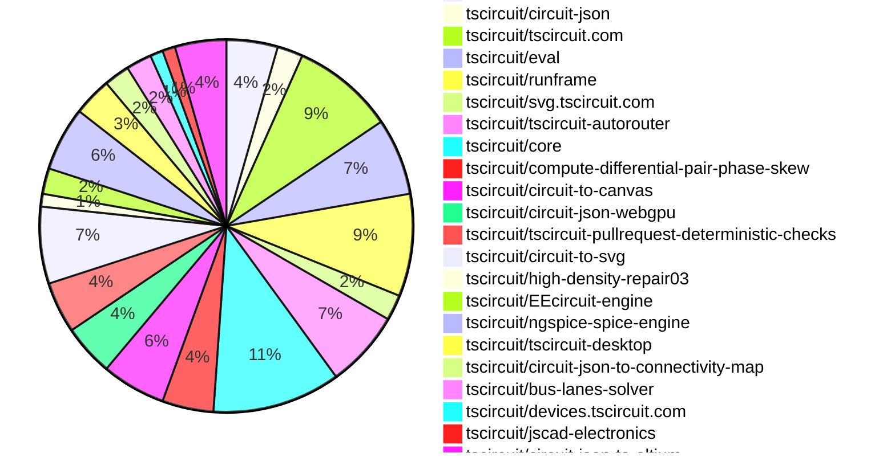

# Contribution Overview 2026-11-24

The current week is shown below. There are 3 major sections:

- [Contributor Overview](#contributor-overview)
- [PRs by Repository](#prs-by-repository)
- [PRs by Contributor](#changes-by-contributor)
- [Scoring & Sponsorship Details](/docs/sponsorship-calculation-explanation.md)

## PRs by Repository

## Contributor Overview

| Contributor | 🐳 Major | 🐙 Minor | 🐌 Tiny | Score | ⭐ |
|-------------|---------|---------|---------|-------|-----|
| [0hmX](#0hmX) | 4 | 6 | 20 | 41 | ⭐⭐ |
| [ShiboSoftwareDev](#ShiboSoftwareDev) | 5 | 5 | 9 | 40 | ⭐⭐ |
| [AnasSarkiz](#AnasSarkiz) | 3 | 1 | 1 | 16 | ⭐⭐ |
| [tscircuitbot](#tscircuitbot) | 0 | 0 | 28 | 12 | ⭐⭐ |
| [seveibar](#seveibar) | 0 | 1 | 1 | 4 | ⭐ |
| [rushabhcodes](#rushabhcodes) | 0 | 0 | 4 | 4 | ⭐ |
| [imrishabh18](#imrishabh18) | 0 | 0 | 1 | 2 |  |
| [VB-Blue](#VB-Blue) | 0 | 0 | 1 | 1 |  |

## Staff Pass Ratio (SPR)

| Contributor | Reviewed PRs | Rejections | Approvals | SPR |
|-------------|--------------|------------|-----------|-----|
| [0hmX](#0hmX) | 2 | 0 | 2 | 100.0% |
| [ShiboSoftwareDev](#ShiboSoftwareDev) | 2 | 0 | 2 | 100.0% |
| [imrishabh18](#imrishabh18) | 1 | 0 | 1 | 100.0% |

0hmX SPR PRs (2)

- [#1051](https://github.com/tscircuit/circuit-json/pull/1051) Add pcb_differential_pair_phase_skew element
- [#5886](https://github.com/tscircuit/core/pull/5886) Wait for placement and footprints before rendering teardrops

ShiboSoftwareDev SPR PRs (2)

- [#5867](https://github.com/tscircuit/core/pull/5867) fix: warn when voltage overrides peakToPeakVoltage
- [#70](https://github.com/tscircuit/circuit-json-to-connectivity-map/pull/70) Preserve intended source nets when attaching PCB references

imrishabh18 SPR PRs (1)

- [#4184](https://github.com/tscircuit/tscircuit-autorouter/pull/4184) Keep explicit-width trace pairs when routing a shared net

> Note: AI evaluates PRs and assigns 1-3 star ratings automatically. 4 and 5 star ratings require manual staff review.

## Review Table

[reviews-received-hover]: ## "Number of reviews received for PRs for this contributor"
[approvals-received-hover]: ## "Number of approvals received for PRs this contributor authored"
[rejections-received-hover]: ## "Number of rejections received for PRs this contributor authored"
[prs-opened-hover]: ## "Number of PRs opened by this contributor"
[issues-created-hover]: ## "Number of issues created by this contributor"

| Contributor | Reviews Received | Approvals Received | Rejections Received | Approvals | Rejections Given | PRs Opened | PRs Merged | Issues Created |
|---|---|---|---|---|---|---|---|---|
| [0hmX](#0hmX) | 22 | 7 | 0 | 6 | 0 | 40 | 31 | 0 |
| [Abse2001](#Abse2001) | 0 | 0 | 0 | 3 | 0 | 0 | 0 | 0 |
| [AJ0070](#AJ0070) | 0 | 0 | 0 | 0 | 0 | 4 | 0 | 0 |
| [AnasSarkiz](#AnasSarkiz) | 4 | 4 | 0 | 2 | 0 | 8 | 5 | 0 |
| [ashtygn](#ashtygn) | 0 | 0 | 0 | 0 | 0 | 4 | 0 | 0 |
| [bhatipoglu](#bhatipoglu) | 0 | 0 | 0 | 0 | 0 | 1 | 0 | 0 |
| [draarivpatel-ui](#draarivpatel-ui) | 147 | 0 | 0 | 0 | 0 | 147 | 0 | 0 |
| [houzhongyu](#houzhongyu) | 1 | 0 | 0 | 0 | 0 | 2 | 0 | 0 |
| [iisswwhh](#iisswwhh) | 0 | 0 | 0 | 0 | 0 | 5 | 0 | 0 |
| [imrishabh18](#imrishabh18) | 2 | 2 | 0 | 6 | 0 | 5 | 1 | 0 |
| [mikihirokami-maker](#mikihirokami-maker) | 0 | 0 | 0 | 0 | 0 | 1 | 0 | 0 |
| [nanemones](#nanemones) | 0 | 0 | 0 | 0 | 0 | 7 | 0 | 0 |
| [rushabhcodes](#rushabhcodes) | 7 | 3 | 0 | 0 | 0 | 15 | 4 | 0 |
| [seveibar](#seveibar) | 1 | 0 | 0 | 7 | 0 | 5 | 2 | 0 |
| [ShiboSoftwareDev](#ShiboSoftwareDev) | 12 | 11 | 0 | 4 | 0 | 38 | 20 | 0 |
| [tranhoangtu-it](#tranhoangtu-it) | 2 | 0 | 0 | 0 | 0 | 1 | 0 | 0 |
| [tscircuitbot](#tscircuitbot) | 0 | 0 | 0 | 0 | 0 | 38 | 28 | 0 |
| [VB-Blue](#VB-Blue) | 1 | 1 | 0 | 0 | 0 | 1 | 1 | 0 |
| [yaoyanweb](#yaoyanweb) | 0 | 0 | 0 | 0 | 0 | 1 | 0 | 0 |
| [zk16k123-svg](#zk16k123-svg) | 0 | 0 | 0 | 0 | 0 | 4 | 0 | 0 |

## Changes by Repository

### [tscircuit/tscircuit](https://github.com/tscircuit/tscircuit)

🐌 Tiny Contributions (4)

| PR # | Impact | Contributor | Description |
|------|--------|-------------|-------------|
| [#6636](https://github.com/tscircuit/tscircuit/pull/6636) | 🐌 Tiny | tscircuitbot | Automated package update |
| [#6635](https://github.com/tscircuit/tscircuit/pull/6635) | 🐌 Tiny | tscircuitbot | Updates the versions of tscircuitcore and tscircuiteval packages, and synchronizes the ngspice-spice-engine version. |
| [#6632](https://github.com/tscircuit/tscircuit/pull/6632) | 🐌 Tiny | tscircuitbot | Automated package update |
| [#6631](https://github.com/tscircuit/tscircuit/pull/6631) | 🐌 Tiny | tscircuitbot | Bumps tscircuitcore from 0.0.2473 to 0.0.2475 and updates tscircuitrunframe from 0.0.3333 to 0.0.3334, ensuring all package versions are verified and CI gates are met. |

### [tscircuit/circuit-json](https://github.com/tscircuit/circuit-json)

| PR # | Impact | Rating | Contributor | Description |
|------|--------|--------|-------------|-------------|
| [#1051](https://github.com/tscircuit/circuit-json/pull/1051) | 🐳 Major | ⭐⭐⭐ | 0hmX | Adds pcb_differential_pair_phase_skew element to store phase skew along routed differential pairs for accurate rendering in KiCad. |

🐌 Tiny Contributions (1)

| PR # | Impact | Contributor | Description |
|------|--------|-------------|-------------|
| [#1053](https://github.com/tscircuit/circuit-json/pull/1053) | 🐌 Tiny | tscircuitbot | Automated package update |

### [tscircuit/tscircuit.com](https://github.com/tscircuit/tscircuit.com)

🐌 Tiny Contributions (8)

| PR # | Impact | Contributor | Description |
|------|--------|-------------|-------------|
| [#6116](https://github.com/tscircuit/tscircuit.com/pull/6116) | 🐌 Tiny | tscircuitbot | Updates the tscircuitrunframe package from version 0.0.3336 to 0.0.3337 |
| [#6115](https://github.com/tscircuit/tscircuit.com/pull/6115) | 🐌 Tiny | tscircuitbot | Updates the tscircuiteval package from version 0.0.1853 to 0.0.1854 |
| [#6114](https://github.com/tscircuit/tscircuit.com/pull/6114) | 🐌 Tiny | tscircuitbot | Updates the tscircuitrunframe package from version 0.0.3335 to 0.0.3336 |
| [#6113](https://github.com/tscircuit/tscircuit.com/pull/6113) | 🐌 Tiny | tscircuitbot | Updates the tscircuitrunframe package version from 0.0.3334 to 0.0.3335 in package.json |
| [#6112](https://github.com/tscircuit/tscircuit.com/pull/6112) | 🐌 Tiny | tscircuitbot | Updates the tscircuiteval package from version 0.0.1852 to 0.0.1853 |
| [#6111](https://github.com/tscircuit/tscircuit.com/pull/6111) | 🐌 Tiny | tscircuitbot | Updates the tscircuitrunframe package version from 0.0.3333 to 0.0.3334 in package.json |
| [#6110](https://github.com/tscircuit/tscircuit.com/pull/6110) | 🐌 Tiny | tscircuitbot | Automated package update |
| [#6109](https://github.com/tscircuit/tscircuit.com/pull/6109) | 🐌 Tiny | imrishabh18 | Applies the package tab palette to the System page picker bar, native dropdown, and surrounding viewer panel for consistent theming. |

### [tscircuit/eval](https://github.com/tscircuit/eval)

🐌 Tiny Contributions (6)

| PR # | Impact | Contributor | Description |
|------|--------|-------------|-------------|
| [#6132](https://github.com/tscircuit/eval/pull/6132) | 🐌 Tiny | tscircuitbot | Automated package update |
| [#6131](https://github.com/tscircuit/eval/pull/6131) | 🐌 Tiny | tscircuitbot | Automated package update |
| [#6129](https://github.com/tscircuit/eval/pull/6129) | 🐌 Tiny | tscircuitbot | Automated package update |
| [#6128](https://github.com/tscircuit/eval/pull/6128) | 🐌 Tiny | tscircuitbot | Automated package update |
| [#6122](https://github.com/tscircuit/eval/pull/6122) | 🐌 Tiny | tscircuitbot | Automated package update |
| [#6121](https://github.com/tscircuit/eval/pull/6121) | 🐌 Tiny | ShiboSoftwareDev | Pins the tscircuitngspice-spice-engine dependency to version 0.0.28 for local simulation imports and integration tests, ensuring compatibility with recent fixes for transient resampling and TI VALUE XOR handling. |

### [tscircuit/runframe](https://github.com/tscircuit/runframe)

🐌 Tiny Contributions (8)

| PR # | Impact | Contributor | Description |
|------|--------|-------------|-------------|
| [#6525](https://github.com/tscircuit/runframe/pull/6525) | 🐌 Tiny | tscircuitbot | Automated package update |
| [#6524](https://github.com/tscircuit/runframe/pull/6524) | 🐌 Tiny | tscircuitbot | Updates the tscircuiteval package from version 0.0.1853 to 0.0.1854 in the package.json file. |
| [#6523](https://github.com/tscircuit/runframe/pull/6523) | 🐌 Tiny | tscircuitbot | Automated package update |
| [#6522](https://github.com/tscircuit/runframe/pull/6522) | 🐌 Tiny | tscircuitbot | Automated package update |
| [#6521](https://github.com/tscircuit/runframe/pull/6521) | 🐌 Tiny | tscircuitbot | Updates the tscircuiteval package from version 0.0.1852 to 0.0.1853 |
| [#6520](https://github.com/tscircuit/runframe/pull/6520) | 🐌 Tiny | tscircuitbot | Automated package update |
| [#6519](https://github.com/tscircuit/runframe/pull/6519) | 🐌 Tiny | tscircuitbot | Updates the tscircuiteval package from version 0.0.1851 to 0.0.1852 |
| [#6515](https://github.com/tscircuit/runframe/pull/6515) | 🐌 Tiny | VB-Blue | Fixes the export functionality to place Gerber and Excellon drill files directly at the root of the Fabrication Files ZIP archive instead of in a subdirectory, ensuring proper file structure for users. |

### [tscircuit/svg.tscircuit.com](https://github.com/tscircuit/svg.tscircuit.com)

🐌 Tiny Contributions (2)

| PR # | Impact | Contributor | Description |
|------|--------|-------------|-------------|
| [#3027](https://github.com/tscircuit/svg.tscircuit.com/pull/3027) | 🐌 Tiny | tscircuitbot | Updates the tscircuit package version from 0.0.3291 to 0.0.3292 in package.json |
| [#3025](https://github.com/tscircuit/svg.tscircuit.com/pull/3025) | 🐌 Tiny | tscircuitbot | Updates the tscircuit package version from 0.0.3290 to 0.0.3291 in package.json |

### [tscircuit/tscircuit-autorouter](https://github.com/tscircuit/tscircuit-autorouter)

| PR # | Impact | Rating | Contributor | Description |
|------|--------|--------|-------------|-------------|
| [#4173](https://github.com/tscircuit/tscircuit-autorouter/pull/4173) | 🐳 Major | ⭐⭐⭐ | AnasSarkiz | Fixes the A13 contact repair by allowing the via to move clear of both RAM pads, reducing DRC errors and improving clearance. |
| [#4172](https://github.com/tscircuit/tscircuit-autorouter/pull/4172) | 🐳 Major | ⭐⭐⭐ | AnasSarkiz | Fixes via-to-pad clearance violations caused by joint repair on the A13 circuit, ensuring compliance with clearance requirements. |
| [#4171](https://github.com/tscircuit/tscircuit-autorouter/pull/4171) | 🐳 Major | ⭐⭐⭐ | ShiboSoftwareDev | Selects the prepared BGA routing at the start of the existing high-density solver to improve routing efficiency and connection rates for BGA packages. |
| [#4177](https://github.com/tscircuit/tscircuit-autorouter/pull/4177) | 🐳 Major | ⭐⭐⭐ | ShiboSoftwareDev | Fixes autorouting failure for i.MX6 DDR signals by adjusting high-density routing iterations and improving connection success rates. |

🐌 Tiny Contributions (2)

| PR # | Impact | Contributor | Description |
|------|--------|-------------|-------------|
| [#4182](https://github.com/tscircuit/tscircuit-autorouter/pull/4182) | 🐌 Tiny | tscircuitbot | Automated package update |
| [#4181](https://github.com/tscircuit/tscircuit-autorouter/pull/4181) | 🐌 Tiny | tscircuitbot | Automated package update |

### [tscircuit/core](https://github.com/tscircuit/core)

| PR # | Impact | Rating | Contributor | Description |
|------|--------|--------|-------------|-------------|
| [#5879](https://github.com/tscircuit/core/pull/5879) | 🐳 Major | ⭐⭐⭐ | 0hmX | Stores phase skew records for differential pairs after routing and trace teardrops are complete, ensuring accurate rendering of phase skew in PCB designs. |
| [#5886](https://github.com/tscircuit/core/pull/5886) | 🐳 Major | ⭐⭐⭐ | 0hmX | Waits for placement checks and both footprint-loading phases before rendering teardrops, ensuring traces receive their requested teardrops after deferred routing completes. |
| [#5868](https://github.com/tscircuit/core/pull/5868) | 🐙 Minor | ⭐⭐ | AnasSarkiz | Fixes the default center of standalone boards without an explicit pcbX, pcbY, or boardAnchorPosition, correcting the emitted center and offsets for L-shaped outlines. |
| [#5867](https://github.com/tscircuit/core/pull/5867) | 🐙 Minor | ⭐⭐ | ShiboSoftwareDev | Emit a warning when both voltage and peakToPeakVoltage are set, indicating that voltage takes precedence and peakToPeakVoltage is ignored. |

🐌 Tiny Contributions (6)

| PR # | Impact | Contributor | Description |
|------|--------|-------------|-------------|
| [#5876](https://github.com/tscircuit/core/pull/5876) | 🐌 Tiny | 0hmX | Adds the phase skew library as compute-differential-pair-phase-skew, the repos new name, pinned to the librarys main at 440d441, which includes the Circuit JSON output and the package rename. Add it to noExternal so published core bundles the library. |
| [#5881](https://github.com/tscircuit/core/pull/5881) | 🐌 Tiny | 0hmX | Removes the circuit-json entry from overrides in package.json, allowing dependencies to manage their own circuit-json versions without forcing a single version across all dependencies. |
| [#5875](https://github.com/tscircuit/core/pull/5875) | 🐌 Tiny | 0hmX | Updates the circuit-json dependency to version 0.0.562 to enable core to write the released PCB phase skew element and bumps the dev pin. |
| [#5884](https://github.com/tscircuit/core/pull/5884) | 🐌 Tiny | 0hmX | Adds a two-pad TSX reproduction that includes a known-failing regression test and PCB snapshot for autorouted traces with teardrops after placement checks. |
| [#5869](https://github.com/tscircuit/core/pull/5869) | 🐌 Tiny | AnasSarkiz | Reproduces a bug where the board outline emits incorrect center coordinates, asserting known-bad behavior for testing purposes. |
| [#5891](https://github.com/tscircuit/core/pull/5891) | 🐌 Tiny | ShiboSoftwareDev | Update tscircuitngspice-spice-engine from 0.0.26 to published 0.0.28, which includes the fixes for transient resampling and TI VALUE XOR handling. This keeps cores simulation tests and the shared dependency pin on the corrected adapter. |

### [tscircuit/compute-differential-pair-phase-skew](https://github.com/tscircuit/compute-differential-pair-phase-skew)

| PR # | Impact | Rating | Contributor | Description |
|------|--------|--------|-------------|-------------|
| [#14](https://github.com/tscircuit/compute-differential-pair-phase-skew/pull/14) | 🐳 Major | ⭐⭐⭐ | 0hmX | Emit a pcb_differential_pair_phase_skew element for each measurable pair so viewers can draw the results directly. Stacked on 12. |

🐌 Tiny Contributions (3)

| PR # | Impact | Contributor | Description |
|------|--------|-------------|-------------|
| [#9](https://github.com/tscircuit/compute-differential-pair-phase-skew/pull/9) | 🐌 Tiny | 0hmX | Renames the package to compute-differential-pair-phase-skew to match the repo, updating the package.json name, repository URL, README, and tarball name in the release workflow. |
| [#12](https://github.com/tscircuit/compute-differential-pair-phase-skew/pull/12) | 🐌 Tiny | 0hmX | Raises the peer minimum version of circuit-json to 0.0.562, which includes the PCB phase skew element. |
| [#11](https://github.com/tscircuit/compute-differential-pair-phase-skew/pull/11) | 🐌 Tiny | 0hmX | Updates the circuit-json development dependency to version 0.0.562 to prepare for upcoming phase skew changes using the released PCB element schema. |

### [tscircuit/circuit-to-canvas](https://github.com/tscircuit/circuit-to-canvas)

| PR # | Impact | Rating | Contributor | Description |
|------|--------|--------|-------------|-------------|
| [#347](https://github.com/tscircuit/circuit-to-canvas/pull/347) | 🐙 Minor | ⭐⭐ | 0hmX | Adds functionality to draw differential pair phase skew on Canvas copper, allowing users to visualize phase skew in traces with color gradients based on skew measurements. |
| [#346](https://github.com/tscircuit/circuit-to-canvas/pull/346) | 🐙 Minor | ⭐⭐ | 0hmX | Adds functionality to emit differential pair phase skew measurements from the core during fixture board rendering. |
| [#345](https://github.com/tscircuit/circuit-to-canvas/pull/345) | 🐙 Minor | ⭐⭐ | 0hmX | Adds the tscircuit package as a dependency to enable runtime modules for Canvas fixtures in the Core. |

🐌 Tiny Contributions (2)

| PR # | Impact | Contributor | Description |
|------|--------|-------------|-------------|
| [#344](https://github.com/tscircuit/circuit-to-canvas/pull/344) | 🐌 Tiny | 0hmX | Updates the dependency version of format-si-unit to 0.0.12 for the TSX fixture runtime, enabling the import of formatMm. |
| [#343](https://github.com/tscircuit/circuit-to-canvas/pull/343) | 🐌 Tiny | 0hmX | Updates the circuit-json dependency to version 0.0.562 to support PCB phase-skew elements in Canvas rendering. |

### [tscircuit/circuit-json-webgpu](https://github.com/tscircuit/circuit-json-webgpu)

| PR # | Impact | Rating | Contributor | Description |
|------|--------|--------|-------------|-------------|
| [#134](https://github.com/tscircuit/circuit-json-webgpu/pull/134) | 🐙 Minor | ⭐⭐ | 0hmX | Adds functionality to visualize differential pair phase skew in WebGPU, allowing users to see trace performance variations through color gradients. |

🐌 Tiny Contributions (3)

| PR # | Impact | Contributor | Description |
|------|--------|-------------|-------------|
| [#139](https://github.com/tscircuit/circuit-json-webgpu/pull/139) | 🐌 Tiny | 0hmX | Updates the tscircuitcore dependency to version 0.0.2478 to enable TSX fixtures to emit phase-skew records. |
| [#133](https://github.com/tscircuit/circuit-json-webgpu/pull/133) | 🐌 Tiny | 0hmX | Bump the tscircuit devDependency from 0.0.3031 to 0.0.3293, addressing compatibility issues with core 0.0.2217. |
| [#132](https://github.com/tscircuit/circuit-json-webgpu/pull/132) | 🐌 Tiny | 0hmX | Updates the circuit-json dependency to version 0.0.562 to enable typing of phase skew records emitted by core. |

### [tscircuit/tscircuit-pullrequest-deterministic-checks](https://github.com/tscircuit/tscircuit-pullrequest-deterministic-checks)

| PR # | Impact | Rating | Contributor | Description |
|------|--------|--------|-------------|-------------|
| [#9](https://github.com/tscircuit/tscircuit-pullrequest-deterministic-checks/pull/9) | 🐙 Minor | ⭐⭐ | 0hmX | Adds an advisory warning for TypeScript function annotations that explicitly accept or return undefined, encouraging better handling of absence at the caller level. |
| [#8](https://github.com/tscircuit/tscircuit-pullrequest-deterministic-checks/pull/8) | 🐙 Minor | ⭐⭐ | 0hmX | Adds a blocking deterministic check to prevent new PrimitiveComponent subclasses in subcircuit inflators within the tscircuitcore target, ensuring reuse or centralization of deferred restoration work. |

🐌 Tiny Contributions (2)

| PR # | Impact | Contributor | Description |
|------|--------|-------------|-------------|
| [#7](https://github.com/tscircuit/tscircuit-pullrequest-deterministic-checks/pull/7) | 🐌 Tiny | 0hmX | Adds a warning-only schemamissing-measurement-unit rule for added TypeScript number and direct Zod number() fields in Circuit JSON, checking for numeric property names without units. |
| [#6](https://github.com/tscircuit/tscircuit-pullrequest-deterministic-checks/pull/6) | 🐌 Tiny | 0hmX | Adds schemaredeclared-shared-shape, a non-blocking check scoped to tscircuitcircuit-json that warns when a new or edited top-level TypeScript type or Zod object matches the shape of an unchanged export from srccommon |

### [tscircuit/circuit-to-svg](https://github.com/tscircuit/circuit-to-svg)

🐌 Tiny Contributions (6)

| PR # | Impact | Contributor | Description |
|------|--------|-------------|-------------|
| [#975](https://github.com/tscircuit/circuit-to-svg/pull/975) | 🐌 Tiny | 0hmX | Adds functionality to visualize differential pair phase skew in PCB SVGs by coloring skew segments based on their phase relationship, enhancing the representation of signal integrity in PCB designs. |
| [#974](https://github.com/tscircuit/circuit-to-svg/pull/974) | 🐌 Tiny | 0hmX | Adds core 0.0.2478 as a development dependency to enable the TSX fixtures to produce stored phase skew segments. |
| [#973](https://github.com/tscircuit/circuit-to-svg/pull/973) | 🐌 Tiny | 0hmX | Updates the fixture toolchain to tscircuit 0.0.3293, allowing for proper rendering of routed vias with specified dimensions and revised clearance messages. |
| [#972](https://github.com/tscircuit/circuit-to-svg/pull/972) | 🐌 Tiny | 0hmX | Update the development dependency to 0.0.562 so the renderer can use the published phase skew element types. |
| [#969](https://github.com/tscircuit/circuit-to-svg/pull/969) | 🐌 Tiny | 0hmX | Removes the differential pair phase skew overlay (showDifferentialPairPhaseSkew, phaseSkewColors) along with its dependency on circuit-json-to-differential-pair-phase-skew. |
| [#970](https://github.com/tscircuit/circuit-to-svg/pull/970) | 🐌 Tiny | 0hmX | Removes the tscircuit-phase-skew-fixtures dev dependency, which was only used for phase skew tests that are being deleted in a separate PR. |

### [tscircuit/high-density-repair03](https://github.com/tscircuit/high-density-repair03)

| PR # | Impact | Rating | Contributor | Description |
|------|--------|--------|-------------|-------------|
| [#227](https://github.com/tscircuit/high-density-repair03/pull/227) | 🐳 Major | ⭐⭐⭐ | AnasSarkiz | Modifies the via movement logic in the TraceContactRepairSolver to continue moving vias even after a same-count move, ensuring that vias can clear pads effectively during autorouting. |

### [tscircuit/EEcircuit-engine](https://github.com/tscircuit/EEcircuit-engine)

| PR # | Impact | Rating | Contributor | Description |
|------|--------|--------|-------------|-------------|
| [#14](https://github.com/tscircuit/EEcircuit-engine/pull/14) | 🐳 Major | ⭐⭐⭐ | ShiboSoftwareDev | Reduces asynchronous overhead in SPICE simulations by modifying input handling to improve performance without changing the public Simulation API or numerical solver. |

🐌 Tiny Contributions (1)

| PR # | Impact | Contributor | Description |
|------|--------|-------------|-------------|
| [#13](https://github.com/tscircuit/EEcircuit-engine/pull/13) | 🐌 Tiny | ShiboSoftwareDev | Reproduces the TPS54320 buck converter startup waveform and isolates input pauses during command execution in simulation tests. |

### [tscircuit/ngspice-spice-engine](https://github.com/tscircuit/ngspice-spice-engine)

| PR # | Impact | Rating | Contributor | Description |
|------|--------|--------|-------------|-------------|
| [#52](https://github.com/tscircuit/ngspice-spice-engine/pull/52) | 🐳 Major | ⭐⭐⭐ | ShiboSoftwareDev | Fixes the resampling cost in dense transient interpolation by implementing a binary search for timestamp interpolation, reducing the number of source timestamp reads significantly. |
| [#54](https://github.com/tscircuit/ngspice-spice-engine/pull/54) | 🐙 Minor | ⭐⭐ | ShiboSoftwareDev | Fixes incorrect output behavior in ngspice for boolean expressions using VALUE syntax, aligning with TIs XOR rule for the TPS8208485 models. |
| [#53](https://github.com/tscircuit/ngspice-spice-engine/pull/53) | 🐙 Minor | ⭐⭐ | ShiboSoftwareDev | Fixes incorrect handling of XOR logic in PSpice VALUE expressions by reproducing the issue with a comprehensive test and providing a truth table simulation. |

🐌 Tiny Contributions (2)

| PR # | Impact | Contributor | Description |
|------|--------|-------------|-------------|
| [#57](https://github.com/tscircuit/ngspice-spice-engine/pull/57) | 🐌 Tiny | ShiboSoftwareDev | Pins the EEcircuit engine runtime URL to version 1.7.9, incorporating performance fixes from the command-loop and solver callback. |
| [#51](https://github.com/tscircuit/ngspice-spice-engine/pull/51) | 🐌 Tiny | ShiboSoftwareDev | Adds a deterministic RC-response reproduction that records roughly two million timestamp reads for 2,001 output samples and captures the waveform and read count in a visual snapshot, asserting existing inefficient behavior without changing production code. |

### [tscircuit/tscircuit-desktop](https://github.com/tscircuit/tscircuit-desktop)

| PR # | Impact | Rating | Contributor | Description |
|------|--------|--------|-------------|-------------|
| [#35](https://github.com/tscircuit/tscircuit-desktop/pull/35) | 🐳 Major | ⭐⭐⭐ | ShiboSoftwareDev | Fixes the issue where saved Circuit JSON files opened as text instead of displaying the schematic and simulation view in the circuit viewer. |

🐌 Tiny Contributions (2)

| PR # | Impact | Contributor | Description |
|------|--------|-------------|-------------|
| [#34](https://github.com/tscircuit/tscircuit-desktop/pull/34) | 🐌 Tiny | ShiboSoftwareDev | Reproduces the issue where completed simulation results cannot be opened after a report edit invalidates the source reuse. |
| [#36](https://github.com/tscircuit/tscircuit-desktop/pull/36) | 🐌 Tiny | ShiboSoftwareDev | Moves Desktop-owned tests into a dedicated directory, separating them from production source code, while updating imports and CI commands accordingly. |

### [tscircuit/circuit-json-to-connectivity-map](https://github.com/tscircuit/circuit-json-to-connectivity-map)

| PR # | Impact | Rating | Contributor | Description |
|------|--------|--------|-------------|-------------|
| [#70](https://github.com/tscircuit/circuit-json-to-connectivity-map/pull/70) | 🐙 Minor | ⭐⭐ | ShiboSoftwareDev | Fixes the issue where VM and GND nets were incorrectly merged through PCB endpoints, ensuring they remain separate for accurate physical copper checks. |

🐌 Tiny Contributions (1)

| PR # | Impact | Contributor | Description |
|------|--------|-------------|-------------|
| [#69](https://github.com/tscircuit/circuit-json-to-connectivity-map/pull/69) | 🐌 Tiny | ShiboSoftwareDev | Reproduces a bug where VM and GND nets are incorrectly merged in the connectivity map, using a simplified two-component circuit sample to demonstrate the issue. |

### [tscircuit/bus-lanes-solver](https://github.com/tscircuit/bus-lanes-solver)

| PR # | Impact | Rating | Contributor | Description |
|------|--------|--------|-------------|-------------|
| [#249](https://github.com/tscircuit/bus-lanes-solver/pull/249) | 🐙 Minor | ⭐⭐ | ShiboSoftwareDev | The router could connect H616 but could not satisfy its length-matching rules. This fix uses the lengths of clocks routed earlier when tuning the other signals, and handles rules that compare signals with their groups average length. If the tuning cannot fit on one crowded trace, it tries another route or spreads the added length across traces. Clock termination branches stay connected, and the original board constraints and routing budget are preserved. |

🐌 Tiny Contributions (1)

| PR # | Impact | Contributor | Description |
|------|--------|-------------|-------------|
| [#248](https://github.com/tscircuit/bus-lanes-solver/pull/248) | 🐌 Tiny | ShiboSoftwareDev | Reproduces the real H616 control phase emitted by Core, ensuring that 28 requested control signals match clock paths already routed with 22 data signals, while maintaining unchanged geometry, timing limits, and supplied copper. |

### [tscircuit/devices.tscircuit.com](https://github.com/tscircuit/devices.tscircuit.com)

| PR # | Impact | Rating | Contributor | Description |
|------|--------|--------|-------------|-------------|
| [#4](https://github.com/tscircuit/devices.tscircuit.com/pull/4) | 🐙 Minor | ⭐⭐ | seveibar | Updates the limit-switch mounting drawing to use released CAD geometry, correcting the model height and ensuring consistent rendering across sheets. |

### [tscircuit/jscad-electronics](https://github.com/tscircuit/jscad-electronics)

🐌 Tiny Contributions (1)

| PR # | Impact | Contributor | Description |
|------|--------|-------------|-------------|
| [#519](https://github.com/tscircuit/jscad-electronics/pull/519) | 🐌 Tiny | seveibar | Implements five vendor-neutral mechanical dimensions for USB-C connectors, enhancing the rendering of the shell, cavity, and tongue based on specified measurements. |

### [tscircuit/circuit-json-to-altium](https://github.com/tscircuit/circuit-json-to-altium)

🐌 Tiny Contributions (4)

| PR # | Impact | Contributor | Description |
|------|--------|-------------|-------------|
| [#213](https://github.com/tscircuit/circuit-json-to-altium/pull/213) | 🐌 Tiny | rushabhcodes | Allocates unique filenames for schematic documents to prevent overwriting and collisions when generating files from distinct source paths. |
| [#212](https://github.com/tscircuit/circuit-json-to-altium/pull/212) | 🐌 Tiny | rushabhcodes | Fixes filename collisions that cause the NEMA17 schematic to be overwritten and ensures all schematic files are preserved during extraction. |
| [#215](https://github.com/tscircuit/circuit-json-to-altium/pull/215) | 🐌 Tiny | rushabhcodes | Reserves declared and allocated PCB net names to ensure uniqueness, preventing naming collisions during net generation. |
| [#214](https://github.com/tscircuit/circuit-json-to-altium/pull/214) | 🐌 Tiny | rushabhcodes | Fixes duplicate naming of distinct nets on the NEMA17 board during export, ensuring unique net names in the output. |

## Changes by Contributor

### [tscircuitbot](https://github.com/tscircuitbot)

🐌 Tiny Contributions (28)

| PR # | Impact | Description |
|------|--------|-------------|
| [#6636](https://github.com/tscircuit/tscircuit/pull/6636) | 🐌 Tiny | Automated package update |
| [#6635](https://github.com/tscircuit/tscircuit/pull/6635) | 🐌 Tiny | Updates the versions of tscircuitcore and tscircuiteval packages, and synchronizes the ngspice-spice-engine version. |
| [#6632](https://github.com/tscircuit/tscircuit/pull/6632) | 🐌 Tiny | Automated package update |
| [#6631](https://github.com/tscircuit/tscircuit/pull/6631) | 🐌 Tiny | Bumps tscircuitcore from 0.0.2473 to 0.0.2475 and updates tscircuitrunframe from 0.0.3333 to 0.0.3334, ensuring all package versions are verified and CI gates are met. |
| [#1053](https://github.com/tscircuit/circuit-json/pull/1053) | 🐌 Tiny | Automated package update |
| [#6116](https://github.com/tscircuit/tscircuit.com/pull/6116) | 🐌 Tiny | Updates the tscircuitrunframe package from version 0.0.3336 to 0.0.3337 |
| [#6115](https://github.com/tscircuit/tscircuit.com/pull/6115) | 🐌 Tiny | Updates the tscircuiteval package from version 0.0.1853 to 0.0.1854 |
| [#6114](https://github.com/tscircuit/tscircuit.com/pull/6114) | 🐌 Tiny | Updates the tscircuitrunframe package from version 0.0.3335 to 0.0.3336 |
| [#6113](https://github.com/tscircuit/tscircuit.com/pull/6113) | 🐌 Tiny | Updates the tscircuitrunframe package version from 0.0.3334 to 0.0.3335 in package.json |
| [#6112](https://github.com/tscircuit/tscircuit.com/pull/6112) | 🐌 Tiny | Updates the tscircuiteval package from version 0.0.1852 to 0.0.1853 |
| [#6111](https://github.com/tscircuit/tscircuit.com/pull/6111) | 🐌 Tiny | Updates the tscircuitrunframe package version from 0.0.3333 to 0.0.3334 in package.json |
| [#6110](https://github.com/tscircuit/tscircuit.com/pull/6110) | 🐌 Tiny | Automated package update |
| [#6132](https://github.com/tscircuit/eval/pull/6132) | 🐌 Tiny | Automated package update |
| [#6131](https://github.com/tscircuit/eval/pull/6131) | 🐌 Tiny | Automated package update |
| [#6129](https://github.com/tscircuit/eval/pull/6129) | 🐌 Tiny | Automated package update |
| [#6128](https://github.com/tscircuit/eval/pull/6128) | 🐌 Tiny | Automated package update |
| [#6122](https://github.com/tscircuit/eval/pull/6122) | 🐌 Tiny | Automated package update |
| [#6525](https://github.com/tscircuit/runframe/pull/6525) | 🐌 Tiny | Automated package update |
| [#6524](https://github.com/tscircuit/runframe/pull/6524) | 🐌 Tiny | Updates the tscircuiteval package from version 0.0.1853 to 0.0.1854 in the package.json file. |
| [#6523](https://github.com/tscircuit/runframe/pull/6523) | 🐌 Tiny | Automated package update |
| [#6522](https://github.com/tscircuit/runframe/pull/6522) | 🐌 Tiny | Automated package update |
| [#6521](https://github.com/tscircuit/runframe/pull/6521) | 🐌 Tiny | Updates the tscircuiteval package from version 0.0.1852 to 0.0.1853 |
| [#6520](https://github.com/tscircuit/runframe/pull/6520) | 🐌 Tiny | Automated package update |
| [#6519](https://github.com/tscircuit/runframe/pull/6519) | 🐌 Tiny | Updates the tscircuiteval package from version 0.0.1851 to 0.0.1852 |
| [#3027](https://github.com/tscircuit/svg.tscircuit.com/pull/3027) | 🐌 Tiny | Updates the tscircuit package version from 0.0.3291 to 0.0.3292 in package.json |
| [#3025](https://github.com/tscircuit/svg.tscircuit.com/pull/3025) | 🐌 Tiny | Updates the tscircuit package version from 0.0.3290 to 0.0.3291 in package.json |
| [#4182](https://github.com/tscircuit/tscircuit-autorouter/pull/4182) | 🐌 Tiny | Automated package update |
| [#4181](https://github.com/tscircuit/tscircuit-autorouter/pull/4181) | 🐌 Tiny | Automated package update |

### [0hmX](https://github.com/0hmX)

| PRs # | Impact | Rating | Description |
|------|--------|--------|-------------|
| [#1051](https://github.com/tscircuit/circuit-json/pull/1051) | 🐳 Major | ⭐⭐⭐ | Adds pcb_differential_pair_phase_skew element to store phase skew along routed differential pairs for accurate rendering in KiCad. |
| [#5879](https://github.com/tscircuit/core/pull/5879) | 🐳 Major | ⭐⭐⭐ | Stores phase skew records for differential pairs after routing and trace teardrops are complete, ensuring accurate rendering of phase skew in PCB designs. |
| [#5886](https://github.com/tscircuit/core/pull/5886) | 🐳 Major | ⭐⭐⭐ | Waits for placement checks and both footprint-loading phases before rendering teardrops, ensuring traces receive their requested teardrops after deferred routing completes. |
| [#14](https://github.com/tscircuit/compute-differential-pair-phase-skew/pull/14) | 🐳 Major | ⭐⭐⭐ | Emit a pcb_differential_pair_phase_skew element for each measurable pair so viewers can draw the results directly. Stacked on 12. |
| [#347](https://github.com/tscircuit/circuit-to-canvas/pull/347) | 🐙 Minor | ⭐⭐ | Adds functionality to draw differential pair phase skew on Canvas copper, allowing users to visualize phase skew in traces with color gradients based on skew measurements. |
| [#346](https://github.com/tscircuit/circuit-to-canvas/pull/346) | 🐙 Minor | ⭐⭐ | Adds functionality to emit differential pair phase skew measurements from the core during fixture board rendering. |
| [#345](https://github.com/tscircuit/circuit-to-canvas/pull/345) | 🐙 Minor | ⭐⭐ | Adds the tscircuit package as a dependency to enable runtime modules for Canvas fixtures in the Core. |
| [#134](https://github.com/tscircuit/circuit-json-webgpu/pull/134) | 🐙 Minor | ⭐⭐ | Adds functionality to visualize differential pair phase skew in WebGPU, allowing users to see trace performance variations through color gradients. |
| [#9](https://github.com/tscircuit/tscircuit-pullrequest-deterministic-checks/pull/9) | 🐙 Minor | ⭐⭐ | Adds an advisory warning for TypeScript function annotations that explicitly accept or return undefined, encouraging better handling of absence at the caller level. |
| [#8](https://github.com/tscircuit/tscircuit-pullrequest-deterministic-checks/pull/8) | 🐙 Minor | ⭐⭐ | Adds a blocking deterministic check to prevent new PrimitiveComponent subclasses in subcircuit inflators within the tscircuitcore target, ensuring reuse or centralization of deferred restoration work. |

🐌 Tiny Contributions (20)

| PR # | Impact | Description |
|------|--------|-------------|
| [#5876](https://github.com/tscircuit/core/pull/5876) | 🐌 Tiny | Adds the phase skew library as compute-differential-pair-phase-skew, the repos new name, pinned to the librarys main at 440d441, which includes the Circuit JSON output and the package rename. Add it to noExternal so published core bundles the library. |
| [#5881](https://github.com/tscircuit/core/pull/5881) | 🐌 Tiny | Removes the circuit-json entry from overrides in package.json, allowing dependencies to manage their own circuit-json versions without forcing a single version across all dependencies. |
| [#5875](https://github.com/tscircuit/core/pull/5875) | 🐌 Tiny | Updates the circuit-json dependency to version 0.0.562 to enable core to write the released PCB phase skew element and bumps the dev pin. |
| [#5884](https://github.com/tscircuit/core/pull/5884) | 🐌 Tiny | Adds a two-pad TSX reproduction that includes a known-failing regression test and PCB snapshot for autorouted traces with teardrops after placement checks. |
| [#975](https://github.com/tscircuit/circuit-to-svg/pull/975) | 🐌 Tiny | Adds functionality to visualize differential pair phase skew in PCB SVGs by coloring skew segments based on their phase relationship, enhancing the representation of signal integrity in PCB designs. |
| [#974](https://github.com/tscircuit/circuit-to-svg/pull/974) | 🐌 Tiny | Adds core 0.0.2478 as a development dependency to enable the TSX fixtures to produce stored phase skew segments. |
| [#973](https://github.com/tscircuit/circuit-to-svg/pull/973) | 🐌 Tiny | Updates the fixture toolchain to tscircuit 0.0.3293, allowing for proper rendering of routed vias with specified dimensions and revised clearance messages. |
| [#972](https://github.com/tscircuit/circuit-to-svg/pull/972) | 🐌 Tiny | Update the development dependency to 0.0.562 so the renderer can use the published phase skew element types. |
| [#969](https://github.com/tscircuit/circuit-to-svg/pull/969) | 🐌 Tiny | Removes the differential pair phase skew overlay (showDifferentialPairPhaseSkew, phaseSkewColors) along with its dependency on circuit-json-to-differential-pair-phase-skew. |
| [#970](https://github.com/tscircuit/circuit-to-svg/pull/970) | 🐌 Tiny | Removes the tscircuit-phase-skew-fixtures dev dependency, which was only used for phase skew tests that are being deleted in a separate PR. |
| [#344](https://github.com/tscircuit/circuit-to-canvas/pull/344) | 🐌 Tiny | Updates the dependency version of format-si-unit to 0.0.12 for the TSX fixture runtime, enabling the import of formatMm. |
| [#343](https://github.com/tscircuit/circuit-to-canvas/pull/343) | 🐌 Tiny | Updates the circuit-json dependency to version 0.0.562 to support PCB phase-skew elements in Canvas rendering. |
| [#139](https://github.com/tscircuit/circuit-json-webgpu/pull/139) | 🐌 Tiny | Updates the tscircuitcore dependency to version 0.0.2478 to enable TSX fixtures to emit phase-skew records. |
| [#133](https://github.com/tscircuit/circuit-json-webgpu/pull/133) | 🐌 Tiny | Bump the tscircuit devDependency from 0.0.3031 to 0.0.3293, addressing compatibility issues with core 0.0.2217. |
| [#132](https://github.com/tscircuit/circuit-json-webgpu/pull/132) | 🐌 Tiny | Updates the circuit-json dependency to version 0.0.562 to enable typing of phase skew records emitted by core. |
| [#9](https://github.com/tscircuit/compute-differential-pair-phase-skew/pull/9) | 🐌 Tiny | Renames the package to compute-differential-pair-phase-skew to match the repo, updating the package.json name, repository URL, README, and tarball name in the release workflow. |
| [#12](https://github.com/tscircuit/compute-differential-pair-phase-skew/pull/12) | 🐌 Tiny | Raises the peer minimum version of circuit-json to 0.0.562, which includes the PCB phase skew element. |
| [#11](https://github.com/tscircuit/compute-differential-pair-phase-skew/pull/11) | 🐌 Tiny | Updates the circuit-json development dependency to version 0.0.562 to prepare for upcoming phase skew changes using the released PCB element schema. |
| [#7](https://github.com/tscircuit/tscircuit-pullrequest-deterministic-checks/pull/7) | 🐌 Tiny | Adds a warning-only schemamissing-measurement-unit rule for added TypeScript number and direct Zod number() fields in Circuit JSON, checking for numeric property names without units. |
| [#6](https://github.com/tscircuit/tscircuit-pullrequest-deterministic-checks/pull/6) | 🐌 Tiny | Adds schemaredeclared-shared-shape, a non-blocking check scoped to tscircuitcircuit-json that warns when a new or edited top-level TypeScript type or Zod object matches the shape of an unchanged export from srccommon |

### [AnasSarkiz](https://github.com/AnasSarkiz)

| PRs # | Impact | Rating | Description |
|------|--------|--------|-------------|
| [#4173](https://github.com/tscircuit/tscircuit-autorouter/pull/4173) | 🐳 Major | ⭐⭐⭐ | Fixes the A13 contact repair by allowing the via to move clear of both RAM pads, reducing DRC errors and improving clearance. |
| [#4172](https://github.com/tscircuit/tscircuit-autorouter/pull/4172) | 🐳 Major | ⭐⭐⭐ | Fixes via-to-pad clearance violations caused by joint repair on the A13 circuit, ensuring compliance with clearance requirements. |
| [#227](https://github.com/tscircuit/high-density-repair03/pull/227) | 🐳 Major | ⭐⭐⭐ | Modifies the via movement logic in the TraceContactRepairSolver to continue moving vias even after a same-count move, ensuring that vias can clear pads effectively during autorouting. |
| [#5868](https://github.com/tscircuit/core/pull/5868) | 🐙 Minor | ⭐⭐ | Fixes the default center of standalone boards without an explicit pcbX, pcbY, or boardAnchorPosition, correcting the emitted center and offsets for L-shaped outlines. |

🐌 Tiny Contributions (1)

| PR # | Impact | Description |
|------|--------|-------------|
| [#5869](https://github.com/tscircuit/core/pull/5869) | 🐌 Tiny | Reproduces a bug where the board outline emits incorrect center coordinates, asserting known-bad behavior for testing purposes. |

### [ShiboSoftwareDev](https://github.com/ShiboSoftwareDev)

| PRs # | Impact | Rating | Description |
|------|--------|--------|-------------|
| [#4171](https://github.com/tscircuit/tscircuit-autorouter/pull/4171) | 🐳 Major | ⭐⭐⭐ | Selects the prepared BGA routing at the start of the existing high-density solver to improve routing efficiency and connection rates for BGA packages. |
| [#4177](https://github.com/tscircuit/tscircuit-autorouter/pull/4177) | 🐳 Major | ⭐⭐⭐ | Fixes autorouting failure for i.MX6 DDR signals by adjusting high-density routing iterations and improving connection success rates. |
| [#14](https://github.com/tscircuit/EEcircuit-engine/pull/14) | 🐳 Major | ⭐⭐⭐ | Reduces asynchronous overhead in SPICE simulations by modifying input handling to improve performance without changing the public Simulation API or numerical solver. |
| [#52](https://github.com/tscircuit/ngspice-spice-engine/pull/52) | 🐳 Major | ⭐⭐⭐ | Fixes the resampling cost in dense transient interpolation by implementing a binary search for timestamp interpolation, reducing the number of source timestamp reads significantly. |
| [#35](https://github.com/tscircuit/tscircuit-desktop/pull/35) | 🐳 Major | ⭐⭐⭐ | Fixes the issue where saved Circuit JSON files opened as text instead of displaying the schematic and simulation view in the circuit viewer. |
| [#5867](https://github.com/tscircuit/core/pull/5867) | 🐙 Minor | ⭐⭐ | Emit a warning when both voltage and peakToPeakVoltage are set, indicating that voltage takes precedence and peakToPeakVoltage is ignored. |
| [#70](https://github.com/tscircuit/circuit-json-to-connectivity-map/pull/70) | 🐙 Minor | ⭐⭐ | Fixes the issue where VM and GND nets were incorrectly merged through PCB endpoints, ensuring they remain separate for accurate physical copper checks. |
| [#54](https://github.com/tscircuit/ngspice-spice-engine/pull/54) | 🐙 Minor | ⭐⭐ | Fixes incorrect output behavior in ngspice for boolean expressions using VALUE syntax, aligning with TIs XOR rule for the TPS8208485 models. |
| [#53](https://github.com/tscircuit/ngspice-spice-engine/pull/53) | 🐙 Minor | ⭐⭐ | Fixes incorrect handling of XOR logic in PSpice VALUE expressions by reproducing the issue with a comprehensive test and providing a truth table simulation. |
| [#249](https://github.com/tscircuit/bus-lanes-solver/pull/249) | 🐙 Minor | ⭐⭐ | The router could connect H616 but could not satisfy its length-matching rules. This fix uses the lengths of clocks routed earlier when tuning the other signals, and handles rules that compare signals with their groups average length. If the tuning cannot fit on one crowded trace, it tries another route or spreads the added length across traces. Clock termination branches stay connected, and the original board constraints and routing budget are preserved. |

🐌 Tiny Contributions (9)

| PR # | Impact | Description |
|------|--------|-------------|
| [#5891](https://github.com/tscircuit/core/pull/5891) | 🐌 Tiny | Update tscircuitngspice-spice-engine from 0.0.26 to published 0.0.28, which includes the fixes for transient resampling and TI VALUE XOR handling. This keeps cores simulation tests and the shared dependency pin on the corrected adapter. |
| [#69](https://github.com/tscircuit/circuit-json-to-connectivity-map/pull/69) | 🐌 Tiny | Reproduces a bug where VM and GND nets are incorrectly merged in the connectivity map, using a simplified two-component circuit sample to demonstrate the issue. |
| [#6121](https://github.com/tscircuit/eval/pull/6121) | 🐌 Tiny | Pins the tscircuitngspice-spice-engine dependency to version 0.0.28 for local simulation imports and integration tests, ensuring compatibility with recent fixes for transient resampling and TI VALUE XOR handling. |
| [#13](https://github.com/tscircuit/EEcircuit-engine/pull/13) | 🐌 Tiny | Reproduces the TPS54320 buck converter startup waveform and isolates input pauses during command execution in simulation tests. |
| [#57](https://github.com/tscircuit/ngspice-spice-engine/pull/57) | 🐌 Tiny | Pins the EEcircuit engine runtime URL to version 1.7.9, incorporating performance fixes from the command-loop and solver callback. |
| [#51](https://github.com/tscircuit/ngspice-spice-engine/pull/51) | 🐌 Tiny | Adds a deterministic RC-response reproduction that records roughly two million timestamp reads for 2,001 output samples and captures the waveform and read count in a visual snapshot, asserting existing inefficient behavior without changing production code. |
| [#248](https://github.com/tscircuit/bus-lanes-solver/pull/248) | 🐌 Tiny | Reproduces the real H616 control phase emitted by Core, ensuring that 28 requested control signals match clock paths already routed with 22 data signals, while maintaining unchanged geometry, timing limits, and supplied copper. |
| [#34](https://github.com/tscircuit/tscircuit-desktop/pull/34) | 🐌 Tiny | Reproduces the issue where completed simulation results cannot be opened after a report edit invalidates the source reuse. |
| [#36](https://github.com/tscircuit/tscircuit-desktop/pull/36) | 🐌 Tiny | Moves Desktop-owned tests into a dedicated directory, separating them from production source code, while updating imports and CI commands accordingly. |

### [seveibar](https://github.com/seveibar)

| PRs # | Impact | Rating | Description |
|------|--------|--------|-------------|
| [#4](https://github.com/tscircuit/devices.tscircuit.com/pull/4) | 🐙 Minor | ⭐⭐ | Updates the limit-switch mounting drawing to use released CAD geometry, correcting the model height and ensuring consistent rendering across sheets. |

🐌 Tiny Contributions (1)

| PR # | Impact | Description |
|------|--------|-------------|
| [#519](https://github.com/tscircuit/jscad-electronics/pull/519) | 🐌 Tiny | Implements five vendor-neutral mechanical dimensions for USB-C connectors, enhancing the rendering of the shell, cavity, and tongue based on specified measurements. |

### [imrishabh18](https://github.com/imrishabh18)

🐌 Tiny Contributions (1)

| PR # | Impact | Description |
|------|--------|-------------|
| [#6109](https://github.com/tscircuit/tscircuit.com/pull/6109) | 🐌 Tiny | Applies the package tab palette to the System page picker bar, native dropdown, and surrounding viewer panel for consistent theming. |

### [VB-Blue](https://github.com/VB-Blue)

🐌 Tiny Contributions (1)

| PR # | Impact | Description |
|------|--------|-------------|
| [#6515](https://github.com/tscircuit/runframe/pull/6515) | 🐌 Tiny | Fixes the export functionality to place Gerber and Excellon drill files directly at the root of the Fabrication Files ZIP archive instead of in a subdirectory, ensuring proper file structure for users. |

### [rushabhcodes](https://github.com/rushabhcodes)

🐌 Tiny Contributions (4)

| PR # | Impact | Description |
|------|--------|-------------|
| [#213](https://github.com/tscircuit/circuit-json-to-altium/pull/213) | 🐌 Tiny | Allocates unique filenames for schematic documents to prevent overwriting and collisions when generating files from distinct source paths. |
| [#212](https://github.com/tscircuit/circuit-json-to-altium/pull/212) | 🐌 Tiny | Fixes filename collisions that cause the NEMA17 schematic to be overwritten and ensures all schematic files are preserved during extraction. |
| [#215](https://github.com/tscircuit/circuit-json-to-altium/pull/215) | 🐌 Tiny | Reserves declared and allocated PCB net names to ensure uniqueness, preventing naming collisions during net generation. |
| [#214](https://github.com/tscircuit/circuit-json-to-altium/pull/214) | 🐌 Tiny | Fixes duplicate naming of distinct nets on the NEMA17 board during export, ensuring unique net names in the output. |

## Repository Owners

| Repository | Codeowners |
|------------|------------|
| [builder](https://github.com/tscircuit/builder/blob/main/.github/CODEOWNERS) | [seveibar](https://github.com/seveibar)
| [pcb-viewer](https://github.com/tscircuit/pcb-viewer/blob/main/.github/CODEOWNERS) | [seveibar](https://github.com/seveibar), [ShiboSoftwareDev](https://github.com/ShiboSoftwareDev), [Abse2001](https://github.com/Abse2001)
| [footprints-old](https://github.com/tscircuit/footprints-old/blob/main/.github/CODEOWNERS) | [seveibar](https://github.com/seveibar)
| [footprinter](https://github.com/tscircuit/footprinter/blob/main/.github/CODEOWNERS) | [seveibar](https://github.com/seveibar), [techmannih](https://github.com/techmannih)
| [3d-viewer](https://github.com/tscircuit/3d-viewer/blob/main/.github/CODEOWNERS) | [ShiboSoftwareDev](https://github.com/ShiboSoftwareDev), [Abse2001](https://github.com/Abse2001)
| [winterspec](https://github.com/tscircuit/winterspec/blob/main/.github/CODEOWNERS) | [seveibar](https://github.com/seveibar), [ShiboSoftwareDev](https://github.com/ShiboSoftwareDev)
| [jscad-electronics](https://github.com/tscircuit/jscad-electronics/blob/main/.github/CODEOWNERS) | [seveibar](https://github.com/seveibar), [techmannih](https://github.com/techmannih), [ShiboSoftwareDev](https://github.com/ShiboSoftwareDev), [anas-sarkez](https://github.com/anas-sarkez)
| [circuit-to-svg](https://github.com/tscircuit/circuit-to-svg/blob/main/.github/CODEOWNERS) | [imrishabh18](https://github.com/imrishabh18)
| [schematic-symbols](https://github.com/tscircuit/schematic-symbols/blob/main/.github/CODEOWNERS) | [seveibar](https://github.com/seveibar), [imrishabh18](https://github.com/imrishabh18), [techmannih](https://github.com/techmannih)
| [circuit-json-to-gerber](https://github.com/tscircuit/circuit-json-to-gerber/blob/main/.github/CODEOWNERS) | [seveibar](https://github.com/seveibar), [ShiboSoftwareDev](https://github.com/ShiboSoftwareDev)
| [tscircuit.com](https://github.com/tscircuit/tscircuit.com/blob/main/.github/CODEOWNERS) | [seveibar](https://github.com/seveibar), [imrishabh18](https://github.com/imrishabh18)
| [issue-roulette](https://github.com/tscircuit/issue-roulette/blob/main/.github/CODEOWNERS) | [Anshgrover23](https://github.com/Anshgrover23)
| [tscircuit-autorouter](https://github.com/tscircuit/tscircuit-autorouter/blob/main/.github/CODEOWNERS) | [ShiboSoftwareDev](https://github.com/ShiboSoftwareDev), [0hmX](https://github.com/0hmX), [seveibar](https://github.com/seveibar)
| [schematic-corpus](https://github.com/tscircuit/schematic-corpus/blob/main/.github/CODEOWNERS) | [Abse2001](https://github.com/Abse2001)
| [copper-pour-solver](https://github.com/tscircuit/copper-pour-solver/blob/main/.github/CODEOWNERS) | [seveibar](https://github.com/seveibar), [ShiboSoftwareDev](https://github.com/ShiboSoftwareDev)
| [common](https://github.com/tscircuit/common/blob/main/.github/CODEOWNERS) | [seveibar](https://github.com/seveibar), [Abse2001](https://github.com/Abse2001)
| [circuit-json-to-kicad](https://github.com/tscircuit/circuit-json-to-kicad/blob/main/.github/CODEOWNERS) | [mustafamulla29](https://github.com/mustafamulla29), [ShiboSoftwareDev](https://github.com/ShiboSoftwareDev)
| [circuit-to-canvas](https://github.com/tscircuit/circuit-to-canvas/blob/main/.github/CODEOWNERS) | [ShiboSoftwareDev](https://github.com/ShiboSoftwareDev), [Abse2001](https://github.com/Abse2001), [techmannih](https://github.com/techmannih)
| [circuit-json-to-lbrn](https://github.com/tscircuit/circuit-json-to-lbrn/blob/main/.github/CODEOWNERS) | [AnasSarkiz](https://github.com/AnasSarkiz)
| [pcbburn.com](https://github.com/tscircuit/pcbburn.com/blob/main/.github/CODEOWNERS) | [AnasSarkiz](https://github.com/AnasSarkiz)
| [high-density-repair03](https://github.com/tscircuit/high-density-repair03/blob/main/.github/CODEOWNERS) | [Abse2001](https://github.com/Abse2001)
| [fabrication-operator-ui](https://github.com/tscircuit/fabrication-operator-ui/blob/main/.github/CODEOWNERS) | [AnasSarkiz](https://github.com/AnasSarkiz)
| [layerweaver](https://github.com/tscircuit/layerweaver/blob/main/.github/CODEOWNERS) | [0hmx](https://github.com/0hmx)
| [compute-differential-pair-phase-skew](https://github.com/tscircuit/compute-differential-pair-phase-skew/blob/main/.github/CODEOWNERS) | [0hmX](https://github.com/0hmX)

## Repositories by Owner

| User | Repo |
|------|------|
| [seveibar](https://github.com/seveibar) | [builder](https://github.com/tscircuit/builder/blob/main/.github/CODEOWNERS) |
|  | [pcb-viewer](https://github.com/tscircuit/pcb-viewer/blob/main/.github/CODEOWNERS) |
|  | [footprints-old](https://github.com/tscircuit/footprints-old/blob/main/.github/CODEOWNERS) |
|  | [footprinter](https://github.com/tscircuit/footprinter/blob/main/.github/CODEOWNERS) |
|  | [winterspec](https://github.com/tscircuit/winterspec/blob/main/.github/CODEOWNERS) |
|  | [jscad-electronics](https://github.com/tscircuit/jscad-electronics/blob/main/.github/CODEOWNERS) |
|  | [schematic-symbols](https://github.com/tscircuit/schematic-symbols/blob/main/.github/CODEOWNERS) |
|  | [circuit-json-to-gerber](https://github.com/tscircuit/circuit-json-to-gerber/blob/main/.github/CODEOWNERS) |
|  | [tscircuit.com](https://github.com/tscircuit/tscircuit.com/blob/main/.github/CODEOWNERS) |
|  | [tscircuit-autorouter](https://github.com/tscircuit/tscircuit-autorouter/blob/main/.github/CODEOWNERS) |
|  | [copper-pour-solver](https://github.com/tscircuit/copper-pour-solver/blob/main/.github/CODEOWNERS) |
|  | [common](https://github.com/tscircuit/common/blob/main/.github/CODEOWNERS) |
| [ShiboSoftwareDev](https://github.com/ShiboSoftwareDev) | [pcb-viewer](https://github.com/tscircuit/pcb-viewer/blob/main/.github/CODEOWNERS) |
|  | [3d-viewer](https://github.com/tscircuit/3d-viewer/blob/main/.github/CODEOWNERS) |
|  | [winterspec](https://github.com/tscircuit/winterspec/blob/main/.github/CODEOWNERS) |
|  | [jscad-electronics](https://github.com/tscircuit/jscad-electronics/blob/main/.github/CODEOWNERS) |
|  | [circuit-json-to-gerber](https://github.com/tscircuit/circuit-json-to-gerber/blob/main/.github/CODEOWNERS) |
|  | [tscircuit-autorouter](https://github.com/tscircuit/tscircuit-autorouter/blob/main/.github/CODEOWNERS) |
|  | [copper-pour-solver](https://github.com/tscircuit/copper-pour-solver/blob/main/.github/CODEOWNERS) |
|  | [circuit-json-to-kicad](https://github.com/tscircuit/circuit-json-to-kicad/blob/main/.github/CODEOWNERS) |
|  | [circuit-to-canvas](https://github.com/tscircuit/circuit-to-canvas/blob/main/.github/CODEOWNERS) |
| [Abse2001](https://github.com/Abse2001) | [pcb-viewer](https://github.com/tscircuit/pcb-viewer/blob/main/.github/CODEOWNERS) |
|  | [3d-viewer](https://github.com/tscircuit/3d-viewer/blob/main/.github/CODEOWNERS) |
|  | [schematic-corpus](https://github.com/tscircuit/schematic-corpus/blob/main/.github/CODEOWNERS) |
|  | [common](https://github.com/tscircuit/common/blob/main/.github/CODEOWNERS) |
|  | [circuit-to-canvas](https://github.com/tscircuit/circuit-to-canvas/blob/main/.github/CODEOWNERS) |
|  | [high-density-repair03](https://github.com/tscircuit/high-density-repair03/blob/main/.github/CODEOWNERS) |
| [techmannih](https://github.com/techmannih) | [footprinter](https://github.com/tscircuit/footprinter/blob/main/.github/CODEOWNERS) |
|  | [jscad-electronics](https://github.com/tscircuit/jscad-electronics/blob/main/.github/CODEOWNERS) |
|  | [schematic-symbols](https://github.com/tscircuit/schematic-symbols/blob/main/.github/CODEOWNERS) |
|  | [circuit-to-canvas](https://github.com/tscircuit/circuit-to-canvas/blob/main/.github/CODEOWNERS) |
| [anas-sarkez](https://github.com/anas-sarkez) | [jscad-electronics](https://github.com/tscircuit/jscad-electronics/blob/main/.github/CODEOWNERS) |
| [imrishabh18](https://github.com/imrishabh18) | [circuit-to-svg](https://github.com/tscircuit/circuit-to-svg/blob/main/.github/CODEOWNERS) |
|  | [schematic-symbols](https://github.com/tscircuit/schematic-symbols/blob/main/.github/CODEOWNERS) |
|  | [tscircuit.com](https://github.com/tscircuit/tscircuit.com/blob/main/.github/CODEOWNERS) |
| [Anshgrover23](https://github.com/Anshgrover23) | [issue-roulette](https://github.com/tscircuit/issue-roulette/blob/main/.github/CODEOWNERS) |
| [0hmX](https://github.com/0hmX) | [tscircuit-autorouter](https://github.com/tscircuit/tscircuit-autorouter/blob/main/.github/CODEOWNERS) |
|  | [compute-differential-pair-phase-skew](https://github.com/tscircuit/compute-differential-pair-phase-skew/blob/main/.github/CODEOWNERS) |
| [mustafamulla29](https://github.com/mustafamulla29) | [circuit-json-to-kicad](https://github.com/tscircuit/circuit-json-to-kicad/blob/main/.github/CODEOWNERS) |
| [AnasSarkiz](https://github.com/AnasSarkiz) | [circuit-json-to-lbrn](https://github.com/tscircuit/circuit-json-to-lbrn/blob/main/.github/CODEOWNERS) |
|  | [pcbburn.com](https://github.com/tscircuit/pcbburn.com/blob/main/.github/CODEOWNERS) |
|  | [fabrication-operator-ui](https://github.com/tscircuit/fabrication-operator-ui/blob/main/.github/CODEOWNERS) |
| [0hmx](https://github.com/0hmx) | [layerweaver](https://github.com/tscircuit/layerweaver/blob/main/.github/CODEOWNERS) |

